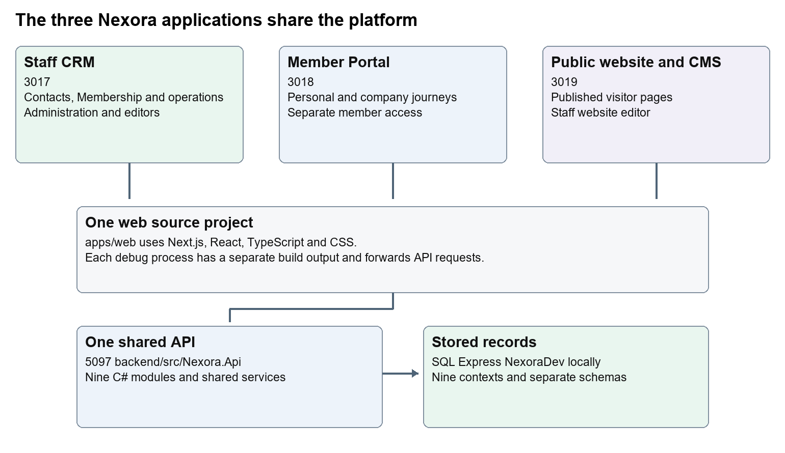
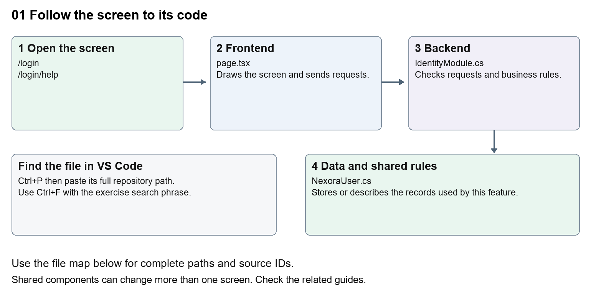
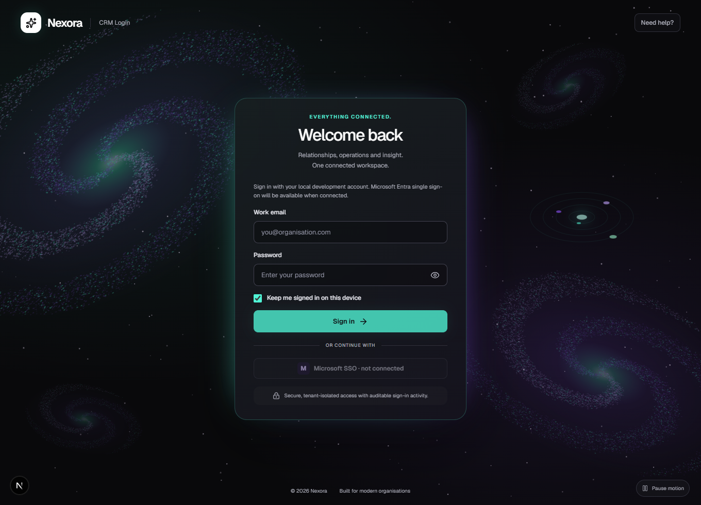
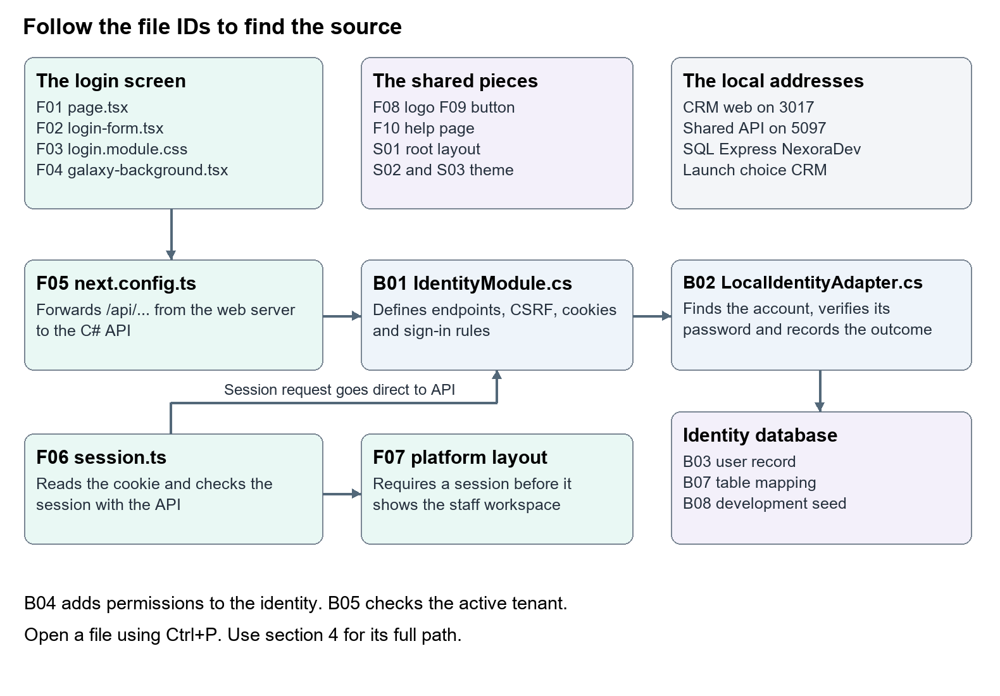
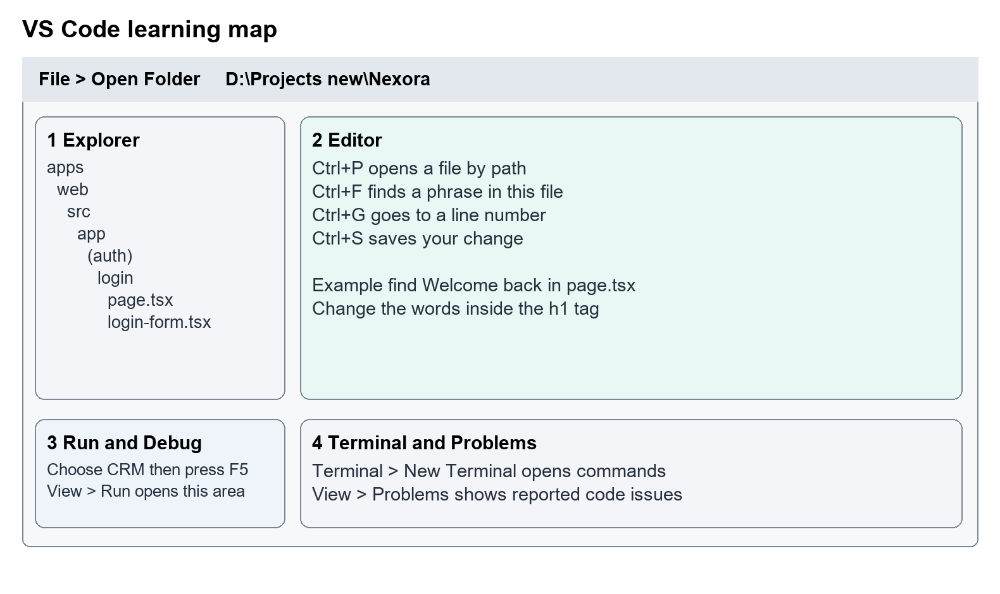
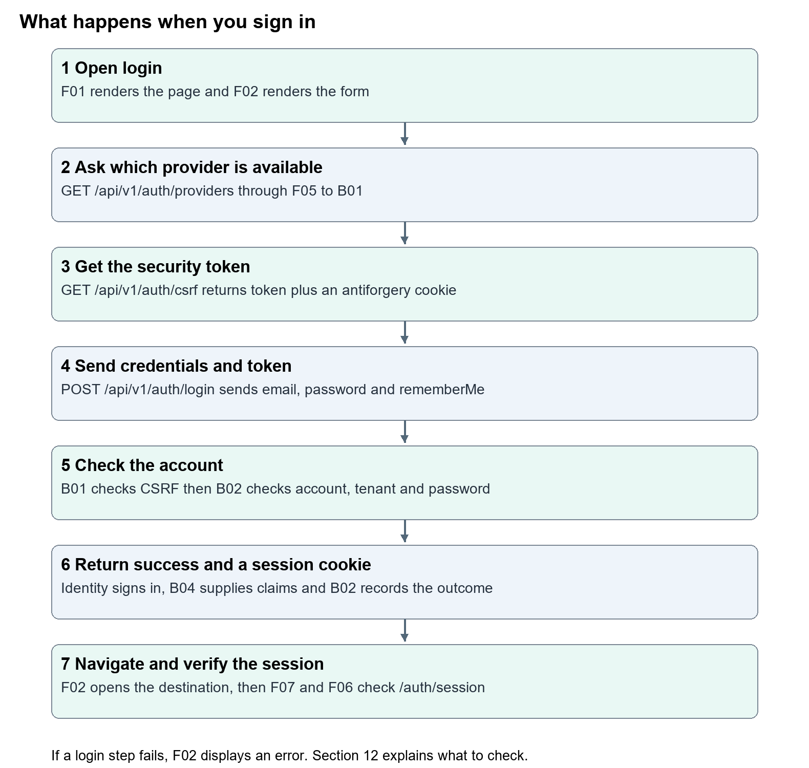
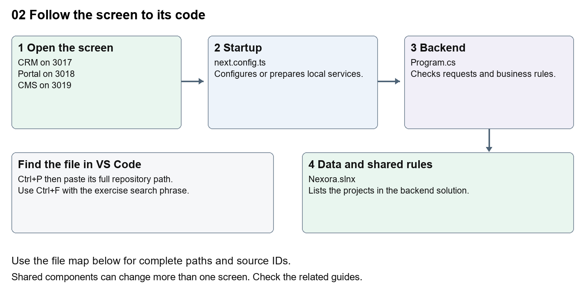
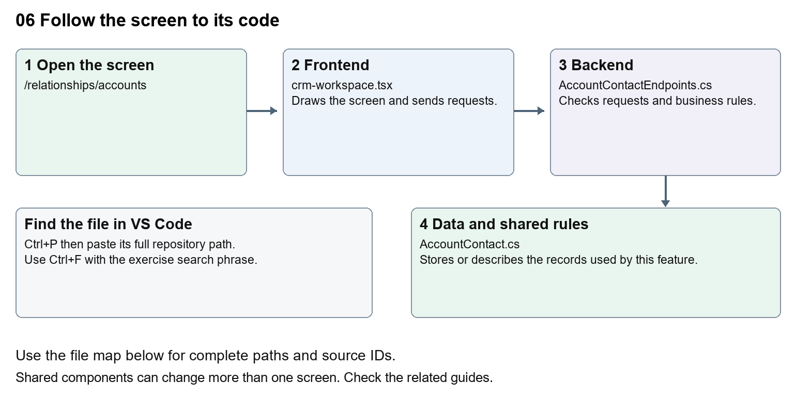
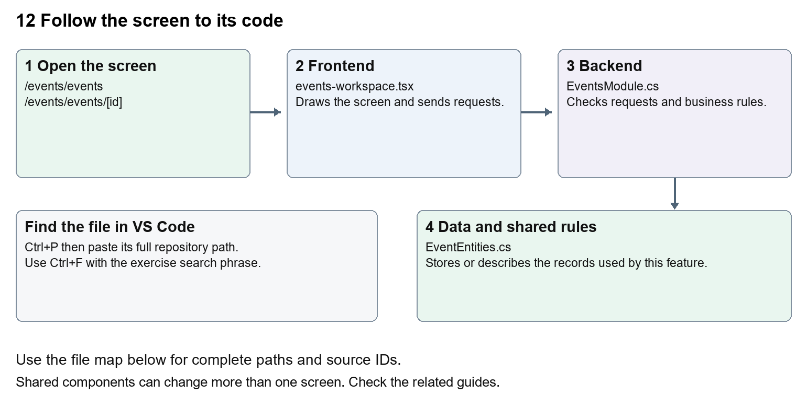
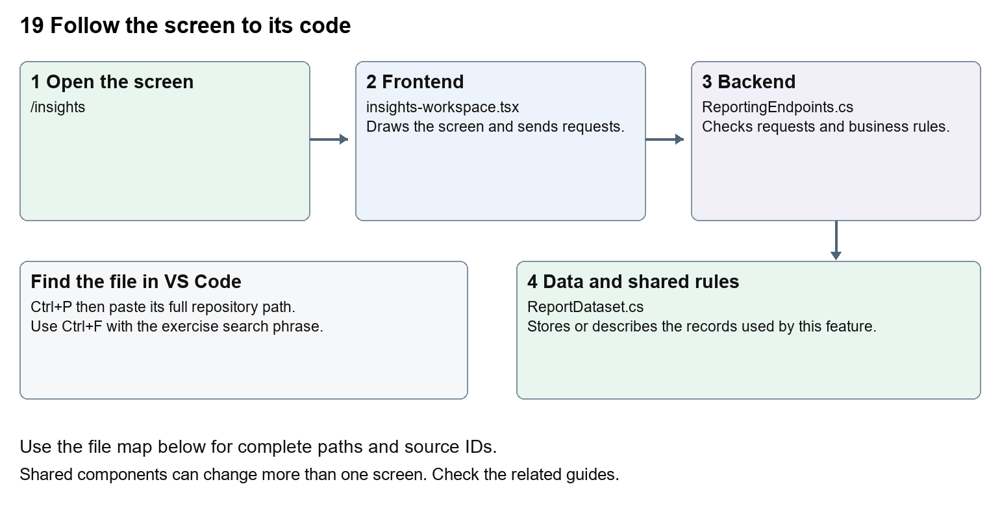

# Nexora complete beginner guide

Source snapshot 13 October 2026 at 17:12 UTC  
A learning manual for someone starting without coding experience

This manual explains the complete Nexora platform through 30 beginner guides. Each guide identifies its screen, maps the frontend and backend files, follows the request into stored records, explains the code and gives a small practice task. The same structure as the approved Nexora login page guide is used throughout.

The Word edition is the readable teaching manual with short labelled code extracts. The self-contained HTML edition combines that same teaching text with the full captured source library. Open the HTML file in a browser, choose Full source library and read or search every included file without needing a server. Individual Word and Markdown guides are also saved alongside this manual.

The snapshot reflects the working checkout, including implemented changes that may not yet be committed as application source. It is dated evidence, not a production release certificate. The documentation commit records the manuals; it does not silently commit other application edits. The originally approved login document is retained as its own dated reference.



Read the first login guide, then the platform setup and navigation guides. Continue with the screen you want to change. The full-code library lets you look beyond the short extracts when you are ready.

## Guide contents

1. [01 Nexora login page](#guide_01)
2. [02 Nexora platform setup and VS Code](#guide_02)
3. [03 Nexora workspace navigation and theme](#guide_03)
4. [04 Nexora home dashboard](#guide_04)
5. [05 Nexora CRM contacts](#guide_05)
6. [06 Nexora CRM accounts and associations](#guide_06)
7. [07 Nexora record listings and saved views](#guide_07)
8. [08 Nexora record profiles and related information](#guide_08)
9. [09 Nexora member records and subscriptions](#guide_09)
10. [10 Nexora membership applications and decisions](#guide_10)
11. [11 Nexora membership setup and products](#guide_11)
12. [12 Nexora events and bookings](#guide_12)
13. [13 Nexora courses and training](#guide_13)
14. [14 Nexora examinations and results](#guide_14)
15. [15 Nexora sales and finance](#guide_15)
16. [16 Nexora engagement and fundraising](#guide_16)
17. [17 Nexora tasks and notifications](#guide_17)
18. [18 Nexora imports exports and migration](#guide_18)
19. [19 Nexora insights and reporting](#guide_19)
20. [20 Nexora administration and access](#guide_20)
21. [21 Nexora automation controllers](#guide_21)
22. [22 Nexora workflow designer and runtime](#guide_22)
23. [23 Nexora AI assistant connection](#guide_23)
24. [24 Nexora member portal login and onboarding](#guide_24)
25. [25 Nexora member portal journeys](#guide_25)
26. [26 Nexora portal management](#guide_26)
27. [27 Nexora website editor and publishing](#guide_27)
28. [28 Nexora public website](#guide_28)
29. [29 Nexora documents evidence and file safety](#guide_29)
30. [30 Nexora backend database and maintenance](#guide_30)

## Start learning and run the platform

### The words used throughout the guides

| Word | Meaning |
| --- | --- |
| Frontend | Code that draws the screen and handles browser actions. |
| Backend | Server code that checks requests and stores or returns records. |
| Component | A reusable part of a screen, such as a form or toolbar. |
| Route | The address of a screen, such as /membership/members. |
| Endpoint | An API address and method, such as GET /api/v1/crm/records. |
| Request and response | The browser asks for something; the server returns a result. |
| JSON | Named data values sent between browser and API. |
| State | A value held by a screen while it runs, such as an open editor. |
| Hook | A React function such as useState or useEffect that manages screen behaviour. |
| Model | A description of the shape of stored or transferred data. |
| DbContext | A C# gateway to a module's database tables. |
| Migration | A reviewed set of database structure changes. |
| Tenant | One organisation's area and permitted records. |
| Permission | A named right checked by the server, such as content.publish. |
| Version | A marker which helps detect another user's newer edit. |
| Draft and published | Editable saved work and the version released for other people to see. |
| Git commit | A named local snapshot of selected project changes. |

### Read the smallest piece first

An import at the top of a .tsx file tells you which other components it uses. A function describes behaviour. return supplies the markup the screen draws. Text between tags is often visible wording; values inside braces come from code or data. onClick and onSubmit connect user actions to functions. await waits for a request result. A JSON key must match the server request model; changing a field label does not mean renaming that key.

CSS changes spacing, colour and movement. A className attaches styles to an element. A module.css file usually scopes styles to a component; a shared global stylesheet can affect many screens. A value such as var(--portal-brand) reads a configured colour variable. Database-backed portal and website settings can override defaults in source.

### Use VS Code one step at a time

1. Choose File then Open Folder and select D:\Projects new\Nexora. Confirm apps, backend and docs appear in Explorer.
2. Press Ctrl+P, paste a path from the guide, and press Enter. Paths in the guide are relative to this repository unless explicitly absolute.
3. Press Ctrl+F and search for the exercise phrase. Press Ctrl+G only when you want a numbered source line; line numbers move as code changes.
4. Read the whole surrounding tag or function. Record its original text before editing. Change one visible phrase first.
5. Press Ctrl+S to save. Read View then Problems. Refresh the local screen and inspect the changed wording.
6. Open Source Control to review your own diff. Revert only your own text when practising.

Explorer is the folder tree. The editor is where you read and type. Run and Debug is where you choose CRM, Portal or CMS. Terminal then New Terminal opens commands. Problems shows reported syntax and type issues. Saving a frontend text change normally refreshes during development; backend changes require a rebuilt or restarted API.

### Start the applications on this workstation

Choose CRM, Portal or CMS in Run and Debug, then press F5. Each profile prepares the shared API before starting the frontend. CRM uses http://localhost:3017, Portal uses http://localhost:3018/portal, and CMS uses http://localhost:3019. Staff editors remain at /portal-management and /website. The shared API uses http://localhost:5097 and the configured SQL Express NexoraDev database. The three frontends have distinct .next-local-debug output folders.

The All applications profile also launches Company Dash from its separate repository. That application is not Nexora source. To work only on Nexora, launch its three named profiles. Source and documentation in this manual remain within the Nexora repository.

The existing launch file and preparation script are the authority for this workstation. A new computer needs compatible Node, .NET, SQL and extensions plus adjusted runtime paths. Do not run a guessed command from an older README when its addresses differ. A directly started next dev can fall back to another API if NEXORA_API_URL was not provided.

### Check your work and restore a practice change

For a text change, reload the page, inspect a second screen that shares the component, check mobile layout if the text length changed, and review the diff. Do not submit real data to prove a wording edit. Ctrl+Z is suitable for a just-made edit in the open file; for a saved practice edit, restore the recorded original text and save. Source Control Discard is safe only if every change in that file belongs to you. Other people's unfinished work can share a file.

For a behaviour change, run the relevant type and module checks as well as the actual screen journey. Full integrated tests use isolated data and services; coordinate them with the team. Tests named in this manual are places to start, not claims that this documentation run executed them.

```powershell
npm --prefix apps/web exec tsc -- --noEmit
npm run lint:web
dotnet build backend/Nexora.slnx --configuration Release
```

Use those broad commands after meaningful code changes. Backend test filters and browser configuration need the appropriate developer review. Do not run migration or import commands simply to check a label edit.

### Understand common error responses

| Result | What to inspect |
| --- | --- |
| 400 invalid request | Field types, validation messages and CSRF token. |
| 401 sign-in required | The relevant staff or member session and expiry. |
| 403 permission denied | User group permissions and endpoint authorisation. |
| 404 unavailable record | Route, record id, tenant and explicit company grant. |
| 409 conflict | Reload the latest version before retrying a save. |
| 429 too many requests | Allow the login rate limit to reset; inspect the limit. |
| 503 service unavailable | API readiness, provider configuration, logs and SQL connection. |
| Quarantined file | Scanner state and clean-download rules; do not bypass them. |


<!-- CHAPTER 01 -->
## 01 Nexora login page

Understand the staff sign-in page, the password check and the session that opens CRM.

### Recognise the screen and its scope

Open `/login`, `/login/help`. CRM routes use port 3017; member routes use 3018; public website routes can use 3019. Brackets name a route parameter, not text to paste into a browser. Choose a real record or site id from the application.

This guide covers Staff login and help; Provider availability; CSRF tokens; Session cookie and sign-out; Active tenant and permission claims.



The diagram shows the file roles. The full paths below are what you paste into Ctrl+P.

### Find the files in VS Code

| Role | File and source ID | What it does |
| --- | --- | --- |
| Screen | S0011 page.tsx | Main UI or route for this topic |
| Server | S0381 IdentityModule.cs | Endpoints or server rules |
| Data | S0374 NexoraUser.cs | Data shape or persistence structure |

**Screen S0011**  
[apps/web/src/app/(auth)/login/page.tsx](<D:/Projects new/Nexora/apps/web/src/app/(auth)/login/page.tsx>)

**Server S0381**  
[backend/src/Modules/Nexora.Modules.Identity/IdentityModule.cs](<D:/Projects new/Nexora/backend/src/Modules/Nexora.Modules.Identity/IdentityModule.cs>)

**Data S0374**  
[backend/src/Modules/Nexora.Modules.Identity/Domain/NexoraUser.cs](<D:/Projects new/Nexora/backend/src/Modules/Nexora.Modules.Identity/Domain/NexoraUser.cs>)

The complete HTML manual opens these source IDs inside its Source library. The Word manual shows short labelled extracts so you can learn the flow before reading large files. Each individual Markdown guide includes its complete primary files after the walkthrough.

### Follow the request and the records

1. The page draws the heading, form and animated background.
2. The form asks which sign-in provider is enabled.
3. Submitting requests a CSRF token, then sends credentials to /api/v1/auth/login.
4. The local identity adapter checks the user, tenant and password.
5. The returned cookie lets protected CRM routes verify /api/v1/auth/session.

### The approved login walkthrough

#### 2 The words you need first

| Word | Meaning in this guide |
| --- | --- |
| Repository | The Nexora project folder and its recorded change history. |
| Frontend | Code that draws the screen and handles browser interactions. |
| Backend | The server code that checks accounts, passwords and permissions. |
| Database | The stored records used by the backend, including users and organisations. |
| File and folder | A file contains text or code. Folders organise files. A path tells you where a file is. |
| Component | A reusable piece of a screen, such as the login form or logo. |
| Route | A web address handled by the application, such as /login. |
| API endpoint | An address that receives or returns application data, such as /api/v1/auth/login. |
| Session | The application's knowledge that this browser has signed in as a particular user. |
| Cookie | A small value the browser keeps and sends back to the server. The login cookie proves the session. |
| Tenant | One organisation's area within Nexora. Access must stay inside that organisation. |
| CSRF token | A security value checked with the request to help stop another site making a sign-in or sign-out request on your behalf. |
| Permission | A named right to use something, such as crm.read or identity.manage. |
| Terminal | A text panel where you can run commands and read their output. |
| Development | A local working environment used to learn and test changes. |
| Restart and refresh | Restart runs the server again. Refresh asks the browser to load the page again. |

File endings help you recognise the language. **.tsx** contains TypeScript and React screen markup. **.ts** contains TypeScript. **.css** controls appearance. **.cs** contains C# backend code. **.json** stores configuration. **.ps1** is a PowerShell script.

#### 3 Recognise the page



Figure 1 shows the current local page. The dark card, green accent and galaxy animation are built from code. The background is a canvas drawing rather than a photograph.

Use the following landmarks to decide where to look. File IDs such as F01 connect the pictures, the file map and the appendix.

| What you see or use | File that controls it |
| --- | --- |
| CRM Login, Welcome back, the introductory text and footer | F01 page.tsx |
| Work email, Password, the eye icon and the checkbox | F02 login-form.tsx |
| Sign in, Signing in and the visible error message | F02 login-form.tsx |
| Card width, spacing, colours and small-screen layout | F03 login.module.css |
| Galaxies, stars and the Pause motion button | F04 galaxy-background.tsx |
| The Nexora name and mark | F08 nexora-mark.tsx |
| Need help and the help instructions | The link is in F01 and the page is F10 |
| Whether local sign-in is available | B01 IdentityModule.cs and B02 LocalIdentityAdapter.cs |

The browser initially renders the local form disabled. F02 asks the backend whether local sign-in is available, then enables Sign in when the answer is true. A disabled button during initial loading is different from a permanently unavailable provider.

#### 4 Find the right file

All paths below start from **D:\Projects new\Nexora**. Open this folder in VS Code. Keep Nexora work inside this repository.



Figure 2 is the code map. Follow the arrows when you want to trace a sign-in. Use the file IDs in the list below to open the matching source.

#### Frontend files

**F01 Page structure and wording**  
[apps/web/src/app/(auth)/login/page.tsx](<D:/Projects new/Nexora/apps/web/src/app/(auth)/login/page.tsx>)

Open this to change the greeting, introductory text, footer or help link. It also chooses a safe destination after sign-in. Search for `Welcome back` at line 18.

**F02 Form fields and browser behaviour**  
[apps/web/src/app/(auth)/login/login-form.tsx](<D:/Projects new/Nexora/apps/web/src/app/(auth)/login/login-form.tsx>)

Open this for labels, placeholders, showing the password, the checkbox, provider availability, request submission and error display. Search for `handleSubmit` at line 28.

**F03 Login appearance**  
[apps/web/src/app/(auth)/login/login.module.css](<D:/Projects new/Nexora/apps/web/src/app/(auth)/login/login.module.css>)

Open this for the login card, spacing, colour rules, motion button and mobile layout. Search for `.card {` at line 10. Some rules here override the utility classes in F02.

**F04 Animated background**  
[apps/web/src/app/(auth)/login/galaxy-background.tsx](<D:/Projects new/Nexora/apps/web/src/app/(auth)/login/galaxy-background.tsx>)

Open this for the canvas drawing and motion controls. Search for `GalaxyBackground` at line 6.

**F05 Browser requests forwarded to the backend**  
[apps/web/next.config.ts](<D:/Projects new/Nexora/apps/web/next.config.ts>)

Open this when tracing where `/api/...` requests go. Search for `async rewrites` at line 10. This is the bridge to the C# API; there is no separate login API route file in the web application.

**F06 Check the signed-in session**  
[apps/web/src/lib/auth/session.ts](<D:/Projects new/Nexora/apps/web/src/lib/auth/session.ts>)

Open this to understand why a protected page sends someone back to login. Search for `requireSession` at line 46.

**F07 Protect the staff workspace**  
[apps/web/src/app/(platform)/layout.tsx](<D:/Projects new/Nexora/apps/web/src/app/(platform)/layout.tsx>)

This layout calls F06 before rendering the staff workspace. The login page lives outside this protected layout.

**F08 Logo**  
[apps/web/src/components/brand/nexora-mark.tsx](<D:/Projects new/Nexora/apps/web/src/components/brand/nexora-mark.tsx>)

This shared component is also used elsewhere. A change here can affect other screens.

**F09 Shared button**  
[apps/web/src/components/ui/button.tsx](<D:/Projects new/Nexora/apps/web/src/components/ui/button.tsx>)

This supplies common button styles and passes through attributes such as `disabled`. F03 supplies additional login-specific button styles.

**F10 Help page**  
[apps/web/src/app/(auth)/login/help/page.tsx](<D:/Projects new/Nexora/apps/web/src/app/(auth)/login/help/page.tsx>)

This is the small user-facing guide at `/login/help`. It is separate from this developer learning document.

#### Backend files

**B01 Authentication setup and endpoints**  
[backend/src/Modules/Nexora.Modules.Identity/IdentityModule.cs](<D:/Projects new/Nexora/backend/src/Modules/Nexora.Modules.Identity/IdentityModule.cs>)

This defines password rules, cookies, rate limits, CSRF and the login, session and logout endpoints. Search for `LoginAsync` at line 210.

**B02 Check the credentials and record the outcome**  
[backend/src/Modules/Nexora.Modules.Identity/Security/LocalIdentityAdapter.cs](<D:/Projects new/Nexora/backend/src/Modules/Nexora.Modules.Identity/Security/LocalIdentityAdapter.cs>)

This finds the user, checks that the user and tenant are active, asks ASP.NET Core Identity to check the password, and records the outcome. Search for `PasswordSignInAsync` at line 43.

**B03 User record**  
[backend/src/Modules/Nexora.Modules.Identity/Domain/NexoraUser.cs](<D:/Projects new/Nexora/backend/src/Modules/Nexora.Modules.Identity/Domain/NexoraUser.cs>)

This adds Nexora fields to the standard Identity user, including TenantId, DisplayName and IsActive.

**B04 Roles and permissions added to the session identity**  
[backend/src/Modules/Nexora.Modules.Identity/Security/NexoraClaimsPrincipalFactory.cs](<D:/Projects new/Nexora/backend/src/Modules/Nexora.Modules.Identity/Security/NexoraClaimsPrincipalFactory.cs>)

This adds the tenant, display name and permissions to the signed-in identity. These values are called claims.

**B05 Active tenant check**  
[backend/src/Modules/Nexora.Modules.Identity/Security/ActiveTenantAuthorization.cs](<D:/Projects new/Nexora/backend/src/Modules/Nexora.Modules.Identity/Security/ActiveTenantAuthorization.cs>)

This checks that the signed-in user and tenant are still active when access is authorised.

**B06 API startup**  
[backend/src/Nexora.Api/Program.cs](<D:/Projects new/Nexora/backend/src/Nexora.Api/Program.cs>)

This connects the identity module to the running API. Search for `UseAuthentication` at line 61.

**B07 Identity database mapping**  
[backend/src/Modules/Nexora.Modules.Identity/Infrastructure/Persistence/NexoraIdentityDbContext.cs](<D:/Projects new/Nexora/backend/src/Modules/Nexora.Modules.Identity/Infrastructure/Persistence/NexoraIdentityDbContext.cs>)

This maps user and tenant records to SQL tables and applies tenant query filters. Treat database structure changes as a later learning step.

**B08 Local development account setup**  
[backend/src/Modules/Nexora.Modules.Identity/Infrastructure/Persistence/IdentitySeeder.cs](<D:/Projects new/Nexora/backend/src/Modules/Nexora.Modules.Identity/Infrastructure/Persistence/IdentitySeeder.cs>)

This creates the local demonstration administrator when configured. It does not normally reset an existing user's password.

#### Supporting files

- S01 root layout loads the global stylesheet and page title settings. [apps/web/src/app/layout.tsx](<D:/Projects new/Nexora/apps/web/src/app/layout.tsx>)
- S02 global stylesheet imports the shared CRM theme. [apps/web/src/app/globals.css](<D:/Projects new/Nexora/apps/web/src/app/globals.css>)
- S03 shared CRM theme defines the default Nexora colour variables. [apps/web/src/components/app-shell/workspace-theme.css](<D:/Projects new/Nexora/apps/web/src/components/app-shell/workspace-theme.css>)
- S04 class helper merges shared button classes. [apps/web/src/lib/cn.ts](<D:/Projects new/Nexora/apps/web/src/lib/cn.ts>)
- S05 development configuration allows local sign-in. [backend/src/Nexora.Api/appsettings.Development.json](<D:/Projects new/Nexora/backend/src/Nexora.Api/appsettings.Development.json>)
- S06 provider option model holds configuration for the future Entra adapter. [backend/src/Modules/Nexora.Modules.Identity/Security/IdentityProviderOptions.cs](<D:/Projects new/Nexora/backend/src/Modules/Nexora.Modules.Identity/Security/IdentityProviderOptions.cs>)
- S07 security names and tenant context. [backend/src/Modules/Nexora.Modules.Identity/Security/NexoraSecurity.cs](<D:/Projects new/Nexora/backend/src/Modules/Nexora.Modules.Identity/Security/NexoraSecurity.cs>)
- S08 tenant record. [backend/src/Modules/Nexora.Modules.Identity/Domain/Tenant.cs](<D:/Projects new/Nexora/backend/src/Modules/Nexora.Modules.Identity/Domain/Tenant.cs>)
- S09 sign-in audit record. [backend/src/Modules/Nexora.Modules.Identity/Domain/AuditEvent.cs](<D:/Projects new/Nexora/backend/src/Modules/Nexora.Modules.Identity/Domain/AuditEvent.cs>)
- S10 tenant write boundary used by B07. [backend/src/Modules/Nexora.Modules.Identity/Infrastructure/Persistence/TenantWriteBoundary.cs](<D:/Projects new/Nexora/backend/src/Modules/Nexora.Modules.Identity/Infrastructure/Persistence/TenantWriteBoundary.cs>)
- S11 dashboard route calls the session helper again. [apps/web/src/app/(platform)/dashboard/page.tsx](<D:/Projects new/Nexora/apps/web/src/app/(platform)/dashboard/page.tsx>)
- S12 sign out handler in the shared staff shell. [apps/web/src/components/app-shell/app-shell.tsx](<D:/Projects new/Nexora/apps/web/src/components/app-shell/app-shell.tsx>)

The launch settings are in `.vscode/launch.json`; tasks are in `.vscode/tasks.json`; API preparation is in `scripts/Prepare-LocalDebug.ps1`. These are existing setup files rather than page-design files. Their relevant settings are explained in section 6.

#### 5 Find your way around VS Code



Figure 3 is an illustration of the areas you will use. Your VS Code layout may look slightly different.

1. Open VS Code and choose **File > Open Folder**. Select `D:\Projects new\Nexora`.
2. The Explorer on the left shows folders and files. Expand `apps`, then `web`, then `src`, then `app`, then `(auth)`, then `login`.
3. Click `page.tsx`. The editor in the centre shows its contents.
4. Press **Ctrl+F**, type `Welcome back`, and press Enter. This finds text in the current file.
5. Press **Ctrl+P** to open a file quickly. Paste `apps/web/src/app/(auth)/login/page.tsx` and select it. This is often easier than expanding folders.
6. Press **Ctrl+G**, enter a line number from this guide, and press Enter to jump to that line. Line numbers change when the file changes, so use the search phrase if needed.
7. Save a change with **Ctrl+S**. A dot on the file tab indicates unsaved changes.
8. Open **View > Problems** to see reported code issues. An error does not always mean the file you just changed caused it; check the filename.
9. Open **Terminal > New Terminal** when a step needs a command. Check which folder the terminal prompt shows before running it.
10. Open **View > Run** to find Run and Debug. The dropdown there selects CRM, Portal or CMS.

`(auth)` and `(platform)` are organising folders called route groups. Their names do not appear in the web address. That is why `app/(auth)/login/page.tsx` creates `/login`, rather than `/(auth)/login`.

In an import, `@/` means the web application's `src` folder. For example, `@/lib/auth/session` points to `apps/web/src/lib/auth/session.ts`.

#### Read the shape of a file

Imports at the top bring in existing components or functions. The function below the imports describes what the file does. `return` gives back a result; in a React screen it usually gives back the screen markup. Braces `{ }` group code or insert a value into markup. Quotes hold text.

Indentation helps you see which lines belong together. Do not remove a closing brace or quotation mark while changing a word. For your first exercise, replace only the text specified.

#### 6 Run the local CRM

The local setup has two running parts. The web application draws the page on **3017**. The shared C# API checks identity on **5097**. They also need the configured SQL Server database.

| Setting | Current local configuration |
| --- | --- |
| VS Code launch choice | CRM |
| Staff login URL | http://localhost:3017/login |
| Shared backend API | http://localhost:5097 |
| API environment | Development |
| SQL instance and database | .\SQLEXPRESS and NexoraDev |
| Web backend setting | NEXORA_API_URL=http://localhost:5097 |
| Web build output | .next-local-debug-crm |
| Local staff account | admin@nexora.local unless SeedAdminEmail overrides it |

1. Open the Nexora root folder in VS Code.
2. Open Run and Debug, choose **CRM**, and press **F5**.
3. The preparation task starts or reuses the shared API and waits for it to be ready. Startup can take time when a build or database migrations are needed.
4. Edge is configured to open `/relationships/contacts`. An unsigned-in browser is sent to login. For this guide, type `http://localhost:3017/login` in the browser address bar.
5. Wait until the provider message says that a local development account can sign in.
6. Use the local administrator email above and the local seed password configured in `.vscode/launch.json` under `Identity__SeedAdminPassword`. Do not copy that password into screenshots or this guide. The launch configuration sets `Identity__ResetSeedAdminPassword` to false, so an existing password can differ.

The workstation's launch configuration uses a specific Node executable. On a different computer, the configured runtime and SQL instance may need updating. The backend targets .NET 10, and VS Code recommends the `ms-dotnettools.csharp` extension. The web dependencies are declared in `apps/web/package.json`. A newly cloned machine needs these prerequisites and restored packages before F5 can work; this guide's launch steps assume the existing prepared checkout.

Starting `next dev` directly uses defaults unless you supply the environment settings. Both F05 and F06 fall back to backend port **5080** when `NEXORA_API_URL` is missing. This differs from the VS Code shared API port. For learning, use the existing CRM launch profile.

#### When a change needs a restart

Text, React markup and CSS often update after you save while development mode is running. Refresh the browser if needed. A C# backend change needs a rebuilt and restarted API. Stop the CRM frontend you launched, then launch CRM again; the preparation script detects newer backend source and rebuilds the API it manages. If the API was started by another debug session, stop that API session and relaunch. A change to `next.config.ts` or environment values needs the frontend to restart.

Stopping CRM does not normally stop the shared API. Portal and CMS may also use it. Do not stop another person's running services just to inspect a file. For C# debugging, use **Attach shared API** and select the Nexora API process. Reattach after the API restarts.

#### 7 Follow the login journey



Figure 4 follows the local password sign-in. The arrows represent requests and their results.

1. **Open the page.** F01 selects the page content and renders F02. F04 draws the animated background after the browser starts its JavaScript.
2. **Check availability.** F02 sends a GET request to `/api/v1/auth/providers`. F05 forwards it to the backend. B01 returns whether local development sign-in is enabled. The form enables Sign in only when it is enabled.
3. **Collect the fields.** You enter an email and password. F02 reads the fields when you select Sign in. Showing a password only changes its visibility in your browser.
4. **Get the security token.** F02 asks `/api/v1/auth/csrf` for a CSRF token. The backend stores an antiforgery cookie and returns the request token.
5. **Send the login request.** F02 sends email, password and rememberMe to `/api/v1/auth/login` as JSON. It puts the token in the `X-CSRF-TOKEN` header and includes cookies.
6. **Check on the server.** B01 checks required fields and the token. B02 checks provider availability, finds the account, checks the user and tenant status, and calls the Identity password sign-in method. The backend login rate limit can reject excess requests before this work.
7. **Create the session.** A successful Identity sign-in issues the session cookie. B04 supplies tenant and permission claims. B02 records the successful sign-in and returns `{ "authenticated": true }`.
8. **Open the destination.** F02 calls `router.replace(returnTo)` and `router.refresh()`. F01 has checked the requested destination. The default is `/dashboard`.
9. **Check protected access.** F07 calls F06, which sends the session cookie to `/api/v1/auth/session`. A valid session allows the workspace to render. If the session cannot be obtained, F06 redirects to `/login`.
10. **Show an error when needed.** If a login request fails, F02 displays the backend's problem title or a fallback message, and lets you try again when local sign-in remains available.

#### The API addresses

| Request | Purpose | Normal result |
| --- | --- | --- |
| GET /api/v1/auth/providers | Ask which login providers are enabled | 200 and localDevelopmentEnabled plus entraEnabled |
| GET /api/v1/auth/csrf | Obtain the token used for a protected request | 200 and token |
| POST /api/v1/auth/login | Submit credentials with the token | 200 and authenticated true plus a session cookie |
| GET /api/v1/auth/session | Read the current signed-in user and tenant | 200 and session data, or an access failure |
| POST /api/v1/auth/logout | End the signed-in session with a fresh token | 204 with no response body |

**GET** asks for data. **POST** submits an action. **200** means a request succeeded. **204** means it succeeded with no response content. **400** means the request is invalid; **401** means authentication failed or is missing; **403** means access is forbidden; **429** means too many requests; **503** means a service or provider is unavailable.

Sign-out is started in `apps/web/src/components/app-shell/app-shell.tsx`. Its handler fetches a fresh CSRF token and posts to the logout endpoint. B01 then calls `SignOutAsync` to remove the staff session.

#### 8 Read the frontend code

#### F01 chooses the page and the destination

`metadata` supplies the page title. S01 adds the Nexora title suffix, so the browser tab is called `Sign in · Nexora`.

The page reads `returnTo` from the address. A path such as `/login?returnTo=/relationships/contacts` asks to open Contacts after login. F01 accepts a value only if it starts with `/`, does not start with `//`, and contains none of the backslash or control/space characters rejected by its regular expression. Otherwise it uses `/dashboard`. Do not remove this validation when changing the destination.

`<GalaxyBackground />` inserts F04. `<LoginForm returnTo={returnTo} />` inserts F02 and passes it the destination. A value passed from one component to another is called a prop.

#### F02 remembers what is happening

The form uses React state. State is a value the component can update and then redraw.

| State value | Initial value | What changes when it updates |
| --- | --- | --- |
| showPassword | false | Chooses a masked password field or visible text |
| isSubmitting | false | Disables Sign in while a request is being submitted and shows Signing in |
| error | null | Displays the current error when there is one |
| localEnabled | false | Enables Sign in when the provider check succeeds and says true |

`useEffect` runs the provider request after the component is active in the browser. Its `active` flag prevents a late result updating a component that has already been removed from the page.

`handleSubmit` runs when the form is submitted. `event.preventDefault()` stops the browser's usual full-page form submission. `new FormData(event.currentTarget)` reads the form's named fields. `async` and `await` let the code wait for requests without treating an unfinished request as a result.

This is the actual shape of the data sent. These are variable values read from the form, not a saved password inside the source code.

```typescript
body: JSON.stringify({
  email: formData.get("email"),
  password: formData.get("password"),
  rememberMe: formData.get("rememberMe") === "on",
}),
```

`JSON.stringify` turns the object into the text format expected by the API. `credentials: "include"` tells fetch to include cookies. `response.ok` asks whether the request returned a successful status. The `catch` block handles a failed request and shows an error.

The input `name` values are part of this connection. Changing `name="email"` without also changing `formData.get("email")` would stop the email being read. You can change the visible label or placeholder without renaming the field.

#### F03 decides the final appearance

F02 has utility classes that supply styles directly in its markup. F03 then adds login-specific rules such as `.card form input` and `.card form button[type=submit]`. Therefore, editing an input's utility colour in F02 may not change its appearance if F03 overrides it.

F03 uses variables such as `var(--nexora-accent)`. S03 supplies the shared defaults. Some other colours are literal values in F03 and F04. Changing one theme variable does not recolour every galaxy or every glow automatically.

The mobile rule begins with `@media(max-width:600px)`. It changes padding and text sizes on narrow screens. The reduced-motion rule removes the card's entrance animation for people who request reduced motion.

#### F04 draws and controls motion

`useRef` holds the canvas element. The canvas context draws stars, glowing galaxies and orbital shapes. `requestAnimationFrame` schedules the drawing loop. The code limits updates to roughly 30 frames per second and stops active animation while the document is hidden.

The pause button updates `paused`. The component also reads the system's reduced-motion preference. When that preference is on, it draws a still background and hides the motion button. The pause choice is component state; it is not a saved CRM setting and does not persist through a fresh page load.

#### F05 and F06 connect the servers

F05 rewrites browser `/api/...` requests to `NEXORA_API_URL`. The browser uses its current web origin; the web server forwards the request to the C# API. It is a forwarding rule, not the password-checking code.

F06 runs on the web server for protected pages. It reads incoming cookies and forwards them to the API's session endpoint with `cache: "no-store"`. Its React `cache` wrapper avoids repeated work within a server render; it is not a browser's persistent login storage. A network failure also produces a null session, so being redirected to login can mean the API is unavailable as well as being signed out.

#### 9 Read the backend code and database map

#### B01 sets the rules and receives requests

`AddNexoraIdentity` registers the identity services when the API starts. `MapNexoraIdentityEndpoints` attaches addresses to their handlers. A handler is the function that receives a request.

The frontend's JSON keys match this backend record. The standard JSON handling maps the browser's email, password and rememberMe fields to these properties.

```csharp
public sealed record LoginRequest(string Email, string Password, bool RememberMe);
```

`LoginAsync` first checks for missing email or password, validates the CSRF token, and then calls B02. The C# backend must make these checks even though the browser marks the fields as required. A caller can send an API request without using the form.

#### B02 verifies the account

B02 allows the local adapter only when its settings are enabled. It trims and normalises the email to find the account, checks the user and tenant are active, and then calls the existing Identity library:

```csharp
var result = await signInManager.PasswordSignInAsync(
    user,
    request.Password,
    request.RememberMe,
    lockoutOnFailure: true);
```

Nexora passes password verification to ASP.NET Core Identity. The application stores a password hash through that library rather than a readable password. Changing the placeholder or the screen's password visibility does not change the stored password.

The temporary `BeginSystemAccess` scope lets this trusted server code find an account before it knows the signed-in tenant. It is not a tenant selected by the browser. S10 restores that scope afterwards. Normal authenticated work uses tenant boundaries.

#### The current rules

| Rule | Value in the current source | Where it comes from |
| --- | --- | --- |
| Local adapter available | Development environment AND LocalDevelopmentEnabled true | B01 |
| New-password minimum | 12 characters, digit, lowercase, uppercase and non-alphanumeric | B01 |
| Failed-password lockout | 5 failed attempts and a 15-minute lockout | B01 |
| Login request limiter | 8 requests per minute per server-observed IP, with no queue | B01 |
| Session lifetime setting | 8 hours with sliding expiration | B01 |
| Development cookie name | Nexora.Session | B01 |
| Production cookie name | __Host-Nexora.Session, with HTTPS required | B01 |
| CSRF header name | X-CSRF-TOKEN | B01 |
| Sign-in audit type | identity.login | B02 |

Password creation rules do not mean a short string is rejected by the login form itself. They are the backend policy used when creating or setting passwords. Lockout and request limiting are different controls: one concerns an account's failed password attempts, the other limits requests from an IP.

The session cookie is HttpOnly, so browser JavaScript cannot read it directly. It is sent with requests. `rememberMe` controls whether Identity makes the login persistent; the eight-hour ticket setting and sliding renewal still apply. Browser settings also affect persistence. It does not mean permanent access.

B01 refreshes the user's claims during cookie validation and rejects an inactive or invalid user. B05 also checks the active tenant boundary. Updating an account or its permissions must affect later access, even if the browser already has a cookie.

#### Where the records are stored

B07 configures the `identity` SQL schema. The local SQL database is selected by the launch configuration. The page does not connect directly to SQL.

| Table | What it contributes to login |
| --- | --- |
| identity.Users | Email, PasswordHash, lockout fields, Nexora display name, tenant and active status |
| identity.Tenants | Organisation name, slug and active or suspended status |
| identity.Roles and identity.UserRoles | The user's assigned security roles |
| identity.RolePermissions | Named permissions for tenant roles |
| identity.AuditEvents | Sign-in outcome, subject, time, and available user, tenant and IP values |

The base IdentityUser supplies fields such as PasswordHash and lockout information. B03 adds Nexora-specific properties. B04 creates the claims used by the session. B01's session endpoint returns the user's display name, email, tenant, roles and permissions; it does not return a password hash.

B02 records successful sign-ins, denied credentials, and locked-account outcomes. Provider-disabled, CSRF-validation and rate-limit failures do not all pass through its audit-writing method. The visible audit wording on the page should not be read as proof that every rejected request is recorded there.

B08 creates demonstration records only in the configured Development startup path. Existing passwords are not reset unless `Identity:ResetSeedAdminPassword` is deliberately enabled. Do not delete user tables or enable resets as a routine fix for a forgotten local password.

#### 10 Make your first changes

Start with A. Complete one exercise, save, check the browser, and then decide whether to keep it. These exercises change existing code; they do not add a new application.

#### Exercise A Change the welcome heading

1. Press Ctrl+P and open `apps/web/src/app/(auth)/login/page.tsx`.
2. Press Ctrl+F and search for `Welcome back`.
3. Replace only the words inside the heading.

Before

```tsx
<h1 id="login-title">Welcome back</h1>
```

After

```tsx
<h1 id="login-title">Welcome to Nexora</h1>
```

4. Press Ctrl+S. Open or refresh `/login`.
5. Check that the heading changed and the form still appears. On a narrow screen, check that it wraps naturally.

What you learned: visible text can be changed without altering sign-in behaviour. Keep `id="login-title"` because the card's accessibility label points to it.

#### Exercise B Change the email hint

Open F02 and find `placeholder="you@organisation.com"`. Replace it with:

```tsx
placeholder="name@yourcompany.com"
```

Save and refresh. The hint appears only when the field is empty. Keep `id="email"`, `name="email"`, `type="email"` and `required`. Those connect the label, data collection and browser validation.

#### Exercise C Change the button wording

Open F02 and find `Sign in<ArrowRight`. Replace just the displayed `Sign in` with `Open my workspace`. Keep the ArrowRight component and the button attributes.

Check that the button shows the new wording. The busy text is separately written as `Signing in…`; change that only if you want a different loading message. Existing browser tests that locate the exact button name `Sign in` may need their locators updated. A wording change can affect automated checks even when the login request is unchanged.

#### Exercise D Make the card slightly wider

Open F03 and search for `width:min(100%,450px)` inside `.card`. Change only 450 to 480:

```css
width:min(100%,480px);
```

Save and check the desktop page. Also check a narrow browser window: `100%` still caps the card to the available space. The media rule and outer padding also contribute to the mobile appearance.

#### Exercise E Try a colour only on the login page

Open F03. Inside the `.page { ... }` rule, add this declaration:

```css
--nexora-accent: #7dd3fc;
```

The card and submit button inherit this login-specific value. Save and check text contrast, input focus and hover states. Some glow colours and F04's drawing colours are literal green and purple values, so they will remain those colours. To undo, remove only the new declaration.

Changing S03's root variable would also affect other screens. Use the local `.page` example when your intention is to experiment with the login alone.

#### Exercise F Read and test the background controls

Use the existing Pause motion button before editing code. Watch the background stop, then use Play motion. Reload: the choice is not persisted. If your operating system requests reduced motion, the button is hidden and the drawing is still.

To change the number of background stars, open F04 and find `Array.from({ length: 220 }`. Replace 220 with 160, save, and reload. This changes the separate background stars. The 14500-point galaxy drawing is a different loop; it has not changed. Put 220 back when finished. Avoid increasing drawing counts without checking performance.

#### Exercise G Change a backend error message with support

This is a later exercise because it changes server behaviour and requires an API restart. Open B02 and find the two occurrences of `Email or password is incorrect.`. One is for a missing, inactive or unavailable-tenant account; the other is for a failed password check.

You could replace both strings with `Unable to sign in with these details.`. Keep the 401 status and the same generic wording for both cases. Do not disclose whether an email exists. Preserve the distinct lockout message.

Rebuild and restart the managed API using section 6, then check one failed login in a local test account. Do not repeatedly submit wrong passwords. The existing `Login_rejects_invalid_credentials_without_disclosing_the_account` test expects part of the original wording, so its assertion must be reviewed with this change.

#### Changes to leave until you understand the login

Security-sensitive changes include removing CSRF checks, changing cookie security, changing tenant filters, weakening password or lockout rules, allowing local login outside Development, adding SSO, adding account recovery, and changing database structure. These require implementation work and meaningful security checks. Editing a button label does not implement any of them.

#### 11 Check a change and put it back

Before editing, write down the file, the phrase you found and the original value. Save a copy of the small section you plan to change. The repository may already contain someone else's unsaved or uncommitted work; preserve it.

After a text or CSS change, use these checks:

1. Open `/login`, then check your specific edit.
2. Make the browser narrow and check for clipped labels, overlapping controls and horizontal scrolling.
3. Press Tab through the page. The focused link or button should have a visible outline. Check the label remains attached to its input.
4. Enter a dummy password without submitting. Use the eye button to show and hide it, then clear the field.
5. Check the local provider message and Microsoft button still match the configured provider state.
6. For a change to the submission logic, use a valid local test account once and confirm protected access and sign-out. Keep real passwords out of screenshots and logs.

For frontend changes that affect code structure, the existing commands below provide additional checks. Run them from `D:\Projects new\Nexora\apps\web`. `npm` must be available in that terminal. These commands check the source; they do not replace viewing the page.

```powershell
npm run lint
npx tsc --noEmit
```

For backend changes, ask someone comfortable with .NET to run the existing IdentityEndpointTests and review failures. The targeted command from the repository root is:

```powershell
dotnet test backend/tests/Nexora.Api.Tests/Nexora.Api.Tests.csproj --filter FullyQualifiedName~IdentityEndpointTests
```

The four tests in that class cover anonymous session rejection, successful tenant-scoped login and logout, generic invalid-credential rejection, and missing-CSRF rejection. They use test-host accounts and are different from signing into your persistent local CRM. Read the test factory before changing test infrastructure, and check the current test results before relying on a change.

To undo your own edit, restore the exact original text and save. Ctrl+Z can undo recent editor changes while the edit history is available. If using Source Control, inspect the diff and revert only the lines you changed. **Discard Changes** can remove other work in that file; do not use it casually. Do not delete the database to undo a wording or colour change.

#### 12 Troubleshoot common problems

#### The page cannot be opened

Confirm you used `http://localhost:3017/login`. Check that the CRM debug session is running. A connection-refused message usually means no frontend is listening at that address. Check the VS Code terminal output before changing port settings.

#### The sign in service is unavailable

Open `http://localhost:5097/api/v1/auth/providers` and `http://localhost:3017/api/v1/auth/providers` in a browser. Both should return JSON and, for the enabled local setup, show `localDevelopmentEnabled: true`.

If the direct API works but the frontend address fails, check F05 and `NEXORA_API_URL`, then restart the frontend. If both fail, check the shared API. Use `http://localhost:5097/health/ready` to check backend and database readiness. `/health` alone is not the same readiness check.

The provider check also depends on browser JavaScript starting successfully. If the API answers true but the button remains disabled, refresh and inspect the browser Console and Network tabs for failed scripts or requests.

#### Sign in stays disabled

Wait for the provider request to finish. If it returns false, check that the API environment is Development and S05 enables local development sign-in. Do not remove `disabled` to bypass this state. The backend still rejects the disabled provider.

#### The email or password is rejected

Check the account and password, including accidental spaces in the password. The email is trimmed on the backend; the password is passed as entered. The configured seed password may not match an existing account because automatic resetting is disabled. An inactive user or suspended tenant also receives the generic credential message.

#### The account is temporarily locked

Stop submitting guesses and wait for the configured lockout to expire, or ask the Nexora administrator to investigate. Five failed password attempts can lock an account. Excess requests from the same IP can independently return 429; wait for its one-minute limiter window to pass rather than weakening the limiter.

#### The security token is invalid or expired

Refresh the page and submit once again so it gets a fresh CSRF token. If the problem continues, check that the token request and login request use the same browser session and origin, and that `X-CSRF-TOKEN` is still sent. Do not remove the backend check.

#### Login succeeds but the page returns to login

Check the session endpoint, cookie and API connection. F06 needs the same backend origin as F05. It returns no session when the API cannot be reached. Also check the user's active status and tenant status. A 403 and a 401 have different meanings; inspect the actual Network response instead of guessing from the page redirect alone.

#### Saved code does not change the running page

Confirm you edited this checkout and saved the file. F03 may override a style from F02. Restart for configuration or backend changes. The API preparation script rebuilds backend source only when you launch its preparation flow; saving C# alone does not reload a currently running API.

#### API preparation fails

Do not choose Debug Anyway when the API preparation task fails. Read `artifacts/local-shared-api-error.log` and `artifacts/local-shared-api.log` inside Nexora. A build problem, stopped SQL service, or database migration problem needs its own correction. A password or CSS edit will not resolve it. Local Development startup may apply pending migrations; have a suitable backup before experimenting with database changes.

#### 13 Understand the current limits

The source currently implements the local development staff password flow, provider reporting, CSRF, cookie sessions, account lockout, login rate limiting, tenant checks, and sign-in outcome auditing in B02.

Microsoft Entra login is future scope in this implementation. B01 returns `entraEnabled = false`; F02 displays a disabled Microsoft button; S06 holds options for a forthcoming adapter. Filling in a tenant or client ID alone does not create a working SSO flow. The help page's general wording does not override this actual state.

The staff login page has no self-service registration, working forgot-password/reset journey, or MFA challenge. The help page directs people to an administrator. Adding a link alone would not implement account recovery.

The login's text and animation are currently controlled by these source files. F04's pause state is not a published CRM animation setting. Portal and website presentation controls elsewhere in Nexora do not automatically control this staff login. The session cookie's production settings do not establish that production identity is connected or a deployment is ready.

#### 14 Understand how the pieces are assembled

The source shows a useful learning order for rebuilding your understanding of this feature. This is the dependency order of the existing pieces, rather than a dated history of who wrote each line.

1. Define users and organisations in B03 and S08, with table mapping in B07.
2. Register Identity, cookie rules, tenant checks, CSRF and request limiting in B01.
3. Verify credentials and record outcomes in B02. Add tenant and permission claims through B04.
4. Connect the module to API startup and its request pipeline in B06.
5. Build the screen in F01 and reusable form in F02.
6. Connect browser requests to the API with F05. Protect staff pages through F06 and F07.
7. Add the login appearance in F03, drawing in F04 and shared components in F08 and F09.
8. Configure the local runtime and database through the launch files and preparation script.
9. Check the page, API responses, tenant boundaries and logout behaviour.

This order explains why copying only page.tsx will not reproduce a working login. The page depends on imported components, packages, the API, a configured database and a valid account. The appendix provides the application code for this feature; framework library internals and the rest of Nexora remain in their existing dependencies and repository files.

#### 15 Keep this guide useful

Each source listing has a file ID, repository path, line numbers and a SHA256 fingerprint of the file when the document was generated. The fingerprint helps a maintainer see whether the live file has changed. Use the search phrases in section 4 when line numbers have moved.

When you keep a code change, update the corresponding explanation, exercise or screenshot. Regenerate the source appendix and Word document so the printed code stays in step with the checkout. The maintainer command from the repository root is:

```powershell
& 'C:\Users\ramish\.cache\codex-runtimes\codex-primary-runtime\dependencies\python\python.exe' scripts/docs/Build-LoginGuide.py
```

That path is specific to this workstation. The generator reads the source files and this Markdown guide, creates the diagram assets, refreshes the appendix, and writes `docs/beginner-guides/Nexora login page.docx`. It does not modify application source. Capture a new page screenshot and visually review the Word output after meaningful changes.

The same teaching structure can be used for later Nexora guides: recognise the screen, map the files, follow the request, explain the source, practise small changes, check them, and document the feature's actual limits.


### Complete login source

Use the frontend and backend buttons in the HTML manual for the current full files. The separate approved login document retains its original full source appendix.

<!-- CHAPTER 02 -->
## 02 Nexora platform setup and VS Code

Open the right project, recognise its folders, and run CRM, Portal and CMS locally.

### Recognise the screen and its scope

Open `CRM on 3017`, `Portal on 3018`, `CMS on 3019`, `API on 5097`. CRM routes use port 3017; member routes use 3018; public website routes can use 3019. Brackets name a route parameter, not text to paste into a browser. Choose a real record or site id from the application.

This guide covers Repository boundaries; Frontend and backend languages; Three debug profiles; Shared API startup; Environment variables and local database.



The diagram shows the file roles. The full paths below are what you paste into Ctrl+P.

### Find the files in VS Code

| Role | File and source ID | What it does |
| --- | --- | --- |
| Startup | S0004 next.config.ts | Local service setup |
| Server | S0575 Program.cs | Endpoints or server rules |
| Projects | S0185 Nexora.slnx | Backend solution projects |

**Startup S0004**  
[apps/web/next.config.ts](<D:/Projects new/Nexora/apps/web/next.config.ts>)

**Server S0575**  
[backend/src/Nexora.Api/Program.cs](<D:/Projects new/Nexora/backend/src/Nexora.Api/Program.cs>)

**Projects S0185**  
[backend/Nexora.slnx](<D:/Projects new/Nexora/backend/Nexora.slnx>)

The complete HTML manual opens these source IDs inside its Source library. The Word manual shows short labelled extracts so you can learn the flow before reading large files. Each individual Markdown guide includes its complete primary files after the walkthrough.

### Follow the request and the records

1. VS Code opens the Nexora repository folder.
2. A CRM, Portal or CMS debug profile runs its preparation task.
3. Prepare-LocalDebug.ps1 builds or reuses the shared API and waits for readiness.
4. Next.js starts with its own port and build output folder.
5. The frontend forwards /api requests to the configured API.

### Read the code with an explanation

Nexora uses one Next.js web project and a C# backend made of modules. The three local frontend processes share source but have separate debug outputs. A .tsx file draws a screen, .css changes appearance, .cs runs server rules, and .json supplies configuration. Company Dash appears in the launch menu but belongs to a separate repository; its source is outside this manual.

Source reference S0004 apps/web/next.config.ts

Selected opening lines with their original numbers. The complete file is in the HTML source library.

```ts
0001  import type { NextConfig } from "next";
0002  import path from "node:path";
0004  const nextConfig: NextConfig = {
0005    turbopack: { root: path.resolve(__dirname, "../..") },
0006    distDir: process.env.NEXORA_NEXT_DIST_DIR ?? ".next",
0007    poweredByHeader: false,
```


The import lines lead to shared components and helpers. Start at the exported component or route function; follow the request helper to the server rather than assuming the whole feature lives in this file.

Source reference S0575 backend/src/Nexora.Api/Program.cs

Extract from source line 83. A fragment from a long line is shown without the rest of that line.

```cs
0083  app.MapGet("/api/v1/platform", () =>
```


On the server, look for MapGet to load records, MapPost to create or perform an action, MapPut or MapPatch to change data, and RequireAuthorization for permissions. Some shared methods register endpoints indirectly. Find SaveChangesAsync to see the database write. A request method alone does not tell you every side effect.

Source reference S0185 backend/Nexora.slnx

Selected opening lines with their original numbers. The complete file is in the HTML source library.

```slnx
0001  <Solution>
0002    <Folder Name="/src/">
0003      <Project Path="src/Nexora.Api/Nexora.Api.csproj" />
0004      <Project Path="src/Nexora.Worker/Nexora.Worker.csproj" />
0005    </Folder>
0006    <Folder Name="/src/BuildingBlocks/">
```


Follow model fields to their request names and database mapping. An id points to a particular record. A tenant id limits the organisation. A version or concurrency stamp protects newer edits. Some model files describe contracts rather than tables; check the owning DbContext before assuming storage.

### Make or trace your first change

1. Press Ctrl+P and open [apps/web/next.config.ts](<D:/Projects new/Nexora/apps/web/next.config.ts>).
2. Press Ctrl+F and search for `NEXORA_API_URL`. In this snapshot it appears at line 11.
3. Read-only exercise: find the environment variable and its fallback. Compare it with the CRM launch profile. Write down why a terminal started without that variable can point to a different API; do not change a port.
4. Record the file, request path and server handler you found. This exercise is read-only; no stored records need to change.

Extract from source line 11. A fragment from a long line is shown without the rest of that line.

```ts
0011      const apiOrigin = process.env.NEXORA_API_URL ?? "http://localhost:5080";
```


These exercises have not been applied to the application. Their search phrases are verified against the captured source. Line numbers can move; the phrase and file path are your main navigation aids.

### Check a change and diagnose problems

Confirm the original screen still loads, the changed words appear in the intended place, and another screen using the same component still behaves correctly. If an action fails, inspect the browser Network response, the relevant helper and server validation message. Use the common error table at the beginning of the manual. Reload on a version conflict instead of removing the version check.

A syntax error after a text edit usually means a quote, brace or closing tag changed. Compare your diff with the original. An unchanged browser result can mean the wrong port, a saved published configuration overriding a default, or a running API that has not reloaded.

### Understand the current limits

The saved runtime path and SQL Express instance are workstation-specific. F5 dispatch itself is a manual action. Preparation can apply Development database migrations; it is not a production deployment procedure.

### Continue learning

Related guides [01 Nexora login page](#guide_01), [30 Nexora backend database and maintenance](#guide_30).

<!-- CHAPTER 03 -->
## 03 Nexora workspace navigation and theme

Find the shared sidebar, header, logo, responsive menu and staff workspace colours.

### Recognise the screen and its scope

Open `/dashboard`, `/relationships`, `/settings`. CRM routes use port 3017; member routes use 3018; public website routes can use 3019. Brackets name a route parameter, not text to paste into a browser. Choose a real record or site id from the application.

This guide covers Navigation groups and submenu links; Mobile menu; User account and sign-out; Permission-filtered navigation; Shared neon theme and headings.


The diagram shows the file roles. The full paths below are what you paste into Ctrl+P.

### Find the files in VS Code

| Role | File and source ID | What it does |
| --- | --- | --- |
| Screen | S0058 app-shell.tsx | Main UI or route for this topic |
| Server | S0408 NexoraClaimsPrincipalFactory.cs | Endpoints or server rules |
| Data | S0378 RolePermission.cs | Data shape or persistence structure |

**Screen S0058**  
[apps/web/src/components/app-shell/app-shell.tsx](<D:/Projects new/Nexora/apps/web/src/components/app-shell/app-shell.tsx>)

**Server S0408**  
[backend/src/Modules/Nexora.Modules.Identity/Security/NexoraClaimsPrincipalFactory.cs](<D:/Projects new/Nexora/backend/src/Modules/Nexora.Modules.Identity/Security/NexoraClaimsPrincipalFactory.cs>)

**Data S0378**  
[backend/src/Modules/Nexora.Modules.Identity/Domain/RolePermission.cs](<D:/Projects new/Nexora/backend/src/Modules/Nexora.Modules.Identity/Domain/RolePermission.cs>)

The complete HTML manual opens these source IDs inside its Source library. The Word manual shows short labelled extracts so you can learn the flow before reading large files. Each individual Markdown guide includes its complete primary files after the walkthrough.

### Follow the request and the records

1. The protected platform layout obtains a staff session.
2. AppShell receives the display name and permissions.
3. The navigation array supplies labels, routes and icons.
4. Permission filtering hides unavailable groups.
5. The selected route becomes the page content inside the shared shell.

### Read the code with an explanation

The shell surrounds many CRM pages. Changing a sidebar label changes every page using that shell. A hidden menu does not secure the API; server authorisation still checks every protected request. Specific routes take precedence over the old [workspace] placeholder route, which still displays a Scheduled module message for its recognised fallback names.

Source reference S0058 apps/web/src/components/app-shell/app-shell.tsx

Selected opening lines with their original numbers. The complete file is in the HTML source library.

```tsx
0001  "use client";
0003  import Link from "next/link";
0004  import type { Route } from "next";
0005  import { usePathname } from "next/navigation";
0006  import { useRouter } from "next/navigation";
0007  import { useRef, useState, type ReactNode } from "react";
```


The import lines lead to shared components and helpers. Start at the exported component or route function; follow the request helper to the server rather than assuming the whole feature lives in this file.

Source reference S0408 backend/src/Modules/Nexora.Modules.Identity/Security/NexoraClaimsPrincipalFactory.cs

Selected opening lines with their original numbers. The complete file is in the HTML source library.

```cs
0001  using System.Security.Claims;
0002  using Microsoft.AspNetCore.Identity;
0003  using Microsoft.EntityFrameworkCore;
0004  using Microsoft.Extensions.Options;
0005  using Nexora.Modules.Identity.Domain;
0006  using Nexora.Modules.Identity.Infrastructure.Persistence;
```


On the server, look for MapGet to load records, MapPost to create or perform an action, MapPut or MapPatch to change data, and RequireAuthorization for permissions. Some shared methods register endpoints indirectly. Find SaveChangesAsync to see the database write. A request method alone does not tell you every side effect.

Source reference S0378 backend/src/Modules/Nexora.Modules.Identity/Domain/RolePermission.cs

Selected opening lines with their original numbers. The complete file is in the HTML source library.

```cs
0001  namespace Nexora.Modules.Identity.Domain;
0003  public sealed class RolePermission
0004  {
0005      public Guid RoleId { get; set; }
0006      public NexoraRole Role { get; set; } = null!;
0007      public required string Permission { get; set; }
```


Follow model fields to their request names and database mapping. An id points to a particular record. A tenant id limits the organisation. A version or concurrency stamp protects newer edits. Some model files describe contracts rather than tables; check the owning DbContext before assuming storage.

### Make or trace your first change

1. Press Ctrl+P and open [apps/web/src/components/app-shell/app-shell.tsx](<D:/Projects new/Nexora/apps/web/src/components/app-shell/app-shell.tsx>).
2. Press Ctrl+F and search for `Workspace</p>`. In this snapshot it appears at line 74.
3. Change the small sidebar heading only. Keep the closing tag and class names. Refresh CRM and verify two different pages show the same changed heading.
4. Replace only `Workspace</p>` with `Nexora workspace</p>` in that intended location. Keep quotes, tags, JSON keys and routes intact.
5. Save with Ctrl+S. Inspect Problems and the local screen. Review the diff and restore the original text when you finish practising.

Extract from source line 74. A fragment from a long line is shown without the rest of that line.

```tsx
0074            <p className="mb-2 px-3 text-[10px] font-semibold uppercase tracking-[0.14em] text-[#a0a9b8]">Workspace</p>
```


These exercises have not been applied to the application. Their search phrases are verified against the captured source. Line numbers can move; the phrase and file path are your main navigation aids.

### Check a change and diagnose problems

Confirm the original screen still loads, the changed words appear in the intended place, and another screen using the same component still behaves correctly. If an action fails, inspect the browser Network response, the relevant helper and server validation message. Use the common error table at the beginning of the manual. Reload on a version conflict instead of removing the version check.

A syntax error after a text edit usually means a quote, brace or closing tag changed. Compare your diff with the original. An unchanged browser result can mean the wrong port, a saved published configuration overriding a default, or a running API that has not reloaded.

### Understand the current limits

The staff shell and staff login appearance are source-controlled. Portal and website presentation settings have their own CRM-managed controls. Do not describe staff theme CSS as a stored per-tenant setting.

### Continue learning

Related guides [07 Nexora record listings and saved views](#guide_07), [20 Nexora administration and access](#guide_20), [26 Nexora portal management](#guide_26), [27 Nexora website editor and publishing](#guide_27).

<!-- CHAPTER 04 -->
## 04 Nexora home dashboard

Understand the welcome screen, period selector, report cards and recent-record summaries.

### Recognise the screen and its scope

Open `/dashboard`. CRM routes use port 3017; member routes use 3018; public website routes can use 3019. Brackets name a route parameter, not text to paste into a browser. Choose a real record or site id from the application.

This guide covers Welcome name; Report period; Permission-based datasets; Flip cards; Recent records and retry state.


The diagram shows the file roles. The full paths below are what you paste into Ctrl+P.

### Find the files in VS Code

| Role | File and source ID | What it does |
| --- | --- | --- |
| Screen | S0101 live-dashboard.tsx | Main UI or route for this topic |
| Server | S0577 ReportingEndpoints.cs | Endpoints or server rules |
| Data | S0199 ReportDataset.cs | Data shape or persistence structure |

**Screen S0101**  
[apps/web/src/features/insights/live-dashboard.tsx](<D:/Projects new/Nexora/apps/web/src/features/insights/live-dashboard.tsx>)

**Server S0577**  
[backend/src/Nexora.Api/ReportingEndpoints.cs](<D:/Projects new/Nexora/backend/src/Nexora.Api/ReportingEndpoints.cs>)

**Data S0199**  
[backend/src/BuildingBlocks/Nexora.BuildingBlocks/Reporting/ReportDataset.cs](<D:/Projects new/Nexora/backend/src/BuildingBlocks/Nexora.BuildingBlocks/Reporting/ReportDataset.cs>)

The complete HTML manual opens these source IDs inside its Source library. The Word manual shows short labelled extracts so you can learn the flow before reading large files. Each individual Markdown guide includes its complete primary files after the walkthrough.

### Follow the request and the records

1. The dashboard route checks the staff session.
2. LiveDashboard starts with its selected number of days.
3. It gets available datasets from /api/v1/insights/datasets.
4. It requests matching records for each dataset with fromUtc and toUtc.
5. Cards display totals and samples from those stored records.

### Read the code with an explanation

The name comes from the session rather than a hardcoded person. useState stores the selected period in this mounted screen. useEffect loads data when the period changes; its active flag prevents a late response updating an unmounted screen. The counts describe records created in the period, not revenue or customer validation.

Source reference S0101 apps/web/src/features/insights/live-dashboard.tsx

Selected opening lines with their original numbers. The complete file is in the HTML source library.

```tsx
0001  "use client";
0002  import { useEffect,useState } from "react";
0003  import { moduleApi } from "../shared/module-api";
0004  import { WorkspaceHeading } from "@/components/ui/workspace-heading";
0005  import styles from "./live-dashboard.module.css";
0006  type Row={id:string;label:string;status:string;createdAtUtc:string};
```


The import lines lead to shared components and helpers. Start at the exported component or route function; follow the request helper to the server rather than assuming the whole feature lives in this file.

Source reference S0577 backend/src/Nexora.Api/ReportingEndpoints.cs

Extract from source line 12. A fragment from a long line is shown without the rest of that line.

```cs
0012    api.MapGet("/datasets",(IEnumerable<IReportDataset> datasets,HttpContext http)=>datasets.Where(d=>Allowed(http,d)).Select(d=>new{d.Key,d.Title,fields=new[]{"label","status","createdAtUtc"}}));
```


On the server, look for MapGet to load records, MapPost to create or perform an action, MapPut or MapPatch to change data, and RequireAuthorization for permissions. Some shared methods register endpoints indirectly. Find SaveChangesAsync to see the database write. A request method alone does not tell you every side effect.

Source reference S0199 backend/src/BuildingBlocks/Nexora.BuildingBlocks/Reporting/ReportDataset.cs

Selected opening lines with their original numbers. The complete file is in the HTML source library.

```cs
0001  using Microsoft.EntityFrameworkCore;
0002  namespace Nexora.BuildingBlocks.Reporting;
0003  public sealed record ReportQuery(string? Search=null,string? Status=null,DateTime? FromUtc=null,DateTime? ToUtc=null,int Skip=0,int Take=50,string Sort="-createdAtUtc");
0005  public sealed record ReportPage(int Total,IReadOnlyList<ReportRow> Items);
0006  public interface IReportDataset
0007  {
```


Follow model fields to their request names and database mapping. An id points to a particular record. A tenant id limits the organisation. A version or concurrency stamp protects newer edits. Some model files describe contracts rather than tables; check the owning DbContext before assuming storage.

### Make or trace your first change

1. Press Ctrl+P and open [apps/web/src/features/insights/live-dashboard.tsx](<D:/Projects new/Nexora/apps/web/src/features/insights/live-dashboard.tsx>).
2. Press Ctrl+F and search for `Stored records created during the selected period.`. In this snapshot it appears at line 11.
3. Replace only this explanatory sentence. Reload /dashboard and change the period. Check that card loading and totals still work.
4. Replace only `Stored records created during the selected period.` with `Records created in your chosen period.` in that intended location. Keep quotes, tags, JSON keys and routes intact.
5. Save with Ctrl+S. Inspect Problems and the local screen. Review the diff and restore the original text when you finish practising.

Extract from source line 11. A fragment from a long line is shown without the rest of that line.

```tsx
0011  lassName="mt-2 text-sm text-white">Stored records created during the selected period.</p></div><label className="text-sm">Report p
```


These exercises have not been applied to the application. Their search phrases are verified against the captured source. Line numbers can move; the phrase and file path are your main navigation aids.

### Check a change and diagnose problems

Confirm the original screen still loads, the changed words appear in the intended place, and another screen using the same component still behaves correctly. If an action fails, inspect the browser Network response, the relevant helper and server validation message. Use the common error table at the beginning of the manual. Reload on a version conflict instead of removing the version check.

A syntax error after a text edit usually means a quote, brace or closing tag changed. Compare your diff with the original. An unchanged browser result can mean the wrong port, a saved published configuration overriding a default, or a running API that has not reloaded.

### Understand the current limits

The user needs reporting permission. The reporting service also filters datasets by module permissions and tenant. Counts are a point-in-time result; no automatic real-time stream is implied.

### Continue learning

Related guides [19 Nexora insights and reporting](#guide_19), [20 Nexora administration and access](#guide_20).

<!-- CHAPTER 05 -->
## 05 Nexora CRM contacts

Understand the contact list, create form, detail screen and connected person information.

### Recognise the screen and its scope

Open `/relationships/contacts`. CRM routes use port 3017; member routes use 3018; public website routes can use 3019. Brackets name a route parameter, not text to paste into a browser. Choose a real record or site id from the application.

This guide covers Contact creation and editing; Status category owner and team; Structured names and general information; Addresses communication social links and consent; Notes tags timeline photo and connected memberships.


The diagram shows the file roles. The full paths below are what you paste into Ctrl+P.

### Find the files in VS Code

| Role | File and source ID | What it does |
| --- | --- | --- |
| Screen | S0080 crm-workspace.tsx | Main UI or route for this topic |
| Server | S0249 CrmModule.cs | Endpoints or server rules |
| Data | S0254 CrmEntities.cs | Data shape or persistence structure |

**Screen S0080**  
[apps/web/src/features/crm/crm-workspace.tsx](<D:/Projects new/Nexora/apps/web/src/features/crm/crm-workspace.tsx>)

**Server S0249**  
[backend/src/Modules/Nexora.Modules.Crm/CrmModule.cs](<D:/Projects new/Nexora/backend/src/Modules/Nexora.Modules.Crm/CrmModule.cs>)

**Data S0254**  
[backend/src/Modules/Nexora.Modules.Crm/Domain/CrmEntities.cs](<D:/Projects new/Nexora/backend/src/Modules/Nexora.Modules.Crm/Domain/CrmEntities.cs>)

The complete HTML manual opens these source IDs inside its Source library. The Word manual shows short labelled extracts so you can learn the flow before reading large files. Each individual Markdown guide includes its complete primary files after the walkthrough.

### Follow the request and the records

1. The contacts route passes contact as the record kind.
2. useCrmListing requests /api/v1/crm/records with filters and paging.
3. Selecting a row loads its detail and related sections.
4. The create or edit form sends JSON with the record kind and version.
5. The CRM module validates the request and saves tenant-scoped records and activity.

### Read the code with an explanation

Contacts and Accounts use the same CrmWorkspace with a different kind. Small components handle general information, communication permissions, addresses and associations. A field label is the readable text; a name or JSON key is the address of the data. Change the label without renaming the key. Version values help detect another user changing the same record.

Source reference S0080 apps/web/src/features/crm/crm-workspace.tsx

Selected opening lines with their original numbers. The complete file is in the HTML source library.

```tsx
0001  "use client";
0002  import styles from "./record-detail.module.css";
0003  import listingStyles from "./record-listing.module.css";
0004  import { RecordSection } from "./record-section";
0005  import { RecordTimeline } from "./record-timeline";
0006  import { RecordDataAudit } from "./record-data-audit";
```


The import lines lead to shared components and helpers. Start at the exported component or route function; follow the request helper to the server rather than assuming the whole feature lives in this file.

Source reference S0249 backend/src/Modules/Nexora.Modules.Crm/CrmModule.cs

Extract from source line 47. A fragment from a long line is shown without the rest of that line.

```cs
0047          var api = endpoints.MapGroup("/api/v1/crm").WithTags("CRM").RequireAuthorization("crm.read");
```


On the server, look for MapGet to load records, MapPost to create or perform an action, MapPut or MapPatch to change data, and RequireAuthorization for permissions. Some shared methods register endpoints indirectly. Find SaveChangesAsync to see the database write. A request method alone does not tell you every side effect.

Source reference S0254 backend/src/Modules/Nexora.Modules.Crm/Domain/CrmEntities.cs

Selected opening lines with their original numbers. The complete file is in the HTML source library.

```cs
0001  namespace Nexora.Modules.Crm.Domain;
0003  public abstract class TenantRow
0004  {
0005      public Guid Id { get; set; } = Guid.NewGuid();
0006      public Guid TenantId { get; set; }
0007  }
```


Follow model fields to their request names and database mapping. An id points to a particular record. A tenant id limits the organisation. A version or concurrency stamp protects newer edits. Some model files describe contracts rather than tables; check the owning DbContext before assuming storage.

### Make or trace your first change

1. Press Ctrl+P and open [apps/web/src/features/crm/crm-workspace.tsx](<D:/Projects new/Nexora/apps/web/src/features/crm/crm-workspace.tsx>).
2. Press Ctrl+F and search for `Label Name`. In this snapshot it appears at line 107.
3. Change the contact label text only inside the kind-based Label. Leave name="name" intact. Open the Contact create form, confirm the new label, then undo without creating a real contact.
4. Replace only `Label Name` with `Contact display name` in that intended location. Keep quotes, tags, JSON keys and routes intact.
5. Save with Ctrl+S. Inspect Problems and the local screen. Review the diff and restore the original text when you finish practising.

Extract from source line 107. A fragment from a long line is shown without the rest of that line.

```tsx
0107      <Label title={kind === "contact" ? "Label Name" : "Account Name"}><input className={input} name="name" defaultValue={row?.name} maxLength={160} required /></Label>
```


These exercises have not been applied to the application. Their search phrases are verified against the captured source. Line numbers can move; the phrase and file path are your main navigation aids.

### Check a change and diagnose problems

Confirm the original screen still loads, the changed words appear in the intended place, and another screen using the same component still behaves correctly. If an action fails, inspect the browser Network response, the relevant helper and server validation message. Use the common error table at the beginning of the manual. Reload on a version conflict instead of removing the version check.

A syntax error after a text edit usually means a quote, brace or closing tag changed. Compare your diff with the original. An unchanged browser result can mean the wrong port, a saved published configuration overriding a default, or a running API that has not reloaded.

### Understand the current limits

Contact access requires crm.read; writes and files need their own permissions. An archived record remains stored. Editing labels does not migrate data or change matching and consent rules.

### Continue learning

Related guides [06 Nexora CRM accounts and associations](#guide_06), [07 Nexora record listings and saved views](#guide_07), [08 Nexora record profiles and related information](#guide_08), [18 Nexora imports exports and migration](#guide_18), [29 Nexora documents evidence and file safety](#guide_29).

<!-- CHAPTER 06 -->
## 06 Nexora CRM accounts and associations

Understand company records and the history linking people to organisations.

### Recognise the screen and its scope

Open `/relationships/accounts`. CRM routes use port 3017; member routes use 3018; public website routes can use 3019. Brackets name a route parameter, not text to paste into a browser. Choose a real record or site id from the application.

This guide covers Account forms and general information; Contact to Account links; Start and end dates; Department job title classification and roles; Main and authorised contacts; Transfer and association history.



The diagram shows the file roles. The full paths below are what you paste into Ctrl+P.

### Find the files in VS Code

| Role | File and source ID | What it does |
| --- | --- | --- |
| Screen | S0080 crm-workspace.tsx | Main UI or route for this topic |
| Server | S0239 AccountContactEndpoints.cs | Endpoints or server rules |
| Data | S0253 AccountContact.cs | Data shape or persistence structure |

**Screen S0080**  
[apps/web/src/features/crm/crm-workspace.tsx](<D:/Projects new/Nexora/apps/web/src/features/crm/crm-workspace.tsx>)

**Server S0239**  
[backend/src/Modules/Nexora.Modules.Crm/AccountContactEndpoints.cs](<D:/Projects new/Nexora/backend/src/Modules/Nexora.Modules.Crm/AccountContactEndpoints.cs>)

**Data S0253**  
[backend/src/Modules/Nexora.Modules.Crm/Domain/AccountContact.cs](<D:/Projects new/Nexora/backend/src/Modules/Nexora.Modules.Crm/Domain/AccountContact.cs>)

The complete HTML manual opens these source IDs inside its Source library. The Word manual shows short labelled extracts so you can learn the flow before reading large files. Each individual Markdown guide includes its complete primary files after the walkthrough.

### Follow the request and the records

1. The accounts route selects account as the record kind.
2. Opening an Account loads its saved detail.
3. The association panel asks for currently linked Contacts and optional history.
4. A link or change sends dates, role information and the expected version.
5. The backend checks tenant boundaries and preserves association history.

### Read the code with an explanation

A Contact is a person and an Account is an organisation. Their association is a separate record, so a person can change organisation without rewriting their identity. Ending an association stores its end date. Authorised-contact flags describe the relationship, but explicit portal grants control member access to company data.

Source reference S0080 apps/web/src/features/crm/crm-workspace.tsx

Selected opening lines with their original numbers. The complete file is in the HTML source library.

```tsx
0001  "use client";
0002  import styles from "./record-detail.module.css";
0003  import listingStyles from "./record-listing.module.css";
0004  import { RecordSection } from "./record-section";
0005  import { RecordTimeline } from "./record-timeline";
0006  import { RecordDataAudit } from "./record-data-audit";
```


The import lines lead to shared components and helpers. Start at the exported component or route function; follow the request helper to the server rather than assuming the whole feature lives in this file.

Source reference S0239 backend/src/Modules/Nexora.Modules.Crm/AccountContactEndpoints.cs

Extract from source line 17. A fragment from a long line is shown without the rest of that line.

```cs
0017          api.MapGet("/account-contact-options", () => new {
```


On the server, look for MapGet to load records, MapPost to create or perform an action, MapPut or MapPatch to change data, and RequireAuthorization for permissions. Some shared methods register endpoints indirectly. Find SaveChangesAsync to see the database write. A request method alone does not tell you every side effect.

Source reference S0253 backend/src/Modules/Nexora.Modules.Crm/Domain/AccountContact.cs

Selected opening lines with their original numbers. The complete file is in the HTML source library.

```cs
0001  namespace Nexora.Modules.Crm.Domain;
0003  // A person's association with an organisation; it is not a login or membership.
0004  public sealed class AccountContact : TenantRow
0005  {
0006      public Guid AccountId { get; set; }
0007      public Guid ContactId { get; set; }
```


Follow model fields to their request names and database mapping. An id points to a particular record. A tenant id limits the organisation. A version or concurrency stamp protects newer edits. Some model files describe contracts rather than tables; check the owning DbContext before assuming storage.

### Make or trace your first change

1. Press Ctrl+P and open [apps/web/src/features/crm/crm-workspace.tsx](<D:/Projects new/Nexora/apps/web/src/features/crm/crm-workspace.tsx>).
2. Press Ctrl+F and search for `Account Name`. In this snapshot it appears at line 107.
3. Replace this visible Account label only. Open the Account form and check the Contact form still uses its own label. Leave kind and the input name unchanged.
4. Replace only `Account Name` with `Organisation name` in that intended location. Keep quotes, tags, JSON keys and routes intact.
5. Save with Ctrl+S. Inspect Problems and the local screen. Review the diff and restore the original text when you finish practising.

Extract from source line 107. A fragment from a long line is shown without the rest of that line.

```tsx
0107      <Label title={kind === "contact" ? "Label Name" : "Account Name"}><input className={input} name="name" defaultValue={row?.name} maxLength={160} required /></Label>
```


These exercises have not been applied to the application. Their search phrases are verified against the captured source. Line numbers can move; the phrase and file path are your main navigation aids.

### Check a change and diagnose problems

Confirm the original screen still loads, the changed words appear in the intended place, and another screen using the same component still behaves correctly. If an action fails, inspect the browser Network response, the relevant helper and server validation message. Use the common error table at the beginning of the manual. Reload on a version conflict instead of removing the version check.

A syntax error after a text edit usually means a quote, brace or closing tag changed. Compare your diff with the original. An unchanged browser result can mean the wrong port, a saved published configuration overriding a default, or a running API that has not reloaded.

### Understand the current limits

Do not assume an association grants portal access. Ending or transferring links has operational consequences; the beginner exercise changes wording only. Existing history must be preserved.

### Continue learning

Related guides [05 Nexora CRM contacts](#guide_05), [08 Nexora record profiles and related information](#guide_08), [20 Nexora administration and access](#guide_20), [25 Nexora member portal journeys](#guide_25).

<!-- CHAPTER 07 -->
## 07 Nexora record listings and saved views

Learn the shared search, filters, column chooser, sorting and saved-view code used across modules.

### Recognise the screen and its scope

Open `/relationships/contacts`, `/membership/members`, `/finance/orders`, `/insights`. CRM routes use port 3017; member routes use 3018; public website routes can use 3019. Brackets name a route parameter, not text to paste into a browser. Choose a real record or site id from the application.

This guide covers Search and filter toolbar; Column chooser; Sortable headers; Client and server sorting; Personal saved views; Paging selection retry and all records.


The diagram shows the file roles. The full paths below are what you paste into Ctrl+P.

### Find the files in VS Code

| Role | File and source ID | What it does |
| --- | --- | --- |
| Screen | S0141 filter-view-toolbar.tsx | Main UI or route for this topic |
| Server | S0248 CrmListingSorting.cs | Endpoints or server rules |
| Data | S0254 CrmEntities.cs | Data shape or persistence structure |

**Screen S0141**  
[apps/web/src/features/shared/filter-view-toolbar.tsx](<D:/Projects new/Nexora/apps/web/src/features/shared/filter-view-toolbar.tsx>)

**Server S0248**  
[backend/src/Modules/Nexora.Modules.Crm/CrmListingSorting.cs](<D:/Projects new/Nexora/backend/src/Modules/Nexora.Modules.Crm/CrmListingSorting.cs>)

**Data S0254**  
[backend/src/Modules/Nexora.Modules.Crm/Domain/CrmEntities.cs](<D:/Projects new/Nexora/backend/src/Modules/Nexora.Modules.Crm/Domain/CrmEntities.cs>)

The complete HTML manual opens these source IDs inside its Source library. The Word manual shows short labelled extracts so you can learn the flow before reading large files. Each individual Markdown guide includes its complete primary files after the walkthrough.

### Follow the request and the records

1. A workspace passes rows, filters and callbacks to shared listing controls.
2. Search and filters update query state or local filtering, depending on the module.
3. A sortable header asks for an ascending or descending key.
4. CRM and Membership validate supported server sort keys; some smaller lists sort loaded rows in the browser.
5. The refreshed list renders with the chosen visible columns.

### Read the code with an explanation

Shared components are used by several workspaces, so a wording change can affect multiple modules. useCrmListing loads server pages; useEntityListing supplies shared controls and client matching. A saved view is a stored query definition, not a copy of the records. Column visibility and saved filters are different pieces of state; inspect the relevant hook before changing persistence.

Source reference S0141 apps/web/src/features/shared/filter-view-toolbar.tsx

Selected opening lines with their original numbers. The complete file is in the HTML source library.

```tsx
0001  "use client";
0003  import { useEffect, useId, useRef, useState, type ReactNode } from "react";
0004  import { ChevronDown, ListFilter } from "lucide-react";
0008  export function FilterViewToolbar({ search, actions, filters, onAllRecords, onMyRecords, disabled = false }: {
0009    search: ReactNode; actions?: ReactNode; filters: ReactNode;
0010    onAllRecords: () => void; onMyRecords?: () => void; disabled?: boolean;
```


The import lines lead to shared components and helpers. Start at the exported component or route function; follow the request helper to the server rather than assuming the whole feature lives in this file.

Source reference S0248 backend/src/Modules/Nexora.Modules.Crm/CrmListingSorting.cs

Extract from source line 14. A fragment from a long line is shown without the rest of that line.

```cs
0014      public static async Task ValidateAsync(CrmDbContext db, string kind, string sort, CancellationToken ct)
```


On the server, look for MapGet to load records, MapPost to create or perform an action, MapPut or MapPatch to change data, and RequireAuthorization for permissions. Some shared methods register endpoints indirectly. Find SaveChangesAsync to see the database write. A request method alone does not tell you every side effect.

Source reference S0254 backend/src/Modules/Nexora.Modules.Crm/Domain/CrmEntities.cs

Selected opening lines with their original numbers. The complete file is in the HTML source library.

```cs
0001  namespace Nexora.Modules.Crm.Domain;
0003  public abstract class TenantRow
0004  {
0005      public Guid Id { get; set; } = Guid.NewGuid();
0006      public Guid TenantId { get; set; }
0007  }
```


Follow model fields to their request names and database mapping. An id points to a particular record. A tenant id limits the organisation. A version or concurrency stamp protects newer edits. Some model files describe contracts rather than tables; check the owning DbContext before assuming storage.

### Make or trace your first change

1. Press Ctrl+P and open [apps/web/src/features/shared/column-chooser.tsx](<D:/Projects new/Nexora/apps/web/src/features/shared/column-chooser.tsx>).
2. Press Ctrl+F and search for `Columns`. In this snapshot it appears at line 57.
3. Read-only exercise: locate the visible Columns label, then trace where ColumnChooser is imported. Write down two workspaces that would be affected by changing this shared component.
4. Record the file, request path and server handler you found. This exercise is read-only; no stored records need to change.

Extract from source line 57. A fragment from a long line is shown without the rest of that line.

```tsx
0057  ={styles.heading}><h2 id={titleId}>Columns</h2><button type="button" className={styles.
```


These exercises have not been applied to the application. Their search phrases are verified against the captured source. Line numbers can move; the phrase and file path are your main navigation aids.

### Check a change and diagnose problems

Confirm the original screen still loads, the changed words appear in the intended place, and another screen using the same component still behaves correctly. If an action fails, inspect the browser Network response, the relevant helper and server validation message. Use the common error table at the beginning of the manual. Reload on a version conflict instead of removing the version check.

A syntax error after a text edit usually means a quote, brace or closing tag changed. Compare your diff with the original. An unchanged browser result can mean the wrong port, a saved published configuration overriding a default, or a running API that has not reloaded.

### Understand the current limits

Sorting behaviour differs between server-paged and locally loaded lists. Keep the API sort allowlists and UI keys aligned. A new column needs a data source and corresponding cell; renaming its label alone cannot create stored data.

### Continue learning

Related guides [05 Nexora CRM contacts](#guide_05), [06 Nexora CRM accounts and associations](#guide_06), [09 Nexora member records and subscriptions](#guide_09), [19 Nexora insights and reporting](#guide_19).

<!-- CHAPTER 08 -->
## 08 Nexora record profiles and related information

Understand structured profile fields, taxonomy, audit history and record sections.

### Recognise the screen and its scope

Open `/relationships/contacts`, `/relationships/accounts`. CRM routes use port 3017; member routes use 3018; public website routes can use 3019. Brackets name a route parameter, not text to paste into a browser. Choose a real record or site id from the application.

This guide covers Contact and Account profiles; General information; Profile definitions and typed fields; Taxonomy and departments; Communication methods permissions and social details; Data audit and connected activity.


The diagram shows the file roles. The full paths below are what you paste into Ctrl+P.

### Find the files in VS Code

| Role | File and source ID | What it does |
| --- | --- | --- |
| Screen | S0088 record-profiles.tsx | Main UI or route for this topic |
| Server | S0251 CrmProfiles.cs | Endpoints or server rules |
| Data | S0256 RecordProfiles.cs | Data shape or persistence structure |

**Screen S0088**  
[apps/web/src/features/crm/record-profiles.tsx](<D:/Projects new/Nexora/apps/web/src/features/crm/record-profiles.tsx>)

**Server S0251**  
[backend/src/Modules/Nexora.Modules.Crm/CrmProfiles.cs](<D:/Projects new/Nexora/backend/src/Modules/Nexora.Modules.Crm/CrmProfiles.cs>)

**Data S0256**  
[backend/src/Modules/Nexora.Modules.Crm/Domain/RecordProfiles.cs](<D:/Projects new/Nexora/backend/src/Modules/Nexora.Modules.Crm/Domain/RecordProfiles.cs>)

The complete HTML manual opens these source IDs inside its Source library. The Word manual shows short labelled extracts so you can learn the flow before reading large files. Each individual Markdown guide includes its complete primary files after the walkthrough.

### Follow the request and the records

1. The record detail loads the available profile definitions.
2. A profile component draws fields based on the definition.
3. Saving sends typed values and a version through the CRM API.
4. The server validates field definitions and persists values for that record.
5. Audit and timeline components explain changes and connected module activity.

### Read the code with an explanation

A profile definition describes which fields appear and how they are typed. A profile value stores one record's answer. This differs from adding a fixed property to a C# class, which may require a database migration. A department lookup and a free-text job title also have different storage rules. Follow the definition, value and UI component together.

Source reference S0088 apps/web/src/features/crm/record-profiles.tsx

Selected opening lines with their original numbers. The complete file is in the HTML source library.

```tsx
0001  "use client";
0002  import { RecordSection } from "./record-section";
0003  import { useEffect, useState } from "react";
0004  import { crm } from "./api";
0006  export type ProfileAssignment = { slot: number; definitionId: string; parentNode: string; childNode: string; isArchived: boolean };
0007  type Definition = { id: string; parentNode: string; childNode: string; isArchived: boolean; version: string };
```


The import lines lead to shared components and helpers. Start at the exported component or route function; follow the request helper to the server rather than assuming the whole feature lives in this file.

Source reference S0251 backend/src/Modules/Nexora.Modules.Crm/CrmProfiles.cs

Extract from source line 12. A fragment from a long line is shown without the rest of that line.

```cs
0012  public static partial class CrmModule
```


On the server, look for MapGet to load records, MapPost to create or perform an action, MapPut or MapPatch to change data, and RequireAuthorization for permissions. Some shared methods register endpoints indirectly. Find SaveChangesAsync to see the database write. A request method alone does not tell you every side effect.

Source reference S0256 backend/src/Modules/Nexora.Modules.Crm/Domain/RecordProfiles.cs

Selected opening lines with their original numbers. The complete file is in the HTML source library.

```cs
0001  namespace Nexora.Modules.Crm.Domain;
0003  public sealed class ContactProfile : RecordChild
0004  {
0005      public string? Title { get; set; }
0006      public string? FirstName { get; set; }
0007      public string? MiddleName { get; set; }
```


Follow model fields to their request names and database mapping. An id points to a particular record. A tenant id limits the organisation. A version or concurrency stamp protects newer edits. Some model files describe contracts rather than tables; check the owning DbContext before assuming storage.

### Make or trace your first change

1. Press Ctrl+P and open [apps/web/src/features/crm/record-profiles.tsx](<D:/Projects new/Nexora/apps/web/src/features/crm/record-profiles.tsx>).
2. Press Ctrl+F and search for `export function`. In this snapshot it appears at line 11.
3. Read-only exercise: find the exported profile component and its imports. Follow RecordProfiles to its API requests, then find the matching server file. Identify where a displayed profile name comes from data rather than hardcoded JSX.
4. Record the file, request path and server handler you found. This exercise is read-only; no stored records need to change.

Extract from source line 11. A fragment from a long line is shown without the rest of that line.

```tsx
0011  export function RecordProfiles({ id, version, assignments, e
```


These exercises have not been applied to the application. Their search phrases are verified against the captured source. Line numbers can move; the phrase and file path are your main navigation aids.

### Check a change and diagnose problems

Confirm the original screen still loads, the changed words appear in the intended place, and another screen using the same component still behaves correctly. If an action fails, inspect the browser Network response, the relevant helper and server validation message. Use the common error table at the beginning of the manual. Reload on a version conflict instead of removing the version check.

A syntax error after a text edit usually means a quote, brace or closing tag changed. Compare your diff with the original. An unchanged browser result can mean the wrong port, a saved published configuration overriding a default, or a running API that has not reloaded.

### Understand the current limits

The browser may show configured sections, but validation stays on the server. Historical audit rows are evidence of stored changes, not proof that every external system has synchronised.

### Continue learning

Related guides [05 Nexora CRM contacts](#guide_05), [06 Nexora CRM accounts and associations](#guide_06), [21 Nexora automation controllers](#guide_21).

<!-- CHAPTER 09 -->
## 09 Nexora member records and subscriptions

Understand the member listing, subscription detail, lifecycle changes and membership administration.

### Recognise the screen and its scope

Open `/membership/members`, `/membership/members/[id]`. CRM routes use port 3017; member routes use 3018; public website routes can use 3019. Brackets name a route parameter, not text to paste into a browser. Choose a real record or site id from the application.

This guide covers Member list and detail; Join dates and rejoin selection; Renew cancel lapse and archive actions; Administration classifications and financial arrangements; Options joining fees and timeline.


The diagram shows the file roles. The full paths below are what you paste into Ctrl+P.

### Find the files in VS Code

| Role | File and source ID | What it does |
| --- | --- | --- |
| Screen | S0115 membership-workspace.tsx | Main UI or route for this topic |
| Server | S0511 MembershipModule.cs | Endpoints or server rules |
| Data | S0417 MembershipEntities.cs | Data shape or persistence structure |

**Screen S0115**  
[apps/web/src/features/membership/membership-workspace.tsx](<D:/Projects new/Nexora/apps/web/src/features/membership/membership-workspace.tsx>)

**Server S0511**  
[backend/src/Modules/Nexora.Modules.Membership/MembershipModule.cs](<D:/Projects new/Nexora/backend/src/Modules/Nexora.Modules.Membership/MembershipModule.cs>)

**Data S0417**  
[backend/src/Modules/Nexora.Modules.Membership/Domain/MembershipEntities.cs](<D:/Projects new/Nexora/backend/src/Modules/Nexora.Modules.Membership/Domain/MembershipEntities.cs>)

The complete HTML manual opens these source IDs inside its Source library. The Word manual shows short labelled extracts so you can learn the flow before reading large files. Each individual Markdown guide includes its complete primary files after the walkthrough.

### Follow the request and the records

1. The members route loads the staff session and required permissions.
2. MembershipList builds the member search, paging and sort request.
3. Opening a subscription loads its connected detail and administration sections.
4. A lifecycle action includes a version and reason.
5. The module validates the transition, saves changes and records history.

### Read the code with an explanation

A Contact is not the same record as a subscription. The subscription links a subject to a product, term and status. Renewal, rejoin and cancellation rules belong in the server files, while individual frontend components edit dates, classifications and arrangements. Trace the id carefully: a Contact id and a membership id are not interchangeable.

Source reference S0115 apps/web/src/features/membership/membership-workspace.tsx

Selected opening lines with their original numbers. The complete file is in the HTML source library.

```tsx
0001  "use client";
0002  import Link from "next/link";
0003  import { WorkspaceHeading } from "@/components/ui/workspace-heading";
0004  import { useRouter } from "next/navigation";
0005  import type { Route } from "next";
0006  import { ArrowLeft, Plus, Eye, Pencil, Trash2 } from "lucide-react";
```


The import lines lead to shared components and helpers. Start at the exported component or route function; follow the request helper to the server rather than assuming the whole feature lives in this file.

Source reference S0511 backend/src/Modules/Nexora.Modules.Membership/MembershipModule.cs

Extract from source line 54. A fragment from a long line is shown without the rest of that line.

```cs
0054          api.MapGet("/setup/{kind}", async (string kind, MembershipDbContext db, CancellationToken ct) =>
```


On the server, look for MapGet to load records, MapPost to create or perform an action, MapPut or MapPatch to change data, and RequireAuthorization for permissions. Some shared methods register endpoints indirectly. Find SaveChangesAsync to see the database write. A request method alone does not tell you every side effect.

Source reference S0417 backend/src/Modules/Nexora.Modules.Membership/Domain/MembershipEntities.cs

Selected opening lines with their original numbers. The complete file is in the HTML source library.

```cs
0001  using Nexora.BuildingBlocks.Domain;
0002  namespace Nexora.Modules.Membership.Domain;
0003  public sealed class MembershipProduct : TenantEntity
0004  {
0005      public string Name { get; set; } = "";
0006      public string Category { get; set; } = "";
```


Follow model fields to their request names and database mapping. An id points to a particular record. A tenant id limits the organisation. A version or concurrency stamp protects newer edits. Some model files describe contracts rather than tables; check the owning DbContext before assuming storage.

### Make or trace your first change

1. Press Ctrl+P and open [apps/web/src/features/membership/membership-workspace.tsx](<D:/Projects new/Nexora/apps/web/src/features/membership/membership-workspace.tsx>).
2. Press Ctrl+F and search for `Member subscriptions`. In this snapshot it appears at line 49.
3. Change the accessible table caption text only. Open the Members list and inspect its caption in browser accessibility tools. Leave tab names, routes and status values unchanged.
4. Replace only `Member subscriptions` with `Membership subscriptions` in that intended location. Keep quotes, tags, JSON keys and routes intact.
5. Save with Ctrl+S. Inspect Problems and the local screen. Review the diff and restore the original text when you finish practising.

Extract from source line 49. A fragment from a long line is shown without the rest of that line.

```tsx
0049  t-sm"><caption className="sr-only">Member subscriptions</caption><thead><tr><th className="p-3"><inp
```


These exercises have not been applied to the application. Their search phrases are verified against the captured source. Line numbers can move; the phrase and file path are your main navigation aids.

### Check a change and diagnose problems

Confirm the original screen still loads, the changed words appear in the intended place, and another screen using the same component still behaves correctly. If an action fails, inspect the browser Network response, the relevant helper and server validation message. Use the common error table at the beginning of the manual. Reload on a version conflict instead of removing the version check.

A syntax error after a text edit usually means a quote, brace or closing tag changed. Compare your diff with the original. An unchanged browser result can mean the wrong port, a saved published configuration overriding a default, or a running API that has not reloaded.

### Understand the current limits

A stored membership term is not proof of collected payment. Versions guard against conflicting edits. Do not run cancellation or renewal on an active real member as a learning exercise.

### Continue learning

Related guides [10 Nexora membership applications and decisions](#guide_10), [11 Nexora membership setup and products](#guide_11), [15 Nexora sales and finance](#guide_15), [25 Nexora member portal journeys](#guide_25).

<!-- CHAPTER 10 -->
## 10 Nexora membership applications and decisions

Understand application forms, review details, evidence and staff approval or rejection.

### Recognise the screen and its scope

Open `/membership/applications`, `/membership/applications/[id]`. CRM routes use port 3017; member routes use 3018; public website routes can use 3019. Brackets name a route parameter, not text to paste into a browser. Choose a real record or site id from the application.

This guide covers Personal and company applications; Application details and review summary; Terms quoted rates and submission; Evidence files; Approve and reject decisions; Membership creation and notifications.


The diagram shows the file roles. The full paths below are what you paste into Ctrl+P.

### Find the files in VS Code

| Role | File and source ID | What it does |
| --- | --- | --- |
| Screen | S0103 membership-application-details.tsx | Main UI or route for this topic |
| Server | S0505 MembershipApplicationDetails.cs | Endpoints or server rules |
| Data | S0417 MembershipEntities.cs | Data shape or persistence structure |

**Screen S0103**  
[apps/web/src/features/membership/membership-application-details.tsx](<D:/Projects new/Nexora/apps/web/src/features/membership/membership-application-details.tsx>)

**Server S0505**  
[backend/src/Modules/Nexora.Modules.Membership/MembershipApplicationDetails.cs](<D:/Projects new/Nexora/backend/src/Modules/Nexora.Modules.Membership/MembershipApplicationDetails.cs>)

**Data S0417**  
[backend/src/Modules/Nexora.Modules.Membership/Domain/MembershipEntities.cs](<D:/Projects new/Nexora/backend/src/Modules/Nexora.Modules.Membership/Domain/MembershipEntities.cs>)

The complete HTML manual opens these source IDs inside its Source library. The Word manual shows short labelled extracts so you can learn the flow before reading large files. Each individual Markdown guide includes its complete primary files after the walkthrough.

### Follow the request and the records

1. A staff or member form chooses a permitted product and subject.
2. A saved draft retains editable application details.
3. Submission validates the draft and produces an application record.
4. Staff read the review summary and available clean evidence.
5. An authorised decision calls server rules which record the outcome and any resulting membership.

### Read the code with an explanation

Draft, submitted application and active membership are separate states. Client forms help collect information; the application command and service enforce product, account-link and eligibility rules. Review summaries bring related facts together. Evidence scanning controls which attachments may be opened; the presence of an uploaded file does not mean it is safe or approved.

Source reference S0103 apps/web/src/features/membership/membership-application-details.tsx

Selected opening lines with their original numbers. The complete file is in the HTML source library.

```tsx
0001  "use client";
0002  import { useEffect, useState } from "react";
0003  import { moduleApi } from "../shared/module-api";
0007  type Names = { memberType: string | null; category: string | null; subscriptionBand: string | null; invoicingAccount: string | null };
0008  type Result = { version: string; status: string; lifecyclePurpose: string | null; statusEffectiveOn: string | null; details: ApplicationRequestedDetails; names: Names };
0009  type Choice = { id: string; name: string };
```


The import lines lead to shared components and helpers. Start at the exported component or route function; follow the request helper to the server rather than assuming the whole feature lives in this file.

Source reference S0505 backend/src/Modules/Nexora.Modules.Membership/MembershipApplicationDetails.cs

Extract from source line 21. A fragment from a long line is shown without the rest of that line.

```cs
0021          api.MapGet("/applications/{id:guid}/details", async (Guid id, MembershipDbContext db, CancellationToken ct) =>
```


On the server, look for MapGet to load records, MapPost to create or perform an action, MapPut or MapPatch to change data, and RequireAuthorization for permissions. Some shared methods register endpoints indirectly. Find SaveChangesAsync to see the database write. A request method alone does not tell you every side effect.

Source reference S0417 backend/src/Modules/Nexora.Modules.Membership/Domain/MembershipEntities.cs

Selected opening lines with their original numbers. The complete file is in the HTML source library.

```cs
0001  using Nexora.BuildingBlocks.Domain;
0002  namespace Nexora.Modules.Membership.Domain;
0003  public sealed class MembershipProduct : TenantEntity
0004  {
0005      public string Name { get; set; } = "";
0006      public string Category { get; set; } = "";
```


Follow model fields to their request names and database mapping. An id points to a particular record. A tenant id limits the organisation. A version or concurrency stamp protects newer edits. Some model files describe contracts rather than tables; check the owning DbContext before assuming storage.

### Make or trace your first change

1. Press Ctrl+P and open [apps/web/src/features/membership/membership-application-details.tsx](<D:/Projects new/Nexora/apps/web/src/features/membership/membership-application-details.tsx>).
2. Press Ctrl+F and search for `export function`. In this snapshot it appears at line 12.
3. Read-only exercise: locate the application detail component, identify its request path and expected version, then find the corresponding C# endpoint. Sketch the difference between saving details and deciding an application.
4. Record the file, request path and server handler you found. This exercise is read-only; no stored records need to change.

Extract from source line 12. A fragment from a long line is shown without the rest of that line.

```tsx
0012  export function ApplicationRequestedFields({ value, onChange
```


These exercises have not been applied to the application. Their search phrases are verified against the captured source. Line numbers can move; the phrase and file path are your main navigation aids.

### Check a change and diagnose problems

Confirm the original screen still loads, the changed words appear in the intended place, and another screen using the same component still behaves correctly. If an action fails, inspect the browser Network response, the relevant helper and server validation message. Use the common error table at the beginning of the manual. Reload on a version conflict instead of removing the version check.

A syntax error after a text edit usually means a quote, brace or closing tag changed. Compare your diff with the original. An unchanged browser result can mean the wrong port, a saved published configuration overriding a default, or a running API that has not reloaded.

### Understand the current limits

membership.manage and membership.decide are separate rights. Approval can create real records and notifications. Notification queue or inbox state does not prove external email delivery.

### Continue learning

Related guides [09 Nexora member records and subscriptions](#guide_09), [11 Nexora membership setup and products](#guide_11), [24 Nexora member portal login and onboarding](#guide_24), [25 Nexora member portal journeys](#guide_25), [29 Nexora documents evidence and file safety](#guide_29).

<!-- CHAPTER 11 -->
## 11 Nexora membership setup and products

Understand lookup values, membership products, prices and portal product settings.

### Recognise the screen and its scope

Open `/membership/setup`, `/membership/setup/[kind]`. CRM routes use port 3017; member routes use 3018; public website routes can use 3019. Brackets name a route parameter, not text to paste into a browser. Choose a real record or site id from the application.

This guide covers Member Type; Member Category; Member Subscription Band; Member Rate Type; Member Rate; Member Status; Member Application Status; Membership products and portal eligibility settings.


The diagram shows the file roles. The full paths below are what you paste into Ctrl+P.

### Find the files in VS Code

| Role | File and source ID | What it does |
| --- | --- | --- |
| Screen | S0113 membership-setup.tsx | Main UI or route for this topic |
| Server | S0511 MembershipModule.cs | Endpoints or server rules |
| Data | S0417 MembershipEntities.cs | Data shape or persistence structure |

**Screen S0113**  
[apps/web/src/features/membership/membership-setup.tsx](<D:/Projects new/Nexora/apps/web/src/features/membership/membership-setup.tsx>)

**Server S0511**  
[backend/src/Modules/Nexora.Modules.Membership/MembershipModule.cs](<D:/Projects new/Nexora/backend/src/Modules/Nexora.Modules.Membership/MembershipModule.cs>)

**Data S0417**  
[backend/src/Modules/Nexora.Modules.Membership/Domain/MembershipEntities.cs](<D:/Projects new/Nexora/backend/src/Modules/Nexora.Modules.Membership/Domain/MembershipEntities.cs>)

The complete HTML manual opens these source IDs inside its Source library. The Word manual shows short labelled extracts so you can learn the flow before reading large files. Each individual Markdown guide includes its complete primary files after the walkthrough.

### Follow the request and the records

1. The setup route checks that the kind is in setupKinds.
2. MembershipSetup loads /setup/{kind}.
3. Authorised staff add or patch lookup names and descriptions.
4. Product settings specify term, rate, currency and portal application options.
5. The server stores these values and validates application requests against the product.

### Read the code with an explanation

The seven setup-kind keys are identifiers used by routes and stored records; their labels are the words shown to people. A product connects business settings such as term and rate to an application. Changing a display label differs from changing a key. Existing prices and classifications need a considered migration or business update, not a global text replacement.

Source reference S0113 apps/web/src/features/membership/membership-setup.tsx

Selected opening lines with their original numbers. The complete file is in the HTML source library.

```tsx
0001  "use client";
0002  import { EntityHeading } from "@/components/ui/entity-heading";
0003  import { useEffect, useState } from "react";
0004  import { moduleApi } from "../shared/module-api";
0005  import { ColumnChooser } from "../shared/column-chooser";
0006  import { useEntityListing } from "../shared/entity-listing-controls";
```


The import lines lead to shared components and helpers. Start at the exported component or route function; follow the request helper to the server rather than assuming the whole feature lives in this file.

Source reference S0511 backend/src/Modules/Nexora.Modules.Membership/MembershipModule.cs

Extract from source line 54. A fragment from a long line is shown without the rest of that line.

```cs
0054          api.MapGet("/setup/{kind}", async (string kind, MembershipDbContext db, CancellationToken ct) =>
```


On the server, look for MapGet to load records, MapPost to create or perform an action, MapPut or MapPatch to change data, and RequireAuthorization for permissions. Some shared methods register endpoints indirectly. Find SaveChangesAsync to see the database write. A request method alone does not tell you every side effect.

Source reference S0417 backend/src/Modules/Nexora.Modules.Membership/Domain/MembershipEntities.cs

Selected opening lines with their original numbers. The complete file is in the HTML source library.

```cs
0001  using Nexora.BuildingBlocks.Domain;
0002  namespace Nexora.Modules.Membership.Domain;
0003  public sealed class MembershipProduct : TenantEntity
0004  {
0005      public string Name { get; set; } = "";
0006      public string Category { get; set; } = "";
```


Follow model fields to their request names and database mapping. An id points to a particular record. A tenant id limits the organisation. A version or concurrency stamp protects newer edits. Some model files describe contracts rather than tables; check the owning DbContext before assuming storage.

### Make or trace your first change

1. Press Ctrl+P and open [apps/web/src/features/membership/membership-setup.tsx](<D:/Projects new/Nexora/apps/web/src/features/membership/membership-setup.tsx>).
2. Press Ctrl+F and search for `Lookup values`. In this snapshot it appears at line 20.
3. Replace the Panel title only. Open one setup list and confirm its stored names still load. Do not change the kind passed to /setup.
4. Replace only `Lookup values` with `Setup values` in that intended location. Keep quotes, tags, JSON keys and routes intact.
5. Save with Ctrl+S. Inspect Problems and the local screen. Review the diff and restore the original text when you finish practising.

Extract from source line 20. A fragment from a long line is shown without the rest of that line.

```tsx
0020   <Panel title="Lookup values">{listing.toolbar}{loading ? <p role="status
```


These exercises have not been applied to the application. Their search phrases are verified against the captured source. Line numbers can move; the phrase and file path are your main navigation aids.

### Check a change and diagnose problems

Confirm the original screen still loads, the changed words appear in the intended place, and another screen using the same component still behaves correctly. If an action fails, inspect the browser Network response, the relevant helper and server validation message. Use the common error table at the beginning of the manual. Reload on a version conflict instead of removing the version check.

A syntax error after a text edit usually means a quote, brace or closing tag changed. Compare your diff with the original. An unchanged browser result can mean the wrong port, a saved published configuration overriding a default, or a running API that has not reloaded.

### Understand the current limits

Lookup edits need configuration permission. A product rate is a stored quote or arrangement; no card processor is connected by changing it. Product portal options determine which applications are offered.

### Continue learning

Related guides [09 Nexora member records and subscriptions](#guide_09), [10 Nexora membership applications and decisions](#guide_10), [15 Nexora sales and finance](#guide_15), [21 Nexora automation controllers](#guide_21).

<!-- CHAPTER 12 -->
## 12 Nexora events and bookings

Understand event offerings, sessions, capacity, registrations and attendance.

### Recognise the screen and its scope

Open `/events/events`, `/events/events/[id]`. CRM routes use port 3017; member routes use 3018; public website routes can use 3019. Brackets name a route parameter, not text to paste into a browser. Choose a real record or site id from the application.

This guide covers Event creation; Venue and dates; Sessions; Contact bookings and waitlists; Attendance transfer promotion and cancellation; Activity history.



The diagram shows the file roles. The full paths below are what you paste into Ctrl+P.

### Find the files in VS Code

| Role | File and source ID | What it does |
| --- | --- | --- |
| Screen | S0097 events-workspace.tsx | Main UI or route for this topic |
| Server | S0328 EventsModule.cs | Endpoints or server rules |
| Data | S0327 EventEntities.cs | Data shape or persistence structure |

**Screen S0097**  
[apps/web/src/features/events/events-workspace.tsx](<D:/Projects new/Nexora/apps/web/src/features/events/events-workspace.tsx>)

**Server S0328**  
[backend/src/Modules/Nexora.Modules.Events/EventsModule.cs](<D:/Projects new/Nexora/backend/src/Modules/Nexora.Modules.Events/EventsModule.cs>)

**Data S0327**  
[backend/src/Modules/Nexora.Modules.Events/Domain/EventEntities.cs](<D:/Projects new/Nexora/backend/src/Modules/Nexora.Modules.Events/Domain/EventEntities.cs>)

The complete HTML manual opens these source IDs inside its Source library. The Word manual shows short labelled extracts so you can learn the flow before reading large files. Each individual Markdown guide includes its complete primary files after the walkthrough.

### Follow the request and the records

1. The events route sets offeringKind to event.
2. The workspace lists /api/v1/events/offerings.
3. A create form supplies dates, venue and capacity.
4. Selecting a Contact creates an enrollment or waitlist entry.
5. The backend validates dates, capacity and permitted booking transitions.

### Read the code with an explanation

Events, courses and exams share Offering and Enrollment structures. The kind selects which behaviour and wording apply. Dates entered by the browser are converted to UTC for requests. An enrollment is the participant's booking; an Offering is the thing they attend. Server capacity checks remain necessary when several people book at once.

Source reference S0097 apps/web/src/features/events/events-workspace.tsx

Selected opening lines with their original numbers. The complete file is in the HTML source library.

```tsx
0001  "use client";
0002  import { RecordListing } from "../shared/record-listing";
0003  import listingStyles from "../crm/record-listing.module.css";
0004  import { WorkspaceHeading } from "@/components/ui/workspace-heading";
0005  import { useRouter } from "next/navigation";
0006  import type { Route } from "next";
```


The import lines lead to shared components and helpers. Start at the exported component or route function; follow the request helper to the server rather than assuming the whole feature lives in this file.

Source reference S0328 backend/src/Modules/Nexora.Modules.Events/EventsModule.cs

Extract from source line 27. A fragment from a long line is shown without the rest of that line.

```cs
0027          api.MapGet("/contacts",(string? search,ICrmDirectory crm,CancellationToken ct)=>crm.SearchContactsAsync(search,ct));
```


On the server, look for MapGet to load records, MapPost to create or perform an action, MapPut or MapPatch to change data, and RequireAuthorization for permissions. Some shared methods register endpoints indirectly. Find SaveChangesAsync to see the database write. A request method alone does not tell you every side effect.

Source reference S0327 backend/src/Modules/Nexora.Modules.Events/Domain/EventEntities.cs

Selected opening lines with their original numbers. The complete file is in the HTML source library.

```cs
0001  using Nexora.BuildingBlocks.Domain;
0002  namespace Nexora.Modules.Events.Domain;
0003  public sealed class Offering : TenantEntity
0004  {
0005      public string Kind { get; set; } = "event";
0006      public string Name { get; set; } = "";
```


Follow model fields to their request names and database mapping. An id points to a particular record. A tenant id limits the organisation. A version or concurrency stamp protects newer edits. Some model files describe contracts rather than tables; check the owning DbContext before assuming storage.

### Make or trace your first change

1. Press Ctrl+P and open [apps/web/src/features/events/events-workspace.tsx](<D:/Projects new/Nexora/apps/web/src/features/events/events-workspace.tsx>).
2. Press Ctrl+F and search for `Venue or online location`. In this snapshot it appears at line 28.
3. Replace only this form label. Open the event create form and verify dates and capacity remain present. Because the component is shared, also inspect a course form.
4. Replace only `Venue or online location` with `Venue or meeting link` in that intended location. Keep quotes, tags, JSON keys and routes intact.
5. Save with Ctrl+S. Inspect Problems and the local screen. Review the diff and restore the original text when you finish practising.

Extract from source line 28. A fragment from a long line is shown without the rest of that line.

```tsx
0028  n>)}</select></Field><Field label="Venue or online location"><input className={input} name="venue" maxLe
```


These exercises have not been applied to the application. Their search phrases are verified against the captured source. Line numbers can move; the phrase and file path are your main navigation aids.

### Check a change and diagnose problems

Confirm the original screen still loads, the changed words appear in the intended place, and another screen using the same component still behaves correctly. If an action fails, inspect the browser Network response, the relevant helper and server validation message. Use the common error table at the beginning of the manual. Reload on a version conflict instead of removing the version check.

A syntax error after a text edit usually means a quote, brace or closing tag changed. Compare your diff with the original. An unchanged browser result can mean the wrong port, a saved published configuration overriding a default, or a running API that has not reloaded.

### Understand the current limits

Stored registrations are not ticket-payment integration. Cancellation and transfer alter real attendance records; only use approved test data for business actions.

### Continue learning

Related guides [13 Nexora courses and training](#guide_13), [14 Nexora examinations and results](#guide_14), [15 Nexora sales and finance](#guide_15).

<!-- CHAPTER 13 -->
## 13 Nexora courses and training

Understand course applications, training approval and attendance through the shared events module.

### Recognise the screen and its scope

Open `/events/courses`, `/events/courses/[id]`. CRM routes use port 3017; member routes use 3018; public website routes can use 3019. Brackets name a route parameter, not text to paste into a browser. Choose a real record or site id from the application.

This guide covers Course offerings; Training applications; Approval rejection and cancellation; Course sessions; Attendance and transfers.


The diagram shows the file roles. The full paths below are what you paste into Ctrl+P.

### Find the files in VS Code

| Role | File and source ID | What it does |
| --- | --- | --- |
| Screen | S0097 events-workspace.tsx | Main UI or route for this topic |
| Server | S0328 EventsModule.cs | Endpoints or server rules |
| Data | S0327 EventEntities.cs | Data shape or persistence structure |

**Screen S0097**  
[apps/web/src/features/events/events-workspace.tsx](<D:/Projects new/Nexora/apps/web/src/features/events/events-workspace.tsx>)

**Server S0328**  
[backend/src/Modules/Nexora.Modules.Events/EventsModule.cs](<D:/Projects new/Nexora/backend/src/Modules/Nexora.Modules.Events/EventsModule.cs>)

**Data S0327**  
[backend/src/Modules/Nexora.Modules.Events/Domain/EventEntities.cs](<D:/Projects new/Nexora/backend/src/Modules/Nexora.Modules.Events/Domain/EventEntities.cs>)

The complete HTML manual opens these source IDs inside its Source library. The Word manual shows short labelled extracts so you can learn the flow before reading large files. Each individual Markdown guide includes its complete primary files after the walkthrough.

### Follow the request and the records

1. The courses route passes course as the offering kind.
2. The shared workspace loads course offerings.
3. A Contact applies for training through the enrollment endpoint.
4. Course applications can be approved or rejected by authorised staff.
5. Attendance and history are recorded against the enrollment.

### Read the code with an explanation

The course route is a small wrapper. Most of the screen lives in EventsWorkspace and most rules live in EventsModule. Course-specific text and transitions are selected by offering.kind. Before changing a shared conditional, inspect how event and exam branches use it so a training improvement does not alter another offering type.

Source reference S0097 apps/web/src/features/events/events-workspace.tsx

Selected opening lines with their original numbers. The complete file is in the HTML source library.

```tsx
0001  "use client";
0002  import { RecordListing } from "../shared/record-listing";
0003  import listingStyles from "../crm/record-listing.module.css";
0004  import { WorkspaceHeading } from "@/components/ui/workspace-heading";
0005  import { useRouter } from "next/navigation";
0006  import type { Route } from "next";
```


The import lines lead to shared components and helpers. Start at the exported component or route function; follow the request helper to the server rather than assuming the whole feature lives in this file.

Source reference S0328 backend/src/Modules/Nexora.Modules.Events/EventsModule.cs

Extract from source line 27. A fragment from a long line is shown without the rest of that line.

```cs
0027          api.MapGet("/contacts",(string? search,ICrmDirectory crm,CancellationToken ct)=>crm.SearchContactsAsync(search,ct));
```


On the server, look for MapGet to load records, MapPost to create or perform an action, MapPut or MapPatch to change data, and RequireAuthorization for permissions. Some shared methods register endpoints indirectly. Find SaveChangesAsync to see the database write. A request method alone does not tell you every side effect.

Source reference S0327 backend/src/Modules/Nexora.Modules.Events/Domain/EventEntities.cs

Selected opening lines with their original numbers. The complete file is in the HTML source library.

```cs
0001  using Nexora.BuildingBlocks.Domain;
0002  namespace Nexora.Modules.Events.Domain;
0003  public sealed class Offering : TenantEntity
0004  {
0005      public string Kind { get; set; } = "event";
0006      public string Name { get; set; } = "";
```


Follow model fields to their request names and database mapping. An id points to a particular record. A tenant id limits the organisation. A version or concurrency stamp protects newer edits. Some model files describe contracts rather than tables; check the owning DbContext before assuming storage.

### Make or trace your first change

1. Press Ctrl+P and open [apps/web/src/features/events/events-workspace.tsx](<D:/Projects new/Nexora/apps/web/src/features/events/events-workspace.tsx>).
2. Press Ctrl+F and search for `Apply for training`. In this snapshot it appears at line 30.
3. Replace this course-specific button wording. Open a course detail and verify the event branch still says Book place. Leave the request endpoint and enrollment fields unchanged.
4. Replace only `Apply for training` with `Submit training application` in that intended location. Keep quotes, tags, JSON keys and routes intact.
5. Save with Ctrl+S. Inspect Problems and the local screen. Review the diff and restore the original text when you finish practising.

Extract from source line 30. A fragment from a long line is shown without the rest of that line.

```tsx
0030  >{detail.offering.kind==="course"?"Apply for training":"Book place"}</button></form></>}
```


These exercises have not been applied to the application. Their search phrases are verified against the captured source. Line numbers can move; the phrase and file path are your main navigation aids.

### Check a change and diagnose problems

Confirm the original screen still loads, the changed words appear in the intended place, and another screen using the same component still behaves correctly. If an action fails, inspect the browser Network response, the relevant helper and server validation message. Use the common error table at the beginning of the manual. Reload on a version conflict instead of removing the version check.

A syntax error after a text edit usually means a quote, brace or closing tag changed. Compare your diff with the original. An unchanged browser result can mean the wrong port, a saved published configuration overriding a default, or a running API that has not reloaded.

### Understand the current limits

The source provides training applications and attendance. A separate learning-content player, third-party learning system or certification delivery must not be inferred from a course record.

### Continue learning

Related guides [12 Nexora events and bookings](#guide_12), [14 Nexora examinations and results](#guide_14).

<!-- CHAPTER 14 -->
## 14 Nexora examinations and results

Understand examination offerings, attendance, score publication and pass or fail outcomes.

### Recognise the screen and its scope

Open `/events/exams`, `/events/exams/[id]`. CRM routes use port 3017; member routes use 3018; public website routes can use 3019. Brackets name a route parameter, not text to paste into a browser. Choose a real record or site id from the application.

This guide covers Exam offering and passing score; Candidate enrollments; Attendance prerequisite; Result score and outcome; Exam-results permission.


The diagram shows the file roles. The full paths below are what you paste into Ctrl+P.

### Find the files in VS Code

| Role | File and source ID | What it does |
| --- | --- | --- |
| Screen | S0097 events-workspace.tsx | Main UI or route for this topic |
| Server | S0328 EventsModule.cs | Endpoints or server rules |
| Data | S0327 EventEntities.cs | Data shape or persistence structure |

**Screen S0097**  
[apps/web/src/features/events/events-workspace.tsx](<D:/Projects new/Nexora/apps/web/src/features/events/events-workspace.tsx>)

**Server S0328**  
[backend/src/Modules/Nexora.Modules.Events/EventsModule.cs](<D:/Projects new/Nexora/backend/src/Modules/Nexora.Modules.Events/EventsModule.cs>)

**Data S0327**  
[backend/src/Modules/Nexora.Modules.Events/Domain/EventEntities.cs](<D:/Projects new/Nexora/backend/src/Modules/Nexora.Modules.Events/Domain/EventEntities.cs>)

The complete HTML manual opens these source IDs inside its Source library. The Word manual shows short labelled extracts so you can learn the flow before reading large files. Each individual Markdown guide includes its complete primary files after the walkthrough.

### Follow the request and the records

1. The exam route selects exam as the offering kind.
2. An enrollment links the candidate Contact to the exam.
3. Attendance is recorded before a result can be published.
4. An authorised results request sends score and expected version.
5. Server validation stores the result and calculates its outcome.

### Read the code with an explanation

The results permission is separate from general event management. The screen only shows the score form for an attended exam enrollment without an existing result. Those browser conditions help usability, while the C# endpoint checks the rules again. Changing the displayed word Score does not change the passing-score calculation.

Source reference S0097 apps/web/src/features/events/events-workspace.tsx

Selected opening lines with their original numbers. The complete file is in the HTML source library.

```tsx
0001  "use client";
0002  import { RecordListing } from "../shared/record-listing";
0003  import listingStyles from "../crm/record-listing.module.css";
0004  import { WorkspaceHeading } from "@/components/ui/workspace-heading";
0005  import { useRouter } from "next/navigation";
0006  import type { Route } from "next";
```


The import lines lead to shared components and helpers. Start at the exported component or route function; follow the request helper to the server rather than assuming the whole feature lives in this file.

Source reference S0328 backend/src/Modules/Nexora.Modules.Events/EventsModule.cs

Extract from source line 27. A fragment from a long line is shown without the rest of that line.

```cs
0027          api.MapGet("/contacts",(string? search,ICrmDirectory crm,CancellationToken ct)=>crm.SearchContactsAsync(search,ct));
```


On the server, look for MapGet to load records, MapPost to create or perform an action, MapPut or MapPatch to change data, and RequireAuthorization for permissions. Some shared methods register endpoints indirectly. Find SaveChangesAsync to see the database write. A request method alone does not tell you every side effect.

Source reference S0327 backend/src/Modules/Nexora.Modules.Events/Domain/EventEntities.cs

Selected opening lines with their original numbers. The complete file is in the HTML source library.

```cs
0001  using Nexora.BuildingBlocks.Domain;
0002  namespace Nexora.Modules.Events.Domain;
0003  public sealed class Offering : TenantEntity
0004  {
0005      public string Kind { get; set; } = "event";
0006      public string Name { get; set; } = "";
```


Follow model fields to their request names and database mapping. An id points to a particular record. A tenant id limits the organisation. A version or concurrency stamp protects newer edits. Some model files describe contracts rather than tables; check the owning DbContext before assuming storage.

### Make or trace your first change

1. Press Ctrl+P and open [apps/web/src/features/events/events-workspace.tsx](<D:/Projects new/Nexora/apps/web/src/features/events/events-workspace.tsx>).
2. Press Ctrl+F and search for `Exam score`. In this snapshot it appears at line 31.
3. Replace only the result field label. Inspect the exam result form using an authorised test enrollment. Do not publish or alter a real result while practising.
4. Replace only `Exam score` with `Candidate score` in that intended location. Keep quotes, tags, JSON keys and routes intact.
5. Save with Ctrl+S. Inspect Problems and the local screen. Review the diff and restore the original text when you finish practising.

Extract from source line 31. A fragment from a long line is shown without the rest of that line.

```tsx
0031  l.offering.id);});}}><Field label="Exam score"><input className={input} name="score" type=
```


These exercises have not been applied to the application. Their search phrases are verified against the captured source. Line numbers can move; the phrase and file path are your main navigation aids.

### Check a change and diagnose problems

Confirm the original screen still loads, the changed words appear in the intended place, and another screen using the same component still behaves correctly. If an action fails, inspect the browser Network response, the relevant helper and server validation message. Use the common error table at the beginning of the manual. Reload on a version conflict instead of removing the version check.

A syntax error after a text edit usually means a quote, brace or closing tag changed. Compare your diff with the original. An unchanged browser result can mean the wrong port, a saved published configuration overriding a default, or a running API that has not reloaded.

### Understand the current limits

The current module stores exam outcomes; it does not establish a live proctoring service, external examination-board integration or automatic certificate distribution.

### Continue learning

Related guides [12 Nexora events and bookings](#guide_12), [13 Nexora courses and training](#guide_13), [20 Nexora administration and access](#guide_20).

<!-- CHAPTER 15 -->
## 15 Nexora sales and finance

Understand catalogue products, orders, invoices, receipts, allocations and reconciliation.

### Recognise the screen and its scope

Open `/finance/catalogue`, `/finance/orders`, `/finance/invoices`, `/finance/receipts`. CRM routes use port 3017; member routes use 3018; public website routes can use 3019. Brackets name a route parameter, not text to paste into a browser. Choose a real record or site id from the application.

This guide covers Catalogue and currencies; Order lines and posting; Invoices and credits; Receipts and refunds; Allocations and reversals; Reconciliation export and history.


The diagram shows the file roles. The full paths below are what you paste into Ctrl+P.

### Find the files in VS Code

| Role | File and source ID | What it does |
| --- | --- | --- |
| Screen | S0098 finance-workspace.tsx | Main UI or route for this topic |
| Server | S0348 FinanceModule.cs | Endpoints or server rules |
| Data | S0347 FinanceEntities.cs | Data shape or persistence structure |

**Screen S0098**  
[apps/web/src/features/finance/finance-workspace.tsx](<D:/Projects new/Nexora/apps/web/src/features/finance/finance-workspace.tsx>)

**Server S0348**  
[backend/src/Modules/Nexora.Modules.Finance/FinanceModule.cs](<D:/Projects new/Nexora/backend/src/Modules/Nexora.Modules.Finance/FinanceModule.cs>)

**Data S0347**  
[backend/src/Modules/Nexora.Modules.Finance/Domain/FinanceEntities.cs](<D:/Projects new/Nexora/backend/src/Modules/Nexora.Modules.Finance/Domain/FinanceEntities.cs>)

The complete HTML manual opens these source IDs inside its Source library. The Word manual shows short labelled extracts so you can learn the flow before reading large files. Each individual Markdown guide includes its complete primary files after the walkthrough.

### Follow the request and the records

1. A catalogue product supplies price, currency and VAT basis points.
2. An order holds customer and line items.
3. Posting produces a stored invoice using validated totals.
4. An external receipt is recorded separately.
5. Allocations link available receipt money to invoice balances, with reversals and reconciliation history.

### Read the code with an explanation

The frontend displays actions but the backend calculates financial balances and validates amounts. A posted invoice is a stored accounting record. Recording a receipt explicitly does not initiate a charge. Credits reduce invoices; refunds reduce available receipts; allocations connect the two. Keep those meanings separate when tracing request fields.

Source reference S0098 apps/web/src/features/finance/finance-workspace.tsx

Selected opening lines with their original numbers. The complete file is in the HTML source library.

```tsx
0001  "use client";
0002  import listingStyles from "../crm/record-listing.module.css";
0003  import { WorkspaceHeading } from "@/components/ui/workspace-heading";
0004  import { RecordListing, useRecordPage } from "../shared/record-listing";
0005  import { Plus, ArrowLeft } from "lucide-react";
0006  import { useRouter } from "next/navigation";
```


The import lines lead to shared components and helpers. Start at the exported component or route function; follow the request helper to the server rather than assuming the whole feature lives in this file.

Source reference S0348 backend/src/Modules/Nexora.Modules.Finance/FinanceModule.cs

Extract from source line 31. A fragment from a long line is shown without the rest of that line.

```cs
0031    api.MapGet("/customers",(string? search,ICrmDirectory crm,CancellationToken ct)=>crm.SearchContactsAsync(search,ct));
```


On the server, look for MapGet to load records, MapPost to create or perform an action, MapPut or MapPatch to change data, and RequireAuthorization for permissions. Some shared methods register endpoints indirectly. Find SaveChangesAsync to see the database write. A request method alone does not tell you every side effect.

Source reference S0347 backend/src/Modules/Nexora.Modules.Finance/Domain/FinanceEntities.cs

Selected opening lines with their original numbers. The complete file is in the HTML source library.

```cs
0001  using Nexora.BuildingBlocks.Domain;
0002  namespace Nexora.Modules.Finance.Domain;
0003  public sealed class CatalogueProduct:TenantEntity
0004  {
0006  }
0007  public sealed class SalesOrder:TenantEntity
```


Follow model fields to their request names and database mapping. An id points to a particular record. A tenant id limits the organisation. A version or concurrency stamp protects newer edits. Some model files describe contracts rather than tables; check the owning DbContext before assuming storage.

### Make or trace your first change

1. Press Ctrl+P and open [apps/web/src/features/finance/finance-workspace.tsx](<D:/Projects new/Nexora/apps/web/src/features/finance/finance-workspace.tsx>).
2. Press Ctrl+F and search for `export function`. In this snapshot it appears at line 13.
3. Read-only exercise: find the workspace export and trace the receipts create request to FinanceModule. Find the server history message saying no charge was initiated. Explain why a receipt form is different from taking a card payment.
4. Record the file, request path and server handler you found. This exercise is read-only; no stored records need to change.

Extract from source line 13. A fragment from a long line is shown without the rest of that line.

```tsx
0013  export function FinanceWorkspace({permissions, section = "orders"}:{permissions:string[]; section?: string}){
```


These exercises have not been applied to the application. Their search phrases are verified against the captured source. Line numbers can move; the phrase and file path are your main navigation aids.

### Check a change and diagnose problems

Confirm the original screen still loads, the changed words appear in the intended place, and another screen using the same component still behaves correctly. If an action fails, inspect the browser Network response, the relevant helper and server validation message. Use the common error table at the beginning of the manual. Reload on a version conflict instead of removing the version check.

A syntax error after a text edit usually means a quote, brace or closing tag changed. Compare your diff with the original. An unchanged browser result can mean the wrong port, a saved published configuration overriding a default, or a running API that has not reloaded.

### Understand the current limits

No live payment processor or statutory accounting acceptance is established by these records. Calculation, posting and currency changes require targeted financial tests; beginners should start with text-only exercises.

### Continue learning

Related guides [09 Nexora member records and subscriptions](#guide_09), [11 Nexora membership setup and products](#guide_11), [16 Nexora engagement and fundraising](#guide_16), [19 Nexora insights and reporting](#guide_19).

<!-- CHAPTER 16 -->
## 16 Nexora engagement and fundraising

Understand communities, campaigns, consented audiences, funds and donation records.

### Recognise the screen and its scope

Open `/engagement/communities`, `/engagement/campaigns`, `/engagement/funds`. CRM routes use port 3017; member routes use 3018; public website routes can use 3019. Brackets name a route parameter, not text to paste into a browser. Choose a real record or site id from the application.

This guide covers Communities and members; Campaign drafts and prepared audiences; Consent checks; Funds; Donation recording and activity.


The diagram shows the file roles. The full paths below are what you paste into Ctrl+P.

### Find the files in VS Code

| Role | File and source ID | What it does |
| --- | --- | --- |
| Screen | S0118 operations-workspace.tsx | Main UI or route for this topic |
| Server | S0308 EngagementModule.cs | Endpoints or server rules |
| Data | S0307 EngagementEntities.cs | Data shape or persistence structure |

**Screen S0118**  
[apps/web/src/features/operations/operations-workspace.tsx](<D:/Projects new/Nexora/apps/web/src/features/operations/operations-workspace.tsx>)

**Server S0308**  
[backend/src/Modules/Nexora.Modules.Engagement/EngagementModule.cs](<D:/Projects new/Nexora/backend/src/Modules/Nexora.Modules.Engagement/EngagementModule.cs>)

**Data S0307**  
[backend/src/Modules/Nexora.Modules.Engagement/Domain/EngagementEntities.cs](<D:/Projects new/Nexora/backend/src/Modules/Nexora.Modules.Engagement/Domain/EngagementEntities.cs>)

The complete HTML manual opens these source IDs inside its Source library. The Word manual shows short labelled extracts so you can learn the flow before reading large files. Each individual Markdown guide includes its complete primary files after the walkthrough.

### Follow the request and the records

1. The engagement route selects the OperationsWorkspace module and section.
2. The shared workspace loads the chosen engagement lists.
3. Forms are generated from the engagement action definitions.
4. Preparing a campaign asks the backend to build its consented audience.
5. The server persists community, campaign, fund or donation records.

### Read the code with an explanation

OperationsWorkspace is shared with Work. Its engagement array describes form labels, paths and fields. A prepared audience is a set of eligible records, not evidence that emails were sent. Consent fields in CRM feed audience selection. Fundraising stores donation information without proving a banking transaction.

Source reference S0118 apps/web/src/features/operations/operations-workspace.tsx

Selected opening lines with their original numbers. The complete file is in the HTML source library.

```tsx
0001  "use client";
0002  import listingStyles from "../crm/record-listing.module.css";
0003  import { WorkspaceHeading } from "@/components/ui/workspace-heading";
0004  import { RecordListing, useRecordPage } from "../shared/record-listing";
0005  import { Plus, ArrowLeft } from "lucide-react";
0006  import { useEntityListing } from "../shared/entity-listing-controls";
```


The import lines lead to shared components and helpers. Start at the exported component or route function; follow the request helper to the server rather than assuming the whole feature lives in this file.

Source reference S0308 backend/src/Modules/Nexora.Modules.Engagement/EngagementModule.cs

Extract from source line 28. A fragment from a long line is shown without the rest of that line.

```cs
0028    api.MapGet("/contacts",(string? search,ICrmDirectory crm,CancellationToken ct)=>crm.SearchContactsAsync(search,ct));
```


On the server, look for MapGet to load records, MapPost to create or perform an action, MapPut or MapPatch to change data, and RequireAuthorization for permissions. Some shared methods register endpoints indirectly. Find SaveChangesAsync to see the database write. A request method alone does not tell you every side effect.

Source reference S0307 backend/src/Modules/Nexora.Modules.Engagement/Domain/EngagementEntities.cs

Selected opening lines with their original numbers. The complete file is in the HTML source library.

```cs
0001  using Nexora.BuildingBlocks.Domain;
0002  namespace Nexora.Modules.Engagement.Domain;
0003  public sealed class Community:TenantEntity {public string Kind{get;set;}="group";public string Name{get;set;}="";public string Purpose{get;set;}="";}
0007  public sealed class CampaignRecipient:TenantEntity,IAppendOnly {public Guid CampaignId{get;set;}public Guid ContactId{get;set;}public string Email{get;set;}="";}
0008  public sealed class Fund:TenantEntity {public string Name{get;set;}="";public string Currency{get;set;}="GBP";public decimal Target{get;set;}}
```


Follow model fields to their request names and database mapping. An id points to a particular record. A tenant id limits the organisation. A version or concurrency stamp protects newer edits. Some model files describe contracts rather than tables; check the owning DbContext before assuming storage.

### Make or trace your first change

1. Press Ctrl+P and open [apps/web/src/features/operations/operations-workspace.tsx](<D:/Projects new/Nexora/apps/web/src/features/operations/operations-workspace.tsx>).
2. Press Ctrl+F and search for `Prepare consented audience`. In this snapshot it appears at line 30.
3. Change this campaign button wording only. Check the campaign detail and a Work task screen; the Work actions should be unaffected.
4. Replace only `Prepare consented audience` with `Prepare eligible audience` in that intended location. Keep quotes, tags, JSON keys and routes intact.
5. Save with Ctrl+S. Inspect Problems and the local screen. Review the diff and restore the original text when you finish practising.

Extract from source line 30. A fragment from a long line is shown without the rest of that line.

```tsx
0030  e`,"POST",{version:row.version}))}>Prepare consented audience</button>}</>}{section==="notifications"&&!ro
```


These exercises have not been applied to the application. Their search phrases are verified against the captured source. Line numbers can move; the phrase and file path are your main navigation aids.

### Check a change and diagnose problems

Confirm the original screen still loads, the changed words appear in the intended place, and another screen using the same component still behaves correctly. If an action fails, inspect the browser Network response, the relevant helper and server validation message. Use the common error table at the beginning of the manual. Reload on a version conflict instead of removing the version check.

A syntax error after a text edit usually means a quote, brace or closing tag changed. Compare your diff with the original. An unchanged browser result can mean the wrong port, a saved published configuration overriding a default, or a running API that has not reloaded.

### Understand the current limits

Campaign audience preparation does not connect an email delivery provider. A donation record does not charge a donor. Consent and suppression checks remain server-side business rules.

### Continue learning

Related guides [05 Nexora CRM contacts](#guide_05), [15 Nexora sales and finance](#guide_15), [17 Nexora tasks and notifications](#guide_17).

<!-- CHAPTER 17 -->
## 17 Nexora tasks and notifications

Understand work items, assignees, teams, completion and staff notifications.

### Recognise the screen and its scope

Open `/work/items`, `/work/notifications`. CRM routes use port 3017; member routes use 3018; public website routes can use 3019. Brackets name a route parameter, not text to paste into a browser. Choose a real record or site id from the application.

This guide covers Task creation and priority; User and team assignment; Due dates; Complete task; Notification lists and read state; Task export.


The diagram shows the file roles. The full paths below are what you paste into Ctrl+P.

### Find the files in VS Code

| Role | File and source ID | What it does |
| --- | --- | --- |
| Screen | S0118 operations-workspace.tsx | Main UI or route for this topic |
| Server | S0538 WorkModule.cs | Endpoints or server rules |
| Data | S0520 WorkEntities.cs | Data shape or persistence structure |

**Screen S0118**  
[apps/web/src/features/operations/operations-workspace.tsx](<D:/Projects new/Nexora/apps/web/src/features/operations/operations-workspace.tsx>)

**Server S0538**  
[backend/src/Modules/Nexora.Modules.Work/WorkModule.cs](<D:/Projects new/Nexora/backend/src/Modules/Nexora.Modules.Work/WorkModule.cs>)

**Data S0520**  
[backend/src/Modules/Nexora.Modules.Work/Domain/WorkEntities.cs](<D:/Projects new/Nexora/backend/src/Modules/Nexora.Modules.Work/Domain/WorkEntities.cs>)

The complete HTML manual opens these source IDs inside its Source library. The Word manual shows short labelled extracts so you can learn the flow before reading large files. Each individual Markdown guide includes its complete primary files after the walkthrough.

### Follow the request and the records

1. The Work route chooses items or notifications.
2. OperationsWorkspace loads records through moduleApi.
3. Task creation sends the fields described in the work actions array.
4. Completing sends a patch with its current version and updated status.
5. The server persists task or notification changes for the current tenant.

### Read the code with an explanation

A task is a stored item with title, priority, status and optional due date and assignee. Staff notifications are separate from the Member Portal inbox. The shared operation form converts number and date fields before it sends JSON. A date label change is safe; changing conversion logic can change stored times.

Source reference S0118 apps/web/src/features/operations/operations-workspace.tsx

Selected opening lines with their original numbers. The complete file is in the HTML source library.

```tsx
0001  "use client";
0002  import listingStyles from "../crm/record-listing.module.css";
0003  import { WorkspaceHeading } from "@/components/ui/workspace-heading";
0004  import { RecordListing, useRecordPage } from "../shared/record-listing";
0005  import { Plus, ArrowLeft } from "lucide-react";
0006  import { useEntityListing } from "../shared/entity-listing-controls";
```


The import lines lead to shared components and helpers. Start at the exported component or route function; follow the request helper to the server rather than assuming the whole feature lives in this file.

Source reference S0538 backend/src/Modules/Nexora.Modules.Work/WorkModule.cs

Extract from source line 25. A fragment from a long line is shown without the rest of that line.

```cs
0025  ork.manage", typeof(WorkItem));api.MapGet("/directory",(IIdentityDirectory directory,C
```


On the server, look for MapGet to load records, MapPost to create or perform an action, MapPut or MapPatch to change data, and RequireAuthorization for permissions. Some shared methods register endpoints indirectly. Find SaveChangesAsync to see the database write. A request method alone does not tell you every side effect.

Source reference S0520 backend/src/Modules/Nexora.Modules.Work/Domain/WorkEntities.cs

Selected opening lines with their original numbers. The complete file is in the HTML source library.

```cs
0001  using Nexora.BuildingBlocks.Domain;
0002  namespace Nexora.Modules.Work.Domain;
```


Follow model fields to their request names and database mapping. An id points to a particular record. A tenant id limits the organisation. A version or concurrency stamp protects newer edits. Some model files describe contracts rather than tables; check the owning DbContext before assuming storage.

### Make or trace your first change

1. Press Ctrl+P and open [apps/web/src/features/operations/operations-workspace.tsx](<D:/Projects new/Nexora/apps/web/src/features/operations/operations-workspace.tsx>).
2. Press Ctrl+F and search for `Show assignees and teams`. In this snapshot it appears at line 28.
3. Replace this Work-only button label. Open task creation and verify the directory still loads. Inspect Engagement because it shares the component.
4. Replace only `Show assignees and teams` with `Find staff and teams` in that intended location. Keep quotes, tags, JSON keys and routes intact.
5. Save with Ctrl+S. Inspect Problems and the local screen. Review the diff and restore the original text when you finish practising.

Extract from source line 28. A fragment from a long line is shown without the rest of that line.

```tsx
0028  ectory(results);return results;})}>Show assignees and teams</button>}<p className="text-sm text-slate-50
```


These exercises have not been applied to the application. Their search phrases are verified against the captured source. Line numbers can move; the phrase and file path are your main navigation aids.

### Check a change and diagnose problems

Confirm the original screen still loads, the changed words appear in the intended place, and another screen using the same component still behaves correctly. If an action fails, inspect the browser Network response, the relevant helper and server validation message. Use the common error table at the beginning of the manual. Reload on a version conflict instead of removing the version check.

A syntax error after a text edit usually means a quote, brace or closing tag changed. Compare your diff with the original. An unchanged browser result can mean the wrong port, a saved published configuration overriding a default, or a running API that has not reloaded.

### Understand the current limits

Marking an item done or a notification read changes persistent records. A listed notification is not proof of a push or email provider delivery.

### Continue learning

Related guides [16 Nexora engagement and fundraising](#guide_16), [18 Nexora imports exports and migration](#guide_18), [20 Nexora administration and access](#guide_20), [25 Nexora member portal journeys](#guide_25).

<!-- CHAPTER 18 -->
## 18 Nexora imports exports and migration

Understand data previews, commit steps, export paths and the difference between importing data and database migrations.

### Recognise the screen and its scope

Open `/work/imports`, `/relationships/contacts`, `/insights`. CRM routes use port 3017; member routes use 3018; public website routes can use 3019. Brackets name a route parameter, not text to paste into a browser. Choose a real record or site id from the application.

This guide covers Task JSON import preview and commit; CRM CSV import and export; Report and finance exports; Migration workbook field mapping; EF database migrations; Error review and reconciliation.


The diagram shows the file roles. The full paths below are what you paste into Ctrl+P.

### Find the files in VS Code

| Role | File and source ID | What it does |
| --- | --- | --- |
| Screen | S0118 operations-workspace.tsx | Main UI or route for this topic |
| Server | S0538 WorkModule.cs | Endpoints or server rules |
| Data | S0520 WorkEntities.cs | Data shape or persistence structure |

**Screen S0118**  
[apps/web/src/features/operations/operations-workspace.tsx](<D:/Projects new/Nexora/apps/web/src/features/operations/operations-workspace.tsx>)

**Server S0538**  
[backend/src/Modules/Nexora.Modules.Work/WorkModule.cs](<D:/Projects new/Nexora/backend/src/Modules/Nexora.Modules.Work/WorkModule.cs>)

**Data S0520**  
[backend/src/Modules/Nexora.Modules.Work/Domain/WorkEntities.cs](<D:/Projects new/Nexora/backend/src/Modules/Nexora.Modules.Work/Domain/WorkEntities.cs>)

The complete HTML manual opens these source IDs inside its Source library. The Word manual shows short labelled extracts so you can learn the flow before reading large files. Each individual Markdown guide includes its complete primary files after the walkthrough.

### Follow the request and the records

1. A data import first parses rows into a request.
2. Preview validates rows and records errors without the final business write.
3. An authorised commit applies a validated import using its version.
4. Exports return the permitted matching records.
5. Database migrations separately change table structure, not business import row mapping.

### Read the code with an explanation

A workbook field inventory is a mapping aid, not a universal working importer. The Work screen specifically accepts up to 500 task rows as JSON. CRM has its own import endpoints and schema. EF migration files change the SQL table design and are normally generated from model changes. Never treat a successful preview as proof a full migration reconciled correctly.

Source reference S0118 apps/web/src/features/operations/operations-workspace.tsx

Selected opening lines with their original numbers. The complete file is in the HTML source library.

```tsx
0001  "use client";
0002  import listingStyles from "../crm/record-listing.module.css";
0003  import { WorkspaceHeading } from "@/components/ui/workspace-heading";
0004  import { RecordListing, useRecordPage } from "../shared/record-listing";
0005  import { Plus, ArrowLeft } from "lucide-react";
0006  import { useEntityListing } from "../shared/entity-listing-controls";
```


The import lines lead to shared components and helpers. Start at the exported component or route function; follow the request helper to the server rather than assuming the whole feature lives in this file.

Source reference S0538 backend/src/Modules/Nexora.Modules.Work/WorkModule.cs

Extract from source line 25. A fragment from a long line is shown without the rest of that line.

```cs
0025  ork.manage", typeof(WorkItem));api.MapGet("/directory",(IIdentityDirectory directory,C
```


On the server, look for MapGet to load records, MapPost to create or perform an action, MapPut or MapPatch to change data, and RequireAuthorization for permissions. Some shared methods register endpoints indirectly. Find SaveChangesAsync to see the database write. A request method alone does not tell you every side effect.

Source reference S0520 backend/src/Modules/Nexora.Modules.Work/Domain/WorkEntities.cs

Selected opening lines with their original numbers. The complete file is in the HTML source library.

```cs
0001  using Nexora.BuildingBlocks.Domain;
0002  namespace Nexora.Modules.Work.Domain;
```


Follow model fields to their request names and database mapping. An id points to a particular record. A tenant id limits the organisation. A version or concurrency stamp protects newer edits. Some model files describe contracts rather than tables; check the owning DbContext before assuming storage.

### Make or trace your first change

1. Press Ctrl+P and open [apps/web/src/features/operations/operations-workspace.tsx](<D:/Projects new/Nexora/apps/web/src/features/operations/operations-workspace.tsx>).
2. Press Ctrl+F and search for `Validate and preview`. In this snapshot it appears at line 31.
3. Replace only the task import button label. Open /work/imports in create mode and inspect the form. Do not click Commit validated import or run a database migration for this text exercise.
4. Replace only `Validate and preview` with `Check rows and preview` in that intended location. Keep quotes, tags, JSON keys and routes intact.
5. Save with Ctrl+S. Inspect Problems and the local screen. Review the diff and restore the original text when you finish practising.

Extract from source line 31. A fragment from a long line is shown without the rest of that line.

```tsx
0031  ed={busy} className={primaryClass}>Validate and preview</button></form></Panel>}
```


These exercises have not been applied to the application. Their search phrases are verified against the captured source. Line numbers can move; the phrase and file path are your main navigation aids.

### Check a change and diagnose problems

Confirm the original screen still loads, the changed words appear in the intended place, and another screen using the same component still behaves correctly. If an action fails, inspect the browser Network response, the relevant helper and server validation message. Use the common error table at the beginning of the manual. Reload on a version conflict instead of removing the version check.

A syntax error after a text edit usually means a quote, brace or closing tag changed. Compare your diff with the original. An unchanged browser result can mean the wrong port, a saved published configuration overriding a default, or a running API that has not reloaded.

### Understand the current limits

Preview, commit and reconciliation are distinct evidence. A complete customer migration still needs source-specific mapping, counts, error review and acceptance. A schema change needs a reviewed migration for the appropriate context.

### Continue learning

Related guides [05 Nexora CRM contacts](#guide_05), [17 Nexora tasks and notifications](#guide_17), [19 Nexora insights and reporting](#guide_19), [30 Nexora backend database and maintenance](#guide_30).

<!-- CHAPTER 19 -->
## 19 Nexora insights and reporting

Understand dataset selection, query filters, matching totals, paging and CSV export.

### Recognise the screen and its scope

Open `/insights`. CRM routes use port 3017; member routes use 3018; public website routes can use 3019. Brackets name a route parameter, not text to paste into a browser. Choose a real record or site id from the application.

This guide covers Available datasets; Search exact status and created-date filters; Server query paging; Sorting; CSV export; Tenant and role restrictions.



The diagram shows the file roles. The full paths below are what you paste into Ctrl+P.

### Find the files in VS Code

| Role | File and source ID | What it does |
| --- | --- | --- |
| Screen | S0099 insights-workspace.tsx | Main UI or route for this topic |
| Server | S0577 ReportingEndpoints.cs | Endpoints or server rules |
| Data | S0199 ReportDataset.cs | Data shape or persistence structure |

**Screen S0099**  
[apps/web/src/features/insights/insights-workspace.tsx](<D:/Projects new/Nexora/apps/web/src/features/insights/insights-workspace.tsx>)

**Server S0577**  
[backend/src/Nexora.Api/ReportingEndpoints.cs](<D:/Projects new/Nexora/backend/src/Nexora.Api/ReportingEndpoints.cs>)

**Data S0199**  
[backend/src/BuildingBlocks/Nexora.BuildingBlocks/Reporting/ReportDataset.cs](<D:/Projects new/Nexora/backend/src/BuildingBlocks/Nexora.BuildingBlocks/Reporting/ReportDataset.cs>)

The complete HTML manual opens these source IDs inside its Source library. The Word manual shows short labelled extracts so you can learn the flow before reading large files. Each individual Markdown guide includes its complete primary files after the walkthrough.

### Follow the request and the records

1. Insights asks the API for datasets permitted to the signed-in user.
2. The user selects a dataset and enters filters.
3. A POST query request applies those filters on the server.
4. The response supplies total and current page items.
5. Export requests the permitted matching records with the same intended filter scope.

### Read the code with an explanation

A dataset describes how a module exposes reportable records. The browser has filter state and query state; pressing Run report commits the chosen filter values to a request. Previous and Next change skip while keeping the query. Total is the full matching count, while items is one page. Permission checks protect both queries and exports.

Source reference S0099 apps/web/src/features/insights/insights-workspace.tsx

Selected opening lines with their original numbers. The complete file is in the HTML source library.

```tsx
0001  "use client";
0002  import { EntityHeading } from "@/components/ui/entity-heading";
0003  import {useEffect,useState} from "react";
0004  import {moduleApi} from "@/features/shared/module-api";
0005  import { ColumnChooser } from "../shared/column-chooser";
0006  import { FilterViewToolbar } from "../shared/filter-view-toolbar";
```


The import lines lead to shared components and helpers. Start at the exported component or route function; follow the request helper to the server rather than assuming the whole feature lives in this file.

Source reference S0577 backend/src/Nexora.Api/ReportingEndpoints.cs

Extract from source line 12. A fragment from a long line is shown without the rest of that line.

```cs
0012    api.MapGet("/datasets",(IEnumerable<IReportDataset> datasets,HttpContext http)=>datasets.Where(d=>Allowed(http,d)).Select(d=>new{d.Key,d.Title,fields=new[]{"label","status","createdAtUtc"}}));
```


On the server, look for MapGet to load records, MapPost to create or perform an action, MapPut or MapPatch to change data, and RequireAuthorization for permissions. Some shared methods register endpoints indirectly. Find SaveChangesAsync to see the database write. A request method alone does not tell you every side effect.

Source reference S0199 backend/src/BuildingBlocks/Nexora.BuildingBlocks/Reporting/ReportDataset.cs

Selected opening lines with their original numbers. The complete file is in the HTML source library.

```cs
0001  using Microsoft.EntityFrameworkCore;
0002  namespace Nexora.BuildingBlocks.Reporting;
0003  public sealed record ReportQuery(string? Search=null,string? Status=null,DateTime? FromUtc=null,DateTime? ToUtc=null,int Skip=0,int Take=50,string Sort="-createdAtUtc");
0005  public sealed record ReportPage(int Total,IReadOnlyList<ReportRow> Items);
0006  public interface IReportDataset
0007  {
```


Follow model fields to their request names and database mapping. An id points to a particular record. A tenant id limits the organisation. A version or concurrency stamp protects newer edits. Some model files describe contracts rather than tables; check the owning DbContext before assuming storage.

### Make or trace your first change

1. Press Ctrl+P and open [apps/web/src/features/insights/insights-workspace.tsx](<D:/Projects new/Nexora/apps/web/src/features/insights/insights-workspace.tsx>).
2. Press Ctrl+F and search for `Explore records available to your tenant and role. Counts reflect the time this page loaded.`. In this snapshot it appears at line 19.
3. Replace only this paragraph text. Run the same report before and after the change and check the total and results do not change because of the wording.
4. Replace only `Explore records available to your tenant and role. Counts reflect the time this page loaded.` with `Explore the records your organisation and role can access. Counts show this page load.` in that intended location. Keep quotes, tags, JSON keys and routes intact.
5. Save with Ctrl+S. Inspect Problems and the local screen. Review the diff and restore the original text when you finish practising.

Extract from source line 19. A fragment from a long line is shown without the rest of that line.

```tsx
0019  ding><p className="text-slate-600">Explore records available to your tenant and role. Counts reflect the time this page loaded.</p>{error&&<p role="alert" className="text-r
```


These exercises have not been applied to the application. Their search phrases are verified against the captured source. Line numbers can move; the phrase and file path are your main navigation aids.

### Check a change and diagnose problems

Confirm the original screen still loads, the changed words appear in the intended place, and another screen using the same component still behaves correctly. If an action fails, inspect the browser Network response, the relevant helper and server validation message. Use the common error table at the beginning of the manual. Reload on a version conflict instead of removing the version check.

A syntax error after a text edit usually means a quote, brace or closing tag changed. Compare your diff with the original. An unchanged browser result can mean the wrong port, a saved published configuration overriding a default, or a running API that has not reloaded.

### Understand the current limits

An Insights count measures stored records available to that role. It does not establish external analytics integration or broader commercial KPIs. Export rights are separate from read rights.

### Continue learning

Related guides [04 Nexora home dashboard](#guide_04), [07 Nexora record listings and saved views](#guide_07), [15 Nexora sales and finance](#guide_15), [18 Nexora imports exports and migration](#guide_18).

<!-- CHAPTER 20 -->
## 20 Nexora administration and access

Understand staff users, security groups, permission assignment and tenant protection.

### Recognise the screen and its scope

Open `/settings/users`, `/settings/security-groups`. CRM routes use port 3017; member routes use 3018; public website routes can use 3019. Brackets name a route parameter, not text to paste into a browser. Choose a real record or site id from the application.

This guide covers Staff user lists and forms; Security groups; Permission matrix; Protected system administrator; User activation and passwords; Concurrency stamps and current access.


The diagram shows the file roles. The full paths below are what you paste into Ctrl+P.

### Find the files in VS Code

| Role | File and source ID | What it does |
| --- | --- | --- |
| Screen | S0064 access-workspace.tsx | Main UI or route for this topic |
| Server | S0370 AdministrationEndpoints.cs | Endpoints or server rules |
| Data | S0373 NexoraRole.cs | Data shape or persistence structure |

**Screen S0064**  
[apps/web/src/features/administration/access-workspace.tsx](<D:/Projects new/Nexora/apps/web/src/features/administration/access-workspace.tsx>)

**Server S0370**  
[backend/src/Modules/Nexora.Modules.Identity/AdministrationEndpoints.cs](<D:/Projects new/Nexora/backend/src/Modules/Nexora.Modules.Identity/AdministrationEndpoints.cs>)

**Data S0373**  
[backend/src/Modules/Nexora.Modules.Identity/Domain/NexoraRole.cs](<D:/Projects new/Nexora/backend/src/Modules/Nexora.Modules.Identity/Domain/NexoraRole.cs>)

The complete HTML manual opens these source IDs inside its Source library. The Word manual shows short labelled extracts so you can learn the flow before reading large files. Each individual Markdown guide includes its complete primary files after the walkthrough.

### Follow the request and the records

1. The settings route requires the staff session and identity.read.
2. AccessWorkspace loads users, groups and available permissions.
3. An authorised form sends user or group changes with its concurrency stamp.
4. AdministrationEndpoints validate protected accounts and group permissions.
5. Fresh claims and active-tenant authorisation determine later request access.

### Read the code with an explanation

Security groups are backed by Identity roles with permissions. A user can belong to several groups. Human-friendly permission labels do not change the underlying strings such as crm.read. Server rules protect system accounts and tenant scope. A concurrency stamp is a version marker which prevents overwriting a newer change.

Source reference S0064 apps/web/src/features/administration/access-workspace.tsx

Selected opening lines with their original numbers. The complete file is in the HTML source library.

```tsx
0001  "use client";
0002  import { WorkspaceHeading } from "@/components/ui/workspace-heading";
0003  import { RecordListing } from "../shared/record-listing";
0004  import listingStyles from "../crm/record-listing.module.css";
0005  import { ArrowLeft, Plus } from "lucide-react";
0007  import { useEffect, useState } from "react";
```


The import lines lead to shared components and helpers. Start at the exported component or route function; follow the request helper to the server rather than assuming the whole feature lives in this file.

Source reference S0370 backend/src/Modules/Nexora.Modules.Identity/AdministrationEndpoints.cs

Extract from source line 23. A fragment from a long line is shown without the rest of that line.

```cs
0023          var api = routes.MapGroup("/api/v1/admin").WithTags("Administration").RequireAuthorization(NexoraPermissions.IdentityRead);
```


On the server, look for MapGet to load records, MapPost to create or perform an action, MapPut or MapPatch to change data, and RequireAuthorization for permissions. Some shared methods register endpoints indirectly. Find SaveChangesAsync to see the database write. A request method alone does not tell you every side effect.

Source reference S0373 backend/src/Modules/Nexora.Modules.Identity/Domain/NexoraRole.cs

Selected opening lines with their original numbers. The complete file is in the HTML source library.

```cs
0001  using Microsoft.AspNetCore.Identity;
0003  namespace Nexora.Modules.Identity.Domain;
0005  public sealed class NexoraRole : IdentityRole<Guid>
0006  {
0007      public Guid TenantId { get; set; }
0008      public string? Description { get; set; }
```


Follow model fields to their request names and database mapping. An id points to a particular record. A tenant id limits the organisation. A version or concurrency stamp protects newer edits. Some model files describe contracts rather than tables; check the owning DbContext before assuming storage.

### Make or trace your first change

1. Press Ctrl+P and open [apps/web/src/features/administration/access-workspace.tsx](<D:/Projects new/Nexora/apps/web/src/features/administration/access-workspace.tsx>).
2. Press Ctrl+F and search for `Files and evidence`. In this snapshot it appears at line 20.
3. Replace this human-readable permission label in permissionNames only. Inspect the permission matrix. Leave the files key and crm.files permission string unchanged.
4. Replace only `Files and evidence` with `Documents and evidence` in that intended location. Keep quotes, tags, JSON keys and routes intact.
5. Save with Ctrl+S. Inspect Problems and the local screen. Review the diff and restore the original text when you finish practising.

Extract from source line 20. A fragment from a long line is shown without the rest of that line.

```tsx
0020  ", configure: "Configure", files: "Files and evidence", decide: "Application decisions", results: 
```


These exercises have not been applied to the application. Their search phrases are verified against the captured source. Line numbers can move; the phrase and file path are your main navigation aids.

### Check a change and diagnose problems

Confirm the original screen still loads, the changed words appear in the intended place, and another screen using the same component still behaves correctly. If an action fails, inspect the browser Network response, the relevant helper and server validation message. Use the common error table at the beginning of the manual. Reload on a version conflict instead of removing the version check.

A syntax error after a text edit usually means a quote, brace or closing tag changed. Compare your diff with the original. An unchanged browser result can mean the wrong port, a saved published configuration overriding a default, or a running API that has not reloaded.

### Understand the current limits

Identity management changes can lock people out or grant access. Start with label changes, and keep protected-account safeguards. Production identity and verification remain separate unfinished integration work.

### Continue learning

Related guides [01 Nexora login page](#guide_01), [03 Nexora workspace navigation and theme](#guide_03), [24 Nexora member portal login and onboarding](#guide_24), [30 Nexora backend database and maintenance](#guide_30).

<!-- CHAPTER 21 -->
## 21 Nexora automation controllers

Understand the Attributes, Rules and Design controllers for configuring entity forms.

### Recognise the screen and its scope

Open `/automations`, `/automations/type/[automation]`, `/automations/[module]/attributes-controller`, `/automations/[module]/rules-controller`, `/automations/[module]/design-controller`. CRM routes use port 3017; member routes use 3018; public website routes can use 3019. Brackets name a route parameter, not text to paste into a browser. Choose a real record or site id from the application.

This guide covers Choose controller then entity; Typed custom attributes; Formula and conditional rules; Section layouts and visibility; Metadata and validation; Applying configured sections on record forms.


The diagram shows the file roles. The full paths below are what you paste into Ctrl+P.

### Find the files in VS Code

| Role | File and source ID | What it does |
| --- | --- | --- |
| Screen | S0136 automation-controller.tsx | Main UI or route for this topic |
| Server | S0191 AutomationConfiguration.cs | Endpoints or server rules |
| Data | S0193 EntityAttributes.cs | Data shape or persistence structure |

**Screen S0136**  
[apps/web/src/features/shared/automation-controller.tsx](<D:/Projects new/Nexora/apps/web/src/features/shared/automation-controller.tsx>)

**Server S0191**  
[backend/src/BuildingBlocks/Nexora.BuildingBlocks/Persistence/AutomationConfiguration.cs](<D:/Projects new/Nexora/backend/src/BuildingBlocks/Nexora.BuildingBlocks/Persistence/AutomationConfiguration.cs>)

**Data S0193**  
[backend/src/BuildingBlocks/Nexora.BuildingBlocks/Persistence/EntityAttributes.cs](<D:/Projects new/Nexora/backend/src/BuildingBlocks/Nexora.BuildingBlocks/Persistence/EntityAttributes.cs>)

The complete HTML manual opens these source IDs inside its Source library. The Word manual shows short labelled extracts so you can learn the flow before reading large files. Each individual Markdown guide includes its complete primary files after the walkthrough.

### Follow the request and the records

1. The automation menu chooses controller type and module.
2. Metadata provides entities and supported fields.
3. The controller edits attribute, rule or section definitions.
4. Shared backend endpoints validate and store configuration.
5. Record forms render configured fields, and server save rules apply configured calculations.

### Read the code with an explanation

A controller changes configuration for records, while a workflow coordinates a sequence of actions. Attributes define extra data, Rules calculate or condition values, and Design arranges record sections. Several modules reuse the same controller UI and BuildingBlocks storage. Changes to shared metadata can affect every registered module.

Source reference S0136 apps/web/src/features/shared/automation-controller.tsx

Selected opening lines with their original numbers. The complete file is in the HTML source library.

```tsx
0001  "use client";
0002  import { EntityHeading } from "@/components/ui/entity-heading";
0003  import { useEffect, useRef, useState } from "react";
0004  import Link from "next/link";
0005  import { attributeEntities, entityLabel, reconcileSections } from "./attribute-entities";
0006  import { useAttributeEntities } from "./use-attribute-entities";
```


The import lines lead to shared components and helpers. Start at the exported component or route function; follow the request helper to the server rather than assuming the whole feature lives in this file.

Source reference S0191 backend/src/BuildingBlocks/Nexora.BuildingBlocks/Persistence/AutomationConfiguration.cs

Extract from source line 60. A fragment from a long line is shown without the rest of that line.

```cs
0060          api.MapGet("/automations/{entityType}", async (string entityType, TDb db, IRequestIdentity who, HttpContext http, CancellationToken ct) =>
```


On the server, look for MapGet to load records, MapPost to create or perform an action, MapPut or MapPatch to change data, and RequireAuthorization for permissions. Some shared methods register endpoints indirectly. Find SaveChangesAsync to see the database write. A request method alone does not tell you every side effect.

Source reference S0193 backend/src/BuildingBlocks/Nexora.BuildingBlocks/Persistence/EntityAttributes.cs

Selected opening lines with their original numbers. The complete file is in the HTML source library.

```cs
0001  using System.ComponentModel.DataAnnotations;
0002  using Microsoft.AspNetCore.Builder;
0003  using Microsoft.AspNetCore.Http;
0004  using Microsoft.AspNetCore.Routing;
0005  using Microsoft.EntityFrameworkCore;
0006  using Microsoft.Extensions.DependencyInjection;
```


Follow model fields to their request names and database mapping. An id points to a particular record. A tenant id limits the organisation. A version or concurrency stamp protects newer edits. Some model files describe contracts rather than tables; check the owning DbContext before assuming storage.

### Make or trace your first change

1. Press Ctrl+P and open [apps/web/src/app/(platform)/automations/page.tsx](<D:/Projects new/Nexora/apps/web/src/app/(platform)/automations/page.tsx>).
2. Press Ctrl+F and search for `Choose an automation type first, then select the entities it should apply to.`. In this snapshot it appears at line 10.
3. Replace only the introduction sentence. Open the controller menu and follow one entity into each controller without saving configuration.
4. Replace only `Choose an automation type first, then select the entities it should apply to.` with `Choose a controller, then choose the records it should apply to.` in that intended location. Keep quotes, tags, JSON keys and routes intact.
5. Save with Ctrl+S. Inspect Problems and the local screen. Review the diff and restore the original text when you finish practising.

Extract from source line 10. A fragment from a long line is shown without the rest of that line.

```tsx
0010  Name="mt-2 text-sm text-slate-600">Choose an automation type first, then select the entities it should apply to.</p></header><section className="grid gap-4 s
```


These exercises have not been applied to the application. Their search phrases are verified against the captured source. Line numbers can move; the phrase and file path are your main navigation aids.

### Check a change and diagnose problems

Confirm the original screen still loads, the changed words appear in the intended place, and another screen using the same component still behaves correctly. If an action fails, inspect the browser Network response, the relevant helper and server validation message. Use the common error table at the beginning of the manual. Reload on a version conflict instead of removing the version check.

A syntax error after a text edit usually means a quote, brace or closing tag changed. Compare your diff with the original. An unchanged browser result can mean the wrong port, a saved published configuration overriding a default, or a running API that has not reloaded.

### Understand the current limits

Configuration edits can affect many forms and future saves. Formula syntax and entity metadata must remain valid. Styling defaults are separate from per-entity configuration.

### Continue learning

Related guides [08 Nexora record profiles and related information](#guide_08), [11 Nexora membership setup and products](#guide_11), [22 Nexora workflow designer and runtime](#guide_22).

<!-- CHAPTER 22 -->
## 22 Nexora workflow designer and runtime

Understand workflow drafts, nodes, validation, publishing, activation, runs and operational gates.

### Recognise the screen and its scope

Open `/workflow-designer`, `/workflow-designer/content-preview/[pageId]/[revisionId]`. CRM routes use port 3017; member routes use 3018; public website routes can use 3019. Brackets name a route parameter, not text to paste into a browser. Choose a real record or site id from the application.

This guide covers Catalogue and inactive draft templates; Canvas nodes conditions queries and variables; Triggers field changes and schedules; Validation version publishing and activation; Approvals exceptions and run history; Connectors delivery reconciliation import export and AI draft.


The diagram shows the file roles. The full paths below are what you paste into Ctrl+P.

### Find the files in VS Code

| Role | File and source ID | What it does |
| --- | --- | --- |
| Screen | S0156 workflow-designer-workspace.tsx | Main UI or route for this topic |
| Server | S0564 WorkflowModule.cs | Endpoints or server rules |
| Data | S0563 WorkflowModels.cs | Data shape or persistence structure |

**Screen S0156**  
[apps/web/src/features/workflows/workflow-designer-workspace.tsx](<D:/Projects new/Nexora/apps/web/src/features/workflows/workflow-designer-workspace.tsx>)

**Server S0564**  
[backend/src/Modules/Nexora.Modules.Workflow/WorkflowModule.cs](<D:/Projects new/Nexora/backend/src/Modules/Nexora.Modules.Workflow/WorkflowModule.cs>)

**Data S0563**  
[backend/src/Modules/Nexora.Modules.Workflow/WorkflowModels.cs](<D:/Projects new/Nexora/backend/src/Modules/Nexora.Modules.Workflow/WorkflowModels.cs>)

The complete HTML manual opens these source IDs inside its Source library. The Word manual shows short labelled extracts so you can learn the flow before reading large files. Each individual Markdown guide includes its complete primary files after the walkthrough.

### Follow the request and the records

1. The designer loads metadata, definitions and permissions.
2. A draft graph contains typed nodes and connections.
3. Validation checks graph structure, conditions and action inputs.
4. Publishing creates a version; activation separately enables its triggers.
5. The processor records runs, steps, approvals, exceptions and delivery outcomes.

### Read the code with an explanation

A graph is a set of steps and links. A draft is editable; a published version is the reference used by runs. Activation controls whether eligible triggers start it. Saving a diagram does not execute it. WorkflowProcessor and registered module actions perform server work, with gates and persisted state. Preview, test, publish and execute have different consequences.

Source reference S0156 apps/web/src/features/workflows/workflow-designer-workspace.tsx

Selected opening lines with their original numbers. The complete file is in the HTML source library.

```tsx
0001  "use client";
0003  import Link from "next/link";
0004  import { useCallback, useEffect, useId, useState } from "react";
0005  import { PanelToggle, useCollapsedPanel } from "@/features/shared/panel-toggle";
0006  import {
0007    ArrowLeft,
```


The import lines lead to shared components and helpers. Start at the exported component or route function; follow the request helper to the server rather than assuming the whole feature lives in this file.

Source reference S0564 backend/src/Modules/Nexora.Modules.Workflow/WorkflowModule.cs

Extract from source line 33. A fragment from a long line is shown without the rest of that line.

```cs
0033    api.MapGet("/metadata",(IEnumerable<Nexora.BuildingBloc
```


On the server, look for MapGet to load records, MapPost to create or perform an action, MapPut or MapPatch to change data, and RequireAuthorization for permissions. Some shared methods register endpoints indirectly. Find SaveChangesAsync to see the database write. A request method alone does not tell you every side effect.

Source reference S0563 backend/src/Modules/Nexora.Modules.Workflow/WorkflowModels.cs

Selected opening lines with their original numbers. The complete file is in the HTML source library.

```cs
0001  using Nexora.BuildingBlocks.Persistence;
0002  using Nexora.BuildingBlocks.Domain;
0003  namespace Nexora.Modules.Workflow;
0004  public sealed class WorkflowDefinition:TenantEntity
0005  {
0006   public string Name{get;set;}=""; public string Description{get;set;}=""; public string DraftJson{get;set;}="";
```


Follow model fields to their request names and database mapping. An id points to a particular record. A tenant id limits the organisation. A version or concurrency stamp protects newer edits. Some model files describe contracts rather than tables; check the owning DbContext before assuming storage.

### Make or trace your first change

1. Press Ctrl+P and open [apps/web/src/features/workflows/workflow-editor.tsx](<D:/Projects new/Nexora/apps/web/src/features/workflows/workflow-editor.tsx>).
2. Press Ctrl+F and search for `Drag nodes to arrange. Set connections in node settings.`. In this snapshot it appears at line 13.
3. Replace only the canvas help sentence. Open a draft and inspect the canvas. Do not publish, activate, install templates or execute it during this wording exercise.
4. Replace only `Drag nodes to arrange. Set connections in node settings.` with `Drag steps to arrange them. Choose links in step settings.` in that intended location. Keep quotes, tags, JSON keys and routes intact.
5. Save with Ctrl+S. Inspect Problems and the local screen. Review the diff and restore the original text when you finish practising.

Extract from source line 13. A fragment from a long line is shown without the rest of that line.

```tsx
0013  tZoom(1)}>Reset view</button><span>Drag nodes to arrange. Set connections in node settings.</span></div><div className={`${vertical?"h-[
```


These exercises have not been applied to the application. Their search phrases are verified against the captured source. Line numbers can move; the phrase and file path are your main navigation aids.

### Check a change and diagnose problems

Confirm the original screen still loads, the changed words appear in the intended place, and another screen using the same component still behaves correctly. If an action fails, inspect the browser Network response, the relevant helper and server validation message. Use the common error table at the beginning of the manual. Reload on a version conflict instead of removing the version check.

A syntax error after a text edit usually means a quote, brace or closing tag changed. Compare your diff with the original. An unchanged browser result can mean the wrong port, a saved published configuration overriding a default, or a running API that has not reloaded.

### Understand the current limits

A queued email or connector delivery is not confirmed external delivery. Provider availability and reconciliation are separate. Template installation creates records, and execution can alter operational data. Trace permissions and action capabilities before enabling a workflow.

### Continue learning

Related guides [10 Nexora membership applications and decisions](#guide_10), [15 Nexora sales and finance](#guide_15), [17 Nexora tasks and notifications](#guide_17), [21 Nexora automation controllers](#guide_21), [27 Nexora website editor and publishing](#guide_27).

<!-- CHAPTER 23 -->
## 23 Nexora AI assistant connection

Understand the NexOrchestr AI page, its configured iframe and CRM context endpoint.

### Recognise the screen and its scope

Open `/assistant`. CRM routes use port 3017; member routes use 3018; public website routes can use 3019. Brackets name a route parameter, not text to paste into a browser. Choose a real record or site id from the application.

This guide covers Signed-in assistant page; Configured external application URL; Allowed URL schemes; Iframe sandbox and referrer policy; CRM context boundary; Unavailable state.


The diagram shows the file roles. The full paths below are what you paste into Ctrl+P.

### Find the files in VS Code

| Role | File and source ID | What it does |
| --- | --- | --- |
| Screen | S0013 page.tsx | Main UI or route for this topic |
| Server | S0249 CrmModule.cs | Endpoints or server rules |
| Data | S0201 CrmContextContracts.cs | Data shape or persistence structure |

**Screen S0013**  
[apps/web/src/app/(platform)/assistant/page.tsx](<D:/Projects new/Nexora/apps/web/src/app/(platform)/assistant/page.tsx>)

**Server S0249**  
[backend/src/Modules/Nexora.Modules.Crm/CrmModule.cs](<D:/Projects new/Nexora/backend/src/Modules/Nexora.Modules.Crm/CrmModule.cs>)

**Data S0201**  
[backend/src/BuildingBlocks/Nexora.BuildingBlocks/Security/CrmContextContracts.cs](<D:/Projects new/Nexora/backend/src/BuildingBlocks/Nexora.BuildingBlocks/Security/CrmContextContracts.cs>)

The complete HTML manual opens these source IDs inside its Source library. The Word manual shows short labelled extracts so you can learn the flow before reading large files. Each individual Markdown guide includes its complete primary files after the walkthrough.

### Follow the request and the records

1. The route checks the staff session.
2. It reads NEXORCHESTR_APP_URL on the server.
3. A valid allowed URL becomes an iframe source.
4. Without valid configuration the page shows an unavailable message.
5. CRM context is exposed through an authorised endpoint, rather than unrestricted database access.

### Read the code with an explanation

The repository page is a connection shell. The AI application itself is not implemented by this iframe file. URL validation rejects embedded credentials and restricts schemes. Its sandbox specifies browser capabilities. The CRM context endpoint is a separate API boundary; embedding a page does not automatically authorise it to access Nexora records.

Source reference S0013 apps/web/src/app/(platform)/assistant/page.tsx

Selected opening lines with their original numbers. The complete file is in the HTML source library.

```tsx
0001  import { EntityHeading } from "@/components/ui/entity-heading";
0002  import { requireSession } from "@/lib/auth/session";
0004  export default async function AssistantPage() {
0005    await requireSession();
0006    const configuredUrl = process.env.NEXORCHESTR_APP_URL;
0007    let appUrl: string | null = null;
```


The import lines lead to shared components and helpers. Start at the exported component or route function; follow the request helper to the server rather than assuming the whole feature lives in this file.

Source reference S0249 backend/src/Modules/Nexora.Modules.Crm/CrmModule.cs

Extract from source line 47. A fragment from a long line is shown without the rest of that line.

```cs
0047          var api = endpoints.MapGroup("/api/v1/crm").WithTags("CRM").RequireAuthorization("crm.read");
```


On the server, look for MapGet to load records, MapPost to create or perform an action, MapPut or MapPatch to change data, and RequireAuthorization for permissions. Some shared methods register endpoints indirectly. Find SaveChangesAsync to see the database write. A request method alone does not tell you every side effect.

Source reference S0201 backend/src/BuildingBlocks/Nexora.BuildingBlocks/Security/CrmContextContracts.cs

Selected opening lines with their original numbers. The complete file is in the HTML source library.

```cs
0001  namespace Nexora.BuildingBlocks.Security;
0002  public sealed record CrmContextItem(Guid Id, string Label, string Status, DateTime AtUtc, string Url);
0003  public sealed record CrmContextSection(string Title, int Total, IReadOnlyList<CrmContextItem> Items);
0004  public interface ICrmContextProvider
0005  {
0006      string[] Permissions { get; }
```


Follow model fields to their request names and database mapping. An id points to a particular record. A tenant id limits the organisation. A version or concurrency stamp protects newer edits. Some model files describe contracts rather than tables; check the owning DbContext before assuming storage.

### Make or trace your first change

1. Press Ctrl+P and open [apps/web/src/app/(platform)/assistant/page.tsx](<D:/Projects new/Nexora/apps/web/src/app/(platform)/assistant/page.tsx>).
2. Press Ctrl+F and search for `The AI assistant is not connected yet. Contact your administrator to enable it.`. In this snapshot it appears at line 33.
3. Replace only the unavailable-state sentence. Inspect /assistant without adding an external URL. This wording change should not enable any provider.
4. Replace only `The AI assistant is not connected yet. Contact your administrator to enable it.` with `The AI assistant is awaiting connection. Ask your administrator to configure it.` in that intended location. Keep quotes, tags, JSON keys and routes intact.
5. Save with Ctrl+S. Inspect Problems and the local screen. Review the diff and restore the original text when you finish practising.

Extract from source line 33. A fragment from a long line is shown without the rest of that line.

```tsx
0033            The AI assistant is not connected yet. Contact your administrator to enable it.
```


These exercises have not been applied to the application. Their search phrases are verified against the captured source. Line numbers can move; the phrase and file path are your main navigation aids.

### Check a change and diagnose problems

Confirm the original screen still loads, the changed words appear in the intended place, and another screen using the same component still behaves correctly. If an action fails, inspect the browser Network response, the relevant helper and server validation message. Use the common error table at the beginning of the manual. Reload on a version conflict instead of removing the version check.

A syntax error after a text edit usually means a quote, brace or closing tag changed. Compare your diff with the original. An unchanged browser result can mean the wrong port, a saved published configuration overriding a default, or a running API that has not reloaded.

### Understand the current limits

A complete AI service, model configuration and provider behaviour cannot be inferred from this route. The configured external URL and its service availability need separate verification.

### Continue learning

Related guides [03 Nexora workspace navigation and theme](#guide_03), [05 Nexora CRM contacts](#guide_05), [20 Nexora administration and access](#guide_20), [22 Nexora workflow designer and runtime](#guide_22).

<!-- CHAPTER 24 -->
## 24 Nexora member portal login and onboarding

Understand member sign-in, optional self-registration and organisation access requests.

### Recognise the screen and its scope

Open `/portal`, `/portal/signup`. CRM routes use port 3017; member routes use 3018; public website routes can use 3019. Brackets name a route parameter, not text to paste into a browser. Choose a real record or site id from the application.

This guide covers Member login and logout; Published sign-in branding; Optional self-registration; Association host mapping; Contact and personal portal access creation; Company access requests and staff review.


The diagram shows the file roles. The full paths below are what you paste into Ctrl+P.

### Find the files in VS Code

| Role | File and source ID | What it does |
| --- | --- | --- |
| Screen | S0123 member-portal.tsx | Main UI or route for this topic |
| Server | S0401 PortalOnboardingEndpoints.cs | Endpoints or server rules |
| Data | S0375 PortalAccess.cs | Data shape or persistence structure |

**Screen S0123**  
[apps/web/src/features/portal/member-portal.tsx](<D:/Projects new/Nexora/apps/web/src/features/portal/member-portal.tsx>)

**Server S0401**  
[backend/src/Modules/Nexora.Modules.Identity/PortalOnboardingEndpoints.cs](<D:/Projects new/Nexora/backend/src/Modules/Nexora.Modules.Identity/PortalOnboardingEndpoints.cs>)

**Data S0375**  
[backend/src/Modules/Nexora.Modules.Identity/Domain/PortalAccess.cs](<D:/Projects new/Nexora/backend/src/Modules/Nexora.Modules.Identity/Domain/PortalAccess.cs>)

The complete HTML manual opens these source IDs inside its Source library. The Word manual shows short labelled extracts so you can learn the flow before reading large files. Each individual Markdown guide includes its complete primary files after the walkthrough.

### Follow the request and the records

1. PortalLayout preserves the member shell while the route changes.
2. The page loads public appearance and onboarding availability for its mapped association host.
3. Login or enabled registration uses the portal API helper and portal CSRF endpoint.
4. The Identity module creates or checks permitted member access.
5. Company access is requested and reviewed separately from personal membership.

### Read the code with an explanation

Staff and member sessions have separate purposes and access checks. Self-registration is governed by published onboarding settings and host mapping. A new personal profile does not immediately grant membership or company authority. Organisation requests can be reviewed by staff, who can create the relevant relationship and explicit grant. Failed or late requests are guarded so they do not restore an expired session.

Source reference S0123 apps/web/src/features/portal/member-portal.tsx

Selected opening lines with their original numbers. The complete file is in the HTML source library.

```tsx
0001  "use client";
0002  import { useCallback, useEffect, useRef, useState } from "react";
0003  import { MemberDashboard } from "./member-dashboard";
0004  import { defaultPresentation, defaultPortalDesign, portalDesignStyle, type PortalPresentation } from "./presentation";
0005  import styles from "./portal.module.css";
0006  import { portal } from "./api";
```


The import lines lead to shared components and helpers. Start at the exported component or route function; follow the request helper to the server rather than assuming the whole feature lives in this file.

Source reference S0401 backend/src/Modules/Nexora.Modules.Identity/PortalOnboardingEndpoints.cs

Extract from source line 29. A fragment from a long line is shown without the rest of that line.

```cs
0029          portal.MapGet("/onboarding", async (IPortalRegistrationDirectory directory, CancellationToken ct) =>
```


On the server, look for MapGet to load records, MapPost to create or perform an action, MapPut or MapPatch to change data, and RequireAuthorization for permissions. Some shared methods register endpoints indirectly. Find SaveChangesAsync to see the database write. A request method alone does not tell you every side effect.

Source reference S0375 backend/src/Modules/Nexora.Modules.Identity/Domain/PortalAccess.cs

Selected opening lines with their original numbers. The complete file is in the HTML source library.

```cs
0001  namespace Nexora.Modules.Identity.Domain;
0003  // Explicit access grant. CRM relationships and email addresses never imply this grant.
0004  public sealed class PortalAccess
0005  {
0006      public Guid Id { get; set; } = Guid.NewGuid();
0007      public Guid TenantId { get; set; }
```


Follow model fields to their request names and database mapping. An id points to a particular record. A tenant id limits the organisation. A version or concurrency stamp protects newer edits. Some model files describe contracts rather than tables; check the owning DbContext before assuming storage.

### Make or trace your first change

1. Press Ctrl+P and open [apps/web/src/features/portal/member-portal.tsx](<D:/Projects new/Nexora/apps/web/src/features/portal/member-portal.tsx>).
2. Press Ctrl+F and search for `Welcome to your member portal`. In this snapshot it appears at line 88.
3. Change this fallback sign-in heading only. Refresh /portal while signed out. Use CRM settings for stored branding; this source change affects the hardcoded heading.
4. Replace only `Welcome to your member portal` with `Welcome to your community portal` in that intended location. Keep quotes, tags, JSON keys and routes intact.
5. Save with Ctrl+S. Inspect Problems and the local screen. Review the diff and restore the original text when you finish practising.

Extract from source line 88. A fragment from a long line is shown without the rest of that line.

```tsx
0088  gningUp ? "Join your community" : "Welcome to your member portal"}</h1>
```


These exercises have not been applied to the application. Their search phrases are verified against the captured source. Line numbers can move; the phrase and file path are your main navigation aids.

### Check a change and diagnose problems

Confirm the original screen still loads, the changed words appear in the intended place, and another screen using the same component still behaves correctly. If an action fails, inspect the browser Network response, the relevant helper and server validation message. Use the common error table at the beginning of the manual. Reload on a version conflict instead of removing the version check.

A syntax error after a text edit usually means a quote, brace or closing tag changed. Compare your diff with the original. An unchanged browser result can mean the wrong port, a saved published configuration overriding a default, or a running API that has not reloaded.

### Understand the current limits

Current local portal identity is Development-only. Production identity, email verification and password recovery remain future scope. New registration requires enabled published settings and a correctly mapped association domain.

### Continue learning

Related guides [01 Nexora login page](#guide_01), [20 Nexora administration and access](#guide_20), [25 Nexora member portal journeys](#guide_25), [26 Nexora portal management](#guide_26).

<!-- CHAPTER 25 -->
## 25 Nexora member portal journeys

Understand the signed-in dashboard, profile, applications, memberships, organisations and inbox.

### Recognise the screen and its scope

Open `/portal`, `/portal/profile`, `/portal/memberships`, `/portal/applications`, `/portal/applications/[id]`, `/portal/organisations`, `/portal/notifications`. CRM routes use port 3017; member routes use 3018; public website routes can use 3019. Brackets name a route parameter, not text to paste into a browser. Choose a real record or site id from the application.

This guide covers Persistent member navigation; Dashboard totals and quick links; Structured profile and correspondence address; Application drafts submission evidence and receipts; Company grants and applications; Member notifications and read state.


The diagram shows the file roles. The full paths below are what you paste into Ctrl+P.

### Find the files in VS Code

| Role | File and source ID | What it does |
| --- | --- | --- |
| Screen | S0123 member-portal.tsx | Main UI or route for this topic |
| Server | S0399 PortalEndpoints.cs | Endpoints or server rules |
| Data | S0376 PortalOrganisationGrant.cs | Data shape or persistence structure |

**Screen S0123**  
[apps/web/src/features/portal/member-portal.tsx](<D:/Projects new/Nexora/apps/web/src/features/portal/member-portal.tsx>)

**Server S0399**  
[backend/src/Modules/Nexora.Modules.Identity/PortalEndpoints.cs](<D:/Projects new/Nexora/backend/src/Modules/Nexora.Modules.Identity/PortalEndpoints.cs>)

**Data S0376**  
[backend/src/Modules/Nexora.Modules.Identity/Domain/PortalOrganisationGrant.cs](<D:/Projects new/Nexora/backend/src/Modules/Nexora.Modules.Identity/Domain/PortalOrganisationGrant.cs>)

The complete HTML manual opens these source IDs inside its Source library. The Word manual shows short labelled extracts so you can learn the flow before reading large files. Each individual Markdown guide includes its complete primary files after the walkthrough.

### Follow the request and the records

1. The shared portal layout chooses the route section.
2. Profile and published presentation establish the signed-in view.
3. The selected component loads only its relevant records.
4. Personal or company requests go through /api/v1/portal with access checks.
5. Saving, submitting or marking read updates the stored record and refreshes the relevant view.

### Read the code with an explanation

Portal routes often return null because the shared layout renders MemberPortal; editing the small route wrapper will not change the visible form. Organisation requests use an explicit accountId and grant check. A profile version prevents overwriting newer changes. sessionRevision and the expiry event keep delayed requests from restoring signed-out data.

Source reference S0123 apps/web/src/features/portal/member-portal.tsx

Selected opening lines with their original numbers. The complete file is in the HTML source library.

```tsx
0001  "use client";
0002  import { useCallback, useEffect, useRef, useState } from "react";
0003  import { MemberDashboard } from "./member-dashboard";
0004  import { defaultPresentation, defaultPortalDesign, portalDesignStyle, type PortalPresentation } from "./presentation";
0005  import styles from "./portal.module.css";
0006  import { portal } from "./api";
```


The import lines lead to shared components and helpers. Start at the exported component or route function; follow the request helper to the server rather than assuming the whole feature lives in this file.

Source reference S0399 backend/src/Modules/Nexora.Modules.Identity/PortalEndpoints.cs

Extract from source line 37. A fragment from a long line is shown without the rest of that line.

```cs
0037          var portal = endpoints.MapGroup("/api/v1/portal").WithTags("Member portal");
```


On the server, look for MapGet to load records, MapPost to create or perform an action, MapPut or MapPatch to change data, and RequireAuthorization for permissions. Some shared methods register endpoints indirectly. Find SaveChangesAsync to see the database write. A request method alone does not tell you every side effect.

Source reference S0376 backend/src/Modules/Nexora.Modules.Identity/Domain/PortalOrganisationGrant.cs

Selected opening lines with their original numbers. The complete file is in the HTML source library.

```cs
0001  namespace Nexora.Modules.Identity.Domain;
0003  // Bound to one access grant, so revoking/replacing a login binding cannot revive delegation.
0004  public sealed class PortalOrganisationGrant
0005  {
0006      public Guid Id { get; set; } = Guid.NewGuid();
0007      public Guid TenantId { get; set; }
```


Follow model fields to their request names and database mapping. An id points to a particular record. A tenant id limits the organisation. A version or concurrency stamp protects newer edits. Some model files describe contracts rather than tables; check the owning DbContext before assuming storage.

### Make or trace your first change

1. Press Ctrl+P and open [apps/web/src/features/portal/member-portal.tsx](<D:/Projects new/Nexora/apps/web/src/features/portal/member-portal.tsx>).
2. Press Ctrl+F and search for `Save profile`. In this snapshot it appears at line 119.
3. Replace only the profile button text. Open /portal/profile and inspect it. Navigate to applications and Back, and check the shared shell remains consistent. Do not submit a real profile change for this exercise.
4. Replace only `Save profile` with `Save my profile` in that intended location. Keep quotes, tags, JSON keys and routes intact.
5. Save with Ctrl+S. Inspect Problems and the local screen. Review the diff and restore the original text when you finish practising.

Extract from source line 119. A fragment from a long line is shown without the rest of that line.

```tsx
0119  className={button} disabled={busy}>Save profile</button><button type="button" className="und
```


These exercises have not been applied to the application. Their search phrases are verified against the captured source. Line numbers can move; the phrase and file path are your main navigation aids.

### Check a change and diagnose problems

Confirm the original screen still loads, the changed words appear in the intended place, and another screen using the same component still behaves correctly. If an action fails, inspect the browser Network response, the relevant helper and server validation message. Use the common error table at the beginning of the manual. Reload on a version conflict instead of removing the version check.

A syntax error after a text edit usually means a quote, brace or closing tag changed. Compare your diff with the original. An unchanged browser result can mean the wrong port, a saved published configuration overriding a default, or a running API that has not reloaded.

### Understand the current limits

Member visibility is limited to their Contact and explicit company grants. Application receipts confirm stored submission, not paid membership. Public website visitors are not automatically created as Contacts.

### Continue learning

Related guides [09 Nexora member records and subscriptions](#guide_09), [10 Nexora membership applications and decisions](#guide_10), [24 Nexora member portal login and onboarding](#guide_24), [26 Nexora portal management](#guide_26), [29 Nexora documents evidence and file safety](#guide_29).

<!-- CHAPTER 26 -->
## 26 Nexora portal management

Understand CRM control of member portal branding, themes, menus, pages and onboarding.

### Recognise the screen and its scope

Open `/portal-management`. CRM routes use port 3017; member routes use 3018; public website routes can use 3019. Brackets name a route parameter, not text to paste into a browser. Choose a real record or site id from the application.

This guide covers Draft save preview and publish; Portal name tagline and welcome; Neon and classic appearance controls; Motion settings and reduced motion; Menu labels order and visibility; Dashboard sections and custom pages; Self-registration and organisation-request settings.


The diagram shows the file roles. The full paths below are what you paste into Ctrl+P.

### Find the files in VS Code

| Role | File and source ID | What it does |
| --- | --- | --- |
| Screen | S0067 portal-editor.tsx | Main UI or route for this topic |
| Server | S0235 PortalPresentation.cs | Endpoints or server rules |
| Data | S0216 ContentEntities.cs | Data shape or persistence structure |

**Screen S0067**  
[apps/web/src/features/content/portal-editor.tsx](<D:/Projects new/Nexora/apps/web/src/features/content/portal-editor.tsx>)

**Server S0235**  
[backend/src/Modules/Nexora.Modules.Content/PortalPresentation.cs](<D:/Projects new/Nexora/backend/src/Modules/Nexora.Modules.Content/PortalPresentation.cs>)

**Data S0216**  
[backend/src/Modules/Nexora.Modules.Content/ContentEntities.cs](<D:/Projects new/Nexora/backend/src/Modules/Nexora.Modules.Content/ContentEntities.cs>)

The complete HTML manual opens these source IDs inside its Source library. The Word manual shows short labelled extracts so you can learn the flow before reading large files. Each individual Markdown guide includes its complete primary files after the walkthrough.

### Follow the request and the records

1. PortalEditor loads the draft and published configuration.
2. Staff change draft fields and preview the appearance.
3. Saving persists a draft with its expected version.
4. Publishing validates and replaces the published configuration.
5. Member and public sign-in views read the published settings for the association.

### Read the code with an explanation

Draft and published settings are separate. The preview shows presentation while member data stays live in the real portal. Labels and page text are stored data, so administrators can change them without coding. presentation.ts supplies fallback defaults; changing a fallback does not overwrite an existing published configuration. Dashboard stays available even if other menu links are hidden.

Source reference S0067 apps/web/src/features/content/portal-editor.tsx

Selected opening lines with their original numbers. The complete file is in the HTML source library.

```tsx
0001  "use client";
0002  import { WorkspaceHeading } from "@/components/ui/workspace-heading";
0003  import { RecordListing } from "../shared/record-listing";
0004  import { useEntityListing } from "../shared/entity-listing-controls";
0005  import listingStyles from "../crm/record-listing.module.css";
0006  import { ArrowLeft, Plus } from "lucide-react";
```


The import lines lead to shared components and helpers. Start at the exported component or route function; follow the request helper to the server rather than assuming the whole feature lives in this file.

Source reference S0235 backend/src/Modules/Nexora.Modules.Content/PortalPresentation.cs

Extract from source line 73. A fragment from a long line is shown without the rest of that line.

```cs
0073          api.MapGet("/portal", async (ContentDbContext db, CancellationToken ct) => Results.Ok(ReadPortalConfiguration(await db.Set<PortalConfiguration>().SingleOrDefaultAsync(ct))));
```


On the server, look for MapGet to load records, MapPost to create or perform an action, MapPut or MapPatch to change data, and RequireAuthorization for permissions. Some shared methods register endpoints indirectly. Find SaveChangesAsync to see the database write. A request method alone does not tell you every side effect.

Source reference S0216 backend/src/Modules/Nexora.Modules.Content/ContentEntities.cs

Selected opening lines with their original numbers. The complete file is in the HTML source library.

```cs
0001  using Nexora.BuildingBlocks.Domain;
0003  namespace Nexora.Modules.Content;
0005  public sealed class Site : TenantEntity
0006  {
0007      public string Name { get; set; } = "";
0008      public string Tagline { get; set; } = "";
```


Follow model fields to their request names and database mapping. An id points to a particular record. A tenant id limits the organisation. A version or concurrency stamp protects newer edits. Some model files describe contracts rather than tables; check the owning DbContext before assuming storage.

### Make or trace your first change

1. Press Ctrl+P and open [apps/web/src/features/content/portal-editor.tsx](<D:/Projects new/Nexora/apps/web/src/features/content/portal-editor.tsx>).
2. Press Ctrl+F and search for `Branding and welcome`. In this snapshot it appears at line 57.
3. Replace this editor section heading only. Open Portal management and inspect Settings. For a no-code exercise, preview a changed draft welcome message, then discard it rather than publishing to members.
4. Replace only `Branding and welcome` with `Portal branding and welcome` in that intended location. Keep quotes, tags, JSON keys and routes intact.
5. Save with Ctrl+S. Inspect Problems and the local screen. Review the diff and restore the original text when you finish practising.

Extract from source line 57. A fragment from a long line is shown without the rest of that line.

```tsx
0057  xt-xl font-semibold sm:col-span-2">Branding and welcome</h2>{([['name', 'Portal name', 100], ['tagli
```


These exercises have not been applied to the application. Their search phrases are verified against the captured source. Line numbers can move; the phrase and file path are your main navigation aids.

### Check a change and diagnose problems

Confirm the original screen still loads, the changed words appear in the intended place, and another screen using the same component still behaves correctly. If an action fails, inspect the browser Network response, the relevant helper and server validation message. Use the common error table at the beginning of the manual. Reload on a version conflict instead of removing the version check.

A syntax error after a text edit usually means a quote, brace or closing tag changed. Compare your diff with the original. An unchanged browser result can mean the wrong port, a saved published configuration overriding a default, or a running API that has not reloaded.

### Understand the current limits

Editing needs content.manage and publication needs content.publish. Custom member pages are plain text, not arbitrary executable HTML. Published onboarding changes can allow new registrations.

### Continue learning

Related guides [24 Nexora member portal login and onboarding](#guide_24), [25 Nexora member portal journeys](#guide_25), [27 Nexora website editor and publishing](#guide_27).

<!-- CHAPTER 27 -->
## 27 Nexora website editor and publishing

Understand CRM-managed pages, design controls, media, revision history and publication.

### Recognise the screen and its scope

Open `/website`. CRM routes use port 3017; member routes use 3018; public website routes can use 3019. Brackets name a route parameter, not text to paste into a browser. Choose a real record or site id from the application.

This guide covers Website creation and page list; Block editor and studio template; Layout colours typography and appearance; Per-block motion and hover controls; Media upload and scanning; Draft save preview publish schedules redirects and history.


The diagram shows the file roles. The full paths below are what you paste into Ctrl+P.

### Find the files in VS Code

| Role | File and source ID | What it does |
| --- | --- | --- |
| Screen | S0066 content-workspace.tsx | Main UI or route for this topic |
| Server | S0218 ContentModule.cs | Endpoints or server rules |
| Data | S0216 ContentEntities.cs | Data shape or persistence structure |

**Screen S0066**  
[apps/web/src/features/content/content-workspace.tsx](<D:/Projects new/Nexora/apps/web/src/features/content/content-workspace.tsx>)

**Server S0218**  
[backend/src/Modules/Nexora.Modules.Content/ContentModule.cs](<D:/Projects new/Nexora/backend/src/Modules/Nexora.Modules.Content/ContentModule.cs>)

**Data S0216**  
[backend/src/Modules/Nexora.Modules.Content/ContentEntities.cs](<D:/Projects new/Nexora/backend/src/Modules/Nexora.Modules.Content/ContentEntities.cs>)

The complete HTML manual opens these source IDs inside its Source library. The Word manual shows short labelled extracts so you can learn the flow before reading large files. Each individual Markdown guide includes its complete primary files after the walkthrough.

### Follow the request and the records

1. The workspace loads the site, page drafts, design settings and media.
2. BlockEditor collects structured blocks and their layout and motion.
3. Saving creates or updates a revision using the expected version.
4. An authorised publish or schedule action selects what visitors may see.
5. Public routes render published revisions and published design settings.

### Read the code with an explanation

A page is a stored address and publication pointer; a revision holds title, description and blocks. A draft can change without changing the visitor page. WebsiteDesign and WebsiteMotion describe manageable design fields, not just hardcoded CSS. The editor and public renderer share types so the stored block data can be rendered consistently.

Source reference S0066 apps/web/src/features/content/content-workspace.tsx

Selected opening lines with their original numbers. The complete file is in the HTML source library.

```tsx
0001  "use client";
0002  import { WorkspaceHeading } from "@/components/ui/workspace-heading";
0003  import { RecordListing } from "../shared/record-listing";
0004  import listingStyles from "../crm/record-listing.module.css";
0005  import { ArrowLeft, Plus } from "lucide-react";
0007  import { useEffect, useRef, useState } from "react";
```


The import lines lead to shared components and helpers. Start at the exported component or route function; follow the request helper to the server rather than assuming the whole feature lives in this file.

Source reference S0218 backend/src/Modules/Nexora.Modules.Content/ContentModule.cs

Extract from source line 33. A fragment from a long line is shown without the rest of that line.

```cs
0033          var api = endpoints.MapGroup("/api/v1/content").RequireAuthorization("content.read").WithTags("Content");
```


On the server, look for MapGet to load records, MapPost to create or perform an action, MapPut or MapPatch to change data, and RequireAuthorization for permissions. Some shared methods register endpoints indirectly. Find SaveChangesAsync to see the database write. A request method alone does not tell you every side effect.

Source reference S0216 backend/src/Modules/Nexora.Modules.Content/ContentEntities.cs

Selected opening lines with their original numbers. The complete file is in the HTML source library.

```cs
0001  using Nexora.BuildingBlocks.Domain;
0003  namespace Nexora.Modules.Content;
0005  public sealed class Site : TenantEntity
0006  {
0007      public string Name { get; set; } = "";
0008      public string Tagline { get; set; } = "";
```


Follow model fields to their request names and database mapping. An id points to a particular record. A tenant id limits the organisation. A version or concurrency stamp protects newer edits. Some model files describe contracts rather than tables; check the owning DbContext before assuming storage.

### Make or trace your first change

1. Press Ctrl+P and open [apps/web/src/features/content/content-workspace.tsx](<D:/Projects new/Nexora/apps/web/src/features/content/content-workspace.tsx>).
2. Press Ctrl+F and search for `Create your association website`. In this snapshot it appears at line 78.
3. Replace this empty-site form heading only. Inspect it only on a local site without saved content. For an existing website, use the block editor to preview draft text and discard it without publishing.
4. Replace only `Create your association website` with `Set up your association website` in that intended location. Keep quotes, tags, JSON keys and routes intact.
5. Save with Ctrl+S. Inspect Problems and the local screen. Review the diff and restore the original text when you finish practising.

Extract from source line 78. A fragment from a long line is shown without the rest of that line.

```tsx
0078   className="text-xl font-semibold">Create your association website</h2><label className="block text-sm">Associa
```


These exercises have not been applied to the application. Their search phrases are verified against the captured source. Line numbers can move; the phrase and file path are your main navigation aids.

### Check a change and diagnose problems

Confirm the original screen still loads, the changed words appear in the intended place, and another screen using the same component still behaves correctly. If an action fails, inspect the browser Network response, the relevant helper and server validation message. Use the common error table at the beginning of the manual. Reload on a version conflict instead of removing the version check.

A syntax error after a text edit usually means a quote, brace or closing tag changed. Compare your diff with the original. An unchanged browser result can mean the wrong port, a saved published configuration overriding a default, or a running API that has not reloaded.

### Understand the current limits

Changing default template data does not overwrite saved pages. Clean media, permissions, domain configuration and publish state affect visitor availability. A page labelled Contact does not establish delivery of real enquiries.

### Continue learning

Related guides [26 Nexora portal management](#guide_26), [28 Nexora public website](#guide_28), [29 Nexora documents evidence and file safety](#guide_29).

<!-- CHAPTER 28 -->
## 28 Nexora public website

Understand visitor routes, published content rendering, navigation, media and sitemap.

### Recognise the screen and its scope

Open `/site/[siteId]`, `/site/[siteId]/[slug]`, `/site/[siteId]/media/[id]`, `/site/[siteId]/sitemap.xml`. CRM routes use port 3017; member routes use 3018; public website routes can use 3019. Brackets name a route parameter, not text to paste into a browser. Choose a real record or site id from the application.

This guide covers Published home and pages; Site navigation and portal link; SEO metadata canonical links and sitemap; Redirects; Public clean media; Block rendering theme and motion.


The diagram shows the file roles. The full paths below are what you paste into Ctrl+P.

### Find the files in VS Code

| Role | File and source ID | What it does |
| --- | --- | --- |
| Screen | S0068 site-renderer.tsx | Main UI or route for this topic |
| Server | S0219 ContentPublic.cs | Endpoints or server rules |
| Data | S0216 ContentEntities.cs | Data shape or persistence structure |

**Screen S0068**  
[apps/web/src/features/content/site-renderer.tsx](<D:/Projects new/Nexora/apps/web/src/features/content/site-renderer.tsx>)

**Server S0219**  
[backend/src/Modules/Nexora.Modules.Content/ContentPublic.cs](<D:/Projects new/Nexora/backend/src/Modules/Nexora.Modules.Content/ContentPublic.cs>)

**Data S0216**  
[backend/src/Modules/Nexora.Modules.Content/ContentEntities.cs](<D:/Projects new/Nexora/backend/src/Modules/Nexora.Modules.Content/ContentEntities.cs>)

The complete HTML manual opens these source IDs inside its Source library. The Word manual shows short labelled extracts so you can learn the flow before reading large files. Each individual Markdown guide includes its complete primary files after the walkthrough.

### Follow the request and the records

1. A public route receives siteId and optional slug.
2. The route requests published page data from the API.
3. ContentPublic checks the site, publication and media availability.
4. SiteRenderer draws blocks with published layout and design.
5. Navigation, portal links and sitemap use published page addresses.

### Read the code with an explanation

The route is the entry point, but the page text lives in saved revisions. SiteRenderer switches on each block type, so a new block type needs matching types, editor controls, validation and rendering. Motion fields affect how content enters and responds to hover. Respect reduced-motion settings. A media URL is checked by the backend before data is returned.

Source reference S0068 apps/web/src/features/content/site-renderer.tsx

Selected opening lines with their original numbers. The complete file is in the HTML source library.

```tsx
0001  "use client";
0002  /* eslint-disable @next/next/no-img-element -- Media URLs enforce tenant, scan and public-grant checks. */
0003  import { useEffect, useId, useRef, useState, type CSSProperties, type ReactNode } from "react";
0004  import type { BlockItem, PublicPage, WebsiteMotion } from "./types";
0005  import { defaultDesign, defaultLayout } from "./website-design";
0006  import "./site.css";
```


The import lines lead to shared components and helpers. Start at the exported component or route function; follow the request helper to the server rather than assuming the whole feature lives in this file.

Source reference S0219 backend/src/Modules/Nexora.Modules.Content/ContentPublic.cs

Extract from source line 40. A fragment from a long line is shown without the rest of that line.

```cs
0040          endpoints.MapGet("/api/v1/public/portal-appearance", async (C
```


On the server, look for MapGet to load records, MapPost to create or perform an action, MapPut or MapPatch to change data, and RequireAuthorization for permissions. Some shared methods register endpoints indirectly. Find SaveChangesAsync to see the database write. A request method alone does not tell you every side effect.

Source reference S0216 backend/src/Modules/Nexora.Modules.Content/ContentEntities.cs

Selected opening lines with their original numbers. The complete file is in the HTML source library.

```cs
0001  using Nexora.BuildingBlocks.Domain;
0003  namespace Nexora.Modules.Content;
0005  public sealed class Site : TenantEntity
0006  {
0007      public string Name { get; set; } = "";
0008      public string Tagline { get; set; } = "";
```


Follow model fields to their request names and database mapping. An id points to a particular record. A tenant id limits the organisation. A version or concurrency stamp protects newer edits. Some model files describe contracts rather than tables; check the owning DbContext before assuming storage.

### Make or trace your first change

1. Press Ctrl+P and open [apps/web/src/features/content/site-renderer.tsx](<D:/Projects new/Nexora/apps/web/src/features/content/site-renderer.tsx>).
2. Press Ctrl+F and search for `export function`. In this snapshot it appears at line 57.
3. Read-only exercise: locate SiteRenderer, find how it chooses block types, then follow a hero block back to the editor types. Use CRM to preview changed text; do not replace a saved page with a hardcoded route.
4. Record the file, request path and server handler you found. This exercise is read-only; no stored records need to change.

Extract from source line 57. A fragment from a long line is shown without the rest of that line.

```tsx
0057  export function SiteRenderer({ content, preview = false }: { content: PublicPage; preview?: boolean }) {
```


These exercises have not been applied to the application. Their search phrases are verified against the captured source. Line numbers can move; the phrase and file path are your main navigation aids.

### Check a change and diagnose problems

Confirm the original screen still loads, the changed words appear in the intended place, and another screen using the same component still behaves correctly. If an action fails, inspect the browser Network response, the relevant helper and server validation message. Use the common error table at the beginning of the manual. Reload on a version conflict instead of removing the version check.

A syntax error after a text edit usually means a quote, brace or closing tag changed. Compare your diff with the original. An unchanged browser result can mean the wrong port, a saved published configuration overriding a default, or a running API that has not reloaded.

### Understand the current limits

The public demo is not evidence of live event booking, payments or enquiry delivery. Only published content is visible to anonymous visitors. Registration and member actions belong to the portal access boundary.

### Continue learning

Related guides [24 Nexora member portal login and onboarding](#guide_24), [27 Nexora website editor and publishing](#guide_27), [29 Nexora documents evidence and file safety](#guide_29).

<!-- CHAPTER 29 -->
## 29 Nexora documents evidence and file safety

Understand CRM files, application evidence, CMS media and quarantined uploads.

### Recognise the screen and its scope

Open `/relationships/contacts`, `/membership/applications/[id]`, `/portal/applications`, `/website`. CRM routes use port 3017; member routes use 3018; public website routes can use 3019. Brackets name a route parameter, not text to paste into a browser. Choose a real record or site id from the application.

This guide covers Upload metadata and content; Quarantine and scan states; ClamAV scanner configuration; Clean-file download; Tenant and record access; Application evidence review and CMS public media.


The diagram shows the file roles. The full paths below are what you paste into Ctrl+P.

### Find the files in VS Code

| Role | File and source ID | What it does |
| --- | --- | --- |
| Screen | S0133 application-evidence.tsx | Main UI or route for this topic |
| Server | S0186 DocumentSafety.cs | Endpoints or server rules |
| Data | S0415 ApplicationEvidence.cs | Data shape or persistence structure |

**Screen S0133**  
[apps/web/src/features/shared/application-evidence.tsx](<D:/Projects new/Nexora/apps/web/src/features/shared/application-evidence.tsx>)

**Server S0186**  
[backend/src/BuildingBlocks/Nexora.BuildingBlocks/Documents/DocumentSafety.cs](<D:/Projects new/Nexora/backend/src/BuildingBlocks/Nexora.BuildingBlocks/Documents/DocumentSafety.cs>)

**Data S0415**  
[backend/src/Modules/Nexora.Modules.Membership/Domain/ApplicationEvidence.cs](<D:/Projects new/Nexora/backend/src/Modules/Nexora.Modules.Membership/Domain/ApplicationEvidence.cs>)

The complete HTML manual opens these source IDs inside its Source library. The Word manual shows short labelled extracts so you can learn the flow before reading large files. Each individual Markdown guide includes its complete primary files after the walkthrough.

### Follow the request and the records

1. A form sends a file and relevant record or draft id.
2. The endpoint validates size, type and access.
3. The shared safety service stores quarantine and scan state.
4. A scan result controls whether download or publication is allowed.
5. Record, application and public media endpoints apply their own access rules.

### Read the code with an explanation

File metadata is the name, type, size and scan result; file bytes are the actual content. Stored bytes alone do not make a file safe. Missing scanner access deliberately retains quarantine. CRM, portal evidence and CMS media use shared safety concepts but different endpoints and permissions. On Windows, Prepare-LocalDebug.ps1 calls Prepare-LocalDocumentScanner.ps1 before API preparation. The helper can download its configured ClamAV package and signatures, checks the package checksum and starts the local scanner on 127.0.0.1:3310. The Development API configuration points to that address. Inspect its logs under artifacts/local-document-scanner when this preparation fails. Never make the UI treat quarantined as clean to remove an error.

Source reference S0133 apps/web/src/features/shared/application-evidence.tsx

Selected opening lines with their original numbers. The complete file is in the HTML source library.

```tsx
0001  "use client";
0003  import { useEffect, useState } from "react";
0005  type Evidence = { id: string; name: string; size: number; scanStatus: string };
0006  type Change = { draftVersion: string };
0007  type Props = { path: string; staff?: boolean; version?: string; disabled?: boolean; canScan?: boolean;
0008    onChanged?: (version: string) => void; onBusy?: (busy: boolean) => void };
```


The import lines lead to shared components and helpers. Start at the exported component or route function; follow the request helper to the server rather than assuming the whole feature lives in this file.

Source reference S0186 backend/src/BuildingBlocks/Nexora.BuildingBlocks/Documents/DocumentSafety.cs

Extract from source line 17. A fragment from a long line is shown without the rest of that line.

```cs
0017  public static class DocumentSafety
```


On the server, look for MapGet to load records, MapPost to create or perform an action, MapPut or MapPatch to change data, and RequireAuthorization for permissions. Some shared methods register endpoints indirectly. Find SaveChangesAsync to see the database write. A request method alone does not tell you every side effect.

Source reference S0415 backend/src/Modules/Nexora.Modules.Membership/Domain/ApplicationEvidence.cs

Selected opening lines with their original numbers. The complete file is in the HTML source library.

```cs
0001  using Nexora.BuildingBlocks.Domain;
0002  namespace Nexora.Modules.Membership.Domain;
0004  public sealed class ApplicationEvidence : TenantEntity
0005  {
0006      public Guid DraftId { get; set; }
0007      public string Name { get; set; } = "";
```


Follow model fields to their request names and database mapping. An id points to a particular record. A tenant id limits the organisation. A version or concurrency stamp protects newer edits. Some model files describe contracts rather than tables; check the owning DbContext before assuming storage.

### Make or trace your first change

1. Press Ctrl+P and open [apps/web/src/features/shared/application-evidence.tsx](<D:/Projects new/Nexora/apps/web/src/features/shared/application-evidence.tsx>).
2. Press Ctrl+F and search for `export function`. In this snapshot it appears at line 10.
3. Read-only exercise: find the upload, list and download requests. Trace the scan-status rendering to the backend safety code. Explain why a successful upload can still be unavailable for download.
4. Record the file, request path and server handler you found. This exercise is read-only; no stored records need to change.

Extract from source line 10. A fragment from a long line is shown without the rest of that line.

```tsx
0010  export function ApplicationEvidence({ path, staff = false, version, disabled = false, canScan = false, onChanged, onBusy }: Props) {
```


These exercises have not been applied to the application. Their search phrases are verified against the captured source. Line numbers can move; the phrase and file path are your main navigation aids.

### Check a change and diagnose problems

Confirm the original screen still loads, the changed words appear in the intended place, and another screen using the same component still behaves correctly. If an action fails, inspect the browser Network response, the relevant helper and server validation message. Use the common error table at the beginning of the manual. Reload on a version conflict instead of removing the version check.

A syntax error after a text edit usually means a quote, brace or closing tag changed. Compare your diff with the original. An unchanged browser result can mean the wrong port, a saved published configuration overriding a default, or a running API that has not reloaded.

### Understand the current limits

No live scanner was exercised for this documentation task. A controlled clean-scan test is different from an operational ClamAV deployment. Leave access and quarantine checks in place.

### Continue learning

Related guides [05 Nexora CRM contacts](#guide_05), [10 Nexora membership applications and decisions](#guide_10), [25 Nexora member portal journeys](#guide_25), [27 Nexora website editor and publishing](#guide_27), [28 Nexora public website](#guide_28), [30 Nexora backend database and maintenance](#guide_30).

<!-- CHAPTER 30 -->
## 30 Nexora backend database and maintenance

Understand the shared API, module boundaries, SQL contexts, migrations, health checks and Git maintenance.

### Recognise the screen and its scope

Open `/health`, `/health/ready`, `/api/v1/platform`. CRM routes use port 3017; member routes use 3018; public website routes can use 3019. Brackets name a route parameter, not text to paste into a browser. Choose a real record or site id from the application.

This guide covers Nine modules and shared BuildingBlocks; Nine database contexts; Identity CRM Membership Events Finance Engagement Work and Content schemas; Workflow context and schema; Per-context migration histories; Readiness cancellation logging testing and release runbook; Local Git and documentation updates.


The diagram shows the file roles. The full paths below are what you paste into Ctrl+P.

### Find the files in VS Code

| Role | File and source ID | What it does |
| --- | --- | --- |
| Startup | S0676 Prepare-LocalDebug.ps1 | Local service setup |
| Server | S0575 Program.cs | Endpoints or server rules |
| Data | S0195 TenantDbContext.cs | Data shape or persistence structure |

**Startup S0676**  
[scripts/Prepare-LocalDebug.ps1](<D:/Projects new/Nexora/scripts/Prepare-LocalDebug.ps1>)

**Server S0575**  
[backend/src/Nexora.Api/Program.cs](<D:/Projects new/Nexora/backend/src/Nexora.Api/Program.cs>)

**Data S0195**  
[backend/src/BuildingBlocks/Nexora.BuildingBlocks/Persistence/TenantDbContext.cs](<D:/Projects new/Nexora/backend/src/BuildingBlocks/Nexora.BuildingBlocks/Persistence/TenantDbContext.cs>)

The complete HTML manual opens these source IDs inside its Source library. The Word manual shows short labelled extracts so you can learn the flow before reading large files. Each individual Markdown guide includes its complete primary files after the walkthrough.

### Follow the request and the records

1. Program registers module services and their database contexts.
2. Middleware applies errors, CORS, limits, authentication and authorisation.
3. Each module maps endpoints and tenant-scoped persistence.
4. Development startup and preparation manage the configured local database.
5. Operational checks report health and readiness; reviewed release steps govern deployment.

### Read the code with an explanation

A DbContext is a C# gateway to a group of tables. Different modules can use the same SQL database with separate schemas and migration histories. Identity plus eight business and Workflow contexts totals nine contexts in current source; read the generated context inventory for the exact names. Never apply one context's migration to another or drop a database to repair a missing table.

Source reference S0676 scripts/Prepare-LocalDebug.ps1

Selected opening lines with their original numbers. The complete file is in the HTML source library.

```ps1
0001  param([switch]$WaitForApi)
0002  $ErrorActionPreference = 'Stop'
0003  $root = Split-Path $PSScriptRoot -Parent
0004  function Wait-NexoraApi {
0005      param($StartedProcess)
0006      $deadline = (Get-Date).AddSeconds(180)
```


The import lines lead to shared components and helpers. Start at the exported component or route function; follow the request helper to the server rather than assuming the whole feature lives in this file.

Source reference S0575 backend/src/Nexora.Api/Program.cs

Extract from source line 83. A fragment from a long line is shown without the rest of that line.

```cs
0083  app.MapGet("/api/v1/platform", () =>
```


On the server, look for MapGet to load records, MapPost to create or perform an action, MapPut or MapPatch to change data, and RequireAuthorization for permissions. Some shared methods register endpoints indirectly. Find SaveChangesAsync to see the database write. A request method alone does not tell you every side effect.

Source reference S0195 backend/src/BuildingBlocks/Nexora.BuildingBlocks/Persistence/TenantDbContext.cs

Selected opening lines with their original numbers. The complete file is in the HTML source library.

```cs
0001  using Microsoft.EntityFrameworkCore;
0002  using Microsoft.EntityFrameworkCore.ChangeTracking;
0003  using Microsoft.EntityFrameworkCore.Metadata.Builders;
0004  using Microsoft.EntityFrameworkCore.Storage.ValueConversion;
0005  using Nexora.BuildingBlocks.Domain;
0006  using Nexora.BuildingBlocks.Security;
```


Follow model fields to their request names and database mapping. An id points to a particular record. A tenant id limits the organisation. A version or concurrency stamp protects newer edits. Some model files describe contracts rather than tables; check the owning DbContext before assuming storage.

### Make or trace your first change

1. Press Ctrl+P and open [backend/src/Nexora.Api/Program.cs](<D:/Projects new/Nexora/backend/src/Nexora.Api/Program.cs>).
2. Press Ctrl+F and search for `AddNexora`. In this snapshot it appears at line 28.
3. Read-only exercise: list the registered modules, then find each DbContext. Compare the generated database inventory with the health/readiness checks. Follow the Git practice instructions using only your own documentation or text change.
4. Record the file, request path and server handler you found. This exercise is read-only; no stored records need to change.

Extract from source line 28. A fragment from a long line is shown without the rest of that line.

```cs
0028  builder.Services.AddNexoraIdentity(builder.Configuration, builder.Environment.IsDevelopment());
```


These exercises have not been applied to the application. Their search phrases are verified against the captured source. Line numbers can move; the phrase and file path are your main navigation aids.

### Check a change and diagnose problems

Confirm the original screen still loads, the changed words appear in the intended place, and another screen using the same component still behaves correctly. If an action fails, inspect the browser Network response, the relevant helper and server validation message. Use the common error table at the beginning of the manual. Reload on a version conflict instead of removing the version check.

A syntax error after a text edit usually means a quote, brace or closing tag changed. Compare your diff with the original. An unchanged browser result can mean the wrong port, a saved published configuration overriding a default, or a running API that has not reloaded.

### Understand the current limits

A successful build, a health response and production approval are different results. This manual records source coverage and documentation checks; it does not claim a full platform regression, live provider delivery, backups or production acceptance.

### Continue learning

Related guides [02 Nexora platform setup and VS Code](#guide_02), [18 Nexora imports exports and migration](#guide_18), [20 Nexora administration and access](#guide_20), [22 Nexora workflow designer and runtime](#guide_22), [29 Nexora documents evidence and file safety](#guide_29).

<!-- CHAPTER inventory -->
## Platform coverage and source index

The following inventory is generated from this source snapshot. Every captured text source file has a source ID and at least one teaching chapter. Shared files may support several chapters. Framework package internals, binary media, generated build output and local secret files are outside the source library.

### Screen routes and shared layouts

page.tsx is a screen entry. route.ts handles an HTTP route such as media or sitemap. layout.tsx surrounds child pages. The dynamic [workspace] fallback is a retained scheduled-module placeholder; dedicated implemented routes take precedence.

| Route or layout scope | Entry source ID | Guide |
| --- | --- | --- |
| /login/help page.tsx | S0008 | 01 |
| /login page.tsx | S0011 | 01 |
| /[workspace] page.tsx | S0012 | 03 |
| /assistant page.tsx | S0013 | 23 |
| /automations/[module]/attributes-controller page.tsx | S0014 | 21 |
| /automations/[module]/design-controller page.tsx | S0015 | 21 |
| /automations/[module] page.tsx | S0016 | 21 |
| /automations/[module]/rules-controller page.tsx | S0017 | 21 |
| /automations page.tsx | S0018 | 21 |
| /automations/type/[automation] page.tsx | S0019 | 21 |
| /dashboard page.tsx | S0020 | 04 |
| /engagement/[section] page.tsx | S0021 | 16 |
| /engagement page.tsx | S0022 | 16 |
| /events/[section]/[id] page.tsx | S0023 | 12, 13, 14 |
| /events/[section] page.tsx | S0024 | 12, 13, 14 |
| /events page.tsx | S0025 | 12, 13, 14 |
| /finance/[section] page.tsx | S0026 | 15 |
| /finance page.tsx | S0027 | 15 |
| /insights page.tsx | S0028 | 19 |
| / layout.tsx | S0029 | 03 |
| /membership/[section]/[id] page.tsx | S0030 | 09, 10 |
| /membership/[section] page.tsx | S0031 | 09, 10 |
| /membership page.tsx | S0032 | 09, 10 |
| /membership/setup/[kind] page.tsx | S0033 | 11 |
| /membership/setup page.tsx | S0034 | 11 |
| /portal-management page.tsx | S0035 | 26 |
| /relationships/accounts page.tsx | S0036 | 05, 06 |
| /relationships/contacts page.tsx | S0037 | 05, 06 |
| /relationships page.tsx | S0038 | 05, 06 |
| /settings/[section] page.tsx | S0039 | 20 |
| /settings page.tsx | S0040 | 20 |
| /website page.tsx | S0041 | 27 |
| /work/[section] page.tsx | S0042 | 17, 18 |
| /work page.tsx | S0043 | 17, 18 |
| / layout.tsx | S0045 | 03 |
| / page.tsx | S0046 | 03 |
| /portal/[section] page.tsx | S0047 | 24, 25 |
| /portal/applications/[id] page.tsx | S0048 | 24, 25 |
| /portal layout.tsx | S0049 | 24, 25 |
| /portal page.tsx | S0050 | 24, 25 |
| /site/[siteId]/[slug] page.tsx | S0051 | 28 |
| /site/[siteId]/media/[id] route.ts | S0052 | 28 |
| /site/[siteId] page.tsx | S0053 | 28 |
| /site/[siteId]/sitemap.xml route.ts | S0054 | 28 |
| /site error.tsx | S0055 | 28 |
| /workflow-designer/content-preview/[pageId]/[revisionId] page.tsx | S0056 | 22 |
| /workflow-designer page.tsx | S0057 | 22 |

### Backend modules

| Module | Source directory | Guide |
| --- | --- | --- |
| Content | backend/src/Modules/Nexora.Modules.Content | 26, 27, 28 |
| Crm | backend/src/Modules/Nexora.Modules.Crm | 05, 06, 07, 08, 18 |
| Engagement | backend/src/Modules/Nexora.Modules.Engagement | 16 |
| Events | backend/src/Modules/Nexora.Modules.Events | 12, 13, 14 |
| Finance | backend/src/Modules/Nexora.Modules.Finance | 15 |
| Identity | backend/src/Modules/Nexora.Modules.Identity | 01, 20, 24, 25 |
| Membership | backend/src/Modules/Nexora.Modules.Membership | 09, 10, 11, 25, 29 |
| Work | backend/src/Modules/Nexora.Modules.Work | 17, 18 |
| Workflow | backend/src/Modules/Nexora.Modules.Workflow | 22 |

### Database contexts

The current source contains 9 concrete module contexts. Identity uses its own Identity mapping and migration history. Other modules configure their own schemas and histories. OperationalChecks checks each context rather than assuming one healthy connection proves all tables are ready.

| Context | Owning module | Source ID |
| --- | --- | --- |
| ContentDbContext | Content | S0215 |
| CrmDbContext | Crm | S0258 |
| EngagementDbContext | Engagement | S0310 |
| EventsDbContext | Events | S0330 |
| FinanceDbContext | Finance | S0350 |
| MembershipDbContext | Membership | S0428 |
| NexoraIdentityDbContext | Identity | S0395 |
| WorkDbContext | Work | S0535 |
| WorkflowDbContext | Workflow | S0559 |

### Find all supporting code

The offline HTML Source library contains 686 text files and 151,827 lines. It includes production frontend and backend source, EF migrations, related test source and selected build/debug configuration. Search by source ID, path or a phrase inside code; select a guide to narrow the list. Each selected file displays its full captured code, numbered lines and SHA256 fingerprint. Configured local passwords are replaced by an explicit omitted marker, and those files are labelled redacted.

The source library is part of the HTML file itself. It needs no server, network or dependency download. Its code is a dated reference; edit the actual repository file in VS Code. Copy raw source excludes the display line numbers. Open in VS Code is a user-clicked editor link and may prompt your browser.

<!-- CHAPTER maintenance -->
## How to maintain the platform and these guides

### Assemble the platform from its dependencies

This is a teaching order, not a claim about the historical day-by-day build. Start with repository structure and dependencies. Then understand the shared API and tenant identity, the staff shell, CRM records and module data, member access, content publishing, automation configuration and the workflow processor. The test source and release runbook explain how to verify boundaries before deployment.

A screen needs its imports, packages, request helpers, API endpoints, models, database mappings and configured environment. Copying a page.tsx file by itself does not recreate the platform. Shared BuildingBlocks are explicit code in this repository; Nexora has no source or runtime dependency on the sibling SalesApi project.

### Make a complete behaviour change

1. Explain the intended before and after behaviour using one screen and one example record.
2. Trace the current route, component, helper, endpoint, model and database mapping using the guide and source library.
3. Decide whether this is a stored configuration change, display wording change, data model change or business rule change.
4. For a new stored field, align frontend types, request models, validation, persistence and any required EF migration. Inspect the owning module and context.
5. For a new route or action, retain session, CSRF, permission and tenant checks. Understand related history, workflow triggers and notifications.
6. Use approved test data and relevant source tests. Inspect browser behaviour as well as build results. Reconcile data-changing operations separately.
7. Review the actual diff, update the corresponding guide and capture fresh source. Keep unverified work labelled as unverified.

### Save only your work in Git

Git records selected changes in a local commit. A push sends commits to a remote. A deployment changes a running environment. These are separate actions. Check git status before and after work. Review the exact files you intend to stage. Do not use git add . in a shared checkout that has unrelated unfinished work.

```powershell
git status --short
git diff -- path/to/your/file
git add -- path/to/your/file
git diff --cached --stat
git commit -m "docs: update the relevant Nexora beginner guide"
```

The example path is a placeholder for your own file. If a file contains another person's changes, coordinate before staging it. Restoring or discarding a whole file can remove work you did not create. The documentation builder does not commit or push automatically.

### Rebuild the manual

The editorial explanations are in scripts/docs/platform_guide_catalog.py. The Markdown to Word renderer is scripts/docs/guide_docx.py. The master generator is scripts/docs/Build-PlatformGuides.py. Keep these with the documents so another maintainer can reproduce the output.

```powershell
& 'C:\Users\ramish\.cache\codex-runtimes\codex-primary-runtime\dependencies\python\python.exe' scripts/docs/Build-PlatformGuides.py
```

The runtime path is specific to this workstation. The builder captures code, verifies every primary file and exercise search phrase, generates diagrams, writes the individual guides, and combines the complete Word, Markdown and offline HTML manuals. It excludes build output and checks that configured local password values were not copied. Review new source changes, scope and rendered pages before delivering a rebuilt Word file.

### Preserve the evidence boundaries

Source inspection proves where implemented code is located. A build proves compilation for that build. A browser journey proves the exercised flow in its tested environment. A stored queue item proves queued work. Provider acknowledgements and reconciliation are needed for external delivery. Production approval also needs identity, hosting, backup, restore and operational acceptance evidence.

This documentation task checks guide paths, search phrases, coverage, copied source and document rendering. It does not claim that all module tests or every live journey were executed again. Tests in the source library are provided for learning and future verification.

### Find the deeper technical records

Existing technical material remains useful after the beginner map makes the code familiar. Start with docs/LOCAL-TESTING.md, docs/blueprint/NEXORA_PRODUCT_BLUEPRINT.md, docs/stages, docs/architecture and docs/operations/RELEASE-RUNBOOK.md. Migration mapping inventories are in docs/strategy and delivery evidence is in docs/implementation. Those records contain dated results; compare them with current code before treating an older result as current verification.
