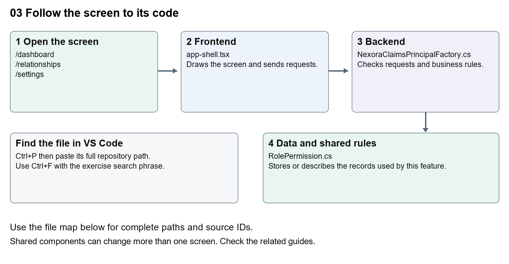

# Nexora workspace navigation and theme

Document 3 of the Nexora learning guides  
Source snapshot 14 October 2026 at 06:41 UTC


Find the shared sidebar, header, logo, responsive menu and staff workspace colours.

### Recognise the screen and its scope

Open `/dashboard`, `/relationships`, `/settings`. CRM routes use port 3017; member routes use 3018; public website routes can use 3019. Brackets name a route parameter, not text to paste into a browser. Choose a real record or site id from the application.

This guide covers Navigation groups and submenu links; Mobile menu; User account and sign-out; Permission-filtered navigation; Shared neon theme and headings.



The diagram shows the file roles. The full paths below are what you paste into Ctrl+P.

### Find the files in VS Code

| Role | File and source ID | What it does |
| --- | --- | --- |
| Screen | S0058 app-shell.tsx | Main UI or route for this topic |
| Server | S0409 NexoraClaimsPrincipalFactory.cs | Endpoints or server rules |
| Data | S0379 RolePermission.cs | Data shape or persistence structure |

**Screen S0058**  
[apps/web/src/components/app-shell/app-shell.tsx](<D:/Projects new/Nexora/apps/web/src/components/app-shell/app-shell.tsx>)

**Server S0409**  
[backend/src/Modules/Nexora.Modules.Identity/Security/NexoraClaimsPrincipalFactory.cs](<D:/Projects new/Nexora/backend/src/Modules/Nexora.Modules.Identity/Security/NexoraClaimsPrincipalFactory.cs>)

**Data S0379**  
[backend/src/Modules/Nexora.Modules.Identity/Domain/RolePermission.cs](<D:/Projects new/Nexora/backend/src/Modules/Nexora.Modules.Identity/Domain/RolePermission.cs>)

The complete HTML manual opens these source IDs inside its Source library. The Word manual shows short labelled extracts so you can learn the flow before reading large files. Each individual Markdown guide includes its complete primary files after the walkthrough.

### Follow the request and the records

1. The protected platform layout obtains a staff session.
2. AppShell receives the display name and permissions.
3. The navigation array supplies labels, routes and icons.
4. Permission filtering hides unavailable groups.
5. The selected route becomes the page content inside the shared shell.

### Read the code with an explanation

The shell surrounds many CRM pages. Changing a sidebar label changes every page using that shell. A hidden menu does not secure the API; server authorisation still checks every protected request. Specific routes take precedence over the old [workspace] placeholder route, which still displays a Scheduled module message for its recognised fallback names.

Source reference S0058 apps/web/src/components/app-shell/app-shell.tsx

Selected opening lines with their original numbers. The complete file is in the HTML source library.

```tsx
0001  "use client";
0003  import Link from "next/link";
0004  import type { Route } from "next";
0005  import { usePathname } from "next/navigation";
0006  import { useRouter } from "next/navigation";
0007  import { useRef, useState, type ReactNode } from "react";
```


The import lines lead to shared components and helpers. Start at the exported component or route function; follow the request helper to the server rather than assuming the whole feature lives in this file.

Source reference S0409 backend/src/Modules/Nexora.Modules.Identity/Security/NexoraClaimsPrincipalFactory.cs

Selected opening lines with their original numbers. The complete file is in the HTML source library.

```cs
0001  using System.Security.Claims;
0002  using Microsoft.AspNetCore.Identity;
0003  using Microsoft.EntityFrameworkCore;
0004  using Microsoft.Extensions.Options;
0005  using Nexora.Modules.Identity.Domain;
0006  using Nexora.Modules.Identity.Infrastructure.Persistence;
```


On the server, look for MapGet to load records, MapPost to create or perform an action, MapPut or MapPatch to change data, and RequireAuthorization for permissions. Some shared methods register endpoints indirectly. Find SaveChangesAsync to see the database write. A request method alone does not tell you every side effect.

Source reference S0379 backend/src/Modules/Nexora.Modules.Identity/Domain/RolePermission.cs

Selected opening lines with their original numbers. The complete file is in the HTML source library.

```cs
0001  namespace Nexora.Modules.Identity.Domain;
0003  public sealed class RolePermission
0004  {
0005      public Guid RoleId { get; set; }
0006      public NexoraRole Role { get; set; } = null!;
0007      public required string Permission { get; set; }
```


Follow model fields to their request names and database mapping. An id points to a particular record. A tenant id limits the organisation. A version or concurrency stamp protects newer edits. Some model files describe contracts rather than tables; check the owning DbContext before assuming storage.

### Make or trace your first change

1. Press Ctrl+P and open [apps/web/src/components/app-shell/app-shell.tsx](<D:/Projects new/Nexora/apps/web/src/components/app-shell/app-shell.tsx>).
2. Press Ctrl+F and search for `Workspace</p>`. In this snapshot it appears at line 74.
3. Change the small sidebar heading only. Keep the closing tag and class names. Refresh CRM and verify two different pages show the same changed heading.
4. Replace only `Workspace</p>` with `Nexora workspace</p>` in that intended location. Keep quotes, tags, JSON keys and routes intact.
5. Save with Ctrl+S. Inspect Problems and the local screen. Review the diff and restore the original text when you finish practising.

Extract from source line 74. A fragment from a long line is shown without the rest of that line.

```tsx
0074            <p className="mb-2 px-3 text-[10px] font-semibold uppercase tracking-[0.14em] text-[#a0a9b8]">Workspace</p>
```


These exercises have not been applied to the application. Their search phrases are verified against the captured source. Line numbers can move; the phrase and file path are your main navigation aids.

### Check a change and diagnose problems

Confirm the original screen still loads, the changed words appear in the intended place, and another screen using the same component still behaves correctly. If an action fails, inspect the browser Network response, the relevant helper and server validation message. Use the common error table at the beginning of the manual. Reload on a version conflict instead of removing the version check.

A syntax error after a text edit usually means a quote, brace or closing tag changed. Compare your diff with the original. An unchanged browser result can mean the wrong port, a saved published configuration overriding a default, or a running API that has not reloaded.

### Understand the current limits

The staff shell and staff login appearance are source-controlled. Portal and website presentation settings have their own CRM-managed controls. Do not describe staff theme CSS as a stored per-tenant setting.

### Continue learning

Related guides [07 Nexora record listings and saved views](#guide_07), [20 Nexora administration and access](#guide_20), [26 Nexora portal management](#guide_26), [27 Nexora website editor and publishing](#guide_27).

## Complete primary source files

These are the complete captured files, with numbered source lines. Other supporting files are included in the complete HTML manual. Configured local passwords, if any, are explicitly omitted. Do not paste the display line numbers into code.

### S0058 app-shell.tsx

[apps/web/src/components/app-shell/app-shell.tsx](<D:/Projects new/Nexora/apps/web/src/components/app-shell/app-shell.tsx>)

SHA256 `5c61ee1cf609d61d4ea89b53bbdba71ff2fe1cff8e8e84d9dc645298e7c0228c`; 154 source lines; complete captured text.

```tsx
0001  "use client";
0002  
0003  import Link from "next/link";
0004  import type { Route } from "next";
0005  import { usePathname } from "next/navigation";
0006  import { useRouter } from "next/navigation";
0007  import { useRef, useState, type ReactNode } from "react";
0008  import { Bell, Blocks, CalendarDays, ChevronDown, ContactRound, ExternalLink, GraduationCap, LayoutDashboard, LogOut, Menu, MessageSquareText, Settings, ShieldCheck, Sparkles, WalletCards, Workflow, X } from "lucide-react";
0009  import { NexoraMark } from "@/components/brand/nexora-mark";
0010  import { cn } from "@/lib/cn";
0011  import type { Session } from "@/lib/auth/session";
0012  
0013  import { setupKinds } from "@/features/membership/setup-kinds";
0014  import { PanelToggle, useCollapsedPanel } from "@/features/shared/panel-toggle";
0015  
0016  const navigation: Array<{ label: string; href: Route; match: string; icon: typeof LayoutDashboard; children?: Array<{ label: string; href: string; children?: Array<{label: string; href: string}> }> }> = [
0017    { label: "Home", href: "/dashboard", match: "/dashboard", icon: LayoutDashboard },
0018    { label: "Relationships", href: "/relationships" as Route, match: "/relationships", icon: ContactRound, children: [{ label: "Contacts", href: "/relationships/contacts" }, { label: "Accounts", href: "/relationships/accounts" }] },
0019    { label: "Membership", href: "/membership" as Route, match: "/membership", icon: ShieldCheck, children: [{ label: "Members", href: "/membership/members" }, { label: "Applications", href: "/membership/applications" }, { label: "Setup", href: "/membership/setup", children: setupKinds.map(([kind, label]) => ({label, href: `/membership/setup/${kind}`})) }] },
0020    { label: "Events & learning", href: "/events" as Route, match: "/events", icon: CalendarDays, children: [{ label: "Events", href: "/events/events" }, { label: "Courses", href: "/events/courses" }, { label: "Exams", href: "/events/exams" }] },
0021    { label: "Sales & finance", href: "/finance" as Route, match: "/finance", icon: WalletCards, children: [{ label: "Orders", href: "/finance/orders" }, { label: "Invoices", href: "/finance/invoices" }, { label: "Receipts", href: "/finance/receipts" }, { label: "Catalogue", href: "/finance/catalogue" }] },
0022    { label: "Engagement", href: "/engagement" as Route, match: "/engagement", icon: MessageSquareText, children: [{ label: "Communities", href: "/engagement/communities" }, { label: "Campaigns", href: "/engagement/campaigns" }, { label: "Funds", href: "/engagement/funds" }] },
0023    { label: "Work", href: "/work" as Route, match: "/work", icon: Blocks, children: [{ label: "Tasks", href: "/work/items" }, { label: "Notifications", href: "/work/notifications" }, { label: "Imports", href: "/work/imports" }] },
0024    { label: "Portal", href: "/portal-management" as Route, match: "/portal-management", icon: Blocks, children: [{ label: "Portal management", href: "/portal-management" }] },
0025    { label: "Website", href: "/website" as Route, match: "/website", icon: Blocks, children: [{ label: "Website pages and settings", href: "/website" }] },
0026    { label: "Insights", href: "/insights" as Route, match: "/insights", icon: GraduationCap, children: [{ label: "Reports", href: "/insights" }] },
0027    { label: "NexOrchestr AI", href: "/assistant" as Route, match: "/assistant", icon: Sparkles, children: [{ label: "Assistant", href: "/assistant" }] },
0028  ];
0029  
0030  export function AppShell({ children, session }: { children: ReactNode; session: Session }) {
0031    const pathname = usePathname();
0032    const router = useRouter();
0033    const [mobileOpen, setMobileOpen] = useState(false);
0034    const [navigationCollapsed, toggleNavigation] = useCollapsedPanel("nexora.layout.navigation-collapsed");
0035    const [openGroups, setOpenGroups] = useState<Record<string, boolean>>({});
0036    const accountPopover = useRef<HTMLDivElement>(null);
0037    const hasAdminTools = session.permissions.some(permission => permission.endsWith(".manage") || permission === "crm.configure" || permission === "workflows.read");
0038    const administrationOpen = openGroups["/settings"] ?? pathname.startsWith("/settings");
0039    const moduleAccess: Record<string, string> = { "/relationships": "crm.read", "/membership": "membership.read", "/events": "events.read", "/finance": "finance.read", "/engagement": "engagement.read", "/work": "work.read", "/portal-management": "content.read", "/website": "content.read", "/insights": "insights.read", "/assistant": "crm.read" };
0040    const [isSigningOut, setIsSigningOut] = useState(false);
0041    const dashboardTheme = pathname === "/dashboard";
0042    const initials = session.displayName.split(/\s+/).map((part) => part[0]).join("").slice(0, 2).toUpperCase();
0043  
0044    async function signOut() {
0045      setIsSigningOut(true);
0046      try {
0047        const csrf = await fetch("/api/v1/auth/csrf", { credentials: "include" });
0048        const { token } = (await csrf.json()) as { token: string };
0049        await fetch("/api/v1/auth/logout", {
0050          method: "POST",
0051          credentials: "include",
0052          headers: { "X-CSRF-TOKEN": token },
0053        });
0054      } finally {
0055        router.replace("/login");
0056        router.refresh();
0057      }
0058    }
0059  
0060    return (
0061      <div className={cn("min-h-screen workspace-theme", dashboardTheme && "dashboard-theme")} data-navigation-collapsed={navigationCollapsed}>
0062        <div className="workspace-ambient" aria-hidden="true">
0063          <span className="workspace-ambient-blue" />
0064          <span className="workspace-ambient-cobalt" />
0065          <span className="workspace-ambient-horizon" />
0066        </div>
0067        {mobileOpen && <button className="workspace-overlay fixed inset-0 z-40 backdrop-blur-sm lg:hidden" onClick={() => setMobileOpen(false)} aria-label="Close navigation overlay" />}
0068        <aside id="workspace-navigation" data-mobile-open={mobileOpen} inert={navigationCollapsed && !mobileOpen} className="workspace-sidebar fixed inset-y-0 left-0 z-50 flex w-[274px] flex-col border-r transition-transform">
0069          <div className="flex h-[68px] shrink-0 items-center justify-between px-5">
0070            <NexoraMark inverse />
0071            <button className="grid size-9 place-items-center rounded-lg text-[#667085] hover:bg-[#f2f4f8] lg:hidden" onClick={() => setMobileOpen(false)} aria-label="Close navigation"><X className="size-5" /></button>
0072          </div>
0073          <nav className="min-h-0 flex-1 overflow-y-auto px-3 py-4" aria-label="Primary navigation">
0074            <p className="mb-2 px-3 text-[10px] font-semibold uppercase tracking-[0.14em] text-[#a0a9b8]">Workspace</p>
0075            <div className="space-y-1">
0076              {navigation.filter(item => !moduleAccess[item.match] || session.permissions.includes(moduleAccess[item.match])).map((item) => {
0077                const active = pathname === item.match || (item.match !== "/dashboard" && pathname.startsWith(item.match));
0078                const Icon = item.icon;
0079                const expanded = openGroups[item.match] ?? active;
0080                return (
0081                  <div key={item.label}>
0082                    {item.children ? <button type="button" onClick={() => setOpenGroups(groups => ({ ...groups, [item.match]: !expanded }))} data-active={active} aria-expanded={expanded} aria-controls={`navigation-${item.match.slice(1)}`} className="workspace-nav-item group flex h-11 w-full items-center gap-3 rounded-xl px-3 text-left text-sm font-medium transition">
0083                      <Icon className={cn("size-[18px]", active ? "text-[#4b66dd]" : "text-[#8b96a8] group-hover:text-[#5f6e82]")} />
0084                      <span className="flex-1">{item.label}</span><ChevronDown className={cn("size-3.5 opacity-45 transition-transform", expanded ? "rotate-0" : "-rotate-90")} />
0085                    </button> : <Link href={item.href} data-active={active} aria-current={active ? "page" : undefined} onClick={() => setMobileOpen(false)} className="workspace-nav-item group flex h-11 items-center gap-3 rounded-xl px-3 text-sm font-medium transition">
0086                      <Icon className={cn("size-[18px]", active ? "text-[#4b66dd]" : "text-[#8b96a8] group-hover:text-[#5f6e82]")} /><span className="flex-1">{item.label}</span>{item.label !== "Home" && <ChevronDown className="size-3.5 -rotate-90 opacity-45" />}
0087                    </Link>}
0088                    {item.children && expanded && <div id={`navigation-${item.match.slice(1)}`} className="ml-8 mt-1 space-y-1 border-l border-[#dfe5f5] pl-3">
0089                      {item.children.map((child, index) => {
0090                        const childActive = pathname === child.href || pathname.startsWith(`${child.href}/`) || (pathname === item.match && index === 0);
0091                        if (child.children) {
0092                          const setupOpen = openGroups[child.href] ?? pathname.startsWith(child.href);
0093                          return <div key={child.href}><button type="button" aria-expanded={setupOpen} onClick={() => setOpenGroups(groups => ({...groups, [child.href]: !setupOpen}))} className="flex w-full items-center justify-between rounded-lg px-3 py-2 text-xs font-medium text-[#364fc7]">{child.label}<ChevronDown className={cn("size-3.5", !setupOpen && "-rotate-90")} /></button>{setupOpen && <div className="ml-3 border-l border-[#dfe5f5] pl-2">{child.children.map(lookup => <Link key={lookup.href} href={lookup.href as Route} aria-current={pathname === lookup.href ? "page" : undefined} onClick={() => setMobileOpen(false)} className={cn("block rounded-lg px-3 py-2 text-xs", pathname === lookup.href ? "bg-[#f1f4ff] text-[#364fc7]" : "text-[#7b8798] hover:bg-[#f6f7fa]")}>{lookup.label}</Link>)}</div>}</div>;
0094                        }
0095                        return <Link key={child.href} href={child.href as Route} aria-current={childActive ? "page" : undefined} onClick={() => setMobileOpen(false)} className={cn("block rounded-lg px-3 py-2 text-xs font-medium", childActive ? "bg-[#f1f4ff] text-[#364fc7]" : "text-[#7b8798] hover:bg-[#f6f7fa]")}>{child.label}</Link>;
0096                      })}
0097                    </div>}
0098                  </div>
0099                );
0100              })}
0101            </div>
0102          </nav>
0103          <div className="sidebar-account max-h-[45dvh] shrink-0 overflow-y-auto border-t border-[#e9ecf1] p-3">
0104            {session.permissions.includes("identity.read") && <>
0105              <button type="button" data-active={pathname.startsWith("/settings")} aria-expanded={administrationOpen} aria-controls="administration-navigation" onClick={() => setOpenGroups(groups => ({...groups, "/settings": !administrationOpen}))} className="workspace-nav-item flex min-h-11 w-full items-center gap-3 rounded-xl px-3 py-2 text-left text-sm font-medium"><Settings className="size-[18px] shrink-0 text-[#8b96a8]" /><span className="flex-1">Administration</span><ChevronDown className={cn("size-3.5 shrink-0", !administrationOpen && "-rotate-90")} /></button>
0106              {administrationOpen && <div id="administration-navigation" className="ml-8 mt-1 space-y-1 border-l border-[#dfe5f5] pl-3">{[["users", "Users"], ["security-groups", "Security groups"]].map(([section, label]) => <Link key={section} href={`/settings/${section}` as Route} aria-current={pathname === `/settings/${section}` ? "page" : undefined} onClick={() => setMobileOpen(false)} className={cn("block rounded-lg px-3 py-2 text-xs font-medium", pathname === `/settings/${section}` ? "bg-[#f1f4ff] text-[#364fc7]" : "text-[#7b8798] hover:bg-[#f6f7fa]")}>{label}</Link>)}</div>}
0107            </>}
0108            <div className="sidebar-profile mt-2">
0109              <button type="button" popoverTarget="account-options" aria-label={`Account options for ${session.displayName}`} className="profile-trigger flex w-full items-center gap-2.5 rounded-xl px-2 py-3 text-left">
0110                <span className="profile-avatar grid size-9 shrink-0 place-items-center rounded-full text-[11px] font-semibold" aria-hidden="true">{initials}</span>
0111                <span className="min-w-0 flex-1">
0112                  <span className="profile-name block truncate text-[11px] font-semibold leading-5" title={session.displayName}>{session.displayName}</span>
0113                  <span className="profile-role block truncate text-[10px] leading-4" title={session.roles[0] ?? session.tenantName}>{session.roles[0] ?? session.tenantName}</span>
0114                </span>
0115                <ChevronDown className="size-3.5 shrink-0 opacity-60" />
0116              </button>
0117              <div ref={accountPopover} id="account-options" popover="auto" aria-label="Account options" className="account-popover">
0118                <div className="account-popover-heading">
0119                  <p className="text-[10px] font-semibold uppercase tracking-[0.12em]">Your workspace</p>
0120                  <p className="mt-1 text-xs leading-5">{session.tenantName}</p>
0121                </div>
0122                {hasAdminTools && <div className="space-y-1 p-2">
0123                  <Link href={"/automations" as Route} aria-current={pathname.startsWith("/automations") ? "page" : undefined} onClick={() => { accountPopover.current?.hidePopover(); setMobileOpen(false); }} className="account-action">
0124                    <Workflow className="size-4" /><span>Automations</span>
0125                  </Link>
0126                  {session.permissions.includes("workflows.read") && <button type="button" title="Open WFL Designer in a new window" onClick={() => { window.open("/workflow-designer", "_blank", "popup,width=1440,height=1000,noopener,noreferrer"); accountPopover.current?.hidePopover(); setMobileOpen(false); }} className="account-action">
0127                    <Blocks className="size-4" /><span className="flex-1">WFL Designer</span><ExternalLink className="size-3.5 opacity-50" />
0128                  </button>}
0129                </div>}
0130                <div className="account-signout p-2">
0131                  <button type="button" disabled={isSigningOut} onClick={signOut} className="account-action disabled:opacity-50"><LogOut className="size-4" />{isSigningOut ? "Signing out…" : "Sign out"}</button>
0132                </div>
0133              </div>
0134            </div>
0135          </div>
0136        </aside>
0137  
0138        <div className="workspace-main">
0139          <header className="workspace-header sticky top-0 z-30 flex h-[56px] items-center gap-4 border-b px-4 backdrop-blur-xl sm:px-7">
0140            <button className="grid size-10 place-items-center rounded-xl border border-[#e2e6ed] text-[#5d697b] lg:hidden" onClick={() => setMobileOpen(true)} aria-label="Open navigation"><Menu className="size-5" /></button>
0141            <PanelToggle className="workspace-navigation-toggle" label="navigation" collapsed={navigationCollapsed} controls="workspace-navigation" onToggle={() => { accountPopover.current?.hidePopover(); setMobileOpen(false); toggleNavigation(); }} />
0142            <div id="workspace-page-heading" className="flex min-w-0 flex-1 items-center justify-between gap-3" />
0143            <div className="ml-auto flex items-center gap-1.5">
0144              {session.permissions.includes("work.read") && <Link href={"/work/notifications" as Route} className="grid size-10 place-items-center rounded-xl text-[#687487] transition hover:bg-[#f2f4f8]" aria-label="Notifications"><Bell className="size-[19px]" /></Link>}
0145            </div>
0146          </header>
0147          <div className="workspace-content min-h-[calc(100vh-56px)]">{children}</div>
0148          <footer className="pointer-events-none fixed bottom-3 right-4 z-20 text-right text-[10px] text-white/55 sm:right-7" aria-label="Copyright">
0149            © 2026 Nexora. All rights reserved.
0150          </footer>
0151        </div>
0152      </div>
0153    );
0154  }
```

### S0409 NexoraClaimsPrincipalFactory.cs

[backend/src/Modules/Nexora.Modules.Identity/Security/NexoraClaimsPrincipalFactory.cs](<D:/Projects new/Nexora/backend/src/Modules/Nexora.Modules.Identity/Security/NexoraClaimsPrincipalFactory.cs>)

SHA256 `6e21b92f5e837cd8219e32b6151135c8d5c89a27fb09d5a13b93f93e8c808c39`; 45 source lines; complete captured text.

```cs
0001  using System.Security.Claims;
0002  using Microsoft.AspNetCore.Identity;
0003  using Microsoft.EntityFrameworkCore;
0004  using Microsoft.Extensions.Options;
0005  using Nexora.Modules.Identity.Domain;
0006  using Nexora.Modules.Identity.Infrastructure.Persistence;
0007  
0008  namespace Nexora.Modules.Identity.Security;
0009  
0010  internal sealed class NexoraClaimsPrincipalFactory(
0011      UserManager<NexoraUser> userManager,
0012      RoleManager<NexoraRole> roleManager,
0013      IOptions<IdentityOptions> options,
0014      NexoraIdentityDbContext dbContext)
0015      : UserClaimsPrincipalFactory<NexoraUser, NexoraRole>(userManager, roleManager, options)
0016  {
0017      protected override async Task<ClaimsIdentity> GenerateClaimsAsync(NexoraUser user)
0018      {
0019          var identity = await base.GenerateClaimsAsync(user);
0020          identity.AddClaim(new Claim(NexoraClaimTypes.TenantId, user.TenantId.ToString()));
0021          identity.AddClaim(new Claim(NexoraClaimTypes.DisplayName, user.DisplayName));
0022  
0023          var roleNames = await UserManager.GetRolesAsync(user);
0024          if (roleNames.Count == 0)
0025          {
0026              return identity;
0027          }
0028  
0029          var isAdmin = await dbContext.Roles.AnyAsync(role => role.IsSystem && role.TenantId == user.TenantId && roleNames.Contains(role.Name!));
0030          var permissions = isAdmin ? NexoraPermissions.All.ToList() : await dbContext.RolePermissions
0031              .Where(permission =>
0032                  permission.Role.TenantId == user.TenantId &&
0033                  roleNames.Contains(permission.Role.Name!))
0034              .Select(permission => permission.Permission)
0035              .Distinct()
0036              .ToListAsync();
0037  
0038          foreach (var permission in permissions)
0039          {
0040              identity.AddClaim(new Claim(NexoraClaimTypes.Permission, permission));
0041          }
0042  
0043          return identity;
0044      }
0045  }
```

### S0379 RolePermission.cs

[backend/src/Modules/Nexora.Modules.Identity/Domain/RolePermission.cs](<D:/Projects new/Nexora/backend/src/Modules/Nexora.Modules.Identity/Domain/RolePermission.cs>)

SHA256 `bdb131bbe37c55267e3b56a388ff89925efa1cc7f74b439b939d0db0bbc8a2ab`; 8 source lines; complete captured text.

```cs
0001  namespace Nexora.Modules.Identity.Domain;
0002  
0003  public sealed class RolePermission
0004  {
0005      public Guid RoleId { get; set; }
0006      public NexoraRole Role { get; set; } = null!;
0007      public required string Permission { get; set; }
0008  }
```
