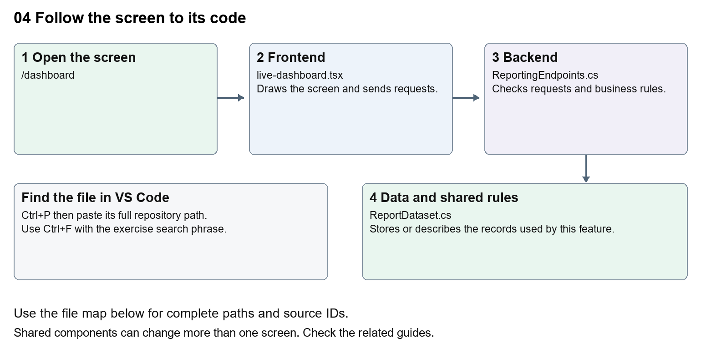

# Nexora home dashboard

Document 4 of the Nexora learning guides  
Source snapshot 13 October 2026 at 17:12 UTC


Understand the welcome screen, period selector, report cards and recent-record summaries.

### Recognise the screen and its scope

Open `/dashboard`. CRM routes use port 3017; member routes use 3018; public website routes can use 3019. Brackets name a route parameter, not text to paste into a browser. Choose a real record or site id from the application.

This guide covers Welcome name; Report period; Permission-based datasets; Flip cards; Recent records and retry state.



The diagram shows the file roles. The full paths below are what you paste into Ctrl+P.

### Find the files in VS Code

| Role | File and source ID | What it does |
| --- | --- | --- |
| Screen | S0101 live-dashboard.tsx | Main UI or route for this topic |
| Server | S0577 ReportingEndpoints.cs | Endpoints or server rules |
| Data | S0199 ReportDataset.cs | Data shape or persistence structure |

**Screen S0101**  
[apps/web/src/features/insights/live-dashboard.tsx](<D:/Projects new/Nexora/apps/web/src/features/insights/live-dashboard.tsx>)

**Server S0577**  
[backend/src/Nexora.Api/ReportingEndpoints.cs](<D:/Projects new/Nexora/backend/src/Nexora.Api/ReportingEndpoints.cs>)

**Data S0199**  
[backend/src/BuildingBlocks/Nexora.BuildingBlocks/Reporting/ReportDataset.cs](<D:/Projects new/Nexora/backend/src/BuildingBlocks/Nexora.BuildingBlocks/Reporting/ReportDataset.cs>)

The complete HTML manual opens these source IDs inside its Source library. The Word manual shows short labelled extracts so you can learn the flow before reading large files. Each individual Markdown guide includes its complete primary files after the walkthrough.

### Follow the request and the records

1. The dashboard route checks the staff session.
2. LiveDashboard starts with its selected number of days.
3. It gets available datasets from /api/v1/insights/datasets.
4. It requests matching records for each dataset with fromUtc and toUtc.
5. Cards display totals and samples from those stored records.

### Read the code with an explanation

The name comes from the session rather than a hardcoded person. useState stores the selected period in this mounted screen. useEffect loads data when the period changes; its active flag prevents a late response updating an unmounted screen. The counts describe records created in the period, not revenue or customer validation.

Source reference S0101 apps/web/src/features/insights/live-dashboard.tsx

Selected opening lines with their original numbers. The complete file is in the HTML source library.

```tsx
0001  "use client";
0002  import { useEffect,useState } from "react";
0003  import { moduleApi } from "../shared/module-api";
0004  import { WorkspaceHeading } from "@/components/ui/workspace-heading";
0005  import styles from "./live-dashboard.module.css";
0006  type Row={id:string;label:string;status:string;createdAtUtc:string};
```


The import lines lead to shared components and helpers. Start at the exported component or route function; follow the request helper to the server rather than assuming the whole feature lives in this file.

Source reference S0577 backend/src/Nexora.Api/ReportingEndpoints.cs

Extract from source line 12. A fragment from a long line is shown without the rest of that line.

```cs
0012    api.MapGet("/datasets",(IEnumerable<IReportDataset> datasets,HttpContext http)=>datasets.Where(d=>Allowed(http,d)).Select(d=>new{d.Key,d.Title,fields=new[]{"label","status","createdAtUtc"}}));
```


On the server, look for MapGet to load records, MapPost to create or perform an action, MapPut or MapPatch to change data, and RequireAuthorization for permissions. Some shared methods register endpoints indirectly. Find SaveChangesAsync to see the database write. A request method alone does not tell you every side effect.

Source reference S0199 backend/src/BuildingBlocks/Nexora.BuildingBlocks/Reporting/ReportDataset.cs

Selected opening lines with their original numbers. The complete file is in the HTML source library.

```cs
0001  using Microsoft.EntityFrameworkCore;
0002  namespace Nexora.BuildingBlocks.Reporting;
0003  public sealed record ReportQuery(string? Search=null,string? Status=null,DateTime? FromUtc=null,DateTime? ToUtc=null,int Skip=0,int Take=50,string Sort="-createdAtUtc");
0005  public sealed record ReportPage(int Total,IReadOnlyList<ReportRow> Items);
0006  public interface IReportDataset
0007  {
```


Follow model fields to their request names and database mapping. An id points to a particular record. A tenant id limits the organisation. A version or concurrency stamp protects newer edits. Some model files describe contracts rather than tables; check the owning DbContext before assuming storage.

### Make or trace your first change

1. Press Ctrl+P and open [apps/web/src/features/insights/live-dashboard.tsx](<D:/Projects new/Nexora/apps/web/src/features/insights/live-dashboard.tsx>).
2. Press Ctrl+F and search for `Stored records created during the selected period.`. In this snapshot it appears at line 11.
3. Replace only this explanatory sentence. Reload /dashboard and change the period. Check that card loading and totals still work.
4. Replace only `Stored records created during the selected period.` with `Records created in your chosen period.` in that intended location. Keep quotes, tags, JSON keys and routes intact.
5. Save with Ctrl+S. Inspect Problems and the local screen. Review the diff and restore the original text when you finish practising.

Extract from source line 11. A fragment from a long line is shown without the rest of that line.

```tsx
0011  lassName="mt-2 text-sm text-white">Stored records created during the selected period.</p></div><label className="text-sm">Report p
```


These exercises have not been applied to the application. Their search phrases are verified against the captured source. Line numbers can move; the phrase and file path are your main navigation aids.

### Check a change and diagnose problems

Confirm the original screen still loads, the changed words appear in the intended place, and another screen using the same component still behaves correctly. If an action fails, inspect the browser Network response, the relevant helper and server validation message. Use the common error table at the beginning of the manual. Reload on a version conflict instead of removing the version check.

A syntax error after a text edit usually means a quote, brace or closing tag changed. Compare your diff with the original. An unchanged browser result can mean the wrong port, a saved published configuration overriding a default, or a running API that has not reloaded.

### Understand the current limits

The user needs reporting permission. The reporting service also filters datasets by module permissions and tenant. Counts are a point-in-time result; no automatic real-time stream is implied.

### Continue learning

Related guides [19 Nexora insights and reporting](#guide_19), [20 Nexora administration and access](#guide_20).

## Complete primary source files

These are the complete captured files, with numbered source lines. Other supporting files are included in the complete HTML manual. Configured local passwords, if any, are explicitly omitted. Do not paste the display line numbers into code.

### S0101 live-dashboard.tsx

[apps/web/src/features/insights/live-dashboard.tsx](<D:/Projects new/Nexora/apps/web/src/features/insights/live-dashboard.tsx>)

SHA256 `bdebbc0f6234dd57d1637074c11d28a1d1d37f839e8ce700dc9a3f03a01e1964`; 14 source lines; complete captured text.

```tsx
0001  "use client";
0002  import { useEffect,useState } from "react";
0003  import { moduleApi } from "../shared/module-api";
0004  import { WorkspaceHeading } from "@/components/ui/workspace-heading";
0005  import styles from "./live-dashboard.module.css";
0006  type Row={id:string;label:string;status:string;createdAtUtc:string};
0007  type Report={key:string;title:string;total:number;items:Row[]};
0008  export function LiveDashboard({name,allowed}:{name:string;allowed:boolean}){
0009   const [days,setDays]=useState(30),[reports,setReports]=useState<Report[]>([]),[error,setError]=useState(""),[loading,setLoading]=useState(true),[flipped,setFlipped]=useState<string[]>([]),[retry,setRetry]=useState(0),[asOf,setAsOf]=useState("");
0010   useEffect(()=>{if(!allowed)return;let active=true;const to=new Date(),from=new Date(to.getTime()-days*86400000);moduleApi<{key:string;title:string}[]>("insights","/datasets").then(ds=>Promise.all(ds.map(async d=>({...d,...await moduleApi<{total:number;items:Row[]}>("insights",`/query/${d.key}`,"POST",{fromUtc:from.toISOString(),toUtc:to.toISOString(),skip:0,take:5})})))).then(data=>{if(active){setReports(data);setAsOf(to.toISOString());setLoading(false);}}).catch(e=>{if(active){setError(e.message);setLoading(false);}});return()=>{active=false;};},[days,retry,allowed]);
0011   return <main className="mx-auto max-w-7xl space-y-6 p-5 sm:p-8"><WorkspaceHeading>Home</WorkspaceHeading><div className="flex flex-wrap items-end justify-between gap-4"><div><h2 className="text-2xl font-semibold text-white">Welcome, {name}</h2><p className="mt-2 text-sm text-white">Stored records created during the selected period.</p></div><label className="text-sm">Report period <select className="ml-2 rounded-lg bg-white p-2" value={days} onChange={e=>{setDays(Number(e.target.value));setLoading(true);setError("");}}>{[1,5,10,15,30,60,90,365].map(n=><option key={n} value={n}>Last {n} {n===1?"day":"days"}</option>)}</select></label></div>
0012   {!allowed?<p className="rounded-xl bg-white p-5">Ask your administrator for reporting access.</p>:error?<div role="alert" className="rounded-xl bg-white p-5">{error} <button onClick={()=>{setError("");setLoading(true);setRetry(n=>n+1);}}>Retry</button></div>:loading?<p role="status">Loading stored records…</p>:<><div className="grid gap-4 sm:grid-cols-2 xl:grid-cols-4">{reports.map(r=><button key={r.key} className={styles.card} aria-label={`${r.title}: ${flipped.includes(r.key)?r.total+" records, show report name":"show result"}`} aria-pressed={flipped.includes(r.key)} onClick={()=>setFlipped(v=>v.includes(r.key)?v.filter(x=>x!==r.key):[...v,r.key])}><span className={`${styles.inner} ${flipped.includes(r.key)?styles.flipped:""}`}><span className={styles.face} aria-hidden={flipped.includes(r.key)}><strong>{r.title}</strong><small>Click to reveal report</small></span><span className={`${styles.face} ${styles.back}`} aria-hidden={!flipped.includes(r.key)}><strong className="text-4xl">{r.total.toLocaleString()}</strong><span>{r.title}</span><small>Created in the last {days} days</small></span></span></button>)}</div><p className="text-xs text-white">Updated {new Date(asOf).toLocaleString()} · Reports respect your workspace permissions.</p></>}
0013   </main>;
0014  }
```

### S0577 ReportingEndpoints.cs

[backend/src/Nexora.Api/ReportingEndpoints.cs](<D:/Projects new/Nexora/backend/src/Nexora.Api/ReportingEndpoints.cs>)

SHA256 `efe06155ca5e7139ff041fac8c1233d5a797f2fca056d59649082e472d458bb1`; 20 source lines; complete captured text.

```cs
0001  using System.Text;
0002  using Nexora.BuildingBlocks.Endpoints;
0003  using Nexora.BuildingBlocks.Reporting;
0004  using Nexora.Modules.Identity.Security;
0005  using static Nexora.BuildingBlocks.Endpoints.ModuleEndpoints;
0006  namespace Nexora.Api;
0007  public static class ReportingEndpoints
0008  {
0009   public static void MapNexoraReporting(this WebApplication app)
0010   {
0011    var api=app.Module("insights");
0012    api.MapGet("/datasets",(IEnumerable<IReportDataset> datasets,HttpContext http)=>datasets.Where(d=>Allowed(http,d)).Select(d=>new{d.Key,d.Title,fields=new[]{"label","status","createdAtUtc"}}));
0013    api.MapGet("/dashboard",async(IEnumerable<IReportDataset> datasets,HttpContext http,CancellationToken ct)=>{var counts=new List<object>();foreach(var dataset in datasets.Where(d=>Allowed(http,d))){var page=await dataset.QueryAsync(new(Take:0),ct);counts.Add(new{dataset.Key,dataset.Title,count=page.Total});}return Results.Ok(new{asOfUtc=DateTime.UtcNow,datasets=counts});});
0014    api.MapPost("/query/{key}",async(string key,ReportQuery query,IEnumerable<IReportDataset> datasets,HttpContext http,CancellationToken ct)=>{Validate(query);var dataset=datasets.SingleOrDefault(d=>d.Key==key&&Allowed(http,d));if(dataset==null)return Results.NotFound();return Results.Ok(await dataset.QueryAsync(query,ct));});
0015    api.MapPost("/export/{key}",async(string key,ReportQuery query,IEnumerable<IReportDataset> datasets,HttpContext http,ILoggerFactory logs,CancellationToken ct)=>{Validate(query);var dataset=datasets.SingleOrDefault(d=>d.Key==key&&Allowed(http,d));if(dataset==null)return Results.NotFound();var page=await dataset.QueryAsync(query with{Skip=0,Take=10001},ct);Check(page.Total<=10000,"Narrow the filters to at most 10,000 records before export.");var csv=new StringBuilder("Id,Label,Status,CreatedUtc\r\n");foreach(var row in page.Items)csv.AppendLine(string.Join(",",row.Id,Csv(row.Label),Csv(row.Status),row.CreatedAtUtc.ToString("O")));logs.CreateLogger("Nexora.Reports").LogInformation("Report exported dataset={Dataset} rows={Rows} tenant={Tenant} actor={Actor} trace={Trace}",key,page.Items.Count,http.User.FindFirst("tenant_id")?.Value,http.User.FindFirst(System.Security.Claims.ClaimTypes.NameIdentifier)?.Value,http.TraceIdentifier);return Results.File(Encoding.UTF8.GetBytes(csv.ToString()),"text/csv","nexora-"+key+".csv");}).RequireAuthorization("insights.export");
0016   }
0017   private static bool Allowed(HttpContext http,IReportDataset dataset)=>http.User.HasClaim(NexoraClaimTypes.Permission,dataset.Permission);
0018   private static void Validate(ReportQuery q){Choice(q.Sort,"label","-label","status","-status","createdAtUtc","-createdAtUtc");Check(q.Take is >0 and <=200&&q.Skip is >=0 and <=100000,"Use a page size of 1–200 and offset of 0–100000.");Check(q.Search==null||q.Search.Length<=160,"Search is too long.");Check(q.Status==null||q.Status.Length<=80,"Status is too long.");Check(q.FromUtc==null||q.ToUtc==null||q.FromUtc<q.ToUtc,"The end date must follow the start date.");}
0019   private static string Csv(string value){if(value.TrimStart().StartsWith('=')||value.TrimStart().StartsWith('+')||value.TrimStart().StartsWith('-')||value.TrimStart().StartsWith('@'))value="'"+value;return "\""+value.Replace("\"","\"\"")+"\"";}
0020  }
```

### S0199 ReportDataset.cs

[backend/src/BuildingBlocks/Nexora.BuildingBlocks/Reporting/ReportDataset.cs](<D:/Projects new/Nexora/backend/src/BuildingBlocks/Nexora.BuildingBlocks/Reporting/ReportDataset.cs>)

SHA256 `6616900a8a876256e4dcabd20398c39be5ae3e618f18effaa46ebc60cfde2826`; 32 source lines; complete captured text.

```cs
0001  using Microsoft.EntityFrameworkCore;
0002  namespace Nexora.BuildingBlocks.Reporting;
0003  public sealed record ReportQuery(string? Search=null,string? Status=null,DateTime? FromUtc=null,DateTime? ToUtc=null,int Skip=0,int Take=50,string Sort="-createdAtUtc");
0004  public sealed class ReportRow { public Guid Id {get;init;} public string Label {get;init;}=""; public string Status {get;init;}=""; public DateTime CreatedAtUtc {get;init;} }
0005  public sealed record ReportPage(int Total,IReadOnlyList<ReportRow> Items);
0006  public interface IReportDataset
0007  {
0008   string Key {get;} string Title {get;} string Permission {get;}
0009   Task<ReportPage> QueryAsync(ReportQuery query,CancellationToken ct);
0010   Task<ReportRow?> FindAsync(Guid id,CancellationToken ct);
0011  }
0012  public sealed class ReportDataset(string key,string title,string permission,IQueryable<ReportRow> source):IReportDataset
0013  {
0014   public Task<ReportRow?> FindAsync(Guid id,CancellationToken ct)=>source.SingleOrDefaultAsync(x=>x.Id==id,ct);
0015   public string Key=>key;public string Title=>title;public string Permission=>permission;
0016   public async Task<ReportPage> QueryAsync(ReportQuery request,CancellationToken ct)
0017   {
0018    var query=source;
0019    if(!string.IsNullOrWhiteSpace(request.Search))query=query.Where(x=>x.Label.Contains(request.Search));
0020    if(!string.IsNullOrWhiteSpace(request.Status))query=query.Where(x=>x.Status==request.Status);
0021    if(request.FromUtc!=null)query=query.Where(x=>x.CreatedAtUtc>=request.FromUtc);
0022    if(request.ToUtc!=null)query=query.Where(x=>x.CreatedAtUtc<request.ToUtc);
0023    var total=await query.CountAsync(ct);
0024    var ordered=request.Sort switch {
0025     "label"=>query.OrderBy(x=>x.Label), "-label"=>query.OrderByDescending(x=>x.Label),
0026     "status"=>query.OrderBy(x=>x.Status), "-status"=>query.OrderByDescending(x=>x.Status),
0027     "createdAtUtc"=>query.OrderBy(x=>x.CreatedAtUtc), _=>query.OrderByDescending(x=>x.CreatedAtUtc)
0028    };
0029    var rows=await ordered.ThenBy(x=>x.Id).Skip(request.Skip).Take(request.Take).ToListAsync(ct);
0030    return new(total,rows);
0031   }
0032  }
```
