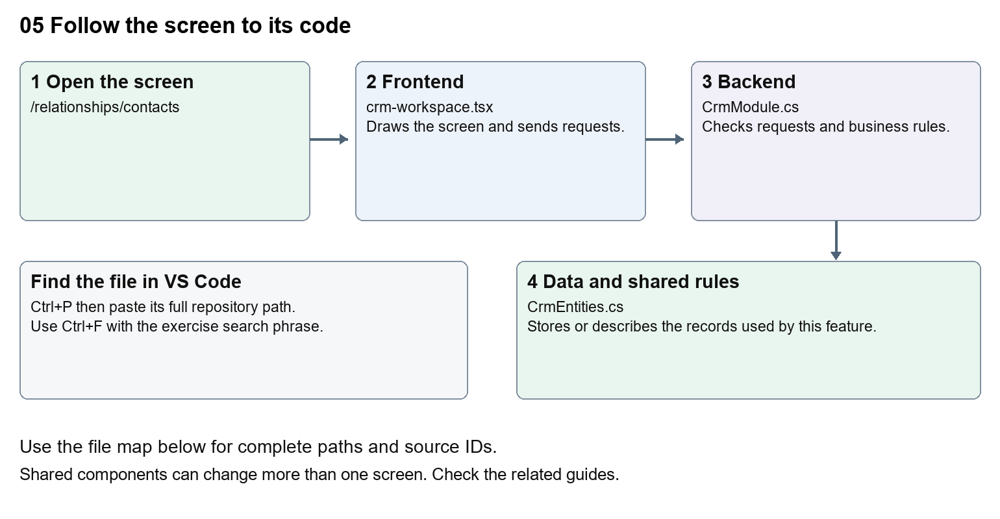

# Nexora CRM contacts

Document 5 of the Nexora learning guides  
Source snapshot 13 October 2026 at 17:12 UTC


Understand the contact list, create form, detail screen and connected person information.

### Recognise the screen and its scope

Open `/relationships/contacts`. CRM routes use port 3017; member routes use 3018; public website routes can use 3019. Brackets name a route parameter, not text to paste into a browser. Choose a real record or site id from the application.

This guide covers Contact creation and editing; Status category owner and team; Structured names and general information; Addresses communication social links and consent; Notes tags timeline photo and connected memberships.



The diagram shows the file roles. The full paths below are what you paste into Ctrl+P.

### Find the files in VS Code

| Role | File and source ID | What it does |
| --- | --- | --- |
| Screen | S0080 crm-workspace.tsx | Main UI or route for this topic |
| Server | S0249 CrmModule.cs | Endpoints or server rules |
| Data | S0254 CrmEntities.cs | Data shape or persistence structure |

**Screen S0080**  
[apps/web/src/features/crm/crm-workspace.tsx](<D:/Projects new/Nexora/apps/web/src/features/crm/crm-workspace.tsx>)

**Server S0249**  
[backend/src/Modules/Nexora.Modules.Crm/CrmModule.cs](<D:/Projects new/Nexora/backend/src/Modules/Nexora.Modules.Crm/CrmModule.cs>)

**Data S0254**  
[backend/src/Modules/Nexora.Modules.Crm/Domain/CrmEntities.cs](<D:/Projects new/Nexora/backend/src/Modules/Nexora.Modules.Crm/Domain/CrmEntities.cs>)

The complete HTML manual opens these source IDs inside its Source library. The Word manual shows short labelled extracts so you can learn the flow before reading large files. Each individual Markdown guide includes its complete primary files after the walkthrough.

### Follow the request and the records

1. The contacts route passes contact as the record kind.
2. useCrmListing requests /api/v1/crm/records with filters and paging.
3. Selecting a row loads its detail and related sections.
4. The create or edit form sends JSON with the record kind and version.
5. The CRM module validates the request and saves tenant-scoped records and activity.

### Read the code with an explanation

Contacts and Accounts use the same CrmWorkspace with a different kind. Small components handle general information, communication permissions, addresses and associations. A field label is the readable text; a name or JSON key is the address of the data. Change the label without renaming the key. Version values help detect another user changing the same record.

Source reference S0080 apps/web/src/features/crm/crm-workspace.tsx

Selected opening lines with their original numbers. The complete file is in the HTML source library.

```tsx
0001  "use client";
0002  import styles from "./record-detail.module.css";
0003  import listingStyles from "./record-listing.module.css";
0004  import { RecordSection } from "./record-section";
0005  import { RecordTimeline } from "./record-timeline";
0006  import { RecordDataAudit } from "./record-data-audit";
```


The import lines lead to shared components and helpers. Start at the exported component or route function; follow the request helper to the server rather than assuming the whole feature lives in this file.

Source reference S0249 backend/src/Modules/Nexora.Modules.Crm/CrmModule.cs

Extract from source line 47. A fragment from a long line is shown without the rest of that line.

```cs
0047          var api = endpoints.MapGroup("/api/v1/crm").WithTags("CRM").RequireAuthorization("crm.read");
```


On the server, look for MapGet to load records, MapPost to create or perform an action, MapPut or MapPatch to change data, and RequireAuthorization for permissions. Some shared methods register endpoints indirectly. Find SaveChangesAsync to see the database write. A request method alone does not tell you every side effect.

Source reference S0254 backend/src/Modules/Nexora.Modules.Crm/Domain/CrmEntities.cs

Selected opening lines with their original numbers. The complete file is in the HTML source library.

```cs
0001  namespace Nexora.Modules.Crm.Domain;
0003  public abstract class TenantRow
0004  {
0005      public Guid Id { get; set; } = Guid.NewGuid();
0006      public Guid TenantId { get; set; }
0007  }
```


Follow model fields to their request names and database mapping. An id points to a particular record. A tenant id limits the organisation. A version or concurrency stamp protects newer edits. Some model files describe contracts rather than tables; check the owning DbContext before assuming storage.

### Make or trace your first change

1. Press Ctrl+P and open [apps/web/src/features/crm/crm-workspace.tsx](<D:/Projects new/Nexora/apps/web/src/features/crm/crm-workspace.tsx>).
2. Press Ctrl+F and search for `Label Name`. In this snapshot it appears at line 107.
3. Change the contact label text only inside the kind-based Label. Leave name="name" intact. Open the Contact create form, confirm the new label, then undo without creating a real contact.
4. Replace only `Label Name` with `Contact display name` in that intended location. Keep quotes, tags, JSON keys and routes intact.
5. Save with Ctrl+S. Inspect Problems and the local screen. Review the diff and restore the original text when you finish practising.

Extract from source line 107. A fragment from a long line is shown without the rest of that line.

```tsx
0107      <Label title={kind === "contact" ? "Label Name" : "Account Name"}><input className={input} name="name" defaultValue={row?.name} maxLength={160} required /></Label>
```


These exercises have not been applied to the application. Their search phrases are verified against the captured source. Line numbers can move; the phrase and file path are your main navigation aids.

### Check a change and diagnose problems

Confirm the original screen still loads, the changed words appear in the intended place, and another screen using the same component still behaves correctly. If an action fails, inspect the browser Network response, the relevant helper and server validation message. Use the common error table at the beginning of the manual. Reload on a version conflict instead of removing the version check.

A syntax error after a text edit usually means a quote, brace or closing tag changed. Compare your diff with the original. An unchanged browser result can mean the wrong port, a saved published configuration overriding a default, or a running API that has not reloaded.

### Understand the current limits

Contact access requires crm.read; writes and files need their own permissions. An archived record remains stored. Editing labels does not migrate data or change matching and consent rules.

### Continue learning

Related guides [06 Nexora CRM accounts and associations](#guide_06), [07 Nexora record listings and saved views](#guide_07), [08 Nexora record profiles and related information](#guide_08), [18 Nexora imports exports and migration](#guide_18), [29 Nexora documents evidence and file safety](#guide_29).

## Complete primary source files

These are the complete captured files, with numbered source lines. Other supporting files are included in the complete HTML manual. Configured local passwords, if any, are explicitly omitted. Do not paste the display line numbers into code.

### S0080 crm-workspace.tsx

[apps/web/src/features/crm/crm-workspace.tsx](<D:/Projects new/Nexora/apps/web/src/features/crm/crm-workspace.tsx>)

SHA256 `aeea3421ba16171ca13f3778d1ad68dc9eb640303291a9569f5a89993d4cc5a6`; 243 source lines; complete captured text.

```tsx
0001  "use client";
0002  import styles from "./record-detail.module.css";
0003  import listingStyles from "./record-listing.module.css";
0004  import { RecordSection } from "./record-section";
0005  import { RecordTimeline } from "./record-timeline";
0006  import { RecordDataAudit } from "./record-data-audit";
0007  import { RecordPhoto, RecordPhotoField } from "./record-photo";
0008  import { WorkspaceHeading } from "@/components/ui/workspace-heading";
0009  import { EntityHeading } from "@/components/ui/entity-heading";
0010  import { attributeValues } from "../shared/attribute-fields";
0011  import { RecordAttributeSections } from "../shared/record-attribute-sections";
0012  import { RecordProfiles } from "./record-profiles";
0013  import { RecordMemberships } from "./record-memberships";
0014  import { RecordProfile } from "./record-profile";
0015  import { CommunicationMethods } from "./communication-methods";
0016  import { RecordAddresses } from "./record-addresses";
0017  import { RecordTags } from "./record-tags";
0018  import { PanelToggle, useCollapsedPanel } from "../shared/panel-toggle";
0019  import { ConfiguredSections } from "../shared/configured-sections";
0020  
0021  import { useEffect, useId, useRef, useState, type FormEvent, type ReactNode } from "react";
0022  import { ArrowLeft, Building2, Plus, Eye, MoreHorizontal, Pencil, Trash2, UserRound } from "lucide-react";
0023  import { crm } from "./api";
0024  import { useCrmListing } from "./use-crm-listing";
0025  import { ConnectedRecord } from "./connected-record";
0026  import { RecordTransfer } from "./record-transfer";
0027  import { ColumnChooser } from "../shared/column-chooser";
0028  import { FilterViewToolbar } from "../shared/filter-view-toolbar";
0029  import { SortableHeader, parseTableSort } from "../shared/table-sort";
0030  import { SavedViewControls } from "./saved-view-controls";
0031  import type { Detail, Directory, Field, Item, ListState, RecordRow } from "./types";
0032  
0033  const input = "mt-1 w-full rounded-lg border border-slate-300 bg-white px-3 py-2 text-sm text-slate-900 focus:outline-none focus:ring-2 focus:ring-indigo-500";
0034  const button = "rounded-lg border border-slate-300 bg-white px-3 py-2 text-sm font-medium text-slate-800 hover:bg-slate-50 focus-visible:outline-2 focus-visible:outline-indigo-600 disabled:opacity-50";
0035  const primary = "rounded-lg bg-indigo-600 px-4 py-2 text-sm font-semibold text-white hover:bg-indigo-700 focus-visible:outline-2 focus-visible:outline-offset-2 focus-visible:outline-indigo-600 disabled:opacity-50";
0036  function Label({ title, children }: { title: string; children: ReactNode }) { return <label className="block text-sm font-medium text-slate-700">{title}{children}</label>; }
0037  function data(event: FormEvent<HTMLFormElement>) { event.preventDefault(); return Object.fromEntries(new FormData(event.currentTarget).entries()) as Record<string, string>; }
0038  function Card({ title, children }: { title: string; children: ReactNode }) { return <section className="rounded-xl border border-slate-200 bg-white p-5"><h2 className="mb-4 text-lg font-semibold text-slate-900">{title}</h2>{children}</section>; }
0039  
0040  function ConfirmDialog({ message, onConfirm, onCancel }: { message: string; onConfirm: () => void; onCancel: () => void }) {
0041    const dialog = useRef<HTMLDialogElement>(null);
0042    const titleId = useId();
0043    const messageId = useId();
0044    useEffect(() => { dialog.current?.showModal(); }, []);
0045    return <dialog ref={dialog} aria-labelledby={titleId} aria-describedby={messageId} onCancel={event => { event.preventDefault(); onCancel(); }} className="m-auto w-[calc(100%-2rem)] max-w-md rounded-xl border border-slate-200 bg-white p-6 text-slate-800 shadow-xl backdrop:bg-slate-900/40">
0046      <h2 id={titleId} className="text-lg font-semibold">Confirm change</h2><p id={messageId} className="my-4 text-sm leading-6">{message}</p>
0047      <div className="flex justify-end gap-2"><button className={button} onClick={onCancel}>Cancel</button><button className={primary} onClick={onConfirm}>Confirm</button></div>
0048    </dialog>;
0049  }
0050  
0051  export function CrmWorkspace({ permissions, initial, initialRecord, fixedKind = false, currentUserId }: { currentUserId?: string; permissions: string[]; initial: ListState; initialRecord: string; fixedKind?: boolean }) {
0052    const [selectedReadOnly, setSelectedReadOnly] = useState(true);
0053    const [items, setItems] = useState<RecordRow[]>([]);
0054    const [checked, setChecked] = useState<{key:string; ids:string[]}>({key:"", ids:[]});
0055    const [total, setTotal] = useState(0);
0056    const [refresh, setRefresh] = useState(0);
0057    const listing = useCrmListing(initial, initialRecord, fixedKind, refresh);
0058    const { query, search, setSearch, selected, setSelected, directory, fields, columns, setColumns, filter } = listing;
0059    const requestKey = JSON.stringify([query, refresh, selected]);
0060    const [loadedRequest, setLoadedRequest] = useState("");
0061    const selectedIds = checked.key === requestKey ? checked.ids : [];
0062    const loading = !listing.ready || loadedRequest !== requestKey;
0063    const [error, setError] = useState("");
0064    const [busy, setBusy] = useState(false);
0065    const [creating, setCreating] = useState(false);
0066    const canManage = permissions.includes("crm.manage");
0067    useEffect(() => {
0068      let current = true;
0069      const params = new URLSearchParams(Object.entries(query).map(([k, v]) => [k, String(v)]));
0070      if (!listing.ready) return;
0071      crm<{ items: RecordRow[]; total: number }>(`/records?${params}`).then(result => { if (current) { setItems(result.items); setTotal(result.total); setError(""); setLoadedRequest(requestKey); } }).catch(e => { if (current) { setError(e.message); setLoadedRequest(requestKey); } });
0072      return () => { current = false; };
0073    }, [query, refresh, selected, listing.ready, requestKey]);
0074    async function perform(action: () => Promise<void>) { setBusy(true); setError(""); try { await action(); setRefresh(r => r + 1); } catch (e) { setError(e instanceof Error ? e.message : "Unable to save."); } finally { setBusy(false); } }
0075    const columnControls = <>{[{ id: "name", label: "Name" }, { id: "status", label: "Status" }, { id: "category", label: "Category" }, { id: "updatedAtUtc", label: "Updated" }, ...fields.filter(f => f.kind === query.kind).map(f => ({ id: `field:${f.id}`, label: `${f.name} (${f.dataType})` }))].map(column => <label key={column.id} className="flex items-center gap-3 rounded-lg border border-slate-200 p-3 text-sm"><input type="checkbox" disabled={column.id === "name"} checked={columns.includes(column.id)} onChange={() => setColumns(current => current.includes(column.id) ? current.filter(x => x !== column.id) : [...current, column.id])} />{column.label}</label>)}</>;
0076    if (creating) return <main className="page-enter mx-auto max-w-4xl space-y-6 p-5 sm:p-8"><header className="flex items-start justify-between gap-4"><div><EntityHeading className="mt-2">Create {query.kind}</EntityHeading><p className="mt-2 text-sm text-slate-600">Complete the available details for this {query.kind} before saving.</p></div><button className={button} onClick={() => setCreating(false)}>Back to {query.kind === "contact" ? "contacts" : "accounts"}</button></header><Card title={`${query.kind === "contact" ? "Contact" : "Account"} details`}><RecordForm kind={query.kind} directory={directory} busy={busy} onCancel={() => setCreating(false)} onSave={r => perform(async () => { const saved = await crm<RecordRow>("/records", "POST", r); setCreating(false); setSelected(saved.id); })} /></Card></main>;
0077    if (selected) return <main className={`${styles.page} page-enter mx-auto max-w-7xl space-y-5 p-5 sm:p-8`}><WorkspaceHeading>{query.kind === "contact" ? "Contacts" : "Accounts"}</WorkspaceHeading><button className={styles.back} aria-label="Back to listing" title="Back" onClick={() => setSelected("")}><ArrowLeft size={16} aria-hidden="true" /></button><RecordDetail key={`${selected}-${selectedReadOnly}`} id={selected} directory={directory} fields={fields} permissions={permissions} readOnly={selectedReadOnly} onChanged={() => setRefresh(r => r + 1)} /></main>;
0078    return <main className={`${listingStyles.listing} mx-auto max-w-7xl space-y-5 p-4 text-slate-800 sm:p-7`}>
0079      <WorkspaceHeading actions={<div className="flex items-center gap-2">{canManage && <button type="button" className={listingStyles.create} aria-label={`Create ${query.kind}`} title={`Create ${query.kind}`} onClick={() => { setCreating(true); setSelected(""); }}><Plus size={20} strokeWidth={1.8} aria-hidden="true" /></button>}</div>}>{query.kind === "contact" ? "Contacts" : "Accounts"}</WorkspaceHeading>
0080      {error && <div role="alert" className="flex flex-wrap items-center justify-between gap-2 rounded-lg border border-red-200 bg-red-50 p-4 text-sm text-red-800">{error}<button className={button} onClick={() => { setError(""); setRefresh(r => r + 1); }}>Retry loading</button></div>}
0081      <FilterViewToolbar onAllRecords={() => listing.scope()} onMyRecords={currentUserId ? () => listing.scope(currentUserId) : undefined}
0082        search={<form className="flex items-end gap-2" onSubmit={e => { e.preventDefault(); filter({ search }); }}><label className="min-w-0 flex-1"><span className="sr-only">Search records</span><input className="w-full rounded-lg border border-blue-300 bg-white px-3 py-2 text-sm text-slate-900 placeholder:text-blue-400 focus:outline-none focus:ring-2 focus:ring-blue-500" type="search" value={search} maxLength={160} onChange={e => setSearch(e.target.value)} placeholder="Search records…" /></label><button className="rounded-lg bg-blue-600 px-3 py-2 text-sm font-semibold text-white hover:bg-blue-700 focus-visible:outline-2 focus-visible:outline-offset-2 focus-visible:outline-blue-600">Search</button></form>}
0083        actions={canManage ? <RecordTransfer kind={query.kind} changed={() => setRefresh(r => r + 1)} /> : undefined}
0084        filters={<>
0085        <div className="grid gap-3 sm:grid-cols-2">
0086          <Label title="Status"><select className={input} value={query.status} onChange={e => filter({ status: e.target.value })}><option value="">All statuses</option>{["active", "prospect", "inactive", "lapsed"].map(s => <option key={s}>{s}</option>)}</select></Label>
0087          <Label title="Owner user"><select className={input} value={query.ownerUserId ?? ""} onChange={e => filter({ ownerUserId: e.target.value })}><option value="">All users</option>{directory.users.map(u => <option key={u.id} value={u.id}>{u.name}</option>)}</select></Label>
0088          <Label title="Owner team"><select className={input} value={query.ownerTeamId ?? ""} onChange={e => filter({ ownerTeamId: e.target.value })}><option value="">All teams</option>{directory.teams.map(t => <option key={t.id} value={t.id}>{t.name}</option>)}</select></Label>
0089          <Label title="Category"><input className={input} maxLength={100} value={query.category ?? ""} onChange={e => filter({ category: e.target.value })} /></Label>
0090          <Label title="Sort"><select className={input} value={query.sort} onChange={e => filter({ sort: e.target.value })}><option value="name">Name A–Z</option><option value="-name">Name Z–A</option><option value="updated">Recently updated</option></select></Label>
0091          <label className="flex items-center gap-2 text-sm"><input type="checkbox" checked={query.archived} onChange={e => filter({ archived: e.target.checked })} />Archived records</label>
0092        </div>
0093          <SavedViewControls listing={listing} />
0094        </>}
0095      />
0096      <section aria-label="CRM records" className="overflow-hidden rounded-xl border border-slate-200 bg-white" aria-busy={loading}>
0097        <div className="overflow-x-auto"><table className="w-full text-left text-sm"><caption className="sr-only">{query.kind === "contact" ? "Contacts" : "Accounts"} matching current filters</caption><thead className="bg-slate-50 text-slate-600"><tr><th scope="col" className="w-12 p-4"><span className="sr-only">Select</span><input type="checkbox" aria-label="Select all records" disabled={loading || !items.length} checked={items.length > 0 && items.every(row=>selectedIds.includes(row.id))} onChange={e=>setChecked({key:requestKey,ids:e.target.checked?items.map(row=>row.id):[]})} /></th><th scope="col" className="p-4">Actions</th>{columns.includes("name") && <SortableHeader className="p-4" label="Name" column="name" sort={parseTableSort(query.sort)} disabled={loading} onSort={sort=>filter({sort})}/>}{columns.includes("status") && <SortableHeader className="p-4" label="Status" column="status" sort={parseTableSort(query.sort)} disabled={loading} onSort={sort=>filter({sort})}/>}{columns.includes("category") && <SortableHeader className="p-4" label="Category" column="category" sort={parseTableSort(query.sort)} disabled={loading} onSort={sort=>filter({sort})}/>}{columns.includes("updatedAtUtc") && <SortableHeader className="p-4" label="Updated" column="updatedAtUtc" sort={parseTableSort(query.sort)} disabled={loading} onSort={sort=>filter({sort})}/>}{fields.filter(f => f.kind === query.kind && columns.includes(`field:${f.id}`)).map(f => <SortableHeader key={f.id} className="p-4" label={f.name} column={`field:${f.id}`} sort={parseTableSort(query.sort)} disabled={loading} onSort={sort=>filter({sort})}/>)}</tr></thead><tbody>{!loading && items.map(row => <tr key={row.id} className="border-t border-slate-100 hover:bg-indigo-50/30"><td className="p-4"><input type="checkbox" aria-label={`Select ${row.name}`} checked={selectedIds.includes(row.id)} onChange={e=>setChecked({key:requestKey,ids:e.target.checked?[...selectedIds,row.id]:selectedIds.filter(id=>id!==row.id)})} /></td><td className="p-4"><div className="flex justify-start gap-1"><button className="rounded-lg p-2 text-slate-500 hover:bg-indigo-50 hover:text-indigo-700" aria-label={`View ${row.name}`} title="View" onClick={() => { setSelected(row.id); setSelectedReadOnly(true); setCreating(false); }}><Eye className="size-4" /></button>{canManage && <button className="rounded-lg p-2 text-slate-500 hover:bg-indigo-50 hover:text-indigo-700" aria-label={`Edit ${row.name}`} title="Edit" onClick={() => { setSelected(row.id); setSelectedReadOnly(false); setCreating(false); }}><Pencil className="size-4" /></button>}{canManage && <button className="rounded-lg p-2 text-rose-500 hover:bg-rose-50 hover:text-rose-700" aria-label={`Delete ${row.name}`} title="Delete" onClick={() => void perform(async () => { await crm(`/records/${row.id}/archive`, "POST", { version: row.version }); })}><Trash2 className="size-4" /></button>}</div></td>{columns.includes("name") && <th scope="row" className="p-4"><button className={listingStyles.recordName} onClick={() => { setSelected(row.id); setSelectedReadOnly(true); setCreating(false); }}><span className="grid size-8 place-items-center rounded-full bg-slate-100 text-slate-500">{query.kind === "account" ? <Building2 className="size-4" aria-hidden="true" /> : <UserRound className="size-4" aria-hidden="true" />}</span><span>{row.name}</span></button></th>}{columns.includes("status") && <td className="p-4">{row.status}</td>}{columns.includes("category") && <td className="p-4">{row.category ?? "—"}</td>}{columns.includes("updatedAtUtc") && <td className="p-4">{new Date(row.updatedAtUtc).toLocaleString()}</td>}{fields.filter(f => f.kind === query.kind && columns.includes(`field:${f.id}`)).map(f => { const v = row.customFields?.find(x => x.definitionId === f.id); return <td key={f.id} className="p-4">{v?.textValue ?? v?.numberValue ?? (v?.dateValue ? new Date(v.dateValue).toLocaleDateString() : v?.booleanValue == null ? "—" : v.booleanValue ? "Yes" : "No")}</td>; })}</tr>)}</tbody></table></div>
0098        {loading ? <p className="p-8 text-center" role="status">Loading relationships…</p> : items.length === 0 && <p className="p-8 text-center text-slate-600">No records match these filters. Adjust your search or create the first {query.kind}.</p>}
0099        <footer className="flex flex-wrap gap-3 items-center justify-between border-t border-slate-200 p-4"><div className="flex items-center gap-3"><ColumnChooser>{columnControls}</ColumnChooser><p className="text-sm" aria-live="polite">{total} records · Page {query.page}</p></div><label className="text-sm">Rows per page <select aria-label="Rows per page" className="ml-2 rounded border p-1" value={query.pageSize ?? 20} onChange={e=>filter({pageSize:Number(e.target.value)})}>{[10,20,50,100].map(n=><option key={n}>{n}</option>)}</select></label><div className="flex gap-2"><button className={button} disabled={query.page <= 1 || loading} onClick={() => filter({ page: query.page - 1 })}>Previous</button><button className={button} disabled={query.page * (query.pageSize ?? 20) >= total || loading} onClick={() => filter({ page: query.page + 1 })}>Next</button></div></footer>
0100      </section>
0101      {selected && <RecordDetail key={selected} id={selected} directory={directory} fields={fields} permissions={permissions} readOnly={selectedReadOnly} onChanged={() => setRefresh(r => r + 1)} />}
0102    </main>;
0103  }
0104  
0105  function RecordForm({ row, kind, directory, busy, onSave, onCancel }: { row?: RecordRow; kind: string; directory: Directory; busy: boolean; onSave: (r: unknown) => Promise<void>; onCancel: () => void }) {
0106    return <form className="grid gap-4 sm:grid-cols-2" onSubmit={e => { const r = data(e); const attributes = attributeValues(r); void onSave({ ...r, attributes, kind, category: r.category || null, ownerUserId: r.ownerUserId || null, ownerTeamId: r.ownerTeamId || null, version: row?.version }); }}>
0107      <Label title={kind === "contact" ? "Label Name" : "Account Name"}><input className={input} name="name" defaultValue={row?.name} maxLength={160} required /></Label>
0108      <Label title="Status"><select className={input} name="status" defaultValue={row?.status ?? "active"}>{["active", "prospect", "inactive", "lapsed"].map(s => <option key={s}>{s}</option>)}</select></Label>
0109      <Label title="Category"><input className={input} name="category" defaultValue={row?.category ?? ""} maxLength={100} /></Label>
0110      <Label title="Owner"><select className={input} name="ownerUserId" defaultValue={row?.ownerUserId ?? ""}><option value="">Unassigned</option>{directory.users.map(u => <option key={u.id} value={u.id}>{u.name}</option>)}</select></Label>
0111      <Label title="Team"><select className={input} name="ownerTeamId" defaultValue={row?.ownerTeamId ?? ""}><option value="">Unassigned</option>{directory.teams.map(t => <option key={t.id} value={t.id}>{t.name}</option>)}</select></Label>
0112  
0113      <div className="flex items-end gap-2"><button className={primary} disabled={busy}>Save {kind}</button><button type="button" className={button} onClick={onCancel}>Cancel</button></div>
0114    </form>;
0115  }
0116  
0117  type AccountContactList = { items: Array<{ association: { id: string; contactId: string; isMainAccount: boolean; department?: string | null; jobTitle?: string | null; workClassification: string; isMainContact: boolean; isAuthorisedContact: boolean; startDate: string; endDate?: string | null; endReason?: string | null; version?: string }; accountName: string; contactName: string; accountArchived: boolean; contactArchived: boolean; contactVersion: string; roles: string[] }>; totalCount: number; page: number; pageSize: number };
0118  
0119  function AccountContactsPanel({ recordId, refresh, editable, busy, recordKind, onLink, onEnd, onUpdate, onMain }: { recordId: string; refresh: number; editable: boolean; busy: boolean; recordKind: "account" | "contact"; onMain: (contactId: string, version: string, associationId: string | null) => void; onLink: (contactId: string, values: Record<string, string>) => void; onEnd: (id: string, version: string | undefined, values: Record<string, string>) => void; onUpdate: (id: string, version: string | undefined, values: { department: string | null; jobTitle: string | null; workClassification: string; isMainContact: boolean; isAuthorisedContact: boolean; roles: string[] }) => void }) {
0120    const [associationPage, setAssociationPage] = useState(1);
0121    const [includeEnded, setIncludeEnded] = useState(false);
0122    const [retry, setRetry] = useState(0);
0123    const [loaded, setLoaded] = useState<{ key: string; result?: AccountContactList; error?: string } | null>(null);
0124    const requestKey = `${recordId}/${associationPage}/${includeEnded}/${refresh}/${retry}`;
0125    const result = loaded?.key === requestKey ? loaded.result : undefined;
0126    const loadError = loaded?.key === requestKey ? loaded.error : undefined;
0127    useEffect(() => {
0128      let active = true;
0129      crm<AccountContactList>(`/records/${recordId}/account-contacts?page=${associationPage}&includeEnded=${includeEnded}`)
0130        .then(result => {
0131          if (!active) return;
0132          const lastPage = Math.max(1, Math.ceil(result.totalCount / result.pageSize));
0133          if (associationPage > lastPage) { setAssociationPage(lastPage); return; }
0134          setLoaded({ key: requestKey, result });
0135        }).catch(() => { if (active) setLoaded({ key: requestKey, error: "Associations could not be loaded." }); });
0136      return () => { active = false; };
0137    }, [recordId, associationPage, includeEnded, requestKey]);
0138    const [contactSearch, setContactSearch] = useState("");
0139    const [contacts, setContacts] = useState<RecordRow[]>([]);
0140    const [roles, setRoles] = useState<string[]>([]);
0141    const [ending, setEnding] = useState<{ id: string; version?: string } | null>(null);
0142    const [editing, setEditing] = useState<string | null>(null);
0143    useEffect(() => { crm<{ roles: string[] }>("/account-contact-options").then(x => setRoles(x.roles)).catch(() => undefined); }, []);
0144    const historyControl = <label className="mb-4 flex items-center gap-2 text-sm"><input type="checkbox" checked={includeEnded} disabled={busy} onChange={event => { setIncludeEnded(event.target.checked); setAssociationPage(1); setEditing(null); setEnding(null); }} />Include ended associations</label>;
0145    if (loadError) return <>{historyControl}<div role="alert"><p>{loadError}</p><button className={button} onClick={() => setRetry(x => x + 1)}>Retry associations</button></div></>;
0146    if (!result) return <>{historyControl}<p className="text-sm text-slate-500" role="status">Loading associations…</p></>;
0147    return <>
0148      {historyControl}
0149      {result.items.length === 0 && <p className="text-sm text-slate-500">No {includeEnded ? "" : "current "}{recordKind === "account" ? "contacts are linked to this account" : "employers are linked to this contact"}.</p>}
0150      <ul className="space-y-3">
0151        {result.items.map(item => <li key={item.association.id} className="min-w-0 rounded-xl border border-slate-200 bg-slate-50 p-4 text-sm break-words">
0152          <div className="flex flex-wrap items-center justify-between gap-2"><span className="flex min-w-0 items-center gap-2 font-semibold text-slate-900">{recordKind === "account" ? <UserRound aria-hidden="true" className="size-5 shrink-0 text-indigo-600" /> : <Building2 aria-hidden="true" className="size-5 shrink-0 text-indigo-600" />}{recordKind === "account" ? item.contactName : item.accountName}</span><span className="flex flex-wrap gap-1 text-xs">{item.association.isMainAccount && <span className="rounded-full bg-sky-100 px-2 py-1 text-sky-800">{item.association.endDate ? "Main account at end" : "Main account"}</span>}{item.association.isMainContact && <span className="rounded-full bg-indigo-100 px-2 py-1 text-indigo-800">Main contact</span>}{item.association.isAuthorisedContact && <span className="rounded-full bg-emerald-100 px-2 py-1 text-emerald-800">Authorised</span>}</span></div>
0153          <p className="mt-1 text-xs text-slate-600">{item.association.department && <span>Department: {item.association.department} · </span>}{item.association.jobTitle || "No job title"} · {item.association.workClassification.replace("-", " ")}</p>
0154          <p className="mt-2 text-xs text-slate-600">Started {item.association.startDate.slice(0, 10)} · {item.association.endDate ? `Ended ${item.association.endDate.slice(0, 10)}` : "Current association"}</p>
0155          {item.association.endDate && item.association.endReason && <p className="mt-1 whitespace-pre-wrap break-words text-xs text-slate-600">Reason: {item.association.endReason}</p>}
0156          {(item.accountArchived || item.contactArchived) && <p className="mt-1 text-xs text-amber-800">Linked record is archived.</p>}
0157          {editing === item.association.id && !item.association.endDate && !item.accountArchived && !item.contactArchived ? <form aria-label="Edit association details" className="mt-3 space-y-3 rounded-lg border border-indigo-200 bg-white p-4" onSubmit={e => { e.preventDefault(); const form = new FormData(e.currentTarget); onUpdate(item.association.id, item.association.version, { department: String(form.get("department") || "") || null, jobTitle: String(form.get("jobTitle") || "") || null, workClassification: String(form.get("workClassification")), isMainContact: form.get("isMainContact") === "on", isAuthorisedContact: form.get("isAuthorisedContact") === "on", roles: form.getAll("roles").map(String) }); setEditing(null); }}><p className="font-semibold text-slate-900">Edit association with {recordKind === "account" ? item.contactName : item.accountName}</p><Label title="Department"><input className={input} name="department" defaultValue={item.association.department ?? ""} maxLength={160} /></Label><Label title="Job title"><input className={input} name="jobTitle" defaultValue={item.association.jobTitle ?? ""} maxLength={160} /></Label><Label title="Work classification"><select className={input} name="workClassification" defaultValue={item.association.workClassification}><option>unknown</option><option>technical</option><option>non-technical</option></select></Label><div className="flex flex-wrap gap-3 text-xs"><label><input type="checkbox" name="isMainContact" defaultChecked={item.association.isMainContact} /> Main contact</label><label><input type="checkbox" name="isAuthorisedContact" defaultChecked={item.association.isAuthorisedContact} /> Authorised contact</label></div><Label title="Roles"><select multiple className={`${input} min-h-24`} name="roles" defaultValue={item.roles}>{roles.map(role => <option key={role} value={role}>{role}</option>)}</select></Label><div className="flex gap-2"><button className={primary} disabled={busy}>Save</button><button type="button" className={button} onClick={() => setEditing(null)}>Cancel</button></div></form> : <><p className="mt-2 text-xs text-slate-700">{item.roles.length ? item.roles.join(", ") : "No roles recorded"}</p>{editable && !item.association.endDate && <div className="mt-3 flex flex-wrap gap-2"><button className={button} disabled={busy || item.accountArchived || item.contactArchived} onClick={() => setEditing(item.association.id)}>Edit association</button><button className={button} disabled={busy || item.contactArchived || (!item.association.isMainAccount && item.accountArchived)} onClick={() => onMain(item.association.contactId, item.contactVersion, item.association.isMainAccount ? null : item.association.id)}>{item.association.isMainAccount ? "Clear main account" : "Set as main account"}</button><button className={button} disabled={busy} onClick={() => setEnding({ id: item.association.id, version: item.association.version })}>End association</button></div>}</>}
0158        </li>)}
0159      </ul>
0160      <p className="mt-3 text-xs text-slate-500">{result.totalCount} {includeEnded ? "current and ended" : "current"} {recordKind === "account" ? "contact" : "employer"}{result.totalCount === 1 ? "" : "s"}</p>
0161      <nav aria-label="Association pages" className="mt-3 flex flex-wrap items-center gap-3 text-sm">
0162        <button className={button} disabled={busy || result.page <= 1} onClick={() => { setAssociationPage(p => p - 1); setEditing(null); setEnding(null); }}>Previous associations</button>
0163        <span>Page {result.page} of {Math.max(1, Math.ceil(result.totalCount / result.pageSize))}</span>
0164        <button className={button} disabled={busy || result.page * result.pageSize >= result.totalCount} onClick={() => { setAssociationPage(p => p + 1); setEditing(null); setEnding(null); }}>Next associations</button>
0165      </nav>
0166      {ending && <form aria-label="End association details" className="mt-5 space-y-3 rounded-lg border border-amber-200 bg-amber-50 p-4" onSubmit={e => { const values = data(e); onEnd(ending.id, ending.version, values); setEnding(null); }}><p className="text-sm font-semibold text-slate-900">End association with {result.items.filter(item => item.association.id === ending.id).map(item => recordKind === "account" ? item.contactName : item.accountName).join("")}</p><Label title="End date"><input className={input} type="date" name="endDate" defaultValue={new Date().toISOString().slice(0, 10)} required /></Label><Label title="Reason"><input className={input} name="reason" maxLength={500} defaultValue="Association ended" required /></Label><div className="flex gap-2"><button className={primary} disabled={busy}>Confirm end</button><button type="button" className={button} onClick={() => setEnding(null)}>Cancel</button></div></form>}
0167      {editable && recordKind === "account" && <form className="mt-5 space-y-3 border-t border-slate-200 pt-4" onSubmit={e => { const values = data(e); onLink(values.contactId, values); }}>
0168        <p className="text-sm font-semibold text-slate-900">Link an existing contact</p>
0169        <div className="flex items-end gap-2"><Label title="Search contacts"><input className={input} value={contactSearch} onChange={e => setContactSearch(e.target.value)} placeholder="Name" /></Label><button type="button" className={button} disabled={busy || !contactSearch.trim()} onClick={() => crm<{ items: RecordRow[] }>(`/records?kind=contact&search=${encodeURIComponent(contactSearch)}&pageSize=25`).then(x => setContacts(x.items)).catch(() => setContacts([]))}>Find</button></div>
0170        <Label title="Contact"><select name="contactId" className={input} required><option value="">Choose a contact</option>{contacts.map(contact => <option key={contact.id} value={contact.id}>{contact.name}</option>)}</select></Label>
0171        <div className="grid gap-3 sm:grid-cols-2"><Label title="Start date"><input className={input} type="date" name="startDate" defaultValue={new Date().toISOString().slice(0, 10)} required /></Label><Label title="Job title"><input className={input} name="jobTitle" maxLength={160} /></Label><Label title="Department"><input className={input} name="department" maxLength={160} /></Label></div>
0172        <div className="grid gap-3 sm:grid-cols-2"><Label title="Work classification"><select className={input} name="workClassification" defaultValue="unknown"><option>unknown</option><option>technical</option><option>non-technical</option></select></Label><Label title="Role"><select className={input} name="role"><option value="">No role</option>{roles.map(role => <option key={role} value={role}>{role}</option>)}</select></Label></div>
0173        <button className={primary} disabled={busy}>Link contact</button>
0174      </form>}
0175    </>;
0176  }
0177  
0178  function RecordDetail({ id, directory, permissions, readOnly, onChanged }: { id: string; directory: Directory; fields: Field[]; permissions: string[]; readOnly: boolean; onChanged: () => void }) {
0179    const [sidePanelCollapsed, toggleSidePanel] = useCollapsedPanel("nexora.layout.record-side-panel-collapsed");
0180    const sidePanelId = useId();
0181    const [confirmation, setConfirmation] = useState<{ message: string; action: () => Promise<void> } | null>(null);
0182    const recordHeading = useRef<HTMLDivElement>(null);
0183    const focused = useRef(false);
0184    const [detail, setDetail] = useState<Detail | null>(null);
0185    const [refresh, setRefresh] = useState(0);
0186    const [busy, setBusy] = useState(false);
0187    const [error, setError] = useState("");
0188    const [editing, setEditing] = useState(false);
0189    const [actionsOpen, setActionsOpen] = useState(false);
0190    const [targets, setTargets] = useState<RecordRow[]>([]);
0191    const manage = permissions.includes("crm.manage");
0192    useEffect(() => {
0193      let current = true;
0194      crm<Detail>(`/records/${id}`).then(d => { if (current) setDetail(d); }).catch(e => { if (current) setError(e.message); });
0195      return () => { current = false; };
0196    }, [id, refresh]);
0197    useEffect(() => {
0198      if (detail && !focused.current) {
0199        focused.current = true;
0200        recordHeading.current?.focus();
0201      }
0202    }, [detail]);
0203    async function perform(action: () => Promise<void>) { setBusy(true); setError(""); try { await action(); setRefresh(r => r + 1); onChanged(); } catch (e) { setError(e instanceof Error ? e.message : "Unable to save."); } finally { setBusy(false); } }
0204    function add(collection: string, event: FormEvent<HTMLFormElement>) { const r = data(event); const form = event.currentTarget; void perform(async () => { await crm(`/records/${id}/${collection}`, "POST", r); form.reset(); }); }
0205    async function addTag(name: string) {
0206      setBusy(true);
0207      setError("");
0208      try {
0209        const saved = await crm<{ id: string }>(`/records/${id}/tags`, "POST", { name });
0210        setDetail(current => current ? { ...current, tags: [...current.tags, { id: saved.id, name: name.toLowerCase() }] } : current);
0211        setRefresh(value => value + 1);
0212        onChanged();
0213      } finally { setBusy(false); }
0214    }
0215    const editable = manage && !readOnly && detail && !detail.record.isArchived;
0216    const contactName = [detail?.contactDetails?.firstName, detail?.contactDetails?.middleName, detail?.contactDetails?.lastName].map(part => part?.trim()).filter(Boolean).join(" ");
0217    const displayName = detail?.record.kind === "contact" ? contactName || detail.record.name || "Unnamed contact" : detail?.record.name ?? "";
0218    function section(title: string, collection: keyof Detail, removable = false) {
0219      const rows = detail?.[collection] as Item[];
0220      return <ul className="mb-4 space-y-3">{rows.length === 0 && <li className="text-sm text-slate-500">No {title.toLowerCase()} yet.</li>}{rows.map(row => <li key={row.id} className="flex items-start justify-between gap-2 rounded-lg bg-slate-50 p-3 text-sm"><div className="whitespace-pre-wrap break-words">{row.name || row.body || row.label || row.value}{row.line1 && <p>{[row.line1, row.city, row.postalCode, row.country].filter(Boolean).join(", ")}</p>}{row.consent && <p className="mt-1 text-xs text-slate-600">{row.kind} · Consent: {row.consent}{row.consentEvidence ? ` · ${row.consentEvidence}` : ""}</p>}{row.targetRecordId && <p className="text-xs text-slate-600">{row.label}</p>}</div>{removable && editable && <button className={button} disabled={busy} aria-label={`Remove ${row.name || row.label || row.value}`} onClick={() => setConfirmation({ message: `Remove this item from ${detail?.record.name}?`, action: async () => { await crm(`/records/${id}/${collection}/${row.id}`, "DELETE"); } })}>Remove</button>}</li>)}</ul>;
0221    }
0222    return <section className="space-y-4" aria-label="Selected record">
0223      {confirmation && <ConfirmDialog message={confirmation.message} onCancel={() => setConfirmation(null)} onConfirm={() => { const action = confirmation.action; setConfirmation(null); void perform(action); }} />}
0224      {error && <div role="alert" className="rounded-lg bg-red-50 p-4 text-sm text-red-800">{error} <button className={button} onClick={() => { setError(""); setRefresh(r => r + 1); }}>Reload record</button></div>}
0225      {!detail ? <p role="status">Loading record…</p> : <RecordAttributeSections record={detail.record} values={detail.fields} editable={Boolean(editable)} busy={busy} onSave={attributes => void perform(async () => { await crm(`/records/${id}`, "PATCH", { ...detail.record, attributes }); })}>
0226        {editing && editable && <div className={styles.recordEdit}><RecordForm key={detail.record.version} row={detail.record} kind={detail.record.kind} directory={directory} busy={busy} onCancel={() => setEditing(false)} onSave={r => perform(async () => { await crm(`/records/${id}`, "PATCH", r); setEditing(false); })} /></div>}
0227        <div className={styles.panelTools}><PanelToggle label="record side panel" collapsed={sidePanelCollapsed} controls={sidePanelId} onToggle={toggleSidePanel}>Side panel</PanelToggle>{sidePanelCollapsed && <h2>{displayName}</h2>}</div><div className={styles.layout} data-side-panel-collapsed={sidePanelCollapsed}><div id={sidePanelId} hidden={sidePanelCollapsed} className={styles.rail} role="complementary" aria-label="Record tags"><div ref={recordHeading} tabIndex={-1} aria-label={displayName} className={`${styles.identity} scroll-mt-24 outline-none`}><h2>{displayName}</h2><div className="mb-4 flex flex-wrap items-center gap-2"><div className="relative ml-auto"><button className={button} aria-label="Record actions" aria-expanded={actionsOpen} onClick={() => setActionsOpen(open => !open)}><MoreHorizontal className="size-4" /></button>{actionsOpen && <div className="absolute right-0 z-20 mt-2 w-44 rounded-lg border border-slate-200 bg-white p-1 shadow-lg">{editable && <button className="block w-full rounded-md px-3 py-2 text-left text-sm hover:bg-slate-50" onClick={() => { setEditing(true); setActionsOpen(false); }}>Edit details</button>}{manage && <button className="block w-full rounded-md px-3 py-2 text-left text-sm hover:bg-slate-50" disabled={busy} onClick={() => { setActionsOpen(false); setConfirmation({ message: detail.record.isArchived ? "Restore this record to current lists?" : "Archive this record? It will leave current lists and remain available for restoration.", action: async () => { await crm(`/records/${id}/${detail.record.isArchived ? "restore" : "archive"}`, "POST", { version: detail.record.version }); } }); }}>{detail.record.isArchived ? "Restore" : "Archive"}</button>}</div>}</div></div></div><div className={styles.statusBanner} data-status={detail.record.isArchived?"archived":detail.record.status} aria-hidden="true" /><RecordPhoto record={detail.record} name={displayName} canRead={permissions.includes("crm.files")} /><div className={styles.recordStatus} aria-label="Record status" data-status={detail.record.isArchived ? "archived" : detail.record.status}>{detail.record.isArchived ? "Archived" : detail.record.status}</div>{detail.record.kind === "account" && permissions.includes("crm.files") && <RecordPhotoField record={detail.record} disabled={!editable || busy} onChanged={()=>{setRefresh(n=>n+1);onChanged();}}/>}<RecordTags tags={detail.tags} editable={Boolean(editable)} busy={busy} onAdd={addTag} onRemove={tag => setConfirmation({ message: `Remove "${tag.name}" from ${displayName}?`, action: async () => { await crm(`/records/${id}/tags/${tag.id}`, "DELETE"); } })} /></div><ConfiguredSections module="crm" kind={detail.record.kind} className={styles.content}>
0228        <RecordProfile data-section={detail.record.kind === "contact" ? "Contact details" : "Organisation details"} key={`details-${id}-${detail.record.version}`} kind={detail.record.kind} photoRecord={detail.record} canReadPhoto={permissions.includes("crm.files")} onPhotoChanged={()=>{setRefresh(n=>n+1);onChanged();}} contactDetails={detail.contactDetails} generalInformation={detail.generalInformation} communicationPermissions={detail.communicationPermissions} socialMediaDetails={detail.socialMediaDetails} accountDetails={detail.accountDetails} accountGeneralInformation={detail.accountGeneralInformation} editable={Boolean(editable)} busy={busy} onSave={values => void perform(async () => { await crm(`/records/${id}/profile`, "PUT", { version: detail.record.version, ...values }); })} />
0229        <RecordProfiles data-section="Profile" key={`profiles-${id}-${detail.record.version}`} id={id} version={detail.record.version} assignments={detail.profiles} editable={Boolean(editable)} busy={busy} onChanged={()=>{setRefresh(n=>n+1);onChanged();}} />
0230        {permissions.includes("membership.read") && <RecordMemberships data-section="Membership details" key={`${id}-${refresh}`} id={id} kind={detail.record.kind} />}
0231          {(detail.record.kind === "account" || detail.record.kind === "contact") && <RecordSection title={detail.record.kind === "account" ? "Contacts" : "Employers"}><p className="mb-4 text-sm text-slate-600">Structured associations · Employment, roles and account responsibilities, with current and ended history.</p><AccountContactsPanel onMain={(contactId, version, associationId) => void perform(async () => { await crm(`/contacts/${contactId}/main-account`, "PUT", { version, associationId }); })} recordKind={detail.record.kind} recordId={id} refresh={refresh} editable={Boolean(editable)} busy={busy} onLink={(contactId, values) => void perform(async () => { await crm(`/accounts/${id}/contacts`, "POST", { contactId, startDate: `${values.startDate}T00:00:00Z`, department: values.department || null, jobTitle: values.jobTitle || null, workClassification: values.workClassification, isMainContact: false, isAuthorisedContact: false, roles: values.role ? [values.role] : [] }); })} onEnd={(associationId, version, values) => void perform(async () => { await crm(`/account-contacts/${associationId}/end`, "POST", { version, endDate: `${values.endDate}T00:00:00Z`, reason: values.reason }); })} onUpdate={(associationId, version, values) => void perform(async () => { await crm(`/account-contacts/${associationId}`, "PATCH", { version, ...values }); })} /></RecordSection>}
0232          <RecordSection data-section="Addresses" title="Addresses" onLoad={async () => { setDetail(await crm<Detail>(`/records/${id}`)); }}><RecordAddresses key={`${id}-${detail.record.version}`} items={detail.addresses} billingUsesMailingAddress={Boolean(detail.record.billingUsesMailingAddress)} effectiveBillingAddress={detail.effectiveBillingAddress} editable={Boolean(editable)} busy={busy} onSave={(values, addressId) => void perform(async () => { await crm(`/records/${id}/addresses${addressId ? `/${addressId}` : ""}`, addressId ? "PUT" : "POST", { ...values, version: detail.record.version }); })} onBillingSource={useMailingAddress => void perform(async () => { await crm(`/records/${id}/billing-address`, "PUT", { version: detail.record.version, useMailingAddress }); })} onRemove={item => setConfirmation({ message: `Remove ${item.label} from ${detail.record.name}?`, action: async () => { await crm(`/records/${id}/addresses/${item.id}`, "DELETE"); } })} /></RecordSection>
0233          <RecordSection data-section="Communication methods" title="Communication Methods" onLoad={async () => { setDetail(await crm<Detail>(`/records/${id}`)); }}><CommunicationMethods key={`${id}-${detail.record.version}`} items={detail.communications} editable={Boolean(editable)} busy={busy} onSave={(values, communicationId) => void perform(async () => { await crm(`/records/${id}/communications${communicationId ? `/${communicationId}` : ""}`, communicationId ? "PUT" : "POST", { ...values, version: detail.record.version }); })} onRemove={item => setConfirmation({ message: `Remove ${item.value} from ${detail.record.name}?`, action: async () => { await crm(`/records/${id}/communications/${item.id}`, "DELETE"); } })} /></RecordSection>
0234          <RecordSection data-section="Related records" title="Related Records" onLoad={async () => { setDetail(await crm<Detail>(`/records/${id}`)); }}><p className="mb-4 text-sm text-slate-600">Other connections · General links between records, separate from employment and account responsibilities.</p>{section("Relationships", "relationships", true)}{editable && <><form className="mb-3 flex items-end gap-2" onSubmit={e => { const r = data(e); void perform(async () => { const result = await crm<{ items: RecordRow[] }>(`/records?kind=${r.kind}&search=${encodeURIComponent(r.search)}&pageSize=100`); setTargets(result.items.filter(x => x.id !== id)); }); }}><Label title="Find related"><input name="search" className={input} maxLength={160} required /></Label><Label title="Type"><select name="kind" className={input}><option value="account">Accounts</option><option value="contact">Contacts</option></select></Label><button className={button} disabled={busy}>Find</button></form><form className="space-y-3" onSubmit={e => add("relationships", e)}><Label title="Related record"><select className={input} name="targetRecordId" required><option value="">Choose a search result</option>{targets.map(t => <option key={t.id} value={t.id}>{t.name}</option>)}</select></Label><Label title="Relationship (for example, works at)"><input className={input} name="label" maxLength={100} required /></Label><button className={button} disabled={busy}>Link record</button></form></>}</RecordSection>
0235          <RecordSection data-section="Notes" title="Notes" onLoad={async () => { setDetail(await crm<Detail>(`/records/${id}`)); }}>{section("Notes", "notes")}{editable && <form className="space-y-3" onSubmit={e => add("notes", e)}><Label title="New note"><textarea name="body" className={input} rows={4} maxLength={4000} required /></Label><button className={button} disabled={busy}>Add note</button></form>}</RecordSection>
0236          <RecordSection data-section="Files" title="Files" onLoad={async () => { setDetail(await crm<Detail>(`/records/${id}`)); }}><ul className="mb-4 space-y-2">{detail.files.length === 0 && <li className="text-sm text-slate-500">No files attached.</li>}{detail.files.map(f => <li key={f.id}>{permissions.includes("crm.files") && f.scanStatus === "clean" ? <a className="text-sm font-medium text-indigo-700 underline" href={`/api/v1/crm/records/${id}/files/${f.id}`}>{f.name}</a> : <span className="text-sm">{f.name} · {permissions.includes("crm.files") ? f.scanStatus : "File access required"}</span>}{editable && permissions.includes("crm.files") && <span className="ml-3 inline-flex gap-2">{f.scanStatus === "quarantined" && <button className={button} disabled={busy} onClick={() => void perform(async () => { await crm(`/records/${id}/files/${f.id}/scan`, "POST", { version: f.version }); })}>Retry scan</button>}<button className={button} disabled={busy} onClick={() => setConfirmation({ message: `Delete ${f.name}? This removes the stored file and retains its activity history.`, action: async () => { await crm(`/records/${id}/files/${f.id}`, "DELETE", { version: f.version }); } })}>Delete file</button></span>}</li>)}</ul>{editable && permissions.includes("crm.files") && <form className="space-y-3" onSubmit={e => { e.preventDefault(); const form = e.currentTarget; const body = new FormData(form); body.set("version", detail.record.version); void perform(async () => { await crm(`/records/${id}/files`, "POST", body); form.reset(); }); }}><Label title="Attach file (up to 5 MB)"><input className={input} type="file" name="file" accept=".pdf,.txt,.png,.jpg,.jpeg" required /></Label><p className="text-xs text-slate-600">PDF, text, PNG or JPEG. Files require a clean scan and download as attachments.</p><button className={button} disabled={busy}>Upload file</button></form>}</RecordSection>
0237          <RecordTimeline data-section="Activity timeline" id={id} refresh={refresh} directory={directory} />
0238  
0239        <ConnectedRecord data-section="Connected Activity" id={id} refresh={refresh} />
0240        </ConfiguredSections><div hidden={sidePanelCollapsed} className={styles.auditFooter}><RecordDataAudit id={id} refresh={refresh} createdAtUtc={detail.record.createdAtUtc}/></div></div>
0241      </RecordAttributeSections>}
0242    </section>;
0243  }
```

### S0249 CrmModule.cs

[backend/src/Modules/Nexora.Modules.Crm/CrmModule.cs](<D:/Projects new/Nexora/backend/src/Modules/Nexora.Modules.Crm/CrmModule.cs>)

SHA256 `5224194ce2b11eff3d60836a87bc9c58200ba591fc2390f2adefd01ca9793c7e`; 371 source lines; complete captured text.

```cs
0001  using Microsoft.AspNetCore.Authorization;
0002  using Nexora.BuildingBlocks.Documents;
0003  using System.Security.Cryptography;
0004  using Nexora.BuildingBlocks.Reporting;
0005  using Nexora.BuildingBlocks.Persistence;
0006  using System.ComponentModel.DataAnnotations;
0007  using Microsoft.AspNetCore.Antiforgery;
0008  using Microsoft.AspNetCore.Builder;
0009  using Microsoft.AspNetCore.Http;
0010  using Microsoft.AspNetCore.Routing;
0011  using Microsoft.EntityFrameworkCore;
0012  using Microsoft.Extensions.Configuration;
0013  using Microsoft.Extensions.DependencyInjection;
0014  using Nexora.BuildingBlocks.Security;
0015  using Nexora.Modules.Crm.Contracts;
0016  using Nexora.Modules.Crm.Domain;
0017  using Nexora.Modules.Crm.Infrastructure;
0018  
0019  namespace Nexora.Modules.Crm;
0020  
0021  public static partial class CrmModule
0022  {
0023      public static IServiceCollection AddNexoraCrm(this IServiceCollection services, IConfiguration configuration)
0024      {
0025          AddWorkflowInspections(services);
0026          foreach(var operation in new[]{"create","update","archive"})services.AddScoped<IWorkflowActionHandler>(sp=>new WorkflowRecordAction(sp.GetRequiredService<CrmDbContext>(),sp.GetRequiredService<IIdentityDirectory>(),sp.GetRequiredService<IRequestIdentity>(),operation));
0027          services.AddScoped<ICrmDirectory, CrmDirectory>();
0028          services.AddScoped<IMemberProfileDirectory, MemberProfileDirectory>();
0029          services.AddScoped<IPortalOnboardingCrm, PortalOnboardingCrm>();
0030          services.AddDbContext<CrmDbContext>((sp,o)=>o.AddInterceptors(sp.GetRequiredService<WorkflowCaptureInterceptor>()).UseSqlServer(configuration.GetConnectionString("Nexora"),
0031              sql => sql.MigrationsHistoryTable("__EFMigrationsHistory", "crm")));
0032          services.AddScoped<IReportDataset>(sp=>new ReportDataset("contacts","Contacts","crm.read",sp.GetRequiredService<CrmDbContext>().Set<CrmRecord>().AsNoTracking().Where(x=>x.Kind=="contact"&&!x.IsArchived).Select(x=>new ReportRow{Id=x.Id,Label=x.Name,Status=x.Status,CreatedAtUtc=x.CreatedAtUtc})));
0033  
0034          services.AddWorkflowEntity<CrmDbContext,CrmRecord>("contacts","Contacts","crm.read","Name",x=>x.Kind=="contact"&&!x.IsArchived,"Kind","contact",new WorkflowRelation("profile","contact-profiles","id","recordId",false),new WorkflowRelation("socialProfiles","contact-social-profiles","id","recordId",true),new WorkflowRelation("profiles","profile-assignments","id","recordId",true));
0035          services.AddWorkflowEntity<CrmDbContext,CrmRecord>("accounts","Accounts","crm.read","Name",x=>x.Kind=="account"&&!x.IsArchived,"Kind","account",new WorkflowRelation("profile","account-profiles","id","recordId",false),new WorkflowRelation("profiles","profile-assignments","id","recordId",true));
0036          services.AddWorkflowEntity<CrmDbContext,ContactProfile>("contact-profiles","Contact profiles","crm.read","RecordId",null,null,null);
0037          services.AddWorkflowEntity<CrmDbContext,RecordProfileAssignment>("profile-assignments","Assigned profiles","crm.read","Slot",null,null,null,new WorkflowRelation("definition","profile-definitions","definitionId","id",false));
0038          services.AddWorkflowEntity<CrmDbContext,ProfileDefinition>("profile-definitions","Profile definitions","crm.read","ChildNode",null,null,null);
0039          services.AddWorkflowEntity<CrmDbContext,ContactSocialProfile>("contact-social-profiles","Contact social profiles","crm.read","Identifier",null,null,null);
0040          services.AddWorkflowEntity<CrmDbContext,AccountProfile>("account-profiles","Account profiles","crm.read","RecordId",null,null,null);
0041          services.AddWorkflowEntity<CrmDbContext,CommunicationMethod>("communications","Communications","crm.read","Value",null,null,null,new WorkflowRelation("record","contacts","recordId","id",false));
0042          services.AddWorkflowEntity<CrmDbContext,AccountContact>("account-contacts","Organisation relationships","crm.read","JobTitle",null,null,null,new WorkflowRelation("account","accounts","accountId"),new WorkflowRelation("contact","contacts","contactId"));
0043          return services;
0044      }
0045      public static IEndpointRouteBuilder MapNexoraCrm(this IEndpointRouteBuilder endpoints)
0046      {
0047          var api = endpoints.MapGroup("/api/v1/crm").WithTags("CRM").RequireAuthorization("crm.read");
0048          api.AddEndpointFilter(async (context, next) =>
0049          {
0050              context.HttpContext.Response.Headers.CacheControl = "no-store";
0051              try
0052              {
0053                  if (!HttpMethods.IsGet(context.HttpContext.Request.Method))
0054                      await context.HttpContext.RequestServices.GetRequiredService<IAntiforgery>().ValidateRequestAsync(context.HttpContext);
0055                  return await next(context);
0056              }
0057              catch (AntiforgeryValidationException) { return Results.Problem(statusCode: 400, title: "The security token is invalid or expired."); }
0058              catch (ValidationException ex) { return Results.ValidationProblem(new Dictionary<string, string[]> { ["request"] = [ex.Message] }); }
0059              catch (KeyNotFoundException) { return Results.NotFound(); }
0060              catch (DbUpdateConcurrencyException) { return Results.Problem(statusCode: 409, title: "This record changed. Reload it before saving again."); }
0061              catch (CrmBoundaryException) { return Results.Forbid(); }
0062              catch (TenantBoundaryException) { return Results.Forbid(); }
0063              catch (DbUpdateException) { return Results.Problem(statusCode: 409, title: "The change conflicts with existing data. Reload and check related records."); }
0064          });
0065          api.MapGet("/attribute-entities", () => new[] { "contact", "account" });
0066          api.MapGet("/directory", (IIdentityDirectory directory, CancellationToken ct) => directory.GetAsync(ct));
0067          api.MapAccountContacts();
0068          MapCompletion(api);
0069          MapProfiles(api);
0070          MapProfileTaxonomy(api);
0071          MapRecordPresentation(api);
0072          Automations.Map<CrmDbContext>(api, "crm.manage", kind => kind is "contact" or "account" ? typeof(CrmRecord) : null, (db, kind, ct) => db.AutomationFieldsAsync(kind, ct));
0073          // Legacy query-string tokens did not enforce current user permissions.
0074          // Fail closed until the assistant has a scoped, revocable integration identity.
0075          endpoints.MapGet("/api/v1/assistant/crm-context", (HttpContext http) =>
0076          {
0077              http.Response.Headers.CacheControl = "no-store";
0078              return Results.Problem(statusCode: 503, title: "Assistant CRM access is disabled.");
0079          }).RequireAuthorization("crm.read").WithTags("Assistant");
0080          api.MapGet("/records", ListAsync);
0081          api.MapGet("/records/{id:guid}", DetailAsync);
0082          api.MapPost("/records", CreateAsync).RequireAuthorization("crm.manage");
0083          api.MapPatch("/records/{id:guid}", UpdateAsync).RequireAuthorization("crm.manage");
0084          api.MapPost("/records/{id:guid}/archive", (Guid id, TransitionRequest request, CrmDbContext db, IRequestIdentity who, HttpContext http, CancellationToken ct) => TransitionAsync(id, request, true, db, who, http, ct)).RequireAuthorization("crm.manage");
0085          api.MapPost("/records/{id:guid}/restore", (Guid id, TransitionRequest request, CrmDbContext db, IRequestIdentity who, HttpContext http, CancellationToken ct) => TransitionAsync(id, request, false, db, who, http, ct)).RequireAuthorization("crm.manage");
0086          api.MapGet("/records/{id:guid}/timeline", async (Guid id, CrmDbContext db, int? page, CancellationToken ct) =>
0087          {
0088              await RecordAsync(db, id, ct);
0089              var offset = Math.Clamp(page ?? 1, 1, 10000);
0090              return Results.Ok(await db.Set<Activity>().Where(x => x.RecordId == id).OrderByDescending(x => x.CreatedAtUtc).ThenBy(x => x.Id).Skip((offset - 1) * 50).Take(50).ToListAsync(ct));
0091          });
0092          MapAddresses(api);
0093          MapCommunications(api);
0094          api.MapPost("/records/{id:guid}/relationships", async (Guid id, RelationshipRequest r, CrmDbContext db, IRequestIdentity who, HttpContext http, CancellationToken ct) =>
0095          {
0096              var target = await RecordAsync(db, r.TargetRecordId, ct, true);
0097              if (target.Id == id) throw new ValidationException("Choose a different related record.");
0098              return await AddChildAsync(id, new RecordRelationship { TargetRecordId = target.Id, Label = Required(r.Label, 100) }, "relationship.added", db, who, http, ct);
0099          }).RequireAuthorization("crm.manage");
0100          api.MapPost("/records/{id:guid}/notes", async (Guid id, NoteRequest r, CrmDbContext db, IRequestIdentity who, HttpContext http, CancellationToken ct) =>
0101              await AddChildAsync(id, new Note { Body = Required(r.Body, 4000), ActorUserId = who.UserId!.Value }, "note.added", db, who, http, ct)).RequireAuthorization("crm.manage");
0102          api.MapPost("/records/{id:guid}/tags", async (Guid id, TagRequest r, CrmDbContext db, IRequestIdentity who, HttpContext http, CancellationToken ct) =>
0103              await AddChildAsync(id, new RecordTag { Name = Required(r.Name, 80).ToLowerInvariant() }, "tag.added", db, who, http, ct)).RequireAuthorization("crm.manage");
0104          api.MapDelete("/records/{id:guid}/{collection}/{childId:guid}", DeleteChildAsync).RequireAuthorization("crm.manage");
0105          api.MapPost("/records/{id:guid}/files", UploadAsync).RequireAuthorization("crm.manage", "crm.files");
0106          api.MapGet("/records/{id:guid}/files/{fileId:guid}", async (Guid id, Guid fileId, CrmDbContext db, HttpContext http, CancellationToken ct) =>
0107          {
0108              await RecordAsync(db, id, ct);
0109              var file = await db.Set<RecordFile>().SingleOrDefaultAsync(x => x.RecordId == id && x.Id == fileId, ct) ?? throw new KeyNotFoundException();
0110              if (file.ScanStatus != "clean" || file.Sha256 != Convert.ToHexString(SHA256.HashData(file.Content))) throw new ValidationException("This file is unavailable until its security scan passes.");
0111              return DocumentSafety.Download(http, file.Name, file.Content);
0112          }).RequireAuthorization("crm.files");
0113          api.MapGet("/fields", async (CrmDbContext db, CancellationToken ct) => await db.Set<CustomFieldDefinition>().OrderBy(x => x.DisplayOrder).ThenBy(x => x.Name).ToListAsync(ct));
0114          api.MapPost("/fields", async (FieldRequest r, CrmDbContext db, IRequestIdentity who, CancellationToken ct) =>
0115          {
0116              Choice(r.Kind, "contact", "account"); Choice(r.DataType, "text", "number", "boolean", "date");
0117              if (await db.Set<CustomFieldDefinition>().CountAsync(ct) >= 50) throw new ValidationException("A tenant can define up to 50 CRM fields.");
0118              var field = new CustomFieldDefinition { TenantId = who.TenantId!.Value, Name = Required(r.Name, 80), Kind = r.Kind, DataType = r.DataType, Section = AutomationCatalog.FieldSection(r.Kind, r.Section) };
0119              field.DisplayOrder = (await db.Set<CustomFieldDefinition>().Where(x => x.Kind == r.Kind).MaxAsync(x => (int?)x.DisplayOrder, ct) ?? -1) + 1;
0120              db.Add(field); await db.SaveChangesAsync(ct); return Results.Ok(field);
0121          }).RequireAuthorization("crm.configure");
0122          api.MapDelete("/fields/{id:guid}", async (Guid id, CrmDbContext db, IRequestIdentity who, CancellationToken ct) =>
0123          {
0124              var field = await db.Set<CustomFieldDefinition>().SingleOrDefaultAsync(x => x.Id == id && x.TenantId == who.TenantId, ct) ?? throw new KeyNotFoundException();
0125              db.RemoveRange(await db.Set<CustomFieldValue>().Where(x => x.DefinitionId == id).ToListAsync(ct));
0126              db.Remove(field); await db.SaveChangesAsync(ct); return Results.NoContent();
0127          }).RequireAuthorization("crm.configure");
0128          api.MapPatch("/fields/{id:guid}", async (Guid id, FieldRequest r, CrmDbContext db, CancellationToken ct) =>
0129          {
0130              var field = await db.Set<CustomFieldDefinition>().SingleOrDefaultAsync(x => x.Id == id, ct) ?? throw new KeyNotFoundException();
0131              Choice(r.DataType, "text", "number", "boolean", "date");
0132              if (r.Kind != field.Kind) throw new ValidationException("The entity type cannot change.");
0133              if (r.DataType != field.DataType && await db.Set<CustomFieldValue>().AnyAsync(x => x.DefinitionId == id, ct))
0134                  throw new ValidationException("The data type cannot change while this attribute has saved values.");
0135              field.Name = Required(r.Name, 80); field.DataType = r.DataType;
0136              field.Section = AutomationCatalog.FieldSection(field.Kind, r.Section ?? field.Section);
0137              await db.SaveChangesAsync(ct); return Results.Ok(field);
0138          }).RequireAuthorization("crm.configure");
0139          api.MapPut("/fields/order", async (FieldOrderRequest r, CrmDbContext db, CancellationToken ct) =>
0140          {
0141              Choice(r.Kind, "contact", "account");
0142              var fields = await db.Set<CustomFieldDefinition>().Where(x => x.Kind == r.Kind).ToListAsync(ct);
0143              if (r.Ids == null || r.Ids.Length != fields.Count || r.Ids.Distinct().Count() != fields.Count || fields.Any(x => !r.Ids.Contains(x.Id)))
0144                  throw new ValidationException("Reload attributes and include each field exactly once.");
0145              foreach (var field in fields) field.DisplayOrder = Array.IndexOf(r.Ids, field.Id);
0146              await db.SaveChangesAsync(ct); return Results.NoContent();
0147          }).RequireAuthorization("crm.configure");
0148          api.MapPut("/records/{id:guid}/fields/{fieldId:guid}", SetFieldAsync).RequireAuthorization("crm.manage");
0149          api.MapGet("/views", async (string? kind, CrmDbContext db, CancellationToken ct) =>
0150          {
0151              if (kind != null) Choice(kind, "contact", "account");
0152              return Results.Ok(await db.Set<SavedView>().Where(x => kind == null || x.Kind == kind).OrderBy(x => x.Name).ThenBy(x => x.Id).ToListAsync(ct));
0153          });
0154          api.MapGet("/views/{id:guid}", async (Guid id, CrmDbContext db, CancellationToken ct) =>
0155              Results.Ok(await db.Set<SavedView>().SingleOrDefaultAsync(x => x.Id == id, ct) ?? throw new KeyNotFoundException()));
0156          api.MapPost("/views", async (ViewRequest r, CrmDbContext db, IRequestIdentity who, CancellationToken ct) =>
0157          {
0158              var row = new SavedView { TenantId = who.TenantId!.Value, UserId = who.UserId!.Value };
0159              await ApplyViewAsync(row, r, db, ct);
0160              db.Add(row); await db.SaveChangesAsync(ct); return Results.Ok(row);
0161          });
0162          api.MapPut("/views/{id:guid}", async (Guid id, ViewRequest r, CrmDbContext db, CancellationToken ct) =>
0163          {
0164              var row = await db.Set<SavedView>().SingleOrDefaultAsync(x => x.Id == id, ct) ?? throw new KeyNotFoundException();
0165              if (row.Kind != r.Kind) throw new ValidationException("A saved view cannot change record type.");
0166              await ApplyViewAsync(row, r, db, ct);
0167              await db.SaveChangesAsync(ct); return Results.Ok(row);
0168          });
0169          api.MapDelete("/views/{id:guid}", async (Guid id, CrmDbContext db, CancellationToken ct) =>
0170          {
0171              var row = await db.Set<SavedView>().SingleOrDefaultAsync(x => x.Id == id, ct) ?? throw new KeyNotFoundException();
0172              db.Remove(row); await db.SaveChangesAsync(ct); return Results.NoContent();
0173          });
0174          return endpoints;
0175      }
0176  
0177      private static async Task ApplyViewAsync(SavedView row, ViewRequest r, CrmDbContext db, CancellationToken ct)
0178      {
0179          Choice(r.Kind, "contact", "account"); await CrmListingSorting.ValidateAsync(db, r.Kind, r.Sort, ct); Choice(r.Status, "", "active", "prospect", "inactive", "lapsed");
0180          var columns = Required(r.Columns, 4000).Split(',');
0181          if (columns.Length > 54 || columns.Distinct().Count() != columns.Length || !columns.Contains("name"))
0182              throw new ValidationException("Choose up to 54 distinct columns, including Name.");
0183          var definitions = await db.Set<CustomFieldDefinition>().Where(x => x.Kind == r.Kind).Select(x => x.Id).ToListAsync(ct);
0184          foreach (var column in columns)
0185          {
0186              if (column is "name" or "status" or "category" or "updatedAtUtc") continue;
0187              if (!column.StartsWith("field:") || !Guid.TryParse(column[6..], out var id) || !definitions.Contains(id))
0188                  throw new ValidationException("A selected custom field is unavailable for this record type. Reload the columns and try again.");
0189          }
0190          row.Name = Required(r.Name, 80); row.Kind = r.Kind; row.Search = Optional(r.Search, 160) ?? "";
0191          row.Status = r.Status; row.Sort = r.Sort; row.Archived = r.Archived; row.Columns = string.Join(',', columns);
0192          row.OwnerUserId = r.OwnerUserId; row.OwnerTeamId = r.OwnerTeamId; row.Category = Optional(r.Category, 100);
0193      }
0194  
0195      private static async Task<IResult> ListAsync(CrmDbContext db, IEnumerable<ICrmContextProvider> providers, Microsoft.AspNetCore.Authorization.IAuthorizationService auth, HttpContext http, string? kind, string? search, string? status, string? sort, bool? archived, int? page, int? pageSize, string? ownerUserId, string? ownerTeamId, string? category, CancellationToken ct)
0196      {
0197          kind ??= "contact"; sort ??= "name";
0198          Choice(kind, "contact", "account");
0199          if (!string.IsNullOrEmpty(status)) Choice(status, "active", "prospect", "inactive", "lapsed");
0200          var term = Optional(search, 160);
0201          var query = db.Records.AsNoTracking().Where(x => x.Kind == kind && x.IsArchived == (archived ?? false));
0202          var connectedIds = new HashSet<Guid>();
0203          if (!string.IsNullOrEmpty(term))
0204          {
0205              foreach (var provider in providers)
0206              {
0207                  var allowed = true;
0208                  foreach (var permission in provider.Permissions) if (!(await auth.AuthorizeAsync(http.User, null, permission)).Succeeded) { allowed = false; break; }
0209                  if (allowed) connectedIds.UnionWith(await provider.SearchRecordIdsAsync(term, kind, ct));
0210                  if (connectedIds.Count > 1000) throw new ValidationException("This connected search is too broad. Use a more specific term.");
0211              }
0212          }
0213          if (!string.IsNullOrEmpty(term)) query = query.Where(x => connectedIds.Contains(x.Id) || x.Name.Contains(term) || db.Set<CommunicationMethod>().Any(c => c.RecordId == x.Id && c.Value.Contains(term)) || db.Set<RecordTag>().Any(t => t.RecordId == x.Id && t.Name.Contains(term)) || (from assignment in db.Set<RecordProfileAssignment>() join definition in db.Set<ProfileDefinition>() on assignment.DefinitionId equals definition.Id where assignment.RecordId == x.Id && (definition.ParentNode.Contains(term) || definition.ChildNode.Contains(term)) select assignment.Id).Any() || db.Set<CustomFieldValue>().Any(v => v.RecordId == x.Id && v.TextValue != null && v.TextValue.Contains(term)));
0214          if (!string.IsNullOrEmpty(status)) query = query.Where(x => x.Status == status);
0215          static Guid? OwnerFilter(string? value) => string.IsNullOrEmpty(value) ? null : Guid.TryParse(value, out var id) ? id : throw new ValidationException("Invalid owner filter.");
0216          var userFilter = OwnerFilter(ownerUserId); var teamFilter = OwnerFilter(ownerTeamId);
0217          if (userFilter.HasValue) query = query.Where(x => x.OwnerUserId == userFilter);
0218          if (teamFilter.HasValue) query = query.Where(x => x.OwnerTeamId == teamFilter);
0219          var categoryFilter = Optional(category, 100);
0220          if (categoryFilter != null) query = query.Where(x => x.Category == categoryFilter);
0221          var count = await query.CountAsync(ct);
0222          var ordered = await CrmListingSorting.ApplyAsync(query, db, kind, sort, ct);
0223          var number = Math.Clamp(page ?? 1, 1, 10000); var size = Math.Clamp(pageSize ?? 20, 1, 100);
0224          var rows = await ordered.ThenBy(x => x.Id).Skip((number - 1) * size).Take(size).ToListAsync(ct);
0225          var ids = rows.Select(x => x.Id).ToArray();
0226          var values = await db.Set<CustomFieldValue>().AsNoTracking().Where(x => ids.Contains(x.RecordId)).ToListAsync(ct);
0227          var items = rows.Select(row => new { row.Id, row.Kind, row.Name, row.Status, row.Category, row.OwnerUserId, row.OwnerTeamId, row.IsArchived, row.Version, row.UpdatedAtUtc, CustomFields = values.Where(v => v.RecordId == row.Id) });
0228          return Results.Ok(new { items, total = count, page = number, pageSize = size });
0229      }
0230      private static async Task<IResult> DetailAsync(Guid id, CrmDbContext db, CancellationToken ct)
0231      {
0232          var record = await RecordAsync(db, id, ct);
0233          var addresses = await db.Set<Address>().Where(x => x.RecordId == id).ToListAsync(ct);
0234          return Results.Ok(new
0235          {
0236              record,
0237              contactDetails = record.Kind == "contact" ? await RecordProfileFields.ContactAsync(db, id, ct) : null,
0238              generalInformation = record.Kind == "contact" ? await RecordProfileFields.GeneralInformationAsync(db, id, ct) : null,
0239              communicationPermissions = record.Kind == "contact" ? await RecordProfileFields.CommunicationPermissionsAsync(db, id, ct) : null,
0240              socialMediaDetails = record.Kind == "contact" ? await ContactSocialFields.ReadAsync(db, id, ct) : null,
0241              accountDetails = record.Kind == "account" ? await RecordProfileFields.AccountAsync(db, id, ct) : null,
0242              accountGeneralInformation = record.Kind == "account" ? await RecordProfileFields.AccountGeneralInformationAsync(db, id, ct) : null,
0243              addresses,
0244              effectiveBillingAddress = addresses.SingleOrDefault(x => x.Purpose == (record.BillingUsesMailingAddress ? "mailing" : "billing")),
0245              communications = await db.Set<CommunicationMethod>().Where(x => x.RecordId == id).ToListAsync(ct),
0246              relationships = await (from link in db.Set<RecordRelationship>() join target in db.Records on link.TargetRecordId equals target.Id where link.RecordId == id select new { link.Id, link.Label, link.TargetRecordId, target.Name }).ToListAsync(ct),
0247              notes = await db.Set<Note>().Where(x => x.RecordId == id).OrderByDescending(x => x.CreatedAtUtc).ToListAsync(ct),
0248              tags = await db.Set<RecordTag>().Where(x => x.RecordId == id).OrderBy(x => x.Name).ToListAsync(ct),
0249              profiles = await (from assignment in db.Set<RecordProfileAssignment>() join definition in db.Set<ProfileDefinition>() on assignment.DefinitionId equals definition.Id
0250                  where assignment.RecordId == id orderby assignment.Slot
0251                  select new { assignment.Slot, assignment.DefinitionId, definition.ParentNode, definition.ChildNode, definition.IsArchived }).ToListAsync(ct),
0252              files = await db.Set<RecordFile>().Where(x => x.RecordId == id).Select(x => new { x.Id, x.Name, x.CreatedAtUtc, x.Version, x.ScanStatus, x.ScannedAtUtc }).ToListAsync(ct),
0253              fields = await db.Set<CustomFieldValue>().Where(x => x.RecordId == id).ToListAsync(ct)
0254          });
0255      }
0256      private static async Task<IResult> CreateAsync(RecordRequest r, CrmDbContext db, IIdentityDirectory directory, IRequestIdentity who, HttpContext http, CancellationToken ct)
0257      {
0258          await ValidateAsync(r, directory, ct);
0259          var row = new CrmRecord { TenantId = who.TenantId!.Value, Kind = r.Kind };
0260          Apply(row, r); db.Add(row); Audit(db, who, http, row.Id, "record.created");
0261          await ApplyAttributesAsync(row, r.Attributes, db, ct);
0262          await db.SaveChangesAsync(ct); return Results.Created($"/api/v1/crm/records/{row.Id}", row);
0263      }
0264      private static async Task<IResult> UpdateAsync(Guid id, RecordRequest r, CrmDbContext db, IIdentityDirectory directory, IRequestIdentity who, HttpContext http, CancellationToken ct)
0265      {
0266          var row = await RecordAsync(db, id, ct, true);
0267          if (r.Version != row.Version) return Conflict();
0268          if (r.Kind != row.Kind) throw new ValidationException("Record type cannot change.");
0269          await ValidateAsync(r, directory, ct); Apply(row, r);
0270          await ApplyAttributesAsync(row, r.Attributes, db, ct);
0271          Audit(db, who, http, id, "record.updated"); await db.SaveChangesAsync(ct); return Results.Ok(row);
0272      }
0273      private static async Task<IResult> TransitionAsync(Guid id, TransitionRequest r, bool archived, CrmDbContext db, IRequestIdentity who, HttpContext http, CancellationToken ct)
0274      {
0275          var row = await RecordAsync(db, id, ct);
0276          if (r.Version != row.Version) return Conflict();
0277          row.IsArchived = archived; row.Version = Guid.NewGuid(); row.UpdatedAtUtc = DateTime.UtcNow;
0278          Audit(db, who, http, id, archived ? "record.archived" : "record.restored");
0279          await db.SaveChangesAsync(ct); return Results.Ok(row);
0280      }
0281      private static async Task<IResult> AddChildAsync<T>(Guid id, T row, string action, CrmDbContext db, IRequestIdentity who, HttpContext http, CancellationToken ct) where T : RecordChild
0282      {
0283          var parent = await RecordAsync(db, id, ct, true);
0284          parent.Version = Guid.NewGuid(); parent.UpdatedAtUtc = DateTime.UtcNow;
0285          if (await db.Set<T>().CountAsync(x => x.RecordId == id, ct) >= 100) throw new ValidationException("This record has reached the limit of 100 items in this section.");
0286          row.RecordId = id; row.TenantId = who.TenantId!.Value; db.Add(row);
0287          Audit(db, who, http, id, action); await db.SaveChangesAsync(ct);
0288          return Results.Ok(new { row.Id });
0289      }
0290      private static async Task<IResult> DeleteChildAsync(Guid id, string collection, Guid childId, CrmDbContext db, IRequestIdentity who, HttpContext http, CancellationToken ct)
0291      {
0292          var parent = await RecordAsync(db, id, ct, true);
0293          parent.Version = Guid.NewGuid(); parent.UpdatedAtUtc = DateTime.UtcNow;
0294          RecordChild? row = collection switch
0295          {
0296              "addresses" => await db.Set<Address>().SingleOrDefaultAsync(x => x.Id == childId && x.RecordId == id, ct),
0297              "communications" => await db.Set<CommunicationMethod>().SingleOrDefaultAsync(x => x.Id == childId && x.RecordId == id, ct),
0298              "relationships" => await db.Set<RecordRelationship>().SingleOrDefaultAsync(x => x.Id == childId && x.RecordId == id, ct),
0299              "tags" => await db.Set<RecordTag>().SingleOrDefaultAsync(x => x.Id == childId && x.RecordId == id, ct),
0300              _ => null
0301          };
0302          if (row == null) throw new KeyNotFoundException();
0303          if (row is Address { Purpose: "mailing" } && parent.BillingUsesMailingAddress)
0304              throw new ValidationException("Turn off billing same as mailing before removing the mailing address.");
0305          db.Remove(row); Audit(db, who, http, id, collection + ".removed"); await db.SaveChangesAsync(ct); return Results.NoContent();
0306      }
0307      private static async Task<IResult> UploadAsync(Guid id, CrmDbContext db, IRequestIdentity who, HttpContext http, IDocumentScanner scanner, CancellationToken ct)
0308      {
0309          var parent = await RecordAsync(db, id, ct, true);
0310          var upload = await DocumentSafety.ReadAsync(http.Request, ct);
0311          var form = await http.Request.ReadFormAsync(ct);
0312          if (!Guid.TryParse(form["version"], out var version) || version != parent.Version) return Conflict();
0313          return await AddChildAsync(id, new RecordFile { Name = upload.Name, Content = upload.Content, Sha256 = Convert.ToHexString(SHA256.HashData(upload.Content)), ScanStatus = await scanner.ScanAsync(upload.Content, ct), ScannedAtUtc = DateTime.UtcNow }, "file.added", db, who, http, ct);
0314      }
0315      private static async Task<IResult> SetFieldAsync(Guid id, Guid fieldId, ValueRequest r, CrmDbContext db, IRequestIdentity who, HttpContext http, CancellationToken ct)
0316      {
0317          var record = await RecordAsync(db, id, ct, true);
0318          var definition = await db.Set<CustomFieldDefinition>().SingleOrDefaultAsync(x => x.Id == fieldId && x.Kind == record.Kind, ct) ?? throw new KeyNotFoundException();
0319          if ((r.TextValue != null && definition.DataType != "text") || (r.NumberValue != null && definition.DataType != "number") || (r.BooleanValue != null && definition.DataType != "boolean") || (r.DateValue != null && definition.DataType != "date")) throw new ValidationException("The value does not match the field type.");
0320          if (r.NumberValue is decimal n && ((n >= 100000000000000m || n <= -100000000000000m) || decimal.Round(n, 4) != n)) throw new ValidationException("Use at most 14 integer digits and 4 decimal places.");
0321          var row = await db.Set<CustomFieldValue>().SingleOrDefaultAsync(x => x.RecordId == id && x.DefinitionId == fieldId, ct);
0322          if (row == null) { row = new CustomFieldValue { TenantId = who.TenantId!.Value, RecordId = id, DefinitionId = fieldId }; db.Add(row); }
0323          record.Version = Guid.NewGuid(); record.UpdatedAtUtc = DateTime.UtcNow;
0324          row.TextValue = Optional(r.TextValue, 500); row.NumberValue = r.NumberValue; row.BooleanValue = r.BooleanValue; row.DateValue = r.DateValue;
0325          Audit(db, who, http, id, "custom-field.updated"); await db.SaveChangesAsync(ct); return Results.Ok(row);
0326      }
0327      private static async Task ApplyAttributesAsync(CrmRecord record, Dictionary<Guid, ValueRequest>? values, CrmDbContext db, CancellationToken ct)
0328      {
0329          if (values == null) return;
0330          if (values.Count > 50) throw new ValidationException("Too many attribute values.");
0331          var definitions = await db.Set<CustomFieldDefinition>().Where(x => x.Kind == record.Kind).ToListAsync(ct);
0332          var existing = await db.Set<CustomFieldValue>().Where(x => x.RecordId == record.Id).ToListAsync(ct);
0333          foreach (var (id, value) in values)
0334          {
0335              var definition = definitions.SingleOrDefault(x => x.Id == id) ?? throw new ValidationException("An attribute was removed or is unavailable. Reload the form.");
0336              if (value == null || (value.TextValue != null && definition.DataType != "text") || (value.NumberValue != null && definition.DataType != "number") || (value.BooleanValue != null && definition.DataType != "boolean") || (value.DateValue != null && definition.DataType != "date"))
0337                  throw new ValidationException("The value does not match the field type.");
0338              if (value.NumberValue is decimal n && (n >= 100000000000000m || n <= -100000000000000m || decimal.Round(n, 4) != n))
0339                  throw new ValidationException("Use at most 14 integer digits and 4 decimal places.");
0340              var row = existing.SingleOrDefault(x => x.DefinitionId == id);
0341              if (row == null) { row = new CustomFieldValue { TenantId = record.TenantId, RecordId = record.Id, DefinitionId = id }; db.Add(row); }
0342              row.TextValue = Optional(value.TextValue, 500); row.NumberValue = value.NumberValue; row.BooleanValue = value.BooleanValue; row.DateValue = value.DateValue;
0343          }
0344      }
0345      private static async Task ValidateAsync(RecordRequest r, IIdentityDirectory directory, CancellationToken ct)
0346      {
0347          Choice(r.Kind, "contact", "account"); Choice(r.Status, "active", "prospect", "inactive", "lapsed"); Required(r.Name, 160); Optional(r.Category, 100);
0348          if (!await directory.IsValidOwnerAsync(r.OwnerUserId, r.OwnerTeamId, ct)) throw new ValidationException("Choose an active owner and team from your tenant.");
0349      }
0350      private static void Apply(CrmRecord row, RecordRequest r)
0351      {
0352          row.Name = r.Name.Trim(); row.Status = r.Status; row.Category = Optional(r.Category, 100); row.OwnerUserId = r.OwnerUserId; row.OwnerTeamId = r.OwnerTeamId;
0353          row.Version = Guid.NewGuid(); row.UpdatedAtUtc = DateTime.UtcNow;
0354      }
0355      private static async Task<CrmRecord> RecordAsync(CrmDbContext db, Guid id, CancellationToken ct, bool active = false)
0356      {
0357          var row = await db.Records.SingleOrDefaultAsync(x => x.Id == id, ct) ?? throw new KeyNotFoundException();
0358          if (active && row.IsArchived) throw new ValidationException("Restore this archived record before changing it.");
0359          return row;
0360      }
0361      private static void Audit(CrmDbContext db, IRequestIdentity who, HttpContext http, Guid id, string action) => db.Add(new Activity
0362      { TenantId = who.TenantId!.Value, RecordId = id, ActorUserId = who.UserId!.Value, Action = action, CorrelationId = http.TraceIdentifier });
0363      private static IResult Conflict() => Results.Problem(statusCode: 409, title: "This record changed. Reload it before saving again.");
0364      private static void Choice(string? value, params string[] allowed) { if (value == null || !allowed.Contains(value)) throw new ValidationException("Unsupported choice: " + value); }
0365      private static string Required(string? value, int max) => Optional(value, max) ?? throw new ValidationException("A required field is empty.");
0366      private static string? Optional(string? value, int max)
0367      {
0368          if (value?.Length > max) throw new ValidationException($"Use at most {max} characters.");
0369          return string.IsNullOrWhiteSpace(value) ? null : value.Trim();
0370      }
0371  }
```

### S0254 CrmEntities.cs

[backend/src/Modules/Nexora.Modules.Crm/Domain/CrmEntities.cs](<D:/Projects new/Nexora/backend/src/Modules/Nexora.Modules.Crm/Domain/CrmEntities.cs>)

SHA256 `85b4122eedc78cb82678aeaed850e13ab4be4fe670dfc92d28cc140d367e319d`; 115 source lines; complete captured text.

```cs
0001  namespace Nexora.Modules.Crm.Domain;
0002  
0003  public abstract class TenantRow
0004  {
0005      public Guid Id { get; set; } = Guid.NewGuid();
0006      public Guid TenantId { get; set; }
0007  }
0008  
0009  public sealed class CrmRecord : TenantRow
0010  {
0011      public Guid? PhotoFileId { get; set; }
0012      public bool BillingUsesMailingAddress { get; set; }
0013      public string Kind { get; set; } = "contact";
0014      public string Name { get; set; } = "";
0015      public string Status { get; set; } = "active";
0016      public string? Category { get; set; }
0017      public Guid? OwnerUserId { get; set; }
0018      public Guid? OwnerTeamId { get; set; }
0019      public bool IsArchived { get; set; }
0020      public Guid Version { get; set; } = Guid.NewGuid();
0021      public DateTime CreatedAtUtc { get; set; } = DateTime.UtcNow;
0022      public DateTime UpdatedAtUtc { get; set; } = DateTime.UtcNow;
0023  }
0024  
0025  public abstract class RecordChild : TenantRow
0026  {
0027      public Guid RecordId { get; set; }
0028  }
0029  public sealed class Address : RecordChild
0030  {
0031      public string Label { get; set; } = "";
0032      public string Purpose { get; set; } = "other";
0033      public string? AddressType { get; set; }
0034      public string? AccountName { get; set; }
0035      public string? JobTitle { get; set; }
0036      public string Line1 { get; set; } = "";
0037      public string? Line2 { get; set; }
0038      public string? Line3 { get; set; }
0039      public string? Line4 { get; set; }
0040      public string City { get; set; } = "";
0041      public string? Region { get; set; }
0042      public string? County { get; set; }
0043      public string PostalCode { get; set; } = "";
0044      public string Country { get; set; } = "";
0045  }
0046  public sealed class CommunicationMethod : RecordChild
0047  {
0048      public string Kind { get; set; } = "email";
0049      public string Priority { get; set; } = "other";
0050      public string Value { get; set; } = "";
0051      public string Consent { get; set; } = "unknown";
0052      public string? ConsentEvidence { get; set; }
0053  }
0054  public sealed class RecordRelationship : RecordChild
0055  {
0056      public Guid TargetRecordId { get; set; }
0057      public string Label { get; set; } = "";
0058  }
0059  public sealed class Note : RecordChild
0060  {
0061      public string Body { get; set; } = "";
0062      public Guid ActorUserId { get; set; }
0063      public DateTime CreatedAtUtc { get; set; } = DateTime.UtcNow;
0064  }
0065  public sealed class RecordTag : RecordChild
0066  {
0067      public string Name { get; set; } = "";
0068  }
0069  public sealed class RecordFile : RecordChild
0070  {
0071      public Guid Version { get; set; } = Guid.NewGuid();
0072      public string ScanStatus { get; set; } = "quarantined";
0073      public string Sha256 { get; set; } = "";
0074      public DateTime? ScannedAtUtc { get; set; }
0075      public string Name { get; set; } = "";
0076      public byte[] Content { get; set; } = [];
0077      public DateTime CreatedAtUtc { get; set; } = DateTime.UtcNow;
0078  }
0079  public sealed class Activity : RecordChild
0080  {
0081      public string Action { get; set; } = "";
0082      public Guid ActorUserId { get; set; }
0083      public string CorrelationId { get; set; } = "";
0084      public DateTime CreatedAtUtc { get; set; } = DateTime.UtcNow;
0085  }
0086  public sealed class SavedView : TenantRow
0087  {
0088      public Guid? OwnerUserId { get; set; }
0089      public Guid? OwnerTeamId { get; set; }
0090      public string? Category { get; set; }
0091      public Guid UserId { get; set; }
0092      public string Name { get; set; } = "";
0093      public string Kind { get; set; } = "contact";
0094      public string Search { get; set; } = "";
0095      public string Status { get; set; } = "";
0096      public string Sort { get; set; } = "name";
0097      public bool Archived { get; set; }
0098      public string Columns { get; set; } = "name,status,category";
0099  }
0100  public sealed class CustomFieldDefinition : TenantRow
0101  {
0102      public int DisplayOrder { get; set; }
0103      public string Name { get; set; } = "";
0104      public string Kind { get; set; } = "contact";
0105      public string DataType { get; set; } = "text";
0106      public string Section { get; set; } = "General Information";
0107  }
0108  public sealed class CustomFieldValue : RecordChild, Nexora.BuildingBlocks.Persistence.IAutomationValue
0109  {
0110      public Guid DefinitionId { get; set; }
0111      public string? TextValue { get; set; }
0112      public decimal? NumberValue { get; set; }
0113      public bool? BooleanValue { get; set; }
0114      public DateTime? DateValue { get; set; }
0115  }
```
