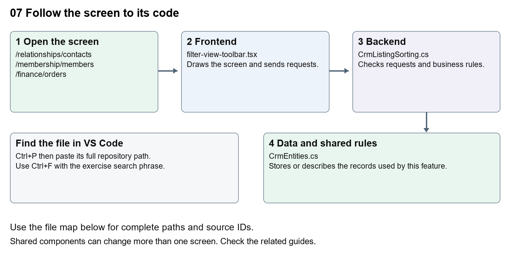

# Nexora record listings and saved views

Document 7 of the Nexora learning guides  
Source snapshot 14 October 2026 at 06:41 UTC


Learn the shared search, filters, column chooser, sorting and saved-view code used across modules.

### Recognise the screen and its scope

Open `/relationships/contacts`, `/membership/members`, `/finance/orders`, `/insights`. CRM routes use port 3017; member routes use 3018; public website routes can use 3019. Brackets name a route parameter, not text to paste into a browser. Choose a real record or site id from the application.

This guide covers Search and filter toolbar; Column chooser; Sortable headers; Client and server sorting; Personal saved views; Paging selection retry and all records.



The diagram shows the file roles. The full paths below are what you paste into Ctrl+P.

### Find the files in VS Code

| Role | File and source ID | What it does |
| --- | --- | --- |
| Screen | S0141 filter-view-toolbar.tsx | Main UI or route for this topic |
| Server | S0249 CrmListingSorting.cs | Endpoints or server rules |
| Data | S0255 CrmEntities.cs | Data shape or persistence structure |

**Screen S0141**  
[apps/web/src/features/shared/filter-view-toolbar.tsx](<D:/Projects new/Nexora/apps/web/src/features/shared/filter-view-toolbar.tsx>)

**Server S0249**  
[backend/src/Modules/Nexora.Modules.Crm/CrmListingSorting.cs](<D:/Projects new/Nexora/backend/src/Modules/Nexora.Modules.Crm/CrmListingSorting.cs>)

**Data S0255**  
[backend/src/Modules/Nexora.Modules.Crm/Domain/CrmEntities.cs](<D:/Projects new/Nexora/backend/src/Modules/Nexora.Modules.Crm/Domain/CrmEntities.cs>)

The complete HTML manual opens these source IDs inside its Source library. The Word manual shows short labelled extracts so you can learn the flow before reading large files. Each individual Markdown guide includes its complete primary files after the walkthrough.

### Follow the request and the records

1. A workspace passes rows, filters and callbacks to shared listing controls.
2. Search and filters update query state or local filtering, depending on the module.
3. A sortable header asks for an ascending or descending key.
4. CRM and Membership validate supported server sort keys; some smaller lists sort loaded rows in the browser.
5. The refreshed list renders with the chosen visible columns.

### Read the code with an explanation

Shared components are used by several workspaces, so a wording change can affect multiple modules. useCrmListing loads server pages; useEntityListing supplies shared controls and client matching. A saved view is a stored query definition, not a copy of the records. Column visibility and saved filters are different pieces of state; inspect the relevant hook before changing persistence.

Source reference S0141 apps/web/src/features/shared/filter-view-toolbar.tsx

Selected opening lines with their original numbers. The complete file is in the HTML source library.

```tsx
0001  "use client";
0003  import { useEffect, useId, useRef, useState, type ReactNode } from "react";
0004  import { ChevronDown, ListFilter } from "lucide-react";
0008  export function FilterViewToolbar({ search, actions, filters, onAllRecords, onMyRecords, disabled = false }: {
0009    search: ReactNode; actions?: ReactNode; filters: ReactNode;
0010    onAllRecords: () => void; onMyRecords?: () => void; disabled?: boolean;
```


The import lines lead to shared components and helpers. Start at the exported component or route function; follow the request helper to the server rather than assuming the whole feature lives in this file.

Source reference S0249 backend/src/Modules/Nexora.Modules.Crm/CrmListingSorting.cs

Extract from source line 14. A fragment from a long line is shown without the rest of that line.

```cs
0014      public static async Task ValidateAsync(CrmDbContext db, string kind, string sort, CancellationToken ct)
```


On the server, look for MapGet to load records, MapPost to create or perform an action, MapPut or MapPatch to change data, and RequireAuthorization for permissions. Some shared methods register endpoints indirectly. Find SaveChangesAsync to see the database write. A request method alone does not tell you every side effect.

Source reference S0255 backend/src/Modules/Nexora.Modules.Crm/Domain/CrmEntities.cs

Selected opening lines with their original numbers. The complete file is in the HTML source library.

```cs
0001  namespace Nexora.Modules.Crm.Domain;
0003  public abstract class TenantRow
0004  {
0005      public Guid Id { get; set; } = Guid.NewGuid();
0006      public Guid TenantId { get; set; }
0007  }
```


Follow model fields to their request names and database mapping. An id points to a particular record. A tenant id limits the organisation. A version or concurrency stamp protects newer edits. Some model files describe contracts rather than tables; check the owning DbContext before assuming storage.

### Make or trace your first change

1. Press Ctrl+P and open [apps/web/src/features/shared/column-chooser.tsx](<D:/Projects new/Nexora/apps/web/src/features/shared/column-chooser.tsx>).
2. Press Ctrl+F and search for `Columns`. In this snapshot it appears at line 57.
3. Read-only exercise: locate the visible Columns label, then trace where ColumnChooser is imported. Write down two workspaces that would be affected by changing this shared component.
4. Record the file, request path and server handler you found. This exercise is read-only; no stored records need to change.

Extract from source line 57. A fragment from a long line is shown without the rest of that line.

```tsx
0057  ={styles.heading}><h2 id={titleId}>Columns</h2><button type="button" className={styles.
```


These exercises have not been applied to the application. Their search phrases are verified against the captured source. Line numbers can move; the phrase and file path are your main navigation aids.

### Check a change and diagnose problems

Confirm the original screen still loads, the changed words appear in the intended place, and another screen using the same component still behaves correctly. If an action fails, inspect the browser Network response, the relevant helper and server validation message. Use the common error table at the beginning of the manual. Reload on a version conflict instead of removing the version check.

A syntax error after a text edit usually means a quote, brace or closing tag changed. Compare your diff with the original. An unchanged browser result can mean the wrong port, a saved published configuration overriding a default, or a running API that has not reloaded.

### Understand the current limits

Sorting behaviour differs between server-paged and locally loaded lists. Keep the API sort allowlists and UI keys aligned. A new column needs a data source and corresponding cell; renaming its label alone cannot create stored data.

### Continue learning

Related guides [05 Nexora CRM contacts](#guide_05), [06 Nexora CRM accounts and associations](#guide_06), [09 Nexora member records and subscriptions](#guide_09), [19 Nexora insights and reporting](#guide_19).

## Complete primary source files

These are the complete captured files, with numbered source lines. Other supporting files are included in the complete HTML manual. Configured local passwords, if any, are explicitly omitted. Do not paste the display line numbers into code.

### S0141 filter-view-toolbar.tsx

[apps/web/src/features/shared/filter-view-toolbar.tsx](<D:/Projects new/Nexora/apps/web/src/features/shared/filter-view-toolbar.tsx>)

SHA256 `09d49d338627835abff94d6671a13bf2b28d9e7f78199303a51b8571733535c7`; 40 source lines; complete captured text.

```tsx
0001  "use client";
0002  
0003  import { useEffect, useId, useRef, useState, type ReactNode } from "react";
0004  import { ChevronDown, ListFilter } from "lucide-react";
0005  
0006  const action = "block w-full rounded-lg px-3 py-2 text-left text-sm font-medium text-slate-700 hover:bg-indigo-50 focus-visible:outline-2 focus-visible:outline-indigo-600 disabled:opacity-50";
0007  
0008  export function FilterViewToolbar({ search, actions, filters, onAllRecords, onMyRecords, disabled = false }: {
0009    search: ReactNode; actions?: ReactNode; filters: ReactNode;
0010    onAllRecords: () => void; onMyRecords?: () => void; disabled?: boolean;
0011  }) {
0012    const [open, setOpen] = useState(false);
0013    const [filtersOpen, setFiltersOpen] = useState(false);
0014    const container = useRef<HTMLDivElement>(null);
0015    const trigger = useRef<HTMLButtonElement>(null);
0016    const id = useId();
0017    useEffect(() => {
0018      if (!open) return;
0019      const outside = (event: PointerEvent) => { if (!container.current?.contains(event.target as Node)) setOpen(false); };
0020      const escape = (event: KeyboardEvent) => { if (event.key === "Escape") { setOpen(false); trigger.current?.focus(); } };
0021      document.addEventListener("pointerdown", outside);
0022      document.addEventListener("keydown", escape);
0023      return () => { document.removeEventListener("pointerdown", outside); document.removeEventListener("keydown", escape); };
0024    }, [open]);
0025    function select(action: () => void) { action(); setOpen(false); trigger.current?.focus(); }
0026    return <section aria-label="Listing controls" className="flex min-w-0 flex-wrap items-center justify-between gap-3 rounded-xl border border-blue-200 bg-blue-50 p-4">
0027      <div ref={container} className="relative">
0028        <button ref={trigger} type="button" aria-expanded={open} aria-controls={id} disabled={disabled} onClick={() => { setOpen(value => !value); setFiltersOpen(false); }} className="flex items-center gap-2 rounded-lg border border-slate-300 bg-white px-3 py-2 text-sm font-medium text-slate-800 hover:bg-slate-50 focus-visible:outline-2 focus-visible:outline-indigo-600 disabled:opacity-50"><ListFilter className="size-4" />Filter view<ChevronDown className="size-4" /></button>
0029        {open && <div id={id} className="absolute left-0 top-full z-40 mt-2 w-[min(34rem,calc(100vw-4rem))] max-h-[65vh] overflow-y-auto rounded-xl border border-slate-200 bg-white p-2 shadow-xl" aria-label="Filter view options">
0030          <div className="grid gap-1 sm:grid-cols-2">
0031            <button type="button" className={action} onClick={() => select(onAllRecords)}>All records</button>
0032            <button type="button" className={action} disabled={!onMyRecords} title={!onMyRecords ? "Record ownership is unavailable for this listing" : undefined} onClick={() => onMyRecords && select(onMyRecords)}>My records</button>
0033            <button type="button" className={action} aria-expanded={filtersOpen} onClick={() => setFiltersOpen(value => !value)}>Filters</button>
0034          </div>
0035          {filtersOpen && <div className="mt-2 space-y-4 border-t border-slate-200 p-3" aria-label="Filters panel">{filters}</div>}
0036        </div>}
0037      </div>
0038      <div className="flex w-full min-w-0 flex-wrap items-center justify-end gap-2 sm:ml-auto sm:w-auto"><div className="w-full min-w-0 sm:w-80">{search}</div>{actions}</div>
0039    </section>;
0040  }
```

### S0249 CrmListingSorting.cs

[backend/src/Modules/Nexora.Modules.Crm/CrmListingSorting.cs](<D:/Projects new/Nexora/backend/src/Modules/Nexora.Modules.Crm/CrmListingSorting.cs>)

SHA256 `d7cb3abcdaa176529a62149ed9c784315f9e6abffdb04745ef6804bfbb2d3c09`; 51 source lines; complete captured text.

```cs
0001  using System.ComponentModel.DataAnnotations;
0002  using System.Linq.Expressions;
0003  using Microsoft.EntityFrameworkCore;
0004  using Nexora.Modules.Crm.Domain;
0005  using Nexora.Modules.Crm.Infrastructure;
0006  
0007  namespace Nexora.Modules.Crm;
0008  
0009  internal static class CrmListingSorting
0010  {
0011      private static string Canonical(string sort) => string.IsNullOrWhiteSpace(sort) ? throw new ValidationException("Invalid sorting column.") : sort == "updated" ? "-updatedAtUtc" : sort;
0012      private static string Key(string sort) => sort.StartsWith('-') ? sort[1..] : sort;
0013  
0014      public static async Task ValidateAsync(CrmDbContext db, string kind, string sort, CancellationToken ct)
0015          => _ = await DefinitionAsync(db, kind, Key(Canonical(sort)), ct);
0016  
0017      private static async Task<CustomFieldDefinition?> DefinitionAsync(CrmDbContext db, string kind, string key, CancellationToken ct)
0018      {
0019          if (key is "name" or "status" or "category" or "updatedAtUtc") return null;
0020          if (key.StartsWith("field:") && Guid.TryParse(key[6..], out var id))
0021              return await db.Set<CustomFieldDefinition>().AsNoTracking().SingleOrDefaultAsync(x => x.Id == id && x.Kind == kind, ct)
0022                  ?? throw new ValidationException("The sorting field is unavailable for this record type.");
0023          throw new ValidationException("Invalid sorting column.");
0024      }
0025  
0026      private static IOrderedQueryable<CrmRecord> Order<T>(IQueryable<CrmRecord> query, Expression<Func<CrmRecord, T>> value, bool descending)
0027          => descending ? query.OrderByDescending(value) : query.OrderBy(value);
0028  
0029      public static async Task<IOrderedQueryable<CrmRecord>> ApplyAsync(IQueryable<CrmRecord> query, CrmDbContext db, string kind, string sort, CancellationToken ct)
0030      {
0031          sort = Canonical(sort);
0032          var descending = sort.StartsWith('-');
0033          var key = Key(sort);
0034          var field = await DefinitionAsync(db, kind, key, ct);
0035          if (field == null) return key switch
0036          {
0037              "status" => Order(query, x => x.Status, descending),
0038              "category" => Order(query, x => x.Category, descending),
0039              "updatedAtUtc" => Order(query, x => x.UpdatedAtUtc, descending),
0040              _ => Order(query, x => x.Name, descending)
0041          };
0042          var values = db.Set<CustomFieldValue>();
0043          return field.DataType switch
0044          {
0045              "number" => Order(query, x => values.Where(v => v.RecordId == x.Id && v.DefinitionId == field.Id).Select(v => v.NumberValue).FirstOrDefault(), descending),
0046              "date" => Order(query, x => values.Where(v => v.RecordId == x.Id && v.DefinitionId == field.Id).Select(v => v.DateValue).FirstOrDefault(), descending),
0047              "boolean" => Order(query, x => values.Where(v => v.RecordId == x.Id && v.DefinitionId == field.Id).Select(v => v.BooleanValue).FirstOrDefault(), descending),
0048              _ => Order(query, x => values.Where(v => v.RecordId == x.Id && v.DefinitionId == field.Id).Select(v => v.TextValue).FirstOrDefault(), descending)
0049          };
0050      }
0051  }
```

### S0255 CrmEntities.cs

[backend/src/Modules/Nexora.Modules.Crm/Domain/CrmEntities.cs](<D:/Projects new/Nexora/backend/src/Modules/Nexora.Modules.Crm/Domain/CrmEntities.cs>)

SHA256 `85b4122eedc78cb82678aeaed850e13ab4be4fe670dfc92d28cc140d367e319d`; 115 source lines; complete captured text.

```cs
0001  namespace Nexora.Modules.Crm.Domain;
0002  
0003  public abstract class TenantRow
0004  {
0005      public Guid Id { get; set; } = Guid.NewGuid();
0006      public Guid TenantId { get; set; }
0007  }
0008  
0009  public sealed class CrmRecord : TenantRow
0010  {
0011      public Guid? PhotoFileId { get; set; }
0012      public bool BillingUsesMailingAddress { get; set; }
0013      public string Kind { get; set; } = "contact";
0014      public string Name { get; set; } = "";
0015      public string Status { get; set; } = "active";
0016      public string? Category { get; set; }
0017      public Guid? OwnerUserId { get; set; }
0018      public Guid? OwnerTeamId { get; set; }
0019      public bool IsArchived { get; set; }
0020      public Guid Version { get; set; } = Guid.NewGuid();
0021      public DateTime CreatedAtUtc { get; set; } = DateTime.UtcNow;
0022      public DateTime UpdatedAtUtc { get; set; } = DateTime.UtcNow;
0023  }
0024  
0025  public abstract class RecordChild : TenantRow
0026  {
0027      public Guid RecordId { get; set; }
0028  }
0029  public sealed class Address : RecordChild
0030  {
0031      public string Label { get; set; } = "";
0032      public string Purpose { get; set; } = "other";
0033      public string? AddressType { get; set; }
0034      public string? AccountName { get; set; }
0035      public string? JobTitle { get; set; }
0036      public string Line1 { get; set; } = "";
0037      public string? Line2 { get; set; }
0038      public string? Line3 { get; set; }
0039      public string? Line4 { get; set; }
0040      public string City { get; set; } = "";
0041      public string? Region { get; set; }
0042      public string? County { get; set; }
0043      public string PostalCode { get; set; } = "";
0044      public string Country { get; set; } = "";
0045  }
0046  public sealed class CommunicationMethod : RecordChild
0047  {
0048      public string Kind { get; set; } = "email";
0049      public string Priority { get; set; } = "other";
0050      public string Value { get; set; } = "";
0051      public string Consent { get; set; } = "unknown";
0052      public string? ConsentEvidence { get; set; }
0053  }
0054  public sealed class RecordRelationship : RecordChild
0055  {
0056      public Guid TargetRecordId { get; set; }
0057      public string Label { get; set; } = "";
0058  }
0059  public sealed class Note : RecordChild
0060  {
0061      public string Body { get; set; } = "";
0062      public Guid ActorUserId { get; set; }
0063      public DateTime CreatedAtUtc { get; set; } = DateTime.UtcNow;
0064  }
0065  public sealed class RecordTag : RecordChild
0066  {
0067      public string Name { get; set; } = "";
0068  }
0069  public sealed class RecordFile : RecordChild
0070  {
0071      public Guid Version { get; set; } = Guid.NewGuid();
0072      public string ScanStatus { get; set; } = "quarantined";
0073      public string Sha256 { get; set; } = "";
0074      public DateTime? ScannedAtUtc { get; set; }
0075      public string Name { get; set; } = "";
0076      public byte[] Content { get; set; } = [];
0077      public DateTime CreatedAtUtc { get; set; } = DateTime.UtcNow;
0078  }
0079  public sealed class Activity : RecordChild
0080  {
0081      public string Action { get; set; } = "";
0082      public Guid ActorUserId { get; set; }
0083      public string CorrelationId { get; set; } = "";
0084      public DateTime CreatedAtUtc { get; set; } = DateTime.UtcNow;
0085  }
0086  public sealed class SavedView : TenantRow
0087  {
0088      public Guid? OwnerUserId { get; set; }
0089      public Guid? OwnerTeamId { get; set; }
0090      public string? Category { get; set; }
0091      public Guid UserId { get; set; }
0092      public string Name { get; set; } = "";
0093      public string Kind { get; set; } = "contact";
0094      public string Search { get; set; } = "";
0095      public string Status { get; set; } = "";
0096      public string Sort { get; set; } = "name";
0097      public bool Archived { get; set; }
0098      public string Columns { get; set; } = "name,status,category";
0099  }
0100  public sealed class CustomFieldDefinition : TenantRow
0101  {
0102      public int DisplayOrder { get; set; }
0103      public string Name { get; set; } = "";
0104      public string Kind { get; set; } = "contact";
0105      public string DataType { get; set; } = "text";
0106      public string Section { get; set; } = "General Information";
0107  }
0108  public sealed class CustomFieldValue : RecordChild, Nexora.BuildingBlocks.Persistence.IAutomationValue
0109  {
0110      public Guid DefinitionId { get; set; }
0111      public string? TextValue { get; set; }
0112      public decimal? NumberValue { get; set; }
0113      public bool? BooleanValue { get; set; }
0114      public DateTime? DateValue { get; set; }
0115  }
```
