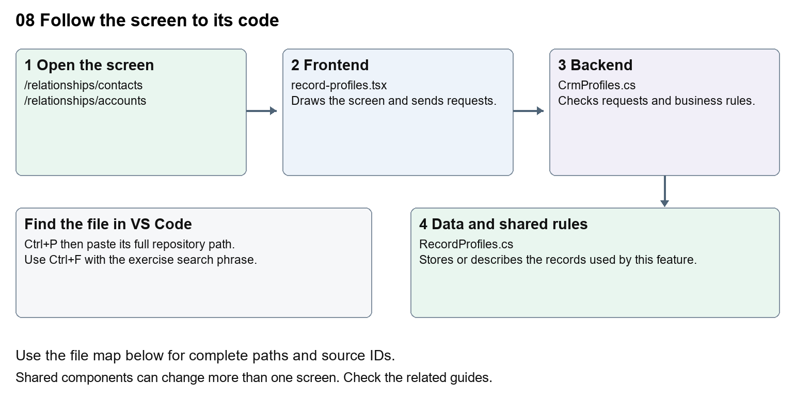

# Nexora record profiles and related information

Document 8 of the Nexora learning guides  
Source snapshot 13 October 2026 at 17:12 UTC


Understand structured profile fields, taxonomy, audit history and record sections.

### Recognise the screen and its scope

Open `/relationships/contacts`, `/relationships/accounts`. CRM routes use port 3017; member routes use 3018; public website routes can use 3019. Brackets name a route parameter, not text to paste into a browser. Choose a real record or site id from the application.

This guide covers Contact and Account profiles; General information; Profile definitions and typed fields; Taxonomy and departments; Communication methods permissions and social details; Data audit and connected activity.



The diagram shows the file roles. The full paths below are what you paste into Ctrl+P.

### Find the files in VS Code

| Role | File and source ID | What it does |
| --- | --- | --- |
| Screen | S0088 record-profiles.tsx | Main UI or route for this topic |
| Server | S0251 CrmProfiles.cs | Endpoints or server rules |
| Data | S0256 RecordProfiles.cs | Data shape or persistence structure |

**Screen S0088**  
[apps/web/src/features/crm/record-profiles.tsx](<D:/Projects new/Nexora/apps/web/src/features/crm/record-profiles.tsx>)

**Server S0251**  
[backend/src/Modules/Nexora.Modules.Crm/CrmProfiles.cs](<D:/Projects new/Nexora/backend/src/Modules/Nexora.Modules.Crm/CrmProfiles.cs>)

**Data S0256**  
[backend/src/Modules/Nexora.Modules.Crm/Domain/RecordProfiles.cs](<D:/Projects new/Nexora/backend/src/Modules/Nexora.Modules.Crm/Domain/RecordProfiles.cs>)

The complete HTML manual opens these source IDs inside its Source library. The Word manual shows short labelled extracts so you can learn the flow before reading large files. Each individual Markdown guide includes its complete primary files after the walkthrough.

### Follow the request and the records

1. The record detail loads the available profile definitions.
2. A profile component draws fields based on the definition.
3. Saving sends typed values and a version through the CRM API.
4. The server validates field definitions and persists values for that record.
5. Audit and timeline components explain changes and connected module activity.

### Read the code with an explanation

A profile definition describes which fields appear and how they are typed. A profile value stores one record's answer. This differs from adding a fixed property to a C# class, which may require a database migration. A department lookup and a free-text job title also have different storage rules. Follow the definition, value and UI component together.

Source reference S0088 apps/web/src/features/crm/record-profiles.tsx

Selected opening lines with their original numbers. The complete file is in the HTML source library.

```tsx
0001  "use client";
0002  import { RecordSection } from "./record-section";
0003  import { useEffect, useState } from "react";
0004  import { crm } from "./api";
0006  export type ProfileAssignment = { slot: number; definitionId: string; parentNode: string; childNode: string; isArchived: boolean };
0007  type Definition = { id: string; parentNode: string; childNode: string; isArchived: boolean; version: string };
```


The import lines lead to shared components and helpers. Start at the exported component or route function; follow the request helper to the server rather than assuming the whole feature lives in this file.

Source reference S0251 backend/src/Modules/Nexora.Modules.Crm/CrmProfiles.cs

Extract from source line 12. A fragment from a long line is shown without the rest of that line.

```cs
0012  public static partial class CrmModule
```


On the server, look for MapGet to load records, MapPost to create or perform an action, MapPut or MapPatch to change data, and RequireAuthorization for permissions. Some shared methods register endpoints indirectly. Find SaveChangesAsync to see the database write. A request method alone does not tell you every side effect.

Source reference S0256 backend/src/Modules/Nexora.Modules.Crm/Domain/RecordProfiles.cs

Selected opening lines with their original numbers. The complete file is in the HTML source library.

```cs
0001  namespace Nexora.Modules.Crm.Domain;
0003  public sealed class ContactProfile : RecordChild
0004  {
0005      public string? Title { get; set; }
0006      public string? FirstName { get; set; }
0007      public string? MiddleName { get; set; }
```


Follow model fields to their request names and database mapping. An id points to a particular record. A tenant id limits the organisation. A version or concurrency stamp protects newer edits. Some model files describe contracts rather than tables; check the owning DbContext before assuming storage.

### Make or trace your first change

1. Press Ctrl+P and open [apps/web/src/features/crm/record-profiles.tsx](<D:/Projects new/Nexora/apps/web/src/features/crm/record-profiles.tsx>).
2. Press Ctrl+F and search for `export function`. In this snapshot it appears at line 11.
3. Read-only exercise: find the exported profile component and its imports. Follow RecordProfiles to its API requests, then find the matching server file. Identify where a displayed profile name comes from data rather than hardcoded JSX.
4. Record the file, request path and server handler you found. This exercise is read-only; no stored records need to change.

Extract from source line 11. A fragment from a long line is shown without the rest of that line.

```tsx
0011  export function RecordProfiles({ id, version, assignments, e
```


These exercises have not been applied to the application. Their search phrases are verified against the captured source. Line numbers can move; the phrase and file path are your main navigation aids.

### Check a change and diagnose problems

Confirm the original screen still loads, the changed words appear in the intended place, and another screen using the same component still behaves correctly. If an action fails, inspect the browser Network response, the relevant helper and server validation message. Use the common error table at the beginning of the manual. Reload on a version conflict instead of removing the version check.

A syntax error after a text edit usually means a quote, brace or closing tag changed. Compare your diff with the original. An unchanged browser result can mean the wrong port, a saved published configuration overriding a default, or a running API that has not reloaded.

### Understand the current limits

The browser may show configured sections, but validation stays on the server. Historical audit rows are evidence of stored changes, not proof that every external system has synchronised.

### Continue learning

Related guides [05 Nexora CRM contacts](#guide_05), [06 Nexora CRM accounts and associations](#guide_06), [21 Nexora automation controllers](#guide_21).

## Complete primary source files

These are the complete captured files, with numbered source lines. Other supporting files are included in the complete HTML manual. Configured local passwords, if any, are explicitly omitted. Do not paste the display line numbers into code.

### S0088 record-profiles.tsx

[apps/web/src/features/crm/record-profiles.tsx](<D:/Projects new/Nexora/apps/web/src/features/crm/record-profiles.tsx>)

SHA256 `11b6a122fcf128a6a015b5915453676351e65efd4a3ec1dfda3eb87b6fd275f1`; 60 source lines; complete captured text.

```tsx
0001  "use client";
0002  import { RecordSection } from "./record-section";
0003  import { useEffect, useState } from "react";
0004  import { crm } from "./api";
0005  
0006  export type ProfileAssignment = { slot: number; definitionId: string; parentNode: string; childNode: string; isArchived: boolean };
0007  type Definition = { id: string; parentNode: string; childNode: string; isArchived: boolean; version: string };
0008  const input = "mt-2 w-full rounded-lg border border-slate-300 bg-white px-3 py-2 text-sm text-slate-900 disabled:bg-slate-50";
0009  const button = "rounded-lg border border-slate-300 px-3 py-2 text-sm font-medium disabled:opacity-50";
0010  
0011  export function RecordProfiles({ id, version, assignments, editable, busy, onChanged }: { id: string; version: string; assignments?: ProfileAssignment[] | null; editable: boolean; busy: boolean; onChanged: () => void }) {
0012    const assignmentsAvailable = Array.isArray(assignments);
0013    const assignedProfiles = assignments ?? [];
0014    const [definitions, setDefinitions] = useState<Definition[]>([]);
0015    const [slots, setSlots] = useState(() => Array.from({ length: 5 }, (_, i) => assignedProfiles.find(x => x.slot === i + 1)?.definitionId ?? ""));
0016    const [pending, setPending] = useState(false);
0017    const [error, setError] = useState("");
0018    const [loaded, setLoaded] = useState(false);
0019    const [revision, setRevision] = useState(0);
0020    const [editing, setEditing] = useState<Definition | null>(null);
0021    const [parent, setParent] = useState("");
0022    const [child, setChild] = useState("");
0023    const disabled = !editable || busy || pending || !loaded || !assignmentsAvailable;
0024    useEffect(() => {
0025      let current = true;
0026      crm<Definition[]>("/profile-definitions").then(rows => { if (current) { setDefinitions(rows); setLoaded(true); } }).catch(e => { if (current) setError(e.message); });
0027      return () => { current = false; };
0028    }, [revision]);
0029    async function save(action: () => Promise<unknown>) {
0030      if (!assignmentsAvailable) { setError("Profile assignments are unavailable. Reload this record before editing profiles."); return; }
0031      setPending(true); setError("");
0032      try { await action(); onChanged(); setRevision(n => n + 1); }
0033      catch (e) { setError(e instanceof Error ? e.message : "Unable to save profiles."); }
0034      finally { setPending(false); }
0035    }
0036    const parents = [...new Set(definitions.map(x => x.parentNode))];
0037    return <RecordSection title="Profile" keepMounted>
0038      {!assignmentsAvailable && <p role="status" className="mb-3 text-sm text-slate-600">Profile assignments are unavailable. Reload this record before editing profiles.</p>}
0039      {error && <p role="alert" className="mb-3 text-sm text-red-700">{error} <button type="button" className={button} disabled={pending} onClick={() => { setError(""); setRevision(n => n + 1); }}>Reload definitions</button></p>}
0040      {!loaded && !error && <p role="status" className="mb-3 text-sm text-slate-500">Loading profiles…</p>}
0041      <form className="space-y-4" onSubmit={e => { e.preventDefault(); void save(() => crm(`/records/${id}/profiles`, "PUT", { version, assignments: slots.flatMap((definitionId, i) => definitionId ? [{ slot: i + 1, definitionId }] : []) })); }}>
0042        <fieldset disabled={disabled} className="grid gap-4 sm:grid-cols-2"><legend className="sr-only">Assigned profiles</legend>
0043          {slots.map((selected, i) => <label className="block text-sm" key={i}>Profile {i + 1}<select className={input} value={selected} onChange={e => setSlots(rows => rows.map((value, index) => index === i ? e.target.value : value))}>
0044            <option value="">None</option>
0045            {selected && !definitions.some(d => d.id === selected) && <option value={selected}>{assignedProfiles.find(x => x.definitionId === selected)?.childNode ?? "Unavailable profile"}</option>}
0046            {parents.map(group => <optgroup key={group} label={group}>{definitions.filter(d => d.parentNode === group && (!d.isArchived || d.id === selected)).map(d => <option key={d.id} value={d.id} disabled={slots.some((value, index) => value === d.id && index !== i)}>{d.childNode}{d.isArchived ? " (archived)" : ""}</option>)}</optgroup>)}
0047          </select></label>)}
0048        </fieldset>
0049        {editable && <button className="rounded-lg bg-indigo-700 px-4 py-2 text-sm font-semibold text-white disabled:opacity-50" disabled={disabled}>Save profiles</button>}
0050      </form>
0051      {editable && <details className="mt-5 border-t border-slate-200 pt-4"><summary className="cursor-pointer text-sm font-semibold">Manage profile definitions</summary>
0052        <p className="mt-3 text-sm text-slate-600">Definitions are shared by Contacts and Accounts in your organisation. Renaming a definition updates its displayed name on every assigned record.</p>
0053        <form className="mt-4 space-y-3" onSubmit={e => { e.preventDefault(); void save(async () => { await crm(`/profile-definitions${editing ? `/${editing.id}` : ""}`, editing ? "PUT" : "POST", { parentNode: parent, childNode: child, ...(editing ? { version: editing.version, isArchived: editing.isArchived } : {}) }); setEditing(null); setParent(""); setChild(""); }); }}>
0054          <div className="grid gap-3 sm:grid-cols-2"><label className="text-sm">Parent node<input className={input} value={parent} onChange={e => setParent(e.target.value)} required maxLength={160} disabled={disabled} /></label><label className="text-sm">Child node<input className={input} value={child} onChange={e => setChild(e.target.value)} required maxLength={160} disabled={disabled} /></label></div>
0055          <div className="flex gap-2"><button className={button} disabled={disabled}>{editing ? "Save definition" : "Add definition"}</button>{editing && <button type="button" className={button} disabled={pending} onClick={() => { setEditing(null); setParent(""); setChild(""); }}>Cancel</button>}</div>
0056        </form>
0057        <ul className="mt-4 space-y-2">{definitions.map(d => <li key={d.id} className="flex flex-wrap items-center justify-between gap-2 rounded-lg bg-slate-50 p-3 text-sm"><span>{d.parentNode} / {d.childNode}{d.isArchived ? " · Archived" : ""}</span><div className="flex gap-2"><button className={button} disabled={disabled} onClick={() => { setEditing(d); setParent(d.parentNode); setChild(d.childNode); }}>Edit</button><button className={button} disabled={disabled} onClick={() => void save(() => crm(`/profile-definitions/${d.id}`, "PUT", { ...d, isArchived: !d.isArchived }))}>{d.isArchived ? "Restore" : "Archive"}</button></div></li>)}</ul>
0058      </details>}
0059    </RecordSection>;
0060  }
```

### S0251 CrmProfiles.cs

[backend/src/Modules/Nexora.Modules.Crm/CrmProfiles.cs](<D:/Projects new/Nexora/backend/src/Modules/Nexora.Modules.Crm/CrmProfiles.cs>)

SHA256 `4ecc767888b9c61f1c5cce26e1b4754cc4e0fce8431e4bdd6ad73e72b7e1ead3`; 45 source lines; complete captured text.

```cs
0001  using System.ComponentModel.DataAnnotations;
0002  using Microsoft.AspNetCore.Builder;
0003  using Microsoft.AspNetCore.Http;
0004  using Microsoft.AspNetCore.Routing;
0005  using Microsoft.EntityFrameworkCore;
0006  using Nexora.BuildingBlocks.Security;
0007  using Nexora.Modules.Crm.Infrastructure;
0008  using Nexora.Modules.Crm.Contracts;
0009  
0010  namespace Nexora.Modules.Crm;
0011  
0012  public static partial class CrmModule
0013  {
0014      public sealed record ProfileRequest(Guid Version, ContactDetails? ContactDetails = null, AccountDetails? AccountDetails = null, ContactGeneralInformation? GeneralInformation = null, ContactCommunicationPermissions? CommunicationPermissions = null, ContactSocialMediaDetails? SocialMediaDetails = null, AccountGeneralInformation? AccountGeneralInformation = null);
0015  
0016      private static void MapProfiles(RouteGroupBuilder api)
0017      {
0018          api.MapPut("/records/{id:guid}/profile", async (Guid id, ProfileRequest request, CrmDbContext db, IRequestIdentity who, HttpContext http, CancellationToken ct) =>
0019          {
0020              var record = await RecordAsync(db, id, ct, true);
0021              if (record.Version != request.Version) throw new DbUpdateConcurrencyException();
0022              if (record.Kind == "contact")
0023              {
0024                  if (request.ContactDetails == null || request.AccountDetails != null || request.AccountGeneralInformation != null) throw new ValidationException("Provide contact details only.");
0025                  await RecordProfileFields.ApplyContactAsync(db, record, request.ContactDetails, ct);
0026                  if (request.GeneralInformation != null)
0027                      await RecordProfileFields.ApplyGeneralInformationAsync(db, record, request.GeneralInformation, ct);
0028                  if (request.CommunicationPermissions != null)
0029                      await RecordProfileFields.ApplyCommunicationPermissionsAsync(db, record, request.CommunicationPermissions, ct);
0030                  if (request.SocialMediaDetails != null)
0031                      await ContactSocialFields.ApplyAsync(db, record, request.SocialMediaDetails, ct);
0032              }
0033              else
0034              {
0035                  if (request.AccountDetails == null || request.ContactDetails != null || request.GeneralInformation != null || request.CommunicationPermissions != null || request.SocialMediaDetails != null) throw new ValidationException("Provide account details only.");
0036                  await RecordProfileFields.ApplyAccountAsync(db, record, request.AccountDetails, ct);
0037                  if (request.AccountGeneralInformation != null) await RecordProfileFields.ApplyAccountGeneralInformationAsync(db, record, request.AccountGeneralInformation, ct);
0038              }
0039              record.Version = Guid.NewGuid(); record.UpdatedAtUtc = DateTime.UtcNow;
0040              Audit(db, who, http, id, "profile.updated");
0041              await db.SaveChangesAsync(ct);
0042              return Results.Ok(new { record.Version });
0043          }).RequireAuthorization("crm.manage");
0044      }
0045  }
```

### S0256 RecordProfiles.cs

[backend/src/Modules/Nexora.Modules.Crm/Domain/RecordProfiles.cs](<D:/Projects new/Nexora/backend/src/Modules/Nexora.Modules.Crm/Domain/RecordProfiles.cs>)

SHA256 `8dae4ff11832e28988c7ce874c3b01f91f46f8c67ba75ad3b83634ae03499ae1`; 58 source lines; complete captured text.

```cs
0001  namespace Nexora.Modules.Crm.Domain;
0002  
0003  public sealed class ContactProfile : RecordChild
0004  {
0005      public string? Title { get; set; }
0006      public string? FirstName { get; set; }
0007      public string? MiddleName { get; set; }
0008      public string? LastName { get; set; }
0009      public string? PreviousLastName { get; set; }
0010      public string? PostNominal { get; set; }
0011      public string? SourcePersonId { get; set; }
0012      public string? ContactType { get; set; }
0013      public string? Nationality { get; set; }
0014      public string? OldReference { get; set; }
0015      public string? Region { get; set; }
0016      public string? Branch { get; set; }
0017      public string? Remarks { get; set; }
0018      public bool? ThirdPartyEmailPermission { get; set; }
0019      public bool? DisclosureDataToThirdParty { get; set; }
0020      public DateOnly? ThirdPartyDisclosureConsentDate { get; set; }
0021      public string? TypeOfThirdParty { get; set; }
0022      public bool? StopAllCommunication { get; set; }
0023      public DateOnly? DateStopAllCommunication { get; set; }
0024      public bool? BouncedInvalidEmailAddress { get; set; }
0025      public DateOnly? DateEmailBounced { get; set; }
0026      public long? NumberOfFollowers { get; set; }
0027      public long? NumberOfFollowing { get; set; }
0028      public long? NumberOfTweetsSent { get; set; }
0029      public long? NumberOfMentions { get; set; }
0030      public long? NumberOfTweetsWithTags { get; set; }
0031      public DateOnly? SocialMetricsObservedOn { get; set; }
0032      public string? SocialMetricsSource { get; set; }
0033  }
0034  
0035  public sealed class ContactSocialProfile : RecordChild
0036  {
0037      public string Channel { get; set; } = "";
0038      public string Identifier { get; set; } = "";
0039  }
0040  
0041  public sealed class AccountProfile : RecordChild
0042  {
0043      public string? SourceAccountId { get; set; }
0044      public string? TradingStatus { get; set; }
0045      public string? AccountType { get; set; }
0046      public string? IndustrySector { get; set; }
0047      public string? Venue { get; set; }
0048      public string? MarketingSource { get; set; }
0049      public string? TurnoverRange { get; set; }
0050      public int? NumberOfEmployees { get; set; }
0051      public string? EmployeesRange { get; set; }
0052      public string? Region { get; set; }
0053      public string? Branch { get; set; }
0054      public string? OldReference { get; set; }
0055      public string? FullName { get; set; }
0056      public string? TradingAs { get; set; }
0057      public DateOnly? DateBusinessCommenced { get; set; }
0058  }
```
