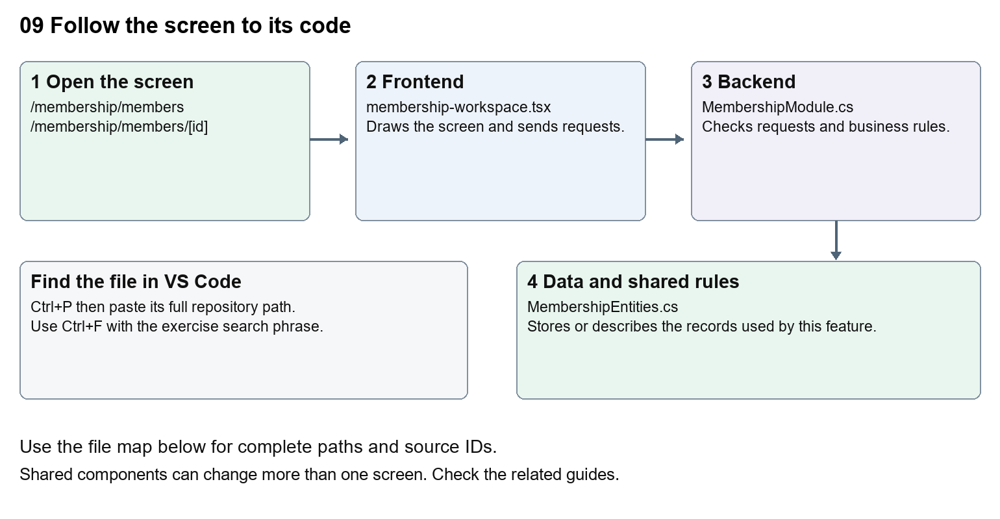

# Nexora member records and subscriptions

Document 9 of the Nexora learning guides  
Source snapshot 14 October 2026 at 06:41 UTC


Understand the member listing, subscription detail, lifecycle changes and membership administration.

### Recognise the screen and its scope

Open `/membership/members`, `/membership/members/[id]`. CRM routes use port 3017; member routes use 3018; public website routes can use 3019. Brackets name a route parameter, not text to paste into a browser. Choose a real record or site id from the application.

This guide covers Member list and detail; Join dates and rejoin selection; Renew cancel lapse and archive actions; Administration classifications and financial arrangements; Options joining fees and timeline.



The diagram shows the file roles. The full paths below are what you paste into Ctrl+P.

### Find the files in VS Code

| Role | File and source ID | What it does |
| --- | --- | --- |
| Screen | S0115 membership-workspace.tsx | Main UI or route for this topic |
| Server | S0512 MembershipModule.cs | Endpoints or server rules |
| Data | S0418 MembershipEntities.cs | Data shape or persistence structure |

**Screen S0115**  
[apps/web/src/features/membership/membership-workspace.tsx](<D:/Projects new/Nexora/apps/web/src/features/membership/membership-workspace.tsx>)

**Server S0512**  
[backend/src/Modules/Nexora.Modules.Membership/MembershipModule.cs](<D:/Projects new/Nexora/backend/src/Modules/Nexora.Modules.Membership/MembershipModule.cs>)

**Data S0418**  
[backend/src/Modules/Nexora.Modules.Membership/Domain/MembershipEntities.cs](<D:/Projects new/Nexora/backend/src/Modules/Nexora.Modules.Membership/Domain/MembershipEntities.cs>)

The complete HTML manual opens these source IDs inside its Source library. The Word manual shows short labelled extracts so you can learn the flow before reading large files. Each individual Markdown guide includes its complete primary files after the walkthrough.

### Follow the request and the records

1. The members route loads the staff session and required permissions.
2. MembershipList builds the member search, paging and sort request.
3. Opening a subscription loads its connected detail and administration sections.
4. A lifecycle action includes a version and reason.
5. The module validates the transition, saves changes and records history.

### Read the code with an explanation

A Contact is not the same record as a subscription. The subscription links a subject to a product, term and status. Renewal, rejoin and cancellation rules belong in the server files, while individual frontend components edit dates, classifications and arrangements. Trace the id carefully: a Contact id and a membership id are not interchangeable.

Source reference S0115 apps/web/src/features/membership/membership-workspace.tsx

Selected opening lines with their original numbers. The complete file is in the HTML source library.

```tsx
0001  "use client";
0002  import Link from "next/link";
0003  import { WorkspaceHeading } from "@/components/ui/workspace-heading";
0004  import { useRouter } from "next/navigation";
0005  import type { Route } from "next";
0006  import { ArrowLeft, Plus, Eye, Pencil, Trash2 } from "lucide-react";
```


The import lines lead to shared components and helpers. Start at the exported component or route function; follow the request helper to the server rather than assuming the whole feature lives in this file.

Source reference S0512 backend/src/Modules/Nexora.Modules.Membership/MembershipModule.cs

Extract from source line 54. A fragment from a long line is shown without the rest of that line.

```cs
0054          api.MapGet("/setup/{kind}", async (string kind, MembershipDbContext db, CancellationToken ct) =>
```


On the server, look for MapGet to load records, MapPost to create or perform an action, MapPut or MapPatch to change data, and RequireAuthorization for permissions. Some shared methods register endpoints indirectly. Find SaveChangesAsync to see the database write. A request method alone does not tell you every side effect.

Source reference S0418 backend/src/Modules/Nexora.Modules.Membership/Domain/MembershipEntities.cs

Selected opening lines with their original numbers. The complete file is in the HTML source library.

```cs
0001  using Nexora.BuildingBlocks.Domain;
0002  namespace Nexora.Modules.Membership.Domain;
0003  public sealed class MembershipProduct : TenantEntity
0004  {
0005      public string Name { get; set; } = "";
0006      public string Category { get; set; } = "";
```


Follow model fields to their request names and database mapping. An id points to a particular record. A tenant id limits the organisation. A version or concurrency stamp protects newer edits. Some model files describe contracts rather than tables; check the owning DbContext before assuming storage.

### Make or trace your first change

1. Press Ctrl+P and open [apps/web/src/features/membership/membership-workspace.tsx](<D:/Projects new/Nexora/apps/web/src/features/membership/membership-workspace.tsx>).
2. Press Ctrl+F and search for `Member subscriptions`. In this snapshot it appears at line 49.
3. Change the accessible table caption text only. Open the Members list and inspect its caption in browser accessibility tools. Leave tab names, routes and status values unchanged.
4. Replace only `Member subscriptions` with `Membership subscriptions` in that intended location. Keep quotes, tags, JSON keys and routes intact.
5. Save with Ctrl+S. Inspect Problems and the local screen. Review the diff and restore the original text when you finish practising.

Extract from source line 49. A fragment from a long line is shown without the rest of that line.

```tsx
0049  t-sm"><caption className="sr-only">Member subscriptions</caption><thead><tr><th className="p-3"><inp
```


These exercises have not been applied to the application. Their search phrases are verified against the captured source. Line numbers can move; the phrase and file path are your main navigation aids.

### Check a change and diagnose problems

Confirm the original screen still loads, the changed words appear in the intended place, and another screen using the same component still behaves correctly. If an action fails, inspect the browser Network response, the relevant helper and server validation message. Use the common error table at the beginning of the manual. Reload on a version conflict instead of removing the version check.

A syntax error after a text edit usually means a quote, brace or closing tag changed. Compare your diff with the original. An unchanged browser result can mean the wrong port, a saved published configuration overriding a default, or a running API that has not reloaded.

### Understand the current limits

A stored membership term is not proof of collected payment. Versions guard against conflicting edits. Do not run cancellation or renewal on an active real member as a learning exercise.

### Continue learning

Related guides [10 Nexora membership applications and decisions](#guide_10), [11 Nexora membership setup and products](#guide_11), [15 Nexora sales and finance](#guide_15), [25 Nexora member portal journeys](#guide_25).

## Complete primary source files

These are the complete captured files, with numbered source lines. Other supporting files are included in the complete HTML manual. Configured local passwords, if any, are explicitly omitted. Do not paste the display line numbers into code.

### S0115 membership-workspace.tsx

[apps/web/src/features/membership/membership-workspace.tsx](<D:/Projects new/Nexora/apps/web/src/features/membership/membership-workspace.tsx>)

SHA256 `741b117f28c893d0a847c43d9833c2d4eb282a79d98d9025b627a5a29f7f4cfd`; 54 source lines; complete captured text.

```tsx
0001  "use client";
0002  import Link from "next/link";
0003  import { WorkspaceHeading } from "@/components/ui/workspace-heading";
0004  import { useRouter } from "next/navigation";
0005  import type { Route } from "next";
0006  import { ArrowLeft, Plus, Eye, Pencil, Trash2 } from "lucide-react";
0007  import { MembershipListControls, MembershipListFooter, useMembershipList } from "./membership-list";
0008  import { useListingColumns } from "../shared/entity-listing-controls";
0009  import { SortableHeader, parseTableSort } from "../shared/table-sort";
0010  import { useEffect, useState } from "react";
0011  import { moduleApi } from "../shared/module-api";
0012  import { Field, Panel, formData, inputClass as input, buttonClass as button, primaryClass as primary } from "../shared/module-ui";
0013  import { MembershipApplicationDetails } from "./membership-application-details";
0014  import { MembershipOrganisationApplication } from "./membership-organisation-application";
0015  import { ApplicationEvidence } from "@/features/shared/application-evidence";
0016  import { MembershipReviewSummary } from "./membership-review-summary";
0017  import { MembershipJoinDate } from "./membership-join-date";
0018  import { MembershipTimeline } from "./membership-timeline";
0019  import { MembershipAdministration } from "./membership-administration";
0020  import { MembershipFinancialArrangement } from "./membership-financial-arrangement";
0021  import { MembershipOptions, MembershipJoiningFee } from "./membership-options";
0022  import { MembershipClassifications } from "./membership-classifications";
0023  
0024  type Product = { id:string; name:string; category:string; termMonths:number; rate:number; currency:string; isActive:boolean; portalApplicationsEnabled:boolean; portalTerms:string; version:string };
0025  type Application = { id:string; contactName:string; accountName?:string|null; productId:string; status:string; version:string; quotedRate:number; currency:string; requestedStartUtc:string };
0026  type Member = { isArchived:boolean; archivedAtUtc:string|null; archiveReason:string|null; previousMembershipId:string|null; rejoinedOn:string|null; statusEffectiveOn:string|null; resignedOn:string|null; resignationReason:string|null; reinstatedOn:string|null; id:string; contactName:string; accountName?:string|null; productId:string; status:string; startsAtUtc:string; endsAtUtc:string; rate:number; currency:string; version:string };
0027  type History = { effectiveOn:string|null; id:string; action:string; reason:string; createdAtUtc:string };
0028  
0029  const api = <T,>(path:string,method="GET",body?:unknown) => moduleApi<T>("membership",path,method,body);
0030  export function MembershipWorkspace({ permissions, section = "members", recordId, initialAction }: { permissions:string[]; section?: string; recordId?:string; initialAction?:string }) {
0031   const router=useRouter();const creating=recordId==="new";const listing=!recordId;const [checked,setChecked]=useState<string[]>([]);const [application,setApplication]=useState<Application|null>(null);
0032   const navigate=(id:string)=>router.push(`/membership/${section}/${id}` as Route);
0033  
0034   const [products,setProducts]=useState<Product[]>([]);
0035   const [refresh,setRefresh]=useState(0); const [error,setError]=useState(""); const [busy,setBusy]=useState(false); const [loading,setLoading]=useState(true);
0036   const [selected,setSelected]=useState<Member|null>(null); const [history,setHistory]=useState<History[]>([]); const tab = section;
0037   const memberList=useMembershipList<Member>("members",refresh); const applicationList=useMembershipList<Application>("applications",refresh);
0038   const memberColumns=useListingColumns(["Member","Product","Status","Term end","Rate"]);
0039   const applicationColumns=useListingColumns(["Applicant","Product","Status","Quoted Rate"]);
0040   const members=memberList.items; const applications=application?[application]:[];
0041   const manage=permissions.includes("membership.manage"); const decide=permissions.includes("membership.decide");
0042   useEffect(()=>{if(!recordId||creating)return;let active=true; (section==="members"?api<{member:Member;history:History[]}>(`/members/${recordId}`).then(r=>{if(active){setSelected(r.member);setHistory(r.history);}}):api<Application>(`/applications/${recordId}`).then(r=>{if(active)setApplication(r);})).catch(e=>{if(active)setError(e.message);});return()=>{active=false;};},[recordId,creating,section,refresh]);
0043   useEffect(()=>{ let active=true; api<Product[]>("/products").then(p=>{if(active){setProducts(p);setLoading(false);}}).catch(e=>{if(active){setError(e.message);setLoading(false);}});return()=>{active=false;};},[refresh]);
0044   async function perform(action:()=>Promise<void>,reload=true){setBusy(true);setError("");try{await action();if(reload)setRefresh(v=>v+1);}catch(e){setError(e instanceof Error?e.message:"Unable to save.");}finally{setBusy(false);}}
0045   return <main className="mx-auto max-w-7xl space-y-5 p-4 text-slate-800 sm:p-7"><WorkspaceHeading actions={listing&&manage&&tab==="applications"?<button className={button} aria-label="Add application" onClick={()=>navigate("new")}><Plus size={18}/></button>:undefined}>{tab==="members"?"Members":creating?"New Application":"Applications"}</WorkspaceHeading>{!listing&&<button className={button} aria-label="Back to listing" onClick={()=>router.push(`/membership/${section}` as Route)}><ArrowLeft size={16}/></button>}
0046   {error&&<div role="alert" className="rounded-lg bg-red-50 p-4 text-sm text-red-800">{error} <button className={button} onClick={()=>{setError("");setRefresh(v=>v+1);}}>Reload</button></div>}
0047   {loading&&<p role="status">Loading membership…</p>}
0048   {tab==="applications"&&!listing&&!creating&&<><Panel title="Application Details"><ul className="space-y-4">{applications.map(a=><li key={a.id} className="rounded-lg border border-slate-200 p-4"><p className="font-medium">{a.contactName} · {products.find(p=>p.id===a.productId)?.name}</p><p className="my-2 text-sm">{a.status} · Quoted {a.currency} {a.quotedRate.toFixed(2)}</p><MembershipReviewSummary items={[a]} /><MembershipApplicationDetails key={`${a.id}-${a.version}`} id={a.id} editable={manage} busy={busy} onChanged={()=>setRefresh(n=>n+1)} />{permissions.includes("crm.files") && <ApplicationEvidence staff path={`/api/v1/membership/applications/${a.id}/evidence`} canScan={permissions.includes("membership.manage")} />}{decide&&a.status==="submitted"&&<form className="flex flex-wrap items-end gap-3" onSubmit={e=>{const r=formData(e);void perform(async()=>{await api(`/applications/${a.id}/decision`,"POST",{...r,version:a.version});});}}><Field label="Decision"><select name="decision" className={input} defaultValue={initialAction==="reject"?"reject":"approve"}><option value="approve">Approve and activate</option><option value="reject">Reject</option></select></Field><Field label="Decision reason"><input name="reason" className={input} maxLength={500} required/></Field><button className={primary} disabled={busy}>Record decision</button></form>}</li>)}</ul>{!applicationList.loading&&!applicationList.error&&applications.length===0&&<p className="text-sm">No matching applications.</p>}</Panel></>}
0049   {tab==="members"&&<>{listing&&<><MembershipListControls label="members" statuses={["active","cancelled","lapsed"]} list={memberList} retry={()=>setRefresh(v=>v+1)}/><section className="overflow-hidden rounded-xl border border-slate-200 bg-white"><div className="overflow-x-auto"><table className="w-full text-left text-sm"><caption className="sr-only">Member subscriptions</caption><thead><tr><th className="p-3"><input type="checkbox" aria-label="Select all members" checked={members.length>0&&members.every(m=>checked.includes(m.id))} onChange={e=>setChecked(e.target.checked?members.map(m=>m.id):[])}/></th><th className="p-3">Actions</th>{[["name","Member"],["product","Product"],["status","Status"],["termEnd","Term end"],["rate","Rate"]].map(([key,label])=><SortableHeader key={key} label={label} column={key} hidden={!memberColumns.show(label)} sort={parseTableSort(memberList.query.sort??"name")} disabled={memberList.loading} onSort={sort=>{setChecked([]);memberList.change({sort});}}/>)}</tr></thead><tbody>{members.map(m=><tr key={m.id} className="border-t border-slate-200"><td className="p-3"><input type="checkbox" aria-label={`Select ${m.accountName??m.contactName}`} checked={checked.includes(m.id)} onChange={e=>setChecked(v=>e.target.checked?[...v,m.id]:v.filter(x=>x!==m.id))}/></td><td className="p-3"><div className="flex gap-1"><button className="p-2" aria-label={`View ${m.contactName}`} onClick={()=>navigate(m.id)}><Eye size={16}/></button>{manage&&<><button className="p-2" aria-label={`Edit ${m.contactName}`} onClick={()=>navigate(m.id)}><Pencil size={16}/></button>{!m.isArchived&&<button className="p-2 text-rose-600" aria-label={`Cancel ${m.contactName}`} title="Cancel membership" onClick={()=>navigate(`${m.id}?action=cancel`)}><Trash2 size={16}/></button>}</>}</div></td><th className="p-3 text-left"><button className="text-left font-medium text-indigo-700" onClick={()=>navigate(m.id)}>{m.accountName??m.contactName}</button></th><td hidden={!memberColumns.show("Product")} className="p-3">{products.find(p=>p.id===m.productId)?.name}</td><td hidden={!memberColumns.show("Status")} className="p-3">{m.status}{m.isArchived&&<span className="ml-2 text-xs text-slate-500">Archived</span>}</td><td hidden={!memberColumns.show("Term end")} className="p-3">{new Date(m.endsAtUtc).toLocaleDateString()}</td><td hidden={!memberColumns.show("Rate")} className="p-3">{m.currency} {m.rate.toFixed(2)}</td></tr>)}</tbody></table></div>{!memberList.loading&&!memberList.error&&members.length===0&&<p className="py-5 text-sm">No matching memberships. Approve an application to activate one.</p>}<MembershipListFooter label="members" list={memberList} columns={memberColumns.controls}/></section></>}{selected&&<Panel title={selected.accountName??selected.contactName}><section className="mb-4 rounded-lg border border-slate-200 p-4" aria-label="Membership archive"><p className="font-semibold">{selected.isArchived?"Archived membership":"Current membership record"}</p>{selected.archivedAtUtc&&<p className="mt-1 text-sm">Archived {new Date(selected.archivedAtUtc).toLocaleString()} · {selected.archiveReason}</p>}<p className="my-2 text-xs text-slate-500">Only inactive memberships can be archived. History is retained; restore before operational changes.</p>{manage&&(selected.isArchived||selected.status!=="active")&&<form className="flex flex-wrap items-end gap-3" onSubmit={e=>{const r=formData(e);void perform(async()=>{await api<Member>(`/members/${selected.id}/archive`,"PUT",{version:selected.version,isArchived:!selected.isArchived,reason:r.reason});});}}><Field label={selected.isArchived?"Restore reason":"Archive reason"}><input name="reason" className={input} required maxLength={500}/></Field><button className={primary} disabled={busy}>{selected.isArchived?"Restore membership record":"Archive membership record"}</button></form>}</section><MembershipFinancialArrangement key={`financial-arrangement-${selected.id}-${selected.version}`} id={selected.id} editable={manage} busy={busy} onChanged={()=>setRefresh(n=>n+1)} /><MembershipOptions key={`options-${selected.id}-${selected.version}`} id={selected.id} editable={manage} busy={busy} onChanged={()=>setRefresh(n=>n+1)} /><MembershipClassifications key={`classifications-${selected.id}-${selected.version}`} id={selected.id} editable={manage} busy={busy} onChanged={()=>setRefresh(n=>n+1)} /><MembershipJoinDate key={`join-date-${selected.id}-${selected.version}`} id={selected.id} editable={manage} busy={busy} onChanged={()=>setRefresh(n=>n+1)} /><MembershipAdministration key={`administration-${selected.id}-${selected.version}`} id={selected.id} editable={manage} busy={busy} onChanged={()=>setRefresh(n=>n+1)} /><p className="mb-3 text-sm">{selected.status} · {new Date(selected.startsAtUtc).toLocaleDateString()} to {new Date(selected.endsAtUtc).toLocaleDateString()}</p>{manage&&!selected.isArchived&&<form className="mb-5 flex flex-wrap items-end gap-3" onSubmit={e=>{const r=formData(e);void perform(async()=>{const m=await api<Member>(`/members/${selected.id}/${r.action}`,"POST",{version:selected.version,reason:r.reason,effectiveOn:r.effectiveOn||null});setSelected(m);setHistory((await api<{history:History[]}>(`/members/${m.id}`)).history);});}}><Field label="Membership action"><select name="action" className={input} defaultValue={initialAction==="cancel"&&selected.status==="active"?"cancel":undefined}>{selected.status==="cancelled"?<option value="reinstate">Reinstate</option>:<><option value="renew">Renew at current policy rate</option>{selected.status==="active"&&<><option value="cancel">Cancel membership</option><option value="resign">Record resignation</option><option value="lapse">Mark expired membership lapsed</option></>}</>}</select></Field><Field label="Effective date"><input name="effectiveOn" type="date" className={input} max={new Date().toISOString().slice(0,10)} defaultValue={new Date().toISOString().slice(0,10)}/></Field><Field label="Reason"><input name="reason" className={input} maxLength={500} required/></Field><button className={primary} disabled={busy}>Apply change</button></form>}<dl className="my-4 grid gap-3 text-sm sm:grid-cols-2"><div><dt className="text-slate-500">Rejoin date</dt><dd>{selected.rejoinedOn??"Not recorded"}</dd></div><div><dt className="text-slate-500">Previous membership</dt><dd className="break-all">{selected.previousMembershipId?<Link className="text-indigo-700 underline" href={`/membership/members/${selected.previousMembershipId}`}>{selected.previousMembershipId}</Link>:"Not recorded"}</dd></div><div><dt className="text-slate-500">Status effective date</dt><dd>{selected.statusEffectiveOn??"Not recorded"}</dd></div><div><dt className="text-slate-500">Latest resignation date</dt><dd>{selected.resignedOn??"Not recorded"}</dd></div><div><dt className="text-slate-500">Resignation reason</dt><dd>{selected.resignationReason??"Not recorded"}</dd></div><div><dt className="text-slate-500">Latest reinstatement date</dt><dd>{selected.reinstatedOn??"Not recorded"}</dd></div></dl><p className="mb-3 text-xs text-slate-500">Changes apply immediately. Renewal and reinstatement use the current date and term policy. Earlier history remains available below.</p><MembershipTimeline key={`timeline-${selected.id}-${selected.version}`} id={selected.id}/><h3 className="mb-3 font-semibold">Audit history</h3><ol className="space-y-3">{history.map(h=><li key={h.id} className="border-l-2 border-indigo-200 pl-3 text-sm"><strong>{h.action.replaceAll("."," ")}</strong><p>{h.reason}</p>{h.effectiveOn&&<p>Effective: {h.effectiveOn}</p>}<span className="text-xs text-slate-500">Recorded: </span><time className="text-xs text-slate-500">{new Date(h.createdAtUtc).toLocaleString()}</time></li>)}</ol></Panel>}</>}
0050   {tab==="applications"&&creating&&manage&&<><MembershipJoiningFee products={products}/><MembershipOrganisationApplication products={products} busy={busy} canManageCrm={permissions.includes("crm.manage")} onSubmit={async payload=>{const saved=await api<Application>("/applications","POST",payload);navigate(saved.id);}} /></>}
0051  
0052   {tab==="applications"&&listing&&<><MembershipListControls label="applications" statuses={["submitted","approved","rejected"]} list={applicationList} retry={()=>setRefresh(v=>v+1)}/><section className="overflow-hidden rounded-xl border border-slate-200 bg-white"><div className="overflow-x-auto"><table className="w-full text-left text-sm"><thead><tr><th className="p-3"><input type="checkbox" aria-label="Select all applications" checked={applicationList.items.length>0&&applicationList.items.every(a=>checked.includes(a.id))} onChange={e=>setChecked(e.target.checked?applicationList.items.map(a=>a.id):[])}/></th><th scope="col" className="p-3">Actions</th>{[["name","Applicant"],["product","Product"],["status","Status"],["rate","Quoted Rate"]].map(([key,label])=><SortableHeader key={key} label={label} column={key} hidden={!applicationColumns.show(label)} sort={parseTableSort(applicationList.query.sort??"-created")} disabled={applicationList.loading} onSort={sort=>{setChecked([]);applicationList.change({sort});}}/>)}</tr></thead><tbody>{applicationList.items.map(a=><tr key={a.id}><td className="p-3"><input type="checkbox" aria-label={`Select ${a.contactName}`} checked={checked.includes(a.id)} onChange={e=>setChecked(v=>e.target.checked?[...v,a.id]:v.filter(x=>x!==a.id))}/></td><td className="p-3"><button className="p-2" aria-label={`View ${a.contactName}`} onClick={()=>navigate(a.id)}><Eye size={16}/></button>{decide&&a.status==="submitted"&&<><button className="p-2" aria-label={`Review ${a.contactName}`} onClick={()=>navigate(a.id)}><Pencil size={16}/></button><button className="p-2 text-rose-600" aria-label={`Reject ${a.contactName}`} onClick={()=>navigate(`${a.id}?action=reject`)}><Trash2 size={16}/></button></>}</td><th className="p-3"><button className="text-left font-medium text-indigo-700" onClick={()=>navigate(a.id)}>{a.contactName}</button></th><td hidden={!applicationColumns.show("Product")} className="p-3">{products.find(p=>p.id===a.productId)?.name}</td><td hidden={!applicationColumns.show("Status")} className="p-3">{a.status}</td><td hidden={!applicationColumns.show("Quoted Rate")} className="p-3">{a.currency} {a.quotedRate.toFixed(2)}</td></tr>)}</tbody></table></div>{!applicationList.loading&&!applicationList.items.length&&<p className="p-5">No matching applications.</p>}<MembershipListFooter label="applications" list={applicationList} columns={applicationColumns.controls}/></section></>}
0053   </main>;
0054  }
```

### S0512 MembershipModule.cs

[backend/src/Modules/Nexora.Modules.Membership/MembershipModule.cs](<D:/Projects new/Nexora/backend/src/Modules/Nexora.Modules.Membership/MembershipModule.cs>)

SHA256 `4d87db514a0a765a297d1fbc46cad37a3143d0c9c0f4dd1be52413f9302e1a67`; 238 source lines; complete captured text.

```cs
0001  using Nexora.BuildingBlocks.Persistence;
0002  using Nexora.BuildingBlocks.Reporting;
0003  using Microsoft.AspNetCore.Builder;
0004  using Microsoft.AspNetCore.Http;
0005  using Microsoft.AspNetCore.Routing;
0006  using Microsoft.EntityFrameworkCore;
0007  using Microsoft.Extensions.Configuration;
0008  using Microsoft.Extensions.DependencyInjection;
0009  using Nexora.BuildingBlocks.Endpoints;
0010  using Nexora.BuildingBlocks.Security;
0011  using Nexora.Modules.Membership.Domain;
0012  using Nexora.Modules.Membership.Infrastructure;
0013  using static Nexora.BuildingBlocks.Endpoints.ModuleEndpoints;
0014  namespace Nexora.Modules.Membership;
0015  public static partial class MembershipModule
0016  {
0017      public sealed record SetupValueRequest(string Name, string Description, Guid? Version);
0018      private static void ValidateSetupKind(string kind) => Choice(kind, "member-type", "member-category", "member-subscription-band", "member-rate-type", "member-rate", "member-status", "member-application-status");
0019      private static void ValidateSetupValue(SetupValueRequest r)
0020      {
0021          Text(r.Name);
0022          Check(r.Description != null && r.Description.Length <= 2000, "Description must not exceed 2000 characters.");
0023      }
0024      private static (int Number, int Size, int Offset) Pagination(string? page, string? pageSize)
0025      {
0026          var number = 1;
0027          var size = 25;
0028          Check(page == null || int.TryParse(page, out number), "Page must be a whole number.");
0029          Check(pageSize == null || int.TryParse(pageSize, out size), "Page size must be a whole number.");
0030          Check(number >= 1 && size is >= 1 and <= 100, "Use a page of at least 1 and a page size of 1–100.");
0031          var offset = ((long)number - 1) * size;
0032          Check(offset <= int.MaxValue, "The requested page is too large.");
0033          return (number, size, (int)offset);
0034      }
0035      public static IServiceCollection AddNexoraMembership(this IServiceCollection services, IConfiguration config)
0036      { services.AddScoped<Nexora.BuildingBlocks.Security.ICrmContextProvider, Nexora.Modules.Membership.Infrastructure.CrmContextProvider>();
0037          services.AddScoped<Nexora.BuildingBlocks.Security.ICrmContextProvider, Nexora.Modules.Membership.Infrastructure.CrmEvidenceContext>();
0038          AddWorkflowCommands(services);
0039          services.AddDbContext<MembershipDbContext>((sp,o)=>o.AddInterceptors(sp.GetRequiredService<WorkflowCaptureInterceptor>()).UseSqlServer(config.GetConnectionString("Nexora"), sql => sql.MigrationsHistoryTable("__EFMigrationsHistory","membership"))); services.AddScoped<IReportDataset>(sp=>new ReportDataset("members","Memberships","membership.read",sp.GetRequiredService<MembershipDbContext>().Set<MemberSubscription>().AsNoTracking().Select(x=>new ReportRow{Id=x.Id,Label=x.ContactName,Status=x.Status,CreatedAtUtc=x.CreatedAtUtc})));
0040          services.AddScoped<IMemberMembershipDirectory, MemberMembershipDirectory>();
0041          services.AddScoped<ICrmMembershipDirectory, CrmMembershipDirectory>();
0042          services.AddScoped<IMemberApplicationService, MemberApplicationService>();
0043          services.AddScoped<IPortalNotificationService, PortalNotificationService>();
0044          services.AddScoped<IApplicationEvidenceService, ApplicationEvidenceService>();
0045          services.AddScoped<Nexora.BuildingBlocks.Documents.IDocumentScanner, Nexora.BuildingBlocks.Documents.ClamDocumentScanner>();
0046  
0047          services.AddWorkflowEntity<MembershipDbContext,MembershipApplication>("applications","Membership applications","membership.read","ContactName",null,null,null,new WorkflowRelation("contact","contacts","contactId","id",false),new WorkflowRelation("account","accounts","accountId","id",false),new WorkflowRelation("product","membership-products","productId","id",false));
0048          services.AddWorkflowEntity<MembershipDbContext,MemberSubscription>("members","Members","membership.read","ContactName",null,null,null,new WorkflowRelation("contact","contacts","contactId","id",false),new WorkflowRelation("account","accounts","accountId","id",false),new WorkflowRelation("product","membership-products","productId","id",false));
0049          services.AddWorkflowEntity<MembershipDbContext,MembershipProduct>("membership-products","Membership offerings","membership.read","Name",null,null,null);
0050          return services; }
0051      public static IEndpointRouteBuilder MapNexoraMembership(this IEndpointRouteBuilder routes)
0052      {
0053          var api = routes.Module("membership").WithAttributes<MembershipDbContext>("membership.manage", typeof(MembershipProduct), typeof(MembershipApplication), typeof(MemberSubscription));
0054          api.MapGet("/setup/{kind}", async (string kind, MembershipDbContext db, CancellationToken ct) =>
0055          {
0056              ValidateSetupKind(kind);
0057              return await db.Set<MembershipSetupValue>().AsNoTracking().Where(x => x.Kind == kind).OrderBy(x => x.Name).ToListAsync(ct);
0058          });
0059          api.MapPost("/setup/{kind}", async (string kind, SetupValueRequest r, MembershipDbContext db, IRequestIdentity who, HttpContext http, CancellationToken ct) =>
0060          {
0061              ValidateSetupKind(kind); ValidateSetupValue(r);
0062              var row = new MembershipSetupValue { TenantId = who.TenantId!.Value, Kind = kind, Name = Text(r.Name), Description = r.Description.Trim() };
0063              db.Add(row); History(db, who, http, row.Id, "setup.created", "Created " + kind + " lookup");
0064              await db.SaveChangesAsync(ct); return Results.Ok(row);
0065          }).RequireAuthorization("membership.manage");
0066          api.MapPatch("/setup/{kind}/{id:guid}", async (string kind, Guid id, SetupValueRequest r, MembershipDbContext db, IRequestIdentity who, HttpContext http, CancellationToken ct) =>
0067          {
0068              ValidateSetupKind(kind); ValidateSetupValue(r);
0069              var row = await db.Set<MembershipSetupValue>().SingleOrDefaultAsync(x => x.Id == id && x.Kind == kind, ct) ?? throw new KeyNotFoundException();
0070              if (row.Version != r.Version) return Conflict();
0071              row.Name = Text(r.Name); row.Description = r.Description.Trim();
0072              History(db, who, http, id, "setup.updated", "Updated " + kind + " lookup");
0073              await db.SaveChangesAsync(ct); return Results.Ok(row);
0074          }).RequireAuthorization("membership.manage");
0075          api.MapMembershipOperations();
0076          api.MapRejoinCandidates();
0077          MapMembershipAdministration(api);
0078          MapMembershipApplicationDetails(api);
0079          MapMembershipArchive(api);
0080          MapMembershipOptions(api);
0081          MapMembershipTimeline(api);
0082          MapMembershipFinancialArrangement(api);
0083          MapMembershipJoinDate(api);
0084          MapMembershipClassifications(api);
0085          api.MapApplicationEvidence();
0086          api.MapPut("/products/{id:guid}/portal", async (Guid id, PortalProductSettings r, MembershipDbContext db, IRequestIdentity who, HttpContext http, CancellationToken ct) =>
0087          {
0088              var product = await db.Set<MembershipProduct>().SingleOrDefaultAsync(p => p.Id == id, ct) ?? throw new KeyNotFoundException();
0089              if (product.Version != r.Version) return Conflict();
0090              Check(!(r.Enabled || r.OrganisationEnabled) || !string.IsNullOrWhiteSpace(r.Terms), "Provide member-facing terms before enabling applications.");
0091              Check(r.Terms != null && r.Terms.Length <= 4000, "Terms must not exceed 4000 characters.");
0092              product.PortalApplicationsEnabled = r.Enabled; product.PortalOrganisationApplicationsEnabled = r.OrganisationEnabled; product.PortalTerms = r.Terms!.Trim();
0093              History(db, who, http, id, "product.portal-settings", "Updated portal availability and terms");
0094              await db.SaveChangesAsync(ct); return Results.Ok(product);
0095          }).RequireAuthorization("membership.manage");
0096          api.MapGet("/contacts", (string? search, ICrmDirectory crm, CancellationToken ct) => crm.SearchContactsAsync(search,ct));
0097          api.MapGet("/accounts", (string? search, ICrmDirectory crm, CancellationToken ct) => crm.SearchAccountsAsync(search,ct));
0098          api.MapGet("/account-contact", async (Guid accountId, Guid contactId, ICrmDirectory crm, CancellationToken ct) => Results.Ok(new { linked = await crm.HasCurrentAccountContactAsync(accountId, contactId, ct) }));
0099          api.MapGet("/products", async (MembershipDbContext db, CancellationToken ct) => await db.Set<MembershipProduct>().OrderBy(x => x.Name).ToListAsync(ct));
0100          api.MapGet("/portal-notifications", async (MembershipDbContext db, CancellationToken ct) =>
0101              await db.Set<PortalNotification>().AsNoTracking().OrderByDescending(x => x.CreatedAtUtc).Take(100).ToListAsync(ct));
0102          api.MapPost("/portal-notifications/{id:guid}/deliver", async (Guid id, MembershipDbContext db, CancellationToken ct) =>
0103          {
0104              var row = await db.Set<PortalNotification>().SingleOrDefaultAsync(x => x.Id == id, ct) ?? throw new KeyNotFoundException();
0105              Check(row.DeliveryStatus == "queued", "Only queued notifications can be delivered.");
0106              row.DeliveryStatus = "delivered"; row.DeliveryAttempts++;
0107              await db.SaveChangesAsync(ct); return Results.Ok(new { row.Id, row.DeliveryStatus, row.DeliveryAttempts });
0108          }).RequireAuthorization("membership.manage");
0109          api.MapPost("/products", async (ProductRequest r, MembershipDbContext db, IRequestIdentity who, HttpContext http, CancellationToken ct) =>
0110          {
0111              ValidateProduct(r);
0112              var product = new MembershipProduct { TenantId = who.TenantId!.Value, Name = Text(r.Name), Category = Text(r.Category,80), TermMonths = r.TermMonths, Rate = r.Rate, Currency = r.Currency, IsActive = r.IsActive };
0113              db.Add(product); History(db,who,http,product.Id,"product.created","Created product"); await db.SaveChangesAsync(ct); return Results.Ok(product);
0114          }).RequireAuthorization("membership.manage");
0115          api.MapPatch("/products/{id:guid}", async (Guid id, ProductRequest r, MembershipDbContext db, IRequestIdentity who, HttpContext http, CancellationToken ct) =>
0116          {
0117              var product = await db.Set<MembershipProduct>().SingleOrDefaultAsync(x => x.Id == id, ct) ?? throw new KeyNotFoundException();
0118              if (r.Version != product.Version) return Conflict(); ValidateProduct(r);
0119              product.Name = Text(r.Name); product.Category = Text(r.Category,80); product.TermMonths = r.TermMonths; product.Rate = r.Rate; product.Currency = r.Currency; product.IsActive = r.IsActive;
0120              History(db,who,http,id,"product.updated","Updated catalogue; existing quotes unchanged"); await db.SaveChangesAsync(ct); return Results.Ok(product);
0121          }).RequireAuthorization("membership.manage");
0122          api.MapGet("/applications", async (MembershipDbContext db, string? search, string? status, string? page, string? pageSize, string? sort, CancellationToken ct) =>
0123          {
0124              var (number, size, offset) = Pagination(page, pageSize);
0125              var q = db.Set<MembershipApplication>().AsNoTracking();
0126              if (!string.IsNullOrWhiteSpace(search)) { var term = Text(search); q = q.Where(x => (x.ContactName.Contains(term) || (x.AccountName != null && x.AccountName.Contains(term)))); }
0127              if (!string.IsNullOrWhiteSpace(status)) { Choice(status,"submitted","approved","rejected"); q = q.Where(x => x.Status == status); }
0128              var totalCount = await q.CountAsync(ct);
0129              var items = await MembershipListingSorting.Applications(q, db, sort).ThenBy(x => x.Id).Skip(offset).Take(size).ToListAsync(ct);
0130              return Results.Ok(new { items, totalCount, page = number, pageSize = size });
0131          });
0132          api.MapGet("/applications/{id:guid}", async (Guid id, MembershipDbContext db, CancellationToken ct) => await db.Set<MembershipApplication>().AsNoTracking().SingleOrDefaultAsync(x => x.Id == id, ct) is { } application ? Results.Ok(application) : Results.NotFound());
0133          api.MapPost("/applications", async (ApplicationRequest r, MembershipDbContext db, ICrmDirectory crm, IRequestIdentity who, HttpContext http, CancellationToken ct) =>
0134          {
0135              var application = await MembershipApplicationCommand.CreateAsync(r, db, crm, who, http.TraceIdentifier, ct);
0136              await db.SaveChangesAsync(ct); return Results.Ok(application);
0137          }).RequireAuthorization("membership.manage");
0138          api.MapPost("/applications/{id:guid}/decision", async (Guid id, DecisionRequest r, MembershipDbContext db, ICrmDirectory crm, IPortalRecipientDirectory recipients, IRequestIdentity who, HttpContext http, CancellationToken ct) =>
0139          {
0140              var application = await db.Set<MembershipApplication>().SingleOrDefaultAsync(x => x.Id == id,ct) ?? throw new KeyNotFoundException();
0141              if (application.Version != r.Version) return Conflict(); Choice(r.Decision,"approve","reject"); Check(application.Status == "submitted","This application already has a decision.");
0142              await ApplyDecision(application,r,db,crm,recipients,who,http,ct);
0143              await db.SaveChangesAsync(ct); return Results.Ok(application);
0144          }).RequireAuthorization("membership.decide");
0145          api.MapGet("/members", async (MembershipDbContext db, string? search, string? status, string? archive, string? page, string? pageSize, string? sort, CancellationToken ct) =>
0146          {
0147              var (number, size, offset) = Pagination(page, pageSize);
0148              var q = db.Set<MemberSubscription>().AsNoTracking();
0149              var archiveFilter = string.IsNullOrWhiteSpace(archive) ? "current" : archive; Choice(archiveFilter,"current","archived","all");
0150              if (archiveFilter != "all") q = q.Where(x => x.IsArchived == (archiveFilter == "archived"));
0151              if (!string.IsNullOrWhiteSpace(search)) { var term = Text(search); q = q.Where(x => (x.ContactName.Contains(term) || (x.AccountName != null && x.AccountName.Contains(term)))); }
0152              if (!string.IsNullOrWhiteSpace(status)) { Choice(status,"active","cancelled","lapsed"); q = q.Where(x => x.Status == status); }
0153              var totalCount = await q.CountAsync(ct);
0154              var items = await MembershipListingSorting.Members(q, db, sort).ThenBy(x => x.Id).Skip(offset).Take(size).ToListAsync(ct);
0155              return Results.Ok(new { items, totalCount, page = number, pageSize = size });
0156          });
0157          api.MapGet("/members/{id:guid}", async (Guid id, MembershipDbContext db, CancellationToken ct) =>
0158          {
0159              var member = await db.Set<MemberSubscription>().SingleOrDefaultAsync(x => x.Id == id,ct) ?? throw new KeyNotFoundException();
0160              return Results.Ok(new { member, history = await db.Set<MembershipHistory>().Where(x => x.SubjectId == id).OrderByDescending(x => x.CreatedAtUtc).Take(100).ToListAsync(ct) });
0161          });
0162          api.MapPost("/members/{id:guid}/{action}", async (Guid id, string action, ChangeRequest r, MembershipDbContext db, IRequestIdentity who, HttpContext http, CancellationToken ct) =>
0163          {
0164              var member = await db.Set<MemberSubscription>().SingleOrDefaultAsync(x => x.Id == id,ct) ?? throw new KeyNotFoundException();
0165              if (r.Version != member.Version) return Conflict(); Choice(action,"renew","cancel","resign","lapse","reinstate"); var reason = Text(r.Reason,500);
0166              await ApplyMemberChange(member,action,reason,db,who,http,ct,r.EffectiveOn); await db.SaveChangesAsync(ct); return Results.Ok(member);
0167          }).RequireAuthorization("membership.manage");
0168          api.MapGet("/history/{id:guid}", async (Guid id, MembershipDbContext db, CancellationToken ct) => await db.Set<MembershipHistory>().Where(x => x.SubjectId == id).OrderByDescending(x => x.CreatedAtUtc).Take(100).ToListAsync(ct));
0169          return routes;
0170      }
0171      private static async Task ApplyDecision(MembershipApplication application,DecisionRequest r,MembershipDbContext db,ICrmDirectory crm,IPortalRecipientDirectory recipients,IRequestIdentity who,HttpContext http,CancellationToken ct)
0172      {
0173          Choice(r.Decision,"approve","reject");Check(application.Status=="submitted","This application already has a decision.");
0174              application.DecisionReason = Text(r.Reason,500);
0175              if (r.Decision == "approve")
0176              {
0177                  Check(await crm.FindActiveAsync(application.ContactId,ct) != null,"The Contact is no longer active.");
0178                  if (application.AccountId.HasValue)
0179                  {
0180                      Check(await crm.FindActiveAsync(application.AccountId.Value, ct) != null, "The organisation is no longer active.");
0181                      Check(await crm.HasCurrentAccountContactAsync(application.AccountId.Value, application.ContactId, ct), "The Contact is no longer linked to this organisation.");
0182                  }
0183                  var previous = await MembershipRejoin.ValidateAsync(application.PreviousMembershipId, application.ContactId, application.AccountId, db, ct);
0184                  var requestedEnd = application.RequestedEndUtc ?? application.RequestedStartUtc.AddMonths(application.TermMonths);
0185                  Check(!await db.Set<MemberSubscription>().AnyAsync(x =>
0186                      (application.AccountId.HasValue ? x.AccountId == application.AccountId : x.AccountId == null && x.ContactId == application.ContactId)
0187                      && x.Status == "active",ct),
0188                      "This applicant already has an active membership. End it before activating another membership.");
0189                  var member = new MemberSubscription { FreeMembership = application.FreeMembership, ExemptJoiningFee = application.ExemptJoiningFee, PreviousMembershipId = previous?.Id, RejoinedOn = previous != null ? DateOnly.FromDateTime(DateTime.UtcNow) : null, OriginalJoinDate = previous?.OriginalJoinDate, StatusEffectiveOn = DateOnly.FromDateTime(DateTime.UtcNow), TenantId = who.TenantId!.Value, AccountId = application.AccountId, AccountName = application.AccountName, ContactId = application.ContactId, ContactName = application.ContactName, ProductId = application.ProductId, StartsAtUtc = application.RequestedStartUtc, EndsAtUtc = requestedEnd, Rate = application.QuotedRate, Currency = application.Currency, ApplicationId = application.Id };
0190                  db.Add(member);
0191                  await ApplicationDetailsFields.ApplyApprovalAsync(application, member, db, crm, who, ct);
0192                  application.MembershipId = member.Id; History(db,who,http,member.Id,"membership.activated",r.Reason,effectiveOn: member.StatusEffectiveOn);
0193                  if (previous != null) History(db,who,http,member.Id,"membership.rejoin",application.DecisionReason,effectiveOn: member.RejoinedOn);
0194              }
0195              application.Status = r.Decision == "approve" ? "approved" : "rejected"; application.StatusEffectiveOn = DateOnly.FromDateTime(DateTime.UtcNow); History(db,who,http,application.Id,"application." + application.Status,r.Reason,effectiveOn: application.StatusEffectiveOn);
0196              var recipient = await recipients.FindPortalUserIdAsync(who.TenantId!.Value, application.ContactId, ct);
0197              if (recipient is Guid userId) db.Add(new PortalNotification { TenantId = who.TenantId.Value, RecipientUserId = userId, ApplicationId = application.Id, Kind = "application." + application.Status, Subject = application.Status == "approved" ? "Application approved" : "Application rejected", Body = application.Status == "approved" ? "Your application was approved." : "Your application was rejected.", DeliveryStatus = "queued" });
0198      }
0199      private static async Task ApplyMemberChange(MemberSubscription member,string action,string reason,MembershipDbContext db,IRequestIdentity who,HttpContext http,CancellationToken ct,DateOnly? effectiveOn = null)
0200      {
0201          Choice(action,"renew","cancel","resign","lapse","reinstate");
0202              Check(!member.IsArchived,"Restore the membership before changing its lifecycle.");
0203              var today = DateOnly.FromDateTime(DateTime.UtcNow);
0204              var effective = effectiveOn ?? today;
0205              Check(effective != DateOnly.MinValue && effective <= today,"Choose a valid effective date on or before today.");
0206              Check(action is not ("renew" or "reinstate") || effective == today,"Renewal and reinstatement use today's effective date and current term policy.");
0207              var previousEffective = await db.Set<MembershipHistory>().Where(x => x.SubjectId == member.Id && x.EffectiveOn != null).MaxAsync(x => x.EffectiveOn, ct);
0208              Check(member.OriginalJoinDate == null || effective >= member.OriginalJoinDate,"Effective date cannot precede the recorded original join date.");
0209              Check(member.StatusEffectiveOn == null || effective >= member.StatusEffectiveOn,"Effective date cannot precede the current status date.");
0210              Check(previousEffective == null || effective >= previousEffective,"Effective date cannot precede the latest recorded lifecycle date.");
0211              var previousStatus = member.Status;
0212              var previousEnd = member.EndsAtUtc;
0213              if (action is "renew" or "reinstate")
0214              {
0215                  Check(action == "renew" ? member.Status is "active" or "lapsed" : member.Status == "cancelled", "This transition is not allowed from the current status.");
0216                  Check(!await db.Set<MemberSubscription>().AnyAsync(x => x.Id != member.Id && x.Status == "active" &&
0217                      (member.AccountId.HasValue ? x.AccountId == member.AccountId : x.AccountId == null && x.ContactId == member.ContactId), ct),
0218                      "This applicant already has an active membership. End it before activating another membership.");
0219                  Check(!await db.Set<MemberSubscription>().AnyAsync(x => x.PreviousMembershipId == member.Id, ct), "This membership has a rejoin successor. Renew or reinstate the latest membership instead.");
0220                  var quote = await MembershipOperations.RenewalQuoteAsync(db, member, action == "reinstate", ct);
0221                  member.EndsAtUtc = quote.EndsAtUtc; member.Rate = quote.Total; member.Currency = quote.Currency; member.Status = "active";
0222              }
0223              else { Check(member.Status == "active","Only active memberships can be cancelled or lapsed."); if (action == "lapse") Check(member.ExcludedFromLapse != true,"This membership is excluded from lapse. Update its options first."); if (action == "lapse") Check(member.EndsAtUtc <= DateTime.UtcNow,"A membership cannot lapse before its term ends."); if (action == "lapse") Check(effective >= DateOnly.FromDateTime(member.EndsAtUtc),"Lapse effective date cannot precede the term end."); member.Status = action is "cancel" or "resign" ? "cancelled" : "lapsed"; }
0224              if (member.Status != previousStatus) member.StatusEffectiveOn = effective;
0225              if (action == "resign") { member.ResignedOn = effective; member.ResignationReason = reason; }
0226              if (action == "reinstate") member.ReinstatedOn = effective;
0227              History(db,who,http,member.Id,"membership." + action,reason,previousEnd,member.EndsAtUtc,effective);
0228      }
0229      private static string? TextOptional(string? value, int max) => string.IsNullOrWhiteSpace(value) ? null : Text(value, max);
0230      private static void ValidateProduct(ProductRequest r) { Text(r.Name); Text(r.Category,80); Check(r.TermMonths is >= 1 and <= 60,"Terms must be between 1 and 60 months."); Check(r.Rate >= 0 && r.Rate < 100000000 && decimal.Round(r.Rate,2) == r.Rate,"Enter a nonnegative rate with two decimal places."); Choice(r.Currency,"GBP","EUR","USD"); }
0231      private static void History(MembershipDbContext db, IRequestIdentity who, HttpContext http, Guid id, string action, string reason, DateTime? previous = null, DateTime? next = null, DateOnly? effectiveOn = null) => db.Add(new MembershipHistory { TenantId = who.TenantId!.Value, SubjectId = id, ActorUserId = who.UserId!.Value, Action = action, Reason = reason, CorrelationId = http.TraceIdentifier, PreviousEndUtc = previous, NewEndUtc = next, EffectiveOn = effectiveOn });
0232  }
0233  public sealed record ProductRequest(string Name,string Category,int TermMonths,decimal Rate,string Currency,bool IsActive,Guid? Version) : IAttributeRequest { public Dictionary<Guid, AttributeInput>? Attributes { get; init; } }
0234  public sealed record ApplicationRequest(Guid ContactId,Guid? AccountId,Guid ProductId,DateTime StartsAtUtc,string ApplicationType="corporate",string? ApplicantRole=null,bool TermsAccepted=false,string? ApplicantNotes=null,Guid? PreviousMembershipId=null,bool? ExemptJoiningFee=null,bool? FreeMembership=null, ApplicationRequestedDetails? RequestedDetails=null, string? LifecyclePurpose=null) : IAttributeRequest { public Dictionary<Guid, AttributeInput>? Attributes { get; init; } }
0235  public sealed record DecisionRequest(Guid Version,string Decision,string Reason);
0236  public sealed record PortalProductSettings(Guid Version, bool Enabled, string Terms, bool OrganisationEnabled = false);
0237  public sealed record ChangeRequest(Guid Version,string Reason,DateOnly? EffectiveOn = null);
0238  
```

### S0418 MembershipEntities.cs

[backend/src/Modules/Nexora.Modules.Membership/Domain/MembershipEntities.cs](<D:/Projects new/Nexora/backend/src/Modules/Nexora.Modules.Membership/Domain/MembershipEntities.cs>)

SHA256 `83d9b09d6a02aa3fa9a771ace99e4f12f93a3e51de6cd12aa0cb1d74352421cd`; 134 source lines; complete captured text.

```cs
0001  using Nexora.BuildingBlocks.Domain;
0002  namespace Nexora.Modules.Membership.Domain;
0003  public sealed class MembershipProduct : TenantEntity
0004  {
0005      public string Name { get; set; } = "";
0006      public string Category { get; set; } = "";
0007      public int TermMonths { get; set; } = 12;
0008      public decimal Rate { get; set; }
0009      public string Currency { get; set; } = "GBP";
0010      public bool IsActive { get; set; } = true;
0011      public bool PortalApplicationsEnabled { get; set; }
0012      public bool PortalOrganisationApplicationsEnabled { get; set; }
0013      public string PortalTerms { get; set; } = "";
0014  }
0015  public sealed class PortalApplicationDraft : TenantEntity
0016  {
0017      public Guid? AccountId { get; set; }
0018      public Guid ContactId { get; set; }
0019      public Guid ProductId { get; set; }
0020      public DateTime StartsAtUtc { get; set; }
0021      public string Notes { get; set; } = "";
0022      public Guid ProductVersion { get; set; }
0023      public Guid? PolicyVersion { get; set; }
0024      public decimal Total { get; set; }
0025      public string Currency { get; set; } = "GBP";
0026      public string Terms { get; set; } = "";
0027      public Guid? ApplicationId { get; set; }
0028  }
0029  public sealed class MembershipApplication : TenantEntity
0030  {
0031      public string? LifecyclePurpose { get; set; }
0032      public DateOnly? StatusEffectiveOn { get; set; }
0033      public Guid? RequestedMemberTypeId { get; set; }
0034      public string? RequestedMemberTypeName { get; set; }
0035      public Guid? RequestedCategoryId { get; set; }
0036      public string? RequestedCategoryName { get; set; }
0037      public Guid? RequestedSubscriptionBandId { get; set; }
0038      public string? RequestedSubscriptionBandName { get; set; }
0039      public string? PaymentMethod { get; set; }
0040      public string? PaymentFrequency { get; set; }
0041      public bool? InvoiceToAccount { get; set; }
0042      public Guid? InvoicingAccountId { get; set; }
0043      public string? InvoicingAccountName { get; set; }
0044      public string? StaffRemarks { get; set; }
0045      public string? Description { get; set; }
0046      public bool? ExemptJoiningFee { get; set; }
0047      public bool? FreeMembership { get; set; }
0048      public Guid? PreviousMembershipId { get; set; }
0049      public Guid? AccountId { get; set; }
0050      public string? AccountName { get; set; }
0051      public Guid ContactId { get; set; }
0052      public string ContactName { get; set; } = "";
0053      public Guid ProductId { get; set; }
0054      public string ApplicationType { get; set; } = "corporate";
0055      public string? ApplicantRole { get; set; }
0056      public bool TermsAccepted { get; set; }
0057      public DateTime? TermsAcceptedAtUtc { get; set; }
0058      public string? ApplicantNotes { get; set; }
0059      public string Status { get; set; } = "submitted";
0060      public DateTime RequestedStartUtc { get; set; }
0061      // Null on legacy applications: approval preserves the original term-month fallback.
0062      // New applications snapshot the quoted end date so later policy edits cannot change it.
0063      public DateTime? RequestedEndUtc { get; set; }
0064      public decimal QuotedRate { get; set; }
0065      public string Currency { get; set; } = "GBP";
0066      public int TermMonths { get; set; }
0067      public string DecisionReason { get; set; } = "";
0068      public Guid? MembershipId { get; set; }
0069  }
0070  public sealed class MemberSubscription : TenantEntity
0071  {
0072      public int? RenewalMonth { get; set; }
0073      public DateOnly? RecordedRenewalDate { get; set; }
0074      public DateOnly? NextRenewalDate { get; set; }
0075      public string? PromotionCode { get; set; }
0076      public string? PaymentMethod { get; set; }
0077      public string? PaymentFrequency { get; set; }
0078      public string? PaymentProvider { get; set; }
0079      public Guid? PaidById { get; set; }
0080      public string? PaidByName { get; set; }
0081      public string? PaidByKind { get; set; }
0082      public bool? InvoiceToAccount { get; set; }
0083      public Guid? InvoicingAccountId { get; set; }
0084      public string? InvoicingAccountName { get; set; }
0085      public bool? ExemptJoiningFee { get; set; }
0086      public bool? FreeMembership { get; set; }
0087      public bool? ExcludedFromLapse { get; set; }
0088      public bool? PrimaryMembership { get; set; }
0089      public bool IsArchived { get; set; }
0090      public DateTime? ArchivedAtUtc { get; set; }
0091      public Guid? ArchivedByUserId { get; set; }
0092      public string? ArchiveReason { get; set; }
0093      public Guid? PreviousMembershipId { get; set; }
0094      public DateOnly? RejoinedOn { get; set; }
0095      public DateOnly? OriginalJoinDate { get; set; }
0096      public DateOnly? StatusEffectiveOn { get; set; }
0097      public DateOnly? ResignedOn { get; set; }
0098      public string? ResignationReason { get; set; }
0099      public DateOnly? ReinstatedOn { get; set; }
0100      public string? LegacyMemberReference { get; set; }
0101      public bool? MembershipPackSent { get; set; }
0102      public DateOnly? MembershipPackSentDate { get; set; }
0103      public string? Remarks { get; set; }
0104      public Guid? AccountId { get; set; }
0105      public string? AccountName { get; set; }
0106      public Guid ContactId { get; set; }
0107      public string ContactName { get; set; } = "";
0108      public Guid ProductId { get; set; }
0109      public string Status { get; set; } = "active";
0110      public DateTime StartsAtUtc { get; set; }
0111      public DateTime EndsAtUtc { get; set; }
0112      public decimal Rate { get; set; }
0113      public string Currency { get; set; } = "GBP";
0114      public Guid ApplicationId { get; set; }
0115  }
0116  public sealed class MembershipHistory : TenantEntity, IAppendOnly
0117  {
0118      public DateOnly? EffectiveOn { get; set; }
0119      public Guid SubjectId { get; set; }
0120      public Guid ActorUserId { get; set; }
0121      public string Action { get; set; } = "";
0122      public string Reason { get; set; } = "";
0123      public string CorrelationId { get; set; } = "";
0124      public DateTime? PreviousEndUtc { get; set; }
0125      public DateTime? NewEndUtc { get; set; }
0126  }
0127  
0128  
0129  public sealed class MembershipSetupValue : TenantEntity
0130  {
0131   public string Kind { get; set; } = "";
0132   public string Name { get; set; } = "";
0133   public string Description { get; set; } = "";
0134  }
```
