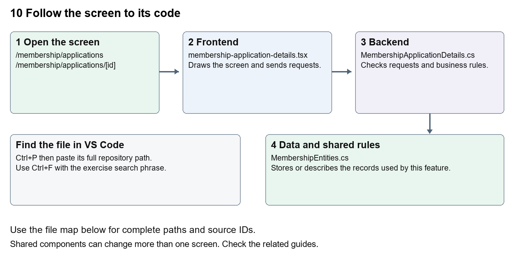

# Nexora membership applications and decisions

Document 10 of the Nexora learning guides  
Source snapshot 13 October 2026 at 17:12 UTC


Understand application forms, review details, evidence and staff approval or rejection.

### Recognise the screen and its scope

Open `/membership/applications`, `/membership/applications/[id]`. CRM routes use port 3017; member routes use 3018; public website routes can use 3019. Brackets name a route parameter, not text to paste into a browser. Choose a real record or site id from the application.

This guide covers Personal and company applications; Application details and review summary; Terms quoted rates and submission; Evidence files; Approve and reject decisions; Membership creation and notifications.



The diagram shows the file roles. The full paths below are what you paste into Ctrl+P.

### Find the files in VS Code

| Role | File and source ID | What it does |
| --- | --- | --- |
| Screen | S0103 membership-application-details.tsx | Main UI or route for this topic |
| Server | S0505 MembershipApplicationDetails.cs | Endpoints or server rules |
| Data | S0417 MembershipEntities.cs | Data shape or persistence structure |

**Screen S0103**  
[apps/web/src/features/membership/membership-application-details.tsx](<D:/Projects new/Nexora/apps/web/src/features/membership/membership-application-details.tsx>)

**Server S0505**  
[backend/src/Modules/Nexora.Modules.Membership/MembershipApplicationDetails.cs](<D:/Projects new/Nexora/backend/src/Modules/Nexora.Modules.Membership/MembershipApplicationDetails.cs>)

**Data S0417**  
[backend/src/Modules/Nexora.Modules.Membership/Domain/MembershipEntities.cs](<D:/Projects new/Nexora/backend/src/Modules/Nexora.Modules.Membership/Domain/MembershipEntities.cs>)

The complete HTML manual opens these source IDs inside its Source library. The Word manual shows short labelled extracts so you can learn the flow before reading large files. Each individual Markdown guide includes its complete primary files after the walkthrough.

### Follow the request and the records

1. A staff or member form chooses a permitted product and subject.
2. A saved draft retains editable application details.
3. Submission validates the draft and produces an application record.
4. Staff read the review summary and available clean evidence.
5. An authorised decision calls server rules which record the outcome and any resulting membership.

### Read the code with an explanation

Draft, submitted application and active membership are separate states. Client forms help collect information; the application command and service enforce product, account-link and eligibility rules. Review summaries bring related facts together. Evidence scanning controls which attachments may be opened; the presence of an uploaded file does not mean it is safe or approved.

Source reference S0103 apps/web/src/features/membership/membership-application-details.tsx

Selected opening lines with their original numbers. The complete file is in the HTML source library.

```tsx
0001  "use client";
0002  import { useEffect, useState } from "react";
0003  import { moduleApi } from "../shared/module-api";
0007  type Names = { memberType: string | null; category: string | null; subscriptionBand: string | null; invoicingAccount: string | null };
0008  type Result = { version: string; status: string; lifecyclePurpose: string | null; statusEffectiveOn: string | null; details: ApplicationRequestedDetails; names: Names };
0009  type Choice = { id: string; name: string };
```


The import lines lead to shared components and helpers. Start at the exported component or route function; follow the request helper to the server rather than assuming the whole feature lives in this file.

Source reference S0505 backend/src/Modules/Nexora.Modules.Membership/MembershipApplicationDetails.cs

Extract from source line 21. A fragment from a long line is shown without the rest of that line.

```cs
0021          api.MapGet("/applications/{id:guid}/details", async (Guid id, MembershipDbContext db, CancellationToken ct) =>
```


On the server, look for MapGet to load records, MapPost to create or perform an action, MapPut or MapPatch to change data, and RequireAuthorization for permissions. Some shared methods register endpoints indirectly. Find SaveChangesAsync to see the database write. A request method alone does not tell you every side effect.

Source reference S0417 backend/src/Modules/Nexora.Modules.Membership/Domain/MembershipEntities.cs

Selected opening lines with their original numbers. The complete file is in the HTML source library.

```cs
0001  using Nexora.BuildingBlocks.Domain;
0002  namespace Nexora.Modules.Membership.Domain;
0003  public sealed class MembershipProduct : TenantEntity
0004  {
0005      public string Name { get; set; } = "";
0006      public string Category { get; set; } = "";
```


Follow model fields to their request names and database mapping. An id points to a particular record. A tenant id limits the organisation. A version or concurrency stamp protects newer edits. Some model files describe contracts rather than tables; check the owning DbContext before assuming storage.

### Make or trace your first change

1. Press Ctrl+P and open [apps/web/src/features/membership/membership-application-details.tsx](<D:/Projects new/Nexora/apps/web/src/features/membership/membership-application-details.tsx>).
2. Press Ctrl+F and search for `export function`. In this snapshot it appears at line 12.
3. Read-only exercise: locate the application detail component, identify its request path and expected version, then find the corresponding C# endpoint. Sketch the difference between saving details and deciding an application.
4. Record the file, request path and server handler you found. This exercise is read-only; no stored records need to change.

Extract from source line 12. A fragment from a long line is shown without the rest of that line.

```tsx
0012  export function ApplicationRequestedFields({ value, onChange
```


These exercises have not been applied to the application. Their search phrases are verified against the captured source. Line numbers can move; the phrase and file path are your main navigation aids.

### Check a change and diagnose problems

Confirm the original screen still loads, the changed words appear in the intended place, and another screen using the same component still behaves correctly. If an action fails, inspect the browser Network response, the relevant helper and server validation message. Use the common error table at the beginning of the manual. Reload on a version conflict instead of removing the version check.

A syntax error after a text edit usually means a quote, brace or closing tag changed. Compare your diff with the original. An unchanged browser result can mean the wrong port, a saved published configuration overriding a default, or a running API that has not reloaded.

### Understand the current limits

membership.manage and membership.decide are separate rights. Approval can create real records and notifications. Notification queue or inbox state does not prove external email delivery.

### Continue learning

Related guides [09 Nexora member records and subscriptions](#guide_09), [11 Nexora membership setup and products](#guide_11), [24 Nexora member portal login and onboarding](#guide_24), [25 Nexora member portal journeys](#guide_25), [29 Nexora documents evidence and file safety](#guide_29).

## Complete primary source files

These are the complete captured files, with numbered source lines. Other supporting files are included in the complete HTML manual. Configured local passwords, if any, are explicitly omitted. Do not paste the display line numbers into code.

### S0103 membership-application-details.tsx

[apps/web/src/features/membership/membership-application-details.tsx](<D:/Projects new/Nexora/apps/web/src/features/membership/membership-application-details.tsx>)

SHA256 `471250d7b06d58d593aea028c119cfdd89a53a057df6266d484927eb96286fb4`; 42 source lines; complete captured text.

```tsx
0001  "use client";
0002  import { useEffect, useState } from "react";
0003  import { moduleApi } from "../shared/module-api";
0004  
0005  export type ApplicationRequestedDetails = { memberTypeId: string | null; categoryId: string | null; subscriptionBandId: string | null; paymentMethod: string | null; paymentFrequency: string | null; invoiceToAccount: boolean | null; invoicingAccountId: string | null; remarks: string | null; description: string | null };
0006  export const emptyApplicationDetails: ApplicationRequestedDetails = { memberTypeId: null, categoryId: null, subscriptionBandId: null, paymentMethod: null, paymentFrequency: null, invoiceToAccount: null, invoicingAccountId: null, remarks: null, description: null };
0007  type Names = { memberType: string | null; category: string | null; subscriptionBand: string | null; invoicingAccount: string | null };
0008  type Result = { version: string; status: string; lifecyclePurpose: string | null; statusEffectiveOn: string | null; details: ApplicationRequestedDetails; names: Names };
0009  type Choice = { id: string; name: string };
0010  const input = "mt-2 w-full rounded-lg border border-slate-300 px-3 py-2 text-sm disabled:bg-slate-50";
0011  
0012  export function ApplicationRequestedFields({ value, onChange, disabled, names, snapshot }: { value: ApplicationRequestedDetails; onChange: (value: ApplicationRequestedDetails) => void; disabled: boolean; names?: Names; snapshot?: ApplicationRequestedDetails | null }) {
0013    const [lists, setLists] = useState<Choice[][]>([[], [], [], []]); const [error, setError] = useState(""); const [revision, setRevision] = useState(0); const [search, setSearch] = useState(""); const [working, setWorking] = useState(false);
0014    useEffect(() => { let current = true; Promise.all(["/setup/member-type", "/setup/member-category", "/setup/member-subscription-band", "/accounts"].map(path => moduleApi<Choice[]>("membership", path))).then(value => { if (current) setLists(value); }).catch(e => { if (current) setError(e.message); }); return () => { current = false; }; }, [revision]);
0015    function change(details: Partial<ApplicationRequestedDetails>) { onChange({ ...value, ...details }); }
0016    return <div className="space-y-3">
0017      {error && <p role="alert" className="text-sm text-red-700">{error} <button type="button" className="underline" onClick={() => { setError(""); setRevision(n => n + 1); }}>Reload choices</button></p>}
0018      <fieldset disabled={disabled || working} className="grid gap-3 sm:grid-cols-2"><legend className="mb-3 font-semibold">Requested application details</legend>
0019        {([["memberTypeId", "memberType", "Requested member type"], ["categoryId", "category", "Requested category"], ["subscriptionBandId", "subscriptionBand", "Requested subscription band"]] as const).map(([key, nameKey, label], index) => <label className="text-sm" key={key}>{label}<select className={input} value={value[key] ?? ""} onChange={e => change({ [key]: e.target.value || null })}><option value="">Not recorded</option>{value[key] && !lists[index].some(choice => choice.id === value[key]) && <option value={value[key]}>{snapshot?.[key] === value[key] ? names?.[nameKey] ?? value[key] : value[key]} (retained)</option>}{lists[index].map(choice => <option key={choice.id} value={choice.id}>{choice.id === value[key] && snapshot?.[key] === value[key] ? names?.[nameKey] ?? choice.name : choice.name}</option>)}</select></label>)}
0020        {([["paymentMethod", "Requested payment method"], ["paymentFrequency", "Requested payment frequency"]] as const).map(([key, label]) => <label className="text-sm" key={key}>{label}<input className={input} maxLength={160} value={value[key] ?? ""} onChange={e => change({ [key]: e.target.value || null })}/></label>)}
0021        <label className="text-sm">Invoice to Account<select className={input} value={value.invoiceToAccount == null ? "unknown" : value.invoiceToAccount ? "yes" : "no"} onChange={e => change({ invoiceToAccount: e.target.value === "unknown" ? null : e.target.value === "yes", ...(e.target.value !== "yes" ? { invoicingAccountId: null } : {}) })}><option value="unknown">Unknown</option><option value="yes">Yes</option><option value="no">No</option></select></label>
0022        <label className="text-sm">Find invoicing Account<input className={input} value={search} onChange={e => setSearch(e.target.value)}/></label>
0023        <button type="button" className="self-end rounded-lg border border-slate-300 px-3 py-2 text-sm" onClick={async () => { setWorking(true); setError(""); try { const accounts = await moduleApi<Choice[]>("membership", `/accounts?search=${encodeURIComponent(search)}`); setLists(current => [current[0], current[1], current[2], accounts]); } catch (e) { setError(e instanceof Error ? e.message : "Unable to find Accounts."); } finally { setWorking(false); } }}>Search invoicing Accounts</button>
0024        <label className="text-sm">Requested invoicing Account<select className={input} required={value.invoiceToAccount === true} disabled={disabled || working || value.invoiceToAccount !== true} value={value.invoicingAccountId ?? ""} onChange={e => change({ invoicingAccountId: e.target.value || null })}><option value="">Not recorded</option>{value.invoicingAccountId && !lists[3].some(choice => choice.id === value.invoicingAccountId) && <option value={value.invoicingAccountId}>{snapshot?.invoicingAccountId === value.invoicingAccountId ? names?.invoicingAccount ?? value.invoicingAccountId : value.invoicingAccountId} (retained)</option>}{lists[3].map(choice => <option key={choice.id} value={choice.id}>{choice.id === value.invoicingAccountId && snapshot?.invoicingAccountId === value.invoicingAccountId ? names?.invoicingAccount ?? choice.name : choice.name}</option>)}</select></label>
0025        {([["remarks", "Application Remarks (staff)"], ["description", "Application Description (staff)"]] as const).map(([key, label]) => <label className="text-sm sm:col-span-2" key={key}>{label}<textarea className={input} rows={3} maxLength={4000} value={value[key] ?? ""} onChange={e => change({ [key]: e.target.value || null })}/></label>)}
0026      </fieldset><p className="text-xs text-slate-500">Requested classifications and invoicing arrangements are retained on the application and applied only on approval. They do not recalculate the submitted quote or collect payment. Remarks and Description remain separate from applicant notes and membership Remarks.</p>
0027    </div>;
0028  }
0029  
0030  export function MembershipApplicationDetails({ id, editable, busy, onChanged }: { id: string; editable: boolean; busy: boolean; onChanged: () => void }) {
0031    const [snapshot, setSnapshot] = useState<ApplicationRequestedDetails | null>(null);
0032    const [result, setResult] = useState<Result | null>(null); const [error, setError] = useState(""); const [reason, setReason] = useState(""); const [pending, setPending] = useState(false); const [revision, setRevision] = useState(0);
0033    useEffect(() => { let current = true; moduleApi<Result>("membership", `/applications/${id}/details`).then(value => { if (current) { setResult(value); setSnapshot(value.details); } }).catch(e => { if (current) setError(e.message); }); return () => { current = false; }; }, [id, revision]);
0034    const allowed = editable && result?.status === "submitted";
0035    return <section className="my-4 rounded-lg border border-slate-200 p-4" aria-label="Requested membership application details">
0036      {error && <p role="alert" className="mb-3 text-sm text-red-700">{error} <button type="button" className="underline" disabled={pending} onClick={() => { setError(""); setResult(null); setRevision(n => n + 1); }}>Reload details</button></p>}
0037      {!result ? !error && <p role="status">Loading application details…</p> : <><p className="mb-3 text-sm">Lifecycle purpose: {result.lifecyclePurpose ?? "Not recorded"} · Status effective date: {result.statusEffectiveOn ?? "Not recorded"}</p><form className="space-y-3" onSubmit={async e => { e.preventDefault(); setPending(true); setError(""); try { const saved = await moduleApi<Result>("membership", `/applications/${id}/details`, "PUT", { version: result.version, details: result.details, reason }); setResult(saved); setSnapshot(saved.details); setReason(""); onChanged(); } catch (e) { setError(e instanceof Error ? e.message : "Unable to save requested details."); } finally { setPending(false); } }}>
0038        <ApplicationRequestedFields value={result.details} names={result.names} snapshot={snapshot} disabled={!allowed || busy || pending} onChange={details => setResult({ ...result, details })}/>
0039        {allowed && <><label className="block text-sm">Change reason<input className={input} required maxLength={500} disabled={busy || pending} value={reason} onChange={e => setReason(e.target.value)}/></label><button className="rounded-lg bg-indigo-700 px-4 py-2 text-sm font-semibold text-white disabled:opacity-50" disabled={busy || pending}>Save requested details</button></>}
0040      </form></>}
0041    </section>;
0042  }
```

### S0505 MembershipApplicationDetails.cs

[backend/src/Modules/Nexora.Modules.Membership/MembershipApplicationDetails.cs](<D:/Projects new/Nexora/backend/src/Modules/Nexora.Modules.Membership/MembershipApplicationDetails.cs>)

SHA256 `34c87c173209b1a0da9995a771d8d26202238986d5470a52cd2660a4b354753a`; 38 source lines; complete captured text.

```cs
0001  using System.ComponentModel.DataAnnotations;
0002  using Microsoft.AspNetCore.Builder;
0003  using Microsoft.AspNetCore.Http;
0004  using Microsoft.AspNetCore.Routing;
0005  using Microsoft.EntityFrameworkCore;
0006  using Nexora.BuildingBlocks.Security;
0007  using Nexora.Modules.Membership.Domain;
0008  using Nexora.Modules.Membership.Infrastructure;
0009  
0010  namespace Nexora.Modules.Membership;
0011  
0012  public sealed record ApplicationRequestedDetails(Guid? MemberTypeId = null, Guid? CategoryId = null, Guid? SubscriptionBandId = null,
0013      string? PaymentMethod = null, string? PaymentFrequency = null, bool? InvoiceToAccount = null, Guid? InvoicingAccountId = null,
0014      string? Remarks = null, string? Description = null);
0015  
0016  public static partial class MembershipModule
0017  {
0018      public sealed record ApplicationDetailsRequest(Guid Version, ApplicationRequestedDetails? Details, string Reason);
0019      private static void MapMembershipApplicationDetails(RouteGroupBuilder api)
0020      {
0021          api.MapGet("/applications/{id:guid}/details", async (Guid id, MembershipDbContext db, CancellationToken ct) =>
0022          {
0023              var application = await db.Set<MembershipApplication>().AsNoTracking().SingleOrDefaultAsync(x => x.Id == id, ct) ?? throw new KeyNotFoundException();
0024              return Results.Ok(ApplicationDetailsFields.Read(application));
0025          });
0026          api.MapPut("/applications/{id:guid}/details", async (Guid id, ApplicationDetailsRequest request, MembershipDbContext db, ICrmDirectory crm, IRequestIdentity who, HttpContext http, CancellationToken ct) =>
0027          {
0028              var application = await db.Set<MembershipApplication>().SingleOrDefaultAsync(x => x.Id == id, ct) ?? throw new KeyNotFoundException();
0029              if (application.Version != request.Version) throw new DbUpdateConcurrencyException();
0030              if (application.Status != "submitted") throw new ValidationException("Only submitted applications can change requested details.");
0031              var reason = AdministrativeText(request.Reason, 500, false) ?? throw new ValidationException("Provide a reason for changing requested application details.");
0032              await ApplicationDetailsFields.ApplyAsync(application, request.Details ?? throw new ValidationException("Provide requested application details."), db, crm, ct);
0033              application.UpdatedAtUtc = DateTime.UtcNow;
0034              History(db, who, http, id, "application.details.updated", reason);
0035              await db.SaveChangesAsync(ct); return Results.Ok(ApplicationDetailsFields.Read(application));
0036          }).RequireAuthorization("membership.manage");
0037      }
0038  }
```

### S0417 MembershipEntities.cs

[backend/src/Modules/Nexora.Modules.Membership/Domain/MembershipEntities.cs](<D:/Projects new/Nexora/backend/src/Modules/Nexora.Modules.Membership/Domain/MembershipEntities.cs>)

SHA256 `83d9b09d6a02aa3fa9a771ace99e4f12f93a3e51de6cd12aa0cb1d74352421cd`; 134 source lines; complete captured text.

```cs
0001  using Nexora.BuildingBlocks.Domain;
0002  namespace Nexora.Modules.Membership.Domain;
0003  public sealed class MembershipProduct : TenantEntity
0004  {
0005      public string Name { get; set; } = "";
0006      public string Category { get; set; } = "";
0007      public int TermMonths { get; set; } = 12;
0008      public decimal Rate { get; set; }
0009      public string Currency { get; set; } = "GBP";
0010      public bool IsActive { get; set; } = true;
0011      public bool PortalApplicationsEnabled { get; set; }
0012      public bool PortalOrganisationApplicationsEnabled { get; set; }
0013      public string PortalTerms { get; set; } = "";
0014  }
0015  public sealed class PortalApplicationDraft : TenantEntity
0016  {
0017      public Guid? AccountId { get; set; }
0018      public Guid ContactId { get; set; }
0019      public Guid ProductId { get; set; }
0020      public DateTime StartsAtUtc { get; set; }
0021      public string Notes { get; set; } = "";
0022      public Guid ProductVersion { get; set; }
0023      public Guid? PolicyVersion { get; set; }
0024      public decimal Total { get; set; }
0025      public string Currency { get; set; } = "GBP";
0026      public string Terms { get; set; } = "";
0027      public Guid? ApplicationId { get; set; }
0028  }
0029  public sealed class MembershipApplication : TenantEntity
0030  {
0031      public string? LifecyclePurpose { get; set; }
0032      public DateOnly? StatusEffectiveOn { get; set; }
0033      public Guid? RequestedMemberTypeId { get; set; }
0034      public string? RequestedMemberTypeName { get; set; }
0035      public Guid? RequestedCategoryId { get; set; }
0036      public string? RequestedCategoryName { get; set; }
0037      public Guid? RequestedSubscriptionBandId { get; set; }
0038      public string? RequestedSubscriptionBandName { get; set; }
0039      public string? PaymentMethod { get; set; }
0040      public string? PaymentFrequency { get; set; }
0041      public bool? InvoiceToAccount { get; set; }
0042      public Guid? InvoicingAccountId { get; set; }
0043      public string? InvoicingAccountName { get; set; }
0044      public string? StaffRemarks { get; set; }
0045      public string? Description { get; set; }
0046      public bool? ExemptJoiningFee { get; set; }
0047      public bool? FreeMembership { get; set; }
0048      public Guid? PreviousMembershipId { get; set; }
0049      public Guid? AccountId { get; set; }
0050      public string? AccountName { get; set; }
0051      public Guid ContactId { get; set; }
0052      public string ContactName { get; set; } = "";
0053      public Guid ProductId { get; set; }
0054      public string ApplicationType { get; set; } = "corporate";
0055      public string? ApplicantRole { get; set; }
0056      public bool TermsAccepted { get; set; }
0057      public DateTime? TermsAcceptedAtUtc { get; set; }
0058      public string? ApplicantNotes { get; set; }
0059      public string Status { get; set; } = "submitted";
0060      public DateTime RequestedStartUtc { get; set; }
0061      // Null on legacy applications: approval preserves the original term-month fallback.
0062      // New applications snapshot the quoted end date so later policy edits cannot change it.
0063      public DateTime? RequestedEndUtc { get; set; }
0064      public decimal QuotedRate { get; set; }
0065      public string Currency { get; set; } = "GBP";
0066      public int TermMonths { get; set; }
0067      public string DecisionReason { get; set; } = "";
0068      public Guid? MembershipId { get; set; }
0069  }
0070  public sealed class MemberSubscription : TenantEntity
0071  {
0072      public int? RenewalMonth { get; set; }
0073      public DateOnly? RecordedRenewalDate { get; set; }
0074      public DateOnly? NextRenewalDate { get; set; }
0075      public string? PromotionCode { get; set; }
0076      public string? PaymentMethod { get; set; }
0077      public string? PaymentFrequency { get; set; }
0078      public string? PaymentProvider { get; set; }
0079      public Guid? PaidById { get; set; }
0080      public string? PaidByName { get; set; }
0081      public string? PaidByKind { get; set; }
0082      public bool? InvoiceToAccount { get; set; }
0083      public Guid? InvoicingAccountId { get; set; }
0084      public string? InvoicingAccountName { get; set; }
0085      public bool? ExemptJoiningFee { get; set; }
0086      public bool? FreeMembership { get; set; }
0087      public bool? ExcludedFromLapse { get; set; }
0088      public bool? PrimaryMembership { get; set; }
0089      public bool IsArchived { get; set; }
0090      public DateTime? ArchivedAtUtc { get; set; }
0091      public Guid? ArchivedByUserId { get; set; }
0092      public string? ArchiveReason { get; set; }
0093      public Guid? PreviousMembershipId { get; set; }
0094      public DateOnly? RejoinedOn { get; set; }
0095      public DateOnly? OriginalJoinDate { get; set; }
0096      public DateOnly? StatusEffectiveOn { get; set; }
0097      public DateOnly? ResignedOn { get; set; }
0098      public string? ResignationReason { get; set; }
0099      public DateOnly? ReinstatedOn { get; set; }
0100      public string? LegacyMemberReference { get; set; }
0101      public bool? MembershipPackSent { get; set; }
0102      public DateOnly? MembershipPackSentDate { get; set; }
0103      public string? Remarks { get; set; }
0104      public Guid? AccountId { get; set; }
0105      public string? AccountName { get; set; }
0106      public Guid ContactId { get; set; }
0107      public string ContactName { get; set; } = "";
0108      public Guid ProductId { get; set; }
0109      public string Status { get; set; } = "active";
0110      public DateTime StartsAtUtc { get; set; }
0111      public DateTime EndsAtUtc { get; set; }
0112      public decimal Rate { get; set; }
0113      public string Currency { get; set; } = "GBP";
0114      public Guid ApplicationId { get; set; }
0115  }
0116  public sealed class MembershipHistory : TenantEntity, IAppendOnly
0117  {
0118      public DateOnly? EffectiveOn { get; set; }
0119      public Guid SubjectId { get; set; }
0120      public Guid ActorUserId { get; set; }
0121      public string Action { get; set; } = "";
0122      public string Reason { get; set; } = "";
0123      public string CorrelationId { get; set; } = "";
0124      public DateTime? PreviousEndUtc { get; set; }
0125      public DateTime? NewEndUtc { get; set; }
0126  }
0127  
0128  
0129  public sealed class MembershipSetupValue : TenantEntity
0130  {
0131   public string Kind { get; set; } = "";
0132   public string Name { get; set; } = "";
0133   public string Description { get; set; } = "";
0134  }
```
