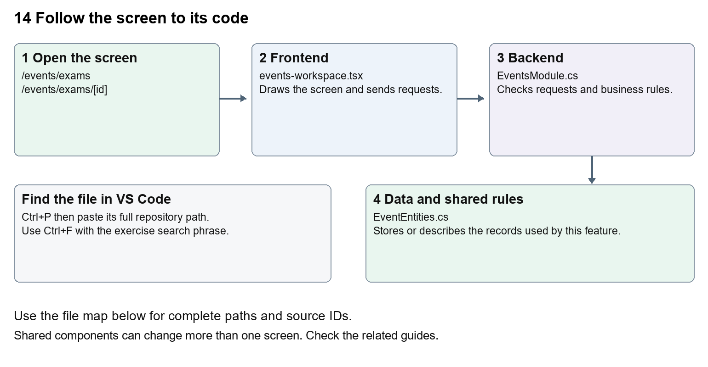

# Nexora examinations and results

Document 14 of the Nexora learning guides  
Source snapshot 14 October 2026 at 06:41 UTC


Understand examination offerings, attendance, score publication and pass or fail outcomes.

### Recognise the screen and its scope

Open `/events/exams`, `/events/exams/[id]`. CRM routes use port 3017; member routes use 3018; public website routes can use 3019. Brackets name a route parameter, not text to paste into a browser. Choose a real record or site id from the application.

This guide covers Exam offering and passing score; Candidate enrollments; Attendance prerequisite; Result score and outcome; Exam-results permission.



The diagram shows the file roles. The full paths below are what you paste into Ctrl+P.

### Find the files in VS Code

| Role | File and source ID | What it does |
| --- | --- | --- |
| Screen | S0097 events-workspace.tsx | Main UI or route for this topic |
| Server | S0329 EventsModule.cs | Endpoints or server rules |
| Data | S0328 EventEntities.cs | Data shape or persistence structure |

**Screen S0097**  
[apps/web/src/features/events/events-workspace.tsx](<D:/Projects new/Nexora/apps/web/src/features/events/events-workspace.tsx>)

**Server S0329**  
[backend/src/Modules/Nexora.Modules.Events/EventsModule.cs](<D:/Projects new/Nexora/backend/src/Modules/Nexora.Modules.Events/EventsModule.cs>)

**Data S0328**  
[backend/src/Modules/Nexora.Modules.Events/Domain/EventEntities.cs](<D:/Projects new/Nexora/backend/src/Modules/Nexora.Modules.Events/Domain/EventEntities.cs>)

The complete HTML manual opens these source IDs inside its Source library. The Word manual shows short labelled extracts so you can learn the flow before reading large files. Each individual Markdown guide includes its complete primary files after the walkthrough.

### Follow the request and the records

1. The exam route selects exam as the offering kind.
2. An enrollment links the candidate Contact to the exam.
3. Attendance is recorded before a result can be published.
4. An authorised results request sends score and expected version.
5. Server validation stores the result and calculates its outcome.

### Read the code with an explanation

The results permission is separate from general event management. The screen only shows the score form for an attended exam enrollment without an existing result. Those browser conditions help usability, while the C# endpoint checks the rules again. Changing the displayed word Score does not change the passing-score calculation.

Source reference S0097 apps/web/src/features/events/events-workspace.tsx

Selected opening lines with their original numbers. The complete file is in the HTML source library.

```tsx
0001  "use client";
0002  import { RecordListing } from "../shared/record-listing";
0003  import listingStyles from "../crm/record-listing.module.css";
0004  import { WorkspaceHeading } from "@/components/ui/workspace-heading";
0005  import { useRouter } from "next/navigation";
0006  import type { Route } from "next";
```


The import lines lead to shared components and helpers. Start at the exported component or route function; follow the request helper to the server rather than assuming the whole feature lives in this file.

Source reference S0329 backend/src/Modules/Nexora.Modules.Events/EventsModule.cs

Extract from source line 27. A fragment from a long line is shown without the rest of that line.

```cs
0027          api.MapGet("/contacts",(string? search,ICrmDirectory crm,CancellationToken ct)=>crm.SearchContactsAsync(search,ct));
```


On the server, look for MapGet to load records, MapPost to create or perform an action, MapPut or MapPatch to change data, and RequireAuthorization for permissions. Some shared methods register endpoints indirectly. Find SaveChangesAsync to see the database write. A request method alone does not tell you every side effect.

Source reference S0328 backend/src/Modules/Nexora.Modules.Events/Domain/EventEntities.cs

Selected opening lines with their original numbers. The complete file is in the HTML source library.

```cs
0001  using Nexora.BuildingBlocks.Domain;
0002  namespace Nexora.Modules.Events.Domain;
0003  public sealed class Offering : TenantEntity
0004  {
0005      public string Kind { get; set; } = "event";
0006      public string Name { get; set; } = "";
```


Follow model fields to their request names and database mapping. An id points to a particular record. A tenant id limits the organisation. A version or concurrency stamp protects newer edits. Some model files describe contracts rather than tables; check the owning DbContext before assuming storage.

### Make or trace your first change

1. Press Ctrl+P and open [apps/web/src/features/events/events-workspace.tsx](<D:/Projects new/Nexora/apps/web/src/features/events/events-workspace.tsx>).
2. Press Ctrl+F and search for `Exam score`. In this snapshot it appears at line 31.
3. Replace only the result field label. Inspect the exam result form using an authorised test enrollment. Do not publish or alter a real result while practising.
4. Replace only `Exam score` with `Candidate score` in that intended location. Keep quotes, tags, JSON keys and routes intact.
5. Save with Ctrl+S. Inspect Problems and the local screen. Review the diff and restore the original text when you finish practising.

Extract from source line 31. A fragment from a long line is shown without the rest of that line.

```tsx
0031  l.offering.id);});}}><Field label="Exam score"><input className={input} name="score" type=
```


These exercises have not been applied to the application. Their search phrases are verified against the captured source. Line numbers can move; the phrase and file path are your main navigation aids.

### Check a change and diagnose problems

Confirm the original screen still loads, the changed words appear in the intended place, and another screen using the same component still behaves correctly. If an action fails, inspect the browser Network response, the relevant helper and server validation message. Use the common error table at the beginning of the manual. Reload on a version conflict instead of removing the version check.

A syntax error after a text edit usually means a quote, brace or closing tag changed. Compare your diff with the original. An unchanged browser result can mean the wrong port, a saved published configuration overriding a default, or a running API that has not reloaded.

### Understand the current limits

The current module stores exam outcomes; it does not establish a live proctoring service, external examination-board integration or automatic certificate distribution.

### Continue learning

Related guides [12 Nexora events and bookings](#guide_12), [13 Nexora courses and training](#guide_13), [20 Nexora administration and access](#guide_20).

## Complete primary source files

These are the complete captured files, with numbered source lines. Other supporting files are included in the complete HTML manual. Configured local passwords, if any, are explicitly omitted. Do not paste the display line numbers into code.

### S0097 events-workspace.tsx

[apps/web/src/features/events/events-workspace.tsx](<D:/Projects new/Nexora/apps/web/src/features/events/events-workspace.tsx>)

SHA256 `a4d5fc4b225aada646803a82590a350bef1f3b7a4cb8bfb9e785b9a686675b8c`; 33 source lines; complete captured text.

```tsx
0001  "use client";
0002  import { RecordListing } from "../shared/record-listing";
0003  import listingStyles from "../crm/record-listing.module.css";
0004  import { WorkspaceHeading } from "@/components/ui/workspace-heading";
0005  import { useRouter } from "next/navigation";
0006  import type { Route } from "next";
0007  import { Plus, ArrowLeft, Trash2 } from "lucide-react";
0008  import { useEntityListing } from "../shared/entity-listing-controls";
0009  import { useEffect,useState } from "react";
0010  import { moduleApi } from "../shared/module-api";
0011  import { Field,Panel,formData,inputClass as input,buttonClass as button,primaryClass as primary } from "../shared/module-ui";
0012  type Offering={id:string;kind:string;name:string;venue:string;startsAtUtc:string;endsAtUtc:string;capacity:number;status:string;version:string};
0013  type Enrollment={id:string;contactName:string;status:string;version:string};
0014  type Detail={offering:Offering;sessions:{id:string;name:string;startsAtUtc:string;endsAtUtc:string}[];enrollments:Enrollment[];results:{id:string;enrollmentId:string;score:number;outcome:string}[];history:{id:string;action:string;reason:string;createdAtUtc:string}[]};
0015  const api=<T,>(p:string,m="GET",b?:unknown)=>moduleApi<T>("events",p,m,b);
0016  export function EventsWorkspace({permissions, offeringKind = "",recordId}:{permissions:string[];offeringKind?:string;recordId?:string}){
0017   const router=useRouter();const creating=recordId==="new";const base=`/events/${offeringKind==="course"?"courses":offeringKind==="exam"?"exams":"events"}`;const navigate=(id:string)=>router.push(`${base}/${id}` as Route);
0018   const [offerings,setOfferings]=useState<Offering[]>([]);const [detail,setDetail]=useState<Detail|null>(null);const [contacts,setContacts]=useState<{id:string;name:string}[]>([]);const [error,setError]=useState("");const [busy,setBusy]=useState(false);const [loading,setLoading]=useState(true);const [refresh,setRefresh]=useState(0);const [kind,setKind]=useState(offeringKind);
0019   const manage=permissions.includes("events.manage");const results=permissions.includes("events.results");
0020   useEffect(()=>{let active=true;Promise.all([api<Offering[]>("/offerings"),api<{id:string;name:string}[]>("/contacts")]).then(([o,c])=>{if(active){setOfferings(o);setContacts(c);setLoading(false);}}).catch(e=>{if(active){setError(e.message);setLoading(false);}});return()=>{active=false;};},[refresh]);
0021   useEffect(()=>{if(!recordId||creating)return;let active=true;api<Detail>(`/offerings/${recordId}`).then(d=>{if(active)setDetail(d);}).catch(e=>{if(active)setError(e.message);});return()=>{active=false;};},[recordId,creating]);
0022   const listing=useEntityListing({records:offerings.filter(o=>!kind||o.kind===kind),actions:undefined,columns:["Name","Status","Starts","Venue","Capacity"]});
0023   const filtered=offerings.filter(o=>(!kind||o.kind===kind)&&listing.matches(o));
0024   async function perform(action:()=>Promise<void>,reload=true){setBusy(true);setError("");try{await action();if(reload)setRefresh(v=>v+1);}catch(e){setError(e instanceof Error?e.message:"Unable to save.");}finally{setBusy(false);}}
0025   async function reloadDetail(id:string){setDetail(await api<Detail>(`/offerings/${id}`));}
0026   return <main className={`${!recordId?listingStyles.listing:""} mx-auto max-w-7xl space-y-5 p-4 text-slate-800 sm:p-7`}><WorkspaceHeading actions={!recordId&&manage?<button className={listingStyles.create} aria-label="Add offering" onClick={()=>navigate("new")}><Plus size={18}/></button>:undefined}>{creating?"New ":""}{offeringKind==="course"?"Courses":offeringKind==="exam"?"Exams":"Events"}</WorkspaceHeading>{recordId&&<button className={button} aria-label="Back to listing" onClick={()=>router.push(base as Route)}><ArrowLeft size={16}/></button>}{error&&<div role="alert" className="rounded-lg bg-red-50 p-4 text-sm text-red-800">{error}<button className={button} onClick={()=>{setError("");setRefresh(v=>v+1);}}>Reload</button></div>}{loading&&<p role="status">Loading schedule…</p>}
0027   {!recordId&&<>{listing.toolbar}{!offeringKind&&<Field label="Type"><select className={input} value={kind} onChange={e=>setKind(e.target.value)}><option value="">All types</option>{["event","course","exam"].map(k=><option key={k}>{k}</option>)}</select></Field>}<RecordListing columnControls={listing.columnControls} label={offeringKind==="course"?"Courses":offeringKind==="exam"?"Exams":"Events"} rows={filtered} loading={loading} filterKey={kind+listing.filterKey} name={row=>row.name} onView={row=>navigate(row.id)} onEdit={manage?row=>navigate(row.id):undefined} actions={row=>manage&&row.status==="published"?<button type="button" className="rounded-lg p-2 text-rose-600 hover:bg-rose-50" aria-label={`Cancel ${row.name}`} title="Cancel offering" onClick={()=>navigate(row.id)}><Trash2 size={16}/></button>:null} columns={[{key:"name",label:"Name",render:row=>row.name},{key:"status",label:"Status",hidden:!listing.show("Status"),render:row=>row.status},{key:"starts",label:"Starts",sortValue:row=>new Date(row.startsAtUtc),hidden:!listing.show("Starts"),render:row=>new Date(row.startsAtUtc).toLocaleString()},{key:"venue",label:"Venue",hidden:!listing.show("Venue"),render:row=>row.venue},{key:"capacity",label:"Capacity",hidden:!listing.show("Capacity"),render:row=>row.capacity}]}/></>}
0028   {manage&&creating&&<Panel title="Publish a Schedule"><form className="grid gap-3 sm:grid-cols-3" onSubmit={e=>{const r=formData(e);const form=e.currentTarget;void perform(async()=>{const o=await api<Offering>("/offerings","POST",{...r,startsAtUtc:new Date(r.startsAtUtc).toISOString(),endsAtUtc:new Date(r.endsAtUtc).toISOString(),capacity:Number(r.capacity),passingScore:Number(r.passingScore)});form.reset();navigate(o.id);});}}><Field label="Name"><input className={input} name="name" maxLength={160} required/></Field><Field label="Type"><select className={input} name="kind" defaultValue={offeringKind||"event"}>{(offeringKind?[offeringKind]:["event","course","exam"]).map(k=><option key={k}>{k}</option>)}</select></Field><Field label="Venue or online location"><input className={input} name="venue" maxLength={160} required/></Field><Field label="Starts"><input className={input} name="startsAtUtc" type="datetime-local" required/></Field><Field label="Ends"><input className={input} name="endsAtUtc" type="datetime-local" required/></Field><Field label="Capacity"><input className={input} name="capacity" type="number" min={1} max={100000} defaultValue={30} required/></Field><Field label="Exam passing score"><input className={input} name="passingScore" type="number" min={0} max={100} defaultValue={50} required/></Field><button className={primary} disabled={busy}>Publish</button></form></Panel>}
0029   {detail&&<><Panel title={detail.offering.name}><p className="mb-4 text-sm">{detail.offering.status} · {detail.enrollments.filter(e=>["registered","attended"].includes(e.status)).length}/{detail.offering.capacity} places filled</p>{manage&&detail.offering.status==="published"&&<form className="mb-4 flex flex-wrap items-end gap-3" onSubmit={e=>{const r=formData(e);void perform(async()=>{await api(`/offerings/${detail.offering.id}/cancel`,"POST",{version:detail.offering.version,reason:r.reason});await reloadDetail(detail.offering.id);});}}><Field label="Reason to cancel offering and pending bookings"><input className={input} name="reason" maxLength={500} required/></Field><button className={button} disabled={busy}>Cancel offering</button></form>}<h3 className="font-semibold">Sessions</h3><ul className="my-3 space-y-2">{detail.sessions.map(s=><li key={s.id} className="text-sm">{s.name} · {new Date(s.startsAtUtc).toLocaleString()} – {new Date(s.endsAtUtc).toLocaleTimeString()}</li>)}</ul>{manage&&detail.offering.status==="published"&&<form className="grid items-end gap-3 sm:grid-cols-3" onSubmit={e=>{const r=formData(e);const form=e.currentTarget;void perform(async()=>{await api(`/offerings/${detail.offering.id}/sessions`,"POST",{...r,startsAtUtc:new Date(r.startsAtUtc).toISOString(),endsAtUtc:new Date(r.endsAtUtc).toISOString()});form.reset();await reloadDetail(detail.offering.id);});}}><Field label="Session name"><input className={input} name="name" required maxLength={160}/></Field><Field label="Session starts"><input className={input} name="startsAtUtc" type="datetime-local" required/></Field><Field label="Session ends"><input className={input} name="endsAtUtc" type="datetime-local" required/></Field><button className={button} disabled={busy}>Add session</button></form>}</Panel>
0030   <Panel title={detail.offering.kind==="course"?"Training applications and attendance":"Bookings and attendance"}>{manage&&detail.offering.status==="published"&&<><form className="mb-3 flex items-end gap-2" onSubmit={e=>{const r=formData(e);void perform(async()=>setContacts(await api(`/contacts?search=${encodeURIComponent(r.search)}`)),false);}}><Field label="Find Contact"><input className={input} name="search" maxLength={160}/></Field><button className={button}>Find</button></form><form className="mb-5 flex items-end gap-3" onSubmit={e=>{const r=formData(e);void perform(async()=>{await api(`/offerings/${detail.offering.id}/enrollments`,"POST",r);await reloadDetail(detail.offering.id);});}}><Field label="Participant"><select className={input} name="contactId" required><option value="">Choose Contact</option>{contacts.map(c=><option key={c.id} value={c.id}>{c.name}</option>)}</select></Field><button className={primary} disabled={busy}>{detail.offering.kind==="course"?"Apply for training":"Book place"}</button></form></>}
0031   <ul className="space-y-4">{detail.enrollments.map(e=><li key={e.id} className="rounded-lg border border-slate-200 p-4"><p className="font-medium">{e.contactName} · {e.status}</p>{manage&&detail.offering.status==="published"&&["submitted","registered","waitlisted"].includes(e.status)&&<form className="mt-3 grid items-end gap-3 sm:grid-cols-4" onSubmit={event=>{const r=formData(event);void perform(async()=>{await api(`/enrollments/${e.id}/${r.action}`,"POST",{version:e.version,reason:r.reason,targetOfferingId:r.targetOfferingId||null});await reloadDetail(detail.offering.id);});}}><Field label="Booking action"><select className={input} name="action">{(e.status==="submitted"?["approve","reject","cancel"]:e.status==="waitlisted"?["promote","transfer","cancel"]:["attend","transfer","cancel"]).map(a=><option key={a}>{a}</option>)}</select></Field><Field label="Reason"><input className={input} name="reason" maxLength={500} required/></Field><Field label="Transfer destination"><select className={input} name="targetOfferingId"><option value="">Only for transfers</option>{offerings.filter(o=>o.id!==detail.offering.id&&o.kind===detail.offering.kind&&o.status==="published").map(o=><option key={o.id} value={o.id}>{o.name}</option>)}</select></Field><button className={button} disabled={busy}>Apply action</button></form>}{results&&detail.offering.kind==="exam"&&e.status==="attended"&&!detail.results.some(r=>r.enrollmentId===e.id)&&<form className="mt-3 flex items-end gap-3" onSubmit={event=>{const r=formData(event);void perform(async()=>{await api(`/enrollments/${e.id}/result`,"POST",{...r,version:e.version,score:Number(r.score)});await reloadDetail(detail.offering.id);});}}><Field label="Exam score"><input className={input} name="score" type="number" min={0} max={100} required/></Field><button className={primary} disabled={busy}>Publish result</button></form>}{detail.results.filter(r=>r.enrollmentId===e.id).map(r=><p key={r.id} className="mt-3 text-sm font-semibold">Result: {r.score}/100 · {r.outcome}</p>)}</li>)}</ul></Panel><Panel title="Activity"><ol className="space-y-3">{detail.history.map(h=><li key={h.id} className="border-l-2 border-indigo-200 pl-3 text-sm"><strong>{h.action.replaceAll("."," ")}</strong><p>{h.reason}</p><time>{new Date(h.createdAtUtc).toLocaleString()}</time></li>)}</ol></Panel></>}
0032   </main>;
0033  }
```

### S0329 EventsModule.cs

[backend/src/Modules/Nexora.Modules.Events/EventsModule.cs](<D:/Projects new/Nexora/backend/src/Modules/Nexora.Modules.Events/EventsModule.cs>)

SHA256 `836c6d3bff2a67a7577de084b7a788cd9f2baec86a8311476b98cf3703a7a577`; 78 source lines; complete captured text.

```cs
0001  using Nexora.BuildingBlocks.Persistence;
0002  using Nexora.BuildingBlocks.Reporting;
0003  using Microsoft.AspNetCore.Builder;
0004  using Microsoft.AspNetCore.Http;
0005  using Microsoft.AspNetCore.Routing;
0006  using Microsoft.EntityFrameworkCore;
0007  using Microsoft.Extensions.Configuration;
0008  using Microsoft.Extensions.DependencyInjection;
0009  using Nexora.BuildingBlocks.Endpoints;
0010  using Nexora.BuildingBlocks.Security;
0011  using Nexora.Modules.Events.Domain;
0012  using Nexora.Modules.Events.Infrastructure;
0013  using static Nexora.BuildingBlocks.Endpoints.ModuleEndpoints;
0014  namespace Nexora.Modules.Events;
0015  public static partial class EventsModule
0016  {
0017      public static IServiceCollection AddNexoraEvents(this IServiceCollection services,IConfiguration config)
0018      {services.AddScoped<Nexora.BuildingBlocks.Security.ICrmContextProvider, Nexora.Modules.Events.Infrastructure.CrmContextProvider>();
0019          services.AddDbContext<EventsDbContext>((sp,o)=>o.AddInterceptors(sp.GetRequiredService<WorkflowCaptureInterceptor>()).UseSqlServer(config.GetConnectionString("Nexora"),sql=>sql.MigrationsHistoryTable("__EFMigrationsHistory","events")));services.AddScoped<IReportDataset>(sp=>new ReportDataset("offerings","Events and learning","events.read",sp.GetRequiredService<EventsDbContext>().Set<Offering>().AsNoTracking().Select(x=>new ReportRow{Id=x.Id,Label=x.Name,Status=x.Status,CreatedAtUtc=x.CreatedAtUtc})));
0020  
0021          services.AddWorkflowEntity<EventsDbContext,Offering>("events","Events and learning","events.read","Name",null,null,null);
0022          services.AddWorkflowEntity<EventsDbContext,Enrollment>("enrollments","Event registrations","events.read","ContactName",null,null,null,new WorkflowRelation("event","events","offeringId"),new WorkflowRelation("contact","contacts","contactId"));
0023          AddWorkflowCommands(services);return services;}
0024      public static IEndpointRouteBuilder MapNexoraEvents(this IEndpointRouteBuilder routes)
0025      {
0026          var api=routes.Module("events").WithAttributes<EventsDbContext>("events.manage", typeof(Offering), typeof(EventSession), typeof(Enrollment), typeof(ExamResult));
0027          api.MapGet("/contacts",(string? search,ICrmDirectory crm,CancellationToken ct)=>crm.SearchContactsAsync(search,ct));
0028          api.MapGet("/offerings",async(EventsDbContext db,string? kind,CancellationToken ct)=>{var q=db.Set<Offering>().AsNoTracking();if(!string.IsNullOrWhiteSpace(kind)){Choice(kind,"event","course","exam");q=q.Where(x=>x.Kind==kind);}return Results.Ok(await q.OrderBy(x=>x.StartsAtUtc).Take(200).ToListAsync(ct));});
0029          api.MapPost("/offerings",async(OfferingRequest r,EventsDbContext db,IRequestIdentity who,HttpContext http,CancellationToken ct)=>
0030          {
0031              Choice(r.Kind,"event","course","exam");Check(r.Capacity is >=1 and <=100000,"Capacity must be 1–100000.");Check(r.StartsAtUtc<r.EndsAtUtc,"End must follow start.");Check(r.PassingScore is >=0 and <=100,"Passing score must be 0–100.");
0032              var row=new Offering{TenantId=who.TenantId!.Value,Kind=r.Kind,Name=Text(r.Name),Venue=Text(r.Venue),StartsAtUtc=r.StartsAtUtc.ToUniversalTime(),EndsAtUtc=r.EndsAtUtc.ToUniversalTime(),Capacity=r.Capacity,PassingScore=r.PassingScore};db.Add(row);History(db,who,http,row.Id,null,"offering.created","Published schedule");await db.SaveChangesAsync(ct);return Results.Ok(row);
0033          }).RequireAuthorization("events.manage");
0034          api.MapGet("/offerings/{id:guid}",async(Guid id,EventsDbContext db,CancellationToken ct)=>
0035          {
0036              var offering=await OfferingAsync(db,id,ct);return Results.Ok(new{offering,sessions=await db.Set<EventSession>().Where(x=>x.OfferingId==id).OrderBy(x=>x.StartsAtUtc).ToListAsync(ct),enrollments=await db.Set<Enrollment>().Where(x=>x.OfferingId==id).OrderBy(x=>x.ContactName).ToListAsync(ct),results=await(from result in db.Set<ExamResult>() join enrollment in db.Set<Enrollment>() on result.EnrollmentId equals enrollment.Id where enrollment.OfferingId==id select result).ToListAsync(ct),history=await db.Set<EventHistory>().Where(x=>x.OfferingId==id).OrderByDescending(x=>x.CreatedAtUtc).Take(100).ToListAsync(ct)});
0037          });
0038          api.MapPost("/offerings/{id:guid}/sessions",async(Guid id,SessionRequest r,EventsDbContext db,IRequestIdentity who,HttpContext http,CancellationToken ct)=>
0039          {var offering=await OfferingAsync(db,id,ct);Check(offering.Status=="published","The offering is cancelled.");Check(r.StartsAtUtc>=offering.StartsAtUtc&&r.EndsAtUtc<=offering.EndsAtUtc&&r.StartsAtUtc<r.EndsAtUtc,"Session times must fit the offering.");var row=new EventSession{TenantId=who.TenantId!.Value,OfferingId=id,Name=Text(r.Name),StartsAtUtc=r.StartsAtUtc,EndsAtUtc=r.EndsAtUtc};db.Add(row);Touch(offering);History(db,who,http,id,null,"session.created",r.Name);await db.SaveChangesAsync(ct);return Results.Ok(row);}).RequireAuthorization("events.manage");
0040          api.MapPost("/offerings/{id:guid}/enrollments",async(Guid id,EnrollmentRequest r,EventsDbContext db,ICrmDirectory crm,IRequestIdentity who,HttpContext http,CancellationToken ct)=>
0041          {
0042              var row=await Enroll(id,r.ContactId,db,crm,who,http,null,ct);await db.SaveChangesAsync(ct);return Results.Ok(row);
0043          }).RequireAuthorization("events.manage");
0044          api.MapPost("/enrollments/{id:guid}/{action}",async(Guid id,string action,EnrollmentChange r,EventsDbContext db,IRequestIdentity who,HttpContext http,CancellationToken ct)=>
0045          {
0046              var row=await db.Set<Enrollment>().SingleOrDefaultAsync(x=>x.Id==id,ct)??throw new KeyNotFoundException();if(row.Version!=r.Version)return Conflict();Choice(action,"approve","reject","promote","attend","cancel","transfer");var reason=Text(r.Reason,500);var source=await OfferingAsync(db,row.OfferingId,ct);Check(source.Status=="published","The offering is cancelled.");
0047              if(action is "approve" or "promote"){Check(action=="approve"?row.Status=="submitted":row.Status=="waitlisted","Invalid enrollment transition.");Check(await HasSeat(db,source.Id,source.Capacity,ct),"This offering is full.");row.Status="registered";}
0048              else if(action=="reject"){Check(row.Status=="submitted","Only submitted applications can be rejected.");row.Status="rejected";}
0049              else if(action=="attend"){Check(row.Status=="registered","Only registered participants can attend.");row.Status="attended";}
0050              else if(action=="cancel"){Check(row.Status is "registered" or "submitted" or "waitlisted","This enrollment cannot be cancelled.");row.Status="cancelled";}
0051              else
0052              {
0053                  Check(row.Status is "registered" or "waitlisted","Only registered/waitlisted enrollments can transfer.");Check(r.TargetOfferingId!=null&&r.TargetOfferingId!=source.Id,"Choose a different destination.");var target=await OfferingAsync(db,r.TargetOfferingId!.Value,ct);Check(target.Status=="published"&&target.Kind==source.Kind,"Choose a published destination of the same kind.");Check(await HasSeat(db,target.Id,target.Capacity,ct),"The destination is full.");row.OfferingId=target.Id;row.Status="registered";Touch(target);History(db,who,http,target.Id,row.Id,"enrollment.transferred-in",reason);
0054              }
0055              Touch(source);History(db,who,http,source.Id,row.Id,"enrollment."+action,reason);await db.SaveChangesAsync(ct);return Results.Ok(row);
0056          }).RequireAuthorization("events.manage");
0057          api.MapPost("/enrollments/{id:guid}/result",async(Guid id,ResultRequest r,EventsDbContext db,IRequestIdentity who,HttpContext http,CancellationToken ct)=>
0058          {
0059              var row=await db.Set<Enrollment>().SingleOrDefaultAsync(x=>x.Id==id,ct)??throw new KeyNotFoundException();if(row.Version!=r.Version)return Conflict();var offering=await OfferingAsync(db,row.OfferingId,ct);Check(offering.Kind=="exam"&&row.Status=="attended","Results require an attended exam booking.");Check(r.Score is >=0 and <=100,"Score must be 0–100.");var result=new ExamResult{TenantId=who.TenantId!.Value,EnrollmentId=id,Score=r.Score,Outcome=r.Score>=offering.PassingScore?"pass":"fail",ActorUserId=who.UserId!.Value};db.Add(result);Touch(offering);History(db,who,http,offering.Id,id,"exam.result-recorded","Published result");await db.SaveChangesAsync(ct);return Results.Ok(result);
0060          }).RequireAuthorization("events.results");
0061          api.MapPost("/offerings/{id:guid}/cancel",async(Guid id,CancelRequest r,EventsDbContext db,IRequestIdentity who,HttpContext http,CancellationToken ct)=>
0062          {var offering=await OfferingAsync(db,id,ct);if(offering.Version!=r.Version)return Conflict();Check(offering.Status=="published","Already cancelled.");var reason=Text(r.Reason,500);offering.Status="cancelled";foreach(var row in await db.Set<Enrollment>().Where(x=>x.OfferingId==id&&(x.Status=="registered"||x.Status=="waitlisted"||x.Status=="submitted")).ToListAsync(ct)){row.Status="cancelled";History(db,who,http,id,row.Id,"enrollment.cancelled",reason);}History(db,who,http,id,null,"offering.cancelled",reason);await db.SaveChangesAsync(ct);return Results.Ok(offering);}).RequireAuthorization("events.manage");
0063          return routes;
0064      }
0065      private static async Task<Enrollment> Enroll(Guid id,Guid contactId,EventsDbContext db,ICrmDirectory crm,IRequestIdentity who,HttpContext http,Guid? enrollmentId,CancellationToken ct){            var offering=await OfferingAsync(db,id,ct);Check(offering.Status=="published","The offering is cancelled.");var contact=await crm.FindActiveAsync(contactId,ct)??throw new KeyNotFoundException();Check(contact.Kind=="contact","Choose a Contact.");
0066              var status=offering.Kind=="course"?"submitted":await HasSeat(db,id,offering.Capacity,ct)?"registered":"waitlisted";
0067              var row=new Enrollment{Id=enrollmentId??Guid.NewGuid(),TenantId=who.TenantId!.Value,OfferingId=id,ContactId=contact.Id,ContactName=contact.Name,Status=status};db.Add(row);Touch(offering);History(db,who,http,id,row.Id,"enrollment."+status,"Created booking/application");return row;}
0068      private static async Task<Offering> OfferingAsync(EventsDbContext db,Guid id,CancellationToken ct)=>await db.Set<Offering>().SingleOrDefaultAsync(x=>x.Id==id,ct)??throw new KeyNotFoundException();
0069      private static async Task<bool> HasSeat(EventsDbContext db,Guid id,int capacity,CancellationToken ct)=>await db.Set<Enrollment>().CountAsync(x=>x.OfferingId==id&&(x.Status=="registered"||x.Status=="attended"),ct)<capacity;
0070      private static void Touch(Offering row){row.Version=Guid.NewGuid();row.UpdatedAtUtc=DateTime.UtcNow;}
0071      private static void History(EventsDbContext db,IRequestIdentity who,HttpContext http,Guid offering,Guid? enrollment,string action,string reason)=>db.Add(new EventHistory{TenantId=who.TenantId!.Value,OfferingId=offering,EnrollmentId=enrollment,Action=action,Reason=reason,ActorUserId=who.UserId!.Value,CorrelationId=http.TraceIdentifier});
0072  }
0073  public sealed record OfferingRequest(string Kind,string Name,string Venue,DateTime StartsAtUtc,DateTime EndsAtUtc,int Capacity,int PassingScore) : IAttributeRequest { public Dictionary<Guid, AttributeInput>? Attributes { get; init; } }
0074  public sealed record SessionRequest(string Name,DateTime StartsAtUtc,DateTime EndsAtUtc) : IAttributeRequest { public Dictionary<Guid, AttributeInput>? Attributes { get; init; } }
0075  public sealed record EnrollmentRequest(Guid ContactId) : IAttributeRequest { public Dictionary<Guid, AttributeInput>? Attributes { get; init; } }
0076  public sealed record EnrollmentChange(Guid Version,string Reason,Guid? TargetOfferingId);
0077  public sealed record ResultRequest(Guid Version,int Score) : IAttributeRequest { public Dictionary<Guid, AttributeInput>? Attributes { get; init; } }
0078  public sealed record CancelRequest(Guid Version,string Reason);
```

### S0328 EventEntities.cs

[backend/src/Modules/Nexora.Modules.Events/Domain/EventEntities.cs](<D:/Projects new/Nexora/backend/src/Modules/Nexora.Modules.Events/Domain/EventEntities.cs>)

SHA256 `02ce838b4747ea492394bce72082a430879ff23f325f4a6d811ced8b4ecac2cd`; 43 source lines; complete captured text.

```cs
0001  using Nexora.BuildingBlocks.Domain;
0002  namespace Nexora.Modules.Events.Domain;
0003  public sealed class Offering : TenantEntity
0004  {
0005      public string Kind { get; set; } = "event";
0006      public string Name { get; set; } = "";
0007      public string Venue { get; set; } = "";
0008      public DateTime StartsAtUtc { get; set; }
0009      public DateTime EndsAtUtc { get; set; }
0010      public int Capacity { get; set; }
0011      public int PassingScore { get; set; } = 50;
0012      public string Status { get; set; } = "published";
0013  }
0014  public sealed class EventSession : TenantEntity
0015  {
0016      public Guid OfferingId { get; set; }
0017      public string Name { get; set; } = "";
0018      public DateTime StartsAtUtc { get; set; }
0019      public DateTime EndsAtUtc { get; set; }
0020  }
0021  public sealed class Enrollment : TenantEntity
0022  {
0023      public Guid OfferingId { get; set; }
0024      public Guid ContactId { get; set; }
0025      public string ContactName { get; set; } = "";
0026      public string Status { get; set; } = "registered";
0027  }
0028  public sealed class ExamResult : TenantEntity, IAppendOnly
0029  {
0030      public Guid EnrollmentId { get; set; }
0031      public int Score { get; set; }
0032      public string Outcome { get; set; } = "";
0033      public Guid ActorUserId { get; set; }
0034  }
0035  public sealed class EventHistory : TenantEntity, IAppendOnly
0036  {
0037      public Guid OfferingId { get; set; }
0038      public Guid? EnrollmentId { get; set; }
0039      public string Action { get; set; } = "";
0040      public string Reason { get; set; } = "";
0041      public Guid ActorUserId { get; set; }
0042      public string CorrelationId { get; set; } = "";
0043  }
```
