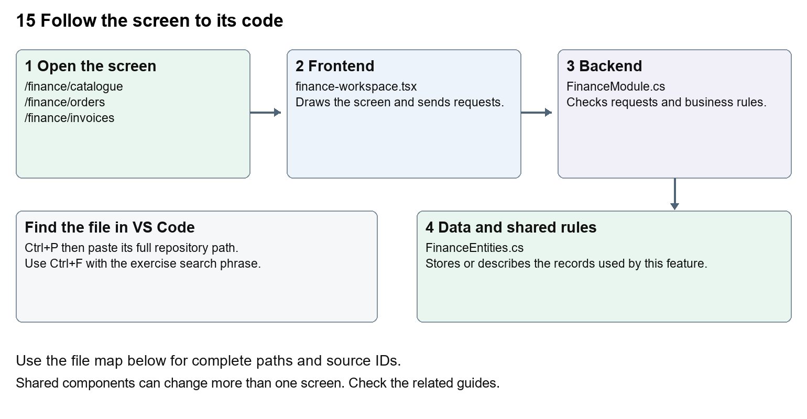

# Nexora sales and finance

Document 15 of the Nexora learning guides  
Source snapshot 13 October 2026 at 17:12 UTC


Understand catalogue products, orders, invoices, receipts, allocations and reconciliation.

### Recognise the screen and its scope

Open `/finance/catalogue`, `/finance/orders`, `/finance/invoices`, `/finance/receipts`. CRM routes use port 3017; member routes use 3018; public website routes can use 3019. Brackets name a route parameter, not text to paste into a browser. Choose a real record or site id from the application.

This guide covers Catalogue and currencies; Order lines and posting; Invoices and credits; Receipts and refunds; Allocations and reversals; Reconciliation export and history.



The diagram shows the file roles. The full paths below are what you paste into Ctrl+P.

### Find the files in VS Code

| Role | File and source ID | What it does |
| --- | --- | --- |
| Screen | S0098 finance-workspace.tsx | Main UI or route for this topic |
| Server | S0348 FinanceModule.cs | Endpoints or server rules |
| Data | S0347 FinanceEntities.cs | Data shape or persistence structure |

**Screen S0098**  
[apps/web/src/features/finance/finance-workspace.tsx](<D:/Projects new/Nexora/apps/web/src/features/finance/finance-workspace.tsx>)

**Server S0348**  
[backend/src/Modules/Nexora.Modules.Finance/FinanceModule.cs](<D:/Projects new/Nexora/backend/src/Modules/Nexora.Modules.Finance/FinanceModule.cs>)

**Data S0347**  
[backend/src/Modules/Nexora.Modules.Finance/Domain/FinanceEntities.cs](<D:/Projects new/Nexora/backend/src/Modules/Nexora.Modules.Finance/Domain/FinanceEntities.cs>)

The complete HTML manual opens these source IDs inside its Source library. The Word manual shows short labelled extracts so you can learn the flow before reading large files. Each individual Markdown guide includes its complete primary files after the walkthrough.

### Follow the request and the records

1. A catalogue product supplies price, currency and VAT basis points.
2. An order holds customer and line items.
3. Posting produces a stored invoice using validated totals.
4. An external receipt is recorded separately.
5. Allocations link available receipt money to invoice balances, with reversals and reconciliation history.

### Read the code with an explanation

The frontend displays actions but the backend calculates financial balances and validates amounts. A posted invoice is a stored accounting record. Recording a receipt explicitly does not initiate a charge. Credits reduce invoices; refunds reduce available receipts; allocations connect the two. Keep those meanings separate when tracing request fields.

Source reference S0098 apps/web/src/features/finance/finance-workspace.tsx

Selected opening lines with their original numbers. The complete file is in the HTML source library.

```tsx
0001  "use client";
0002  import listingStyles from "../crm/record-listing.module.css";
0003  import { WorkspaceHeading } from "@/components/ui/workspace-heading";
0004  import { RecordListing, useRecordPage } from "../shared/record-listing";
0005  import { Plus, ArrowLeft } from "lucide-react";
0006  import { useRouter } from "next/navigation";
```


The import lines lead to shared components and helpers. Start at the exported component or route function; follow the request helper to the server rather than assuming the whole feature lives in this file.

Source reference S0348 backend/src/Modules/Nexora.Modules.Finance/FinanceModule.cs

Extract from source line 31. A fragment from a long line is shown without the rest of that line.

```cs
0031    api.MapGet("/customers",(string? search,ICrmDirectory crm,CancellationToken ct)=>crm.SearchContactsAsync(search,ct));
```


On the server, look for MapGet to load records, MapPost to create or perform an action, MapPut or MapPatch to change data, and RequireAuthorization for permissions. Some shared methods register endpoints indirectly. Find SaveChangesAsync to see the database write. A request method alone does not tell you every side effect.

Source reference S0347 backend/src/Modules/Nexora.Modules.Finance/Domain/FinanceEntities.cs

Selected opening lines with their original numbers. The complete file is in the HTML source library.

```cs
0001  using Nexora.BuildingBlocks.Domain;
0002  namespace Nexora.Modules.Finance.Domain;
0003  public sealed class CatalogueProduct:TenantEntity
0004  {
0006  }
0007  public sealed class SalesOrder:TenantEntity
```


Follow model fields to their request names and database mapping. An id points to a particular record. A tenant id limits the organisation. A version or concurrency stamp protects newer edits. Some model files describe contracts rather than tables; check the owning DbContext before assuming storage.

### Make or trace your first change

1. Press Ctrl+P and open [apps/web/src/features/finance/finance-workspace.tsx](<D:/Projects new/Nexora/apps/web/src/features/finance/finance-workspace.tsx>).
2. Press Ctrl+F and search for `export function`. In this snapshot it appears at line 13.
3. Read-only exercise: find the workspace export and trace the receipts create request to FinanceModule. Find the server history message saying no charge was initiated. Explain why a receipt form is different from taking a card payment.
4. Record the file, request path and server handler you found. This exercise is read-only; no stored records need to change.

Extract from source line 13. A fragment from a long line is shown without the rest of that line.

```tsx
0013  export function FinanceWorkspace({permissions, section = "orders"}:{permissions:string[]; section?: string}){
```


These exercises have not been applied to the application. Their search phrases are verified against the captured source. Line numbers can move; the phrase and file path are your main navigation aids.

### Check a change and diagnose problems

Confirm the original screen still loads, the changed words appear in the intended place, and another screen using the same component still behaves correctly. If an action fails, inspect the browser Network response, the relevant helper and server validation message. Use the common error table at the beginning of the manual. Reload on a version conflict instead of removing the version check.

A syntax error after a text edit usually means a quote, brace or closing tag changed. Compare your diff with the original. An unchanged browser result can mean the wrong port, a saved published configuration overriding a default, or a running API that has not reloaded.

### Understand the current limits

No live payment processor or statutory accounting acceptance is established by these records. Calculation, posting and currency changes require targeted financial tests; beginners should start with text-only exercises.

### Continue learning

Related guides [09 Nexora member records and subscriptions](#guide_09), [11 Nexora membership setup and products](#guide_11), [16 Nexora engagement and fundraising](#guide_16), [19 Nexora insights and reporting](#guide_19).

## Complete primary source files

These are the complete captured files, with numbered source lines. Other supporting files are included in the complete HTML manual. Configured local passwords, if any, are explicitly omitted. Do not paste the display line numbers into code.

### S0098 finance-workspace.tsx

[apps/web/src/features/finance/finance-workspace.tsx](<D:/Projects new/Nexora/apps/web/src/features/finance/finance-workspace.tsx>)

SHA256 `a7d5b55d09e1e128a01eadfaa57b88b9043a46bbc94d4236c87643052eb7bad8`; 27 source lines; complete captured text.

```tsx
0001  "use client";
0002  import listingStyles from "../crm/record-listing.module.css";
0003  import { WorkspaceHeading } from "@/components/ui/workspace-heading";
0004  import { RecordListing, useRecordPage } from "../shared/record-listing";
0005  import { Plus, ArrowLeft } from "lucide-react";
0006  import { useRouter } from "next/navigation";
0007  import { useEntityListing } from "../shared/entity-listing-controls";
0008  import {useEffect,useState} from "react";
0009  import {moduleApi} from "../shared/module-api";
0010  import {Field,Panel,formData,inputClass as input,buttonClass as button,primaryClass as primary} from "../shared/module-ui";
0011  type Product={id:string;sku:string;name:string;unitPrice:number;currency:string};type Order={id:string;customerName:string;total:number;currency:string;status:string;version:string};type Invoice={id:string;number:string;customerName:string;currency:string;total:number};type Receipt={id:string;customerId:string;amount:number;currency:string;reference:string;version:string;statementReference:string|null};type Allocation={id:string;amount:number;reversesId:string|null};type InvoiceDetail={invoice:Invoice;balance:number;credits:{id:string;amount:number;reference:string}[];allocations:Allocation[]};type ReceiptDetail={receipt:Receipt;available:number;refunds:{id:string;amount:number;reference:string}[];allocations:Allocation[]};
0012  const api=<T,>(p:string,m="GET",b?:unknown)=>moduleApi<T>("finance",p,m,b);
0013  export function FinanceWorkspace({permissions, section = "orders"}:{permissions:string[]; section?: string}){
0014   const navigation=useRecordPage();const {recordId,creating,isListing}=navigation;const label=({orders:"Orders",invoices:"Invoices",receipts:"Receipts",catalogue:"Catalogue"} as Record<string,string>)[section]??"Finance";const [loading,setLoading]=useState(true);
0015   const [products,setProducts]=useState<Product[]>([]);const [orders,setOrders]=useState<Order[]>([]);const [invoices,setInvoices]=useState<Invoice[]>([]);const [receipts,setReceipts]=useState<Receipt[]>([]);const [customers,setCustomers]=useState<{id:string;name:string}[]>([]);const [invoice,setInvoice]=useState<InvoiceDetail|null>(null);const [receipt,setReceipt]=useState<ReceiptDetail|null>(null);const [cart,setCart]=useState<{productId:string;quantity:number}[]>([]);const tab = section;const router = useRouter();const [refresh,setRefresh]=useState(0);const [error,setError]=useState("");const [busy,setBusy]=useState(false);const manage=permissions.includes("finance.manage");const post=permissions.includes("finance.post");
0016   useEffect(()=>{let current=true;Promise.all([api<Product[]>("/products"),api<Order[]>("/orders"),api<Invoice[]>("/invoices"),api<Receipt[]>("/receipts"),api<{id:string;name:string}[]>("/customers")]).then(([p,o,i,r,c])=>{if(current){setProducts(p);setOrders(o);setInvoices(i);setReceipts(r);setCustomers(c);setLoading(false);}}).catch(e=>{if(current){setError(e.message);setLoading(false);}});return()=>{current=false;};},[refresh]);
0017   useEffect(()=>{if(!recordId||creating||!["invoices","receipts"].includes(section))return;let active=true;if(section==="invoices")api<InvoiceDetail>(`/invoices/${recordId}`).then(v=>{if(active)setInvoice(v);}).catch(e=>{if(active)setError(e.message);});else api<ReceiptDetail>(`/receipts/${recordId}`).then(v=>{if(active)setReceipt(v);}).catch(e=>{if(active)setError(e.message);});return()=>{active=false;};},[recordId,creating,section]);
0018   async function perform(fn:()=>Promise<void>,reload=true){setBusy(true);setError("");try{await fn();if(reload)setRefresh(v=>v+1);}catch(e){setError(e instanceof Error?e.message:"Unable to save.");}finally{setBusy(false);}}
0019   const listing=useEntityListing({records:section==="catalogue"?products:section==="invoices"?invoices:section==="receipts"?receipts:orders,columns:[tab==="catalogue"?"Product":tab==="invoices"?"Invoice":tab==="receipts"?"Reference":"Customer","Details"],actions:<>{permissions.includes("finance.export")&&<a href="/api/v1/finance/export" download="nexora-invoices.csv" className={button}>Export invoices CSV</a>}</>});
0020   const customerSelect=<select className={input} name="customerId" required><option value="">Choose customer</option>{customers.map(c=><option key={c.id} value={c.id}>{c.name}</option>)}</select>;
0021   return <main className={`${isListing?listingStyles.listing:""} mx-auto max-w-7xl space-y-5 p-4 text-slate-800 sm:p-7`}><WorkspaceHeading actions={isListing&&((manage&&["catalogue","orders"].includes(tab))||(post&&tab==="receipts"))?<button className={listingStyles.create} aria-label={`Add ${label.toLowerCase()}`} onClick={()=>navigation.open("new","edit")}><Plus size={18}/></button>:undefined}>{creating?`New ${label}`:label}</WorkspaceHeading>{!isListing&&<button className={button} aria-label="Back to listing" onClick={navigation.back}><ArrowLeft size={16}/></button>}{!isListing&&["receipts","invoices"].includes(tab)&&<p className="rounded-lg bg-amber-50 p-3 text-sm text-amber-900">Receipts and refunds record external transactions. These actions do not move money.</p>}{error&&<div role="alert" className="rounded-lg bg-red-50 p-4 text-sm text-red-800">{error}<button className={button} onClick={()=>{setError("");setRefresh(v=>v+1);}}>Reload</button></div>}{isListing&&<>{listing.toolbar}<RecordListing columnControls={listing.columnControls} label={label} loading={loading} rows={(tab==="catalogue"?products:tab==="invoices"?invoices:tab==="receipts"?receipts:orders).filter(listing.matches).map(row=>({id:row.id,name:"name" in row?row.name:"number" in row?row.number:"reference" in row?row.reference:row.customerName,details:"unitPrice" in row?`${row.sku} · ${row.currency} ${row.unitPrice.toFixed(2)}`:"amount" in row?`${row.currency} ${row.amount.toFixed(2)} · ${row.statementReference?"Reconciled":"Unreconciled"}`:`${row.currency} ${row.total.toFixed(2)} · ${"status" in row?row.status:row.customerName}`}))} filterKey={section+listing.filterKey} name={row=>row.name} onView={row=>navigation.open(row.id)} columns={[{key:"name",label:tab==="catalogue"?"Product":tab==="invoices"?"Invoice":tab==="receipts"?"Reference":"Customer",render:row=>row.name},{key:"details",label:"Details",hidden:!listing.show("Details"),render:row=>row.details}]}/></>}
0022   {tab==="catalogue"&&!isListing&&<>{!creating&&<Panel title="Catalogue"><ul className="space-y-2">{products.filter(p=>p.id===recordId).map(p=><li key={p.id} className="rounded-lg bg-slate-50 p-3 text-sm">{p.sku} · {p.name} · {p.currency} {p.unitPrice.toFixed(2)}</li>)}</ul></Panel>}{creating&&manage&&<Panel title="Add product"><form className="grid items-end gap-3 sm:grid-cols-3" onSubmit={e=>{const r=formData(e);const form=e.currentTarget;void perform(async()=>{await api("/products","POST",{...r,unitPrice:Number(r.unitPrice),vatBasisPoints:Number(r.vatBasisPoints)});form.reset();navigation.back();});}}>{[["sku","SKU"],["name","Product name"]].map(([n,l])=><Field key={n} label={l}><input className={input} name={n} maxLength={n==="sku"?80:160} required/></Field>)}<Field label="Unit price"><input className={input} name="unitPrice" type="number" min={0} step="0.01" required/></Field><Field label="Currency"><select className={input} name="currency">{["GBP","EUR","USD"].map(c=><option key={c}>{c}</option>)}</select></Field><Field label="VAT basis points (100 = 1%)"><input className={input} name="vatBasisPoints" type="number" min={0} max={10000} defaultValue={0} required/></Field><button className={primary} disabled={busy}>Add product</button></form></Panel>}</>}
0023   {tab==="orders"&&!isListing&&<>{!creating&&<Panel title="Orders"><ul className="space-y-3">{orders.filter(o=>o.id===recordId).map(o=><li key={o.id} className="flex flex-wrap items-center justify-between gap-3 rounded-lg border border-slate-200 p-4"><div><p className="font-medium">{o.customerName}</p><p hidden={!listing.show("Details")} className="text-sm">{o.status} · {o.currency} {o.total.toFixed(2)}</p></div>{post&&o.status==="draft"&&<button className={button} disabled={busy} onClick={()=>void perform(async()=>{const i=await api<Invoice>(`/orders/${o.id}/post`,"POST",{version:o.version});setInvoice(await api(`/invoices/${i.id}`));router.push(`/finance/invoices?record=${i.id}` as import("next").Route);})}>Post invoice</button>}</li>)}</ul>{!orders.length&&<p className="text-sm">Create a draft order to start.</p>}</Panel>}{creating&&manage&&<Panel title="Create order"><form className="mb-3 flex items-end gap-3" onSubmit={e=>{const r=formData(e);void perform(async()=>setCustomers(await api(`/customers?search=${encodeURIComponent(r.search)}`)),false);}}><Field label="Find customer"><input name="search" className={input} maxLength={160}/></Field><button className={button}>Find</button></form><form className="mb-4 grid items-end gap-3 sm:grid-cols-3" onSubmit={e=>{const r=formData(e);setCart(c=>[...c,{productId:r.productId,quantity:Number(r.quantity)}]);}}><Field label="Product"><select className={input} name="productId" required><option value="">Choose product</option>{products.map(p=><option key={p.id} value={p.id}>{p.name} · {p.currency} {p.unitPrice}</option>)}</select></Field><Field label="Quantity"><input className={input} name="quantity" type="number" min={1} max={1000} defaultValue={1} required/></Field><button className={button} disabled={cart.length>=100}>Add line</button></form><ul className="mb-4 space-y-2">{cart.map((line,index)=><li key={index} className="flex items-center justify-between text-sm">{products.find(p=>p.id===line.productId)?.name} × {line.quantity}<button className={button} onClick={()=>setCart(c=>c.filter((_,i)=>i!==index))}>Remove line {index+1}</button></li>)}</ul><form className="flex items-end gap-3" onSubmit={e=>{const r=formData(e);void perform(async()=>{await api("/orders","POST",{...r,customerId:r.customerId,lines:cart});setCart([]);navigation.back();});}}><Field label="Customer">{customerSelect}</Field><button className={primary} disabled={busy||!cart.length}>Create draft</button></form></Panel>}</>}
0024   {tab==="invoices"&&!isListing&&<>{!creating&&<Panel title="Invoices"><ul className="space-y-3">{invoices.filter(i=>i.id===recordId).map(i=><li key={i.id} className="rounded-lg border border-slate-200 p-4"><button className="font-medium text-indigo-700 underline" onClick={()=>void perform(async()=>setInvoice(await api(`/invoices/${i.id}`)),false)}>{i.number}</button><p hidden={!listing.show("Details")} className="text-sm">{i.customerName} · {i.currency} {i.total.toFixed(2)}</p></li>)}</ul></Panel>}{!creating&&invoice?.invoice.id===recordId&&<Panel title={invoice.invoice.number}><p className="mb-4 text-lg font-semibold">Balance: {invoice.invoice.currency} {invoice.balance.toFixed(2)}</p>{post&&<><form className="mb-5 grid items-end gap-3 sm:grid-cols-3" onSubmit={e=>{const r=formData(e);void perform(async()=>{await api("/allocations","POST",{...r,invoiceId:invoice.invoice.id,receiptId:r.receiptId,amount:Number(r.amount)});setInvoice(await api(`/invoices/${invoice.invoice.id}`));});}}><Field label="Receipt"><select className={input} name="receiptId" required><option value="">Choose receipt</option>{receipts.map(r=><option key={r.id} value={r.id}>{r.reference} · {r.currency} {r.amount}</option>)}</select></Field><Field label="Amount to allocate"><input className={input} name="amount" type="number" min="0.01" step="0.01" required/></Field><button className={primary} disabled={busy}>Allocate receipt</button></form><form className="mb-5 grid items-end gap-3 sm:grid-cols-3" onSubmit={e=>{const r=formData(e);void perform(async()=>{await api(`/invoices/${invoice.invoice.id}/credits`,"POST",{...r,amount:Number(r.amount)});setInvoice(await api(`/invoices/${invoice.invoice.id}`));});}}><Field label="Credit amount"><input className={input} name="amount" type="number" min="0.01" step="0.01" required/></Field><Field label="Credit reference"><input className={input} name="reference" maxLength={100} required/></Field><Field label="Reason"><input className={input} name="reason" maxLength={500} required/></Field><button className={button} disabled={busy}>Record credit</button></form></>}<h3 className="font-semibold">Credits</h3><ul className="mb-4">{invoice.credits.map(c=><li key={c.id} className="text-sm">{c.reference}: {c.amount.toFixed(2)}</li>)}</ul><h3 className="font-semibold">Allocations</h3><ul className="space-y-3">{invoice.allocations.map(a=><li key={a.id} className="rounded-lg bg-slate-50 p-3 text-sm">{a.amount.toFixed(2)}{post&&a.amount>0&&!invoice.allocations.some(x=>x.reversesId===a.id)&&<form className="mt-2 flex items-end gap-2" onSubmit={e=>{const r=formData(e);void perform(async()=>{await api(`/allocations/${a.id}/reverse`,"POST",r);setInvoice(await api(`/invoices/${invoice.invoice.id}`));});}}><Field label="Reason for reversal"><input className={input} name="reason" maxLength={500} required/></Field><button className={button} disabled={busy}>Reverse allocation</button></form>}</li>)}</ul></Panel>}</>}
0025   {tab==="receipts"&&!isListing&&<>{!creating&&<Panel title="Receipts"><ul className="space-y-3">{receipts.filter(r=>r.id===recordId).map(r=><li key={r.id} className="rounded-lg border border-slate-200 p-4"><button className="font-medium text-indigo-700 underline" onClick={()=>void perform(async()=>setReceipt(await api(`/receipts/${r.id}`)),false)}>{r.reference}</button><p hidden={!listing.show("Details")} className="text-sm">{r.currency} {r.amount.toFixed(2)} · {r.statementReference?"Reconciled":"Unreconciled"}</p></li>)}</ul></Panel>}{creating&&post&&<Panel title="Record external receipt"><form className="grid items-end gap-3 sm:grid-cols-3" onSubmit={e=>{const r=formData(e);const form=e.currentTarget;void perform(async()=>{await api("/receipts","POST",{...r,amount:Number(r.amount)});form.reset();});}}><Field label="Customer">{customerSelect}</Field><Field label="Amount"><input className={input} name="amount" type="number" min="0.01" step="0.01" required/></Field><Field label="Currency"><select className={input} name="currency">{["GBP","EUR","USD"].map(c=><option key={c}>{c}</option>)}</select></Field><Field label="External receipt reference"><input className={input} name="reference" maxLength={100} required/></Field><button className={primary} disabled={busy}>Record receipt</button></form></Panel>}{!creating&&receipt?.receipt.id===recordId&&<Panel title={receipt.receipt.reference}><p className="mb-4 text-lg font-semibold">Unallocated: {receipt.receipt.currency} {receipt.available.toFixed(2)}</p>{post&&<><form className="mb-5 grid items-end gap-3 sm:grid-cols-3" onSubmit={e=>{const r=formData(e);void perform(async()=>{await api(`/receipts/${receipt.receipt.id}/refunds`,"POST",{...r,amount:Number(r.amount)});setReceipt(await api(`/receipts/${receipt.receipt.id}`));});}}><Field label="External refund amount"><input className={input} name="amount" type="number" min="0.01" step="0.01" required/></Field><Field label="Refund reference"><input className={input} name="reference" maxLength={100} required/></Field><Field label="Reason"><input className={input} name="reason" maxLength={500} required/></Field><button className={button} disabled={busy}>Record external refund</button></form>{!receipt.receipt.statementReference&&<form className="grid items-end gap-3 sm:grid-cols-3" onSubmit={e=>{const r=formData(e);void perform(async()=>{await api(`/receipts/${receipt.receipt.id}/reconcile`,"POST",{...r,amount:Number(r.amount),version:receipt.receipt.version});setReceipt(await api(`/receipts/${receipt.receipt.id}`));});}}><Field label="Statement reference"><input className={input} name="statementReference" maxLength={100} required/></Field><Field label="Statement amount"><input className={input} name="amount" type="number" step="0.01" required/></Field><Field label="Statement currency"><select className={input} name="currency">{["GBP","EUR","USD"].map(c=><option key={c}>{c}</option>)}</select></Field><button className={button} disabled={busy}>Match statement</button></form>}</>}<ul className="mt-4">{receipt.refunds.map(r=><li key={r.id} className="text-sm">Refund {r.reference}: {r.amount.toFixed(2)}</li>)}</ul></Panel>}</>}
0026   </main>;
0027  }
```

### S0348 FinanceModule.cs

[backend/src/Modules/Nexora.Modules.Finance/FinanceModule.cs](<D:/Projects new/Nexora/backend/src/Modules/Nexora.Modules.Finance/FinanceModule.cs>)

SHA256 `3859790347f46d3b1444b110866d1b32cea614164fb0c630846a4175914f461e`; 77 source lines; complete captured text.

```cs
0001  using Nexora.BuildingBlocks.Persistence;
0002  using Nexora.BuildingBlocks.Reporting;
0003  using System.Globalization;
0004  using System.Text;
0005  using Microsoft.AspNetCore.Builder;
0006  using Microsoft.AspNetCore.Http;
0007  using Microsoft.AspNetCore.Routing;
0008  using Microsoft.EntityFrameworkCore;
0009  using Microsoft.Extensions.Configuration;
0010  using Microsoft.Extensions.DependencyInjection;
0011  using Nexora.BuildingBlocks.Domain;
0012  using Nexora.BuildingBlocks.Endpoints;
0013  using Nexora.BuildingBlocks.Security;
0014  using Nexora.Modules.Finance.Domain;
0015  using Nexora.Modules.Finance.Infrastructure;
0016  using static Nexora.BuildingBlocks.Endpoints.ModuleEndpoints;
0017  namespace Nexora.Modules.Finance;
0018  public static partial class FinanceModule
0019  {
0020   public static IServiceCollection AddNexoraFinance(this IServiceCollection services,IConfiguration config){services.AddScoped<Nexora.BuildingBlocks.Security.ICrmContextProvider, Nexora.Modules.Finance.Infrastructure.CrmContextProvider>();
0021          services.AddDbContext<FinanceDbContext>((sp,o)=>o.AddInterceptors(sp.GetRequiredService<WorkflowCaptureInterceptor>()).UseSqlServer(config.GetConnectionString("Nexora"),sql=>sql.MigrationsHistoryTable("__EFMigrationsHistory","finance")));services.AddScoped<IReportDataset>(sp=>new ReportDataset("orders","Sales orders","finance.read",sp.GetRequiredService<FinanceDbContext>().Set<SalesOrder>().AsNoTracking().Select(x=>new ReportRow{Id=x.Id,Label=x.CustomerName,Status=x.Status,CreatedAtUtc=x.CreatedAtUtc})));
0022  
0023          services.AddWorkflowEntity<FinanceDbContext,SalesOrder>("orders","Sales orders","finance.read","CustomerName",null,null,null,new WorkflowRelation("customer","contacts","customerId","id",false));
0024          services.AddWorkflowEntity<FinanceDbContext,PostedInvoice>("invoices","Invoices","finance.read","Number",null,null,null,new WorkflowRelation("customer","contacts","customerId","id",false),new WorkflowRelation("order","orders","orderId","id",false));
0025          services.AddWorkflowEntity<FinanceDbContext,Receipt>("receipts","Receipts","finance.read","Reference",null,null,null,new WorkflowRelation("customer","contacts","customerId","id",false));
0026          services.AddWorkflowEntity<FinanceDbContext,CatalogueProduct>("catalogue","Catalogue","finance.read","Name",null,null,null);
0027          AddWorkflowCommands(services);return services;}
0028   public static IEndpointRouteBuilder MapNexoraFinance(this IEndpointRouteBuilder routes)
0029   {
0030    var api=routes.Module("finance").WithAttributes<FinanceDbContext>("finance.manage", typeof(CatalogueProduct), typeof(SalesOrder), typeof(PostedInvoice), typeof(Receipt), typeof(Credit), typeof(Allocation), typeof(Refund));
0031    api.MapGet("/customers",(string? search,ICrmDirectory crm,CancellationToken ct)=>crm.SearchContactsAsync(search,ct));
0032    api.MapGet("/products",async(FinanceDbContext db,CancellationToken ct)=>await db.Set<CatalogueProduct>().OrderBy(x=>x.Name).ToListAsync(ct));
0033    api.MapPost("/products",async(CatalogueRequest r,FinanceDbContext db,IRequestIdentity who,HttpContext http,CancellationToken ct)=>{Money(r.UnitPrice,true);Choice(r.Currency,"GBP","EUR","USD");Check(r.VatBasisPoints is >=0 and <=10000,"VAT basis points must be 0–10000.");var row=new CatalogueProduct{TenantId=who.TenantId!.Value,Name=Text(r.Name),Sku=Text(r.Sku,80),UnitPrice=r.UnitPrice,Currency=r.Currency,VatBasisPoints=r.VatBasisPoints};db.Add(row);History(db,who,http,row.Id,"product.created","Catalogue entry");await db.SaveChangesAsync(ct);return Results.Ok(row);}).RequireAuthorization("finance.manage");
0034    api.MapGet("/orders",async(FinanceDbContext db,CancellationToken ct)=>await db.Set<SalesOrder>().OrderByDescending(x=>x.CreatedAtUtc).Take(200).ToListAsync(ct));
0035    api.MapPost("/orders",async(OrderRequest r,FinanceDbContext db,ICrmDirectory crm,IRequestIdentity who,HttpContext http,CancellationToken ct)=>
0036    {
0037     var customer=await crm.FindActiveAsync(r.CustomerId,ct)??throw new KeyNotFoundException();Check(r.Lines is {Length:>0 and <=100},"An order needs 1–100 lines.");var order=new SalesOrder{TenantId=who.TenantId!.Value,CustomerId=customer.Id,CustomerName=customer.Name};var lines=new List<OrderLine>();
0038     foreach(var item in r.Lines!){Check(item.Quantity is >=1 and <=1000,"Quantity must be 1–1000.");var product=await db.Set<CatalogueProduct>().SingleOrDefaultAsync(x=>x.Id==item.ProductId&&x.IsActive,ct)??throw new KeyNotFoundException();if(lines.Count==0)order.Currency=product.Currency;Check(order.Currency==product.Currency,"All lines must use one currency.");var net=product.UnitPrice*item.Quantity;var tax=decimal.Round(net*product.VatBasisPoints/10000m,2,MidpointRounding.AwayFromZero);lines.Add(new OrderLine{TenantId=who.TenantId.Value,OrderId=order.Id,ProductId=product.Id,Description=product.Name,Quantity=item.Quantity,UnitPrice=product.UnitPrice,VatBasisPoints=product.VatBasisPoints,Net=net,Tax=tax});}
0039     order.Net=lines.Sum(x=>x.Net);order.Tax=lines.Sum(x=>x.Tax);order.Total=order.Net+order.Tax;Money(order.Total,true);db.Add(order);db.AddRange(lines);History(db,who,http,order.Id,"order.created","Price and tax snapshots captured");await db.SaveChangesAsync(ct);return Results.Ok(order);
0040    }).RequireAuthorization("finance.manage");
0041    api.MapGet("/orders/{id:guid}",async(Guid id,FinanceDbContext db,CancellationToken ct)=>{var order=await db.Set<SalesOrder>().SingleOrDefaultAsync(x=>x.Id==id,ct)??throw new KeyNotFoundException();return Results.Ok(new{order,lines=await db.Set<OrderLine>().Where(x=>x.OrderId==id).ToListAsync(ct)});});
0042    api.MapPost("/orders/{id:guid}/post",async(Guid id,VersionRequest r,FinanceDbContext db,IRequestIdentity who,HttpContext http,CancellationToken ct)=>
0043    {var order=await db.Set<SalesOrder>().SingleOrDefaultAsync(x=>x.Id==id,ct)??throw new KeyNotFoundException();if(order.Version!=r.Version)return Conflict();var invoice=PostOrder(order,db,who,http,null);await db.SaveChangesAsync(ct);return Results.Ok(invoice);}).RequireAuthorization("finance.post");
0044    api.MapGet("/invoices",async(FinanceDbContext db,CancellationToken ct)=>await db.Set<PostedInvoice>().OrderByDescending(x=>x.CreatedAtUtc).Take(200).ToListAsync(ct));
0045    api.MapGet("/invoices/{id:guid}",async(Guid id,FinanceDbContext db,CancellationToken ct)=>{var invoice=await Invoice(db,id,ct);var credits=await db.Set<Credit>().Where(x=>x.InvoiceId==id).ToListAsync(ct);var allocations=await db.Set<Allocation>().Where(x=>x.InvoiceId==id).ToListAsync(ct);return Results.Ok(new{invoice,credits,allocations,balance=invoice.Total-credits.Sum(x=>x.Amount)-allocations.Sum(x=>x.Amount)});});
0046    api.MapPost("/invoices/{id:guid}/credits",async(Guid id,MoneyRequest r,FinanceDbContext db,IRequestIdentity who,HttpContext http,CancellationToken ct)=>
0047    {var invoice=await Invoice(db,id,ct);var row=await RecordCredit(invoice,r,db,who,http,ct);await db.SaveChangesAsync(ct);return Results.Ok(row);}).RequireAuthorization("finance.post");
0048    api.MapGet("/receipts",async(FinanceDbContext db,CancellationToken ct)=>await db.Set<Receipt>().OrderByDescending(x=>x.CreatedAtUtc).Take(200).ToListAsync(ct));
0049    api.MapPost("/receipts",async(ReceiptRequest r,FinanceDbContext db,ICrmDirectory crm,IRequestIdentity who,HttpContext http,CancellationToken ct)=>{Check(await crm.FindActiveAsync(r.CustomerId,ct)!=null,"Choose an active customer.");Money(r.Amount);Choice(r.Currency,"GBP","EUR","USD");var row=new Receipt{TenantId=who.TenantId!.Value,CustomerId=r.CustomerId,Amount=r.Amount,Currency=r.Currency,Reference=Text(r.Reference,100)};db.Add(row);History(db,who,http,row.Id,"receipt.recorded","External receipt recorded; no charge initiated");await db.SaveChangesAsync(ct);return Results.Ok(row);}).RequireAuthorization("finance.post");
0050    api.MapGet("/receipts/{id:guid}",async(Guid id,FinanceDbContext db,CancellationToken ct)=>{var receipt=await ReceiptAsync(db,id,ct);var refunds=await db.Set<Refund>().Where(x=>x.ReceiptId==id).ToListAsync(ct);var allocations=await db.Set<Allocation>().Where(x=>x.ReceiptId==id).ToListAsync(ct);return Results.Ok(new{receipt,refunds,allocations,available=receipt.Amount-refunds.Sum(x=>x.Amount)-allocations.Sum(x=>x.Amount)});});
0051    api.MapPost("/allocations",async(AllocationRequest r,FinanceDbContext db,IRequestIdentity who,HttpContext http,CancellationToken ct)=>
0052    {var invoice=await Invoice(db,r.InvoiceId,ct);var receipt=await ReceiptAsync(db,r.ReceiptId,ct);Money(r.Amount);Check(invoice.Currency==receipt.Currency&&invoice.CustomerId==receipt.CustomerId,"Invoice and receipt must have the same customer and currency.");Check(r.Amount<=await Available(db,receipt,ct),"Receipt has insufficient unallocated funds.");var due=invoice.Total-(await db.Set<Credit>().Where(x=>x.InvoiceId==invoice.Id).ToListAsync(ct)).Sum(x=>x.Amount)-(await db.Set<Allocation>().Where(x=>x.InvoiceId==invoice.Id).ToListAsync(ct)).Sum(x=>x.Amount);Check(r.Amount<=due,"Allocation exceeds the invoice balance.");var row=new Allocation{TenantId=who.TenantId!.Value,InvoiceId=invoice.Id,ReceiptId=receipt.Id,Amount=r.Amount};db.Add(row);Touch(invoice);Touch(receipt);History(db,who,http,invoice.Id,"receipt.allocated","Allocated receipt "+receipt.Reference);await db.SaveChangesAsync(ct);return Results.Ok(row);}).RequireAuthorization("finance.post");
0053    api.MapPost("/allocations/{id:guid}/reverse",async(Guid id,ReasonRequest r,FinanceDbContext db,IRequestIdentity who,HttpContext http,CancellationToken ct)=>{var original=await db.Set<Allocation>().SingleOrDefaultAsync(x=>x.Id==id,ct)??throw new KeyNotFoundException();Check(original.Amount>0,"Only original allocations can be reversed.");Check(!await db.Set<Allocation>().AnyAsync(x=>x.ReversesId==id,ct),"Already reversed.");var invoice=await Invoice(db,original.InvoiceId,ct);var receipt=await ReceiptAsync(db,original.ReceiptId,ct);var row=new Allocation{TenantId=who.TenantId!.Value,InvoiceId=invoice.Id,ReceiptId=receipt.Id,Amount=-original.Amount,ReversesId=id};db.Add(row);Touch(invoice);Touch(receipt);History(db,who,http,invoice.Id,"allocation.reversed",Text(r.Reason,500));await db.SaveChangesAsync(ct);return Results.Ok(row);}).RequireAuthorization("finance.post");
0054    api.MapPost("/receipts/{id:guid}/refunds",async(Guid id,MoneyRequest r,FinanceDbContext db,IRequestIdentity who,HttpContext http,CancellationToken ct)=>{var receipt=await ReceiptAsync(db,id,ct);var row=await RecordRefund(receipt,r,db,who,http,ct);await db.SaveChangesAsync(ct);return Results.Ok(row);}).RequireAuthorization("finance.post");
0055    api.MapPost("/receipts/{id:guid}/reconcile",async(Guid id,ReconcileRequest r,FinanceDbContext db,IRequestIdentity who,HttpContext http,CancellationToken ct)=>{var receipt=await ReceiptAsync(db,id,ct);if(receipt.Version!=r.Version)return Conflict();RecordReconciliation(receipt,r,db,who,http);await db.SaveChangesAsync(ct);return Results.Ok(receipt);}).RequireAuthorization("finance.post");
0056    api.MapGet("/export",async(FinanceDbContext db,IRequestIdentity who,HttpContext http,CancellationToken ct)=>{var invoices=await db.Set<PostedInvoice>().OrderBy(x=>x.CreatedAtUtc).Take(10000).ToListAsync(ct);var csv=new StringBuilder("Invoice,Customer,Currency,Total\r\n");foreach(var row in invoices)csv.AppendLine(string.Join(",",Csv(row.Number),Csv(row.CustomerName),Csv(row.Currency),row.Total.ToString("0.00",CultureInfo.InvariantCulture)));History(db,who,http,Guid.Empty,"invoices.exported",invoices.Count+" rows");await db.SaveChangesAsync(ct);return Results.File(Encoding.UTF8.GetBytes(csv.ToString()),"text/csv","nexora-invoices.csv");}).RequireAuthorization("finance.export");
0057    return routes;
0058   }
0059   private static PostedInvoice PostOrder(SalesOrder order,FinanceDbContext db,IRequestIdentity who,HttpContext http,Guid? invoiceId){Check(order.Status=="draft","Only draft orders can be posted.");order.Status="posted";var invoice=new PostedInvoice{Id=invoiceId??Guid.NewGuid(),TenantId=who.TenantId!.Value,OrderId=order.Id,CustomerId=order.CustomerId,CustomerName=order.CustomerName,Currency=order.Currency,Total=order.Total};invoice.Number="INV-"+invoice.Id.ToString("N")[..12].ToUpperInvariant();db.Add(invoice);History(db,who,http,invoice.Id,"invoice.posted","Posted order "+order.Id);return invoice;}
0060   private static Task<PostedInvoice> Invoice(FinanceDbContext db,Guid id,CancellationToken ct)=>Find<PostedInvoice>(db,id,ct);
0061   private static Task<Receipt> ReceiptAsync(FinanceDbContext db,Guid id,CancellationToken ct)=>Find<Receipt>(db,id,ct);
0062   private static async Task<T> Find<T>(FinanceDbContext db,Guid id,CancellationToken ct)where T:TenantEntity=>await db.Set<T>().SingleOrDefaultAsync(x=>x.Id==id,ct)??throw new KeyNotFoundException();
0063   private static async Task<decimal> Available(FinanceDbContext db,Receipt receipt,CancellationToken ct)=>receipt.Amount-(await db.Set<Allocation>().Where(x=>x.ReceiptId==receipt.Id).ToListAsync(ct)).Sum(x=>x.Amount)-(await db.Set<Refund>().Where(x=>x.ReceiptId==receipt.Id).ToListAsync(ct)).Sum(x=>x.Amount);
0064   private static void Money(decimal value,bool zero=false)=>Check(value>=(zero?0:0.01m)&&value<100000000&&decimal.Round(value,2)==value,"Use a positive amount below 100 million with at most two decimal places.");
0065   private static void Touch(TenantEntity row)=>row.Version=Guid.NewGuid();
0066   private static string Csv(string text){if(text.TrimStart().StartsWith('=')||text.TrimStart().StartsWith('+')||text.TrimStart().StartsWith('-')||text.TrimStart().StartsWith('@'))text="'"+text;return "\""+text.Replace("\"","\"\"")+"\"";}
0067   private static void History(FinanceDbContext db,IRequestIdentity who,HttpContext http,Guid id,string action,string reason)=>db.Add(new FinanceHistory{TenantId=who.TenantId!.Value,SubjectId=id,Action=action,Reason=reason,ActorUserId=who.UserId!.Value,CorrelationId=http.TraceIdentifier});
0068  }
0069  public sealed record CatalogueRequest(string Sku,string Name,decimal UnitPrice,string Currency,int VatBasisPoints) : IAttributeRequest { public Dictionary<Guid, AttributeInput>? Attributes { get; init; } }
0070  public sealed record LineRequest(Guid ProductId,int Quantity);
0071  public sealed record OrderRequest(Guid CustomerId,LineRequest[] Lines) : IAttributeRequest { public Dictionary<Guid, AttributeInput>? Attributes { get; init; } }
0072  public sealed record VersionRequest(Guid Version);
0073  public sealed record MoneyRequest(decimal Amount,string Reference,string Reason) : IAttributeRequest { public Dictionary<Guid, AttributeInput>? Attributes { get; init; } }
0074  public sealed record ReceiptRequest(Guid CustomerId,decimal Amount,string Currency,string Reference) : IAttributeRequest { public Dictionary<Guid, AttributeInput>? Attributes { get; init; } }
0075  public sealed record AllocationRequest(Guid ReceiptId,Guid InvoiceId,decimal Amount) : IAttributeRequest { public Dictionary<Guid, AttributeInput>? Attributes { get; init; } }
0076  public sealed record ReasonRequest(string Reason);
0077  public sealed record ReconcileRequest(Guid Version,string StatementReference,decimal Amount,string Currency);
```

### S0347 FinanceEntities.cs

[backend/src/Modules/Nexora.Modules.Finance/Domain/FinanceEntities.cs](<D:/Projects new/Nexora/backend/src/Modules/Nexora.Modules.Finance/Domain/FinanceEntities.cs>)

SHA256 `5ae69af663719a8860b309bf1d7d4a6b19d3486dcc1ac1ebd9f20d363a2d5b4b`; 38 source lines; complete captured text.

```cs
0001  using Nexora.BuildingBlocks.Domain;
0002  namespace Nexora.Modules.Finance.Domain;
0003  public sealed class CatalogueProduct:TenantEntity
0004  {
0005   public string Sku{get;set;}="";public string Name{get;set;}="";public decimal UnitPrice{get;set;}public string Currency{get;set;}="GBP";public int VatBasisPoints{get;set;}public bool IsActive{get;set;}=true;
0006  }
0007  public sealed class SalesOrder:TenantEntity
0008  {
0009   public Guid CustomerId{get;set;}public string CustomerName{get;set;}="";public string Currency{get;set;}="GBP";public string Status{get;set;}="draft";public decimal Net{get;set;}public decimal Tax{get;set;}public decimal Total{get;set;}
0010  }
0011  public sealed class OrderLine:TenantEntity,IAppendOnly
0012  {
0013   public Guid OrderId{get;set;}public Guid ProductId{get;set;}public string Description{get;set;}="";public int Quantity{get;set;}public decimal UnitPrice{get;set;}public int VatBasisPoints{get;set;}public decimal Net{get;set;}public decimal Tax{get;set;}
0014  }
0015  public sealed class PostedInvoice:TenantEntity
0016  {
0017   public Guid OrderId{get;set;}public Guid CustomerId{get;set;}public string CustomerName{get;set;}="";public string Number{get;set;}="";public string Currency{get;set;}="GBP";public decimal Total{get;set;}
0018  }
0019  public sealed class Receipt:TenantEntity
0020  {
0021   public Guid CustomerId{get;set;}public string Reference{get;set;}="";public decimal Amount{get;set;}public string Currency{get;set;}="GBP";public string? StatementReference{get;set;}
0022  }
0023  public sealed class Credit:TenantEntity,IAppendOnly
0024  {
0025   public Guid InvoiceId{get;set;}public string Reference{get;set;}="";public string Reason{get;set;}="";public decimal Amount{get;set;}
0026  }
0027  public sealed class Allocation:TenantEntity,IAppendOnly
0028  {
0029   public Guid ReceiptId{get;set;}public Guid InvoiceId{get;set;}public decimal Amount{get;set;}public Guid? ReversesId{get;set;}
0030  }
0031  public sealed class Refund:TenantEntity,IAppendOnly
0032  {
0033   public Guid ReceiptId{get;set;}public decimal Amount{get;set;}public string Reference{get;set;}="";public string Reason{get;set;}="";
0034  }
0035  public sealed class FinanceHistory:TenantEntity,IAppendOnly
0036  {
0037   public Guid SubjectId{get;set;}public Guid ActorUserId{get;set;}public string Action{get;set;}="";public string Reason{get;set;}="";public string CorrelationId{get;set;}="";
0038  }
```
