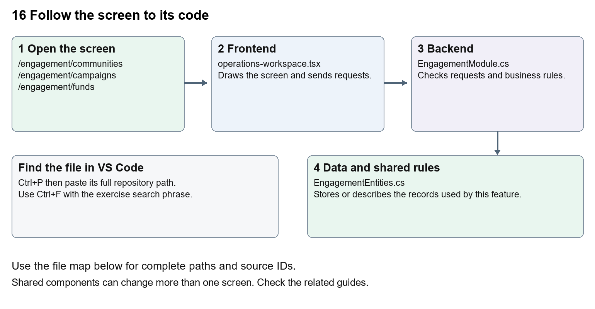

# Nexora engagement and fundraising

Document 16 of the Nexora learning guides  
Source snapshot 13 October 2026 at 17:12 UTC


Understand communities, campaigns, consented audiences, funds and donation records.

### Recognise the screen and its scope

Open `/engagement/communities`, `/engagement/campaigns`, `/engagement/funds`. CRM routes use port 3017; member routes use 3018; public website routes can use 3019. Brackets name a route parameter, not text to paste into a browser. Choose a real record or site id from the application.

This guide covers Communities and members; Campaign drafts and prepared audiences; Consent checks; Funds; Donation recording and activity.



The diagram shows the file roles. The full paths below are what you paste into Ctrl+P.

### Find the files in VS Code

| Role | File and source ID | What it does |
| --- | --- | --- |
| Screen | S0118 operations-workspace.tsx | Main UI or route for this topic |
| Server | S0308 EngagementModule.cs | Endpoints or server rules |
| Data | S0307 EngagementEntities.cs | Data shape or persistence structure |

**Screen S0118**  
[apps/web/src/features/operations/operations-workspace.tsx](<D:/Projects new/Nexora/apps/web/src/features/operations/operations-workspace.tsx>)

**Server S0308**  
[backend/src/Modules/Nexora.Modules.Engagement/EngagementModule.cs](<D:/Projects new/Nexora/backend/src/Modules/Nexora.Modules.Engagement/EngagementModule.cs>)

**Data S0307**  
[backend/src/Modules/Nexora.Modules.Engagement/Domain/EngagementEntities.cs](<D:/Projects new/Nexora/backend/src/Modules/Nexora.Modules.Engagement/Domain/EngagementEntities.cs>)

The complete HTML manual opens these source IDs inside its Source library. The Word manual shows short labelled extracts so you can learn the flow before reading large files. Each individual Markdown guide includes its complete primary files after the walkthrough.

### Follow the request and the records

1. The engagement route selects the OperationsWorkspace module and section.
2. The shared workspace loads the chosen engagement lists.
3. Forms are generated from the engagement action definitions.
4. Preparing a campaign asks the backend to build its consented audience.
5. The server persists community, campaign, fund or donation records.

### Read the code with an explanation

OperationsWorkspace is shared with Work. Its engagement array describes form labels, paths and fields. A prepared audience is a set of eligible records, not evidence that emails were sent. Consent fields in CRM feed audience selection. Fundraising stores donation information without proving a banking transaction.

Source reference S0118 apps/web/src/features/operations/operations-workspace.tsx

Selected opening lines with their original numbers. The complete file is in the HTML source library.

```tsx
0001  "use client";
0002  import listingStyles from "../crm/record-listing.module.css";
0003  import { WorkspaceHeading } from "@/components/ui/workspace-heading";
0004  import { RecordListing, useRecordPage } from "../shared/record-listing";
0005  import { Plus, ArrowLeft } from "lucide-react";
0006  import { useEntityListing } from "../shared/entity-listing-controls";
```


The import lines lead to shared components and helpers. Start at the exported component or route function; follow the request helper to the server rather than assuming the whole feature lives in this file.

Source reference S0308 backend/src/Modules/Nexora.Modules.Engagement/EngagementModule.cs

Extract from source line 28. A fragment from a long line is shown without the rest of that line.

```cs
0028    api.MapGet("/contacts",(string? search,ICrmDirectory crm,CancellationToken ct)=>crm.SearchContactsAsync(search,ct));
```


On the server, look for MapGet to load records, MapPost to create or perform an action, MapPut or MapPatch to change data, and RequireAuthorization for permissions. Some shared methods register endpoints indirectly. Find SaveChangesAsync to see the database write. A request method alone does not tell you every side effect.

Source reference S0307 backend/src/Modules/Nexora.Modules.Engagement/Domain/EngagementEntities.cs

Selected opening lines with their original numbers. The complete file is in the HTML source library.

```cs
0001  using Nexora.BuildingBlocks.Domain;
0002  namespace Nexora.Modules.Engagement.Domain;
0003  public sealed class Community:TenantEntity {public string Kind{get;set;}="group";public string Name{get;set;}="";public string Purpose{get;set;}="";}
0007  public sealed class CampaignRecipient:TenantEntity,IAppendOnly {public Guid CampaignId{get;set;}public Guid ContactId{get;set;}public string Email{get;set;}="";}
0008  public sealed class Fund:TenantEntity {public string Name{get;set;}="";public string Currency{get;set;}="GBP";public decimal Target{get;set;}}
```


Follow model fields to their request names and database mapping. An id points to a particular record. A tenant id limits the organisation. A version or concurrency stamp protects newer edits. Some model files describe contracts rather than tables; check the owning DbContext before assuming storage.

### Make or trace your first change

1. Press Ctrl+P and open [apps/web/src/features/operations/operations-workspace.tsx](<D:/Projects new/Nexora/apps/web/src/features/operations/operations-workspace.tsx>).
2. Press Ctrl+F and search for `Prepare consented audience`. In this snapshot it appears at line 30.
3. Change this campaign button wording only. Check the campaign detail and a Work task screen; the Work actions should be unaffected.
4. Replace only `Prepare consented audience` with `Prepare eligible audience` in that intended location. Keep quotes, tags, JSON keys and routes intact.
5. Save with Ctrl+S. Inspect Problems and the local screen. Review the diff and restore the original text when you finish practising.

Extract from source line 30. A fragment from a long line is shown without the rest of that line.

```tsx
0030  e`,"POST",{version:row.version}))}>Prepare consented audience</button>}</>}{section==="notifications"&&!ro
```


These exercises have not been applied to the application. Their search phrases are verified against the captured source. Line numbers can move; the phrase and file path are your main navigation aids.

### Check a change and diagnose problems

Confirm the original screen still loads, the changed words appear in the intended place, and another screen using the same component still behaves correctly. If an action fails, inspect the browser Network response, the relevant helper and server validation message. Use the common error table at the beginning of the manual. Reload on a version conflict instead of removing the version check.

A syntax error after a text edit usually means a quote, brace or closing tag changed. Compare your diff with the original. An unchanged browser result can mean the wrong port, a saved published configuration overriding a default, or a running API that has not reloaded.

### Understand the current limits

Campaign audience preparation does not connect an email delivery provider. A donation record does not charge a donor. Consent and suppression checks remain server-side business rules.

### Continue learning

Related guides [05 Nexora CRM contacts](#guide_05), [15 Nexora sales and finance](#guide_15), [17 Nexora tasks and notifications](#guide_17).

## Complete primary source files

These are the complete captured files, with numbered source lines. Other supporting files are included in the complete HTML manual. Configured local passwords, if any, are explicitly omitted. Do not paste the display line numbers into code.

### S0118 operations-workspace.tsx

[apps/web/src/features/operations/operations-workspace.tsx](<D:/Projects new/Nexora/apps/web/src/features/operations/operations-workspace.tsx>)

SHA256 `82dce0d489a2d00deaf3715a4582af826a3c31d14f8af7e3c9bd092b223a5bc7`; 35 source lines; complete captured text.

```tsx
0001  "use client";
0002  import listingStyles from "../crm/record-listing.module.css";
0003  import { WorkspaceHeading } from "@/components/ui/workspace-heading";
0004  import { RecordListing, useRecordPage } from "../shared/record-listing";
0005  import { Plus, ArrowLeft } from "lucide-react";
0006  import { useEntityListing } from "../shared/entity-listing-controls";
0007  import {useEffect,useState} from "react";
0008  import {moduleApi} from "@/features/shared/module-api";
0009  import {Panel,Field,inputClass,primaryClass,buttonClass,formData} from "@/features/shared/module-ui";
0010  type Row={id:string;version:string;name?:string;title?:string;status?:string;kind?:string;priority?:string;message?:string;isRead?:boolean;assigneeUserId?:string|null};
0011  type Action={label:string;path:string;fields:string[];permission:string};
0012  const engagement:Action[]=[{label:"Create group or committee",path:"communities",fields:["name","kind=group|committee","purpose"],permission:"engagement.manage"},{label:"Add community member",path:"communities/{communityId}/members",fields:["communityId","contactId","role"],permission:"engagement.manage"},{label:"Schedule meeting",path:"communities/{communityId}/meetings",fields:["communityId","subject","agenda","startsAtUtc:date"],permission:"engagement.manage"},{label:"Create campaign",path:"campaigns",fields:["communityId","name","subject"],permission:"engagement.manage"},{label:"Create fund",path:"funds",fields:["name","currency=GBP|EUR|USD","target:number"],permission:"engagement.manage"},{label:"Record contribution",path:"funds/{fundId}/contributions",fields:["fundId","contactId","kind=donation|pledge","amount:number","reference"],permission:"engagement.fundraise"}];
0013  const work:Action[]=[{label:"Create task",path:"items",fields:["title","description","status=open|in-progress|done|cancelled","priority=normal|low|high","dueAtUtc:optionaldate","assigneeUserId:optional","teamId:optional","contactId:optional"],permission:"work.manage"}];
0014  export function OperationsWorkspace({module,permissions,section,currentUserId}:{module:"engagement"|"work";permissions:string[];section?:string;currentUserId?:string}){
0015   const navigation=useRecordPage();const {recordId,creating,isListing}=navigation;const label=({communities:"Communities",campaigns:"Campaigns",funds:"Funds",items:"Tasks",notifications:"Notifications",imports:"Imports"} as Record<string,string>)[section??""]??"Records";
0016   const [loading,setLoading]=useState(true);
0017   const [lists,setLists]=useState<Record<string,Row[]>>({}),[error,setError]=useState(""),[busy,setBusy]=useState(false),[detail,setDetail]=useState<unknown>(null),[notice,setNotice]=useState(""),[contacts,setContacts]=useState<Row[]>([]),[directory,setDirectory]=useState<{users:Row[];teams:Row[]}>({users:[],teams:[]});
0018   const allSections=module==="engagement"?["communities","campaigns","funds"]:["items","notifications","imports"];
0019   const sections=section?[section]:allSections;
0020   const showDirectory=!isListing&&(!section||["communities","campaigns","funds","items"].includes(section));
0021   const listing=useEntityListing({records:sections.flatMap(name=>lists[name]??[]),currentUserId:module==="work"&&section==="items"?currentUserId:undefined,columns:["Name","Status","Type","Priority"],actions:<>{module==="work"&&section==="items"&&permissions.includes("work.export")&&<a href="/api/v1/work/export" download="nexora-tasks.csv" className={buttonClass}>Export tasks</a>}</>});
0022   async function load(){const names=module==="engagement"?["communities","campaigns","funds"]:["items","notifications","imports"];const values=await Promise.all(names.map(n=>moduleApi<Row[]>(module,"/"+n)));setLists(Object.fromEntries(names.map((n,i)=>[n,values[i]])));}
0023   useEffect(()=>{let active=true;const names=module==="engagement"?["communities","campaigns","funds"]:["items","notifications","imports"];Promise.all(names.map(n=>moduleApi<Row[]>(module,"/"+n))).then(values=>{if(active){setLists(Object.fromEntries(names.map((n,i)=>[n,values[i]])));setLoading(false);}}).catch(e=>{if(active){setError(e.message);setLoading(false);}});return()=>{active=false;};},[module]);
0024   useEffect(()=>{if(!recordId||creating||!section||["items","notifications"].includes(section))return;let active=true;const path=section==="campaigns"?`/campaigns/${recordId}/audience`:`/${section}/${recordId}`;moduleApi(module,path).then(value=>{if(active)setDetail(value);}).catch(e=>{if(active)setError(e.message);});return()=>{active=false;};},[recordId,creating,section,module]);
0025   async function run(action:()=>Promise<unknown>){setBusy(true);setError("");try{const value=await action();setDetail(value??null);await load();setNotice("Completed successfully.");}catch(e){setError(e instanceof Error?e.message:"Request failed");}finally{setBusy(false);}}
0026   return <main className={`${isListing?listingStyles.listing:""} mx-auto max-w-7xl space-y-5 p-4 text-slate-800 sm:p-7`}><WorkspaceHeading actions={isListing&&((module==="engagement"&&permissions.includes("engagement.manage"))||(section==="items"&&permissions.includes("work.manage"))||(section==="imports"&&permissions.includes("work.import")))?<button className={listingStyles.create} aria-label={`Add ${label.toLowerCase()}`} onClick={()=>navigation.open("new","edit")}><Plus size={18}/></button>:undefined}>{creating?`New ${label}`:label}</WorkspaceHeading>{!isListing&&<button className={buttonClass} aria-label="Back to listing" onClick={navigation.back}><ArrowLeft size={16}/></button>}{error&&<p role="alert" className="text-red-700">{error}</p>}<p role="status">{busy?"Working…":notice}</p>
0027   {isListing&&<>{listing.toolbar}<RecordListing columnControls={listing.columnControls} label={label} loading={loading} rows={(lists[section??""]??[]).filter(listing.matches)} filterKey={section+listing.filterKey} name={row=>row.name??row.title??row.message??row.id} onView={row=>navigation.open(row.id)} onEdit={permissions.includes(module+".manage")&&!['notifications','imports'].includes(section??'')?row=>navigation.open(row.id,"edit"):undefined} columns={[{key:"name",label:"Name",render:row=>row.name??row.title??row.message??row.id},{key:"status",label:"Status",hidden:!listing.show("Status"),render:row=>row.status??(row.isRead===undefined?"—":row.isRead?"Read":"Unread")},{key:"kind",label:"Type",hidden:!listing.show("Type"),render:row=>row.kind??"—"},{key:"priority",label:"Priority",hidden:!listing.show("Priority"),render:row=>row.priority??"—"}]}/></>}
0028   {showDirectory&&<Panel title="Contact directory"><form onSubmit={e=>{const d=formData(e);void run(async()=>{const results=await moduleApi<Row[]>(module,"/contacts?search="+encodeURIComponent(d.search));setContacts(results);return results;});}}><Field label="Find Contact"><input name="search" className={inputClass}/></Field><button className={buttonClass} disabled={busy}>Search contacts</button></form>{module==="work"&&<button className={buttonClass} onClick={()=>void run(async()=>{const results=await moduleApi<{users:Row[];teams:Row[]}>(module,"/directory");setDirectory(results);return results;})}>Show assignees and teams</button>}<p className="text-sm text-slate-500">Search contacts to populate the forms below.</p></Panel>}
0029   <div className="grid gap-5 lg:grid-cols-2">{(module==="engagement"?engagement:work).filter(a=>!isListing&&permissions.includes(a.permission)&&(!section||a.path.split("/")[0]===section)&&(creating?!a.path.includes("{"):a.path.includes("{"))).map(a=><Panel key={a.path} title={a.label}><form className="space-y-3" onSubmit={e=>{const d=formData(e);const body:Record<string,unknown>={...d};let path=a.path;for(const spec of a.fields){const [key]=spec.split("=");const [name,type]=key.split(":");body[name]=type==="number"?Number(d[name]):type?.includes("date")?(d[name]?new Date(d[name]).toISOString():null):d[name]||null;path=path.replace("{"+name+"}",encodeURIComponent(d[name]));}void run(()=>moduleApi(module,"/"+path,"POST",body));}}>{a.fields.map(spec=>{const [key,options]=spec.split("=");const [name,type]=key.split(":");const choices=name==="contactId"?contacts:name==="communityId"?(lists.communities??[]):name==="fundId"?(lists.funds??[]):name==="assigneeUserId"?directory.users:name==="teamId"?directory.teams:undefined;return <Field key={name} label={name.replace(/Id$/," ").replace(/([A-Z])/g," $1")}>{choices?<select name={name} defaultValue={!creating&&["communityId","fundId"].includes(name)?recordId:undefined} required={!type?.startsWith("optional")} className={inputClass}><option value="">Choose {name.replace(/Id$/,"")}</option>{choices.map(c=><option key={c.id} value={c.id}>{c.name??c.title}</option>)}</select>:options?<select name={name} className={inputClass}>{options.split("|").map(v=><option key={v}>{v}</option>)}</select>:<input name={name} required={!type?.startsWith("optional")} type={type==="number"?"number":type?.includes("date")?"datetime-local":"text"} step={type==="number"?"0.01":undefined} className={inputClass}/>}</Field>})}<button disabled={busy} className={primaryClass}>{a.label}</button></form></Panel>)}</div>
0030   {!isListing&&!creating&&sections.map(section=><Panel key={section} title={section}><ul className="space-y-3">{(lists[section]??[]).filter(row=>row.id===recordId).map(row=><li key={row.id} className="rounded border p-3"><strong>{row.name??row.title??row.message}</strong> <span hidden={!listing.show("Details")}>{row.status??row.kind??row.priority}</span><div className="mt-2 flex flex-wrap gap-2">{!["items","notifications","campaigns"].includes(section)&&<button className={buttonClass} onClick={()=>void run(()=>moduleApi(module,`/${section}/${row.id}`))}>View details</button>}{section==="campaigns"&&<><button className={buttonClass} onClick={()=>void run(()=>moduleApi(module,`/campaigns/${row.id}/audience`))}>View audience</button>{row.status==="draft"&&permissions.includes("engagement.manage")&&<button disabled={busy} className={buttonClass} onClick={()=>void run(()=>moduleApi(module,`/campaigns/${row.id}/prepare`,"POST",{version:row.version}))}>Prepare consented audience</button>}</>}{section==="notifications"&&!row.isRead&&<button disabled={busy} className={buttonClass} onClick={()=>void run(()=>moduleApi(module,`/notifications/${row.id}/read`,"POST"))}>Mark read</button>}{section==="items"&&permissions.includes("work.manage")&&<button disabled={busy||row.status==="done"} className={buttonClass} onClick={()=>void run(()=>moduleApi(module,`/items/${row.id}`,"PATCH",{...row,status:"done"}))}>Complete task</button>}{section==="imports"&&row.status==="preview"&&permissions.includes("work.import")&&permissions.includes("work.manage")&&<button disabled={busy} className={buttonClass} onClick={()=>void run(()=>moduleApi(module,`/imports/${row.id}/commit`,"POST",{version:row.version}))}>Commit validated import</button>}</div></li>)}</ul>{!lists[section]?.length&&<p>No records yet.</p>}</Panel>)}
0031   {creating&&module==="work"&&(!section||section==="imports")&&permissions.includes("work.import")&&<Panel title="Preview task import"><p>Paste up to 500 task rows as a JSON array. Each row needs title and priority (low, normal, high); dueAtUtc is optional.</p><form className="space-y-3" onSubmit={e=>{const d=formData(e);void run(()=>moduleApi(module,"/imports/preview","POST",{name:d.name,rows:JSON.parse(d.rows)}));}}><Field label="Import name"><input name="name" required className={inputClass}/></Field><Field label="Task rows"><textarea name="rows" required className={inputClass} defaultValue={'[{"title":"Follow up","priority":"normal"}]'}/></Field><button disabled={busy} className={primaryClass}>Validate and preview</button></form></Panel>}
0032   {!isListing&&!creating&&detail!==null&&<Panel title="Results"><Result value={detail}/></Panel>}</main>;
0033  }
0034  
0035  function Result({value}:{value:unknown}){if(value===null||value===undefined)return null;if(Array.isArray(value))return <ul className="space-y-3">{value.map((item,i)=><li className="rounded border p-3" key={i}><Result value={item}/></li>)}</ul>;if(typeof value==="object")return <dl className="space-y-2">{Object.entries(value).filter(([key])=>!key.endsWith("Id")&&!["id","version","tenantId","correlationId"].includes(key)).map(([key,item])=><div key={key}><dt className="text-sm font-medium text-slate-500">{key.replace(/([A-Z])/g," $1")}</dt><dd><Result value={item}/></dd></div>)}</dl>;return <span>{String(value)}</span>;}
```

### S0308 EngagementModule.cs

[backend/src/Modules/Nexora.Modules.Engagement/EngagementModule.cs](<D:/Projects new/Nexora/backend/src/Modules/Nexora.Modules.Engagement/EngagementModule.cs>)

SHA256 `a7d8e06367f31cefc6dcac25122b481f689b2f05d1f766bac31217c0d25c4211`; 55 source lines; complete captured text.

```cs
0001  using Nexora.BuildingBlocks.Persistence;
0002  using Nexora.BuildingBlocks.Reporting;
0003  using Microsoft.AspNetCore.Builder;
0004  using Microsoft.AspNetCore.Http;
0005  using Microsoft.AspNetCore.Routing;
0006  using Microsoft.EntityFrameworkCore;
0007  using Microsoft.Extensions.Configuration;
0008  using Microsoft.Extensions.DependencyInjection;
0009  using Nexora.BuildingBlocks.Endpoints;
0010  using Nexora.BuildingBlocks.Security;
0011  using Nexora.Modules.Engagement.Domain;
0012  using Nexora.Modules.Engagement.Infrastructure;
0013  using static Nexora.BuildingBlocks.Endpoints.ModuleEndpoints;
0014  namespace Nexora.Modules.Engagement;
0015  public static partial class EngagementModule
0016  {
0017   public static IServiceCollection AddNexoraEngagement(this IServiceCollection services,IConfiguration config){services.AddScoped<Nexora.BuildingBlocks.Security.ICrmContextProvider, Nexora.Modules.Engagement.Infrastructure.CrmContextProvider>();
0018          services.AddDbContext<EngagementDbContext>((sp,o)=>o.AddInterceptors(sp.GetRequiredService<WorkflowCaptureInterceptor>()).UseSqlServer(config.GetConnectionString("Nexora"),sql=>sql.MigrationsHistoryTable("__EFMigrationsHistory","engagement")));services.AddScoped<IReportDataset>(sp=>new ReportDataset("campaigns","Campaigns","engagement.read",sp.GetRequiredService<EngagementDbContext>().Set<Campaign>().AsNoTracking().Select(x=>new ReportRow{Id=x.Id,Label=x.Name,Status=x.Status,CreatedAtUtc=x.CreatedAtUtc})));
0019  
0020          services.AddWorkflowEntity<EngagementDbContext,Community>("communities","Communities","engagement.read","Name",null,null,null);
0021          services.AddWorkflowEntity<EngagementDbContext,CommunityMember>("community-members","Community members","engagement.read","ContactName",null,null,null,new WorkflowRelation("community","communities","communityId"),new WorkflowRelation("contact","contacts","contactId"));
0022          services.AddWorkflowEntity<EngagementDbContext,Campaign>("campaigns","Campaigns","engagement.read","Name",null,null,null);
0023          services.AddWorkflowEntity<EngagementDbContext,Fund>("funds","Funds","engagement.read","Name",null,null,null);
0024          AddWorkflowCommands(services);return services;}
0025   public static IEndpointRouteBuilder MapNexoraEngagement(this IEndpointRouteBuilder routes)
0026   {
0027    var api=routes.Module("engagement").WithAttributes<EngagementDbContext>("engagement.manage", typeof(Community), typeof(CommunityMember), typeof(CommunityMeeting), typeof(Campaign), typeof(Fund), typeof(Contribution));
0028    api.MapGet("/contacts",(string? search,ICrmDirectory crm,CancellationToken ct)=>crm.SearchContactsAsync(search,ct));
0029    api.MapGet("/communities",async(EngagementDbContext db,CancellationToken ct)=>await db.Set<Community>().OrderBy(x=>x.Name).ToListAsync(ct));
0030    api.MapPost("/communities",async(CommunityRequest r,EngagementDbContext db,IRequestIdentity who,HttpContext http,CancellationToken ct)=>{Choice(r.Kind,"group","committee");var row=new Community{TenantId=who.TenantId!.Value,Kind=r.Kind,Name=Text(r.Name),Purpose=Text(r.Purpose,500)};db.Add(row);History(db,who,http,row.Id,"community.created",row.Name);await db.SaveChangesAsync(ct);return Results.Ok(row);}).RequireAuthorization("engagement.manage");
0031    api.MapGet("/communities/{id:guid}",async(Guid id,EngagementDbContext db,CancellationToken ct)=>{var community=await db.Set<Community>().SingleOrDefaultAsync(x=>x.Id==id,ct)??throw new KeyNotFoundException();return Results.Ok(new{community,members=await db.Set<CommunityMember>().Where(x=>x.CommunityId==id).OrderBy(x=>x.ContactName).ToListAsync(ct),meetings=await db.Set<CommunityMeeting>().Where(x=>x.CommunityId==id).OrderBy(x=>x.StartsAtUtc).ToListAsync(ct)});});
0032    api.MapPost("/communities/{id:guid}/members",async(Guid id,MemberRequest r,EngagementDbContext db,ICrmDirectory crm,IRequestIdentity who,HttpContext http,CancellationToken ct)=>{var row=await AddCommunityMember(id,r.ContactId,r.Role,db,crm,who,http,null,ct);await db.SaveChangesAsync(ct);return Results.Ok(row);}).RequireAuthorization("engagement.manage");
0033    api.MapDelete("/communities/{id:guid}/members/{memberId:guid}",async(Guid id,Guid memberId,EngagementDbContext db,IRequestIdentity who,HttpContext http,CancellationToken ct)=>{await RemoveCommunityMember(id,memberId,db,who,http,ct);await db.SaveChangesAsync(ct);return Results.NoContent();}).RequireAuthorization("engagement.manage");
0034    api.MapPost("/communities/{id:guid}/meetings",async(Guid id,MeetingRequest r,EngagementDbContext db,IRequestIdentity who,HttpContext http,CancellationToken ct)=>{Check(await db.Set<Community>().AnyAsync(x=>x.Id==id,ct),"Community unavailable.");var row=new CommunityMeeting{TenantId=who.TenantId!.Value,CommunityId=id,Subject=Text(r.Subject),Agenda=Text(r.Agenda,500),StartsAtUtc=r.StartsAtUtc};db.Add(row);History(db,who,http,id,"meeting.scheduled",row.Subject);await db.SaveChangesAsync(ct);return Results.Ok(row);}).RequireAuthorization("engagement.manage");
0035    api.MapGet("/campaigns",async(EngagementDbContext db,CancellationToken ct)=>await db.Set<Campaign>().OrderByDescending(x=>x.CreatedAtUtc).Take(200).ToListAsync(ct));
0036    api.MapPost("/campaigns",async(CampaignRequest r,EngagementDbContext db,IRequestIdentity who,HttpContext http,CancellationToken ct)=>{Check(await db.Set<Community>().AnyAsync(x=>x.Id==r.CommunityId,ct),"Community unavailable.");var row=new Campaign{TenantId=who.TenantId!.Value,CommunityId=r.CommunityId,Name=Text(r.Name),Subject=Text(r.Subject)};db.Add(row);History(db,who,http,row.Id,"campaign.created",row.Name);await db.SaveChangesAsync(ct);return Results.Ok(row);}).RequireAuthorization("engagement.manage");
0037    api.MapPost("/campaigns/{id:guid}/prepare",async(Guid id,CampaignVersion r,EngagementDbContext db,ICrmDirectory crm,IRequestIdentity who,HttpContext http,CancellationToken ct)=>{var campaign=await db.Set<Campaign>().SingleOrDefaultAsync(x=>x.Id==id,ct)??throw new KeyNotFoundException();if(campaign.Version!=r.Version)return Conflict();Check(campaign.Status=="draft","This audience is already prepared.");var members=await db.Set<CommunityMember>().Where(x=>x.CommunityId==campaign.CommunityId).ToListAsync(ct);Check(members.Count<=1000,"Use a community of at most 1000 members for this preparation workflow.");var included=0;foreach(var member in members){var email=await crm.MarketingEmailAsync(member.ContactId,ct);if(email==null)continue;db.Add(new CampaignRecipient{TenantId=who.TenantId!.Value,CampaignId=id,ContactId=member.ContactId,Email=email});included++;}campaign.Status="prepared";History(db,who,http,id,"campaign.prepared",included+" consented recipients; no messages sent");await db.SaveChangesAsync(ct);return Results.Ok(new{campaign,included,excluded=members.Count-included});}).RequireAuthorization("engagement.manage");
0038    api.MapGet("/campaigns/{id:guid}/audience",async(Guid id,EngagementDbContext db,CancellationToken ct)=>{Check(await db.Set<Campaign>().AnyAsync(x=>x.Id==id,ct),"Campaign unavailable.");return Results.Ok(await db.Set<CampaignRecipient>().Where(x=>x.CampaignId==id).Select(x=>new{x.Id,x.ContactId,x.Email}).ToListAsync(ct));});
0039    api.MapGet("/funds",async(EngagementDbContext db,CancellationToken ct)=>await db.Set<Fund>().OrderBy(x=>x.Name).ToListAsync(ct));
0040    api.MapPost("/funds",async(FundRequest r,EngagementDbContext db,IRequestIdentity who,HttpContext http,CancellationToken ct)=>{Choice(r.Currency,"GBP","EUR","USD");Check(r.Target>=0&&r.Target<100000000&&decimal.Round(r.Target,2)==r.Target,"Invalid target.");var row=new Fund{TenantId=who.TenantId!.Value,Name=Text(r.Name),Currency=r.Currency,Target=r.Target};db.Add(row);History(db,who,http,row.Id,"fund.created",row.Name);await db.SaveChangesAsync(ct);return Results.Ok(row);}).RequireAuthorization("engagement.manage");
0041    api.MapGet("/funds/{id:guid}",async(Guid id,EngagementDbContext db,CancellationToken ct)=>{var fund=await db.Set<Fund>().SingleOrDefaultAsync(x=>x.Id==id,ct)??throw new KeyNotFoundException();var contributions=await db.Set<Contribution>().Where(x=>x.FundId==id).ToListAsync(ct);return Results.Ok(new{fund,contributions,donations=contributions.Where(x=>x.Kind=="donation").Sum(x=>x.Amount),pledges=contributions.Where(x=>x.Kind=="pledge").Sum(x=>x.Amount)});});
0042    api.MapPost("/funds/{id:guid}/contributions",async(Guid id,ContributionRequest r,EngagementDbContext db,ICrmDirectory crm,IRequestIdentity who,HttpContext http,CancellationToken ct)=>{Check(await db.Set<Fund>().AnyAsync(x=>x.Id==id,ct),"Fund unavailable.");Choice(r.Kind,"donation","pledge");Check(r.Amount>0&&r.Amount<100000000&&decimal.Round(r.Amount,2)==r.Amount,"Use a positive amount with two decimal places.");var contact=await crm.FindActiveAsync(r.ContactId,ct)??throw new KeyNotFoundException();var row=new Contribution{TenantId=who.TenantId!.Value,FundId=id,ContactId=contact.Id,ContactName=contact.Name,Kind=r.Kind,Amount=r.Amount,Reference=Text(r.Reference,100)};db.Add(row);History(db,who,http,id,"contribution.recorded",r.Kind+" recorded; no payment initiated");await db.SaveChangesAsync(ct);return Results.Ok(row);}).RequireAuthorization("engagement.fundraise");
0043    return routes;
0044   }
0045   private static async Task<CommunityMember> AddCommunityMember(Guid id,Guid contactId,string role,EngagementDbContext db,ICrmDirectory crm,IRequestIdentity who,HttpContext http,Guid? memberId,CancellationToken ct){Check(await db.Set<Community>().AnyAsync(x=>x.Id==id,ct),"Community unavailable.");var contact=await crm.FindActiveAsync(contactId,ct)??throw new KeyNotFoundException();Check(contact.Kind=="contact","Choose a Contact.");var row=new CommunityMember{Id=memberId??Guid.NewGuid(),TenantId=who.TenantId!.Value,CommunityId=id,ContactId=contact.Id,ContactName=contact.Name,Role=Text(role,80)};db.Add(row);History(db,who,http,id,"member.added",row.Role);return row;}
0046   private static void History(EngagementDbContext db,IRequestIdentity who,HttpContext http,Guid id,string action,string reason)=>db.Add(new EngagementHistory{TenantId=who.TenantId!.Value,SubjectId=id,ActorUserId=who.UserId!.Value,Action=action,Reason=reason,CorrelationId=http.TraceIdentifier});
0047   private static async Task RemoveCommunityMember(Guid id,Guid memberId,EngagementDbContext db,IRequestIdentity who,HttpContext http,CancellationToken ct){var row=await db.Set<CommunityMember>().SingleOrDefaultAsync(x=>x.Id==memberId&&x.CommunityId==id,ct)??throw new KeyNotFoundException();db.Remove(row);History(db,who,http,id,"member.removed",row.Role);}
0048  }
0049  public sealed record CommunityRequest(string Kind,string Name,string Purpose) : IAttributeRequest { public Dictionary<Guid, AttributeInput>? Attributes { get; init; } }
0050  public sealed record MemberRequest(Guid ContactId,string Role) : IAttributeRequest { public Dictionary<Guid, AttributeInput>? Attributes { get; init; } }
0051  public sealed record MeetingRequest(string Subject,string Agenda,DateTime StartsAtUtc) : IAttributeRequest { public Dictionary<Guid, AttributeInput>? Attributes { get; init; } }
0052  public sealed record CampaignRequest(Guid CommunityId,string Name,string Subject) : IAttributeRequest { public Dictionary<Guid, AttributeInput>? Attributes { get; init; } }
0053  public sealed record CampaignVersion(Guid Version);
0054  public sealed record FundRequest(string Name,string Currency,decimal Target) : IAttributeRequest { public Dictionary<Guid, AttributeInput>? Attributes { get; init; } }
0055  public sealed record ContributionRequest(Guid ContactId,string Kind,decimal Amount,string Reference) : IAttributeRequest { public Dictionary<Guid, AttributeInput>? Attributes { get; init; } }
```

### S0307 EngagementEntities.cs

[backend/src/Modules/Nexora.Modules.Engagement/Domain/EngagementEntities.cs](<D:/Projects new/Nexora/backend/src/Modules/Nexora.Modules.Engagement/Domain/EngagementEntities.cs>)

SHA256 `36b7fe3e67ca9c50c3c65a5fda03382f4862df06c0b1e141236cf40c15b7e9b8`; 10 source lines; complete captured text.

```cs
0001  using Nexora.BuildingBlocks.Domain;
0002  namespace Nexora.Modules.Engagement.Domain;
0003  public sealed class Community:TenantEntity {public string Kind{get;set;}="group";public string Name{get;set;}="";public string Purpose{get;set;}="";}
0004  public sealed class CommunityMember:TenantEntity {public Guid CommunityId{get;set;}public Guid ContactId{get;set;}public string ContactName{get;set;}="";public string Role{get;set;}="member";}
0005  public sealed class CommunityMeeting:TenantEntity {public Guid CommunityId{get;set;}public string Subject{get;set;}="";public string Agenda{get;set;}="";public DateTime StartsAtUtc{get;set;}}
0006  public sealed class Campaign:TenantEntity {public Guid CommunityId{get;set;}public string Name{get;set;}="";public string Subject{get;set;}="";public string Status{get;set;}="draft";}
0007  public sealed class CampaignRecipient:TenantEntity,IAppendOnly {public Guid CampaignId{get;set;}public Guid ContactId{get;set;}public string Email{get;set;}="";}
0008  public sealed class Fund:TenantEntity {public string Name{get;set;}="";public string Currency{get;set;}="GBP";public decimal Target{get;set;}}
0009  public sealed class Contribution:TenantEntity,IAppendOnly {public Guid FundId{get;set;}public Guid ContactId{get;set;}public string ContactName{get;set;}="";public string Kind{get;set;}="donation";public decimal Amount{get;set;}public string Reference{get;set;}="";}
0010  public sealed class EngagementHistory:TenantEntity,IAppendOnly {public Guid SubjectId{get;set;}public Guid ActorUserId{get;set;}public string Action{get;set;}="";public string Reason{get;set;}="";public string CorrelationId{get;set;}="";}
```
