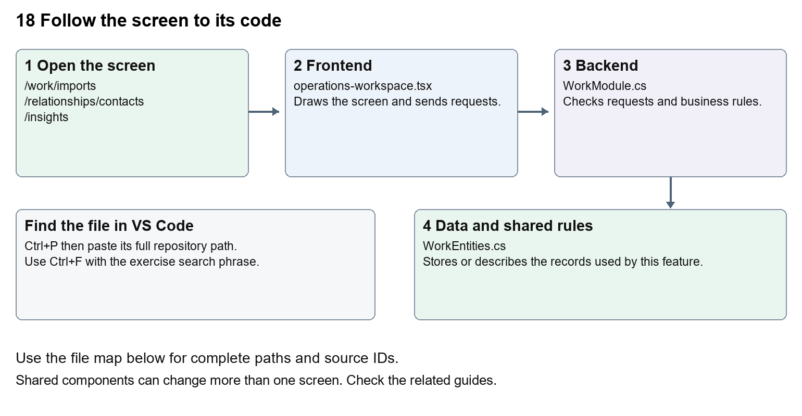

# Nexora imports exports and migration

Document 18 of the Nexora learning guides  
Source snapshot 13 October 2026 at 17:12 UTC


Understand data previews, commit steps, export paths and the difference between importing data and database migrations.

### Recognise the screen and its scope

Open `/work/imports`, `/relationships/contacts`, `/insights`. CRM routes use port 3017; member routes use 3018; public website routes can use 3019. Brackets name a route parameter, not text to paste into a browser. Choose a real record or site id from the application.

This guide covers Task JSON import preview and commit; CRM CSV import and export; Report and finance exports; Migration workbook field mapping; EF database migrations; Error review and reconciliation.



The diagram shows the file roles. The full paths below are what you paste into Ctrl+P.

### Find the files in VS Code

| Role | File and source ID | What it does |
| --- | --- | --- |
| Screen | S0118 operations-workspace.tsx | Main UI or route for this topic |
| Server | S0538 WorkModule.cs | Endpoints or server rules |
| Data | S0520 WorkEntities.cs | Data shape or persistence structure |

**Screen S0118**  
[apps/web/src/features/operations/operations-workspace.tsx](<D:/Projects new/Nexora/apps/web/src/features/operations/operations-workspace.tsx>)

**Server S0538**  
[backend/src/Modules/Nexora.Modules.Work/WorkModule.cs](<D:/Projects new/Nexora/backend/src/Modules/Nexora.Modules.Work/WorkModule.cs>)

**Data S0520**  
[backend/src/Modules/Nexora.Modules.Work/Domain/WorkEntities.cs](<D:/Projects new/Nexora/backend/src/Modules/Nexora.Modules.Work/Domain/WorkEntities.cs>)

The complete HTML manual opens these source IDs inside its Source library. The Word manual shows short labelled extracts so you can learn the flow before reading large files. Each individual Markdown guide includes its complete primary files after the walkthrough.

### Follow the request and the records

1. A data import first parses rows into a request.
2. Preview validates rows and records errors without the final business write.
3. An authorised commit applies a validated import using its version.
4. Exports return the permitted matching records.
5. Database migrations separately change table structure, not business import row mapping.

### Read the code with an explanation

A workbook field inventory is a mapping aid, not a universal working importer. The Work screen specifically accepts up to 500 task rows as JSON. CRM has its own import endpoints and schema. EF migration files change the SQL table design and are normally generated from model changes. Never treat a successful preview as proof a full migration reconciled correctly.

Source reference S0118 apps/web/src/features/operations/operations-workspace.tsx

Selected opening lines with their original numbers. The complete file is in the HTML source library.

```tsx
0001  "use client";
0002  import listingStyles from "../crm/record-listing.module.css";
0003  import { WorkspaceHeading } from "@/components/ui/workspace-heading";
0004  import { RecordListing, useRecordPage } from "../shared/record-listing";
0005  import { Plus, ArrowLeft } from "lucide-react";
0006  import { useEntityListing } from "../shared/entity-listing-controls";
```


The import lines lead to shared components and helpers. Start at the exported component or route function; follow the request helper to the server rather than assuming the whole feature lives in this file.

Source reference S0538 backend/src/Modules/Nexora.Modules.Work/WorkModule.cs

Extract from source line 25. A fragment from a long line is shown without the rest of that line.

```cs
0025  ork.manage", typeof(WorkItem));api.MapGet("/directory",(IIdentityDirectory directory,C
```


On the server, look for MapGet to load records, MapPost to create or perform an action, MapPut or MapPatch to change data, and RequireAuthorization for permissions. Some shared methods register endpoints indirectly. Find SaveChangesAsync to see the database write. A request method alone does not tell you every side effect.

Source reference S0520 backend/src/Modules/Nexora.Modules.Work/Domain/WorkEntities.cs

Selected opening lines with their original numbers. The complete file is in the HTML source library.

```cs
0001  using Nexora.BuildingBlocks.Domain;
0002  namespace Nexora.Modules.Work.Domain;
```


Follow model fields to their request names and database mapping. An id points to a particular record. A tenant id limits the organisation. A version or concurrency stamp protects newer edits. Some model files describe contracts rather than tables; check the owning DbContext before assuming storage.

### Make or trace your first change

1. Press Ctrl+P and open [apps/web/src/features/operations/operations-workspace.tsx](<D:/Projects new/Nexora/apps/web/src/features/operations/operations-workspace.tsx>).
2. Press Ctrl+F and search for `Validate and preview`. In this snapshot it appears at line 31.
3. Replace only the task import button label. Open /work/imports in create mode and inspect the form. Do not click Commit validated import or run a database migration for this text exercise.
4. Replace only `Validate and preview` with `Check rows and preview` in that intended location. Keep quotes, tags, JSON keys and routes intact.
5. Save with Ctrl+S. Inspect Problems and the local screen. Review the diff and restore the original text when you finish practising.

Extract from source line 31. A fragment from a long line is shown without the rest of that line.

```tsx
0031  ed={busy} className={primaryClass}>Validate and preview</button></form></Panel>}
```


These exercises have not been applied to the application. Their search phrases are verified against the captured source. Line numbers can move; the phrase and file path are your main navigation aids.

### Check a change and diagnose problems

Confirm the original screen still loads, the changed words appear in the intended place, and another screen using the same component still behaves correctly. If an action fails, inspect the browser Network response, the relevant helper and server validation message. Use the common error table at the beginning of the manual. Reload on a version conflict instead of removing the version check.

A syntax error after a text edit usually means a quote, brace or closing tag changed. Compare your diff with the original. An unchanged browser result can mean the wrong port, a saved published configuration overriding a default, or a running API that has not reloaded.

### Understand the current limits

Preview, commit and reconciliation are distinct evidence. A complete customer migration still needs source-specific mapping, counts, error review and acceptance. A schema change needs a reviewed migration for the appropriate context.

### Continue learning

Related guides [05 Nexora CRM contacts](#guide_05), [17 Nexora tasks and notifications](#guide_17), [19 Nexora insights and reporting](#guide_19), [30 Nexora backend database and maintenance](#guide_30).

## Complete primary source files

These are the complete captured files, with numbered source lines. Other supporting files are included in the complete HTML manual. Configured local passwords, if any, are explicitly omitted. Do not paste the display line numbers into code.

### S0118 operations-workspace.tsx

[apps/web/src/features/operations/operations-workspace.tsx](<D:/Projects new/Nexora/apps/web/src/features/operations/operations-workspace.tsx>)

SHA256 `82dce0d489a2d00deaf3715a4582af826a3c31d14f8af7e3c9bd092b223a5bc7`; 35 source lines; complete captured text.

```tsx
0001  "use client";
0002  import listingStyles from "../crm/record-listing.module.css";
0003  import { WorkspaceHeading } from "@/components/ui/workspace-heading";
0004  import { RecordListing, useRecordPage } from "../shared/record-listing";
0005  import { Plus, ArrowLeft } from "lucide-react";
0006  import { useEntityListing } from "../shared/entity-listing-controls";
0007  import {useEffect,useState} from "react";
0008  import {moduleApi} from "@/features/shared/module-api";
0009  import {Panel,Field,inputClass,primaryClass,buttonClass,formData} from "@/features/shared/module-ui";
0010  type Row={id:string;version:string;name?:string;title?:string;status?:string;kind?:string;priority?:string;message?:string;isRead?:boolean;assigneeUserId?:string|null};
0011  type Action={label:string;path:string;fields:string[];permission:string};
0012  const engagement:Action[]=[{label:"Create group or committee",path:"communities",fields:["name","kind=group|committee","purpose"],permission:"engagement.manage"},{label:"Add community member",path:"communities/{communityId}/members",fields:["communityId","contactId","role"],permission:"engagement.manage"},{label:"Schedule meeting",path:"communities/{communityId}/meetings",fields:["communityId","subject","agenda","startsAtUtc:date"],permission:"engagement.manage"},{label:"Create campaign",path:"campaigns",fields:["communityId","name","subject"],permission:"engagement.manage"},{label:"Create fund",path:"funds",fields:["name","currency=GBP|EUR|USD","target:number"],permission:"engagement.manage"},{label:"Record contribution",path:"funds/{fundId}/contributions",fields:["fundId","contactId","kind=donation|pledge","amount:number","reference"],permission:"engagement.fundraise"}];
0013  const work:Action[]=[{label:"Create task",path:"items",fields:["title","description","status=open|in-progress|done|cancelled","priority=normal|low|high","dueAtUtc:optionaldate","assigneeUserId:optional","teamId:optional","contactId:optional"],permission:"work.manage"}];
0014  export function OperationsWorkspace({module,permissions,section,currentUserId}:{module:"engagement"|"work";permissions:string[];section?:string;currentUserId?:string}){
0015   const navigation=useRecordPage();const {recordId,creating,isListing}=navigation;const label=({communities:"Communities",campaigns:"Campaigns",funds:"Funds",items:"Tasks",notifications:"Notifications",imports:"Imports"} as Record<string,string>)[section??""]??"Records";
0016   const [loading,setLoading]=useState(true);
0017   const [lists,setLists]=useState<Record<string,Row[]>>({}),[error,setError]=useState(""),[busy,setBusy]=useState(false),[detail,setDetail]=useState<unknown>(null),[notice,setNotice]=useState(""),[contacts,setContacts]=useState<Row[]>([]),[directory,setDirectory]=useState<{users:Row[];teams:Row[]}>({users:[],teams:[]});
0018   const allSections=module==="engagement"?["communities","campaigns","funds"]:["items","notifications","imports"];
0019   const sections=section?[section]:allSections;
0020   const showDirectory=!isListing&&(!section||["communities","campaigns","funds","items"].includes(section));
0021   const listing=useEntityListing({records:sections.flatMap(name=>lists[name]??[]),currentUserId:module==="work"&&section==="items"?currentUserId:undefined,columns:["Name","Status","Type","Priority"],actions:<>{module==="work"&&section==="items"&&permissions.includes("work.export")&&<a href="/api/v1/work/export" download="nexora-tasks.csv" className={buttonClass}>Export tasks</a>}</>});
0022   async function load(){const names=module==="engagement"?["communities","campaigns","funds"]:["items","notifications","imports"];const values=await Promise.all(names.map(n=>moduleApi<Row[]>(module,"/"+n)));setLists(Object.fromEntries(names.map((n,i)=>[n,values[i]])));}
0023   useEffect(()=>{let active=true;const names=module==="engagement"?["communities","campaigns","funds"]:["items","notifications","imports"];Promise.all(names.map(n=>moduleApi<Row[]>(module,"/"+n))).then(values=>{if(active){setLists(Object.fromEntries(names.map((n,i)=>[n,values[i]])));setLoading(false);}}).catch(e=>{if(active){setError(e.message);setLoading(false);}});return()=>{active=false;};},[module]);
0024   useEffect(()=>{if(!recordId||creating||!section||["items","notifications"].includes(section))return;let active=true;const path=section==="campaigns"?`/campaigns/${recordId}/audience`:`/${section}/${recordId}`;moduleApi(module,path).then(value=>{if(active)setDetail(value);}).catch(e=>{if(active)setError(e.message);});return()=>{active=false;};},[recordId,creating,section,module]);
0025   async function run(action:()=>Promise<unknown>){setBusy(true);setError("");try{const value=await action();setDetail(value??null);await load();setNotice("Completed successfully.");}catch(e){setError(e instanceof Error?e.message:"Request failed");}finally{setBusy(false);}}
0026   return <main className={`${isListing?listingStyles.listing:""} mx-auto max-w-7xl space-y-5 p-4 text-slate-800 sm:p-7`}><WorkspaceHeading actions={isListing&&((module==="engagement"&&permissions.includes("engagement.manage"))||(section==="items"&&permissions.includes("work.manage"))||(section==="imports"&&permissions.includes("work.import")))?<button className={listingStyles.create} aria-label={`Add ${label.toLowerCase()}`} onClick={()=>navigation.open("new","edit")}><Plus size={18}/></button>:undefined}>{creating?`New ${label}`:label}</WorkspaceHeading>{!isListing&&<button className={buttonClass} aria-label="Back to listing" onClick={navigation.back}><ArrowLeft size={16}/></button>}{error&&<p role="alert" className="text-red-700">{error}</p>}<p role="status">{busy?"Working…":notice}</p>
0027   {isListing&&<>{listing.toolbar}<RecordListing columnControls={listing.columnControls} label={label} loading={loading} rows={(lists[section??""]??[]).filter(listing.matches)} filterKey={section+listing.filterKey} name={row=>row.name??row.title??row.message??row.id} onView={row=>navigation.open(row.id)} onEdit={permissions.includes(module+".manage")&&!['notifications','imports'].includes(section??'')?row=>navigation.open(row.id,"edit"):undefined} columns={[{key:"name",label:"Name",render:row=>row.name??row.title??row.message??row.id},{key:"status",label:"Status",hidden:!listing.show("Status"),render:row=>row.status??(row.isRead===undefined?"—":row.isRead?"Read":"Unread")},{key:"kind",label:"Type",hidden:!listing.show("Type"),render:row=>row.kind??"—"},{key:"priority",label:"Priority",hidden:!listing.show("Priority"),render:row=>row.priority??"—"}]}/></>}
0028   {showDirectory&&<Panel title="Contact directory"><form onSubmit={e=>{const d=formData(e);void run(async()=>{const results=await moduleApi<Row[]>(module,"/contacts?search="+encodeURIComponent(d.search));setContacts(results);return results;});}}><Field label="Find Contact"><input name="search" className={inputClass}/></Field><button className={buttonClass} disabled={busy}>Search contacts</button></form>{module==="work"&&<button className={buttonClass} onClick={()=>void run(async()=>{const results=await moduleApi<{users:Row[];teams:Row[]}>(module,"/directory");setDirectory(results);return results;})}>Show assignees and teams</button>}<p className="text-sm text-slate-500">Search contacts to populate the forms below.</p></Panel>}
0029   <div className="grid gap-5 lg:grid-cols-2">{(module==="engagement"?engagement:work).filter(a=>!isListing&&permissions.includes(a.permission)&&(!section||a.path.split("/")[0]===section)&&(creating?!a.path.includes("{"):a.path.includes("{"))).map(a=><Panel key={a.path} title={a.label}><form className="space-y-3" onSubmit={e=>{const d=formData(e);const body:Record<string,unknown>={...d};let path=a.path;for(const spec of a.fields){const [key]=spec.split("=");const [name,type]=key.split(":");body[name]=type==="number"?Number(d[name]):type?.includes("date")?(d[name]?new Date(d[name]).toISOString():null):d[name]||null;path=path.replace("{"+name+"}",encodeURIComponent(d[name]));}void run(()=>moduleApi(module,"/"+path,"POST",body));}}>{a.fields.map(spec=>{const [key,options]=spec.split("=");const [name,type]=key.split(":");const choices=name==="contactId"?contacts:name==="communityId"?(lists.communities??[]):name==="fundId"?(lists.funds??[]):name==="assigneeUserId"?directory.users:name==="teamId"?directory.teams:undefined;return <Field key={name} label={name.replace(/Id$/," ").replace(/([A-Z])/g," $1")}>{choices?<select name={name} defaultValue={!creating&&["communityId","fundId"].includes(name)?recordId:undefined} required={!type?.startsWith("optional")} className={inputClass}><option value="">Choose {name.replace(/Id$/,"")}</option>{choices.map(c=><option key={c.id} value={c.id}>{c.name??c.title}</option>)}</select>:options?<select name={name} className={inputClass}>{options.split("|").map(v=><option key={v}>{v}</option>)}</select>:<input name={name} required={!type?.startsWith("optional")} type={type==="number"?"number":type?.includes("date")?"datetime-local":"text"} step={type==="number"?"0.01":undefined} className={inputClass}/>}</Field>})}<button disabled={busy} className={primaryClass}>{a.label}</button></form></Panel>)}</div>
0030   {!isListing&&!creating&&sections.map(section=><Panel key={section} title={section}><ul className="space-y-3">{(lists[section]??[]).filter(row=>row.id===recordId).map(row=><li key={row.id} className="rounded border p-3"><strong>{row.name??row.title??row.message}</strong> <span hidden={!listing.show("Details")}>{row.status??row.kind??row.priority}</span><div className="mt-2 flex flex-wrap gap-2">{!["items","notifications","campaigns"].includes(section)&&<button className={buttonClass} onClick={()=>void run(()=>moduleApi(module,`/${section}/${row.id}`))}>View details</button>}{section==="campaigns"&&<><button className={buttonClass} onClick={()=>void run(()=>moduleApi(module,`/campaigns/${row.id}/audience`))}>View audience</button>{row.status==="draft"&&permissions.includes("engagement.manage")&&<button disabled={busy} className={buttonClass} onClick={()=>void run(()=>moduleApi(module,`/campaigns/${row.id}/prepare`,"POST",{version:row.version}))}>Prepare consented audience</button>}</>}{section==="notifications"&&!row.isRead&&<button disabled={busy} className={buttonClass} onClick={()=>void run(()=>moduleApi(module,`/notifications/${row.id}/read`,"POST"))}>Mark read</button>}{section==="items"&&permissions.includes("work.manage")&&<button disabled={busy||row.status==="done"} className={buttonClass} onClick={()=>void run(()=>moduleApi(module,`/items/${row.id}`,"PATCH",{...row,status:"done"}))}>Complete task</button>}{section==="imports"&&row.status==="preview"&&permissions.includes("work.import")&&permissions.includes("work.manage")&&<button disabled={busy} className={buttonClass} onClick={()=>void run(()=>moduleApi(module,`/imports/${row.id}/commit`,"POST",{version:row.version}))}>Commit validated import</button>}</div></li>)}</ul>{!lists[section]?.length&&<p>No records yet.</p>}</Panel>)}
0031   {creating&&module==="work"&&(!section||section==="imports")&&permissions.includes("work.import")&&<Panel title="Preview task import"><p>Paste up to 500 task rows as a JSON array. Each row needs title and priority (low, normal, high); dueAtUtc is optional.</p><form className="space-y-3" onSubmit={e=>{const d=formData(e);void run(()=>moduleApi(module,"/imports/preview","POST",{name:d.name,rows:JSON.parse(d.rows)}));}}><Field label="Import name"><input name="name" required className={inputClass}/></Field><Field label="Task rows"><textarea name="rows" required className={inputClass} defaultValue={'[{"title":"Follow up","priority":"normal"}]'}/></Field><button disabled={busy} className={primaryClass}>Validate and preview</button></form></Panel>}
0032   {!isListing&&!creating&&detail!==null&&<Panel title="Results"><Result value={detail}/></Panel>}</main>;
0033  }
0034  
0035  function Result({value}:{value:unknown}){if(value===null||value===undefined)return null;if(Array.isArray(value))return <ul className="space-y-3">{value.map((item,i)=><li className="rounded border p-3" key={i}><Result value={item}/></li>)}</ul>;if(typeof value==="object")return <dl className="space-y-2">{Object.entries(value).filter(([key])=>!key.endsWith("Id")&&!["id","version","tenantId","correlationId"].includes(key)).map(([key,item])=><div key={key}><dt className="text-sm font-medium text-slate-500">{key.replace(/([A-Z])/g," $1")}</dt><dd><Result value={item}/></dd></div>)}</dl>;return <span>{String(value)}</span>;}
```

### S0538 WorkModule.cs

[backend/src/Modules/Nexora.Modules.Work/WorkModule.cs](<D:/Projects new/Nexora/backend/src/Modules/Nexora.Modules.Work/WorkModule.cs>)

SHA256 `2b32249e8167c8663a7741024130f3fd86fe9e99dd1533e61d0113204af7940e`; 47 source lines; complete captured text.

```cs
0001  using Nexora.BuildingBlocks.Persistence;
0002  using Nexora.BuildingBlocks.Reporting;
0003  using System.Text;
0004  using Microsoft.AspNetCore.Builder;
0005  using Microsoft.AspNetCore.Http;
0006  using Microsoft.AspNetCore.Routing;
0007  using Microsoft.EntityFrameworkCore;
0008  using Microsoft.Extensions.Configuration;
0009  using Microsoft.Extensions.DependencyInjection;
0010  using Nexora.BuildingBlocks.Endpoints;
0011  using Nexora.BuildingBlocks.Security;
0012  using Nexora.Modules.Work.Domain;
0013  using Nexora.Modules.Work.Infrastructure;
0014  using static Nexora.BuildingBlocks.Endpoints.ModuleEndpoints;
0015  namespace Nexora.Modules.Work;
0016  public static class WorkModule
0017  {
0018   public static IServiceCollection AddNexoraWork(this IServiceCollection services,IConfiguration config){services.AddScoped<WorkTaskCommands>();services.AddScoped<IWorkflowActionHandler,WorkflowTaskUpdate>();services.AddScoped<IWorkflowActionHandler,WorkflowNotification>();services.AddScoped<IWorkflowActionHandler,WorkflowTaskAction>();services.AddScoped<Nexora.BuildingBlocks.Security.ICrmContextProvider, Nexora.Modules.Work.Infrastructure.CrmContextProvider>();
0019          services.AddDbContext<WorkDbContext>((sp,o)=>o.AddInterceptors(sp.GetRequiredService<WorkflowCaptureInterceptor>()).UseSqlServer(config.GetConnectionString("Nexora"),sql=>sql.MigrationsHistoryTable("__EFMigrationsHistory","work")));services.AddScoped<IReportDataset>(sp=>new ReportDataset("tasks","Tasks","work.read",sp.GetRequiredService<WorkDbContext>().Set<WorkItem>().AsNoTracking().Select(x=>new ReportRow{Id=x.Id,Label=x.Title,Status=x.Status,CreatedAtUtc=x.CreatedAtUtc})));
0020  
0021          services.AddWorkflowEntity<WorkDbContext,WorkItem>("tasks","Tasks","work.read","Title",null,null,null,new WorkflowRelation("contact","contacts","contactId","id",false));
0022          return services;}
0023   public static IEndpointRouteBuilder MapNexoraWork(this IEndpointRouteBuilder routes)
0024   {
0025    var api=routes.Module("work").WithAttributes<WorkDbContext>("work.manage", typeof(WorkItem));api.MapGet("/directory",(IIdentityDirectory directory,CancellationToken ct)=>directory.GetAsync(ct));api.MapGet("/contacts",(string? search,ICrmDirectory crm,CancellationToken ct)=>crm.SearchContactsAsync(search,ct));
0026    api.MapGet("/items",async(WorkDbContext db,string? status,CancellationToken ct)=>{var q=db.Set<WorkItem>().AsNoTracking();if(!string.IsNullOrEmpty(status)){Choice(status,"open","in-progress","done","cancelled");q=q.Where(x=>x.Status==status);}return Results.Ok(await q.OrderBy(x=>x.DueAtUtc).ThenBy(x=>x.Id).Take(200).ToListAsync(ct));});
0027    api.MapPost("/items",async(WorkRequest r,WorkTaskCommands commands,HttpContext http,CancellationToken ct)=>Results.Ok(await commands.CreateAsync(r,Guid.NewGuid(),http.TraceIdentifier,ct))).RequireAuthorization("work.manage");
0028    api.MapPatch("/items/{id:guid}",async(Guid id,WorkRequest r,WorkDbContext db,IIdentityDirectory directory,ICrmDirectory crm,IRequestIdentity who,HttpContext http,CancellationToken ct)=>{var row=await db.Set<WorkItem>().SingleOrDefaultAsync(x=>x.Id==id,ct)??throw new KeyNotFoundException();if(row.Version!=r.Version)return Conflict();await Validate(r,directory,crm,ct);var previous=row.AssigneeUserId;Apply(row,r);if(previous!=row.AssigneeUserId)Notify(db,who,row);History(db,who,http,id,"task.updated",row.Status);await db.SaveChangesAsync(ct);return Results.Ok(row);}).RequireAuthorization("work.manage");
0029    api.MapGet("/notifications",async(WorkDbContext db,CancellationToken ct)=>await db.Set<Notification>().OrderByDescending(x=>x.CreatedAtUtc).Take(100).ToListAsync(ct));
0030    api.MapPost("/notifications/{id:guid}/read",async(Guid id,WorkDbContext db,CancellationToken ct)=>{var row=await db.Set<Notification>().SingleOrDefaultAsync(x=>x.Id==id,ct)??throw new KeyNotFoundException();row.IsRead=true;await db.SaveChangesAsync(ct);return Results.NoContent();});
0031    api.MapGet("/imports",async(WorkDbContext db,CancellationToken ct)=>await db.Set<ImportBatch>().OrderByDescending(x=>x.CreatedAtUtc).Take(100).ToListAsync(ct));
0032    api.MapPost("/imports/preview",async(ImportRequest r,WorkDbContext db,IRequestIdentity who,HttpContext http,CancellationToken ct)=>{Check(r.Rows is{Length:>0 and <=500},"Provide 1–500 task rows.");var batch=new ImportBatch{TenantId=who.TenantId!.Value,Name=Text(r.Name),CreatedByUserId=who.UserId!.Value,RowCount=r.Rows.Length};var rows=new List<ImportRow>();foreach(var item in r.Rows){Choice(item.Priority,"low","normal","high");rows.Add(new ImportRow{TenantId=who.TenantId.Value,BatchId=batch.Id,Title=Text(item.Title),Priority=item.Priority,DueAtUtc=item.DueAtUtc});}db.Add(batch);db.AddRange(rows);History(db,who,http,batch.Id,"import.previewed",batch.RowCount+" validated task rows");await db.SaveChangesAsync(ct);return Results.Ok(new{batch,rows});}).RequireAuthorization("work.import");
0033    api.MapGet("/imports/{id:guid}",async(Guid id,WorkDbContext db,CancellationToken ct)=>{var batch=await db.Set<ImportBatch>().SingleOrDefaultAsync(x=>x.Id==id,ct)??throw new KeyNotFoundException();return Results.Ok(new{batch,rows=await db.Set<ImportRow>().Where(x=>x.BatchId==id).ToListAsync(ct)});}).RequireAuthorization("work.import");
0034    api.MapPost("/imports/{id:guid}/commit",async(Guid id,ImportVersion r,WorkDbContext db,IRequestIdentity who,HttpContext http,CancellationToken ct)=>{var batch=await db.Set<ImportBatch>().SingleOrDefaultAsync(x=>x.Id==id,ct)??throw new KeyNotFoundException();if(batch.Version!=r.Version)return Conflict();Check(batch.Status=="preview","Import already committed.");var rows=await db.Set<ImportRow>().Where(x=>x.BatchId==id).ToListAsync(ct);foreach(var row in rows){var item=new WorkItem{TenantId=who.TenantId!.Value,Title=row.Title,Priority=row.Priority,DueAtUtc=row.DueAtUtc};db.Add(item);History(db,who,http,item.Id,"task.imported",batch.Name);}batch.Status="completed";History(db,who,http,id,"import.completed",rows.Count+" tasks");await db.SaveChangesAsync(ct);return Results.Ok(batch);}).RequireAuthorization("work.import","work.manage");
0035    api.MapGet("/export",async(WorkDbContext db,IRequestIdentity who,HttpContext http,CancellationToken ct)=>{var rows=await db.Set<WorkItem>().OrderBy(x=>x.CreatedAtUtc).Take(10000).ToListAsync(ct);var csv=new StringBuilder("Title,Status,Priority,DueUtc\r\n");foreach(var row in rows)csv.AppendLine(string.Join(",",Csv(row.Title),Csv(row.Status),Csv(row.Priority),Csv(row.DueAtUtc?.ToString("O")??"")));History(db,who,http,Guid.Empty,"tasks.exported",rows.Count+" rows");await db.SaveChangesAsync(ct);return Results.File(Encoding.UTF8.GetBytes(csv.ToString()),"text/csv","nexora-tasks.csv");}).RequireAuthorization("work.export");
0036    return routes;
0037   }
0038   private static async Task Validate(WorkRequest r,IIdentityDirectory directory,ICrmDirectory crm,CancellationToken ct){Text(r.Title);Check(r.Description==null||r.Description.Length<=500,"Description is too long.");Choice(r.Status,"open","in-progress","done","cancelled");Choice(r.Priority,"low","normal","high");Check(await directory.IsValidOwnerAsync(r.AssigneeUserId,r.TeamId,ct),"Choose an active assignee and team in your tenant.");if(r.ContactId!=null)Check(await crm.FindActiveAsync(r.ContactId.Value,ct)!=null,"Related Contact is unavailable.");}
0039   private static void Apply(WorkItem row,WorkRequest r){row.Title=Text(r.Title);row.Description=r.Description?.Trim()??"";row.Status=r.Status;row.Priority=r.Priority;row.AssigneeUserId=r.AssigneeUserId;row.TeamId=r.TeamId;row.ContactId=r.ContactId;row.DueAtUtc=r.DueAtUtc;}
0040   private static void Notify(WorkDbContext db,IRequestIdentity who,WorkItem row){if(row.AssigneeUserId!=null)db.Add(new Notification{TenantId=who.TenantId!.Value,UserId=row.AssigneeUserId.Value,WorkItemId=row.Id,Message="Task assigned: "+row.Title});}
0041   private static string Csv(string text){if(text.TrimStart().StartsWith('=')||text.TrimStart().StartsWith('+')||text.TrimStart().StartsWith('-')||text.TrimStart().StartsWith('@'))text="'"+text;return "\""+text.Replace("\"","\"\"")+"\"";}
0042   private static void History(WorkDbContext db,IRequestIdentity who,HttpContext http,Guid id,string action,string reason)=>db.Add(new WorkHistory{TenantId=who.TenantId!.Value,SubjectId=id,ActorUserId=who.UserId!.Value,Action=action,Reason=reason,CorrelationId=http.TraceIdentifier});
0043  }
0044  public sealed record WorkRequest(string Title,string? Description,string Status,string Priority,DateTime? DueAtUtc,Guid? AssigneeUserId,Guid? TeamId,Guid? ContactId,Guid? Version) : IAttributeRequest { public Dictionary<Guid, AttributeInput>? Attributes { get; init; } }
0045  public sealed record ImportTask(string Title,string Priority,DateTime? DueAtUtc);
0046  public sealed record ImportRequest(string Name,ImportTask[] Rows);
0047  public sealed record ImportVersion(Guid Version);
```

### S0520 WorkEntities.cs

[backend/src/Modules/Nexora.Modules.Work/Domain/WorkEntities.cs](<D:/Projects new/Nexora/backend/src/Modules/Nexora.Modules.Work/Domain/WorkEntities.cs>)

SHA256 `e69365bbc8b426e4f773c71927f74bb6ccbbef28c278f2a9c7c3537957ba2aa7`; 7 source lines; complete captured text.

```cs
0001  using Nexora.BuildingBlocks.Domain;
0002  namespace Nexora.Modules.Work.Domain;
0003  public sealed class WorkItem:TenantEntity{public string Title{get;set;}="";public string Description{get;set;}="";public string Status{get;set;}="open";public string Priority{get;set;}="normal";public DateTime? DueAtUtc{get;set;}public Guid? AssigneeUserId{get;set;}public Guid? TeamId{get;set;}public Guid? ContactId{get;set;}}
0004  public sealed class Notification:TenantEntity{public Guid UserId{get;set;}public string Message{get;set;}="";public Guid? WorkItemId{get;set;}public bool IsRead{get;set;}}
0005  public sealed class WorkHistory:TenantEntity,IAppendOnly{public Guid SubjectId{get;set;}public Guid ActorUserId{get;set;}public string Action{get;set;}="";public string Reason{get;set;}="";public string CorrelationId{get;set;}="";}
0006  public sealed class ImportBatch:TenantEntity{public string Name{get;set;}="";public string Status{get;set;}="preview";public int RowCount{get;set;}public Guid CreatedByUserId{get;set;}}
0007  public sealed class ImportRow:TenantEntity,IAppendOnly{public Guid BatchId{get;set;}public string Title{get;set;}="";public string Priority{get;set;}="normal";public DateTime? DueAtUtc{get;set;}}
```
