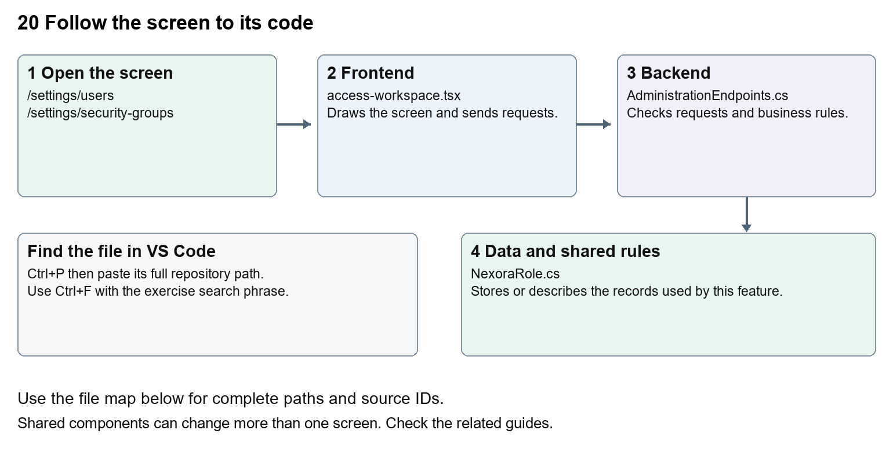

# Nexora administration and access

Document 20 of the Nexora learning guides  
Source snapshot 14 October 2026 at 06:41 UTC


Understand staff users, security groups, permission assignment and tenant protection.

### Recognise the screen and its scope

Open `/settings/users`, `/settings/security-groups`. CRM routes use port 3017; member routes use 3018; public website routes can use 3019. Brackets name a route parameter, not text to paste into a browser. Choose a real record or site id from the application.

This guide covers Staff user lists and forms; Security groups; Permission matrix; Protected system administrator; User activation and passwords; Concurrency stamps and current access.



The diagram shows the file roles. The full paths below are what you paste into Ctrl+P.

### Find the files in VS Code

| Role | File and source ID | What it does |
| --- | --- | --- |
| Screen | S0064 access-workspace.tsx | Main UI or route for this topic |
| Server | S0371 AdministrationEndpoints.cs | Endpoints or server rules |
| Data | S0374 NexoraRole.cs | Data shape or persistence structure |

**Screen S0064**  
[apps/web/src/features/administration/access-workspace.tsx](<D:/Projects new/Nexora/apps/web/src/features/administration/access-workspace.tsx>)

**Server S0371**  
[backend/src/Modules/Nexora.Modules.Identity/AdministrationEndpoints.cs](<D:/Projects new/Nexora/backend/src/Modules/Nexora.Modules.Identity/AdministrationEndpoints.cs>)

**Data S0374**  
[backend/src/Modules/Nexora.Modules.Identity/Domain/NexoraRole.cs](<D:/Projects new/Nexora/backend/src/Modules/Nexora.Modules.Identity/Domain/NexoraRole.cs>)

The complete HTML manual opens these source IDs inside its Source library. The Word manual shows short labelled extracts so you can learn the flow before reading large files. Each individual Markdown guide includes its complete primary files after the walkthrough.

### Follow the request and the records

1. The settings route requires the staff session and identity.read.
2. AccessWorkspace loads users, groups and available permissions.
3. An authorised form sends user or group changes with its concurrency stamp.
4. AdministrationEndpoints validate protected accounts and group permissions.
5. Fresh claims and active-tenant authorisation determine later request access.

### Read the code with an explanation

Security groups are backed by Identity roles with permissions. A user can belong to several groups. Human-friendly permission labels do not change the underlying strings such as crm.read. Server rules protect system accounts and tenant scope. A concurrency stamp is a version marker which prevents overwriting a newer change.

Source reference S0064 apps/web/src/features/administration/access-workspace.tsx

Selected opening lines with their original numbers. The complete file is in the HTML source library.

```tsx
0001  "use client";
0002  import { WorkspaceHeading } from "@/components/ui/workspace-heading";
0003  import { RecordListing } from "../shared/record-listing";
0004  import listingStyles from "../crm/record-listing.module.css";
0005  import { ArrowLeft, Plus } from "lucide-react";
0007  import { useEffect, useState } from "react";
```


The import lines lead to shared components and helpers. Start at the exported component or route function; follow the request helper to the server rather than assuming the whole feature lives in this file.

Source reference S0371 backend/src/Modules/Nexora.Modules.Identity/AdministrationEndpoints.cs

Extract from source line 23. A fragment from a long line is shown without the rest of that line.

```cs
0023          var api = routes.MapGroup("/api/v1/admin").WithTags("Administration").RequireAuthorization(NexoraPermissions.IdentityRead);
```


On the server, look for MapGet to load records, MapPost to create or perform an action, MapPut or MapPatch to change data, and RequireAuthorization for permissions. Some shared methods register endpoints indirectly. Find SaveChangesAsync to see the database write. A request method alone does not tell you every side effect.

Source reference S0374 backend/src/Modules/Nexora.Modules.Identity/Domain/NexoraRole.cs

Selected opening lines with their original numbers. The complete file is in the HTML source library.

```cs
0001  using Microsoft.AspNetCore.Identity;
0003  namespace Nexora.Modules.Identity.Domain;
0005  public sealed class NexoraRole : IdentityRole<Guid>
0006  {
0007      public Guid TenantId { get; set; }
0008      public string? Description { get; set; }
```


Follow model fields to their request names and database mapping. An id points to a particular record. A tenant id limits the organisation. A version or concurrency stamp protects newer edits. Some model files describe contracts rather than tables; check the owning DbContext before assuming storage.

### Make or trace your first change

1. Press Ctrl+P and open [apps/web/src/features/administration/access-workspace.tsx](<D:/Projects new/Nexora/apps/web/src/features/administration/access-workspace.tsx>).
2. Press Ctrl+F and search for `Files and evidence`. In this snapshot it appears at line 20.
3. Replace this human-readable permission label in permissionNames only. Inspect the permission matrix. Leave the files key and crm.files permission string unchanged.
4. Replace only `Files and evidence` with `Documents and evidence` in that intended location. Keep quotes, tags, JSON keys and routes intact.
5. Save with Ctrl+S. Inspect Problems and the local screen. Review the diff and restore the original text when you finish practising.

Extract from source line 20. A fragment from a long line is shown without the rest of that line.

```tsx
0020  ", configure: "Configure", files: "Files and evidence", decide: "Application decisions", results: 
```


These exercises have not been applied to the application. Their search phrases are verified against the captured source. Line numbers can move; the phrase and file path are your main navigation aids.

### Check a change and diagnose problems

Confirm the original screen still loads, the changed words appear in the intended place, and another screen using the same component still behaves correctly. If an action fails, inspect the browser Network response, the relevant helper and server validation message. Use the common error table at the beginning of the manual. Reload on a version conflict instead of removing the version check.

A syntax error after a text edit usually means a quote, brace or closing tag changed. Compare your diff with the original. An unchanged browser result can mean the wrong port, a saved published configuration overriding a default, or a running API that has not reloaded.

### Understand the current limits

Identity management changes can lock people out or grant access. Start with label changes, and keep protected-account safeguards. Production identity and verification remain separate unfinished integration work.

### Continue learning

Related guides [01 Nexora login page](#guide_01), [03 Nexora workspace navigation and theme](#guide_03), [24 Nexora member portal login and onboarding](#guide_24), [30 Nexora backend database and maintenance](#guide_30).

## Complete primary source files

These are the complete captured files, with numbered source lines. Other supporting files are included in the complete HTML manual. Configured local passwords, if any, are explicitly omitted. Do not paste the display line numbers into code.

### S0064 access-workspace.tsx

[apps/web/src/features/administration/access-workspace.tsx](<D:/Projects new/Nexora/apps/web/src/features/administration/access-workspace.tsx>)

SHA256 `4453cc0e04a868222421df750191d3bfa6a58d6bc49f17674074438a3b3e97c6`; 106 source lines; complete captured text.

```tsx
0001  "use client";
0002  import { WorkspaceHeading } from "@/components/ui/workspace-heading";
0003  import { RecordListing } from "../shared/record-listing";
0004  import listingStyles from "../crm/record-listing.module.css";
0005  import { ArrowLeft, Plus } from "lucide-react";
0006  
0007  import { useEffect, useState } from "react";
0008  import { useRouter } from "next/navigation";
0009  import { moduleApi } from "../shared/module-api";
0010  import { useEntityListing } from "../shared/entity-listing-controls";
0011  import { Field, Panel, buttonClass, inputClass, primaryClass } from "../shared/module-ui";
0012  
0013  type User = { id: string; displayName: string; email: string; isActive: boolean; hasPassword: boolean; isProtected: boolean; concurrencyStamp: string; groupIds: string[] };
0014  type Group = { id: string; name: string; description: string; isSystem: boolean; concurrencyStamp: string; permissions: string[]; memberCount: number };
0015  type UserDraft = { displayName: string; email: string; password: string; isActive: boolean; groupIds: string[] };
0016  type GroupDraft = { name: string; description: string; permissions: string[] };
0017  const emptyUser: UserDraft = { displayName: "", email: "", password: "", isActive: true, groupIds: [] };
0018  const emptyGroup: GroupDraft = { name: "", description: "", permissions: [] };
0019  const moduleNames: Record<string, string> = { identity: "Administration", audit: "Audit", crm: "Relationships", membership: "Membership", events: "Events & learning", finance: "Sales & finance", engagement: "Engagement", work: "Work", insights: "Insights", content: "Portal & website", workflows: "Workflow designer" };
0020  const permissionNames: Record<string, string> = { read: "View", manage: "Add and edit", configure: "Configure", files: "Files and evidence", decide: "Application decisions", results: "Exam results", post: "Post invoices", export: "Export", fundraise: "Fundraising", import: "Import", publish: "Publish", create: "Create workflows", edit: "Edit drafts", activate: "Activate/deactivate", delete: "Delete workflows", execute: "Execute", history: "View run history", retry: "Retry failures", cancel: "Cancel runs" };
0021  const api = <T,>(path: string, method = "GET", body?: unknown) => moduleApi<T>("admin", path, method, body);
0022  const groupName = (group: Group) => group.isSystem ? "Admin" : group.name;
0023  
0024  export function AccessWorkspace({ section, canManage, currentUserId }: { section: "users" | "security-groups"; canManage: boolean; currentUserId: string }) {
0025    const router = useRouter();
0026    const [editorOpen,setEditorOpen]=useState(false);
0027    const [users, setUsers] = useState<User[]>([]);
0028    const [groups, setGroups] = useState<Group[]>([]);
0029    const [permissions, setPermissions] = useState<string[]>([]);
0030    const [refresh, setRefresh] = useState(0);
0031    const [loading, setLoading] = useState(true);
0032    const [busy, setBusy] = useState(false);
0033    const [error, setError] = useState("");
0034    const [notice, setNotice] = useState("");
0035    const [userEdit, setUserEdit] = useState<User | null>(null);
0036    const [groupEdit, setGroupEdit] = useState<Group | null>(null);
0037    const [userDraft, setUserDraft] = useState<UserDraft>(emptyUser);
0038    const [groupDraft, setGroupDraft] = useState<GroupDraft>(emptyGroup);
0039    const [deleting, setDeleting] = useState<User | Group | null>(null);
0040    const rows = section === "users" ? users.map(user => ({ ...user, name: user.displayName, description: `${user.email} ${groups.filter(group => user.groupIds.includes(group.id)).map(groupName).join(" ")}`, status: user.isActive ? "active" : "inactive" })) : groups;
0041    const listing = useEntityListing({ records: rows, columns: section === "users" ? ["Name", "Login name", "Security groups", "Status", "Password"] : ["Name", "Description", "Modules", "Users"] });
0042  
0043    useEffect(() => {
0044      let active = true;
0045      Promise.all([api<User[]>("/users"), api<Group[]>("/security-groups"), api<string[]>("/permissions")]).then(([nextUsers, nextGroups, nextPermissions]) => {
0046        if (active) { setUsers(nextUsers); setGroups(nextGroups); setPermissions(nextPermissions); }
0047      }).catch(e => { if (active) setError(e.message); }).finally(() => { if (active) setLoading(false); });
0048      return () => { active = false; };
0049    }, [refresh]);
0050  
0051    async function run(action: () => Promise<void>, message: string) {
0052      setBusy(true); setError(""); setNotice("");
0053      try { await action(); setNotice(message); setRefresh(value => value + 1); router.refresh(); }
0054      catch (e) { setError(e instanceof Error ? e.message : "Unable to save changes."); }
0055      finally { setBusy(false); }
0056    }
0057  
0058    function selectPermission(permission: string, checked: boolean) {
0059      const moduleKey = permission.split(".")[0];
0060      const read = `${moduleKey}.read`;
0061      setGroupDraft(draft => {
0062        let next = draft.permissions.filter(value => value !== permission);
0063        if (checked) next.push(permission);
0064        if (checked && permissions.includes(read) && !next.includes(read)) next.push(read);
0065        if (!checked && permission === read) next = next.filter(value => !value.startsWith(`${moduleKey}.`));
0066        return { ...draft, permissions: next };
0067      });
0068    }
0069  
0070    return <main className={`${!editorOpen?listingStyles.listing:""} mx-auto max-w-7xl space-y-5 p-4 sm:p-7`}>
0071      <WorkspaceHeading actions={canManage&&!editorOpen?<button type="button" className={listingStyles.create} aria-label={section==="users"?"Add user":"Add security group"} onClick={()=>{setUserEdit(null);setGroupEdit(null);setUserDraft(emptyUser);setGroupDraft(emptyGroup);setEditorOpen(true);}}><Plus size={18}/></button>:undefined}>{section==="users"?"Users":"Security groups"}</WorkspaceHeading>
0072      {editorOpen&&<button type="button" className={buttonClass} aria-label="Back to listing" onClick={()=>setEditorOpen(false)}><ArrowLeft size={16}/></button>}
0073      {error && <div role="alert" className="rounded-lg bg-red-50 p-4 text-red-800">{error} <button type="button" className={buttonClass} disabled={busy} onClick={() => { setError(""); setRefresh(value => value + 1); }}>Reload</button></div>}
0074      {notice && <p role="status" className="text-sm text-green-700">{notice}</p>}
0075      {!editorOpen&&<>{listing.toolbar}{section==="users"?<RecordListing columnControls={listing.columnControls} label="Users" loading={loading} rows={users.filter(user=>listing.matches(rows.find(row=>row.id===user.id)!))} filterKey={section+listing.filterKey} name={user=>user.displayName} columns={[
0076        {key:"name",label:"Name",render:user=><>{user.displayName}{user.isProtected&&<span className="ml-2 text-xs text-blue-700">Protected admin</span>}</>},
0077        {key:"email",label:"Login name",hidden:!listing.show("Login name"),render:user=>user.email},
0078        {key:"groups",label:"Security groups",hidden:!listing.show("Security groups"),render:user=>groups.filter(group=>user.groupIds.includes(group.id)).map(groupName).join(", ")||"None assigned"},
0079        {key:"status",label:"Status",hidden:!listing.show("Status"),render:user=>user.isActive?"Active":"Inactive"},
0080        {key:"password",label:"Password",hidden:!listing.show("Password"),render:user=>user.hasPassword?"Set":"Not set"}
0081      ]} actions={user=>canManage?<><button disabled={busy} className={buttonClass} aria-label={`Edit ${user.displayName}`} onClick={()=>{setUserEdit(user);setUserDraft({displayName:user.displayName,email:user.email,password:"",isActive:user.isActive,groupIds:user.groupIds});setEditorOpen(true);}}>Edit</button><button className={buttonClass} disabled={busy||user.isProtected||user.id===currentUserId} title={user.isProtected?"Admin accounts cannot be deleted":user.id===currentUserId?"You cannot delete your own account":undefined} aria-label={`Delete ${user.displayName}`} onClick={()=>setDeleting(user)}>Delete</button></>:null}/>:<RecordListing columnControls={listing.columnControls} label="Security groups" loading={loading} rows={groups.filter(listing.matches)} filterKey={section+listing.filterKey} name={groupName} columns={[
0082        {key:"name",label:"Name",render:group=><>{groupName(group)}{group.isSystem&&<span className="ml-2 text-xs text-blue-700">All access · Protected</span>}</>},
0083        {key:"description",label:"Description",hidden:!listing.show("Description"),render:group=>group.description},
0084        {key:"modules",label:"Modules",hidden:!listing.show("Modules"),render:group=>[...new Set(group.permissions.filter(permission=>permission.endsWith(".read")).map(permission=>moduleNames[permission.split(".")[0]]))].join(", ")||"No module access"},
0085        {key:"users",label:"Users",hidden:!listing.show("Users"),render:group=>group.memberCount}
0086      ]} actions={group=>canManage?<><button className={buttonClass} disabled={busy||group.isSystem} aria-label={`Edit ${groupName(group)}`} onClick={()=>{setGroupEdit(group);setGroupDraft({name:group.name,description:group.description,permissions:group.permissions});setEditorOpen(true);}}>Edit</button><button className={buttonClass} disabled={busy||group.isSystem||group.memberCount>0} title={group.memberCount>0?"Reassign users before deleting this group":undefined} aria-label={`Delete ${groupName(group)}`} onClick={()=>setDeleting(group)}>Delete</button></>:null}/>}</>}
0087  
0088      {deleting && <Panel title="Confirm deletion"><p className="mb-3 text-sm">Delete {"email" in deleting ? deleting.displayName : deleting.name}? This cannot be undone.</p><div className="flex gap-2"><button disabled={busy} className={primaryClass} onClick={() => void run(async () => { await api(`/${section}/${deleting.id}`, "DELETE", { concurrencyStamp: deleting.concurrencyStamp }); setDeleting(null); if (userEdit?.id === deleting.id) {setUserEdit(null); setUserDraft(emptyUser);} if (groupEdit?.id === deleting.id) {setGroupEdit(null); setGroupDraft(emptyGroup);} }, "Deleted successfully.")}>Confirm delete</button><button disabled={busy} className={buttonClass} onClick={() => setDeleting(null)}>Cancel deletion</button></div></Panel>}
0089  
0090      {editorOpen && canManage && !loading && section === "users" && <Panel title={userEdit ? "Edit user" : "Add user"}><form className="grid gap-4 sm:grid-cols-2" onSubmit={event => { event.preventDefault(); void run(async () => { await api(`/users${userEdit ? `/${userEdit.id}` : ""}`, userEdit ? "PATCH" : "POST", { ...userDraft, password: userDraft.password || null, concurrencyStamp: userEdit?.concurrencyStamp }); setUserEdit(null); setUserDraft(emptyUser); setEditorOpen(false); }, "User saved."); }}>
0091        <Field label="Display name"><input required maxLength={160} className={inputClass} value={userDraft.displayName} disabled={busy} onChange={event => setUserDraft(draft => ({ ...draft, displayName: event.target.value }))} /></Field>
0092        <Field label="Login name (email)"><input required type="email" maxLength={256} autoComplete="off" className={inputClass} value={userDraft.email} disabled={busy} onChange={event => setUserDraft(draft => ({ ...draft, email: event.target.value }))} /></Field>
0093        <Field label={userEdit ? "New password (leave blank to keep current)" : "Password"}><input aria-label={userEdit ? "New password (leave blank to keep current)" : "Password"} type="password" required={!userEdit} minLength={12} maxLength={128} autoComplete="new-password" className={inputClass} value={userDraft.password} disabled={busy} onChange={event => setUserDraft(draft => ({ ...draft, password: event.target.value }))} /><span className="mt-1 block text-xs text-slate-500">At least 12 characters, with uppercase, lowercase, a number and a symbol. Existing passwords are never displayed.</span></Field>
0094        <Field label="Status"><select className={inputClass} value={String(userDraft.isActive)} disabled={busy || userEdit?.isProtected || userEdit?.id === currentUserId} onChange={event => setUserDraft(draft => ({ ...draft, isActive: event.target.value === "true" }))}><option value="true">Active</option><option value="false">Inactive</option></select></Field>
0095        <fieldset className="sm:col-span-2"><legend className="mb-2 text-sm font-medium">Security groups</legend><div className="grid gap-2 sm:grid-cols-2">{groups.map(group => <label key={group.id} className="flex gap-3 rounded-lg border border-slate-200 p-3 text-sm"><input type="checkbox" disabled={busy || !!(userEdit?.isProtected && group.isSystem && userEdit.groupIds.includes(group.id))} checked={userDraft.groupIds.includes(group.id)} onChange={event => setUserDraft(draft => ({ ...draft, groupIds: event.target.checked ? [...draft.groupIds, group.id] : draft.groupIds.filter(id => id !== group.id) }))} /><span>{groupName(group)}{group.isSystem && " — all access"}</span></label>)}</div></fieldset>
0096        <div className="flex gap-2 sm:col-span-2"><button disabled={busy || !userDraft.groupIds.length} className={primaryClass}>Save user</button>{userEdit && <button type="button" disabled={busy} className={buttonClass} onClick={() => { setUserEdit(null); setUserDraft(emptyUser); }}>Cancel edit</button>}</div>
0097      </form></Panel>}
0098  
0099      {editorOpen && canManage && !loading && section === "security-groups" && <Panel title={groupEdit ? "Edit security group" : "Add security group"}><form className="space-y-4" onSubmit={event => {event.preventDefault(); void run(async () => {await api(`/security-groups${groupEdit ? `/${groupEdit.id}` : ""}`, groupEdit ? "PATCH" : "POST", {...groupDraft, concurrencyStamp: groupEdit?.concurrencyStamp}); setGroupEdit(null); setGroupDraft(emptyGroup);setEditorOpen(false);}, "Security group saved.");}}>
0100        <Field label="Group name"><input required maxLength={80} className={inputClass} value={groupDraft.name} disabled={busy} onChange={event => setGroupDraft(draft => ({...draft, name: event.target.value}))} /></Field>
0101        <Field label="Description"><textarea maxLength={300} className={inputClass} value={groupDraft.description} disabled={busy} onChange={event => setGroupDraft(draft => ({...draft, description: event.target.value}))} /></Field>
0102        <div className="grid gap-3 sm:grid-cols-2">{Object.entries(moduleNames).map(([moduleKey, label]) => <fieldset key={moduleKey} className="rounded-xl border border-slate-200 p-4"><legend className="px-1 text-sm font-semibold">{label}</legend><div className="flex flex-wrap gap-3">{permissions.filter(permission => permission.startsWith(`${moduleKey}.`)).map(permission => <label key={permission} className="flex items-center gap-2 text-sm"><input type="checkbox" checked={groupDraft.permissions.includes(permission)} disabled={busy} onChange={event => selectPermission(permission, event.target.checked)} />{permissionNames[permission.split(".")[1]] ?? permission}</label>)}</div></fieldset>)}</div>
0103        <div className="flex gap-2"><button disabled={busy} className={primaryClass}>Save security group</button>{groupEdit && <button type="button" disabled={busy} className={buttonClass} onClick={() => {setGroupEdit(null); setGroupDraft(emptyGroup);}}>Cancel edit</button>}</div>
0104      </form></Panel>}
0105    </main>;
0106  }
```

### S0371 AdministrationEndpoints.cs

[backend/src/Modules/Nexora.Modules.Identity/AdministrationEndpoints.cs](<D:/Projects new/Nexora/backend/src/Modules/Nexora.Modules.Identity/AdministrationEndpoints.cs>)

SHA256 `5456b8efa4e7ed81886f319b5e67474d06605608f4089f1e35487f1e9701491e`; 204 source lines; complete captured text.

```cs
0001  using System.ComponentModel.DataAnnotations;
0002  using System.Data;
0003  using System.Security.Claims;
0004  using Microsoft.AspNetCore.Antiforgery;
0005  using Microsoft.AspNetCore.Builder;
0006  using Microsoft.AspNetCore.Http;
0007  using Microsoft.AspNetCore.Identity;
0008  using Microsoft.AspNetCore.Mvc;
0009  using Microsoft.AspNetCore.Routing;
0010  using Microsoft.EntityFrameworkCore;
0011  using Microsoft.Extensions.DependencyInjection;
0012  using Nexora.Modules.Identity.Domain;
0013  using Nexora.Modules.Identity.Infrastructure.Persistence;
0014  using Nexora.Modules.Identity.Security;
0015  using static Nexora.BuildingBlocks.Endpoints.ModuleEndpoints;
0016  
0017  namespace Nexora.Modules.Identity;
0018  
0019  internal static class AdministrationEndpoints
0020  {
0021      internal static void MapAdministration(this IEndpointRouteBuilder routes)
0022      {
0023          var api = routes.MapGroup("/api/v1/admin").WithTags("Administration").RequireAuthorization(NexoraPermissions.IdentityRead);
0024          api.AddEndpointFilter(async (context, next) =>
0025          {
0026              context.HttpContext.Response.Headers.CacheControl = "no-store";
0027              try
0028              {
0029                  if (!HttpMethods.IsGet(context.HttpContext.Request.Method))
0030                      await context.HttpContext.RequestServices.GetRequiredService<IAntiforgery>().ValidateRequestAsync(context.HttpContext);
0031                  return await next(context);
0032              }
0033              catch (ValidationException e) { return Results.ValidationProblem(new Dictionary<string, string[]> { ["request"] = [e.Message] }); }
0034              catch (AntiforgeryValidationException) { return Results.Problem(statusCode: 400, title: "The security token is invalid or expired."); }
0035              catch (KeyNotFoundException) { return Results.NotFound(); }
0036              catch (TenantIsolationException) { return Results.Forbid(); }
0037              catch (DbUpdateConcurrencyException) { return Conflict(); }
0038              catch (DbUpdateException) { return Results.Problem(statusCode: 409, title: "The change conflicts with existing data."); }
0039          });
0040          api.MapGet("/permissions", () => NexoraPermissions.All);
0041          api.MapGet("/users", ListUsers);
0042          api.MapGet("/security-groups", ListGroups);
0043          api.MapPost("/users", CreateUser).RequireAuthorization(NexoraPermissions.IdentityManage);
0044          api.MapPatch("/users/{id:guid}", UpdateUser).RequireAuthorization(NexoraPermissions.IdentityManage);
0045          api.MapDelete("/users/{id:guid}", DeleteUser).RequireAuthorization(NexoraPermissions.IdentityManage);
0046          api.MapPost("/security-groups", CreateGroup).RequireAuthorization(NexoraPermissions.IdentityManage);
0047          api.MapPatch("/security-groups/{id:guid}", UpdateGroup).RequireAuthorization(NexoraPermissions.IdentityManage);
0048          api.MapDelete("/security-groups/{id:guid}", DeleteGroup).RequireAuthorization(NexoraPermissions.IdentityManage);
0049      }
0050  
0051      private static async Task<List<AdminUser>> ListUsers(NexoraIdentityDbContext db, CancellationToken ct)
0052      {
0053          var users = await db.Users.AsNoTracking().OrderBy(x => x.DisplayName).ToListAsync(ct);
0054          var memberships = await (from membership in db.UserRoles join role in db.Roles on membership.RoleId equals role.Id select new { membership.UserId, role.Id, role.Name, role.IsSystem }).ToListAsync(ct);
0055          return users.Select(user => new AdminUser(user.Id, user.DisplayName, user.Email!, user.IsActive, user.ConcurrencyStamp!, user.PasswordHash != null,
0056              memberships.Any(x => x.UserId == user.Id && x.IsSystem), memberships.Where(x => x.UserId == user.Id).Select(x => x.Id).ToArray())).ToList();
0057      }
0058  
0059      private static async Task<List<AdminGroup>> ListGroups(NexoraIdentityDbContext db, CancellationToken ct)
0060      {
0061          var roles = await db.Roles.AsNoTracking().OrderBy(x => x.Name).ToListAsync(ct);
0062          var permissions = await db.RolePermissions.AsNoTracking().ToListAsync(ct);
0063          var memberships = await db.UserRoles.AsNoTracking().ToListAsync(ct);
0064          return roles.Select(role => new AdminGroup(role.Id, role.Name!, role.Description ?? "", role.IsSystem, role.ConcurrencyStamp!,
0065              role.IsSystem ? NexoraPermissions.All : permissions.Where(x => x.RoleId == role.Id).Select(x => x.Permission).Order().ToArray(), memberships.Count(x => x.RoleId == role.Id))).ToList();
0066      }
0067  
0068      private static void Ensure(IdentityResult result)
0069      {
0070          if (!result.Succeeded) throw new ValidationException(string.Join(" ", result.Errors.Select(x => x.Description)));
0071      }
0072  
0073      private static async Task<List<NexoraRole>> Groups(Guid[]? ids, NexoraIdentityDbContext db, CancellationToken ct)
0074      {
0075          Check(ids != null && ids.Length > 0, "Choose at least one security group.");
0076          var unique = ids!.Distinct().ToArray();
0077          var groups = await db.Roles.Where(x => unique.Contains(x.Id)).ToListAsync(ct);
0078          Check(groups.Count == unique.Length, "A security group is unavailable.");
0079          return groups;
0080      }
0081  
0082      private static void ValidateUser(UserRequest r)
0083      {
0084          Text(r.DisplayName); Text(r.Email, 256);
0085          Check(new EmailAddressAttribute().IsValid(r.Email.Trim()), "Enter a valid email login name.");
0086          Check(r.Password == null || r.Password.Length <= 128, "Password must not exceed 128 characters.");
0087      }
0088  
0089      private static async Task<IResult> CreateUser(UserRequest r, NexoraIdentityDbContext db, UserManager<NexoraUser> users, HttpContext http, CancellationToken ct)
0090      {
0091          ValidateUser(r); Check(!string.IsNullOrWhiteSpace(r.Password), "Set an initial password.");
0092          var groups = await Groups(r.GroupIds, db, ct);
0093          await using var transaction = await db.Database.BeginTransactionAsync(IsolationLevel.Serializable, ct);
0094          var user = new NexoraUser { TenantId = Tenant(http), DisplayName = Text(r.DisplayName), Email = r.Email.Trim(), UserName = r.Email.Trim(), IsActive = r.IsActive, EmailConfirmed = true };
0095          Ensure(await users.CreateAsync(user, r.Password!));
0096          Ensure(await users.AddToRolesAsync(user, groups.Select(x => x.Name!)));
0097          Audit(db, http, "identity.user.created", user.Id); await db.SaveChangesAsync(ct); await transaction.CommitAsync(ct);
0098          return Results.Ok((await ListUsers(db, ct)).Single(x => x.Id == user.Id));
0099      }
0100  
0101      private static async Task<IResult> UpdateUser(Guid id, UserRequest r, NexoraIdentityDbContext db, UserManager<NexoraUser> users, HttpContext http, CancellationToken ct)
0102      {
0103          ValidateUser(r);
0104          await using var transaction = await db.Database.BeginTransactionAsync(IsolationLevel.Serializable, ct);
0105          var user = await db.Users.SingleOrDefaultAsync(x => x.Id == id, ct) ?? throw new KeyNotFoundException();
0106          if (user.ConcurrencyStamp != r.ConcurrencyStamp) return Conflict();
0107          var groups = await Groups(r.GroupIds, db, ct);
0108          var existingRoles = await users.GetRolesAsync(user);
0109          var protectedGroups = await db.Roles.Where(x => x.IsSystem && existingRoles.Contains(x.Name!)).Select(x => x.Id).ToListAsync(ct);
0110          Check(protectedGroups.Count == 0 || (r.IsActive && protectedGroups.All(x => groups.Any(g => g.Id == x))), "Admin accounts must remain active and keep their Admin security group.");
0111          Check(user.Id != Actor(http) || r.IsActive, "You cannot disable your own account.");
0112          Check(user.Id != Actor(http) || groups.Any(g => g.IsSystem) || await db.RolePermissions.AnyAsync(x => groups.Select(g => g.Id).Contains(x.RoleId) && x.Permission == NexoraPermissions.IdentityManage, ct), "You cannot remove your own administration access.");
0113          user.DisplayName = Text(r.DisplayName); user.Email = r.Email.Trim(); user.UserName = r.Email.Trim(); user.IsActive = r.IsActive;
0114          Ensure(await users.UpdateAsync(user));
0115          var desired = groups.Select(x => x.Name!).ToArray();
0116          var removed = existingRoles.Except(desired).ToArray(); var added = desired.Except(existingRoles).ToArray();
0117          if (removed.Length > 0) Ensure(await users.RemoveFromRolesAsync(user, removed));
0118          if (added.Length > 0) Ensure(await users.AddToRolesAsync(user, added));
0119          if (!string.IsNullOrEmpty(r.Password)) Ensure(await users.ResetPasswordAsync(user, await users.GeneratePasswordResetTokenAsync(user), r.Password));
0120          Audit(db, http, string.IsNullOrEmpty(r.Password) ? "identity.user.updated" : "identity.user.password-reset", user.Id);
0121          await db.SaveChangesAsync(ct); await transaction.CommitAsync(ct);
0122          return Results.Ok((await ListUsers(db, ct)).Single(x => x.Id == id));
0123      }
0124  
0125      private static async Task<IResult> DeleteUser(Guid id, [FromBody] VersionRequest r, NexoraIdentityDbContext db, UserManager<NexoraUser> users, HttpContext http, CancellationToken ct)
0126      {
0127          await using var transaction = await db.Database.BeginTransactionAsync(IsolationLevel.Serializable, ct);
0128          var user = await db.Users.SingleOrDefaultAsync(x => x.Id == id, ct) ?? throw new KeyNotFoundException();
0129          if (user.ConcurrencyStamp != r.ConcurrencyStamp) return Conflict();
0130          Check(id != Actor(http), "You cannot delete your own account.");
0131          Check(!await (from membership in db.UserRoles join role in db.Roles on membership.RoleId equals role.Id where membership.UserId == id && role.IsSystem select role).AnyAsync(ct), "Admin accounts cannot be deleted.");
0132          // Portal identities have their own managed access and retained grant history.
0133          Check(!await db.PortalAccess.AnyAsync(x => x.UserId == id, ct), "This user has portal access history. Disable the account instead of deleting it.");
0134          db.TeamMembers.RemoveRange(await db.TeamMembers.Where(x => x.UserId == id).ToListAsync(ct));
0135          await db.SaveChangesAsync(ct);
0136          Ensure(await users.DeleteAsync(user)); Audit(db, http, "identity.user.deleted", id);
0137          await db.SaveChangesAsync(ct); await transaction.CommitAsync(ct); return Results.NoContent();
0138      }
0139  
0140      private static void ValidateGroup(GroupRequest r)
0141      {
0142          Text(r.Name, 80); Check(r.Description != null && r.Description.Length <= 300, "Description must not exceed 300 characters.");
0143          Check(r.Permissions != null && r.Permissions.All(NexoraPermissions.All.Contains), "Choose only supported permissions.");
0144          foreach (var permission in r.Permissions!)
0145          {
0146              var module = permission.Split('.')[0]; var read = module + ".read";
0147              Check(!NexoraPermissions.All.Contains(read) || r.Permissions.Contains(read), "Include View access for every selected module.");
0148          }
0149      }
0150  
0151      private static async Task<IResult> CreateGroup(GroupRequest r, NexoraIdentityDbContext db, RoleManager<NexoraRole> roles, HttpContext http, CancellationToken ct)
0152      {
0153          ValidateGroup(r);
0154          await using var transaction = await db.Database.BeginTransactionAsync(IsolationLevel.Serializable, ct);
0155          var role = new NexoraRole { TenantId = Tenant(http), Name = Text(r.Name, 80), Description = r.Description.Trim() };
0156          Ensure(await roles.CreateAsync(role));
0157          db.RolePermissions.AddRange(r.Permissions.Distinct().Select(permission => new RolePermission { RoleId = role.Id, Permission = permission }));
0158          Audit(db, http, "identity.group.created", role.Id); await db.SaveChangesAsync(ct); await transaction.CommitAsync(ct);
0159          return Results.Ok((await ListGroups(db, ct)).Single(x => x.Id == role.Id));
0160      }
0161  
0162      private static async Task<IResult> UpdateGroup(Guid id, GroupRequest r, NexoraIdentityDbContext db, RoleManager<NexoraRole> roles, HttpContext http, CancellationToken ct)
0163      {
0164          ValidateGroup(r);
0165          await using var transaction = await db.Database.BeginTransactionAsync(IsolationLevel.Serializable, ct);
0166          var role = await db.Roles.SingleOrDefaultAsync(x => x.Id == id, ct) ?? throw new KeyNotFoundException();
0167          if (role.ConcurrencyStamp != r.ConcurrencyStamp) return Conflict();
0168          Check(!role.IsSystem, "The Admin security group has permanent full access and cannot be changed.");
0169          var ownRole = await db.UserRoles.AnyAsync(x => x.RoleId == id && x.UserId == Actor(http), ct);
0170          if (ownRole && !r.Permissions.Contains(NexoraPermissions.IdentityManage))
0171          {
0172              var otherRoleIds = db.UserRoles.Where(x => x.UserId == Actor(http) && x.RoleId != id).Select(x => x.RoleId);
0173              Check(await db.Roles.AnyAsync(x => otherRoleIds.Contains(x.Id) && x.IsSystem, ct) || await db.RolePermissions.AnyAsync(x => otherRoleIds.Contains(x.RoleId) && x.Permission == NexoraPermissions.IdentityManage, ct), "You cannot remove your own administration access.");
0174          }
0175          // Identity user-role membership is keyed by role ID, so renaming preserves membership.
0176          role.Name = Text(r.Name, 80); role.Description = r.Description.Trim(); Ensure(await roles.UpdateAsync(role));
0177          db.RolePermissions.RemoveRange(await db.RolePermissions.Where(x => x.RoleId == id).ToListAsync(ct));
0178          await db.SaveChangesAsync(ct);
0179          db.RolePermissions.AddRange(r.Permissions.Distinct().Select(permission => new RolePermission { RoleId = id, Permission = permission }));
0180          Audit(db, http, "identity.group.updated", id); await db.SaveChangesAsync(ct); await transaction.CommitAsync(ct);
0181          return Results.Ok((await ListGroups(db, ct)).Single(x => x.Id == id));
0182      }
0183  
0184      private static async Task<IResult> DeleteGroup(Guid id, [FromBody] VersionRequest r, NexoraIdentityDbContext db, RoleManager<NexoraRole> roles, HttpContext http, CancellationToken ct)
0185      {
0186          await using var transaction = await db.Database.BeginTransactionAsync(IsolationLevel.Serializable, ct);
0187          var role = await db.Roles.SingleOrDefaultAsync(x => x.Id == id, ct) ?? throw new KeyNotFoundException();
0188          if (role.ConcurrencyStamp != r.ConcurrencyStamp) return Conflict();
0189          Check(!role.IsSystem, "The Admin security group cannot be deleted.");
0190          Check(!await db.UserRoles.AnyAsync(x => x.RoleId == id, ct), "Reassign this group's users before deleting it.");
0191          Ensure(await roles.DeleteAsync(role)); Audit(db, http, "identity.group.deleted", id);
0192          await db.SaveChangesAsync(ct); await transaction.CommitAsync(ct); return Results.NoContent();
0193      }
0194  
0195      private static Guid Tenant(HttpContext http) => Guid.Parse(http.User.FindFirstValue(NexoraClaimTypes.TenantId)!);
0196      private static Guid Actor(HttpContext http) => Guid.Parse(http.User.FindFirstValue(ClaimTypes.NameIdentifier)!);
0197      private static void Audit(NexoraIdentityDbContext db, HttpContext http, string action, Guid subject) => db.AuditEvents.Add(new AuditEvent { TenantId = Tenant(http), ActorUserId = Actor(http), EventType = action, Outcome = "succeeded", Subject = subject.ToString(), IpAddress = http.Connection.RemoteIpAddress?.ToString() });
0198  }
0199  
0200  public sealed record AdminUser(Guid Id, string DisplayName, string Email, bool IsActive, string ConcurrencyStamp, bool HasPassword, bool IsProtected, Guid[] GroupIds);
0201  public sealed record AdminGroup(Guid Id, string Name, string Description, bool IsSystem, string ConcurrencyStamp, string[] Permissions, int MemberCount);
0202  public sealed record UserRequest(string DisplayName, string Email, bool IsActive, Guid[] GroupIds, string? Password = null, string? ConcurrencyStamp = null);
0203  public sealed record GroupRequest(string Name, string Description, string[] Permissions, string? ConcurrencyStamp = null);
0204  public sealed record VersionRequest(string ConcurrencyStamp);
```

### S0374 NexoraRole.cs

[backend/src/Modules/Nexora.Modules.Identity/Domain/NexoraRole.cs](<D:/Projects new/Nexora/backend/src/Modules/Nexora.Modules.Identity/Domain/NexoraRole.cs>)

SHA256 `04ac2a8c2e7c44ef21735c6665dec8f9baccb2caa81aac1717b5a9e380b87288`; 10 source lines; complete captured text.

```cs
0001  using Microsoft.AspNetCore.Identity;
0002  
0003  namespace Nexora.Modules.Identity.Domain;
0004  
0005  public sealed class NexoraRole : IdentityRole<Guid>
0006  {
0007      public Guid TenantId { get; set; }
0008      public string? Description { get; set; }
0009      public bool IsSystem { get; set; }
0010  }
```
