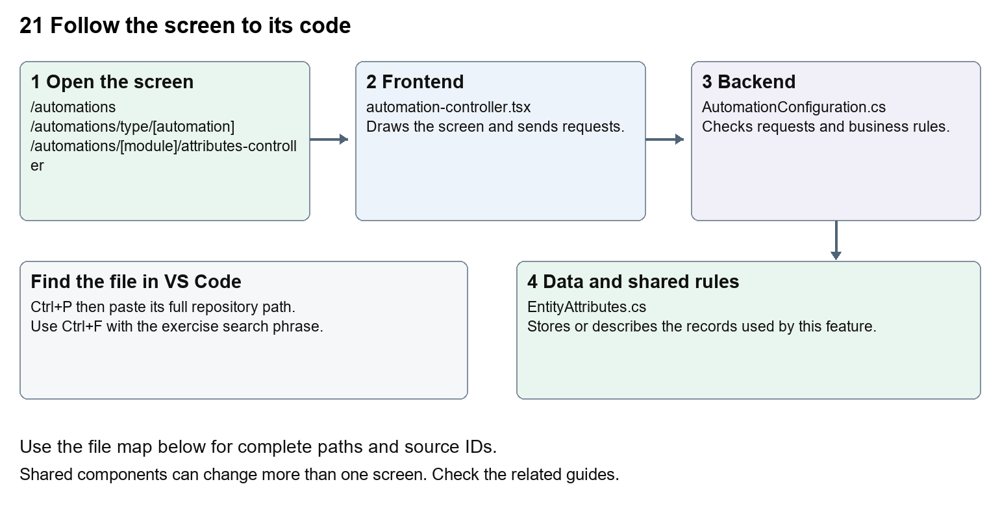

# Nexora automation controllers

Document 21 of the Nexora learning guides  
Source snapshot 14 October 2026 at 06:41 UTC


Understand the Attributes, Rules and Design controllers for configuring entity forms.

### Recognise the screen and its scope

Open `/automations`, `/automations/type/[automation]`, `/automations/[module]/attributes-controller`, `/automations/[module]/rules-controller`, `/automations/[module]/design-controller`. CRM routes use port 3017; member routes use 3018; public website routes can use 3019. Brackets name a route parameter, not text to paste into a browser. Choose a real record or site id from the application.

This guide covers Choose controller then entity; Typed custom attributes; Formula and conditional rules; Section layouts and visibility; Metadata and validation; Applying configured sections on record forms.



The diagram shows the file roles. The full paths below are what you paste into Ctrl+P.

### Find the files in VS Code

| Role | File and source ID | What it does |
| --- | --- | --- |
| Screen | S0136 automation-controller.tsx | Main UI or route for this topic |
| Server | S0192 AutomationConfiguration.cs | Endpoints or server rules |
| Data | S0194 EntityAttributes.cs | Data shape or persistence structure |

**Screen S0136**  
[apps/web/src/features/shared/automation-controller.tsx](<D:/Projects new/Nexora/apps/web/src/features/shared/automation-controller.tsx>)

**Server S0192**  
[backend/src/BuildingBlocks/Nexora.BuildingBlocks/Persistence/AutomationConfiguration.cs](<D:/Projects new/Nexora/backend/src/BuildingBlocks/Nexora.BuildingBlocks/Persistence/AutomationConfiguration.cs>)

**Data S0194**  
[backend/src/BuildingBlocks/Nexora.BuildingBlocks/Persistence/EntityAttributes.cs](<D:/Projects new/Nexora/backend/src/BuildingBlocks/Nexora.BuildingBlocks/Persistence/EntityAttributes.cs>)

The complete HTML manual opens these source IDs inside its Source library. The Word manual shows short labelled extracts so you can learn the flow before reading large files. Each individual Markdown guide includes its complete primary files after the walkthrough.

### Follow the request and the records

1. The automation menu chooses controller type and module.
2. Metadata provides entities and supported fields.
3. The controller edits attribute, rule or section definitions.
4. Shared backend endpoints validate and store configuration.
5. Record forms render configured fields, and server save rules apply configured calculations.

### Read the code with an explanation

A controller changes configuration for records, while a workflow coordinates a sequence of actions. Attributes define extra data, Rules calculate or condition values, and Design arranges record sections. Several modules reuse the same controller UI and BuildingBlocks storage. Changes to shared metadata can affect every registered module.

Source reference S0136 apps/web/src/features/shared/automation-controller.tsx

Selected opening lines with their original numbers. The complete file is in the HTML source library.

```tsx
0001  "use client";
0002  import { EntityHeading } from "@/components/ui/entity-heading";
0003  import { useEffect, useRef, useState } from "react";
0004  import Link from "next/link";
0005  import { attributeEntities, entityLabel, reconcileSections } from "./attribute-entities";
0006  import { useAttributeEntities } from "./use-attribute-entities";
```


The import lines lead to shared components and helpers. Start at the exported component or route function; follow the request helper to the server rather than assuming the whole feature lives in this file.

Source reference S0192 backend/src/BuildingBlocks/Nexora.BuildingBlocks/Persistence/AutomationConfiguration.cs

Extract from source line 60. A fragment from a long line is shown without the rest of that line.

```cs
0060          api.MapGet("/automations/{entityType}", async (string entityType, TDb db, IRequestIdentity who, HttpContext http, CancellationToken ct) =>
```


On the server, look for MapGet to load records, MapPost to create or perform an action, MapPut or MapPatch to change data, and RequireAuthorization for permissions. Some shared methods register endpoints indirectly. Find SaveChangesAsync to see the database write. A request method alone does not tell you every side effect.

Source reference S0194 backend/src/BuildingBlocks/Nexora.BuildingBlocks/Persistence/EntityAttributes.cs

Selected opening lines with their original numbers. The complete file is in the HTML source library.

```cs
0001  using System.ComponentModel.DataAnnotations;
0002  using Microsoft.AspNetCore.Builder;
0003  using Microsoft.AspNetCore.Http;
0004  using Microsoft.AspNetCore.Routing;
0005  using Microsoft.EntityFrameworkCore;
0006  using Microsoft.Extensions.DependencyInjection;
```


Follow model fields to their request names and database mapping. An id points to a particular record. A tenant id limits the organisation. A version or concurrency stamp protects newer edits. Some model files describe contracts rather than tables; check the owning DbContext before assuming storage.

### Make or trace your first change

1. Press Ctrl+P and open [apps/web/src/app/(platform)/automations/page.tsx](<D:/Projects new/Nexora/apps/web/src/app/(platform)/automations/page.tsx>).
2. Press Ctrl+F and search for `Choose an automation type first, then select the entities it should apply to.`. In this snapshot it appears at line 10.
3. Replace only the introduction sentence. Open the controller menu and follow one entity into each controller without saving configuration.
4. Replace only `Choose an automation type first, then select the entities it should apply to.` with `Choose a controller, then choose the records it should apply to.` in that intended location. Keep quotes, tags, JSON keys and routes intact.
5. Save with Ctrl+S. Inspect Problems and the local screen. Review the diff and restore the original text when you finish practising.

Extract from source line 10. A fragment from a long line is shown without the rest of that line.

```tsx
0010  Name="mt-2 text-sm text-slate-600">Choose an automation type first, then select the entities it should apply to.</p></header><section className="grid gap-4 s
```


These exercises have not been applied to the application. Their search phrases are verified against the captured source. Line numbers can move; the phrase and file path are your main navigation aids.

### Check a change and diagnose problems

Confirm the original screen still loads, the changed words appear in the intended place, and another screen using the same component still behaves correctly. If an action fails, inspect the browser Network response, the relevant helper and server validation message. Use the common error table at the beginning of the manual. Reload on a version conflict instead of removing the version check.

A syntax error after a text edit usually means a quote, brace or closing tag changed. Compare your diff with the original. An unchanged browser result can mean the wrong port, a saved published configuration overriding a default, or a running API that has not reloaded.

### Understand the current limits

Configuration edits can affect many forms and future saves. Formula syntax and entity metadata must remain valid. Styling defaults are separate from per-entity configuration.

### Continue learning

Related guides [08 Nexora record profiles and related information](#guide_08), [11 Nexora membership setup and products](#guide_11), [22 Nexora workflow designer and runtime](#guide_22).

## Complete primary source files

These are the complete captured files, with numbered source lines. Other supporting files are included in the complete HTML manual. Configured local passwords, if any, are explicitly omitted. Do not paste the display line numbers into code.

### S0136 automation-controller.tsx

[apps/web/src/features/shared/automation-controller.tsx](<D:/Projects new/Nexora/apps/web/src/features/shared/automation-controller.tsx>)

SHA256 `de84b0d372a896b77bd4fe87de6679279dc86ed0d1580d5c37fb0af97b46bf9e`; 148 source lines; complete captured text.

```tsx
0001  "use client";
0002  import { EntityHeading } from "@/components/ui/entity-heading";
0003  import { useEffect, useRef, useState } from "react";
0004  import Link from "next/link";
0005  import { attributeEntities, entityLabel, reconcileSections } from "./attribute-entities";
0006  import { useAttributeEntities } from "./use-attribute-entities";
0007  import { moduleApi } from "./module-api";
0008  import { buttonClass, inputClass, primaryClass } from "./module-ui";
0009  
0010  export type Rule = { source: string; operation: string; target: string; operand: string | null; value: string | null };
0011  type Field = { id: string; name: string; dataType: string; writable: boolean };
0012  export type AutomationSettings = { version: string | null; sections: string[]; availableSections: string[]; sectionDefinitions: { id: string; title: string; region: string; acceptsFields?: boolean }[]; rules: Rule[]; fields: Field[]; canManage: boolean };
0013  const functions = [{ id: "copy", name: "Copy value" }, { id: "age", name: "Calculate age" }, { id: "add", name: "Add" }, { id: "subtract", name: "Subtract" }, { id: "equals", name: "Equals" }, { id: "not-equal", name: "Not equal" }, { id: "contains", name: "Contains" }, { id: "set-when-equal", name: "Set text when equal" }];
0014  const emptyRule: Rule = { source: "", operation: "copy", target: "", operand: null, value: null };
0015  export function notifyAutomationChanged() {
0016    window.dispatchEvent(new Event("nexora-automations"));
0017    const channel = new BroadcastChannel("nexora-automations"); channel.postMessage("changed"); channel.close();
0018  }
0019  export function AutomationController({ module, mode }: { module: string; mode: "rules" | "design" }) {
0020    const config = attributeEntities[module];
0021    const [selected, setSelected] = useState("");
0022    const types = useAttributeEntities(config?.api ?? "", config?.types);
0023    const kind = types.includes(selected) ? selected : types[0];
0024    return <main className="mx-auto max-w-4xl space-y-6 p-5 text-slate-800 sm:p-8">
0025      <Link href={`/automations/${module}`} className="text-indigo-700 underline">Back to automations</Link>
0026      <EntityHeading>{mode === "rules" ? "Rules" : "Design"} controller</EntityHeading>
0027      {!config ? <p role="alert">This entity is unavailable.</p> : <>
0028        <label className="block text-sm font-medium">Entity<select className={inputClass} value={kind} onChange={e => setSelected(e.target.value)}>{types.map(t => <option key={t} value={t}>{entityLabel(t)}</option>)}</select></label>
0029        <ControllerEditor key={`${config.api}-${kind}-${mode}`} module={module} api={config.api} kind={kind} mode={mode} />
0030      </>}
0031    </main>;
0032  }
0033  function ControllerEditor({ module, api, kind, mode }: { module: string; api: string; kind: string; mode: "rules" | "design" }) {
0034    const [settings, setSettings] = useState<AutomationSettings | null>(null);
0035    const [notice, setNotice] = useState("");
0036    const [error, setError] = useState("");
0037    const [busy, setBusy] = useState(false);
0038    const [reload, setReload] = useState(0);
0039    const dragged = useRef<number | null>(null);
0040    const dirty = useRef(false);
0041    const [rule, setRule] = useState<Rule>(emptyRule);
0042    useEffect(() => {
0043      let active = true;
0044      let request = 0;
0045      const load = () => {
0046        const current = ++request;
0047        void moduleApi<AutomationSettings>(api, `/automations/${kind}`).then(result => {
0048          if (active && current === request) {
0049            setSettings(previous => dirty.current && previous ? { ...previous, canManage: result.canManage, fields: result.fields, availableSections: result.availableSections, sectionDefinitions: result.sectionDefinitions, sections: reconcileSections(previous.sections, result.availableSections) } : result);
0050            setError("");
0051          }
0052        }).catch(e => { if (active && current === request) setError(e.message); });
0053      };
0054      load(); window.addEventListener("focus", load); window.addEventListener("nexora-automations", load); window.addEventListener("nexora-attributes", load);
0055      const attributes = new BroadcastChannel("nexora-attributes"); attributes.onmessage = load;
0056      const automations = new BroadcastChannel("nexora-automations"); automations.onmessage = load;
0057      return () => { active = false; attributes.close(); automations.close(); window.removeEventListener("focus", load); window.removeEventListener("nexora-automations", load); window.removeEventListener("nexora-attributes", load); };
0058    }, [api, kind, reload]);
0059    function update(value: Partial<AutomationSettings>) { dirty.current = true; setSettings(current => current && { ...current, ...value }); setNotice(""); }
0060    function move(from: number, to: number) {
0061      if (!settings || from === to || from < 0 || to < 0 || from >= settings.sections.length || to >= settings.sections.length) return;
0062      const region = (index: number) => settings.sectionDefinitions.find(section => section.id === settings.sections[index])?.region;
0063      if (region(from) !== region(to)) return;
0064      const sections = [...settings.sections]; const [item] = sections.splice(from, 1); sections.splice(to, 0, item); update({ sections });
0065    }
0066    async function save() {
0067      if (!settings) return;
0068      setBusy(true); setError(""); setNotice("");
0069      try {
0070        const result = await moduleApi<{ version: string }>(api, `/automations/${kind}`, "PUT", { version: settings.version, ...(mode === "rules" ? { rules: settings.rules } : { sections: settings.sections }) });
0071        dirty.current = false; setSettings({ ...settings, version: result.version }); setNotice("Changes saved for your organisation."); notifyAutomationChanged();
0072      } catch (e) { setError(e instanceof Error ? e.message : "Unable to save."); }
0073      finally { setBusy(false); }
0074    }
0075    function importPrevious() {
0076      if (!settings) return;
0077      setError(""); setNotice("");
0078      try {
0079        const raw = localStorage.getItem(`nexora-${mode === "rules" ? "rules" : "layout"}-${module}`);
0080        if (!raw) throw new Error("No previous settings were found in this browser.");
0081        const previous: unknown = JSON.parse(raw);
0082        if (!Array.isArray(previous)) throw new Error("Previous settings could not be read.");
0083        if (mode === "design") {
0084          const sections = [...new Set(previous.filter((s): s is string => typeof s === "string" && settings.availableSections.includes(s)))];
0085          if (sections.length === 0) throw new Error("The previous layout does not match this entity’s available sections.");
0086          update({ sections: [...sections, ...settings.availableSections.filter(s => !sections.includes(s))] });
0087        } else {
0088          const operations: Record<string, string> = { "Calculate age": "age", "Equals": "equals", "Not equal": "not-equal", "Contains": "contains", "Add": "add", "Subtract": "subtract", "Set status": "set-when-equal" };
0089          const rules = previous.map((r: { source?: string; fn?: string; target?: string }) => {
0090            const source = settings.fields.filter(f => f.name.toLowerCase() === r?.source?.toLowerCase());
0091            const target = settings.fields.filter(f => f.writable && f.name.toLowerCase() === r?.target?.toLowerCase());
0092            const operation = operations[r?.fn ?? ""];
0093            if (source.length !== 1 || target.length !== 1 || operation !== "age") throw new Error("A previous rule needs field mapping or an operand. Recreate it using the current fields and functions.");
0094            return { source: source[0].id, operation, target: target[0].id, operand: null, value: null };
0095          });
0096          update({ rules });
0097        }
0098        setNotice("Previous browser settings loaded as a draft. Review the entity and settings, then save to share them with your organisation.");
0099      } catch (e) { setError(e instanceof Error ? e.message : "Previous settings could not be read."); }
0100    }
0101    function neighbor(index: number, offset: number) {
0102      if (!settings) return -1;
0103      const region = settings.sectionDefinitions.find(section => section.id === settings.sections[index])?.region;
0104      for (let next = index + offset; next >= 0 && next < settings.sections.length; next += offset)
0105        if (settings.sectionDefinitions.find(section => section.id === settings.sections[next])?.region === region) return next;
0106      return -1;
0107    }
0108    const source = settings?.fields.find(f => f.id === rule.source);
0109    const targetType = ["age", "add", "subtract"].includes(rule.operation) ? "number" : ["equals", "not-equal", "contains"].includes(rule.operation) ? "boolean" : rule.operation === "set-when-equal" ? "text" : source?.dataType;
0110    return <>
0111      {error && <p role="alert" className="text-red-700">{error}</p>}
0112      {!settings ? <><p role="status">{error ? "Settings could not be loaded." : "Loading settings…"}</p><button className={buttonClass} onClick={() => setReload(r => r + 1)}>Retry</button></> : <>
0113        {!settings.canManage && <p>You can view these settings. Editing requires module management permission.</p>}
0114        <fieldset disabled={busy || !settings.canManage} className="space-y-5 disabled:opacity-70">
0115          {mode === "design" ? <>
0116            <p className="text-sm text-slate-600">{api === "crm" ? "Arrange record sections within their area: main details, personal/general details, side rail, or footer. Newly registered sections appear automatically." : "Arrange sections in this entity’s Record attributes workspace."} Drag a section or use Up and Down. Changes apply across browsers after saving.</p>
0117            <ol className="space-y-2">{settings.sections.map((section, i) => <li key={section} draggable={settings.canManage && !busy}
0118              onDragStart={e => { dragged.current = i; e.dataTransfer.effectAllowed = "move"; e.dataTransfer.setData("text/plain", section); }}
0119              onDragEnd={() => { dragged.current = null; }} onDragOver={e => e.preventDefault()}
0120              onDrop={e => { e.preventDefault(); if (dragged.current !== null && settings.canManage && !busy) move(dragged.current, i); dragged.current = null; }}
0121              className="flex items-center gap-3 rounded-xl border bg-white p-4">
0122              <span className="mr-auto font-medium">{settings.sectionDefinitions.find(item => item.id === section)?.title ?? section}<small className="ml-2 font-normal text-slate-500">{settings.sectionDefinitions.find(item => item.id === section)?.region}</small></span>
0123              <button type="button" className={buttonClass} disabled={neighbor(i, -1) < 0} aria-label={`Move ${section} up`} onClick={() => move(i, neighbor(i, -1))}>Up</button>
0124              <button type="button" className={buttonClass} disabled={neighbor(i, 1) < 0} aria-label={`Move ${section} down`} onClick={() => move(i, neighbor(i, 1))}>Down</button>
0125            </li>)}</ol>
0126          </> : <>
0127            <p className="text-sm text-slate-600">Rules calculate custom attributes whenever a record or its attributes are saved. Age is recalculated on save. Existing records update on their next save. Chained rules run in dependency order.</p>
0128            <form className="grid gap-4 rounded-xl border bg-white p-5 sm:grid-cols-2" onSubmit={e => { e.preventDefault(); update({ rules: [...settings.rules, rule] }); setRule(emptyRule); }}>
0129              <label>Source field<select required className={inputClass} value={rule.source} onChange={e => setRule({ ...rule, source: e.target.value, target: "" })}><option value="">Choose a field</option>{settings.fields.map(f => <option key={f.id} value={f.id}>{f.name} ({f.dataType})</option>)}</select></label>
0130              <label>Function<select className={inputClass} value={rule.operation} onChange={e => setRule({ ...rule, operation: e.target.value, target: "", operand: null, value: null })}>{functions.map(f => <option key={f.id} value={f.id}>{f.name}</option>)}</select></label>
0131              <label>Target attribute<select required className={inputClass} value={rule.target} onChange={e => setRule({ ...rule, target: e.target.value })}><option value="">Choose an attribute</option>{settings.fields.filter(f => f.writable && f.dataType === targetType && f.id !== rule.source).map(f => <option key={f.id} value={f.id}>{f.name} ({f.dataType})</option>)}</select></label>
0132              {!["copy", "age"].includes(rule.operation) && <label>{["add", "subtract"].includes(rule.operation) ? "Amount" : "Compare with"}<input required maxLength={500} className={inputClass} value={rule.operand ?? ""} placeholder={source?.dataType === "date" ? "yyyy-mm-dd" : source?.dataType === "boolean" ? "true or false" : undefined} onChange={e => setRule({ ...rule, operand: e.target.value })} /></label>}
0133              {rule.operation === "set-when-equal" && <label>Text when matched<input required maxLength={500} className={inputClass} value={rule.value ?? ""} onChange={e => setRule({ ...rule, value: e.target.value })} /></label>}
0134              <p className="text-xs text-slate-500 sm:col-span-2">Create target attributes in Attributes controller first. Empty sources clear their calculated targets. “Set text when equal” clears the target when it does not match.</p>
0135              <button className={buttonClass} disabled={settings.rules.length >= 50}>Add rule</button>
0136            </form>
0137            <ul className="space-y-2" aria-label="Configured rules">{settings.rules.map((r, i) => <li key={i} className="flex items-center justify-between gap-4 rounded-xl border bg-white p-4 text-sm">
0138              <span>{settings.fields.find(f => f.id === r.source)?.name ?? "Missing field"} → {functions.find(f => f.id === r.operation)?.name} {r.operand ?? ""}{r.value != null ? `: ${r.value}` : ""} → {settings.fields.find(f => f.id === r.target)?.name ?? "Missing attribute"}</span>
0139              <button type="button" className={buttonClass} aria-label={`Remove rule ${i + 1}`} onClick={() => update({ rules: settings.rules.filter((_, index) => index !== i) })}>Remove</button>
0140            </li>)}</ul>
0141            {settings.rules.length === 0 && <p>No rules configured.</p>}
0142          </>}
0143          <div className="flex flex-wrap justify-end gap-3"><button type="button" className={buttonClass} onClick={importPrevious}>Load previous browser settings</button><button type="button" className={buttonClass} onClick={() => { dirty.current = false; setSettings(null); setNotice(""); setReload(r => r + 1); }}>Cancel / reload</button><button type="button" className={primaryClass} onClick={() => void save()}>{busy ? "Saving…" : mode === "rules" ? "Save rules" : "Save layout"}</button></div>
0144        </fieldset>
0145        <p role="status" className="text-sm text-emerald-700">{notice}</p>
0146      </>}
0147    </>;
0148  }
```

### S0192 AutomationConfiguration.cs

[backend/src/BuildingBlocks/Nexora.BuildingBlocks/Persistence/AutomationConfiguration.cs](<D:/Projects new/Nexora/backend/src/BuildingBlocks/Nexora.BuildingBlocks/Persistence/AutomationConfiguration.cs>)

SHA256 `b20d6591433d5eb3ed9ba3ade75fc1168c326f42c02178820eb3556e905fcdb6`; 212 source lines; complete captured text.

```cs
0001  using System.ComponentModel.DataAnnotations;
0002  using System.Globalization;
0003  using System.Text.Json;
0004  using Microsoft.AspNetCore.Builder;
0005  using Microsoft.AspNetCore.Http;
0006  using Microsoft.AspNetCore.Routing;
0007  using Microsoft.EntityFrameworkCore;
0008  using Nexora.BuildingBlocks.Security;
0009  
0010  namespace Nexora.BuildingBlocks.Persistence;
0011  
0012  public sealed class AutomationConfiguration
0013  {
0014      public Guid Id { get; set; } = Guid.NewGuid();
0015      public Guid TenantId { get; set; }
0016      public string EntityType { get; set; } = "";
0017      public string SectionsJson { get; set; } = "[]";
0018      public string RulesJson { get; set; } = "[]";
0019      public Guid Version { get; set; } = Guid.NewGuid();
0020  }
0021  
0022  public interface IAutomationValue
0023  {
0024      Guid TenantId { get; set; }
0025      Guid RecordId { get; set; }
0026      Guid DefinitionId { get; set; }
0027      string? TextValue { get; set; }
0028      decimal? NumberValue { get; set; }
0029      bool? BooleanValue { get; set; }
0030      DateTime? DateValue { get; set; }
0031  }
0032  
0033  public sealed record AutomationField(string Id, string Name, string DataType, bool Writable);
0034  public sealed record AutomationRule(string Source, string Operation, string Target, string? Operand = null, string? Value = null);
0035  public sealed record AutomationRequest(Guid? Version, string[]? Sections, AutomationRule[]? Rules);
0036  
0037  /// <summary>Bounded, typed rules. Targets are custom attributes, so automations cannot bypass domain transitions.</summary>
0038  public static class Automations
0039  {
0040      public static void Configure(ModelBuilder b)
0041      {
0042          var row = b.Entity<AutomationConfiguration>();
0043          row.ToTable("AutomationConfigurations").HasKey(x => x.Id);
0044          row.HasIndex(x => new { x.TenantId, x.EntityType }).IsUnique();
0045          row.Property(x => x.EntityType).HasMaxLength(80);
0046          row.Property(x => x.RulesJson).HasMaxLength(100000);
0047          row.Property(x => x.SectionsJson).HasMaxLength(4000);
0048          row.Property(x => x.Version).IsConcurrencyToken();
0049      }
0050  
0051      public static string[] Sections(string kind) => AutomationCatalog.Sections(kind).Select(s => s.Id).ToArray();
0052  
0053      public static AutomationField[] BuiltIns(Type type) => EntityFieldCatalog.Properties(type)
0054          .Select(p => new AutomationField("record:" + p.Name, EntityFieldCatalog.Label(p.Name),
0055              EntityFieldCatalog.DataType(p.PropertyType) is "reference" ? "text" : EntityFieldCatalog.DataType(p.PropertyType)!, false)).ToArray();
0056  
0057      public static void Map<TDb>(RouteGroupBuilder api, string permission, Func<string, Type?> resolve,
0058          Func<TDb, string, CancellationToken, Task<AutomationField[]>> fields) where TDb : DbContext
0059      {
0060          api.MapGet("/automations/{entityType}", async (string entityType, TDb db, IRequestIdentity who, HttpContext http, CancellationToken ct) =>
0061          {
0062              var type = resolve(entityType) ?? throw new KeyNotFoundException();
0063              var row = await db.Set<AutomationConfiguration>().SingleOrDefaultAsync(x => x.EntityType == entityType && x.TenantId == who.TenantId, ct);
0064              return Results.Ok(new { version = row?.Version, sections = AutomationCatalog.Reconcile(row == null ? null : JsonSerializer.Deserialize<string[]>(row.SectionsJson), Sections(entityType)),
0065                  rules = row == null ? [] : ReadRules(row), canManage = http.User.HasClaim("permission", permission), availableSections = Sections(entityType), sectionDefinitions = AutomationCatalog.Sections(entityType), fields = BuiltIns(type).Concat(await fields(db, entityType, ct)) });
0066          });
0067          api.MapPut("/automations/{entityType}", async (string entityType, AutomationRequest request, TDb db, IRequestIdentity who, CancellationToken ct) =>
0068          {
0069              var type = resolve(entityType) ?? throw new KeyNotFoundException();
0070              var row = await db.Set<AutomationConfiguration>().SingleOrDefaultAsync(x => x.EntityType == entityType && x.TenantId == who.TenantId, ct);
0071              if (request.Version != row?.Version) return Results.Problem(statusCode: 409, title: "Settings changed. Reload before saving.");
0072              if (request.Sections == null && request.Rules == null) throw new ValidationException("Provide a layout or rules.");
0073              if (request.Sections is {} sections && (sections.Length == 0 || sections.Distinct().Count() != sections.Length || sections.Except(Sections(entityType)).Any()))
0074                  throw new ValidationException("Include each available section exactly once.");
0075              if (request.Rules is {} rules) Validate(rules, BuiltIns(type).Concat(await fields(db, entityType, ct)).ToArray());
0076              if (row == null) { row = new() { TenantId = who.TenantId!.Value, EntityType = entityType, SectionsJson = JsonSerializer.Serialize(Sections(entityType)) }; db.Add(row); }
0077              if (request.Sections != null) row.SectionsJson = JsonSerializer.Serialize(AutomationCatalog.Reconcile(request.Sections, Sections(entityType)));
0078              if (request.Rules != null) row.RulesJson = JsonSerializer.Serialize(request.Rules);
0079              await db.SaveChangesAsync(ct);
0080              return Results.Ok(new { row.Version });
0081          }).RequireAuthorization(permission);
0082      }
0083  
0084      public static AutomationRule[] ReadRules(AutomationConfiguration row) => JsonSerializer.Deserialize<AutomationRule[]>(row.RulesJson) ?? [];
0085  
0086      public static AutomationRule[] Validate(AutomationRule[] rules, AutomationField[] fields)
0087      {
0088          if (rules.Length > 50 || rules.Any(r => r == null)) throw new ValidationException("Provide at most 50 rules.");
0089          var targets = new HashSet<string>();
0090          foreach (var rule in rules)
0091          {
0092              var source = fields.SingleOrDefault(f => f.Id == rule.Source);
0093              var target = fields.SingleOrDefault(f => f.Id == rule.Target && f.Writable);
0094              if (source == null || target == null) throw new ValidationException("A rule references an unavailable attribute. Remove the rule before deleting its attribute.");
0095              if (!targets.Add(rule.Target)) throw new ValidationException("Only one rule may write each target attribute.");
0096              var valid = rule.Operation switch
0097              {
0098                  "copy" => source.DataType == target.DataType,
0099                  "age" => source.DataType == "date" && target.DataType == "number",
0100                  "add" or "subtract" => source.DataType == "number" && target.DataType == "number" && decimal.TryParse(rule.Operand, NumberStyles.Number, CultureInfo.InvariantCulture, out _),
0101                  "equals" or "not-equal" => target.DataType == "boolean" && ValidOperand(rule.Operand, source.DataType),
0102                  "contains" => source.DataType == "text" && target.DataType == "boolean" && !string.IsNullOrEmpty(rule.Operand),
0103                  "set-when-equal" => source.DataType == "text" && target.DataType == "text" && rule.Operand != null && rule.Value != null,
0104                  _ => false
0105              };
0106              if (!valid || rule.Operand?.Length > 500 || rule.Value?.Length > 500) throw new ValidationException("Choose a compatible function, target type and operand.");
0107          }
0108          var ordered = new List<AutomationRule>();
0109          var remaining = rules.ToList();
0110          while (remaining.Count > 0)
0111          {
0112              var ready = remaining.Where(r => remaining.All(other => other.Target != r.Source)).ToArray();
0113              if (ready.Length == 0) throw new ValidationException("Rules cannot contain circular dependencies.");
0114              ordered.AddRange(ready); foreach (var rule in ready) remaining.Remove(rule);
0115          }
0116          return ordered.ToArray();
0117      }
0118  
0119      private static bool ValidOperand(string? input, string type) => input != null && (type switch
0120      {
0121          "number" => decimal.TryParse(input, NumberStyles.Number, CultureInfo.InvariantCulture, out _),
0122          "boolean" => bool.TryParse(input, out _),
0123          "date" => DateTime.TryParseExact(input, "yyyy-MM-dd", CultureInfo.InvariantCulture, DateTimeStyles.None, out _),
0124          _ => true
0125      });
0126  
0127      public static async Task GuardAsync(DbContext db, Guid? tenant, Guid? user, CancellationToken ct)
0128      {
0129          foreach (var entry in db.ChangeTracker.Entries<AutomationConfiguration>().Where(e => e.State is EntityState.Added or EntityState.Modified or EntityState.Deleted))
0130          {
0131              if (tenant == null || user == null || entry.Entity.TenantId != tenant) throw new TenantBoundaryException();
0132              if (entry.State != EntityState.Added)
0133              {
0134                  var stored = await entry.GetDatabaseValuesAsync(ct);
0135                  if (stored == null || !Equals(stored[nameof(AutomationConfiguration.TenantId)], tenant) || !Equals(stored[nameof(AutomationConfiguration.EntityType)], entry.Entity.EntityType)) throw new TenantBoundaryException();
0136                  entry.Entity.Version = Guid.NewGuid();
0137              }
0138          }
0139      }
0140  
0141      public static async Task ApplyAsync<TValue>(DbContext db, Guid? tenant, Func<string, Type?> resolve,
0142          Func<object, string> kindOf, Func<string, CancellationToken, Task<AutomationField[]>> fields, CancellationToken ct) where TValue : class, IAutomationValue, new()
0143      {
0144          if (tenant == null) return;
0145          db.ChangeTracker.DetectChanges();
0146          var changed = db.ChangeTracker.Entries().Where(e => e.State is EntityState.Added or EntityState.Modified or EntityState.Deleted).Select(e => e.Entity).ToArray();
0147          var configurations = await db.Set<AutomationConfiguration>().Where(x => x.TenantId == tenant).ToListAsync(ct);
0148          foreach (var configuration in configurations)
0149          {
0150              var rules = ReadRules(configuration);
0151              if (rules.Length == 0) continue;
0152              var type = resolve(configuration.EntityType) ?? throw new ValidationException("Unknown automation entity.");
0153              var metadata = BuiltIns(type).Concat(await fields(configuration.EntityType, ct)).ToArray();
0154              rules = Validate(rules, metadata);
0155              var ids = changed.OfType<TValue>().Select(x => x.RecordId).Concat(db is IAutomationRecordSources provider ? provider.ChangedRecordIds(configuration.EntityType, changed) : [])
0156                  .Concat(changed.Where(x => x.GetType() == type && kindOf(x) == configuration.EntityType).Select(x => (Guid)type.GetProperty("Id")!.GetValue(x)!)).Distinct().ToArray();
0157              foreach (var id in ids)
0158              {
0159                  var record = await db.FindAsync(type, [id], ct);
0160                  if (record == null || db.Entry(record).State == EntityState.Deleted || kindOf(record) != configuration.EntityType || !Equals(type.GetProperty("TenantId")!.GetValue(record), tenant)) continue;
0161                  await db.Set<TValue>().Where(x => x.RecordId == id && x.TenantId == tenant).LoadAsync(ct);
0162                  var values = db.ChangeTracker.Entries<TValue>().Where(e => e.State != EntityState.Deleted && e.Entity.RecordId == id && e.Entity.TenantId == tenant).Select(e => e.Entity).ToDictionary(x => x.DefinitionId);
0163                  foreach (var rule in rules)
0164                  {
0165                      var sourceField = metadata.Single(f => f.Id == rule.Source);
0166                      object? source = rule.Source.StartsWith("record:", StringComparison.Ordinal)
0167                          ? EntityFieldCatalog.RuleValue(type.GetProperty(rule.Source[7..])!.GetValue(record))
0168                          : Guid.TryParse(rule.Source, out var sourceId) ? values.TryGetValue(sourceId, out var input) ? ReadValue(input, sourceField.DataType) : null
0169                          : db is IAutomationRecordSources sources ? EntityFieldCatalog.RuleValue(await sources.ReadSourceAsync(record, rule.Source, ct))
0170                          : throw new ValidationException("Source field is unavailable.");
0171                      var result = Evaluate(rule, source, sourceField.DataType, DateTime.UtcNow.Date);
0172                      var targetId = Guid.Parse(rule.Target);
0173                      if (!values.TryGetValue(targetId, out var target)) { target = new TValue { TenantId = tenant.Value, RecordId = id, DefinitionId = targetId }; db.Add(target); values.Add(targetId, target); }
0174                      target.TextValue = result as string; target.NumberValue = result as decimal?;
0175                      target.BooleanValue = result as bool?; target.DateValue = result as DateTime?;
0176                      if (target.TextValue?.Length > 500 || target.NumberValue is decimal n && (n >= 100000000000000m || n <= -100000000000000m || decimal.Round(n, 4) != n)) throw new ValidationException("A calculated value exceeds the attribute limits.");
0177                  }
0178              }
0179          }
0180      }
0181  
0182      private static object? ReadValue(IAutomationValue value, string type) => type switch { "number" => value.NumberValue, "boolean" => value.BooleanValue, "date" => value.DateValue, _ => value.TextValue };
0183  
0184      public static object? Evaluate(AutomationRule rule, object? source, string type, DateTime today)
0185      {
0186          if (source == null) return null;
0187          try
0188          {
0189              var operand = rule.Operand;
0190              var equal = type switch
0191              {
0192                  "number" => decimal.TryParse(operand, NumberStyles.Number, CultureInfo.InvariantCulture, out var n) && (decimal)source == n,
0193                  "boolean" => bool.TryParse(operand, out var b) && (bool)source == b,
0194                  "date" => DateTime.TryParseExact(operand, "yyyy-MM-dd", CultureInfo.InvariantCulture, DateTimeStyles.None, out var d) && ((DateTime)source).Date == d.Date,
0195                  _ => string.Equals((string)source, operand, StringComparison.OrdinalIgnoreCase)
0196              };
0197              return rule.Operation switch
0198              {
0199                  "copy" => source,
0200                  "age" => ((DateTime)source).Date > today ? null : (decimal)(today.Year - ((DateTime)source).Year - (((DateTime)source).Date.AddYears(today.Year - ((DateTime)source).Year) > today ? 1 : 0)),
0201                  "add" => checked((decimal)source + decimal.Parse(operand!, CultureInfo.InvariantCulture)),
0202                  "subtract" => checked((decimal)source - decimal.Parse(operand!, CultureInfo.InvariantCulture)),
0203                  "equals" => equal,
0204                  "not-equal" => !equal,
0205                  "contains" => ((string)source).Contains(operand!, StringComparison.OrdinalIgnoreCase),
0206                  "set-when-equal" => equal ? rule.Value : null,
0207                  _ => throw new ValidationException("Unsupported rule function.")
0208              };
0209          }
0210          catch (OverflowException) { throw new ValidationException("A calculated number exceeds the supported range."); }
0211      }
0212  }
```

### S0194 EntityAttributes.cs

[backend/src/BuildingBlocks/Nexora.BuildingBlocks/Persistence/EntityAttributes.cs](<D:/Projects new/Nexora/backend/src/BuildingBlocks/Nexora.BuildingBlocks/Persistence/EntityAttributes.cs>)

SHA256 `f60247861043349b9b311c20f26938af43b13b4bfac6261bd378d79a3110e99a`; 147 source lines; complete captured text.

```cs
0001  using System.ComponentModel.DataAnnotations;
0002  using Microsoft.AspNetCore.Builder;
0003  using Microsoft.AspNetCore.Http;
0004  using Microsoft.AspNetCore.Routing;
0005  using Microsoft.EntityFrameworkCore;
0006  using Microsoft.Extensions.DependencyInjection;
0007  using Nexora.BuildingBlocks.Domain;
0008  using Nexora.BuildingBlocks.Security;
0009  
0010  namespace Nexora.BuildingBlocks.Persistence;
0011  
0012  public sealed class AttributeDefinition : TenantEntity
0013  {
0014      public string EntityType { get; set; } = "";
0015      public string Name { get; set; } = "";
0016      public string DataType { get; set; } = "text";
0017      public string Section { get; set; } = "General Information";
0018      public int DisplayOrder { get; set; }
0019  }
0020  public sealed class AttributeValue : TenantEntity, IAutomationValue
0021  {
0022      public Guid RecordId { get; set; }
0023      public Guid DefinitionId { get; set; }
0024      public string? TextValue { get; set; }
0025      public decimal? NumberValue { get; set; }
0026      public bool? BooleanValue { get; set; }
0027      public DateTime? DateValue { get; set; }
0028  }
0029  public sealed record AttributeInput(string? TextValue, decimal? NumberValue, bool? BooleanValue, DateTime? DateValue);
0030  public interface IAttributeRequest { Dictionary<Guid, AttributeInput>? Attributes { get; } }
0031  public sealed record AttributeDefinitionRequest(string Name, string DataType, string? Section = null);
0032  public sealed record AttributeOrderRequest(Guid[] Ids);
0033  public sealed record AttributeValuesRequest(Dictionary<Guid, AttributeInput> Attributes) : IAttributeRequest;
0034  
0035  public static class EntityAttributes
0036  {
0037      public static RouteGroupBuilder WithAttributes<TDb>(this RouteGroupBuilder api, string permission, params Type[] entities) where TDb : TenantDbContext
0038      {
0039          Type Resolve(string entityType) => entities.SingleOrDefault(t => t.Name == entityType) ?? throw new KeyNotFoundException();
0040          Automations.Map<TDb>(api, permission, entityType => entities.SingleOrDefault(t => t.Name == entityType), (db, kind, ct) => db.AutomationFieldsAsync(kind, ct));
0041          api.MapGet("/attribute-entities", () => entities.Select(t => t.Name));
0042          api.MapGet("/attributes/{entityType}/records", async (string entityType, int? page, TDb db, CancellationToken ct) =>
0043          {
0044              var method = typeof(EntityAttributes).GetMethod(nameof(ListRecords), System.Reflection.BindingFlags.Static | System.Reflection.BindingFlags.NonPublic)!.MakeGenericMethod(Resolve(entityType));
0045              return await (Task<object>)method.Invoke(null, [db, Math.Max(1, page ?? 1), ct])!;
0046          });
0047          api.MapGet("/attributes/{entityType}/definitions", async (string entityType, TDb db, CancellationToken ct) =>
0048          {
0049              Resolve(entityType);
0050              return await Definitions(db, entityType).OrderBy(x => x.DisplayOrder).ThenBy(x => x.Id).ToListAsync(ct);
0051          });
0052          api.MapPost("/attributes/{entityType}/definitions", async (string entityType, AttributeDefinitionRequest request, TDb db, IRequestIdentity who, CancellationToken ct) =>
0053          {
0054              Resolve(entityType); ValidateDefinition(request);
0055              if (await Definitions(db, entityType).CountAsync(ct) >= 50) throw new ValidationException("An entity may have at most 50 attributes.");
0056              var row = new AttributeDefinition { TenantId = who.TenantId!.Value, EntityType = entityType, Name = request.Name.Trim(), DataType = request.DataType,
0057                  Section = AutomationCatalog.FieldSection(entityType, request.Section),
0058                  DisplayOrder = (await Definitions(db, entityType).MaxAsync(x => (int?)x.DisplayOrder, ct) ?? -1) + 1 };
0059              db.Add(row); await db.SaveChangesAsync(ct); return Results.Ok(row);
0060          }).RequireAuthorization(permission);
0061          api.MapPatch("/attributes/{entityType}/definitions/{id:guid}", async (string entityType, Guid id, AttributeDefinitionRequest request, TDb db, CancellationToken ct) =>
0062          {
0063              Resolve(entityType); ValidateDefinition(request);
0064              var row = await Definitions(db, entityType).SingleOrDefaultAsync(x => x.Id == id, ct) ?? throw new KeyNotFoundException();
0065              if (row.DataType != request.DataType && await db.Set<AttributeValue>().AnyAsync(x => x.DefinitionId == id, ct))
0066                  throw new ValidationException("Cannot change data type while saved values exist.");
0067              row.Name = request.Name.Trim(); row.DataType = request.DataType;
0068              row.Section = AutomationCatalog.FieldSection(entityType, request.Section ?? row.Section);
0069              await db.SaveChangesAsync(ct); return Results.Ok(row);
0070          }).RequireAuthorization(permission);
0071          api.MapDelete("/attributes/{entityType}/definitions/{id:guid}", async (string entityType, Guid id, TDb db, CancellationToken ct) =>
0072          {
0073              Resolve(entityType);
0074              var row = await Definitions(db, entityType).SingleOrDefaultAsync(x => x.Id == id, ct) ?? throw new KeyNotFoundException();
0075              db.RemoveRange(await db.Set<AttributeValue>().Where(x => x.DefinitionId == id).ToListAsync(ct));
0076              db.Remove(row); await db.SaveChangesAsync(ct); return Results.NoContent();
0077          }).RequireAuthorization(permission);
0078          api.MapPut("/attributes/{entityType}/order", async (string entityType, AttributeOrderRequest request, TDb db, CancellationToken ct) =>
0079          {
0080              Resolve(entityType); var rows = await Definitions(db, entityType).ToListAsync(ct);
0081              if (request.Ids == null || request.Ids.Length != rows.Count || request.Ids.Distinct().Count() != rows.Count || rows.Any(x => !request.Ids.Contains(x.Id)))
0082                  throw new ValidationException("Reload and include every attribute exactly once.");
0083              foreach (var row in rows) row.DisplayOrder = Array.IndexOf(request.Ids, row.Id);
0084              await db.SaveChangesAsync(ct); return Results.NoContent();
0085          }).RequireAuthorization(permission);
0086          api.MapGet("/attributes/{entityType}/records/{id:guid}", async (string entityType, Guid id, TDb db, IRequestIdentity who, CancellationToken ct) =>
0087          {
0088              await FindRecord(db, Resolve(entityType), id, who, ct);
0089              return await (from value in db.Set<AttributeValue>() join definition in Definitions(db, entityType) on value.DefinitionId equals definition.Id where value.RecordId == id select value).ToListAsync(ct);
0090          });
0091          api.MapPut("/attributes/{entityType}/records/{id:guid}", async (string entityType, Guid id, AttributeValuesRequest request, TDb db, IRequestIdentity who, CancellationToken ct) =>
0092          {
0093              var record = await FindRecord(db, Resolve(entityType), id, who, ct);
0094              await Apply(db, record, request.Attributes, ct); await db.SaveChangesAsync(ct); return Results.NoContent();
0095          }).RequireAuthorization(permission);
0096          // Attribute requests share the module's transaction with the entity write.
0097          // No persisted parent remains if its typed values fail validation.
0098          api.AddEndpointFilter(async (context, next) =>
0099          {
0100              var request = context.Arguments.OfType<IAttributeRequest>().FirstOrDefault();
0101              if (request?.Attributes == null || context.HttpContext.Request.Path.Value!.Contains("/attributes/")) return await next(context);
0102              var db = context.HttpContext.RequestServices.GetRequiredService<TDb>();
0103              await using var transaction = await db.Database.BeginTransactionAsync(context.HttpContext.RequestAborted);
0104              var result = await next(context);
0105              if (result is IStatusCodeHttpResult status && status.StatusCode >= 400) return result;
0106              if (result is not IValueHttpResult { Value: TenantEntity record } || !entities.Contains(record.GetType()))
0107                  throw new ValidationException("This operation does not support attribute values.");
0108              await Apply(db, record, request.Attributes, context.HttpContext.RequestAborted);
0109              await db.SaveChangesAsync(context.HttpContext.RequestAborted);
0110              await transaction.CommitAsync(context.HttpContext.RequestAborted);
0111              return result;
0112          });
0113          return api;
0114      }
0115      private static IQueryable<AttributeDefinition> Definitions(TenantDbContext db, string type) => db.Set<AttributeDefinition>().Where(x => x.EntityType == type);
0116      private static async Task<object> ListRecords<T>(TenantDbContext db, int page, CancellationToken ct) where T : TenantEntity
0117      {
0118          var rows = await db.Set<T>().AsNoTracking().OrderByDescending(x => x.CreatedAtUtc).ThenBy(x => x.Id).Skip((Math.Min(page, 10000) - 1) * 50).Take(50).ToListAsync(ct);
0119          return rows.Select(row => new { row.Id, name = new[] { "Name", "Title", "ContactName", "CustomerName", "Subject", "Reference", "Number" }.Select(p => typeof(T).GetProperty(p)?.GetValue(row)?.ToString()).FirstOrDefault(v => !string.IsNullOrWhiteSpace(v)) ?? $"{typeof(T).Name} · {row.CreatedAtUtc:yyyy-MM-dd} · {row.Id.ToString()[..8]}" }).ToList();
0120      }
0121      private static async Task<TenantEntity> FindRecord(TenantDbContext db, Type type, Guid id, IRequestIdentity who, CancellationToken ct)
0122      {
0123          var row = await db.FindAsync(type, [id], ct) as TenantEntity;
0124          if (row == null || row.TenantId != who.TenantId) throw new KeyNotFoundException();
0125          return row;
0126      }
0127      private static void ValidateDefinition(AttributeDefinitionRequest request)
0128      {
0129          if (string.IsNullOrWhiteSpace(request.Name) || request.Name.Length > 80) throw new ValidationException("Enter an attribute name of 1–80 characters.");
0130          if (!new[] { "text", "number", "boolean", "date" }.Contains(request.DataType)) throw new ValidationException("Unsupported data type.");
0131      }
0132      private static async Task Apply(TenantDbContext db, TenantEntity record, Dictionary<Guid, AttributeInput>? values, CancellationToken ct)
0133      {
0134          if (values == null || values.Count > 50) throw new ValidationException("Provide at most 50 attribute values.");
0135          var definitions = await Definitions(db, record.GetType().Name).ToListAsync(ct);
0136          var existing = await db.Set<AttributeValue>().Where(x => x.RecordId == record.Id).ToListAsync(ct);
0137          foreach (var (id, input) in values)
0138          {
0139              var definition = definitions.SingleOrDefault(x => x.Id == id) ?? throw new ValidationException("An attribute was deleted or is unavailable. Reload the form.");
0140              if (input == null || input.TextValue?.Length > 500 || (input.TextValue != null && definition.DataType != "text") || (input.NumberValue != null && definition.DataType != "number") || (input.BooleanValue != null && definition.DataType != "boolean") || (input.DateValue != null && definition.DataType != "date")) throw new ValidationException("The value does not match the attribute data type.");
0141              if (input.NumberValue is decimal n && (n >= 100000000000000m || n <= -100000000000000m || decimal.Round(n, 4) != n)) throw new ValidationException("Use up to 14 integer digits and 4 decimal places.");
0142              var row = existing.SingleOrDefault(x => x.DefinitionId == id);
0143              if (row == null) { row = new AttributeValue { TenantId = record.TenantId, RecordId = record.Id, DefinitionId = id }; db.Add(row); }
0144              row.TextValue = input.TextValue; row.NumberValue = input.NumberValue; row.BooleanValue = input.BooleanValue; row.DateValue = input.DateValue;
0145          }
0146      }
0147  }
```
