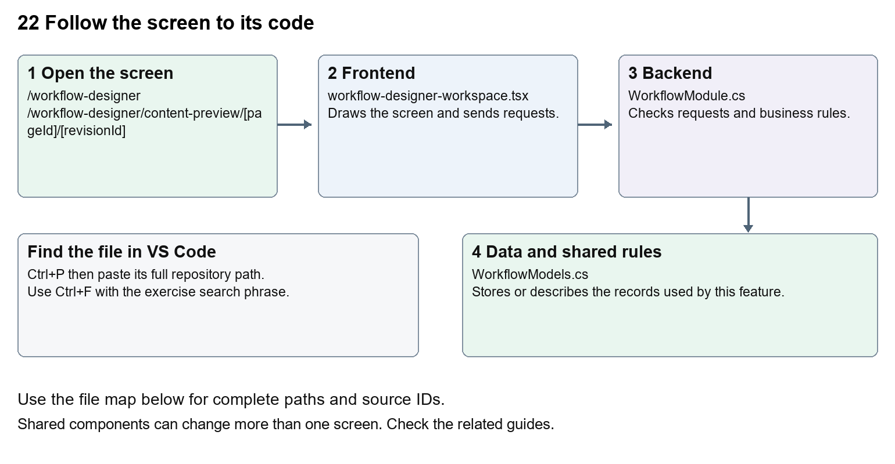

# Nexora workflow designer and runtime

Document 22 of the Nexora learning guides  
Source snapshot 14 October 2026 at 06:41 UTC


Understand workflow drafts, nodes, validation, publishing, activation, runs and operational gates.

### Recognise the screen and its scope

Open `/workflow-designer`, `/workflow-designer/content-preview/[pageId]/[revisionId]`. CRM routes use port 3017; member routes use 3018; public website routes can use 3019. Brackets name a route parameter, not text to paste into a browser. Choose a real record or site id from the application.

This guide covers Catalogue and inactive draft templates; Canvas nodes conditions queries and variables; Triggers field changes and schedules; Validation version publishing and activation; Approvals exceptions and run history; Connectors delivery reconciliation import export and AI draft.



The diagram shows the file roles. The full paths below are what you paste into Ctrl+P.

### Find the files in VS Code

| Role | File and source ID | What it does |
| --- | --- | --- |
| Screen | S0156 workflow-designer-workspace.tsx | Main UI or route for this topic |
| Server | S0565 WorkflowModule.cs | Endpoints or server rules |
| Data | S0564 WorkflowModels.cs | Data shape or persistence structure |

**Screen S0156**  
[apps/web/src/features/workflows/workflow-designer-workspace.tsx](<D:/Projects new/Nexora/apps/web/src/features/workflows/workflow-designer-workspace.tsx>)

**Server S0565**  
[backend/src/Modules/Nexora.Modules.Workflow/WorkflowModule.cs](<D:/Projects new/Nexora/backend/src/Modules/Nexora.Modules.Workflow/WorkflowModule.cs>)

**Data S0564**  
[backend/src/Modules/Nexora.Modules.Workflow/WorkflowModels.cs](<D:/Projects new/Nexora/backend/src/Modules/Nexora.Modules.Workflow/WorkflowModels.cs>)

The complete HTML manual opens these source IDs inside its Source library. The Word manual shows short labelled extracts so you can learn the flow before reading large files. Each individual Markdown guide includes its complete primary files after the walkthrough.

### Follow the request and the records

1. The designer loads metadata, definitions and permissions.
2. A draft graph contains typed nodes and connections.
3. Validation checks graph structure, conditions and action inputs.
4. Publishing creates a version; activation separately enables its triggers.
5. The processor records runs, steps, approvals, exceptions and delivery outcomes.

### Read the code with an explanation

A graph is a set of steps and links. A draft is editable; a published version is the reference used by runs. Activation controls whether eligible triggers start it. Saving a diagram does not execute it. WorkflowProcessor and registered module actions perform server work, with gates and persisted state. Preview, test, publish and execute have different consequences.

Source reference S0156 apps/web/src/features/workflows/workflow-designer-workspace.tsx

Selected opening lines with their original numbers. The complete file is in the HTML source library.

```tsx
0001  "use client";
0003  import Link from "next/link";
0004  import { useCallback, useEffect, useId, useState } from "react";
0005  import { PanelToggle, useCollapsedPanel } from "@/features/shared/panel-toggle";
0006  import {
0007    ArrowLeft,
```


The import lines lead to shared components and helpers. Start at the exported component or route function; follow the request helper to the server rather than assuming the whole feature lives in this file.

Source reference S0565 backend/src/Modules/Nexora.Modules.Workflow/WorkflowModule.cs

Extract from source line 33. A fragment from a long line is shown without the rest of that line.

```cs
0033    api.MapGet("/metadata",(IEnumerable<Nexora.BuildingBloc
```


On the server, look for MapGet to load records, MapPost to create or perform an action, MapPut or MapPatch to change data, and RequireAuthorization for permissions. Some shared methods register endpoints indirectly. Find SaveChangesAsync to see the database write. A request method alone does not tell you every side effect.

Source reference S0564 backend/src/Modules/Nexora.Modules.Workflow/WorkflowModels.cs

Selected opening lines with their original numbers. The complete file is in the HTML source library.

```cs
0001  using Nexora.BuildingBlocks.Persistence;
0002  using Nexora.BuildingBlocks.Domain;
0003  namespace Nexora.Modules.Workflow;
0004  public sealed class WorkflowDefinition:TenantEntity
0005  {
0006   public string Name{get;set;}=""; public string Description{get;set;}=""; public string DraftJson{get;set;}="";
```


Follow model fields to their request names and database mapping. An id points to a particular record. A tenant id limits the organisation. A version or concurrency stamp protects newer edits. Some model files describe contracts rather than tables; check the owning DbContext before assuming storage.

### Make or trace your first change

1. Press Ctrl+P and open [apps/web/src/features/workflows/workflow-editor.tsx](<D:/Projects new/Nexora/apps/web/src/features/workflows/workflow-editor.tsx>).
2. Press Ctrl+F and search for `Drag nodes to arrange. Set connections in node settings.`. In this snapshot it appears at line 13.
3. Replace only the canvas help sentence. Open a draft and inspect the canvas. Do not publish, activate, install templates or execute it during this wording exercise.
4. Replace only `Drag nodes to arrange. Set connections in node settings.` with `Drag steps to arrange them. Choose links in step settings.` in that intended location. Keep quotes, tags, JSON keys and routes intact.
5. Save with Ctrl+S. Inspect Problems and the local screen. Review the diff and restore the original text when you finish practising.

Extract from source line 13. A fragment from a long line is shown without the rest of that line.

```tsx
0013  tZoom(1)}>Reset view</button><span>Drag nodes to arrange. Set connections in node settings.</span></div><div className={`${vertical?"h-[
```


These exercises have not been applied to the application. Their search phrases are verified against the captured source. Line numbers can move; the phrase and file path are your main navigation aids.

### Check a change and diagnose problems

Confirm the original screen still loads, the changed words appear in the intended place, and another screen using the same component still behaves correctly. If an action fails, inspect the browser Network response, the relevant helper and server validation message. Use the common error table at the beginning of the manual. Reload on a version conflict instead of removing the version check.

A syntax error after a text edit usually means a quote, brace or closing tag changed. Compare your diff with the original. An unchanged browser result can mean the wrong port, a saved published configuration overriding a default, or a running API that has not reloaded.

### Understand the current limits

A queued email or connector delivery is not confirmed external delivery. Provider availability and reconciliation are separate. Template installation creates records, and execution can alter operational data. Trace permissions and action capabilities before enabling a workflow.

### Continue learning

Related guides [10 Nexora membership applications and decisions](#guide_10), [15 Nexora sales and finance](#guide_15), [17 Nexora tasks and notifications](#guide_17), [21 Nexora automation controllers](#guide_21), [27 Nexora website editor and publishing](#guide_27).

## Complete primary source files

These are the complete captured files, with numbered source lines. Other supporting files are included in the complete HTML manual. Configured local passwords, if any, are explicitly omitted. Do not paste the display line numbers into code.

### S0156 workflow-designer-workspace.tsx

[apps/web/src/features/workflows/workflow-designer-workspace.tsx](<D:/Projects new/Nexora/apps/web/src/features/workflows/workflow-designer-workspace.tsx>)

SHA256 `90cc459f08dcf3c0d975212c2ff17a31a2acb28583c471ecc7a0729c4c9a1466`; 1650 source lines; complete captured text.

```tsx
0001  "use client";
0002  
0003  import Link from "next/link";
0004  import { useCallback, useEffect, useId, useState } from "react";
0005  import { PanelToggle, useCollapsedPanel } from "@/features/shared/panel-toggle";
0006  import {
0007    ArrowLeft,
0008    ChevronDown,
0009    Pencil,
0010    Play,
0011    Plus,
0012    Save,
0013    Trash2,
0014    X,
0015  } from "lucide-react";
0016  import { moduleApi } from "@/features/shared/module-api";
0017  import {
0018    buttonClass,
0019    inputClass,
0020    primaryClass,
0021  } from "@/features/shared/module-ui";
0022  import { cn } from "@/lib/cn";
0023  
0024  import type { Graph, Node, Metadata } from "./workflow-types";
0025  import {
0026    WorkflowCanvas,
0027    WorkflowTriggerScopeSettings,
0028    WorkflowTriggerSettings,
0029    AdvancedNodeSettings,
0030  } from "./workflow-editor";
0031  import { WorkflowActionInputs } from "./workflow-action-inputs";
0032  import { WorkflowSettings } from "./workflow-settings";
0033  import { WorkflowOperations } from "./workflow-operations";
0034  import { WorkflowGateSettings } from "./workflow-gate-settings";
0035  import styles from "./workflow-designer.module.css";
0036  type Definition = {
0037    id: string;
0038    name: string;
0039    description: string;
0040    draftJson: string;
0041    version: string;
0042    publishedNumber: number;
0043    activeVersionId: string | null;
0044  };
0045  type Version = {
0046    id: string;
0047    number: number;
0048    graphJson: string;
0049    publishedBy: string;
0050    createdAtUtc: string;
0051  };
0052  type Run = {
0053    id: string;
0054    workflowVersionId: string;
0055    recordId: string;
0056    recordLabel: string;
0057    status: string;
0058    currentNodeId: string;
0059    error: string;
0060    version: string;
0061    dueAtUtc: string | null;
0062    createdAtUtc: string;
0063    finishedAtUtc: string | null;
0064  };
0065  type RunDetail = {
0066    run: Run;
0067    version: Version;
0068    steps: {
0069      id: string;
0070      nodeId: string;
0071      kind: string;
0072      outcome: string;
0073      sequence: number;
0074      createdAtUtc: string;
0075      inputsJson: string;
0076      outputsJson: string;
0077      scope: string;
0078    }[];
0079  };
0080  type Detail = { definition: Definition; versions: Version[] };
0081  const api = <T,>(path: string, method = "GET", body?: unknown) =>
0082    moduleApi<T>("workflows", path, method, body);
0083  const emptyGraph = (entityKey: string): Graph => ({
0084    schemaVersion: 2,
0085    entityKey,
0086    trigger: "manual",
0087    entryNodeId: "end",
0088    nodes: [{ id: "end", kind: "end", label: "Complete workflow" }],
0089  });
0090  const time = (value: string | null) =>
0091    value ? new Date(value).toLocaleString() : "—";
0092  const nodeNames: Record<string, string> = {
0093    condition: "Condition",
0094    action: "Action",
0095    wait: "Wait",
0096    end: "End",
0097    query: "Query records",
0098    variable: "Set variable",
0099    loop: "Loop",
0100    return: "Return",
0101    parallel: "Parallel",
0102    join: "Join",
0103    subworkflow: "Subworkflow",
0104    approval: "Human approval",
0105    "await-condition": "Wait for business state",
0106  };
0107  
0108  export function WorkflowDesignerWorkspace() {
0109    const [toolsCollapsed, toggleTools] = useCollapsedPanel("nexora.layout.workflow-tools-collapsed");
0110    const [settingsCollapsed, toggleSettings] = useCollapsedPanel("nexora.layout.workflow-settings-collapsed");
0111    const toolsId = useId();
0112    const settingsId = useId();
0113    const [preview, setPreview] = useState<unknown>(null);
0114    const [previewMode, setPreviewMode] = useState(false);
0115    const [bulkTargets, setBulkTargets] = useState<string[]>([]);
0116    const [runFilter, setRunFilter] = useState("");
0117    const [metadata, setMetadata] = useState<Metadata | null>(null);
0118    const [definitions, setDefinitions] = useState<Definition[]>([]);
0119    const [selected, setSelected] = useState<Detail | null>(null);
0120    const [graph, setGraph] = useState<Graph>(emptyGraph(""));
0121    const [name, setName] = useState("");
0122    const [description, setDescription] = useState("");
0123    const [nodeId, setNodeId] = useState("end");
0124    const [dirty, setDirty] = useState(false);
0125    const [view, setView] = useState<"designer" | "history" | "settings" | "operations">(
0126      "designer",
0127    );
0128    const [busy, setBusy] = useState(false);
0129    const [error, setError] = useState("");
0130    const [notice, setNotice] = useState("");
0131    const [loading, setLoading] = useState(true);
0132    const [runs, setRuns] = useState<Run[]>([]);
0133    const [runDetail, setRunDetail] = useState<RunDetail | null>(null);
0134    const [executeOpen, setExecuteOpen] = useState(false);
0135    const [records, setRecords] = useState<
0136      { id: string; label: string; values: Record<string, string | null> }[]
0137    >([]);
0138    const [search, setSearch] = useState("");
0139    const [target, setTarget] = useState("");
0140    const [requestKey, setRequestKey] = useState("");
0141    const [directory, setDirectory] = useState<{
0142      users: { id: string; name: string }[];
0143      teams: { id: string; name: string }[];
0144    }>({ users: [], teams: [] });
0145    const [workflowDialog, setWorkflowDialog] = useState<"new" | "edit" | null>(
0146      null,
0147    );
0148    const [workflowSettingsOpen, setWorkflowSettingsOpen] = useState(false);
0149    const [workflowActionOpen, setWorkflowActionOpen] = useState(false);
0150    const [debugActionOpen, setDebugActionOpen] = useState(false);
0151    const [publishActionOpen, setPublishActionOpen] = useState(false);
0152    const [dialogName, setDialogName] = useState("");
0153    const [dialogDescription, setDialogDescription] = useState("");
0154    const can = (permission: string) =>
0155      metadata?.permissions.includes(`workflows.${permission}`) ?? false;
0156    const canEdit = selected ? can("edit") : can("create");
0157    const reload = useCallback(async () => {
0158      setDefinitions(await api<Definition[]>("/definitions"));
0159    }, []);
0160    useEffect(() => {
0161      let active = true;
0162      Promise.all([api<Metadata>("/metadata"), api<Definition[]>("/definitions")])
0163        .then(([meta, rows]) => {
0164          if (active) {
0165            setMetadata(meta);
0166            setDefinitions(rows);
0167            setGraph(emptyGraph(meta.entities[0]?.key ?? ""));
0168            if (meta.actions.some((a) => a.key === "work.task.create"))
0169              api<typeof directory>("/directory")
0170                .then(setDirectory)
0171                .catch(() => {});
0172          }
0173        })
0174        .catch((e) => {
0175          if (active) setError(e.message);
0176        })
0177        .finally(() => {
0178          if (active) setLoading(false);
0179        });
0180      return () => {
0181        active = false;
0182      };
0183    }, []);
0184    useEffect(() => {
0185      let active = true;
0186      let request = 0;
0187      const load = () => {
0188        const current = ++request;
0189        void api<Metadata>("/metadata").then(value => { if (active && current === request) setMetadata(value); }).catch(error => { if (active && current === request) setError(error.message); });
0190      };
0191      window.addEventListener("focus", load); window.addEventListener("nexora-attributes", load);
0192      const attributes = new BroadcastChannel("nexora-attributes"); attributes.onmessage = load;
0193      return () => { active = false; attributes.close(); window.removeEventListener("focus", load); window.removeEventListener("nexora-attributes", load); };
0194    }, []);
0195    useEffect(() => {
0196      if (
0197        view !== "history" ||
0198        !metadata?.permissions.includes("workflows.history")
0199      )
0200        return;
0201      let active = true;
0202      const poll = async () => {
0203        try {
0204          const rows = await api<Run[]>("/runs");
0205          if (active) setRuns(rows);
0206        } catch (e) {
0207          if (active)
0208            setError(e instanceof Error ? e.message : "Unable to load runs.");
0209        }
0210      };
0211      void poll();
0212      const timer = setInterval(poll, 5000);
0213      return () => {
0214        active = false;
0215        clearInterval(timer);
0216      };
0217    }, [view, metadata]);
0218    useEffect(() => {
0219      if (
0220        !runDetail ||
0221        ["completed", "failed", "cancelled"].includes(runDetail.run.status)
0222      )
0223        return;
0224      let active = true;
0225      const id = runDetail.run.id;
0226      const timer = setInterval(() => {
0227        api<RunDetail>(`/runs/${id}`)
0228          .then((detail) => {
0229            if (active) setRunDetail(detail);
0230          })
0231          .catch((e) => {
0232            if (active) setError(e.message);
0233          });
0234      }, 3000);
0235      return () => {
0236        active = false;
0237        clearInterval(timer);
0238      };
0239    }, [runDetail]);
0240    useEffect(() => {
0241      if (!executeOpen) return;
0242      let active = true;
0243      const entity =
0244        !previewMode && selected?.definition.activeVersionId
0245          ? selected.versions.find(
0246              (v) => v.id === selected.definition.activeVersionId,
0247            )
0248          : undefined;
0249      const entityKey = entity
0250        ? (JSON.parse(entity.graphJson) as Graph).entityKey
0251        : graph.entityKey;
0252      const timer = setTimeout(() => {
0253        api<{ items: typeof records }>(
0254          `/records/${encodeURIComponent(entityKey)}?search=${encodeURIComponent(search)}`,
0255        )
0256          .then((page) => {
0257            if (active) setRecords(page.items);
0258          })
0259          .catch((e) => {
0260            if (active) setError(e.message);
0261          });
0262      }, 250);
0263      return () => {
0264        active = false;
0265        clearTimeout(timer);
0266      };
0267    }, [executeOpen, search, graph.entityKey, selected, previewMode]);
0268    async function action(work: () => Promise<void>, success: string) {
0269      setBusy(true);
0270      setError("");
0271      setNotice("");
0272      try {
0273        await work();
0274        setNotice(success);
0275      } catch (e) {
0276        setError(
0277          e instanceof Error ? e.message : "Unable to complete this action.",
0278        );
0279      } finally {
0280        setBusy(false);
0281      }
0282    }
0283    const verticalLayout = (value: Graph): Graph => ({
0284      ...value,
0285      nodes: value.nodes.map((node, index) => ({
0286        ...node,
0287        x: 60,
0288        y: 32 + index * 132,
0289      })),
0290    });
0291    async function openDefinition(id: string) {
0292      const detail = await api<Detail>(`/definitions/${id}`);
0293      setSelected(detail);
0294      setName(detail.definition.name);
0295      setDescription(detail.definition.description);
0296      const next = verticalLayout(
0297        JSON.parse(detail.definition.draftJson) as Graph,
0298      );
0299      setGraph(next);
0300      setNodeId(next.entryNodeId);
0301      setDirty(false);
0302      setView("designer");
0303    }
0304    function loadDraft(
0305      draftName: string,
0306      draftDescription: string,
0307      draftGraph: Graph,
0308    ) {
0309      const next = verticalLayout(draftGraph);
0310      setSelected(null);
0311      setName(draftName);
0312      setDescription(draftDescription);
0313      setGraph(next);
0314      setNodeId(next.entryNodeId);
0315      setDirty(true);
0316      setView("designer");
0317    }
0318    function newWorkflow() {
0319      setSelected(null);
0320      setName("");
0321      setDescription("");
0322      setGraph(emptyGraph(metadata?.entities[0]?.key ?? ""));
0323      setNodeId("end");
0324      setDirty(false);
0325      setNotice("");
0326      setError("");
0327    }
0328    function openWorkflowDialog(mode: "new" | "edit") {
0329      if (mode === "new" && dirty && !window.confirm("Discard unsaved changes?"))
0330        return;
0331      setWorkflowActionOpen(false);
0332      setWorkflowDialog(mode);
0333      setDialogName(mode === "edit" ? name : "");
0334      setDialogDescription(mode === "edit" ? description : "");
0335    }
0336    function submitWorkflowDialog() {
0337      if (workflowDialog === "new") {
0338        newWorkflow();
0339        setName(dialogName.trim());
0340        setDescription(dialogDescription.trim());
0341        setDirty(true);
0342      } else {
0343        setName(dialogName.trim());
0344        setDescription(dialogDescription.trim());
0345        setDirty(true);
0346      }
0347      setWorkflowDialog(null);
0348    }
0349    function updateNode(changes: Partial<Node>) {
0350      setGraph((g) => ({
0351        ...g,
0352        nodes: g.nodes.map((n) => (n.id === nodeId ? { ...n, ...changes } : n)),
0353      }));
0354      setDirty(true);
0355    }
0356    function addNode(kind: string) {
0357      const id = crypto.randomUUID();
0358      const end = graph.nodes.find((n) => n.kind === "end")?.id ?? "end";
0359      const node: Node = {
0360        id,
0361        kind,
0362        label: nodeNames[kind],
0363        x: 60,
0364        y: 32 + graph.nodes.length * 132,
0365        next: kind === "end" ? undefined : end,
0366      };
0367      if (kind === "condition")
0368        Object.assign(node, {
0369          field: "status",
0370          operator: "equals",
0371          value: "",
0372          ifTrue: end,
0373          ifFalse: end,
0374        });
0375      if (kind === "action")
0376        Object.assign(node, {
0377          actionKey: metadata?.actions[0]?.key,
0378          inputs: Object.fromEntries(
0379            (metadata?.actions[0]?.inputSchema ?? [])
0380              .filter((i) => i.required)
0381              .map((i) => [
0382                i.key,
0383                i.choices?.[0] ?? (i.key === "name" ? "{{record.label}}" : ""),
0384              ]),
0385          ),
0386        });
0387      if (kind === "wait") node.delayMinutes = 60;
0388      if (kind === "approval") Object.assign(node, {ifTrue:end,ifFalse:end,timeoutNext:end,timeoutMinutes:1440,pollMinutes:5,next:undefined});
0389      if (kind === "await-condition") Object.assign(node, {predicate:{field:"status",operator:"equals",value:"done"},timeoutNext:end,timeoutMinutes:1440,pollMinutes:5});
0390      if (kind === "query")
0391        Object.assign(node, {
0392          queryEntity: graph.entityKey,
0393          outputVariable: "results",
0394          limit: 100,
0395        });
0396      if (kind === "variable")
0397        Object.assign(node, { outputVariable: "value", value: "" });
0398      if (kind === "loop") node.itemsVariable = "variables.results";
0399      if (kind === "return") node.next = undefined;
0400      setGraph((g) => {
0401        const last = g.nodes.filter((n) => n.kind !== "end").at(-1);
0402        return {
0403          ...g,
0404          entryNodeId: last ? g.entryNodeId : id,
0405          nodes: [
0406            ...g.nodes
0407              .map((n) =>
0408                n.id === last?.id
0409                  ? ["condition", "approval"].includes(n.kind)
0410                    ? { ...n, ifTrue: id }
0411                    : { ...n, next: id }
0412                  : n,
0413              )
0414              .filter((n) => n.kind !== "end"),
0415            node,
0416            ...g.nodes.filter((n) => n.kind === "end"),
0417          ],
0418        };
0419      });
0420      setNodeId(id);
0421      setDirty(true);
0422    }
0423    function removeNode() {
0424      const node = graph.nodes.find((n) => n.id === nodeId);
0425      if (!node || node.kind === "end") return;
0426      const next =
0427        node.next ?? node.ifTrue ?? graph.nodes.find((n) => n.kind === "end")?.id ?? graph.nodes.find((n) => n.id !== nodeId)?.id;
0428      if (!next) return;
0429      setGraph((g) => ({
0430        ...g,
0431        entryNodeId: g.entryNodeId === nodeId ? next : g.entryNodeId,
0432        nodes: g.nodes
0433          .filter((n) => n.id !== nodeId)
0434          .map((n) => ({
0435            ...n,
0436            next: n.next === nodeId ? next : n.next,
0437            ifTrue: n.ifTrue === nodeId ? next : n.ifTrue,
0438            ifFalse: n.ifFalse === nodeId ? next : n.ifFalse,
0439            body: n.body === nodeId ? next : n.body,
0440            errorNext: n.errorNext === nodeId ? next : n.errorNext,
0441            timeoutNext: n.timeoutNext === nodeId ? next : n.timeoutNext,
0442            branches: n.branches?.filter((id) => id !== nodeId),
0443          })),
0444      }));
0445      setNodeId(next);
0446      setDirty(true);
0447    }
0448    async function save() {
0449      const row = await api<Definition>(
0450        selected ? `/definitions/${selected.definition.id}` : "/definitions",
0451        selected ? "PUT" : "POST",
0452        { name, description, graph, version: selected?.definition.version },
0453      );
0454      await reload();
0455      await openDefinition(row.id);
0456    }
0457    async function lifecycle(kind: "publish" | "activate" | "deactivate") {
0458      if (!selected) return;
0459      await api(`/definitions/${selected.definition.id}/${kind}`, "POST", {
0460        version: selected.definition.version,
0461      });
0462      await reload();
0463      await openDefinition(selected.definition.id);
0464    }
0465    async function archive() {
0466      if (!selected) return;
0467      await api(`/definitions/${selected.definition.id}`, "DELETE", {
0468        version: selected.definition.version,
0469      });
0470      await reload();
0471      newWorkflow();
0472    }
0473    const currentNode = graph.nodes.find((n) => n.id === nodeId);
0474    const destination = (
0475      label: string,
0476      value: string | undefined,
0477      key: "next" | "ifTrue" | "ifFalse",
0478    ) => (
0479      <label className="block space-y-1 text-sm">
0480        <span>{label}</span>
0481        <select
0482          className={inputClass}
0483          value={value ?? ""}
0484          disabled={!canEdit || busy}
0485          onChange={(e) => updateNode({ [key]: e.target.value })}
0486        >
0487          <option value="">Choose destination</option>
0488          {graph.nodes
0489            .filter((n) => n.id !== nodeId)
0490            .map((n) => (
0491              <option key={n.id} value={n.id}>
0492                {n.label}
0493              </option>
0494            ))}
0495        </select>
0496      </label>
0497    );
0498    const exportWorkflow = () => {
0499      const blob = new Blob(
0500        [
0501          JSON.stringify(
0502            { schema: "nexora.workflow/2", name, description, graph },
0503            null,
0504            2,
0505          ),
0506        ],
0507        { type: "application/json" },
0508      );
0509      const url = URL.createObjectURL(blob);
0510      const a = document.createElement("a");
0511      a.href = url;
0512      a.download = (name || "workflow") + ".json";
0513      a.click();
0514      URL.revokeObjectURL(url);
0515      setDebugActionOpen(false);
0516    };
0517    const importWorkflow = (file: File) =>
0518      void action(async () => {
0519        if (file.size > 262144) throw new Error("Import exceeds 256 KB.");
0520        const r = JSON.parse(await file.text()) as {
0521          name: string;
0522          description: string;
0523          graph: Graph;
0524        };
0525        if (!r.graph?.nodes || !r.graph.entityKey)
0526          throw new Error("Invalid workflow export.");
0527        loadDraft(r.name, r.description ?? "", r.graph);
0528        setDebugActionOpen(false);
0529      }, "Imported as an unsaved draft.");
0530    const loadTemplate = () =>
0531      void action(async () => {
0532        const templates =
0533          await api<{ name: string; description: string; graph: Graph }[]>(
0534            "/templates",
0535          );
0536        const choice = window.prompt(
0537          templates.map((t, i) => `${i + 1}: ${t.name}`).join("\n"),
0538          "1",
0539        );
0540        if (choice === null) return;
0541        const template = templates[Number(choice) - 1];
0542        if (!template) throw new Error("Choose a listed template.");
0543        loadDraft(template.name, template.description, template.graph);
0544        setDebugActionOpen(false);
0545      }, "Template loaded for review.");
0546    if (loading)
0547      return (
0548        <main className="p-8" role="status">
0549          Loading WFL Designer…
0550        </main>
0551      );
0552    return (
0553      <div className={cn(styles.workspace, "min-h-screen bg-slate-50 text-slate-800")}>
0554        <header className="border-b border-slate-200 bg-white p-4 sm:px-8">
0555          <div className="flex flex-wrap items-center justify-between gap-3">
0556            <Link
0557              href="/dashboard"
0558              className="inline-flex items-center gap-2 text-sm font-medium text-blue-700"
0559            >
0560              <ArrowLeft className="size-4" />
0561              Return to Nexora
0562            </Link>
0563            <span className="text-xs text-slate-500">
0564              Workflow administration
0565            </span>
0566          </div>
0567        </header>
0568        <main className="mx-auto max-w-[1800px] space-y-4 p-3 sm:p-5">
0569          <div className="rounded-xl border border-slate-200 bg-white px-4 py-3">
0570            <div className="flex flex-wrap items-center gap-3">
0571              <div className="min-w-0 flex-1">
0572                <div className="min-w-0">
0573                  <p className="text-[10px] font-semibold uppercase tracking-[0.14em] text-slate-500">
0574                    WFL Designer
0575                  </p>
0576                  <h1
0577                    className="break-words text-lg font-semibold leading-tight text-slate-900"
0578                    title={description || "No description added yet."}
0579                  >
0580                    {name || "New workflow"}
0581                  </h1>
0582                </div>
0583              </div>
0584              <div className="relative">
0585                <button
0586                  type="button"
0587                  className={buttonClass}
0588                  disabled={busy}
0589                  aria-haspopup="menu"
0590                  aria-expanded={workflowActionOpen}
0591                  onClick={() => setWorkflowActionOpen((open) => !open)}
0592                >
0593                  Actions
0594                  <ChevronDown className="ml-2 inline size-4" />
0595                </button>
0596                {workflowActionOpen && (
0597                  <div
0598                    role="menu"
0599                    className="absolute right-0 z-30 mt-2 w-56 rounded-xl border border-slate-200 bg-white p-1 shadow-xl"
0600                  >
0601                    <button
0602                      type="button"
0603                      role="menuitem"
0604                      className="flex w-full items-center gap-2 rounded-lg px-3 py-2 text-left text-sm hover:bg-slate-50"
0605                      disabled={!can("create")}
0606                      onClick={() => openWorkflowDialog("new")}
0607                    >
0608                      <Plus className="size-4" />
0609                      New WFL
0610                    </button>
0611                    <button
0612                      type="button"
0613                      role="menuitem"
0614                      className="flex w-full items-center gap-2 rounded-lg px-3 py-2 text-left text-sm hover:bg-slate-50 disabled:opacity-50"
0615                      disabled={!selected || !can("edit")}
0616                      onClick={() => openWorkflowDialog("edit")}
0617                    >
0618                      <Pencil className="size-4" />
0619                      Edit WFL
0620                    </button>
0621                    <button
0622                      type="button"
0623                      role="menuitem"
0624                      className="flex w-full items-center gap-2 rounded-lg px-3 py-2 text-left text-sm text-red-700 hover:bg-red-50 disabled:opacity-50"
0625                      disabled={!selected || !can("delete") || dirty}
0626                      data-destructive
0627                      onClick={() => {
0628                        setWorkflowActionOpen(false);
0629                        if (
0630                          window.confirm(
0631                            "Delete this saved workflow? Existing runs and history will remain available.",
0632                          )
0633                        )
0634                          void action(archive, "Workflow deleted.");
0635                      }}
0636                    >
0637                      <Trash2 className="size-4" />
0638                      Delete WFL
0639                    </button>
0640                    <button
0641                      type="button"
0642                      role="menuitem"
0643                      className="flex w-full items-center gap-2 rounded-lg px-3 py-2 text-left text-sm hover:bg-slate-50"
0644                      onClick={() => {
0645                        setWorkflowActionOpen(false);
0646                        setWorkflowSettingsOpen(true);
0647                      }}
0648                    >
0649                      Trigger &amp; variables
0650                    </button>
0651                  </div>
0652                )}
0653              </div>
0654              <div className="flex shrink-0 gap-1 border-l border-slate-200 pl-3">
0655                <button className={buttonClass} aria-pressed={view === "operations"} onClick={() => setView("operations")}>Operations</button>
0656                <button
0657                  className={buttonClass}
0658                  aria-pressed={view === "designer"}
0659                  onClick={() => setView("designer")}
0660                >
0661                  Designer
0662                </button>
0663                {can("history") && (
0664                  <button
0665                    className={buttonClass}
0666                    aria-pressed={view === "history"}
0667                    onClick={() => setView("history")}
0668                  >
0669                    History
0670                  </button>
0671                )}
0672                {can("integrations") && (
0673                  <button
0674                    className={buttonClass}
0675                    aria-pressed={view === "settings"}
0676                    onClick={() => setView("settings")}
0677                  >
0678                    Connections
0679                  </button>
0680                )}
0681              </div>
0682            </div>
0683          </div>
0684          {error && (
0685            <p
0686              role="alert"
0687              className="rounded-xl border border-red-200 bg-red-50 p-4 text-sm text-red-800"
0688            >
0689              {error}
0690            </p>
0691          )}
0692          {notice && (
0693            <p
0694              role="status"
0695              className="rounded-xl bg-green-50 p-3 text-sm text-green-800"
0696            >
0697              {notice}
0698            </p>
0699          )}
0700          {view === "operations" && metadata ? (
0701            <WorkflowOperations metadata={metadata} onSaved={reload} onOpen={(id)=>void action(()=>openDefinition(id), "Saved workflow loaded.")} onDraft={loadDraft} onRun={(id) => void action(async () => {setRunDetail(await api<RunDetail>(`/runs/${id}`));setView("history");}, "Run loaded.")} />
0702          ) : view === "settings" ? (
0703            <WorkflowSettings canAi={can("ai")} onDraft={loadDraft} />
0704          ) : view === "designer" ? (
0705            <div>
0706            <div className={styles.panelControls}><PanelToggle label="designer tools" collapsed={toolsCollapsed} controls={toolsId} onToggle={toggleTools}>Tools</PanelToggle><PanelToggle label="node settings" collapsed={settingsCollapsed} controls={settingsId} side="right" onToggle={toggleSettings}>Node settings</PanelToggle></div>
0707            <div className={styles.designerPanels} data-tools-collapsed={toolsCollapsed} data-settings-collapsed={settingsCollapsed}>
0708              <aside id={toolsId} hidden={toolsCollapsed} className="min-w-0 rounded-xl border border-slate-200 bg-white p-3">
0709                <h2 className="font-semibold">Designer tools</h2>
0710                <p className="mt-1 text-xs leading-5 text-slate-500">
0711                  Add steps to the WFL canvas.
0712                </p>
0713                <div className="mt-3 space-y-1.5">
0714                  {canEdit &&
0715                    metadata?.nodeKinds
0716                      .filter((k) => k !== "end")
0717                      .map((kind) => (
0718                        <button
0719                          key={kind}
0720                          className="flex w-full items-center gap-2 rounded-lg border border-slate-200 px-3 py-2 text-left text-sm transition hover:border-blue-300 hover:bg-blue-50"
0721                          disabled={busy || graph.nodes.length >= 100}
0722                          onClick={() => addNode(kind)}
0723                        >
0724                          <Plus className="size-3.5 shrink-0" />
0725                          {nodeNames[kind]}
0726                        </button>
0727                      ))}
0728                </div>
0729              </aside>
0730              <section className="min-w-0 space-y-3">
0731                <div className="flex h-full min-h-[calc(100vh-11rem)] flex-col rounded-xl border border-slate-200 bg-white p-4">
0732                  <div className="flex flex-wrap items-center justify-between gap-3">
0733                    <label className="text-sm font-medium">
0734                      Saved WFL
0735                      <select
0736                        aria-label="Saved WFL"
0737                        className={cn(inputClass, "ml-2 min-w-48")}
0738                        value={selected?.definition.id ?? ""}
0739                        disabled={busy}
0740                        onChange={(e) => {
0741                          const id = e.target.value;
0742                          if (!id) return;
0743                          if (
0744                            !dirty ||
0745                            window.confirm("Discard unsaved changes?")
0746                          )
0747                            void action(() => openDefinition(id), "");
0748                        }}
0749                      >
0750                        <option value="">New workflow</option>
0751                        {definitions.map((row) => (
0752                          <option key={row.id} value={row.id}>
0753                            {row.name}
0754                          </option>
0755                        ))}
0756                      </select>
0757                    </label>
0758                    <div className="flex flex-wrap items-center gap-2">
0759                      <div className="relative">
0760                        <button
0761                          type="button"
0762                          className={buttonClass}
0763                          disabled={busy}
0764                          aria-haspopup="menu"
0765                          aria-expanded={debugActionOpen}
0766                          onClick={() => {
0767                            setDebugActionOpen((open) => !open);
0768                            setPublishActionOpen(false);
0769                          }}
0770                        >
0771                          Debug Options
0772                          <ChevronDown className="ml-2 inline size-4" />
0773                        </button>
0774                        {debugActionOpen && (
0775                          <div
0776                            role="menu"
0777                            className="absolute right-0 z-30 mt-2 w-56 rounded-xl border border-slate-200 bg-white p-1 shadow-xl"
0778                          >
0779                            <button
0780                              type="button"
0781                              role="menuitem"
0782                              className="flex w-full items-center gap-2 rounded-lg px-3 py-2 text-left text-sm hover:bg-slate-50"
0783                              onClick={() => {
0784                                setDebugActionOpen(false);
0785                                setPreviewMode(true);
0786                                setBulkTargets([]);
0787                                setTarget("");
0788                                setSearch("");
0789                                setExecuteOpen(true);
0790                              }}
0791                            >
0792                              Test preview
0793                            </button>
0794                            <button
0795                              type="button"
0796                              role="menuitem"
0797                              className="flex w-full items-center gap-2 rounded-lg px-3 py-2 text-left text-sm hover:bg-slate-50"
0798                              onClick={exportWorkflow}
0799                            >
0800                              Export JSON
0801                            </button>
0802                            {canEdit && (
0803                              <label
0804                                role="menuitem"
0805                                className="flex w-full cursor-pointer items-center gap-2 rounded-lg px-3 py-2 text-left text-sm hover:bg-slate-50"
0806                              >
0807                                Import JSON
0808                                <input
0809                                  type="file"
0810                                  accept="application/json,.json"
0811                                  className="sr-only"
0812                                  onChange={(e) => {
0813                                    const file = e.target.files?.[0];
0814                                    if (file) importWorkflow(file);
0815                                    e.target.value = "";
0816                                  }}
0817                                />
0818                              </label>
0819                            )}
0820                            {canEdit && (
0821                              <button
0822                                type="button"
0823                                role="menuitem"
0824                                className="flex w-full items-center gap-2 rounded-lg px-3 py-2 text-left text-sm hover:bg-slate-50"
0825                                onClick={loadTemplate}
0826                              >
0827                                Use template
0828                              </button>
0829                            )}
0830                            {selected && can("integrations") && (
0831                              <button
0832                                type="button"
0833                                role="menuitem"
0834                                className="flex w-full items-center gap-2 rounded-lg px-3 py-2 text-left text-sm hover:bg-slate-50"
0835                                onClick={() =>
0836                                  void action(async () => {
0837                                    const hook = await api<{
0838                                      url: string;
0839                                      secret: string;
0840                                      signing: string;
0841                                    }>(
0842                                      `/definitions/${selected.definition.id}/webhook`,
0843                                      "POST",
0844                                      {},
0845                                    );
0846                                    window.prompt(
0847                                      `Webhook: ${hook.url}\n${hook.signing}\nCopy the secret now; rotating revokes the previous secret.`,
0848                                      hook.secret,
0849                                    );
0850                                    setDebugActionOpen(false);
0851                                  }, "Webhook secret rotated.")
0852                                }
0853                              >
0854                                Configure webhook
0855                              </button>
0856                            )}
0857                          </div>
0858                        )}
0859                      </div>
0860                      <div className="relative">
0861                        <button
0862                          type="button"
0863                          className={buttonClass}
0864                          disabled={busy}
0865                          aria-haspopup="menu"
0866                          aria-expanded={publishActionOpen}
0867                          onClick={() => {
0868                            setPublishActionOpen((open) => !open);
0869                            setDebugActionOpen(false);
0870                          }}
0871                        >
0872                          Publish Options
0873                          <ChevronDown className="ml-2 inline size-4" />
0874                        </button>
0875                        {publishActionOpen && (
0876                          <div
0877                            role="menu"
0878                            className="absolute right-0 z-30 mt-2 w-56 rounded-xl border border-slate-200 bg-white p-1 shadow-xl"
0879                          >
0880                            <button
0881                              type="button"
0882                              role="menuitem"
0883                              className="flex w-full items-center gap-2 rounded-lg px-3 py-2 text-left text-sm hover:bg-slate-50"
0884                              disabled={busy}
0885                              onClick={() => {
0886                                setPublishActionOpen(false);
0887                                void action(async () => {
0888                                  const result = await api<{ errors: string[] }>(
0889                                    "/validate",
0890                                    "POST",
0891                                    graph,
0892                                  );
0893                                  if (result.errors.length)
0894                                    throw new Error(result.errors.join(" "));
0895                                }, "Workflow is valid.");
0896                              }}
0897                            >
0898                              Validate
0899                            </button>
0900                            {canEdit && (
0901                              <button
0902                                type="button"
0903                                role="menuitem"
0904                                className="flex w-full items-center gap-2 rounded-lg px-3 py-2 text-left text-sm hover:bg-slate-50"
0905                                disabled={busy || !name || !graph.entityKey}
0906                                onClick={() => {
0907                                  setPublishActionOpen(false);
0908                                  void action(save, "Draft saved.");
0909                                }}
0910                              >
0911                                <Save className="size-4" />
0912                                Save draft
0913                              </button>
0914                            )}
0915                            {selected && can("publish") && (
0916                              <button
0917                                type="button"
0918                                role="menuitem"
0919                                className="flex w-full items-center gap-2 rounded-lg px-3 py-2 text-left text-sm hover:bg-slate-50 disabled:opacity-50"
0920                                disabled={busy || dirty}
0921                                title={dirty ? "Save the draft first" : undefined}
0922                                onClick={() => {
0923                                  setPublishActionOpen(false);
0924                                  void action(
0925                                    () => lifecycle("publish"),
0926                                    "Version published. Activate it to allow runs.",
0927                                  );
0928                                }}
0929                              >
0930                                Publish version
0931                              </button>
0932                            )}
0933                            {selected && can("activate") && (
0934                              <button
0935                                type="button"
0936                                role="menuitem"
0937                                className="flex w-full items-center gap-2 rounded-lg px-3 py-2 text-left text-sm hover:bg-slate-50 disabled:opacity-50"
0938                                disabled={
0939                                  busy ||
0940                                  dirty ||
0941                                  selected.definition.publishedNumber === 0
0942                                }
0943                                onClick={() => {
0944                                  setPublishActionOpen(false);
0945                                  void action(
0946                                    () =>
0947                                      lifecycle(
0948                                        selected.definition.activeVersionId
0949                                          ? "deactivate"
0950                                          : "activate",
0951                                      ),
0952                                    selected.definition.activeVersionId
0953                                      ? "Workflow deactivated."
0954                                      : "Published version activated.",
0955                                  );
0956                                }}
0957                              >
0958                                {selected.definition.activeVersionId
0959                                  ? "Deactivate"
0960                                  : "Activate latest"}
0961                              </button>
0962                            )}
0963                            {selected?.definition.activeVersionId &&
0964                              can("execute") && (
0965                                <button
0966                                  type="button"
0967                                  role="menuitem"
0968                                  className="flex w-full items-center gap-2 rounded-lg px-3 py-2 text-left text-sm hover:bg-slate-50"
0969                                  disabled={busy}
0970                                  onClick={() => {
0971                                    setPublishActionOpen(false);
0972                                    setPreviewMode(false);
0973                                    setBulkTargets([]);
0974                                    setExecuteOpen(true);
0975                                    setTarget("");
0976                                    setSearch("");
0977                                    setRequestKey(crypto.randomUUID());
0978                                  }}
0979                                >
0980                                  <Play className="size-4" />
0981                                  Run workflow
0982                                </button>
0983                              )}
0984                          </div>
0985                        )}
0986                      </div>
0987                    </div>
0988                  </div>
0989                  {dirty && (
0990                    <p className="text-xs text-amber-800">
0991                      Unsaved changes. Publishing uses the saved draft; running
0992                      uses the active version.
0993                    </p>
0994                  )}
0995                  {selected && selected.versions.length > 0 && (
0996                    <details className="text-sm">
0997                      <summary className="cursor-pointer text-blue-700">
0998                        Published versions ({selected.versions.length})
0999                      </summary>
1000                      <ul className="mt-2 space-y-1 text-xs text-slate-600">
1001                        {selected.versions.map((v) => (
1002                          <li key={v.id}>
1003                            Version {v.number} · {time(v.createdAtUtc)}
1004                            {v.id === selected.definition.activeVersionId
1005                              ? " · Active"
1006                              : ""}
1007                          </li>
1008                        ))}
1009                      </ul>
1010                    </details>
1011                  )}
1012                  <div className="min-h-0 flex-1 pt-3">
1013                    <WorkflowCanvas
1014                      graph={graph}
1015                      selected={nodeId}
1016                      onSelect={setNodeId}
1017                      vertical
1018                      editable={canEdit && !busy}
1019                      onMove={(id, x, y) => {
1020                        setGraph((g) => ({
1021                          ...g,
1022                          nodes: g.nodes.map((n) =>
1023                            n.id === id ? { ...n, x, y } : n,
1024                          ),
1025                        }));
1026                        setDirty(true);
1027                      }}
1028                    />
1029                  </div>
1030                </div>
1031              </section>
1032              <section id={settingsId} hidden={settingsCollapsed} className="space-y-4 rounded-xl border border-slate-200 bg-white p-5">
1033                <h2 className="font-semibold">Node settings</h2>
1034                {currentNode && (
1035                  <>
1036                    {["approval", "await-condition"].includes(currentNode.kind) && metadata && <WorkflowGateSettings node={currentNode} graph={graph} metadata={metadata} disabled={!canEdit || busy} onChange={updateNode} />}
1037                    <label className="block space-y-1 text-sm">
1038                      <span>Label</span>
1039                      <input
1040                        className={inputClass}
1041                        value={currentNode.label}
1042                        maxLength={160}
1043                        disabled={!canEdit || busy}
1044                        onChange={(e) => updateNode({ label: e.target.value })}
1045                      />
1046                    </label>
1047                    {metadata && (
1048                      <AdvancedNodeSettings
1049                        node={currentNode}
1050                        graph={graph}
1051                        metadata={metadata}
1052                        disabled={!canEdit || busy}
1053                        onChange={updateNode}
1054                      />
1055                    )}
1056                    {currentNode.kind === "condition" &&
1057                      !currentNode.predicate && (
1058                        <>
1059                          <label className="block space-y-1 text-sm">
1060                            <span>Field</span>
1061                            <select
1062                              className={inputClass}
1063                              value={currentNode.field}
1064                              disabled={!canEdit || busy}
1065                              onChange={(e) =>
1066                                updateNode({ field: e.target.value })
1067                              }
1068                            >
1069                              {metadata?.entities
1070                                .find((e) => e.key === graph.entityKey)
1071                                ?.fields.map((f) => (
1072                                  <option value={f.key} key={f.key}>
1073                                    {f.title}
1074                                  </option>
1075                                ))}
1076                            </select>
1077                          </label>
1078                          <label className="block space-y-1 text-sm">
1079                            <span>Operator</span>
1080                            <select
1081                              className={inputClass}
1082                              value={currentNode.operator}
1083                              disabled={!canEdit || busy}
1084                              onChange={(e) =>
1085                                updateNode({ operator: e.target.value })
1086                              }
1087                            >
1088                              {metadata?.operators.map((op) => (
1089                                <option key={op}>{op}</option>
1090                              ))}
1091                            </select>
1092                          </label>
1093                          {!["is-empty", "is-not-empty"].includes(
1094                            currentNode.operator ?? "",
1095                          ) && (
1096                            <label className="block space-y-1 text-sm">
1097                              <span>Value</span>
1098                              <input
1099                                className={inputClass}
1100                                value={currentNode.value ?? ""}
1101                                disabled={!canEdit || busy}
1102                                maxLength={500}
1103                                onChange={(e) =>
1104                                  updateNode({ value: e.target.value })
1105                                }
1106                              />
1107                            </label>
1108                          )}
1109                          {destination("When true", currentNode.ifTrue, "ifTrue")}
1110                          {destination(
1111                            "When false",
1112                            currentNode.ifFalse,
1113                            "ifFalse",
1114                          )}
1115                        </>
1116                      )}
1117                    {currentNode.kind === "condition" &&
1118                      currentNode.predicate && (
1119                        <>
1120                          {destination("When true", currentNode.ifTrue, "ifTrue")}
1121                          {destination(
1122                            "When false",
1123                            currentNode.ifFalse,
1124                            "ifFalse",
1125                          )}
1126                        </>
1127                      )}
1128                    {currentNode.kind === "action" && metadata && (
1129                      <WorkflowActionInputs
1130                        node={currentNode}
1131                        graph={graph}
1132                        metadata={metadata}
1133                        disabled={!canEdit || busy}
1134                        onChange={updateNode}
1135                        directory={directory}
1136                      />
1137                    )}
1138                    {currentNode.kind === "wait" && (
1139                      <label className="block space-y-1 text-sm">
1140                        <span>Delay (minutes)</span>
1141                        <input
1142                          type="number"
1143                          min={1}
1144                          max={525600}
1145                          className={inputClass}
1146                          value={currentNode.delayMinutes ?? 1}
1147                          disabled={!canEdit || busy}
1148                          onChange={(e) =>
1149                            updateNode({ delayMinutes: Number(e.target.value) })
1150                          }
1151                        />
1152                        <span className="block text-xs text-slate-500">
1153                          The run is saved and resumes in the background.
1154                        </span>
1155                      </label>
1156                    )}
1157                    {!["condition", "approval", "end", "return"].includes(currentNode.kind) &&
1158                      destination("Next node", currentNode.next, "next")}
1159                    {canEdit && currentNode.kind !== "end" && (
1160                      <button
1161                        className={buttonClass}
1162                        disabled={busy}
1163                        onClick={removeNode}
1164                      >
1165                        Remove node
1166                      </button>
1167                    )}
1168                  </>
1169                )}
1170              </section>
1171            </div>
1172            </div>
1173          ) : (
1174            <section className="space-y-4">
1175              <div className="overflow-x-auto rounded-xl border border-slate-200 bg-white p-4">
1176                <h2 className="mb-3 font-semibold">Workflow runs</h2>
1177                <select
1178                  className={inputClass}
1179                  aria-label="Filter run status"
1180                  value={runFilter}
1181                  onChange={(e) => setRunFilter(e.target.value)}
1182                >
1183                  <option value="">All statuses</option>
1184                  {["queued", "waiting", "completed", "failed", "cancelled"].map(
1185                    (s) => (
1186                      <option key={s}>{s}</option>
1187                    ),
1188                  )}
1189                </select>
1190                <p className="my-3 text-sm">
1191                  {runs.filter((r) => r.status === "completed").length} completed
1192                  · {runs.filter((r) => r.status === "failed").length} failed ·{" "}
1193                  {
1194                    runs.filter((r) => ["queued", "waiting"].includes(r.status))
1195                      .length
1196                  }{" "}
1197                  pending (latest {runs.length})
1198                </p>
1199                {runs.length === 0 ? (
1200                  <p className="text-sm text-slate-500">No executions yet.</p>
1201                ) : (
1202                  <table className="w-full text-left text-sm">
1203                    <thead>
1204                      <tr>
1205                        {["Record", "Status", "Started", "Resume", ""].map(
1206                          (h, i) => (
1207                            <th key={i} className="p-3">
1208                              {h}
1209                            </th>
1210                          ),
1211                        )}
1212                      </tr>
1213                    </thead>
1214                    <tbody>
1215                      {runs
1216                        .filter((r) => !runFilter || r.status === runFilter)
1217                        .map((run) => (
1218                          <tr key={run.id} className="border-t border-slate-100">
1219                            <td className="p-3">{run.recordLabel}</td>
1220                            <td className="p-3 capitalize">{run.status}</td>
1221                            <td className="p-3">{time(run.createdAtUtc)}</td>
1222                            <td className="p-3">
1223                              {run.status === "waiting"
1224                                ? time(run.dueAtUtc)
1225                                : "—"}
1226                            </td>
1227                            <td className="p-3">
1228                              <button
1229                                className={buttonClass}
1230                                onClick={() =>
1231                                  void action(
1232                                    async () =>
1233                                      setRunDetail(
1234                                        await api<RunDetail>(`/runs/${run.id}`),
1235                                      ),
1236                                    "",
1237                                  )
1238                                }
1239                              >
1240                                Inspect run
1241                              </button>
1242                            </td>
1243                          </tr>
1244                        ))}
1245                    </tbody>
1246                  </table>
1247                )}
1248              </div>
1249              {runDetail && (
1250                <article className="space-y-4 rounded-xl border border-slate-200 bg-white p-5">
1251                  <div className="flex flex-wrap items-center justify-between gap-3">
1252                    <h2 className="font-semibold">
1253                      {runDetail.run.recordLabel} · Version{" "}
1254                      {runDetail.version.number} · {runDetail.run.status}
1255                    </h2>
1256                    <div className="flex gap-2">
1257                      {can("retry") && runDetail.run.status === "failed" && (
1258                        <button
1259                          className={buttonClass}
1260                          disabled={busy}
1261                          onClick={() =>
1262                            void action(async () => {
1263                              await api(
1264                                `/runs/${runDetail.run.id}/retry`,
1265                                "POST",
1266                                { version: runDetail.run.version },
1267                              );
1268                              setRunDetail(
1269                                await api<RunDetail>(`/runs/${runDetail.run.id}`),
1270                              );
1271                            }, "Failed step queued for retry.")
1272                          }
1273                        >
1274                          Retry failed step
1275                        </button>
1276                      )}
1277                      {can("cancel") &&
1278                        ["queued", "waiting", "running"].includes(
1279                          runDetail.run.status,
1280                        ) && (
1281                          <button
1282                            className={buttonClass}
1283                            disabled={busy}
1284                            onClick={() =>
1285                              void action(async () => {
1286                                await api(
1287                                  `/runs/${runDetail.run.id}/cancel`,
1288                                  "POST",
1289                                  { version: runDetail.run.version },
1290                                );
1291                                setRunDetail(
1292                                  await api<RunDetail>(
1293                                    `/runs/${runDetail.run.id}`,
1294                                  ),
1295                                );
1296                              }, "Run cancelled.")
1297                            }
1298                          >
1299                            Cancel run
1300                          </button>
1301                        )}
1302                    </div>
1303                  </div>
1304                  <p className="break-all text-xs text-slate-500">
1305                    Run {runDetail.run.id} · Target {runDetail.run.recordId}
1306                  </p>
1307                  {runDetail.run.error && (
1308                    <p className="text-sm text-red-700">{runDetail.run.error}</p>
1309                  )}
1310                  <WorkflowCanvas
1311                    graph={JSON.parse(runDetail.version.graphJson) as Graph}
1312                    selected={runDetail.run.currentNodeId}
1313                    onSelect={() => {}}
1314                    onMove={() => {}}
1315                    editable={false}
1316                  />
1317                  <ol className="space-y-3">
1318                    {runDetail.steps.map((step) => (
1319                      <li
1320                        key={step.id}
1321                        className="rounded-lg border border-slate-100 p-3 text-sm"
1322                      >
1323                        <span className="text-xs text-slate-500">
1324                          {time(step.createdAtUtc)} · {step.kind}
1325                        </span>
1326                        <p className="mt-1 break-words">{step.outcome}</p>
1327                        {step.scope && (
1328                          <p className="break-all text-xs text-slate-500">
1329                            {step.scope}
1330                          </p>
1331                        )}
1332                        {(step.inputsJson !== "{}" ||
1333                          step.outputsJson !== "{}") && (
1334                          <details className="mt-2 text-xs">
1335                            <summary>Resolved inputs and outputs</summary>
1336                            <pre className="max-h-48 overflow-auto whitespace-pre-wrap">
1337                              {JSON.stringify(
1338                                {
1339                                  inputs: JSON.parse(step.inputsJson || "{}"),
1340                                  outputs: JSON.parse(step.outputsJson || "{}"),
1341                                },
1342                                null,
1343                                2,
1344                              )}
1345                            </pre>
1346                          </details>
1347                        )}
1348                      </li>
1349                    ))}
1350                  </ol>
1351                </article>
1352              )}
1353            </section>
1354          )}
1355          {workflowSettingsOpen && metadata && (
1356            <div className="fixed inset-0 z-50 grid place-items-center overflow-y-auto bg-slate-950/40 p-4">
1357              <section
1358                role="dialog"
1359                aria-modal="true"
1360                aria-labelledby="workflow-settings-title"
1361                className="w-full max-w-4xl space-y-4 rounded-xl bg-white p-6 shadow-xl"
1362              >
1363                <div className="flex items-center justify-between">
1364                  <div>
1365                    <h2 id="workflow-settings-title" className="font-semibold">
1366                      Trigger and record scope
1367                    </h2>
1368                    <p className="mt-1 text-sm text-slate-500">
1369                      Configure when this WFL runs, eligible records, and initial
1370                      variables.
1371                    </p>
1372                  </div>
1373                  <button
1374                    type="button"
1375                    aria-label="Close workflow settings"
1376                    className={buttonClass}
1377                    onClick={() => setWorkflowSettingsOpen(false)}
1378                  >
1379                    <X className="size-4" />
1380                  </button>
1381                </div>
1382                <div className="grid gap-4 lg:grid-cols-[minmax(180px,0.7fr)_minmax(0,1.3fr)]">
1383                  <div className="space-y-3">
1384                    <label className="block text-sm">
1385                      Workflow entity
1386                      <select
1387                        aria-label="Workflow entity"
1388                        className={cn(inputClass, "mt-1")}
1389                        value={graph.entityKey}
1390                        disabled={!canEdit || busy}
1391                        onChange={(e) => {
1392                          setGraph((g) => ({ ...g, entityKey: e.target.value }));
1393                          setDirty(true);
1394                        }}
1395                      >
1396                        {metadata.entities.map((e) => (
1397                          <option key={e.key} value={e.key}>
1398                            {e.title}
1399                          </option>
1400                        ))}
1401                      </select>
1402                    </label>
1403                    <div className="rounded-lg border border-slate-100 bg-slate-50 p-3">
1404                      <div className="[&_details]:hidden">
1405                        <WorkflowTriggerSettings
1406                          graph={graph}
1407                          metadata={metadata}
1408                          disabled={!canEdit || busy}
1409                          onChange={(g) => {
1410                            setGraph(g);
1411                            setDirty(true);
1412                          }}
1413                        />
1414                      </div>
1415                    </div>
1416                  </div>
1417                  <div className="rounded-lg border border-slate-100 bg-slate-50 p-3">
1418                    <WorkflowTriggerScopeSettings
1419                      graph={graph}
1420                      metadata={metadata}
1421                      disabled={!canEdit || busy}
1422                      onChange={(g) => {
1423                        setGraph(g);
1424                        setDirty(true);
1425                      }}
1426                    />
1427                  </div>
1428                </div>
1429              </section>
1430            </div>
1431          )}
1432          {workflowDialog && (
1433            <div className="fixed inset-0 z-50 grid place-items-center overflow-y-auto bg-slate-950/40 p-4">
1434              <form
1435                role="dialog"
1436                aria-modal="true"
1437                aria-labelledby="workflow-details-title"
1438                className="w-full max-w-lg space-y-4 rounded-xl bg-white p-6 shadow-xl"
1439                onSubmit={(e) => {
1440                  e.preventDefault();
1441                  if (dialogName.trim()) submitWorkflowDialog();
1442                }}
1443              >
1444                <div className="flex items-center justify-between">
1445                  <div>
1446                    <h2 id="workflow-details-title" className="font-semibold">
1447                      {workflowDialog === "new" ? "New WFL" : "Edit WFL"}
1448                    </h2>
1449                    <p className="mt-1 text-sm text-slate-500">
1450                      {workflowDialog === "new"
1451                        ? "Start a new workflow draft."
1452                        : "Update the saved workflow details."}
1453                    </p>
1454                  </div>
1455                  <button
1456                    type="button"
1457                    aria-label="Close workflow details dialog"
1458                    className={buttonClass}
1459                    onClick={() => setWorkflowDialog(null)}
1460                  >
1461                    <X className="size-4" />
1462                  </button>
1463                </div>
1464                <label className="block text-sm font-medium">
1465                  WFL name
1466                  <input
1467                    autoFocus
1468                    required
1469                    className={cn(inputClass, "mt-1")}
1470                    value={dialogName}
1471                    maxLength={160}
1472                    onChange={(e) => setDialogName(e.target.value)}
1473                  />
1474                </label>
1475                <label className="block text-sm">
1476                  Description
1477                  <textarea
1478                    className={cn(inputClass, "mt-1")}
1479                    value={dialogDescription}
1480                    maxLength={500}
1481                    onChange={(e) => setDialogDescription(e.target.value)}
1482                  />
1483                </label>
1484                <div className="flex justify-end gap-2">
1485                  <button
1486                    type="button"
1487                    className={buttonClass}
1488                    onClick={() => setWorkflowDialog(null)}
1489                  >
1490                    Cancel
1491                  </button>
1492                  <button
1493                    type="submit"
1494                    className={primaryClass}
1495                    disabled={!dialogName.trim()}
1496                  >
1497                    {workflowDialog === "new" ? "Create draft" : "Save details"}
1498                  </button>
1499                </div>
1500              </form>
1501            </div>
1502          )}
1503          {executeOpen && (
1504            <div className="fixed inset-0 z-50 grid place-items-center overflow-y-auto bg-slate-950/40 p-4">
1505              <section
1506                role="dialog"
1507                aria-modal="true"
1508                aria-labelledby="workflow-run-title"
1509                className="w-full max-w-xl space-y-4 rounded-xl bg-white p-6 shadow-xl"
1510              >
1511                <div className="flex items-center justify-between">
1512                  <h2 id="workflow-run-title" className="font-semibold">
1513                    {previewMode
1514                      ? "Test workflow without effects"
1515                      : "Run active workflow"}
1516                  </h2>
1517                  <button
1518                    aria-label="Close run dialog"
1519                    className={buttonClass}
1520                    onClick={() => setExecuteOpen(false)}
1521                  >
1522                    <X className="size-4" />
1523                  </button>
1524                </div>
1525                <p className="text-sm text-slate-600">
1526                  {previewMode
1527                    ? "Tests this draft with real record reads and planned actions only."
1528                    : "Executes the active published version. Select one target or multiple targets for a bulk run."}
1529                </p>
1530                <label className="block text-sm">
1531                  Search records
1532                  <input
1533                    className={cn(inputClass, "mt-1")}
1534                    value={search}
1535                    maxLength={160}
1536                    onChange={(e) => {
1537                      setSearch(e.target.value);
1538                      setTarget("");
1539                    }}
1540                  />
1541                </label>
1542                <label className="block text-sm">
1543                  Target record
1544                  <select
1545                    className={cn(inputClass, "mt-1")}
1546                    value={target}
1547                    onChange={(e) => setTarget(e.target.value)}
1548                  >
1549                    <option value="">Choose a record</option>
1550                    {records.map((row) => (
1551                      <option key={row.id} value={row.id}>
1552                        {row.label}{row.values.status ? ` · ${row.values.status}` : ""}
1553                      </option>
1554                    ))}
1555                  </select>
1556                </label>
1557                {!previewMode && (
1558                  <label className="block text-sm">
1559                    Bulk targets
1560                    <select
1561                      multiple
1562                      className={inputClass}
1563                      value={bulkTargets}
1564                      onChange={(e) =>
1565                        setBulkTargets(
1566                          Array.from(e.target.selectedOptions).map(
1567                            (o) => o.value,
1568                          ),
1569                        )
1570                      }
1571                    >
1572                      {records.map((r) => (
1573                        <option key={r.id} value={r.id}>
1574                          {r.label}
1575                        </option>
1576                      ))}
1577                    </select>
1578                  </label>
1579                )}
1580                <button
1581                  className={primaryClass}
1582                  disabled={busy || (!target && !bulkTargets.length)}
1583                  onClick={() =>
1584                    void action(async () => {
1585                      if (previewMode) {
1586                        setPreview(
1587                          await api("/test", "POST", { graph, recordId: target }),
1588                        );
1589                        setExecuteOpen(false);
1590                        return;
1591                      }
1592                      if (bulkTargets.length) {
1593                        await api(
1594                          `/definitions/${selected!.definition.id}/bulk-execute`,
1595                          "POST",
1596                          { recordIds: bulkTargets, requestKey },
1597                        );
1598                        setExecuteOpen(false);
1599                        setView("history");
1600                        return;
1601                      }
1602                      const run = await api<Run>(
1603                        `/definitions/${selected!.definition.id}/execute`,
1604                        "POST",
1605                        { recordId: target, requestKey },
1606                      );
1607                      setExecuteOpen(false);
1608                      if (can("history")) {
1609                        setView("history");
1610                        setRunDetail(await api<RunDetail>(`/runs/${run.id}`));
1611                      }
1612                    }, "Workflow queued for execution.")
1613                  }
1614                >
1615                  {previewMode
1616                    ? "Test preview"
1617                    : bulkTargets.length
1618                      ? "Run selected records"
1619                      : "Run workflow"}
1620                </button>
1621                <p className="text-xs text-slate-500">
1622                  Up to 100 matching records shown. Narrow the search if needed.
1623                </p>
1624              </section>
1625            </div>
1626          )}
1627          {preview !== null && (
1628            <section className="rounded-xl border bg-white p-5">
1629              <div className="flex justify-between">
1630                <h2 className="font-semibold">
1631                  Test preview — no mutations or deliveries
1632                </h2>
1633                <button className={buttonClass} onClick={() => setPreview(null)}>
1634                  Close
1635                </button>
1636              </div>
1637              <pre className="mt-3 max-h-96 overflow-auto whitespace-pre-wrap text-xs">
1638                {JSON.stringify(preview, null, 2)}
1639              </pre>
1640            </section>
1641          )}
1642          <p className="text-xs text-slate-500">
1643            Drafts remain separate from active versions. Automatic runs use the
1644            publishing user&apos;s current permissions. External delivery outcomes
1645            can be inspected under Connections & AI.
1646          </p>
1647        </main>
1648      </div>
1649    );
1650  }
```

### S0565 WorkflowModule.cs

[backend/src/Modules/Nexora.Modules.Workflow/WorkflowModule.cs](<D:/Projects new/Nexora/backend/src/Modules/Nexora.Modules.Workflow/WorkflowModule.cs>)

SHA256 `3d0f0bc5d97ed631af59da8b6c99116ceef2d628ab939d93dc53e06820aa4f00`; 107 source lines; complete captured text.

```cs
0001  using System.ComponentModel.DataAnnotations;
0002  using Microsoft.AspNetCore.Mvc;
0003  using System.Security.Claims;
0004  using Microsoft.AspNetCore.Builder;
0005  using Microsoft.AspNetCore.Http;
0006  using Microsoft.AspNetCore.Routing;
0007  using Microsoft.EntityFrameworkCore;
0008  using Microsoft.Extensions.Configuration;
0009  using Microsoft.Extensions.DependencyInjection;
0010  using Nexora.BuildingBlocks.Endpoints;
0011  using Nexora.BuildingBlocks.Reporting;
0012  using Nexora.BuildingBlocks.Security;
0013  using static Nexora.BuildingBlocks.Endpoints.ModuleEndpoints;
0014  namespace Nexora.Modules.Workflow;
0015  public static partial class WorkflowModule
0016  {
0017   public static IServiceCollection AddNexoraWorkflow(this IServiceCollection services,IConfiguration config)
0018   {
0019    AddCatalogueInspection(services);
0020    services.AddDbContext<WorkflowDbContext>(o=>o.UseSqlServer(config.GetConnectionString("Nexora"),sql=>sql.MigrationsHistoryTable("__EFMigrationsHistory","workflow")));
0021    services.AddScoped<Nexora.BuildingBlocks.Persistence.WorkflowCaptureInterceptor>();services.AddScoped<WorkflowConnections>();services.AddScoped<IWorkflowTransport,WorkflowTransport>();services.AddScoped<WorkflowPreview>();foreach(var kind in new[]{"http","email"})services.AddScoped<IWorkflowActionHandler>(sp=>new WorkflowDeliveryAction(sp.GetRequiredService<WorkflowDbContext>(),sp.GetRequiredService<WorkflowConnections>(),sp.GetRequiredService<IRequestIdentity>(),kind,sp.GetRequiredService<IWorkflowTransport>()));services.AddRateLimiter(o=>o.AddPolicy("workflow-hooks",http=>System.Threading.RateLimiting.RateLimitPartition.GetFixedWindowLimiter(http.Connection.RemoteIpAddress?.ToString()??"unknown",_=>new System.Threading.RateLimiting.FixedWindowRateLimiterOptions{PermitLimit=30,Window=TimeSpan.FromMinutes(1),QueueLimit=0})));services.AddScoped<WorkflowExpressions>();services.AddScoped<WorkflowValidation>();services.AddScoped<WorkflowGates>();services.AddScoped<WorkflowProcessor>();services.AddScoped<WorkflowTriggers>();services.AddHostedService<WorkflowWorker>();return services;
0022   }
0023   internal static string[] Permissions(HttpContext http)=>http.User.FindAll("permission").Select(x=>x.Value).ToArray();
0024   internal static IReportDataset Dataset(string key,IEnumerable<IReportDataset> datasets,string[] permissions)=>datasets.SingleOrDefault(x=>x.Key==key&&permissions.Contains(x.Permission))??throw new KeyNotFoundException();
0025   private static async Task<WorkflowDefinition> Definition(Guid id,WorkflowDbContext db,IEnumerable<IReportDataset> datasets,HttpContext http,CancellationToken ct)
0026   {
0027    var row=await db.Set<WorkflowDefinition>().SingleOrDefaultAsync(x=>x.Id==id&&!x.IsArchived,ct)??throw new KeyNotFoundException();http.RequestServices.GetRequiredService<WorkflowExpressions>().Source(WorkflowValidation.Parse(row.DraftJson).EntityKey,Permissions(http));return row;
0028   }
0029   private static void Audit(WorkflowDbContext db,IRequestIdentity who,Guid id,string action,string detail="")=>db.Add(new WorkflowAudit{TenantId=who.TenantId!.Value,ActorId=who.UserId!.Value,DefinitionId=id,Action=action,Detail=detail});
0030   public static IEndpointRouteBuilder MapNexoraWorkflow(this IEndpointRouteBuilder routes)
0031   {
0032    var api=routes.Module("workflows");
0033    api.MapGet("/metadata",(IEnumerable<Nexora.BuildingBlocks.Persistence.IWorkflowEntitySource> sources,IEnumerable<IWorkflowActionHandler> handlers,HttpContext http)=>new{entities=sources.Where(x=>Permissions(http).Contains(x.Metadata.Permission)).Select(x=>x.Metadata),actions=handlers.Where(x=>x.Descriptor.RequiredPermissions.All(Permissions(http).Contains)).Select(x=>x.Descriptor),triggers=WorkflowValidation.Triggers,nodeKinds=WorkflowValidation.NodeKinds,operators=WorkflowExpressions.Operators,permissions=Permissions(http)});
0034    api.MapGet("/records/{key}",async(string key,string? search,WorkflowExpressions expressions,HttpContext http,CancellationToken ct)=>{Check(search==null||search.Length<=160,"Search is too long.");return await expressions.Source(key,Permissions(http)).QueryAsync(string.IsNullOrWhiteSpace(search)?null:new(Field:"label",Operator:"contains",Value:search),100,ct);});
0035    api.MapGet("/definitions",async(WorkflowDbContext db,IEnumerable<IReportDataset> datasets,HttpContext http,CancellationToken ct)=>
0036    {
0037     var keys=http.RequestServices.GetServices<Nexora.BuildingBlocks.Persistence.IWorkflowEntitySource>().Where(x=>Permissions(http).Contains(x.Metadata.Permission)).Select(x=>x.Metadata.Key).ToHashSet();
0038     return (await db.Set<WorkflowDefinition>().AsNoTracking().Where(x=>!x.IsArchived).OrderByDescending(x=>x.UpdatedAtUtc).Take(200).ToListAsync(ct)).Where(x=>keys.Contains(WorkflowValidation.Parse(x.DraftJson).EntityKey));
0039    });
0040    api.MapPost("/definitions",async(WorkflowSave r,WorkflowDbContext db,WorkflowValidation validation,IRequestIdentity who,HttpContext http,CancellationToken ct)=>
0041    {
0042     Check(r.Graph!=null,"Provide a workflow definition.");var errors=WorkflowValidation.Structure(r.Graph!);Check(errors.Length==0,string.Join(" ",errors));http.RequestServices.GetRequiredService<WorkflowExpressions>().Source(r.Graph!.EntityKey,Permissions(http));
0043     var row=new WorkflowDefinition{TenantId=who.TenantId!.Value,Name=Text(r.Name),Description=string.IsNullOrWhiteSpace(r.Description)?"":Text(r.Description,500),DraftJson=WorkflowValidation.Serialize(r.Graph!)};db.Add(row);Audit(db,who,row.Id,"draft.created");await db.SaveChangesAsync(ct);return Results.Ok(row);
0044    }).RequireAuthorization("workflows.create");
0045    api.MapGet("/definitions/{id:guid}",async(Guid id,WorkflowDbContext db,IEnumerable<IReportDataset> datasets,HttpContext http,CancellationToken ct)=>
0046    {
0047     var row=await Definition(id,db,datasets,http,ct);return Results.Ok(new{definition=row,versions=await db.Set<WorkflowVersion>().Where(x=>x.DefinitionId==id).OrderByDescending(x=>x.Number).ToListAsync(ct),audit=await db.Set<WorkflowAudit>().Where(x=>x.DefinitionId==id).OrderByDescending(x=>x.CreatedAtUtc).Take(100).ToListAsync(ct)});
0048    });
0049    api.MapPut("/definitions/{id:guid}",async(Guid id,WorkflowSave r,WorkflowDbContext db,WorkflowValidation validation,IEnumerable<IReportDataset> datasets,IRequestIdentity who,HttpContext http,CancellationToken ct)=>
0050    {
0051     var row=await Definition(id,db,datasets,http,ct);if(row.Version!=r.Version)return Conflict();Check(r.Graph!=null,"Provide a workflow definition.");
0052     var errors=WorkflowValidation.Structure(r.Graph!);Check(errors.Length==0,string.Join(" ",errors));http.RequestServices.GetRequiredService<WorkflowExpressions>().Source(r.Graph!.EntityKey,Permissions(http));
0053     row.Name=Text(r.Name);row.Description=string.IsNullOrWhiteSpace(r.Description)?"":Text(r.Description,500);row.DraftJson=WorkflowValidation.Serialize(r.Graph!);Audit(db,who,id,"draft.saved");await db.SaveChangesAsync(ct);return Results.Ok(row);
0054    }).RequireAuthorization("workflows.edit");
0055    api.MapPost("/validate",async(WorkflowGraph graph,WorkflowValidation validation,HttpContext http,CancellationToken ct)=>new{errors=await validation.ValidateAsync(graph,Permissions(http),ct)});
0056    api.MapPost("/definitions/{id:guid}/publish",async(Guid id,WorkflowConcurrency r,WorkflowDbContext db,WorkflowValidation validation,IEnumerable<IReportDataset> datasets,IRequestIdentity who,HttpContext http,CancellationToken ct)=>
0057    {
0058     var row=await Definition(id,db,datasets,http,ct);if(row.Version!=r.Version)return Conflict();var errors=await validation.ValidateAsync(WorkflowValidation.Parse(row.DraftJson),Permissions(http),ct);Check(errors.Length==0,string.Join(" ",errors));
0059     var version=new WorkflowVersion{TenantId=row.TenantId,DefinitionId=id,Number=++row.PublishedNumber,GraphJson=row.DraftJson,PublishedBy=who.UserId!.Value};db.Add(version);Audit(db,who,id,"version.published",version.Number.ToString());await db.SaveChangesAsync(ct);return Results.Ok(new{definition=row,published=version});
0060    }).RequireAuthorization("workflows.publish");
0061    api.MapPost("/definitions/{id:guid}/activate",async(Guid id,WorkflowConcurrency r,WorkflowDbContext db,IEnumerable<IReportDataset> datasets,IRequestIdentity who,HttpContext http,CancellationToken ct)=>
0062    {
0063     var row=await Definition(id,db,datasets,http,ct);if(row.Version!=r.Version)return Conflict();var version=await db.Set<WorkflowVersion>().Where(x=>x.DefinitionId==id).OrderByDescending(x=>x.Number).FirstOrDefaultAsync(ct);Check(version!=null,"Publish a version first.");var validation=http.RequestServices.GetRequiredService<WorkflowValidation>();var activationErrors=await validation.ValidateAsync(WorkflowValidation.Parse(version!.GraphJson),Permissions(http),ct);Check(activationErrors.Length==0,string.Join(" ",activationErrors));row.ActiveVersionId=version.Id;await ConfigureSchedule(row,version,db,ct);Audit(db,who,id,"version.activated",version.Number.ToString());await db.SaveChangesAsync(ct);return Results.Ok(row);
0064    }).RequireAuthorization("workflows.activate");
0065    api.MapPost("/definitions/{id:guid}/deactivate",async(Guid id,WorkflowConcurrency r,WorkflowDbContext db,IEnumerable<IReportDataset> datasets,IRequestIdentity who,HttpContext http,CancellationToken ct)=>
0066    {
0067     var row=await Definition(id,db,datasets,http,ct);if(row.Version!=r.Version)return Conflict();row.ActiveVersionId=null;foreach(var schedule in await db.Set<WorkflowSchedule>().Where(x=>x.DefinitionId==id).ToListAsync(ct))schedule.IsEnabled=false;Audit(db,who,id,"workflow.deactivated");await db.SaveChangesAsync(ct);return Results.Ok(row);
0068    }).RequireAuthorization("workflows.activate");
0069    api.MapDelete("/definitions/{id:guid}",async(Guid id,[FromBody] WorkflowConcurrency r,WorkflowDbContext db,IEnumerable<IReportDataset> datasets,IRequestIdentity who,HttpContext http,CancellationToken ct)=>
0070    {
0071     var row=await Definition(id,db,datasets,http,ct);if(row.Version!=r.Version)return Conflict();row.IsArchived=true;row.ActiveVersionId=null;foreach(var schedule in await db.Set<WorkflowSchedule>().Where(x=>x.DefinitionId==id).ToListAsync(ct))schedule.IsEnabled=false;Audit(db,who,id,"workflow.archived");await db.SaveChangesAsync(ct);return Results.NoContent();
0072    }).RequireAuthorization("workflows.delete");
0073    api.MapPost("/definitions/{id:guid}/execute",async(Guid id,WorkflowStart r,WorkflowDbContext db,IEnumerable<IReportDataset> datasets,WorkflowValidation validation,IRequestIdentity who,HttpContext http,CancellationToken ct)=>
0074    {
0075     var definition=await Definition(id,db,datasets,http,ct);Check(definition.ActiveVersionId!=null,"Activate a published version first.");
0076     var version=await db.Set<WorkflowVersion>().SingleAsync(x=>x.Id==definition.ActiveVersionId,ct);var graph=WorkflowValidation.Parse(version.GraphJson);var errors=await validation.ValidateAsync(graph,Permissions(http),ct);Check(errors.Length==0,string.Join(" ",errors));
0077     var source=http.RequestServices.GetRequiredService<WorkflowExpressions>().Source(graph.EntityKey,Permissions(http));var record=await source.FindAsync(r.RecordId,ct)??throw new KeyNotFoundException();var key=Text(r.RequestKey,80);
0078     var existing=await db.Set<WorkflowRun>().SingleOrDefaultAsync(x=>x.WorkflowVersionId==version.Id&&x.RequestKey==key,ct);if(existing!=null){Check(existing.RecordId==r.RecordId&&existing.ActorId==who.UserId,"This request key was used for a different execution.");return Results.Ok(existing);}
0079     var run=new WorkflowRun{TenantId=definition.TenantId,ActorId=who.UserId!.Value,WorkflowVersionId=version.Id,RecordId=r.RecordId,RecordLabel=record.Label,RequestKey=key,CurrentNodeId=graph.EntryNodeId,AncestryJson=System.Text.Json.JsonSerializer.Serialize(new[]{version.DefinitionId}),ContextJson=System.Text.Json.JsonSerializer.Serialize(new{variables=r.Variables??new Dictionary<string,string>()})};db.Add(run);await db.SaveChangesAsync(ct);return Results.Accepted("/api/v1/workflows/runs/"+run.Id,run);
0080    }).RequireAuthorization("workflows.execute");
0081    api.MapGet("/runs",async(WorkflowDbContext db,IEnumerable<IReportDataset> datasets,HttpContext http,CancellationToken ct)=>
0082    {
0083     var versions=await db.Set<WorkflowVersion>().AsNoTracking().ToListAsync(ct);var keys=http.RequestServices.GetServices<Nexora.BuildingBlocks.Persistence.IWorkflowEntitySource>().Where(x=>Permissions(http).Contains(x.Metadata.Permission)).Select(x=>x.Metadata.Key).ToHashSet();var allowed=versions.Where(x=>keys.Contains(WorkflowValidation.Parse(x.GraphJson).EntityKey)).Select(x=>x.Id).ToArray();
0084     return await db.Set<WorkflowRun>().AsNoTracking().Where(x=>allowed.Contains(x.WorkflowVersionId)).OrderByDescending(x=>x.CreatedAtUtc).Take(100).ToListAsync(ct);
0085    }).RequireAuthorization("workflows.history");
0086    api.MapGet("/runs/{id:guid}",async(Guid id,WorkflowDbContext db,IEnumerable<IReportDataset> datasets,HttpContext http,CancellationToken ct)=>
0087    {
0088     var run=await FindRun(id,db,datasets,http,ct);var version=await db.Set<WorkflowVersion>().SingleAsync(x=>x.Id==run.WorkflowVersionId,ct);return Results.Ok(new{run,version,steps=await db.Set<WorkflowStep>().Where(x=>x.RunId==id).OrderBy(x=>x.Sequence).ToListAsync(ct)});
0089    }).RequireAuthorization("workflows.history");
0090    api.MapPost("/runs/{id:guid}/cancel",async(Guid id,WorkflowConcurrency r,WorkflowDbContext db,IEnumerable<IReportDataset> datasets,HttpContext http,CancellationToken ct)=>
0091    {
0092     var run=await FindRun(id,db,datasets,http,ct);if(run.Version!=r.Version)return Conflict();Check(run.Status is "queued" or "running" or "waiting","This run cannot be cancelled.");run.Status="cancelled";run.FinishedAtUtc=DateTime.UtcNow;foreach(var approval in await db.Set<WorkflowApproval>().Where(x=>x.RunId==id&&x.Status=="pending").ToListAsync(ct)){approval.Status="cancelled";approval.DecidedAtUtc=DateTime.UtcNow;approval.Reason="Run cancelled";}db.Add(new WorkflowStep{TenantId=run.TenantId,RunId=id,NodeId=run.CurrentNodeId,Kind="control",Sequence=++run.Steps,Outcome="Cancelled by authorized user"});await db.SaveChangesAsync(ct);return Results.Ok(run);
0093    }).RequireAuthorization("workflows.cancel");
0094    api.MapPost("/runs/{id:guid}/retry",async(Guid id,WorkflowConcurrency r,WorkflowDbContext db,IEnumerable<IReportDataset> datasets,WorkflowValidation validation,IRequestIdentity who,HttpContext http,CancellationToken ct)=>
0095    {
0096     var run=await FindRun(id,db,datasets,http,ct);if(run.Version!=r.Version)return Conflict();Check(run.Status=="failed","Only failed runs can be retried.");Check(run.Steps<10000,"Execution limit reached.");
0097     var version=await db.Set<WorkflowVersion>().SingleAsync(x=>x.Id==run.WorkflowVersionId,ct);var errors=await validation.ValidateAsync(WorkflowValidation.Parse(version.GraphJson),Permissions(http),ct);Check(errors.Length==0,string.Join(" ",errors));
0098     // Retry retains the original execution identity and logical action IDs.
0099     foreach(var token in await db.Set<WorkflowToken>().Where(x=>x.RunId==id&&x.Status=="failed").ToListAsync(ct)){token.Status="queued";token.Attempts=0;token.Error="";token.DueAtUtc=null;}run.Status="queued";run.Error="";run.Attempts=0;run.DueAtUtc=null;run.LeaseUntilUtc=null;run.FinishedAtUtc=null;db.Add(new WorkflowStep{TenantId=run.TenantId,RunId=id,NodeId=run.CurrentNodeId,Kind="control",Sequence=++run.Steps,Outcome="Retry requested by "+who.UserId});await db.SaveChangesAsync(ct);return Results.Ok(run);
0100    }).RequireAuthorization("workflows.retry");
0101    MapAdvanced(api,routes);return routes;
0102   }
0103   private static async Task<WorkflowRun> FindRun(Guid id,WorkflowDbContext db,IEnumerable<IReportDataset> datasets,HttpContext http,CancellationToken ct)
0104   {
0105    var run=await db.Set<WorkflowRun>().SingleOrDefaultAsync(x=>x.Id==id,ct)??throw new KeyNotFoundException();var version=await db.Set<WorkflowVersion>().SingleAsync(x=>x.Id==run.WorkflowVersionId,ct);http.RequestServices.GetRequiredService<WorkflowExpressions>().Source(WorkflowValidation.Parse(version.GraphJson).EntityKey,Permissions(http));return run;
0106   }
0107  }
```

### S0564 WorkflowModels.cs

[backend/src/Modules/Nexora.Modules.Workflow/WorkflowModels.cs](<D:/Projects new/Nexora/backend/src/Modules/Nexora.Modules.Workflow/WorkflowModels.cs>)

SHA256 `45d4f522904c1be00cb6e46cea5ba6bc744e9bdb47cdf013958ca368e60992aa`; 65 source lines; complete captured text.

```cs
0001  using Nexora.BuildingBlocks.Persistence;
0002  using Nexora.BuildingBlocks.Domain;
0003  namespace Nexora.Modules.Workflow;
0004  public sealed class WorkflowDefinition:TenantEntity
0005  {
0006   public string Name{get;set;}=""; public string Description{get;set;}=""; public string DraftJson{get;set;}="";
0007   public bool IsArchived{get;set;} public int PublishedNumber{get;set;} public Guid? ActiveVersionId{get;set;}
0008  }
0009  public sealed class WorkflowVersion:TenantEntity,IAppendOnly
0010  {
0011   public Guid DefinitionId{get;set;} public int Number{get;set;} public string GraphJson{get;set;}=""; public Guid PublishedBy{get;set;}
0012  }
0013  public sealed class WorkflowRun:TenantEntity
0014  {
0015   public Guid WorkflowVersionId{get;set;} public Guid ActorId{get;set;} public Guid RecordId{get;set;} public string RecordLabel{get;set;}="";
0016   public string RequestKey{get;set;}=""; public string Status{get;set;}="queued"; public string CurrentNodeId{get;set;}="";
0017   public DateTime? DueAtUtc{get;set;} public DateTime? LeaseUntilUtc{get;set;} public DateTime? FinishedAtUtc{get;set;}
0018   public Guid? ParentRunId{get;set;} public Guid? RootRunId{get;set;} public string AncestryJson{get;set;}="[]"; public string TriggerJson{get;set;}="{}"; public string ContextJson{get;set;}="{}";
0019   public int Steps{get;set;} public int Attempts{get;set;} public string Error{get;set;}="";
0020  }
0021  public sealed class WorkflowStep:TenantEntity,IAppendOnly
0022  {
0023   public string InputsJson{get;set;}="{}";public string OutputsJson{get;set;}="{}";public string Scope{get;set;}="";
0024   public Guid RunId{get;set;} public string NodeId{get;set;}=""; public string Kind{get;set;}=""; public string Outcome{get;set;}=""; public int Sequence{get;set;}
0025  }
0026  public sealed class WorkflowAudit:TenantEntity,IAppendOnly
0027  {
0028   public Guid DefinitionId{get;set;} public Guid ActorId{get;set;} public string Action{get;set;}=""; public string Detail{get;set;}="";
0029  }
0030  public sealed record WorkflowGraph(int SchemaVersion,string EntityKey,string Trigger,string EntryNodeId,WorkflowNode[] Nodes,WorkflowScheduleConfig? Schedule=null,WorkflowPredicate? Filter=null,Dictionary<string,string>? Variables=null,string? TriggerField=null,string[]? RequiredVariables=null);
0031  public sealed record WorkflowScheduleConfig(string Mode="interval",int IntervalMinutes=1440,string Time="09:00",string Timezone="UTC",int Weekday=1,DateTime? AtUtc=null,string? AnchorField=null,int OffsetDays=0,bool Singleton=false);
0032  public sealed record WorkflowNode(string Id,string Kind,string Label,string? Next=null,string? IfTrue=null,string? IfFalse=null,string? Field=null,string? Operator=null,string? Value=null,string? ActionKey=null,Dictionary<string,string>? Inputs=null,int? DelayMinutes=null,WorkflowPredicate? Predicate=null,string? QueryEntity=null,string? OutputVariable=null,int Limit=100,string? ItemsVariable=null,string? Body=null,string[]? Branches=null,string? WorkflowVersionId=null,string OnError="stop",string? ErrorNext=null,string? WaitUntil=null,double X=0,double Y=0,string? ApproverUserId=null,string? ApproverTeamId=null,string? RequiredPermission=null,int TimeoutMinutes=1440,int PollMinutes=5,string? TimeoutNext=null);
0033  public sealed record WorkflowSave(string Name,string? Description,WorkflowGraph Graph,Guid? Version);
0034  public sealed record WorkflowConcurrency(Guid Version);
0035  public sealed record WorkflowStart(Guid RecordId,string RequestKey,Dictionary<string,string>? Variables=null);
0036  public sealed record WorkflowBulkStart(Guid[] RecordIds,string RequestKey);
0037  public sealed record WorkflowTest(WorkflowGraph Graph,Guid RecordId,Dictionary<string,string>? Variables=null);
0038  public sealed class WorkflowToken:TenantEntity
0039  {
0040   public Guid RunId{get;set;}public Guid? ParentTokenId{get;set;}public string NodeId{get;set;}="";public string Scope{get;set;}="";public string Status{get;set;}="queued";public DateTime? DueAtUtc{get;set;}public DateTime? LeaseUntilUtc{get;set;}public string ContextJson{get;set;}="{}";public string FramesJson{get;set;}="[]";public string PendingInputsJson{get;set;}="";public string PendingNodeId{get;set;}="";public string Error{get;set;}="";public int Attempts{get;set;}public int Steps{get;set;}
0041  }
0042  public sealed class WorkflowSchedule:TenantEntity
0043  {
0044   public Guid DefinitionId{get;set;}public Guid WorkflowVersionId{get;set;}public Guid ActorId{get;set;}public DateTime NextAtUtc{get;set;}public DateTime ActivatedAtUtc{get;set;}=DateTime.UtcNow;public DateTime? LeaseUntilUtc{get;set;}public bool IsEnabled{get;set;}=true;public string LastError{get;set;}="";
0045  }
0046  public sealed class WorkflowConnector:TenantEntity
0047  {
0048   public string Name{get;set;}="";public string Kind{get;set;}="http";public string Endpoint{get;set;}="";public int Port{get;set;}=587;public string Username{get;set;}="";public string ProtectedSecret{get;set;}="";public string Sender{get;set;}="";public string Model{get;set;}="";public bool IsActive{get;set;}=true;
0049  }
0050  public sealed class WorkflowEmailTemplate:TenantEntity { public string Name{get;set;}="";public string Subject{get;set;}="";public string Body{get;set;}=""; }
0051  public sealed class WorkflowDelivery:TenantEntity
0052  {
0053   public Guid RunId{get;set;}public Guid ConnectorId{get;set;}public Guid ActorId{get;set;}public string Kind{get;set;}="";public string Status{get;set;}="pending";public string RequestJson{get;set;}="{}";public string ResultJson{get;set;}="{}";public string Error{get;set;}="";public DateTime? StartedAtUtc{get;set;}public DateTime? FinishedAtUtc{get;set;}
0054  }
0055  public sealed class WorkflowWebhook:TenantEntity
0056  {
0057   public Guid DefinitionId{get;set;}public Guid ActorId{get;set;}public string ProtectedSecret{get;set;}="";public bool IsActive{get;set;}=true;
0058  }
0059  public sealed class WorkflowApproval:TenantEntity
0060  {
0061   public Guid RunId{get;set;} public Guid TokenId{get;set;} public string NodeId{get;set;}=""; public string Title{get;set;}="";
0062   public Guid? AssignedUserId{get;set;} public Guid? AssignedTeamId{get;set;} public string RequiredPermission{get;set;}="";
0063   public string Status{get;set;}="pending"; public DateTime DeadlineUtc{get;set;} public Guid? DecidedBy{get;set;}
0064   public DateTime? DecidedAtUtc{get;set;} public string Reason{get;set;}="";
0065  }
```
