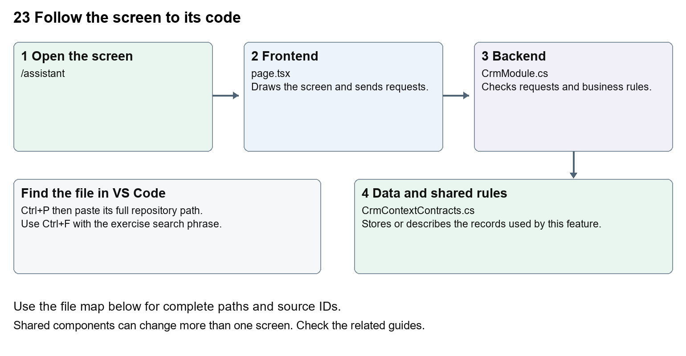

# Nexora AI assistant connection

Document 23 of the Nexora learning guides  
Source snapshot 13 October 2026 at 17:12 UTC


Understand the NexOrchestr AI page, its configured iframe and CRM context endpoint.

### Recognise the screen and its scope

Open `/assistant`. CRM routes use port 3017; member routes use 3018; public website routes can use 3019. Brackets name a route parameter, not text to paste into a browser. Choose a real record or site id from the application.

This guide covers Signed-in assistant page; Configured external application URL; Allowed URL schemes; Iframe sandbox and referrer policy; CRM context boundary; Unavailable state.



The diagram shows the file roles. The full paths below are what you paste into Ctrl+P.

### Find the files in VS Code

| Role | File and source ID | What it does |
| --- | --- | --- |
| Screen | S0013 page.tsx | Main UI or route for this topic |
| Server | S0249 CrmModule.cs | Endpoints or server rules |
| Data | S0201 CrmContextContracts.cs | Data shape or persistence structure |

**Screen S0013**  
[apps/web/src/app/(platform)/assistant/page.tsx](<D:/Projects new/Nexora/apps/web/src/app/(platform)/assistant/page.tsx>)

**Server S0249**  
[backend/src/Modules/Nexora.Modules.Crm/CrmModule.cs](<D:/Projects new/Nexora/backend/src/Modules/Nexora.Modules.Crm/CrmModule.cs>)

**Data S0201**  
[backend/src/BuildingBlocks/Nexora.BuildingBlocks/Security/CrmContextContracts.cs](<D:/Projects new/Nexora/backend/src/BuildingBlocks/Nexora.BuildingBlocks/Security/CrmContextContracts.cs>)

The complete HTML manual opens these source IDs inside its Source library. The Word manual shows short labelled extracts so you can learn the flow before reading large files. Each individual Markdown guide includes its complete primary files after the walkthrough.

### Follow the request and the records

1. The route checks the staff session.
2. It reads NEXORCHESTR_APP_URL on the server.
3. A valid allowed URL becomes an iframe source.
4. Without valid configuration the page shows an unavailable message.
5. CRM context is exposed through an authorised endpoint, rather than unrestricted database access.

### Read the code with an explanation

The repository page is a connection shell. The AI application itself is not implemented by this iframe file. URL validation rejects embedded credentials and restricts schemes. Its sandbox specifies browser capabilities. The CRM context endpoint is a separate API boundary; embedding a page does not automatically authorise it to access Nexora records.

Source reference S0013 apps/web/src/app/(platform)/assistant/page.tsx

Selected opening lines with their original numbers. The complete file is in the HTML source library.

```tsx
0001  import { EntityHeading } from "@/components/ui/entity-heading";
0002  import { requireSession } from "@/lib/auth/session";
0004  export default async function AssistantPage() {
0005    await requireSession();
0006    const configuredUrl = process.env.NEXORCHESTR_APP_URL;
0007    let appUrl: string | null = null;
```


The import lines lead to shared components and helpers. Start at the exported component or route function; follow the request helper to the server rather than assuming the whole feature lives in this file.

Source reference S0249 backend/src/Modules/Nexora.Modules.Crm/CrmModule.cs

Extract from source line 47. A fragment from a long line is shown without the rest of that line.

```cs
0047          var api = endpoints.MapGroup("/api/v1/crm").WithTags("CRM").RequireAuthorization("crm.read");
```


On the server, look for MapGet to load records, MapPost to create or perform an action, MapPut or MapPatch to change data, and RequireAuthorization for permissions. Some shared methods register endpoints indirectly. Find SaveChangesAsync to see the database write. A request method alone does not tell you every side effect.

Source reference S0201 backend/src/BuildingBlocks/Nexora.BuildingBlocks/Security/CrmContextContracts.cs

Selected opening lines with their original numbers. The complete file is in the HTML source library.

```cs
0001  namespace Nexora.BuildingBlocks.Security;
0002  public sealed record CrmContextItem(Guid Id, string Label, string Status, DateTime AtUtc, string Url);
0003  public sealed record CrmContextSection(string Title, int Total, IReadOnlyList<CrmContextItem> Items);
0004  public interface ICrmContextProvider
0005  {
0006      string[] Permissions { get; }
```


Follow model fields to their request names and database mapping. An id points to a particular record. A tenant id limits the organisation. A version or concurrency stamp protects newer edits. Some model files describe contracts rather than tables; check the owning DbContext before assuming storage.

### Make or trace your first change

1. Press Ctrl+P and open [apps/web/src/app/(platform)/assistant/page.tsx](<D:/Projects new/Nexora/apps/web/src/app/(platform)/assistant/page.tsx>).
2. Press Ctrl+F and search for `The AI assistant is not connected yet. Contact your administrator to enable it.`. In this snapshot it appears at line 33.
3. Replace only the unavailable-state sentence. Inspect /assistant without adding an external URL. This wording change should not enable any provider.
4. Replace only `The AI assistant is not connected yet. Contact your administrator to enable it.` with `The AI assistant is awaiting connection. Ask your administrator to configure it.` in that intended location. Keep quotes, tags, JSON keys and routes intact.
5. Save with Ctrl+S. Inspect Problems and the local screen. Review the diff and restore the original text when you finish practising.

Extract from source line 33. A fragment from a long line is shown without the rest of that line.

```tsx
0033            The AI assistant is not connected yet. Contact your administrator to enable it.
```


These exercises have not been applied to the application. Their search phrases are verified against the captured source. Line numbers can move; the phrase and file path are your main navigation aids.

### Check a change and diagnose problems

Confirm the original screen still loads, the changed words appear in the intended place, and another screen using the same component still behaves correctly. If an action fails, inspect the browser Network response, the relevant helper and server validation message. Use the common error table at the beginning of the manual. Reload on a version conflict instead of removing the version check.

A syntax error after a text edit usually means a quote, brace or closing tag changed. Compare your diff with the original. An unchanged browser result can mean the wrong port, a saved published configuration overriding a default, or a running API that has not reloaded.

### Understand the current limits

A complete AI service, model configuration and provider behaviour cannot be inferred from this route. The configured external URL and its service availability need separate verification.

### Continue learning

Related guides [03 Nexora workspace navigation and theme](#guide_03), [05 Nexora CRM contacts](#guide_05), [20 Nexora administration and access](#guide_20), [22 Nexora workflow designer and runtime](#guide_22).

## Complete primary source files

These are the complete captured files, with numbered source lines. Other supporting files are included in the complete HTML manual. Configured local passwords, if any, are explicitly omitted. Do not paste the display line numbers into code.

### S0013 page.tsx

[apps/web/src/app/(platform)/assistant/page.tsx](<D:/Projects new/Nexora/apps/web/src/app/(platform)/assistant/page.tsx>)

SHA256 `425bbe8c0fd597f6ff703ae09f4732e0328ed2defdbf19ef50614e6bcd9c0af5`; 38 source lines; complete captured text.

```tsx
0001  import { EntityHeading } from "@/components/ui/entity-heading";
0002  import { requireSession } from "@/lib/auth/session";
0003  
0004  export default async function AssistantPage() {
0005    await requireSession();
0006    const configuredUrl = process.env.NEXORCHESTR_APP_URL;
0007    let appUrl: string | null = null;
0008    if (configuredUrl) {
0009      try {
0010        const url = new URL(configuredUrl);
0011        if ((url.protocol === "https:" || (process.env.NODE_ENV !== "production" && url.protocol === "http:")) && !url.username && !url.password) {
0012          appUrl = url.href;
0013        }
0014      } catch { /* Render the unavailable state for invalid configuration. */ }
0015    }
0016  
0017    return (
0018      <main className="space-y-4 p-5 sm:p-8">
0019        <header>
0020          <EntityHeading>NexOrchestr AI</EntityHeading>
0021          <p className="mt-2 text-sm text-slate-600">Ask your AI team to research, compare, review or plan.</p>
0022        </header>
0023        {appUrl ? (
0024          <iframe
0025            title="NexOrchestr AI chatbot"
0026            src={appUrl}
0027            className="h-[calc(100dvh-220px)] min-h-[480px] w-full rounded-xl border border-slate-200 bg-white"
0028            sandbox="allow-scripts allow-same-origin allow-forms"
0029            referrerPolicy="no-referrer"
0030          />
0031        ) : (
0032          <p role="status" className="rounded-xl border border-slate-200 bg-white p-6 text-slate-700">
0033            The AI assistant is not connected yet. Contact your administrator to enable it.
0034          </p>
0035        )}
0036      </main>
0037    );
0038  }
```

### S0249 CrmModule.cs

[backend/src/Modules/Nexora.Modules.Crm/CrmModule.cs](<D:/Projects new/Nexora/backend/src/Modules/Nexora.Modules.Crm/CrmModule.cs>)

SHA256 `5224194ce2b11eff3d60836a87bc9c58200ba591fc2390f2adefd01ca9793c7e`; 371 source lines; complete captured text.

```cs
0001  using Microsoft.AspNetCore.Authorization;
0002  using Nexora.BuildingBlocks.Documents;
0003  using System.Security.Cryptography;
0004  using Nexora.BuildingBlocks.Reporting;
0005  using Nexora.BuildingBlocks.Persistence;
0006  using System.ComponentModel.DataAnnotations;
0007  using Microsoft.AspNetCore.Antiforgery;
0008  using Microsoft.AspNetCore.Builder;
0009  using Microsoft.AspNetCore.Http;
0010  using Microsoft.AspNetCore.Routing;
0011  using Microsoft.EntityFrameworkCore;
0012  using Microsoft.Extensions.Configuration;
0013  using Microsoft.Extensions.DependencyInjection;
0014  using Nexora.BuildingBlocks.Security;
0015  using Nexora.Modules.Crm.Contracts;
0016  using Nexora.Modules.Crm.Domain;
0017  using Nexora.Modules.Crm.Infrastructure;
0018  
0019  namespace Nexora.Modules.Crm;
0020  
0021  public static partial class CrmModule
0022  {
0023      public static IServiceCollection AddNexoraCrm(this IServiceCollection services, IConfiguration configuration)
0024      {
0025          AddWorkflowInspections(services);
0026          foreach(var operation in new[]{"create","update","archive"})services.AddScoped<IWorkflowActionHandler>(sp=>new WorkflowRecordAction(sp.GetRequiredService<CrmDbContext>(),sp.GetRequiredService<IIdentityDirectory>(),sp.GetRequiredService<IRequestIdentity>(),operation));
0027          services.AddScoped<ICrmDirectory, CrmDirectory>();
0028          services.AddScoped<IMemberProfileDirectory, MemberProfileDirectory>();
0029          services.AddScoped<IPortalOnboardingCrm, PortalOnboardingCrm>();
0030          services.AddDbContext<CrmDbContext>((sp,o)=>o.AddInterceptors(sp.GetRequiredService<WorkflowCaptureInterceptor>()).UseSqlServer(configuration.GetConnectionString("Nexora"),
0031              sql => sql.MigrationsHistoryTable("__EFMigrationsHistory", "crm")));
0032          services.AddScoped<IReportDataset>(sp=>new ReportDataset("contacts","Contacts","crm.read",sp.GetRequiredService<CrmDbContext>().Set<CrmRecord>().AsNoTracking().Where(x=>x.Kind=="contact"&&!x.IsArchived).Select(x=>new ReportRow{Id=x.Id,Label=x.Name,Status=x.Status,CreatedAtUtc=x.CreatedAtUtc})));
0033  
0034          services.AddWorkflowEntity<CrmDbContext,CrmRecord>("contacts","Contacts","crm.read","Name",x=>x.Kind=="contact"&&!x.IsArchived,"Kind","contact",new WorkflowRelation("profile","contact-profiles","id","recordId",false),new WorkflowRelation("socialProfiles","contact-social-profiles","id","recordId",true),new WorkflowRelation("profiles","profile-assignments","id","recordId",true));
0035          services.AddWorkflowEntity<CrmDbContext,CrmRecord>("accounts","Accounts","crm.read","Name",x=>x.Kind=="account"&&!x.IsArchived,"Kind","account",new WorkflowRelation("profile","account-profiles","id","recordId",false),new WorkflowRelation("profiles","profile-assignments","id","recordId",true));
0036          services.AddWorkflowEntity<CrmDbContext,ContactProfile>("contact-profiles","Contact profiles","crm.read","RecordId",null,null,null);
0037          services.AddWorkflowEntity<CrmDbContext,RecordProfileAssignment>("profile-assignments","Assigned profiles","crm.read","Slot",null,null,null,new WorkflowRelation("definition","profile-definitions","definitionId","id",false));
0038          services.AddWorkflowEntity<CrmDbContext,ProfileDefinition>("profile-definitions","Profile definitions","crm.read","ChildNode",null,null,null);
0039          services.AddWorkflowEntity<CrmDbContext,ContactSocialProfile>("contact-social-profiles","Contact social profiles","crm.read","Identifier",null,null,null);
0040          services.AddWorkflowEntity<CrmDbContext,AccountProfile>("account-profiles","Account profiles","crm.read","RecordId",null,null,null);
0041          services.AddWorkflowEntity<CrmDbContext,CommunicationMethod>("communications","Communications","crm.read","Value",null,null,null,new WorkflowRelation("record","contacts","recordId","id",false));
0042          services.AddWorkflowEntity<CrmDbContext,AccountContact>("account-contacts","Organisation relationships","crm.read","JobTitle",null,null,null,new WorkflowRelation("account","accounts","accountId"),new WorkflowRelation("contact","contacts","contactId"));
0043          return services;
0044      }
0045      public static IEndpointRouteBuilder MapNexoraCrm(this IEndpointRouteBuilder endpoints)
0046      {
0047          var api = endpoints.MapGroup("/api/v1/crm").WithTags("CRM").RequireAuthorization("crm.read");
0048          api.AddEndpointFilter(async (context, next) =>
0049          {
0050              context.HttpContext.Response.Headers.CacheControl = "no-store";
0051              try
0052              {
0053                  if (!HttpMethods.IsGet(context.HttpContext.Request.Method))
0054                      await context.HttpContext.RequestServices.GetRequiredService<IAntiforgery>().ValidateRequestAsync(context.HttpContext);
0055                  return await next(context);
0056              }
0057              catch (AntiforgeryValidationException) { return Results.Problem(statusCode: 400, title: "The security token is invalid or expired."); }
0058              catch (ValidationException ex) { return Results.ValidationProblem(new Dictionary<string, string[]> { ["request"] = [ex.Message] }); }
0059              catch (KeyNotFoundException) { return Results.NotFound(); }
0060              catch (DbUpdateConcurrencyException) { return Results.Problem(statusCode: 409, title: "This record changed. Reload it before saving again."); }
0061              catch (CrmBoundaryException) { return Results.Forbid(); }
0062              catch (TenantBoundaryException) { return Results.Forbid(); }
0063              catch (DbUpdateException) { return Results.Problem(statusCode: 409, title: "The change conflicts with existing data. Reload and check related records."); }
0064          });
0065          api.MapGet("/attribute-entities", () => new[] { "contact", "account" });
0066          api.MapGet("/directory", (IIdentityDirectory directory, CancellationToken ct) => directory.GetAsync(ct));
0067          api.MapAccountContacts();
0068          MapCompletion(api);
0069          MapProfiles(api);
0070          MapProfileTaxonomy(api);
0071          MapRecordPresentation(api);
0072          Automations.Map<CrmDbContext>(api, "crm.manage", kind => kind is "contact" or "account" ? typeof(CrmRecord) : null, (db, kind, ct) => db.AutomationFieldsAsync(kind, ct));
0073          // Legacy query-string tokens did not enforce current user permissions.
0074          // Fail closed until the assistant has a scoped, revocable integration identity.
0075          endpoints.MapGet("/api/v1/assistant/crm-context", (HttpContext http) =>
0076          {
0077              http.Response.Headers.CacheControl = "no-store";
0078              return Results.Problem(statusCode: 503, title: "Assistant CRM access is disabled.");
0079          }).RequireAuthorization("crm.read").WithTags("Assistant");
0080          api.MapGet("/records", ListAsync);
0081          api.MapGet("/records/{id:guid}", DetailAsync);
0082          api.MapPost("/records", CreateAsync).RequireAuthorization("crm.manage");
0083          api.MapPatch("/records/{id:guid}", UpdateAsync).RequireAuthorization("crm.manage");
0084          api.MapPost("/records/{id:guid}/archive", (Guid id, TransitionRequest request, CrmDbContext db, IRequestIdentity who, HttpContext http, CancellationToken ct) => TransitionAsync(id, request, true, db, who, http, ct)).RequireAuthorization("crm.manage");
0085          api.MapPost("/records/{id:guid}/restore", (Guid id, TransitionRequest request, CrmDbContext db, IRequestIdentity who, HttpContext http, CancellationToken ct) => TransitionAsync(id, request, false, db, who, http, ct)).RequireAuthorization("crm.manage");
0086          api.MapGet("/records/{id:guid}/timeline", async (Guid id, CrmDbContext db, int? page, CancellationToken ct) =>
0087          {
0088              await RecordAsync(db, id, ct);
0089              var offset = Math.Clamp(page ?? 1, 1, 10000);
0090              return Results.Ok(await db.Set<Activity>().Where(x => x.RecordId == id).OrderByDescending(x => x.CreatedAtUtc).ThenBy(x => x.Id).Skip((offset - 1) * 50).Take(50).ToListAsync(ct));
0091          });
0092          MapAddresses(api);
0093          MapCommunications(api);
0094          api.MapPost("/records/{id:guid}/relationships", async (Guid id, RelationshipRequest r, CrmDbContext db, IRequestIdentity who, HttpContext http, CancellationToken ct) =>
0095          {
0096              var target = await RecordAsync(db, r.TargetRecordId, ct, true);
0097              if (target.Id == id) throw new ValidationException("Choose a different related record.");
0098              return await AddChildAsync(id, new RecordRelationship { TargetRecordId = target.Id, Label = Required(r.Label, 100) }, "relationship.added", db, who, http, ct);
0099          }).RequireAuthorization("crm.manage");
0100          api.MapPost("/records/{id:guid}/notes", async (Guid id, NoteRequest r, CrmDbContext db, IRequestIdentity who, HttpContext http, CancellationToken ct) =>
0101              await AddChildAsync(id, new Note { Body = Required(r.Body, 4000), ActorUserId = who.UserId!.Value }, "note.added", db, who, http, ct)).RequireAuthorization("crm.manage");
0102          api.MapPost("/records/{id:guid}/tags", async (Guid id, TagRequest r, CrmDbContext db, IRequestIdentity who, HttpContext http, CancellationToken ct) =>
0103              await AddChildAsync(id, new RecordTag { Name = Required(r.Name, 80).ToLowerInvariant() }, "tag.added", db, who, http, ct)).RequireAuthorization("crm.manage");
0104          api.MapDelete("/records/{id:guid}/{collection}/{childId:guid}", DeleteChildAsync).RequireAuthorization("crm.manage");
0105          api.MapPost("/records/{id:guid}/files", UploadAsync).RequireAuthorization("crm.manage", "crm.files");
0106          api.MapGet("/records/{id:guid}/files/{fileId:guid}", async (Guid id, Guid fileId, CrmDbContext db, HttpContext http, CancellationToken ct) =>
0107          {
0108              await RecordAsync(db, id, ct);
0109              var file = await db.Set<RecordFile>().SingleOrDefaultAsync(x => x.RecordId == id && x.Id == fileId, ct) ?? throw new KeyNotFoundException();
0110              if (file.ScanStatus != "clean" || file.Sha256 != Convert.ToHexString(SHA256.HashData(file.Content))) throw new ValidationException("This file is unavailable until its security scan passes.");
0111              return DocumentSafety.Download(http, file.Name, file.Content);
0112          }).RequireAuthorization("crm.files");
0113          api.MapGet("/fields", async (CrmDbContext db, CancellationToken ct) => await db.Set<CustomFieldDefinition>().OrderBy(x => x.DisplayOrder).ThenBy(x => x.Name).ToListAsync(ct));
0114          api.MapPost("/fields", async (FieldRequest r, CrmDbContext db, IRequestIdentity who, CancellationToken ct) =>
0115          {
0116              Choice(r.Kind, "contact", "account"); Choice(r.DataType, "text", "number", "boolean", "date");
0117              if (await db.Set<CustomFieldDefinition>().CountAsync(ct) >= 50) throw new ValidationException("A tenant can define up to 50 CRM fields.");
0118              var field = new CustomFieldDefinition { TenantId = who.TenantId!.Value, Name = Required(r.Name, 80), Kind = r.Kind, DataType = r.DataType, Section = AutomationCatalog.FieldSection(r.Kind, r.Section) };
0119              field.DisplayOrder = (await db.Set<CustomFieldDefinition>().Where(x => x.Kind == r.Kind).MaxAsync(x => (int?)x.DisplayOrder, ct) ?? -1) + 1;
0120              db.Add(field); await db.SaveChangesAsync(ct); return Results.Ok(field);
0121          }).RequireAuthorization("crm.configure");
0122          api.MapDelete("/fields/{id:guid}", async (Guid id, CrmDbContext db, IRequestIdentity who, CancellationToken ct) =>
0123          {
0124              var field = await db.Set<CustomFieldDefinition>().SingleOrDefaultAsync(x => x.Id == id && x.TenantId == who.TenantId, ct) ?? throw new KeyNotFoundException();
0125              db.RemoveRange(await db.Set<CustomFieldValue>().Where(x => x.DefinitionId == id).ToListAsync(ct));
0126              db.Remove(field); await db.SaveChangesAsync(ct); return Results.NoContent();
0127          }).RequireAuthorization("crm.configure");
0128          api.MapPatch("/fields/{id:guid}", async (Guid id, FieldRequest r, CrmDbContext db, CancellationToken ct) =>
0129          {
0130              var field = await db.Set<CustomFieldDefinition>().SingleOrDefaultAsync(x => x.Id == id, ct) ?? throw new KeyNotFoundException();
0131              Choice(r.DataType, "text", "number", "boolean", "date");
0132              if (r.Kind != field.Kind) throw new ValidationException("The entity type cannot change.");
0133              if (r.DataType != field.DataType && await db.Set<CustomFieldValue>().AnyAsync(x => x.DefinitionId == id, ct))
0134                  throw new ValidationException("The data type cannot change while this attribute has saved values.");
0135              field.Name = Required(r.Name, 80); field.DataType = r.DataType;
0136              field.Section = AutomationCatalog.FieldSection(field.Kind, r.Section ?? field.Section);
0137              await db.SaveChangesAsync(ct); return Results.Ok(field);
0138          }).RequireAuthorization("crm.configure");
0139          api.MapPut("/fields/order", async (FieldOrderRequest r, CrmDbContext db, CancellationToken ct) =>
0140          {
0141              Choice(r.Kind, "contact", "account");
0142              var fields = await db.Set<CustomFieldDefinition>().Where(x => x.Kind == r.Kind).ToListAsync(ct);
0143              if (r.Ids == null || r.Ids.Length != fields.Count || r.Ids.Distinct().Count() != fields.Count || fields.Any(x => !r.Ids.Contains(x.Id)))
0144                  throw new ValidationException("Reload attributes and include each field exactly once.");
0145              foreach (var field in fields) field.DisplayOrder = Array.IndexOf(r.Ids, field.Id);
0146              await db.SaveChangesAsync(ct); return Results.NoContent();
0147          }).RequireAuthorization("crm.configure");
0148          api.MapPut("/records/{id:guid}/fields/{fieldId:guid}", SetFieldAsync).RequireAuthorization("crm.manage");
0149          api.MapGet("/views", async (string? kind, CrmDbContext db, CancellationToken ct) =>
0150          {
0151              if (kind != null) Choice(kind, "contact", "account");
0152              return Results.Ok(await db.Set<SavedView>().Where(x => kind == null || x.Kind == kind).OrderBy(x => x.Name).ThenBy(x => x.Id).ToListAsync(ct));
0153          });
0154          api.MapGet("/views/{id:guid}", async (Guid id, CrmDbContext db, CancellationToken ct) =>
0155              Results.Ok(await db.Set<SavedView>().SingleOrDefaultAsync(x => x.Id == id, ct) ?? throw new KeyNotFoundException()));
0156          api.MapPost("/views", async (ViewRequest r, CrmDbContext db, IRequestIdentity who, CancellationToken ct) =>
0157          {
0158              var row = new SavedView { TenantId = who.TenantId!.Value, UserId = who.UserId!.Value };
0159              await ApplyViewAsync(row, r, db, ct);
0160              db.Add(row); await db.SaveChangesAsync(ct); return Results.Ok(row);
0161          });
0162          api.MapPut("/views/{id:guid}", async (Guid id, ViewRequest r, CrmDbContext db, CancellationToken ct) =>
0163          {
0164              var row = await db.Set<SavedView>().SingleOrDefaultAsync(x => x.Id == id, ct) ?? throw new KeyNotFoundException();
0165              if (row.Kind != r.Kind) throw new ValidationException("A saved view cannot change record type.");
0166              await ApplyViewAsync(row, r, db, ct);
0167              await db.SaveChangesAsync(ct); return Results.Ok(row);
0168          });
0169          api.MapDelete("/views/{id:guid}", async (Guid id, CrmDbContext db, CancellationToken ct) =>
0170          {
0171              var row = await db.Set<SavedView>().SingleOrDefaultAsync(x => x.Id == id, ct) ?? throw new KeyNotFoundException();
0172              db.Remove(row); await db.SaveChangesAsync(ct); return Results.NoContent();
0173          });
0174          return endpoints;
0175      }
0176  
0177      private static async Task ApplyViewAsync(SavedView row, ViewRequest r, CrmDbContext db, CancellationToken ct)
0178      {
0179          Choice(r.Kind, "contact", "account"); await CrmListingSorting.ValidateAsync(db, r.Kind, r.Sort, ct); Choice(r.Status, "", "active", "prospect", "inactive", "lapsed");
0180          var columns = Required(r.Columns, 4000).Split(',');
0181          if (columns.Length > 54 || columns.Distinct().Count() != columns.Length || !columns.Contains("name"))
0182              throw new ValidationException("Choose up to 54 distinct columns, including Name.");
0183          var definitions = await db.Set<CustomFieldDefinition>().Where(x => x.Kind == r.Kind).Select(x => x.Id).ToListAsync(ct);
0184          foreach (var column in columns)
0185          {
0186              if (column is "name" or "status" or "category" or "updatedAtUtc") continue;
0187              if (!column.StartsWith("field:") || !Guid.TryParse(column[6..], out var id) || !definitions.Contains(id))
0188                  throw new ValidationException("A selected custom field is unavailable for this record type. Reload the columns and try again.");
0189          }
0190          row.Name = Required(r.Name, 80); row.Kind = r.Kind; row.Search = Optional(r.Search, 160) ?? "";
0191          row.Status = r.Status; row.Sort = r.Sort; row.Archived = r.Archived; row.Columns = string.Join(',', columns);
0192          row.OwnerUserId = r.OwnerUserId; row.OwnerTeamId = r.OwnerTeamId; row.Category = Optional(r.Category, 100);
0193      }
0194  
0195      private static async Task<IResult> ListAsync(CrmDbContext db, IEnumerable<ICrmContextProvider> providers, Microsoft.AspNetCore.Authorization.IAuthorizationService auth, HttpContext http, string? kind, string? search, string? status, string? sort, bool? archived, int? page, int? pageSize, string? ownerUserId, string? ownerTeamId, string? category, CancellationToken ct)
0196      {
0197          kind ??= "contact"; sort ??= "name";
0198          Choice(kind, "contact", "account");
0199          if (!string.IsNullOrEmpty(status)) Choice(status, "active", "prospect", "inactive", "lapsed");
0200          var term = Optional(search, 160);
0201          var query = db.Records.AsNoTracking().Where(x => x.Kind == kind && x.IsArchived == (archived ?? false));
0202          var connectedIds = new HashSet<Guid>();
0203          if (!string.IsNullOrEmpty(term))
0204          {
0205              foreach (var provider in providers)
0206              {
0207                  var allowed = true;
0208                  foreach (var permission in provider.Permissions) if (!(await auth.AuthorizeAsync(http.User, null, permission)).Succeeded) { allowed = false; break; }
0209                  if (allowed) connectedIds.UnionWith(await provider.SearchRecordIdsAsync(term, kind, ct));
0210                  if (connectedIds.Count > 1000) throw new ValidationException("This connected search is too broad. Use a more specific term.");
0211              }
0212          }
0213          if (!string.IsNullOrEmpty(term)) query = query.Where(x => connectedIds.Contains(x.Id) || x.Name.Contains(term) || db.Set<CommunicationMethod>().Any(c => c.RecordId == x.Id && c.Value.Contains(term)) || db.Set<RecordTag>().Any(t => t.RecordId == x.Id && t.Name.Contains(term)) || (from assignment in db.Set<RecordProfileAssignment>() join definition in db.Set<ProfileDefinition>() on assignment.DefinitionId equals definition.Id where assignment.RecordId == x.Id && (definition.ParentNode.Contains(term) || definition.ChildNode.Contains(term)) select assignment.Id).Any() || db.Set<CustomFieldValue>().Any(v => v.RecordId == x.Id && v.TextValue != null && v.TextValue.Contains(term)));
0214          if (!string.IsNullOrEmpty(status)) query = query.Where(x => x.Status == status);
0215          static Guid? OwnerFilter(string? value) => string.IsNullOrEmpty(value) ? null : Guid.TryParse(value, out var id) ? id : throw new ValidationException("Invalid owner filter.");
0216          var userFilter = OwnerFilter(ownerUserId); var teamFilter = OwnerFilter(ownerTeamId);
0217          if (userFilter.HasValue) query = query.Where(x => x.OwnerUserId == userFilter);
0218          if (teamFilter.HasValue) query = query.Where(x => x.OwnerTeamId == teamFilter);
0219          var categoryFilter = Optional(category, 100);
0220          if (categoryFilter != null) query = query.Where(x => x.Category == categoryFilter);
0221          var count = await query.CountAsync(ct);
0222          var ordered = await CrmListingSorting.ApplyAsync(query, db, kind, sort, ct);
0223          var number = Math.Clamp(page ?? 1, 1, 10000); var size = Math.Clamp(pageSize ?? 20, 1, 100);
0224          var rows = await ordered.ThenBy(x => x.Id).Skip((number - 1) * size).Take(size).ToListAsync(ct);
0225          var ids = rows.Select(x => x.Id).ToArray();
0226          var values = await db.Set<CustomFieldValue>().AsNoTracking().Where(x => ids.Contains(x.RecordId)).ToListAsync(ct);
0227          var items = rows.Select(row => new { row.Id, row.Kind, row.Name, row.Status, row.Category, row.OwnerUserId, row.OwnerTeamId, row.IsArchived, row.Version, row.UpdatedAtUtc, CustomFields = values.Where(v => v.RecordId == row.Id) });
0228          return Results.Ok(new { items, total = count, page = number, pageSize = size });
0229      }
0230      private static async Task<IResult> DetailAsync(Guid id, CrmDbContext db, CancellationToken ct)
0231      {
0232          var record = await RecordAsync(db, id, ct);
0233          var addresses = await db.Set<Address>().Where(x => x.RecordId == id).ToListAsync(ct);
0234          return Results.Ok(new
0235          {
0236              record,
0237              contactDetails = record.Kind == "contact" ? await RecordProfileFields.ContactAsync(db, id, ct) : null,
0238              generalInformation = record.Kind == "contact" ? await RecordProfileFields.GeneralInformationAsync(db, id, ct) : null,
0239              communicationPermissions = record.Kind == "contact" ? await RecordProfileFields.CommunicationPermissionsAsync(db, id, ct) : null,
0240              socialMediaDetails = record.Kind == "contact" ? await ContactSocialFields.ReadAsync(db, id, ct) : null,
0241              accountDetails = record.Kind == "account" ? await RecordProfileFields.AccountAsync(db, id, ct) : null,
0242              accountGeneralInformation = record.Kind == "account" ? await RecordProfileFields.AccountGeneralInformationAsync(db, id, ct) : null,
0243              addresses,
0244              effectiveBillingAddress = addresses.SingleOrDefault(x => x.Purpose == (record.BillingUsesMailingAddress ? "mailing" : "billing")),
0245              communications = await db.Set<CommunicationMethod>().Where(x => x.RecordId == id).ToListAsync(ct),
0246              relationships = await (from link in db.Set<RecordRelationship>() join target in db.Records on link.TargetRecordId equals target.Id where link.RecordId == id select new { link.Id, link.Label, link.TargetRecordId, target.Name }).ToListAsync(ct),
0247              notes = await db.Set<Note>().Where(x => x.RecordId == id).OrderByDescending(x => x.CreatedAtUtc).ToListAsync(ct),
0248              tags = await db.Set<RecordTag>().Where(x => x.RecordId == id).OrderBy(x => x.Name).ToListAsync(ct),
0249              profiles = await (from assignment in db.Set<RecordProfileAssignment>() join definition in db.Set<ProfileDefinition>() on assignment.DefinitionId equals definition.Id
0250                  where assignment.RecordId == id orderby assignment.Slot
0251                  select new { assignment.Slot, assignment.DefinitionId, definition.ParentNode, definition.ChildNode, definition.IsArchived }).ToListAsync(ct),
0252              files = await db.Set<RecordFile>().Where(x => x.RecordId == id).Select(x => new { x.Id, x.Name, x.CreatedAtUtc, x.Version, x.ScanStatus, x.ScannedAtUtc }).ToListAsync(ct),
0253              fields = await db.Set<CustomFieldValue>().Where(x => x.RecordId == id).ToListAsync(ct)
0254          });
0255      }
0256      private static async Task<IResult> CreateAsync(RecordRequest r, CrmDbContext db, IIdentityDirectory directory, IRequestIdentity who, HttpContext http, CancellationToken ct)
0257      {
0258          await ValidateAsync(r, directory, ct);
0259          var row = new CrmRecord { TenantId = who.TenantId!.Value, Kind = r.Kind };
0260          Apply(row, r); db.Add(row); Audit(db, who, http, row.Id, "record.created");
0261          await ApplyAttributesAsync(row, r.Attributes, db, ct);
0262          await db.SaveChangesAsync(ct); return Results.Created($"/api/v1/crm/records/{row.Id}", row);
0263      }
0264      private static async Task<IResult> UpdateAsync(Guid id, RecordRequest r, CrmDbContext db, IIdentityDirectory directory, IRequestIdentity who, HttpContext http, CancellationToken ct)
0265      {
0266          var row = await RecordAsync(db, id, ct, true);
0267          if (r.Version != row.Version) return Conflict();
0268          if (r.Kind != row.Kind) throw new ValidationException("Record type cannot change.");
0269          await ValidateAsync(r, directory, ct); Apply(row, r);
0270          await ApplyAttributesAsync(row, r.Attributes, db, ct);
0271          Audit(db, who, http, id, "record.updated"); await db.SaveChangesAsync(ct); return Results.Ok(row);
0272      }
0273      private static async Task<IResult> TransitionAsync(Guid id, TransitionRequest r, bool archived, CrmDbContext db, IRequestIdentity who, HttpContext http, CancellationToken ct)
0274      {
0275          var row = await RecordAsync(db, id, ct);
0276          if (r.Version != row.Version) return Conflict();
0277          row.IsArchived = archived; row.Version = Guid.NewGuid(); row.UpdatedAtUtc = DateTime.UtcNow;
0278          Audit(db, who, http, id, archived ? "record.archived" : "record.restored");
0279          await db.SaveChangesAsync(ct); return Results.Ok(row);
0280      }
0281      private static async Task<IResult> AddChildAsync<T>(Guid id, T row, string action, CrmDbContext db, IRequestIdentity who, HttpContext http, CancellationToken ct) where T : RecordChild
0282      {
0283          var parent = await RecordAsync(db, id, ct, true);
0284          parent.Version = Guid.NewGuid(); parent.UpdatedAtUtc = DateTime.UtcNow;
0285          if (await db.Set<T>().CountAsync(x => x.RecordId == id, ct) >= 100) throw new ValidationException("This record has reached the limit of 100 items in this section.");
0286          row.RecordId = id; row.TenantId = who.TenantId!.Value; db.Add(row);
0287          Audit(db, who, http, id, action); await db.SaveChangesAsync(ct);
0288          return Results.Ok(new { row.Id });
0289      }
0290      private static async Task<IResult> DeleteChildAsync(Guid id, string collection, Guid childId, CrmDbContext db, IRequestIdentity who, HttpContext http, CancellationToken ct)
0291      {
0292          var parent = await RecordAsync(db, id, ct, true);
0293          parent.Version = Guid.NewGuid(); parent.UpdatedAtUtc = DateTime.UtcNow;
0294          RecordChild? row = collection switch
0295          {
0296              "addresses" => await db.Set<Address>().SingleOrDefaultAsync(x => x.Id == childId && x.RecordId == id, ct),
0297              "communications" => await db.Set<CommunicationMethod>().SingleOrDefaultAsync(x => x.Id == childId && x.RecordId == id, ct),
0298              "relationships" => await db.Set<RecordRelationship>().SingleOrDefaultAsync(x => x.Id == childId && x.RecordId == id, ct),
0299              "tags" => await db.Set<RecordTag>().SingleOrDefaultAsync(x => x.Id == childId && x.RecordId == id, ct),
0300              _ => null
0301          };
0302          if (row == null) throw new KeyNotFoundException();
0303          if (row is Address { Purpose: "mailing" } && parent.BillingUsesMailingAddress)
0304              throw new ValidationException("Turn off billing same as mailing before removing the mailing address.");
0305          db.Remove(row); Audit(db, who, http, id, collection + ".removed"); await db.SaveChangesAsync(ct); return Results.NoContent();
0306      }
0307      private static async Task<IResult> UploadAsync(Guid id, CrmDbContext db, IRequestIdentity who, HttpContext http, IDocumentScanner scanner, CancellationToken ct)
0308      {
0309          var parent = await RecordAsync(db, id, ct, true);
0310          var upload = await DocumentSafety.ReadAsync(http.Request, ct);
0311          var form = await http.Request.ReadFormAsync(ct);
0312          if (!Guid.TryParse(form["version"], out var version) || version != parent.Version) return Conflict();
0313          return await AddChildAsync(id, new RecordFile { Name = upload.Name, Content = upload.Content, Sha256 = Convert.ToHexString(SHA256.HashData(upload.Content)), ScanStatus = await scanner.ScanAsync(upload.Content, ct), ScannedAtUtc = DateTime.UtcNow }, "file.added", db, who, http, ct);
0314      }
0315      private static async Task<IResult> SetFieldAsync(Guid id, Guid fieldId, ValueRequest r, CrmDbContext db, IRequestIdentity who, HttpContext http, CancellationToken ct)
0316      {
0317          var record = await RecordAsync(db, id, ct, true);
0318          var definition = await db.Set<CustomFieldDefinition>().SingleOrDefaultAsync(x => x.Id == fieldId && x.Kind == record.Kind, ct) ?? throw new KeyNotFoundException();
0319          if ((r.TextValue != null && definition.DataType != "text") || (r.NumberValue != null && definition.DataType != "number") || (r.BooleanValue != null && definition.DataType != "boolean") || (r.DateValue != null && definition.DataType != "date")) throw new ValidationException("The value does not match the field type.");
0320          if (r.NumberValue is decimal n && ((n >= 100000000000000m || n <= -100000000000000m) || decimal.Round(n, 4) != n)) throw new ValidationException("Use at most 14 integer digits and 4 decimal places.");
0321          var row = await db.Set<CustomFieldValue>().SingleOrDefaultAsync(x => x.RecordId == id && x.DefinitionId == fieldId, ct);
0322          if (row == null) { row = new CustomFieldValue { TenantId = who.TenantId!.Value, RecordId = id, DefinitionId = fieldId }; db.Add(row); }
0323          record.Version = Guid.NewGuid(); record.UpdatedAtUtc = DateTime.UtcNow;
0324          row.TextValue = Optional(r.TextValue, 500); row.NumberValue = r.NumberValue; row.BooleanValue = r.BooleanValue; row.DateValue = r.DateValue;
0325          Audit(db, who, http, id, "custom-field.updated"); await db.SaveChangesAsync(ct); return Results.Ok(row);
0326      }
0327      private static async Task ApplyAttributesAsync(CrmRecord record, Dictionary<Guid, ValueRequest>? values, CrmDbContext db, CancellationToken ct)
0328      {
0329          if (values == null) return;
0330          if (values.Count > 50) throw new ValidationException("Too many attribute values.");
0331          var definitions = await db.Set<CustomFieldDefinition>().Where(x => x.Kind == record.Kind).ToListAsync(ct);
0332          var existing = await db.Set<CustomFieldValue>().Where(x => x.RecordId == record.Id).ToListAsync(ct);
0333          foreach (var (id, value) in values)
0334          {
0335              var definition = definitions.SingleOrDefault(x => x.Id == id) ?? throw new ValidationException("An attribute was removed or is unavailable. Reload the form.");
0336              if (value == null || (value.TextValue != null && definition.DataType != "text") || (value.NumberValue != null && definition.DataType != "number") || (value.BooleanValue != null && definition.DataType != "boolean") || (value.DateValue != null && definition.DataType != "date"))
0337                  throw new ValidationException("The value does not match the field type.");
0338              if (value.NumberValue is decimal n && (n >= 100000000000000m || n <= -100000000000000m || decimal.Round(n, 4) != n))
0339                  throw new ValidationException("Use at most 14 integer digits and 4 decimal places.");
0340              var row = existing.SingleOrDefault(x => x.DefinitionId == id);
0341              if (row == null) { row = new CustomFieldValue { TenantId = record.TenantId, RecordId = record.Id, DefinitionId = id }; db.Add(row); }
0342              row.TextValue = Optional(value.TextValue, 500); row.NumberValue = value.NumberValue; row.BooleanValue = value.BooleanValue; row.DateValue = value.DateValue;
0343          }
0344      }
0345      private static async Task ValidateAsync(RecordRequest r, IIdentityDirectory directory, CancellationToken ct)
0346      {
0347          Choice(r.Kind, "contact", "account"); Choice(r.Status, "active", "prospect", "inactive", "lapsed"); Required(r.Name, 160); Optional(r.Category, 100);
0348          if (!await directory.IsValidOwnerAsync(r.OwnerUserId, r.OwnerTeamId, ct)) throw new ValidationException("Choose an active owner and team from your tenant.");
0349      }
0350      private static void Apply(CrmRecord row, RecordRequest r)
0351      {
0352          row.Name = r.Name.Trim(); row.Status = r.Status; row.Category = Optional(r.Category, 100); row.OwnerUserId = r.OwnerUserId; row.OwnerTeamId = r.OwnerTeamId;
0353          row.Version = Guid.NewGuid(); row.UpdatedAtUtc = DateTime.UtcNow;
0354      }
0355      private static async Task<CrmRecord> RecordAsync(CrmDbContext db, Guid id, CancellationToken ct, bool active = false)
0356      {
0357          var row = await db.Records.SingleOrDefaultAsync(x => x.Id == id, ct) ?? throw new KeyNotFoundException();
0358          if (active && row.IsArchived) throw new ValidationException("Restore this archived record before changing it.");
0359          return row;
0360      }
0361      private static void Audit(CrmDbContext db, IRequestIdentity who, HttpContext http, Guid id, string action) => db.Add(new Activity
0362      { TenantId = who.TenantId!.Value, RecordId = id, ActorUserId = who.UserId!.Value, Action = action, CorrelationId = http.TraceIdentifier });
0363      private static IResult Conflict() => Results.Problem(statusCode: 409, title: "This record changed. Reload it before saving again.");
0364      private static void Choice(string? value, params string[] allowed) { if (value == null || !allowed.Contains(value)) throw new ValidationException("Unsupported choice: " + value); }
0365      private static string Required(string? value, int max) => Optional(value, max) ?? throw new ValidationException("A required field is empty.");
0366      private static string? Optional(string? value, int max)
0367      {
0368          if (value?.Length > max) throw new ValidationException($"Use at most {max} characters.");
0369          return string.IsNullOrWhiteSpace(value) ? null : value.Trim();
0370      }
0371  }
```

### S0201 CrmContextContracts.cs

[backend/src/BuildingBlocks/Nexora.BuildingBlocks/Security/CrmContextContracts.cs](<D:/Projects new/Nexora/backend/src/BuildingBlocks/Nexora.BuildingBlocks/Security/CrmContextContracts.cs>)

SHA256 `751e226729a9f7c5912f67a500eaec233a1365ea1f8e2aecb02efaf9ab193f81`; 9 source lines; complete captured text.

```cs
0001  namespace Nexora.BuildingBlocks.Security;
0002  public sealed record CrmContextItem(Guid Id, string Label, string Status, DateTime AtUtc, string Url);
0003  public sealed record CrmContextSection(string Title, int Total, IReadOnlyList<CrmContextItem> Items);
0004  public interface ICrmContextProvider
0005  {
0006      string[] Permissions { get; }
0007      Task<Guid[]> SearchRecordIdsAsync(string term, string kind, CancellationToken ct) => Task.FromResult(Array.Empty<Guid>());
0008      Task<IReadOnlyList<CrmContextSection>> ReadAsync(Guid recordId, string kind, CancellationToken ct);
0009  }
```
