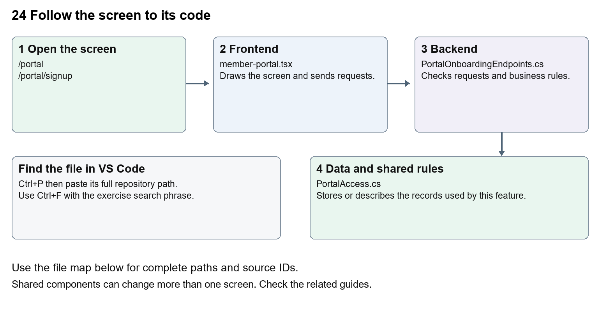

# Nexora member portal login and onboarding

Document 24 of the Nexora learning guides  
Source snapshot 14 October 2026 at 06:41 UTC


Understand member sign-in, optional self-registration and organisation access requests.

### Recognise the screen and its scope

Open `/portal`, `/portal/signup`. CRM routes use port 3017; member routes use 3018; public website routes can use 3019. Brackets name a route parameter, not text to paste into a browser. Choose a real record or site id from the application.

This guide covers Member login and logout; Published sign-in branding; Optional self-registration; Association host mapping; Contact and personal portal access creation; Company access requests and staff review.



The diagram shows the file roles. The full paths below are what you paste into Ctrl+P.

### Find the files in VS Code

| Role | File and source ID | What it does |
| --- | --- | --- |
| Screen | S0123 member-portal.tsx | Main UI or route for this topic |
| Server | S0402 PortalOnboardingEndpoints.cs | Endpoints or server rules |
| Data | S0376 PortalAccess.cs | Data shape or persistence structure |

**Screen S0123**  
[apps/web/src/features/portal/member-portal.tsx](<D:/Projects new/Nexora/apps/web/src/features/portal/member-portal.tsx>)

**Server S0402**  
[backend/src/Modules/Nexora.Modules.Identity/PortalOnboardingEndpoints.cs](<D:/Projects new/Nexora/backend/src/Modules/Nexora.Modules.Identity/PortalOnboardingEndpoints.cs>)

**Data S0376**  
[backend/src/Modules/Nexora.Modules.Identity/Domain/PortalAccess.cs](<D:/Projects new/Nexora/backend/src/Modules/Nexora.Modules.Identity/Domain/PortalAccess.cs>)

The complete HTML manual opens these source IDs inside its Source library. The Word manual shows short labelled extracts so you can learn the flow before reading large files. Each individual Markdown guide includes its complete primary files after the walkthrough.

### Follow the request and the records

1. PortalLayout preserves the member shell while the route changes.
2. The page loads public appearance and onboarding availability for its mapped association host.
3. Login or enabled registration uses the portal API helper and portal CSRF endpoint.
4. The Identity module creates or checks permitted member access.
5. Company access is requested and reviewed separately from personal membership.

### Read the code with an explanation

Staff and member sessions have separate purposes and access checks. Self-registration is governed by published onboarding settings and host mapping. A new personal profile does not immediately grant membership or company authority. Organisation requests can be reviewed by staff, who can create the relevant relationship and explicit grant. Failed or late requests are guarded so they do not restore an expired session.

Source reference S0123 apps/web/src/features/portal/member-portal.tsx

Selected opening lines with their original numbers. The complete file is in the HTML source library.

```tsx
0001  "use client";
0002  import { useCallback, useEffect, useRef, useState } from "react";
0003  import { MemberDashboard } from "./member-dashboard";
0004  import { defaultPresentation, defaultPortalDesign, portalDesignStyle, type PortalPresentation } from "./presentation";
0005  import styles from "./portal.module.css";
0006  import { portal } from "./api";
```


The import lines lead to shared components and helpers. Start at the exported component or route function; follow the request helper to the server rather than assuming the whole feature lives in this file.

Source reference S0402 backend/src/Modules/Nexora.Modules.Identity/PortalOnboardingEndpoints.cs

Extract from source line 29. A fragment from a long line is shown without the rest of that line.

```cs
0029          portal.MapGet("/onboarding", async (IPortalRegistrationDirectory directory, CancellationToken ct) =>
```


On the server, look for MapGet to load records, MapPost to create or perform an action, MapPut or MapPatch to change data, and RequireAuthorization for permissions. Some shared methods register endpoints indirectly. Find SaveChangesAsync to see the database write. A request method alone does not tell you every side effect.

Source reference S0376 backend/src/Modules/Nexora.Modules.Identity/Domain/PortalAccess.cs

Selected opening lines with their original numbers. The complete file is in the HTML source library.

```cs
0001  namespace Nexora.Modules.Identity.Domain;
0003  // Explicit access grant. CRM relationships and email addresses never imply this grant.
0004  public sealed class PortalAccess
0005  {
0006      public Guid Id { get; set; } = Guid.NewGuid();
0007      public Guid TenantId { get; set; }
```


Follow model fields to their request names and database mapping. An id points to a particular record. A tenant id limits the organisation. A version or concurrency stamp protects newer edits. Some model files describe contracts rather than tables; check the owning DbContext before assuming storage.

### Make or trace your first change

1. Press Ctrl+P and open [apps/web/src/features/portal/member-portal.tsx](<D:/Projects new/Nexora/apps/web/src/features/portal/member-portal.tsx>).
2. Press Ctrl+F and search for `Welcome to your member portal`. In this snapshot it appears at line 88.
3. Change this fallback sign-in heading only. Refresh /portal while signed out. Use CRM settings for stored branding; this source change affects the hardcoded heading.
4. Replace only `Welcome to your member portal` with `Welcome to your community portal` in that intended location. Keep quotes, tags, JSON keys and routes intact.
5. Save with Ctrl+S. Inspect Problems and the local screen. Review the diff and restore the original text when you finish practising.

Extract from source line 88. A fragment from a long line is shown without the rest of that line.

```tsx
0088  gningUp ? "Join your community" : "Welcome to your member portal"}</h1>
```


These exercises have not been applied to the application. Their search phrases are verified against the captured source. Line numbers can move; the phrase and file path are your main navigation aids.

### Check a change and diagnose problems

Confirm the original screen still loads, the changed words appear in the intended place, and another screen using the same component still behaves correctly. If an action fails, inspect the browser Network response, the relevant helper and server validation message. Use the common error table at the beginning of the manual. Reload on a version conflict instead of removing the version check.

A syntax error after a text edit usually means a quote, brace or closing tag changed. Compare your diff with the original. An unchanged browser result can mean the wrong port, a saved published configuration overriding a default, or a running API that has not reloaded.

### Understand the current limits

Current local portal identity is Development-only. Production identity, email verification and password recovery remain future scope. New registration requires enabled published settings and a correctly mapped association domain.

### Continue learning

Related guides [01 Nexora login page](#guide_01), [20 Nexora administration and access](#guide_20), [25 Nexora member portal journeys](#guide_25), [26 Nexora portal management](#guide_26).

## Complete primary source files

These are the complete captured files, with numbered source lines. Other supporting files are included in the complete HTML manual. Configured local passwords, if any, are explicitly omitted. Do not paste the display line numbers into code.

### S0123 member-portal.tsx

[apps/web/src/features/portal/member-portal.tsx](<D:/Projects new/Nexora/apps/web/src/features/portal/member-portal.tsx>)

SHA256 `d62b2f5b7e3fb6802b5011a45323c19c2875770f04534d9275e9f008cb3c21bf`; 151 source lines; complete captured text.

```tsx
0001  "use client";
0002  import { useCallback, useEffect, useRef, useState } from "react";
0003  import { MemberDashboard } from "./member-dashboard";
0004  import { defaultPresentation, defaultPortalDesign, portalDesignStyle, type PortalPresentation } from "./presentation";
0005  import styles from "./portal.module.css";
0006  import { portal } from "./api";
0007  import { ApplicationWorkspace } from "./application-workspace";
0008  import Link from "next/link";
0009  import type { Route } from "next";
0010  import { useRouter } from "next/navigation";
0011  import { ApplicationReceipt } from "./application-receipt";
0012  import { NotificationInbox } from "./notification-inbox";
0013  import { ContactNameFields, emptyContactDetails, type ContactDetails } from "../shared/profile-fields";
0014  import { OrganisationWorkspace } from "./organisation-workspace";
0015  
0016  type PostalAddress = { line1: string; line2: string; city: string; region: string; postalCode: string; country: string };
0017  const emptyAddress: PostalAddress = { line1: "", line2: "", city: "", region: "", postalCode: "", country: "" };
0018  type Profile = { contactDetails: ContactDetails | null; name: string; version: string; postalAddress: PostalAddress | null };
0019  type Overview = { memberships: { id: string; product: string; status: string; startsAtUtc: string; endsAtUtc: string }[]; applications: { id: string; product: string; status: string; createdAtUtc: string }[] };
0020  const input = "mt-2 w-full rounded-lg border border-slate-300 bg-white px-4 py-3 text-slate-900";
0021  const button = "portal-action rounded-full bg-[var(--portal-brand,#183a31)] px-6 py-3 font-semibold text-white disabled:opacity-50";
0022  export const portalSections = { dashboard: "Dashboard", memberships: "My memberships", applications: "My applications", organisations: "My organisations", profile: "My profile", notifications: "Notifications" } as const;
0023  export type PortalSection = keyof typeof portalSections;
0024  export function MemberPortal({ applicationId, accountId, section = "dashboard" }: { applicationId?: string; accountId?: string; section?: string }) {
0025    const router = useRouter();
0026    const [allowRegistration, setAllowRegistration] = useState(false);
0027    const signingUp = section === "signup" && allowRegistration;
0028    const activeSection = applicationId ? accountId ? "organisations" : "applications" : section;
0029    const routeKey = `${section}/${applicationId ?? ""}/${accountId ?? ""}`;
0030    const [presentation, setPresentation] = useState<PortalPresentation>(defaultPresentation);
0031    const [publicPresentation, setPublicPresentation] = useState<PortalPresentation>(defaultPresentation);
0032    const customPage = presentation.pages.find(p => p.slug === section);
0033    const sectionLabel = presentation.menu.find(m => m.key === section)?.label ?? "Page unavailable";
0034    const [profile, setProfile] = useState<Profile | null>(null);
0035    const [name, setName] = useState("");
0036    const [contactDetails, setContactDetails] = useState<ContactDetails>(emptyContactDetails);
0037    const [address, setAddress] = useState<PostalAddress>(emptyAddress);
0038    const [ready, setReady] = useState(false);
0039    const [busy, setBusy] = useState(false);
0040    const [error, setError] = useState("");
0041    const [message, setMessage] = useState("");
0042    const [overviewVersion, setOverviewVersion] = useState(0);
0043    const hadSession = useRef(false);
0044    const sessionRevision = useRef(0);
0045    const profileVersion = useRef<string | undefined>(undefined);
0046    const applyProfile = useCallback((current: Profile) => {
0047      // Rechecking access must not overwrite edits with an unchanged profile.
0048      if (profileVersion.current !== current.version) {
0049        setName(current.name); setAddress(current.postalAddress ?? emptyAddress); setContactDetails(current.contactDetails ?? emptyContactDetails);
0050      }
0051      profileVersion.current = current.version;
0052      setProfile(current);
0053    }, []);
0054    async function load() {
0055      const revision = sessionRevision.current;
0056      const [current, config] = await Promise.all([portal<Profile>("/profile"), portal<PortalPresentation>("/configuration")]);
0057      if (sessionRevision.current !== revision) return;
0058      setPresentation(config); hadSession.current = true; profileVersion.current = undefined; applyProfile(current);
0059    }
0060    useEffect(() => {
0061      let active = true;
0062      const revision = sessionRevision.current;
0063      const expired = () => { sessionRevision.current++; setProfile(null); profileVersion.current = undefined; setPresentation(defaultPresentation); setName(""); setMessage(""); if (hadSession.current) setError("Sign in with an account that has active member access."); hadSession.current = false; };
0064      window.addEventListener("portal-session-expired", expired);
0065      const appearance = fetch("/api/v1/public/portal-appearance", { cache: "no-store" }).then(async response => response.ok ? response.json() as Promise<Partial<PortalPresentation>> : null).then(value => { if (active && value) setPublicPresentation({ ...defaultPresentation, ...value }); }).catch(() => { /* Unmapped hosts retain the default sign-in branding. */ });
0066      const onboarding = portal<{ allowSelfRegistration: boolean }>("/onboarding").then(value => { if (active) setAllowRegistration(value.allowSelfRegistration); }).catch(() => { if (active) setAllowRegistration(false); });
0067      const member = Promise.all([portal<Profile>("/profile"), portal<PortalPresentation>("/configuration")]).then(([p, config]) => { if (active && sessionRevision.current === revision) { setPresentation(config); hadSession.current = true; applyProfile(p); } })
0068        .catch(e => { if (active && e.status !== 401) setError(e.message); });
0069      void Promise.all([appearance, member, onboarding]).finally(() => { if (active) setReady(true); });
0070      return () => { active = false; window.removeEventListener("portal-session-expired", expired); };
0071    }, [routeKey, applyProfile]);
0072    async function action(work: () => Promise<void>) {
0073      setBusy(true); setError(""); setMessage("");
0074      try { await work(); } catch (e) {
0075        setError(e instanceof Error ? e.message : "Unable to complete the request.");
0076        if ((e as { status?: number }).status === 401) setProfile(null);
0077      } finally { setBusy(false); }
0078    }
0079    const visiblePresentation = profile ? presentation : publicPresentation;
0080    const design = { ...defaultPortalDesign, ...visiblePresentation.design };
0081    return <div style={portalDesignStyle(design, visiblePresentation.brandColor)} data-theme={design.theme} data-motion={design.motionEnabled} className={`${styles.portal} min-h-screen bg-[#f7f7f2] text-[var(--portal-brand,#183a31)]`}>
0082      <a href="#portal-main" className="sr-only focus:not-sr-only focus:block focus:p-4">Skip to main content</a>
0083      <header className="portal-header border-b border-[var(--portal-brand,#183a31)]/15 px-6 py-6 print:hidden"><div className="mx-auto flex max-w-5xl items-center justify-between gap-4"><Link href="/portal" className="text-xl font-semibold"><span aria-hidden className="portal-brand-mark">{visiblePresentation.name.slice(0, 1)}</span>{visiblePresentation.name}</Link>{profile && <button disabled={busy} className="underline" onClick={() => void action(async () => { await portal("/logout", "POST"); sessionRevision.current++; hadSession.current = false; profileVersion.current = undefined; setProfile(null); setPresentation(defaultPresentation); setName(""); })}>Sign out</button>}</div>
0084        {profile && <nav aria-label="Member navigation" className="portal-navigation mx-auto mt-5 flex max-w-5xl flex-wrap gap-x-6 gap-y-3 text-sm font-semibold">{presentation.menu.filter(m => m.visible).map(({ key, label }) => <Link key={key} href={(key === "dashboard" ? "/portal" : `/portal/${key}`) as Route} aria-current={activeSection === key ? "page" : undefined} className={`rounded-full px-4 py-2 transition-colors ${activeSection === key ? "bg-[var(--portal-brand,#183a31)] text-white" : "hover:bg-[var(--portal-brand,#183a31)]/10"}`}>{label}</Link>)}</nav>}
0085      </header>
0086      <main id="portal-main" className="mx-auto max-w-5xl px-6 py-10">
0087        <p className="portal-tagline text-sm font-semibold uppercase tracking-widest">{visiblePresentation.tagline}</p>
0088        <h1 className="mt-4 break-words text-3xl font-semibold sm:text-4xl">{profile ? applicationId ? "Your application" : customPage?.title ?? sectionLabel : signingUp ? "Join your community" : "Welcome to your member portal"}</h1>
0089        {profile && !applicationId && section === "dashboard" && <p className="mt-4 max-w-2xl leading-7 text-slate-600">Welcome back, {profile.name}. {presentation.welcomeText}</p>}
0090        {error && <p role="alert" className="mt-6 rounded-xl bg-red-50 p-4 text-red-900">{error}</p>}
0091        {message && <p role="status" className="mt-6 rounded-xl bg-emerald-50 p-4">{message}</p>}
0092        {!ready ? <p role="status" className="mt-8">Loading your portal…</p> : !profile ? <section className="portal-sign-in mt-8 max-w-lg rounded-2xl border border-slate-200 bg-white p-7"><div className="portal-sign-in-card">
0093          <h2 className="text-2xl font-semibold">{signingUp ? "Create your account" : "Sign in"}</h2><p className="mt-3 text-sm text-slate-600">{signingUp ? "Create your member profile, apply for membership and request access to your company. Membership and company access are reviewed separately." : "Sign in to manage your profile, membership applications and organisations."}</p>
0094          <p className="mt-3 text-xs text-slate-500">Local development portal. Email verification and password recovery are not available yet.</p>
0095          <form key={signingUp ? "signup" : "signin"} className="mt-6 space-y-5" onSubmit={e => { e.preventDefault(); const data = new FormData(e.currentTarget); void action(async () => {
0096            if (signingUp) {
0097              if (data.get("password") !== data.get("confirmPassword")) throw new Error("Passwords must match.");
0098              await portal("/register", "POST", { firstName: data.get("firstName"), lastName: data.get("lastName"), email: data.get("email"), password: data.get("password") });
0099            } else await portal("/login", "POST", { email: data.get("email"), password: data.get("password"), rememberMe: false });
0100            await load(); router.replace("/portal");
0101          }); }}>
0102            {signingUp && <div className="grid gap-5 sm:grid-cols-2"><label className="block">First name<input className={input} name="firstName" autoComplete="given-name" maxLength={70} required /></label><label className="block">Last name<input className={input} name="lastName" autoComplete="family-name" maxLength={70} required /></label></div>}
0103            <label className="block">Email<input className={input} name="email" type="email" autoComplete="username" required /></label>
0104            <label className="block">Password<input className={input} name="password" type="password" autoComplete={signingUp ? "new-password" : "current-password"} minLength={signingUp ? 12 : undefined} maxLength={128} required /></label>
0105            {signingUp && <><p className="text-sm text-slate-500">Use 12–128 characters with uppercase, lowercase, a number and a symbol.</p><label className="block">Confirm password<input className={input} name="confirmPassword" type="password" autoComplete="new-password" minLength={12} maxLength={128} required /></label></>}
0106            <button className={button} disabled={busy}>{busy ? signingUp ? "Creating account…" : "Signing in…" : signingUp ? "Create account" : "Sign in"}</button>
0107        </form>{allowRegistration && <p className="mt-6 text-sm">{signingUp ? "Already have an account? " : "New to the community? "}<Link className="font-semibold underline" href={signingUp ? "/portal" : "/portal/signup"}>{signingUp ? "Sign in" : "Create an account"}</Link></p>}</div><div className="portal-sign-in-art" aria-hidden><span>{visiblePresentation.name.slice(0, 1)}</span></div></section> : applicationId ? <div className="mt-8"><ApplicationReceipt key={`${applicationId}/${accountId ?? ""}`} id={applicationId} accountId={accountId} /></div> : <div key={routeKey} className="mt-8 min-w-0 space-y-6">
0108          {section === "dashboard" && <MemberDashboard sections={presentation.dashboardSections} />}
0109          {customPage && <article className="rounded-2xl border border-slate-200 bg-white p-7"><p className="whitespace-pre-wrap break-words leading-8">{customPage.body}</p></article>}
0110          {!customPage && !(section in portalSections) && <p>This page is not currently available. Choose a section from the menu.</p>}
0111          {section === "profile" && <>
0112          <section id="profile" className="min-w-0 scroll-mt-6 rounded-2xl border border-slate-200 bg-white p-7"><h2 className="text-2xl font-semibold">My profile</h2><p className="mt-3 text-sm text-slate-600">Your name and correspondence address are shared with the membership team. This address is member supplied. Leave all address fields blank to remove it.</p>
0113            <form className="mt-6 space-y-5" onSubmit={e => { e.preventDefault(); void action(async () => { const updated = await portal<Profile>("/profile", "PUT", { name, version: profile.version, contactDetails, postalAddress: Object.values(address).some(v => v.trim()) ? address : null }); setProfile(updated); setName(updated.name); setAddress(updated.postalAddress ?? emptyAddress); setContactDetails(updated.contactDetails ?? emptyContactDetails); setMessage("Your profile has been saved."); }); }}>
0114              <label className="block">Display name<input className={input} value={name} onChange={e => setName(e.target.value)} required maxLength={160} /></label>
0115              <ContactNameFields value={contactDetails} onChange={setContactDetails} disabled={busy} inputClass={input} />
0116              <fieldset className="space-y-4"><legend className="font-semibold">Correspondence address</legend>{([
0117                ["line1", "Address line 1"], ["line2", "Address line 2"], ["city", "City"], ["region", "Region"], ["postalCode", "Postal code"], ["country", "Country"],
0118              ] as const).map(([key, label]) => <label key={key} className="block">{label}<input className={input} value={address[key] ?? ""} maxLength={160} onChange={e => setAddress(current => ({ ...current, [key]: e.target.value }))} /></label>)}</fieldset>
0119              <div className="flex flex-wrap gap-4"><button className={button} disabled={busy}>Save profile</button><button type="button" className="underline" disabled={busy} onClick={() => void action(load)}>Reload profile</button></div>
0120            </form></section>
0121          </>}
0122          {section === "applications" && <><MembershipOverview key={overviewVersion} section="applications" /><ApplicationWorkspace onSubmitted={() => setOverviewVersion(n => n + 1)} /></>}
0123          {section === "organisations" && <OrganisationWorkspace allowRequests={presentation.onboarding?.allowOrganisationRequests === true} />}
0124          {section === "notifications" && <NotificationInbox revision={overviewVersion} />}
0125          {section === "memberships" && <MembershipOverview section="memberships" />}
0126        </div>}
0127      </main>
0128    </div>;
0129  }
0130  
0131  function MembershipOverview({ section }: { section: "memberships" | "applications" }) {
0132    const [data, setData] = useState<Overview | null>(null);
0133    const [error, setError] = useState("");
0134    const [attempt, setAttempt] = useState(0);
0135    useEffect(() => {
0136      let current = true;
0137      portal<Overview>("/memberships").then(value => { if (current) { setData(value); setError(""); } })
0138        .catch(e => { if (current) setError(e.message); });
0139      return () => { current = false; };
0140    }, [attempt]);
0141    const date = (value: string) => new Intl.DateTimeFormat("en-GB", { dateStyle: "medium", timeZone: "UTC" }).format(new Date(value));
0142    return <aside id="memberships" className="portal-tinted min-w-0 scroll-mt-6 space-y-6 rounded-2xl bg-[#ddebab] p-7">
0143      <div className="flex flex-wrap items-center justify-between gap-3"><h2 className="text-xl font-semibold">{section === "memberships" ? "Membership details" : "Submitted applications"}</h2><button className="text-sm underline" onClick={() => { setError(""); setData(null); setAttempt(n => n + 1); }}>Refresh details</button></div>
0144      {error ? <div role="alert"><p>{error}</p><button className="mt-3 underline" onClick={() => { setError(""); setData(null); setAttempt(n => n + 1); }}>Try again</button></div> : !data ? <p role="status">Loading membership details…</p> : <>
0145        {section === "memberships" && (data.memberships.length === 0 ? <p className="text-sm">No personal memberships are linked to your profile.</p> : data.memberships.map(m => <article key={m.id} className="portal-subcard rounded-xl bg-white/75 p-4"><h3 className="font-semibold">{m.product}</h3><p className="mt-2 text-sm capitalize">{m.status}</p><p className="mt-2 text-sm">{date(m.startsAtUtc)} – {date(m.endsAtUtc)}</p></article>))}
0146        {section === "applications" && (data.applications.length === 0 ? <p className="text-sm">No personal applications have been submitted.</p> : data.applications.map(a => <article key={a.id} className="portal-subcard rounded-xl bg-white/75 p-4"><h3 className="break-words font-semibold">{a.product}</h3><p className="mt-2 text-sm capitalize">{a.status === "submitted" ? "Awaiting review" : a.status}</p><p className="mt-2 text-sm">Submitted {date(a.createdAtUtc)}</p><Link className="mt-3 inline-block text-sm font-semibold underline" href={`/portal/applications/${a.id}` as Route}>View application receipt<span className="sr-only"> for {a.product}</span></Link></article>))}
0147        <p className="text-xs leading-6">Organisation memberships require separately approved representative access.</p>
0148      </>}
0149    </aside>;
0150  }
0151  
```

### S0402 PortalOnboardingEndpoints.cs

[backend/src/Modules/Nexora.Modules.Identity/PortalOnboardingEndpoints.cs](<D:/Projects new/Nexora/backend/src/Modules/Nexora.Modules.Identity/PortalOnboardingEndpoints.cs>)

SHA256 `c0d0ec74e334b7caed7dd313308bb57a54dc54bdd5936feb19b70b66e4b51fbd`; 169 source lines; complete captured text.

```cs
0001  using System.ComponentModel.DataAnnotations;
0002  using System.Security.Claims;
0003  using System.Text.Json;
0004  using Microsoft.AspNetCore.Authentication;
0005  using Microsoft.AspNetCore.Builder;
0006  using Microsoft.AspNetCore.Http;
0007  using Microsoft.AspNetCore.Identity;
0008  using Microsoft.AspNetCore.Routing;
0009  using Microsoft.EntityFrameworkCore;
0010  using Microsoft.EntityFrameworkCore.Storage;
0011  using Nexora.BuildingBlocks.Security;
0012  using Nexora.Modules.Identity.Domain;
0013  using Nexora.Modules.Identity.Infrastructure.Persistence;
0014  using Nexora.Modules.Identity.Security;
0015  
0016  namespace Nexora.Modules.Identity;
0017  
0018  internal static partial class PortalEndpoints
0019  {
0020      private static bool TextValue(JsonElement body, string name, int max, bool required, out string value, bool multiline = false)
0021      {
0022          value = "";
0023          if (!body.TryGetProperty(name, out var field) || field.ValueKind != JsonValueKind.String) return false;
0024          value = field.GetString()!.Trim();
0025          return value.Length <= max && (!required || value.Length > 0) && !value.Any(c => char.IsControl(c) && !(multiline && c is '\n' or '\r' or '\t'));
0026      }
0027      private static void MapRegistration(RouteGroupBuilder portal)
0028      {
0029          portal.MapGet("/onboarding", async (IPortalRegistrationDirectory directory, CancellationToken ct) =>
0030          {
0031              var site = await directory.ResolveAsync(ct);
0032              return Results.Ok(new { allowSelfRegistration = site?.AllowSelfRegistration == true });
0033          });
0034          portal.MapPost("/register", async (JsonElement body, HttpContext http, IPortalRegistrationDirectory directory,
0035              IPortalOnboardingCrm crm, NexoraIdentityDbContext db, UserManager<NexoraUser> users, CancellationToken ct) =>
0036          {
0037              if (http.User.Identity?.IsAuthenticated == true) return Results.Conflict();
0038              var site = await directory.ResolveAsync(ct);
0039              if (site?.AllowSelfRegistration != true) return Results.NotFound();
0040              if (!Fields(body, "firstName", "lastName", "email", "password") ||
0041                  !TextValue(body, "firstName", 70, true, out var first) || !TextValue(body, "lastName", 70, true, out var last) ||
0042                  !TextValue(body, "email", 254, true, out var email) || !new EmailAddressAttribute().IsValid(email) ||
0043                  body.GetProperty("password").ValueKind != JsonValueKind.String) return Results.BadRequest();
0044              var password = body.GetProperty("password").GetString()!;
0045              if (password.Length is < 12 or > 128) return Results.Problem(statusCode: 400, title: "Use a password of 12–128 characters with uppercase, lowercase, a number and a symbol.");
0046              // Tenant comes only from the trusted host resolver. UserManager needs global
0047              // email uniqueness; no existing CRM contact is claimed by name or email.
0048              using var system = db.BeginSystemAccess();
0049              if (!await db.Tenants.AnyAsync(t => t.Id == site.TenantId && t.Status == TenantStatus.Active, ct)) return Results.NotFound();
0050              await using var transaction = await db.Database.BeginTransactionAsync(ct);
0051              var user = new NexoraUser { Id = Guid.NewGuid(), TenantId = site.TenantId, DisplayName = $"{first} {last}", Email = email, UserName = email };
0052              var created = await users.CreateAsync(user, password);
0053              if (!created.Succeeded) return Results.Problem(statusCode: 400, title: "Unable to create account. Use an unused valid email and a password with uppercase, lowercase, a number and a symbol.");
0054              var contactId = Guid.NewGuid();
0055              await crm.CreateContactAsync(site.TenantId, user.Id, contactId, first, last, email,
0056                  db.Database.GetDbConnection(), transaction.GetDbTransaction(), ct);
0057              var access = new PortalAccess { TenantId = site.TenantId, UserId = user.Id, ContactId = contactId };
0058              db.Add(access);
0059              db.AuditEvents.Add(new AuditEvent { TenantId = site.TenantId, ActorUserId = user.Id, EventType = "portal.member.registered", Outcome = "succeeded", Subject = access.Id.ToString() });
0060              await db.SaveChangesAsync(ct);
0061              await transaction.CommitAsync(ct);
0062              var principal = new ClaimsPrincipal(new ClaimsIdentity([
0063                  new Claim(ClaimTypes.NameIdentifier, user.Id.ToString()), new Claim(NexoraClaimTypes.TenantId, user.TenantId.ToString()),
0064                  new Claim("portal_access", access.Id.ToString()), new Claim("portal_stamp", user.SecurityStamp ?? "")], Scheme));
0065              await http.SignInAsync(Scheme, principal);
0066              return Results.Ok(new { authenticated = true });
0067          }).RequireRateLimiting("portal-registration");
0068      }
0069  
0070      private static object RequestSummary(PortalOrganisationRequest row) => new
0071      {
0072          row.Id, row.OrganisationName, row.JobTitle, row.Message, row.Status, row.Version, row.CreatedAtUtc,
0073          row.DecidedAtUtc, row.DecisionMessage, row.CanSubmitApplications
0074      };
0075      private static int? RequestPage(string? page) => page == null ? 1 : int.TryParse(page, out var number) && number is >= 1 and <= 100000 ? number : null;
0076  
0077      private static void MapOrganisationRequests(RouteGroupBuilder own)
0078      {
0079          own.MapGet("/organisation-requests", async (string? page, HttpContext http, NexoraIdentityDbContext db, CancellationToken ct) =>
0080          {
0081              var number = RequestPage(page); if (number == null) return Results.BadRequest();
0082              var accessId = (Guid)http.Items["portal_access"]!;
0083              var query = db.Set<PortalOrganisationRequest>().AsNoTracking().Where(x => x.PortalAccessId == accessId);
0084              var totalCount = await query.CountAsync(ct);
0085              var rows = await query.OrderByDescending(x => x.CreatedAtUtc).ThenBy(x => x.Id).Skip((number.Value - 1) * 20).Take(20).ToArrayAsync(ct);
0086              return Results.Ok(new { items = rows.Select(RequestSummary), page = number, pageSize = 20, totalCount });
0087          });
0088          own.MapPost("/organisation-requests", async (JsonElement body, HttpContext http, NexoraIdentityDbContext db, IPortalPresentationDirectory presentation, CancellationToken ct) =>
0089          {
0090              if ((await presentation.ReadAsync(ct)).Onboarding?.AllowOrganisationRequests != true) return Results.NotFound();
0091              if (!Fields(body, "organisationName", "jobTitle", "message") || !TextValue(body, "organisationName", 160, true, out var name) ||
0092                  !TextValue(body, "jobTitle", 160, false, out var title) || !TextValue(body, "message", 2000, true, out var message, multiline: true)) return Results.BadRequest();
0093              var accessId = (Guid)http.Items["portal_access"]!;
0094              if (await db.Set<PortalOrganisationRequest>().CountAsync(x => x.PortalAccessId == accessId && x.Status == "pending", ct) >= 10)
0095                  return Results.Problem(statusCode: 400, title: "You already have 10 requests awaiting review.");
0096              var normalized = name.ToUpperInvariant();
0097              if (await db.Set<PortalOrganisationRequest>().AnyAsync(x => x.PortalAccessId == accessId && x.Status == "pending" && x.NormalizedName == normalized, ct))
0098                  return Results.Problem(statusCode: 409, title: "You already have a pending request for this company.");
0099              var row = new PortalOrganisationRequest { TenantId = Guid.Parse(http.User.FindFirstValue(NexoraClaimTypes.TenantId)!),
0100                  PortalAccessId = accessId, OrganisationName = name, NormalizedName = normalized, JobTitle = title, Message = message };
0101              db.Add(row);
0102              db.AuditEvents.Add(new AuditEvent { TenantId = row.TenantId, ActorUserId = Guid.Parse(http.User.FindFirstValue(ClaimTypes.NameIdentifier)!),
0103                  EventType = "portal.organisation.requested", Outcome = "succeeded", Subject = row.Id.ToString() });
0104              await db.SaveChangesAsync(ct);
0105              return Results.Ok(RequestSummary(row));
0106          });
0107          own.MapPost("/organisation-requests/{id:guid}/cancel", async (Guid id, JsonElement body, HttpContext http, NexoraIdentityDbContext db, CancellationToken ct) =>
0108          {
0109              if (!Fields(body, "version") || !GuidValue(body, "version", out var version)) return Results.BadRequest();
0110              var accessId = (Guid)http.Items["portal_access"]!;
0111              var row = await db.Set<PortalOrganisationRequest>().SingleOrDefaultAsync(x => x.Id == id && x.PortalAccessId == accessId, ct);
0112              if (row == null) return Results.NotFound();
0113              if (row.Version != version || row.Status != "pending") return Results.Conflict();
0114              row.Status = "cancelled"; row.Version = Guid.NewGuid(); row.DecidedAtUtc = DateTime.UtcNow;
0115              db.AuditEvents.Add(new AuditEvent { TenantId = row.TenantId, ActorUserId = Guid.Parse(http.User.FindFirstValue(ClaimTypes.NameIdentifier)!),
0116                  EventType = "portal.organisation.request.cancelled", Outcome = "succeeded", Subject = row.Id.ToString() });
0117              await db.SaveChangesAsync(ct); return Results.NoContent();
0118          });
0119      }
0120  
0121      private static void MapOrganisationRequestReview(RouteGroupBuilder grants)
0122      {
0123          grants.MapGet("/organisation-requests", async (string? page, NexoraIdentityDbContext db, IMemberProfileDirectory contacts, CancellationToken ct) =>
0124          {
0125              var number = RequestPage(page); if (number == null) return Results.BadRequest();
0126              var query = db.Set<PortalOrganisationRequest>().AsNoTracking();
0127              var totalCount = await query.CountAsync(ct);
0128              var rows = await query.OrderBy(x => x.Status != "pending").ThenByDescending(x => x.CreatedAtUtc).ThenBy(x => x.Id)
0129                  .Skip((number.Value - 1) * 20).Take(20).ToArrayAsync(ct);
0130              var items = new List<object>();
0131              foreach (var row in rows)
0132              {
0133                  var access = await db.PortalAccess.AsNoTracking().SingleAsync(x => x.Id == row.PortalAccessId, ct);
0134                  var user = await db.Users.AsNoTracking().SingleAsync(x => x.Id == access.UserId, ct);
0135                  items.Add(new { request = RequestSummary(row), contactId = access.ContactId, contactName = (await contacts.ReadAsync(access.ContactId, ct))?.Name,
0136                      email = user.Email, accessIsActive = !access.IsRevoked && user.IsActive });
0137              }
0138              return Results.Ok(new { items, page = number, pageSize = 20, totalCount });
0139          });
0140          grants.MapPost("/organisation-requests/{id:guid}/decision", async (Guid id, JsonElement body, NexoraIdentityDbContext db,
0141              IRequestIdentity who, IPortalOnboardingCrm crm, CancellationToken ct) =>
0142          {
0143              if (!Fields(body, "version", "decision", "accountId", "canSubmitApplications", "decisionMessage") || !GuidValue(body, "version", out var version) ||
0144                  !TextValue(body, "decision", 20, true, out var decision) || decision is not ("approved" or "rejected") ||
0145                  !TextValue(body, "decisionMessage", 1000, false, out var message, multiline: true) || body.GetProperty("canSubmitApplications").ValueKind is not (JsonValueKind.True or JsonValueKind.False)) return Results.BadRequest();
0146              Guid accountId = default;
0147              if (decision == "approved" ? !GuidValue(body, "accountId", out accountId) : body.GetProperty("accountId").ValueKind != JsonValueKind.Null || body.GetProperty("canSubmitApplications").GetBoolean()) return Results.BadRequest();
0148              var row = await db.Set<PortalOrganisationRequest>().SingleOrDefaultAsync(x => x.Id == id, ct);
0149              if (row == null) return Results.NotFound();
0150              if (row.Version != version || row.Status != "pending") return Results.Conflict();
0151              var access = await db.PortalAccess.SingleOrDefaultAsync(x => x.Id == row.PortalAccessId, ct);
0152              if (access == null || (decision == "approved" && (access.IsRevoked || !await db.Users.AnyAsync(x => x.Id == access.UserId && x.IsActive, ct)))) return Results.NotFound();
0153              await using var transaction = await db.Database.BeginTransactionAsync(ct);
0154              if (decision == "approved")
0155              {
0156                  if (await db.Set<PortalOrganisationGrant>().AnyAsync(x => x.PortalAccessId == access.Id && x.AccountId == accountId && !x.IsRevoked, ct))
0157                      return Results.Problem(statusCode: 409, title: "This member already has access to that organisation. Review their existing grant.");
0158                  await crm.AssociateAsync(who.TenantId!.Value, who.UserId!.Value, access.ContactId, accountId, row.JobTitle,
0159                      db.Database.GetDbConnection(), transaction.GetDbTransaction(), ct);
0160                  row.AccountId = accountId; row.CanSubmitApplications = body.GetProperty("canSubmitApplications").GetBoolean();
0161                  db.Add(new PortalOrganisationGrant { TenantId = row.TenantId, PortalAccessId = access.Id, AccountId = accountId, CanSubmitApplications = row.CanSubmitApplications });
0162              }
0163              row.Status = decision; row.Version = Guid.NewGuid(); row.DecisionMessage = message; row.DecidedAtUtc = DateTime.UtcNow; row.DecidedBy = who.UserId;
0164              db.AuditEvents.Add(new AuditEvent { TenantId = row.TenantId, ActorUserId = who.UserId, EventType = $"portal.organisation.request.{decision}", Outcome = "succeeded", Subject = row.Id.ToString() });
0165              await db.SaveChangesAsync(ct); await transaction.CommitAsync(ct);
0166              return Results.Ok(RequestSummary(row));
0167          });
0168      }
0169  }
```

### S0376 PortalAccess.cs

[backend/src/Modules/Nexora.Modules.Identity/Domain/PortalAccess.cs](<D:/Projects new/Nexora/backend/src/Modules/Nexora.Modules.Identity/Domain/PortalAccess.cs>)

SHA256 `ac751901cc932ee160d9d47f8d275a3feae3ae9d882385935508294e3e6dc740`; 12 source lines; complete captured text.

```cs
0001  namespace Nexora.Modules.Identity.Domain;
0002  
0003  // Explicit access grant. CRM relationships and email addresses never imply this grant.
0004  public sealed class PortalAccess
0005  {
0006      public Guid Id { get; set; } = Guid.NewGuid();
0007      public Guid TenantId { get; set; }
0008      public Guid UserId { get; set; }
0009      public Guid ContactId { get; set; }
0010      public bool IsRevoked { get; set; }
0011      public DateTime CreatedAtUtc { get; set; } = DateTime.UtcNow;
0012  }
```
