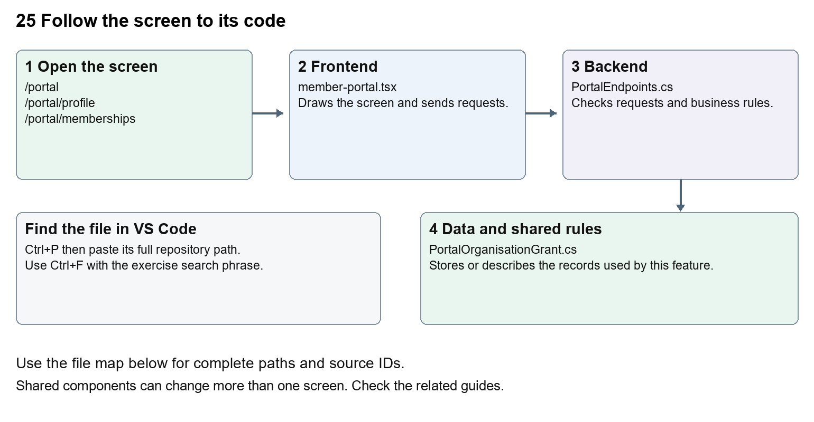

# Nexora member portal journeys

Document 25 of the Nexora learning guides  
Source snapshot 14 October 2026 at 06:41 UTC


Understand the signed-in dashboard, profile, applications, memberships, organisations and inbox.

### Recognise the screen and its scope

Open `/portal`, `/portal/profile`, `/portal/memberships`, `/portal/applications`, `/portal/applications/[id]`, `/portal/organisations`, `/portal/notifications`. CRM routes use port 3017; member routes use 3018; public website routes can use 3019. Brackets name a route parameter, not text to paste into a browser. Choose a real record or site id from the application.

This guide covers Persistent member navigation; Dashboard totals and quick links; Structured profile and correspondence address; Application drafts submission evidence and receipts; Company grants and applications; Member notifications and read state.



The diagram shows the file roles. The full paths below are what you paste into Ctrl+P.

### Find the files in VS Code

| Role | File and source ID | What it does |
| --- | --- | --- |
| Screen | S0123 member-portal.tsx | Main UI or route for this topic |
| Server | S0400 PortalEndpoints.cs | Endpoints or server rules |
| Data | S0377 PortalOrganisationGrant.cs | Data shape or persistence structure |

**Screen S0123**  
[apps/web/src/features/portal/member-portal.tsx](<D:/Projects new/Nexora/apps/web/src/features/portal/member-portal.tsx>)

**Server S0400**  
[backend/src/Modules/Nexora.Modules.Identity/PortalEndpoints.cs](<D:/Projects new/Nexora/backend/src/Modules/Nexora.Modules.Identity/PortalEndpoints.cs>)

**Data S0377**  
[backend/src/Modules/Nexora.Modules.Identity/Domain/PortalOrganisationGrant.cs](<D:/Projects new/Nexora/backend/src/Modules/Nexora.Modules.Identity/Domain/PortalOrganisationGrant.cs>)

The complete HTML manual opens these source IDs inside its Source library. The Word manual shows short labelled extracts so you can learn the flow before reading large files. Each individual Markdown guide includes its complete primary files after the walkthrough.

### Follow the request and the records

1. The shared portal layout chooses the route section.
2. Profile and published presentation establish the signed-in view.
3. The selected component loads only its relevant records.
4. Personal or company requests go through /api/v1/portal with access checks.
5. Saving, submitting or marking read updates the stored record and refreshes the relevant view.

### Read the code with an explanation

Portal routes often return null because the shared layout renders MemberPortal; editing the small route wrapper will not change the visible form. Organisation requests use an explicit accountId and grant check. A profile version prevents overwriting newer changes. sessionRevision and the expiry event keep delayed requests from restoring signed-out data.

Source reference S0123 apps/web/src/features/portal/member-portal.tsx

Selected opening lines with their original numbers. The complete file is in the HTML source library.

```tsx
0001  "use client";
0002  import { useCallback, useEffect, useRef, useState } from "react";
0003  import { MemberDashboard } from "./member-dashboard";
0004  import { defaultPresentation, defaultPortalDesign, portalDesignStyle, type PortalPresentation } from "./presentation";
0005  import styles from "./portal.module.css";
0006  import { portal } from "./api";
```


The import lines lead to shared components and helpers. Start at the exported component or route function; follow the request helper to the server rather than assuming the whole feature lives in this file.

Source reference S0400 backend/src/Modules/Nexora.Modules.Identity/PortalEndpoints.cs

Extract from source line 37. A fragment from a long line is shown without the rest of that line.

```cs
0037          var portal = endpoints.MapGroup("/api/v1/portal").WithTags("Member portal");
```


On the server, look for MapGet to load records, MapPost to create or perform an action, MapPut or MapPatch to change data, and RequireAuthorization for permissions. Some shared methods register endpoints indirectly. Find SaveChangesAsync to see the database write. A request method alone does not tell you every side effect.

Source reference S0377 backend/src/Modules/Nexora.Modules.Identity/Domain/PortalOrganisationGrant.cs

Selected opening lines with their original numbers. The complete file is in the HTML source library.

```cs
0001  namespace Nexora.Modules.Identity.Domain;
0003  // Bound to one access grant, so revoking/replacing a login binding cannot revive delegation.
0004  public sealed class PortalOrganisationGrant
0005  {
0006      public Guid Id { get; set; } = Guid.NewGuid();
0007      public Guid TenantId { get; set; }
```


Follow model fields to their request names and database mapping. An id points to a particular record. A tenant id limits the organisation. A version or concurrency stamp protects newer edits. Some model files describe contracts rather than tables; check the owning DbContext before assuming storage.

### Make or trace your first change

1. Press Ctrl+P and open [apps/web/src/features/portal/member-portal.tsx](<D:/Projects new/Nexora/apps/web/src/features/portal/member-portal.tsx>).
2. Press Ctrl+F and search for `Save profile`. In this snapshot it appears at line 119.
3. Replace only the profile button text. Open /portal/profile and inspect it. Navigate to applications and Back, and check the shared shell remains consistent. Do not submit a real profile change for this exercise.
4. Replace only `Save profile` with `Save my profile` in that intended location. Keep quotes, tags, JSON keys and routes intact.
5. Save with Ctrl+S. Inspect Problems and the local screen. Review the diff and restore the original text when you finish practising.

Extract from source line 119. A fragment from a long line is shown without the rest of that line.

```tsx
0119  className={button} disabled={busy}>Save profile</button><button type="button" className="und
```


These exercises have not been applied to the application. Their search phrases are verified against the captured source. Line numbers can move; the phrase and file path are your main navigation aids.

### Check a change and diagnose problems

Confirm the original screen still loads, the changed words appear in the intended place, and another screen using the same component still behaves correctly. If an action fails, inspect the browser Network response, the relevant helper and server validation message. Use the common error table at the beginning of the manual. Reload on a version conflict instead of removing the version check.

A syntax error after a text edit usually means a quote, brace or closing tag changed. Compare your diff with the original. An unchanged browser result can mean the wrong port, a saved published configuration overriding a default, or a running API that has not reloaded.

### Understand the current limits

Member visibility is limited to their Contact and explicit company grants. Application receipts confirm stored submission, not paid membership. Public website visitors are not automatically created as Contacts.

### Continue learning

Related guides [09 Nexora member records and subscriptions](#guide_09), [10 Nexora membership applications and decisions](#guide_10), [24 Nexora member portal login and onboarding](#guide_24), [26 Nexora portal management](#guide_26), [29 Nexora documents evidence and file safety](#guide_29).

## Complete primary source files

These are the complete captured files, with numbered source lines. Other supporting files are included in the complete HTML manual. Configured local passwords, if any, are explicitly omitted. Do not paste the display line numbers into code.

### S0123 member-portal.tsx

[apps/web/src/features/portal/member-portal.tsx](<D:/Projects new/Nexora/apps/web/src/features/portal/member-portal.tsx>)

SHA256 `d62b2f5b7e3fb6802b5011a45323c19c2875770f04534d9275e9f008cb3c21bf`; 151 source lines; complete captured text.

```tsx
0001  "use client";
0002  import { useCallback, useEffect, useRef, useState } from "react";
0003  import { MemberDashboard } from "./member-dashboard";
0004  import { defaultPresentation, defaultPortalDesign, portalDesignStyle, type PortalPresentation } from "./presentation";
0005  import styles from "./portal.module.css";
0006  import { portal } from "./api";
0007  import { ApplicationWorkspace } from "./application-workspace";
0008  import Link from "next/link";
0009  import type { Route } from "next";
0010  import { useRouter } from "next/navigation";
0011  import { ApplicationReceipt } from "./application-receipt";
0012  import { NotificationInbox } from "./notification-inbox";
0013  import { ContactNameFields, emptyContactDetails, type ContactDetails } from "../shared/profile-fields";
0014  import { OrganisationWorkspace } from "./organisation-workspace";
0015  
0016  type PostalAddress = { line1: string; line2: string; city: string; region: string; postalCode: string; country: string };
0017  const emptyAddress: PostalAddress = { line1: "", line2: "", city: "", region: "", postalCode: "", country: "" };
0018  type Profile = { contactDetails: ContactDetails | null; name: string; version: string; postalAddress: PostalAddress | null };
0019  type Overview = { memberships: { id: string; product: string; status: string; startsAtUtc: string; endsAtUtc: string }[]; applications: { id: string; product: string; status: string; createdAtUtc: string }[] };
0020  const input = "mt-2 w-full rounded-lg border border-slate-300 bg-white px-4 py-3 text-slate-900";
0021  const button = "portal-action rounded-full bg-[var(--portal-brand,#183a31)] px-6 py-3 font-semibold text-white disabled:opacity-50";
0022  export const portalSections = { dashboard: "Dashboard", memberships: "My memberships", applications: "My applications", organisations: "My organisations", profile: "My profile", notifications: "Notifications" } as const;
0023  export type PortalSection = keyof typeof portalSections;
0024  export function MemberPortal({ applicationId, accountId, section = "dashboard" }: { applicationId?: string; accountId?: string; section?: string }) {
0025    const router = useRouter();
0026    const [allowRegistration, setAllowRegistration] = useState(false);
0027    const signingUp = section === "signup" && allowRegistration;
0028    const activeSection = applicationId ? accountId ? "organisations" : "applications" : section;
0029    const routeKey = `${section}/${applicationId ?? ""}/${accountId ?? ""}`;
0030    const [presentation, setPresentation] = useState<PortalPresentation>(defaultPresentation);
0031    const [publicPresentation, setPublicPresentation] = useState<PortalPresentation>(defaultPresentation);
0032    const customPage = presentation.pages.find(p => p.slug === section);
0033    const sectionLabel = presentation.menu.find(m => m.key === section)?.label ?? "Page unavailable";
0034    const [profile, setProfile] = useState<Profile | null>(null);
0035    const [name, setName] = useState("");
0036    const [contactDetails, setContactDetails] = useState<ContactDetails>(emptyContactDetails);
0037    const [address, setAddress] = useState<PostalAddress>(emptyAddress);
0038    const [ready, setReady] = useState(false);
0039    const [busy, setBusy] = useState(false);
0040    const [error, setError] = useState("");
0041    const [message, setMessage] = useState("");
0042    const [overviewVersion, setOverviewVersion] = useState(0);
0043    const hadSession = useRef(false);
0044    const sessionRevision = useRef(0);
0045    const profileVersion = useRef<string | undefined>(undefined);
0046    const applyProfile = useCallback((current: Profile) => {
0047      // Rechecking access must not overwrite edits with an unchanged profile.
0048      if (profileVersion.current !== current.version) {
0049        setName(current.name); setAddress(current.postalAddress ?? emptyAddress); setContactDetails(current.contactDetails ?? emptyContactDetails);
0050      }
0051      profileVersion.current = current.version;
0052      setProfile(current);
0053    }, []);
0054    async function load() {
0055      const revision = sessionRevision.current;
0056      const [current, config] = await Promise.all([portal<Profile>("/profile"), portal<PortalPresentation>("/configuration")]);
0057      if (sessionRevision.current !== revision) return;
0058      setPresentation(config); hadSession.current = true; profileVersion.current = undefined; applyProfile(current);
0059    }
0060    useEffect(() => {
0061      let active = true;
0062      const revision = sessionRevision.current;
0063      const expired = () => { sessionRevision.current++; setProfile(null); profileVersion.current = undefined; setPresentation(defaultPresentation); setName(""); setMessage(""); if (hadSession.current) setError("Sign in with an account that has active member access."); hadSession.current = false; };
0064      window.addEventListener("portal-session-expired", expired);
0065      const appearance = fetch("/api/v1/public/portal-appearance", { cache: "no-store" }).then(async response => response.ok ? response.json() as Promise<Partial<PortalPresentation>> : null).then(value => { if (active && value) setPublicPresentation({ ...defaultPresentation, ...value }); }).catch(() => { /* Unmapped hosts retain the default sign-in branding. */ });
0066      const onboarding = portal<{ allowSelfRegistration: boolean }>("/onboarding").then(value => { if (active) setAllowRegistration(value.allowSelfRegistration); }).catch(() => { if (active) setAllowRegistration(false); });
0067      const member = Promise.all([portal<Profile>("/profile"), portal<PortalPresentation>("/configuration")]).then(([p, config]) => { if (active && sessionRevision.current === revision) { setPresentation(config); hadSession.current = true; applyProfile(p); } })
0068        .catch(e => { if (active && e.status !== 401) setError(e.message); });
0069      void Promise.all([appearance, member, onboarding]).finally(() => { if (active) setReady(true); });
0070      return () => { active = false; window.removeEventListener("portal-session-expired", expired); };
0071    }, [routeKey, applyProfile]);
0072    async function action(work: () => Promise<void>) {
0073      setBusy(true); setError(""); setMessage("");
0074      try { await work(); } catch (e) {
0075        setError(e instanceof Error ? e.message : "Unable to complete the request.");
0076        if ((e as { status?: number }).status === 401) setProfile(null);
0077      } finally { setBusy(false); }
0078    }
0079    const visiblePresentation = profile ? presentation : publicPresentation;
0080    const design = { ...defaultPortalDesign, ...visiblePresentation.design };
0081    return <div style={portalDesignStyle(design, visiblePresentation.brandColor)} data-theme={design.theme} data-motion={design.motionEnabled} className={`${styles.portal} min-h-screen bg-[#f7f7f2] text-[var(--portal-brand,#183a31)]`}>
0082      <a href="#portal-main" className="sr-only focus:not-sr-only focus:block focus:p-4">Skip to main content</a>
0083      <header className="portal-header border-b border-[var(--portal-brand,#183a31)]/15 px-6 py-6 print:hidden"><div className="mx-auto flex max-w-5xl items-center justify-between gap-4"><Link href="/portal" className="text-xl font-semibold"><span aria-hidden className="portal-brand-mark">{visiblePresentation.name.slice(0, 1)}</span>{visiblePresentation.name}</Link>{profile && <button disabled={busy} className="underline" onClick={() => void action(async () => { await portal("/logout", "POST"); sessionRevision.current++; hadSession.current = false; profileVersion.current = undefined; setProfile(null); setPresentation(defaultPresentation); setName(""); })}>Sign out</button>}</div>
0084        {profile && <nav aria-label="Member navigation" className="portal-navigation mx-auto mt-5 flex max-w-5xl flex-wrap gap-x-6 gap-y-3 text-sm font-semibold">{presentation.menu.filter(m => m.visible).map(({ key, label }) => <Link key={key} href={(key === "dashboard" ? "/portal" : `/portal/${key}`) as Route} aria-current={activeSection === key ? "page" : undefined} className={`rounded-full px-4 py-2 transition-colors ${activeSection === key ? "bg-[var(--portal-brand,#183a31)] text-white" : "hover:bg-[var(--portal-brand,#183a31)]/10"}`}>{label}</Link>)}</nav>}
0085      </header>
0086      <main id="portal-main" className="mx-auto max-w-5xl px-6 py-10">
0087        <p className="portal-tagline text-sm font-semibold uppercase tracking-widest">{visiblePresentation.tagline}</p>
0088        <h1 className="mt-4 break-words text-3xl font-semibold sm:text-4xl">{profile ? applicationId ? "Your application" : customPage?.title ?? sectionLabel : signingUp ? "Join your community" : "Welcome to your member portal"}</h1>
0089        {profile && !applicationId && section === "dashboard" && <p className="mt-4 max-w-2xl leading-7 text-slate-600">Welcome back, {profile.name}. {presentation.welcomeText}</p>}
0090        {error && <p role="alert" className="mt-6 rounded-xl bg-red-50 p-4 text-red-900">{error}</p>}
0091        {message && <p role="status" className="mt-6 rounded-xl bg-emerald-50 p-4">{message}</p>}
0092        {!ready ? <p role="status" className="mt-8">Loading your portal…</p> : !profile ? <section className="portal-sign-in mt-8 max-w-lg rounded-2xl border border-slate-200 bg-white p-7"><div className="portal-sign-in-card">
0093          <h2 className="text-2xl font-semibold">{signingUp ? "Create your account" : "Sign in"}</h2><p className="mt-3 text-sm text-slate-600">{signingUp ? "Create your member profile, apply for membership and request access to your company. Membership and company access are reviewed separately." : "Sign in to manage your profile, membership applications and organisations."}</p>
0094          <p className="mt-3 text-xs text-slate-500">Local development portal. Email verification and password recovery are not available yet.</p>
0095          <form key={signingUp ? "signup" : "signin"} className="mt-6 space-y-5" onSubmit={e => { e.preventDefault(); const data = new FormData(e.currentTarget); void action(async () => {
0096            if (signingUp) {
0097              if (data.get("password") !== data.get("confirmPassword")) throw new Error("Passwords must match.");
0098              await portal("/register", "POST", { firstName: data.get("firstName"), lastName: data.get("lastName"), email: data.get("email"), password: data.get("password") });
0099            } else await portal("/login", "POST", { email: data.get("email"), password: data.get("password"), rememberMe: false });
0100            await load(); router.replace("/portal");
0101          }); }}>
0102            {signingUp && <div className="grid gap-5 sm:grid-cols-2"><label className="block">First name<input className={input} name="firstName" autoComplete="given-name" maxLength={70} required /></label><label className="block">Last name<input className={input} name="lastName" autoComplete="family-name" maxLength={70} required /></label></div>}
0103            <label className="block">Email<input className={input} name="email" type="email" autoComplete="username" required /></label>
0104            <label className="block">Password<input className={input} name="password" type="password" autoComplete={signingUp ? "new-password" : "current-password"} minLength={signingUp ? 12 : undefined} maxLength={128} required /></label>
0105            {signingUp && <><p className="text-sm text-slate-500">Use 12–128 characters with uppercase, lowercase, a number and a symbol.</p><label className="block">Confirm password<input className={input} name="confirmPassword" type="password" autoComplete="new-password" minLength={12} maxLength={128} required /></label></>}
0106            <button className={button} disabled={busy}>{busy ? signingUp ? "Creating account…" : "Signing in…" : signingUp ? "Create account" : "Sign in"}</button>
0107        </form>{allowRegistration && <p className="mt-6 text-sm">{signingUp ? "Already have an account? " : "New to the community? "}<Link className="font-semibold underline" href={signingUp ? "/portal" : "/portal/signup"}>{signingUp ? "Sign in" : "Create an account"}</Link></p>}</div><div className="portal-sign-in-art" aria-hidden><span>{visiblePresentation.name.slice(0, 1)}</span></div></section> : applicationId ? <div className="mt-8"><ApplicationReceipt key={`${applicationId}/${accountId ?? ""}`} id={applicationId} accountId={accountId} /></div> : <div key={routeKey} className="mt-8 min-w-0 space-y-6">
0108          {section === "dashboard" && <MemberDashboard sections={presentation.dashboardSections} />}
0109          {customPage && <article className="rounded-2xl border border-slate-200 bg-white p-7"><p className="whitespace-pre-wrap break-words leading-8">{customPage.body}</p></article>}
0110          {!customPage && !(section in portalSections) && <p>This page is not currently available. Choose a section from the menu.</p>}
0111          {section === "profile" && <>
0112          <section id="profile" className="min-w-0 scroll-mt-6 rounded-2xl border border-slate-200 bg-white p-7"><h2 className="text-2xl font-semibold">My profile</h2><p className="mt-3 text-sm text-slate-600">Your name and correspondence address are shared with the membership team. This address is member supplied. Leave all address fields blank to remove it.</p>
0113            <form className="mt-6 space-y-5" onSubmit={e => { e.preventDefault(); void action(async () => { const updated = await portal<Profile>("/profile", "PUT", { name, version: profile.version, contactDetails, postalAddress: Object.values(address).some(v => v.trim()) ? address : null }); setProfile(updated); setName(updated.name); setAddress(updated.postalAddress ?? emptyAddress); setContactDetails(updated.contactDetails ?? emptyContactDetails); setMessage("Your profile has been saved."); }); }}>
0114              <label className="block">Display name<input className={input} value={name} onChange={e => setName(e.target.value)} required maxLength={160} /></label>
0115              <ContactNameFields value={contactDetails} onChange={setContactDetails} disabled={busy} inputClass={input} />
0116              <fieldset className="space-y-4"><legend className="font-semibold">Correspondence address</legend>{([
0117                ["line1", "Address line 1"], ["line2", "Address line 2"], ["city", "City"], ["region", "Region"], ["postalCode", "Postal code"], ["country", "Country"],
0118              ] as const).map(([key, label]) => <label key={key} className="block">{label}<input className={input} value={address[key] ?? ""} maxLength={160} onChange={e => setAddress(current => ({ ...current, [key]: e.target.value }))} /></label>)}</fieldset>
0119              <div className="flex flex-wrap gap-4"><button className={button} disabled={busy}>Save profile</button><button type="button" className="underline" disabled={busy} onClick={() => void action(load)}>Reload profile</button></div>
0120            </form></section>
0121          </>}
0122          {section === "applications" && <><MembershipOverview key={overviewVersion} section="applications" /><ApplicationWorkspace onSubmitted={() => setOverviewVersion(n => n + 1)} /></>}
0123          {section === "organisations" && <OrganisationWorkspace allowRequests={presentation.onboarding?.allowOrganisationRequests === true} />}
0124          {section === "notifications" && <NotificationInbox revision={overviewVersion} />}
0125          {section === "memberships" && <MembershipOverview section="memberships" />}
0126        </div>}
0127      </main>
0128    </div>;
0129  }
0130  
0131  function MembershipOverview({ section }: { section: "memberships" | "applications" }) {
0132    const [data, setData] = useState<Overview | null>(null);
0133    const [error, setError] = useState("");
0134    const [attempt, setAttempt] = useState(0);
0135    useEffect(() => {
0136      let current = true;
0137      portal<Overview>("/memberships").then(value => { if (current) { setData(value); setError(""); } })
0138        .catch(e => { if (current) setError(e.message); });
0139      return () => { current = false; };
0140    }, [attempt]);
0141    const date = (value: string) => new Intl.DateTimeFormat("en-GB", { dateStyle: "medium", timeZone: "UTC" }).format(new Date(value));
0142    return <aside id="memberships" className="portal-tinted min-w-0 scroll-mt-6 space-y-6 rounded-2xl bg-[#ddebab] p-7">
0143      <div className="flex flex-wrap items-center justify-between gap-3"><h2 className="text-xl font-semibold">{section === "memberships" ? "Membership details" : "Submitted applications"}</h2><button className="text-sm underline" onClick={() => { setError(""); setData(null); setAttempt(n => n + 1); }}>Refresh details</button></div>
0144      {error ? <div role="alert"><p>{error}</p><button className="mt-3 underline" onClick={() => { setError(""); setData(null); setAttempt(n => n + 1); }}>Try again</button></div> : !data ? <p role="status">Loading membership details…</p> : <>
0145        {section === "memberships" && (data.memberships.length === 0 ? <p className="text-sm">No personal memberships are linked to your profile.</p> : data.memberships.map(m => <article key={m.id} className="portal-subcard rounded-xl bg-white/75 p-4"><h3 className="font-semibold">{m.product}</h3><p className="mt-2 text-sm capitalize">{m.status}</p><p className="mt-2 text-sm">{date(m.startsAtUtc)} – {date(m.endsAtUtc)}</p></article>))}
0146        {section === "applications" && (data.applications.length === 0 ? <p className="text-sm">No personal applications have been submitted.</p> : data.applications.map(a => <article key={a.id} className="portal-subcard rounded-xl bg-white/75 p-4"><h3 className="break-words font-semibold">{a.product}</h3><p className="mt-2 text-sm capitalize">{a.status === "submitted" ? "Awaiting review" : a.status}</p><p className="mt-2 text-sm">Submitted {date(a.createdAtUtc)}</p><Link className="mt-3 inline-block text-sm font-semibold underline" href={`/portal/applications/${a.id}` as Route}>View application receipt<span className="sr-only"> for {a.product}</span></Link></article>))}
0147        <p className="text-xs leading-6">Organisation memberships require separately approved representative access.</p>
0148      </>}
0149    </aside>;
0150  }
0151  
```

### S0400 PortalEndpoints.cs

[backend/src/Modules/Nexora.Modules.Identity/PortalEndpoints.cs](<D:/Projects new/Nexora/backend/src/Modules/Nexora.Modules.Identity/PortalEndpoints.cs>)

SHA256 `8ad724efcda12e968cdc4057a34bd8db16989eaff8710eebeb09e269d1606c89`; 262 source lines; complete captured text.

```cs
0001  using System.Security.Claims;
0002  using System.Text.Json;
0003  using Microsoft.AspNetCore.Antiforgery;
0004  using Microsoft.AspNetCore.Authentication;
0005  using Microsoft.AspNetCore.Builder;
0006  using Microsoft.AspNetCore.Http;
0007  using Microsoft.AspNetCore.Identity;
0008  using Microsoft.AspNetCore.Routing;
0009  using Microsoft.EntityFrameworkCore;
0010  using Microsoft.Extensions.DependencyInjection;
0011  using Nexora.BuildingBlocks.Security;
0012  using Nexora.Modules.Identity.Domain;
0013  using Nexora.Modules.Identity.Infrastructure.Persistence;
0014  using Nexora.Modules.Identity.Security;
0015  
0016  namespace Nexora.Modules.Identity;
0017  
0018  internal static partial class PortalEndpoints
0019  {
0020      internal const string Scheme = "Nexora.Portal";
0021      internal static void AddPortal(this IServiceCollection services, bool development)
0022      {
0023          services.AddAuthentication().AddCookie(Scheme, o =>
0024          {
0025              o.Cookie.Name = development ? "Nexora.Portal" : "__Host-Nexora.Portal";
0026              o.Cookie.HttpOnly = true; o.Cookie.SameSite = SameSiteMode.Lax;
0027              o.Cookie.SecurePolicy = development ? CookieSecurePolicy.SameAsRequest : CookieSecurePolicy.Always;
0028              o.ExpireTimeSpan = TimeSpan.FromHours(2); o.SlidingExpiration = false;
0029              o.Events.OnRedirectToLogin = c => { c.Response.StatusCode = 401; return Task.CompletedTask; };
0030              o.Events.OnRedirectToAccessDenied = c => { c.Response.StatusCode = 403; return Task.CompletedTask; };
0031          });
0032          services.AddAuthorizationBuilder().AddPolicy(Scheme, p => p.AddAuthenticationSchemes(Scheme).RequireAuthenticatedUser());
0033      }
0034  
0035      internal static void MapPortal(this IEndpointRouteBuilder endpoints)
0036      {
0037          var portal = endpoints.MapGroup("/api/v1/portal").WithTags("Member portal");
0038          portal.AddEndpointFilter(async (context, next) =>
0039          {
0040              var http = context.HttpContext;
0041              http.Response.Headers.CacheControl = "no-store";
0042              var portalSession = await http.AuthenticateAsync(Scheme);
0043              http.User = portalSession.Succeeded ? portalSession.Principal! : new ClaimsPrincipal(new ClaimsIdentity());
0044              // This first adapter is deliberately unavailable outside local development.
0045              if (!http.RequestServices.GetRequiredService<LocalIdentitySettings>().Enabled)
0046                  return Results.Problem(statusCode: 503, title: "Member sign-in is not configured.");
0047              if (!HttpMethods.IsGet(http.Request.Method))
0048              {
0049                  try { await http.RequestServices.GetRequiredService<IAntiforgery>().ValidateRequestAsync(http); }
0050                  catch (AntiforgeryValidationException) { return Results.Problem(statusCode: 400, title: "Invalid security token."); }
0051              }
0052              try { return await next(context); }
0053              catch (DbUpdateConcurrencyException) { return Results.Problem(statusCode: 409, title: "This record changed. Reload before trying again."); }
0054              catch (System.ComponentModel.DataAnnotations.ValidationException e) { return Results.Problem(statusCode: 400, title: e.Message); }
0055              catch (KeyNotFoundException) { return Results.NotFound(); }
0056              catch (DbUpdateException) { return Results.Problem(statusCode: 409, title: "This record changed or a draft already exists. Reload and try again."); }
0057          });
0058          portal.MapGet("/csrf", async (HttpContext http, IAntiforgery csrf) =>
0059          {
0060              var session = await http.AuthenticateAsync(Scheme);
0061              http.User = session.Succeeded ? session.Principal! : new ClaimsPrincipal(new ClaimsIdentity());
0062              return Results.Ok(new CsrfResponse(csrf.GetAndStoreTokens(http).RequestToken!));
0063          });
0064          portal.MapPost("/login", Login).RequireRateLimiting("identity-login");
0065          MapRegistration(portal);
0066          var own = portal.MapGroup("").RequireAuthorization(Scheme);
0067          own.AddEndpointFilter(async (context, next) =>
0068          {
0069              var http = context.HttpContext;
0070              var db = http.RequestServices.GetRequiredService<NexoraIdentityDbContext>();
0071              if (!Guid.TryParse(http.User.FindFirstValue(ClaimTypes.NameIdentifier), out var userId) ||
0072                  !Guid.TryParse(http.User.FindFirstValue(NexoraClaimTypes.TenantId), out var tenantId) ||
0073                  !Guid.TryParse(http.User.FindFirstValue("portal_access"), out var accessId)) return Results.Unauthorized();
0074              var access = await db.PortalAccess.SingleOrDefaultAsync(x => x.Id == accessId && x.UserId == userId && x.TenantId == tenantId && !x.IsRevoked);
0075              var user = await db.Users.SingleOrDefaultAsync(x => x.Id == userId && x.TenantId == tenantId && x.IsActive);
0076              if (access == null || user == null || user.SecurityStamp != http.User.FindFirstValue("portal_stamp") ||
0077                  !await db.Tenants.AnyAsync(x => x.Id == tenantId && x.Status == TenantStatus.Active)) return Results.Unauthorized();
0078              var directory = http.RequestServices.GetRequiredService<IMemberProfileDirectory>();
0079              if (await directory.ReadAsync(access.ContactId, http.RequestAborted) == null) return Results.Unauthorized();
0080              http.Items["portal_contact"] = access.ContactId;
0081              http.Items["portal_access"] = access.Id;
0082              return await next(context);
0083          });
0084          MapOrganisations(own);
0085          MapOrganisationRequests(own);
0086          own.MapGet("/configuration", async (IPortalPresentationDirectory directory, CancellationToken ct) => Results.Ok(await directory.ReadAsync(ct)));
0087          MapEvidence(own);
0088          own.MapGet("/profile", async (HttpContext http, IMemberProfileDirectory directory, CancellationToken ct) =>
0089              Results.Ok(await directory.ReadAsync((Guid)http.Items["portal_contact"]!, ct)));
0090          own.MapGet("/memberships", async (HttpContext http, IMemberMembershipDirectory directory, CancellationToken ct) =>
0091              Results.Ok(await directory.ReadAsync((Guid)http.Items["portal_contact"]!, ct)));
0092          own.MapGet("/notifications", async (HttpContext http, IPortalNotificationService notifications, CancellationToken ct) =>
0093              Results.Ok(await notifications.ListAsync(Guid.Parse(http.User.FindFirstValue(ClaimTypes.NameIdentifier)!), ct)));
0094          own.MapPost("/notifications/{id:guid}/read", async (Guid id, HttpContext http, IPortalNotificationService notifications, CancellationToken ct) =>
0095          {
0096              await notifications.MarkReadAsync(Guid.Parse(http.User.FindFirstValue(ClaimTypes.NameIdentifier)!), id, ct); return Results.NoContent();
0097          });
0098          own.MapGet("/application-products", async (IMemberApplicationService service, CancellationToken ct) => Results.Ok(await service.ProductsAsync(ct)));
0099          own.MapGet("/drafts", async (HttpContext http, IMemberApplicationService service, CancellationToken ct) => Results.Ok(await service.DraftsAsync((Guid)http.Items["portal_contact"]!, ct)));
0100          own.MapGet("/applications/{id:guid}", async (Guid id, HttpContext http, IMemberApplicationService service, CancellationToken ct) =>
0101              Results.Ok(await service.ReceiptAsync((Guid)http.Items["portal_contact"]!, id, ct)));
0102          own.MapDelete("/drafts/{id:guid}", async (Guid id, [Microsoft.AspNetCore.Mvc.FromBody] JsonElement body, HttpContext http, IMemberApplicationService service, CancellationToken ct) =>
0103          {
0104              if (body.ValueKind != JsonValueKind.Object || body.EnumerateObject().Count() != 1 ||
0105                  !body.TryGetProperty("version", out var value) || value.ValueKind != JsonValueKind.String || !value.TryGetGuid(out var version))
0106                  return Results.Problem(statusCode: 400, title: "Only the current draft version is accepted.");
0107              await service.DiscardAsync((Guid)http.Items["portal_contact"]!, id, version, ct);
0108              return Results.NoContent();
0109          });
0110          own.MapPut("/drafts/{id:guid}", async (Guid id, JsonElement body, HttpContext http, IMemberApplicationService service, CancellationToken ct) =>
0111          {
0112              if (body.ValueKind != JsonValueKind.Object || body.EnumerateObject().Count() != 4 ||
0113                  !body.TryGetProperty("productId", out var p) || p.ValueKind != JsonValueKind.String || !p.TryGetGuid(out var productId) ||
0114                  !body.TryGetProperty("startsAtUtc", out var s) || s.ValueKind != JsonValueKind.String || !s.TryGetDateTime(out var start) ||
0115                  !body.TryGetProperty("notes", out var n) || n.ValueKind != JsonValueKind.String ||
0116                  !body.TryGetProperty("version", out var v) || (v.ValueKind != JsonValueKind.Null && (v.ValueKind != JsonValueKind.String || !v.TryGetGuid(out _))))
0117                  return Results.Problem(statusCode: 400, title: "Only productId, startsAtUtc, notes and version are accepted.");
0118              return Results.Ok(await service.SaveAsync((Guid)http.Items["portal_contact"]!, new SaveMemberDraft(id, v.ValueKind == JsonValueKind.Null ? null : v.GetGuid(), productId, start, n.GetString()!), ct));
0119          });
0120          own.MapPost("/drafts/{id:guid}/submit", async (Guid id, JsonElement body, HttpContext http, IMemberApplicationService service, CancellationToken ct) =>
0121          {
0122              if (body.ValueKind != JsonValueKind.Object || body.EnumerateObject().Count() != 2 ||
0123                  !body.TryGetProperty("version", out var v) || v.ValueKind != JsonValueKind.String || !v.TryGetGuid(out var version) ||
0124                  !body.TryGetProperty("termsAccepted", out var t) || t.ValueKind is not (JsonValueKind.True or JsonValueKind.False)) return Results.BadRequest();
0125              var applicationId = await service.SubmitAsync((Guid)http.Items["portal_contact"]!, id, version, t.GetBoolean(), ct);
0126              return Results.Ok(new { applicationId });
0127          });
0128          own.MapPut("/profile", async (JsonElement body, HttpContext http, IMemberProfileDirectory directory, CancellationToken ct) =>
0129          {
0130              if (body.ValueKind != JsonValueKind.Object || body.EnumerateObject().Count() != (2 + (body.TryGetProperty("postalAddress", out _) ? 1 : 0) + (body.TryGetProperty("contactDetails", out _) ? 1 : 0)) ||
0131                  body.EnumerateObject().Any(p => p.Name is not ("name" or "version" or "postalAddress" or "contactDetails")) ||
0132                  !body.TryGetProperty("name", out var nameValue) || nameValue.ValueKind != JsonValueKind.String ||
0133                  !body.TryGetProperty("version", out var versionValue) || versionValue.ValueKind != JsonValueKind.String || !versionValue.TryGetGuid(out var version))
0134                  return Results.Problem(statusCode: 400, title: "Only name, postalAddress, contactDetails and version are accepted.");
0135              var name = nameValue.GetString()?.Trim();
0136              if (string.IsNullOrEmpty(name) || name.Length > 160) return Results.Problem(statusCode: 400, title: "Enter a name between 1 and 160 characters.");
0137              var updateAddress = body.TryGetProperty("postalAddress", out var address);
0138              MemberPostalAddress? postal = null;
0139              if (updateAddress && address.ValueKind != JsonValueKind.Null)
0140              {
0141                  string[] keys = ["line1", "line2", "city", "region", "postalCode", "country"];
0142                  if (address.ValueKind != JsonValueKind.Object || address.EnumerateObject().Count() != keys.Length ||
0143                      keys.Any(k => !address.TryGetProperty(k, out var v) || v.ValueKind != JsonValueKind.String || v.GetString()!.Length > 160 || v.GetString()!.Any(char.IsControl)))
0144                      return Results.Problem(statusCode: 400, title: "Enter address fields up to 160 characters each.");
0145                  string Value(string key) => address.GetProperty(key).GetString()!.Trim();
0146                  if (new[] { "line1", "city", "country" }.Any(k => Value(k).Length == 0))
0147                      return Results.Problem(statusCode: 400, title: "Enter an address line, city and country.");
0148                  postal = new(Value("line1"), Value("line2"), Value("city"), Value("region"), Value("postalCode"), Value("country"));
0149              }
0150              var updateDetails = body.TryGetProperty("contactDetails", out var details);
0151              ContactDetails? contactDetails = null;
0152              if (updateDetails && details.ValueKind != JsonValueKind.Null)
0153              {
0154                  string[] keys = ["title", "firstName", "middleName", "lastName", "previousLastName", "postNominal"];
0155                  if (details.ValueKind != JsonValueKind.Object || details.EnumerateObject().Count() != keys.Length ||
0156                      keys.Any(k => !details.TryGetProperty(k, out var v) || v.ValueKind is not (JsonValueKind.String or JsonValueKind.Null)))
0157                      return Results.Problem(statusCode: 400, title: "Provide only the six personal name fields.");
0158                  string? Value(string key) => details.GetProperty(key).GetString();
0159                  contactDetails = new(Value("title"), Value("firstName"), Value("middleName"), Value("lastName"), Value("previousLastName"), Value("postNominal"));
0160              }
0161              var result = await directory.UpdateNameAsync((Guid)http.Items["portal_contact"]!, name, version, ct, postal, updateAddress, contactDetails, updateDetails);
0162              return result == null ? Results.Unauthorized() : Results.Ok(result);
0163          });
0164          // Logout still works after revocation; it only removes this browser's portal cookie.
0165          portal.MapPost("/logout", async (HttpContext http) => { await http.SignOutAsync(Scheme); return Results.NoContent(); }).RequireAuthorization(Scheme);
0166  
0167          var grants = endpoints.MapGroup("/api/v1/admin/portal-access").RequireAuthorization(NexoraPermissions.IdentityManage, "crm.manage");
0168          grants.AddEndpointFilter(async (context, next) =>
0169          {
0170              context.HttpContext.Response.Headers.CacheControl = "no-store";
0171              if (!HttpMethods.IsGet(context.HttpContext.Request.Method))
0172              {
0173                  try { await context.HttpContext.RequestServices.GetRequiredService<IAntiforgery>().ValidateRequestAsync(context.HttpContext); }
0174                  catch (AntiforgeryValidationException) { return Results.BadRequest(); }
0175              }
0176              try { return await next(context); }
0177              catch (DbUpdateException) { return Results.Conflict(); }
0178              catch (System.ComponentModel.DataAnnotations.ValidationException e) { return Results.Problem(statusCode: 400, title: e.Message); }
0179          });
0180          MapOrganisationAdministration(grants);
0181          MapOrganisationRequestReview(grants);
0182          grants.MapGet("", async (string? page, NexoraIdentityDbContext db, IMemberProfileDirectory contacts,
0183              LocalIdentitySettings settings, CancellationToken ct) =>
0184          {
0185              var number = 1;
0186              if (page != null && (!int.TryParse(page, out number) || number < 1 || number > 100000)) return Results.BadRequest();
0187              var query = from grant in db.PortalAccess.AsNoTracking()
0188                          join user in db.Users.AsNoTracking() on grant.UserId equals user.Id
0189                          orderby grant.CreatedAtUtc descending, grant.Id
0190                          select new { grant.Id, grant.ContactId, grant.IsRevoked, grant.CreatedAtUtc, user.DisplayName, user.Email, user.IsActive };
0191              var totalCount = await query.CountAsync(ct);
0192              var rows = await query.Skip((number - 1) * 20).Take(20).ToArrayAsync(ct);
0193              var items = new List<object>();
0194              foreach (var row in rows)
0195              {
0196                  var contact = await contacts.ReadAsync(row.ContactId, ct);
0197                  items.Add(new { row.Id, row.ContactId, row.IsRevoked, row.CreatedAtUtc, row.DisplayName, row.Email,
0198                      userIsActive = row.IsActive, contactName = contact?.Name, contactIsActive = contact != null });
0199              }
0200              return Results.Ok(new { items, page = number, pageSize = 20, totalCount, localProvisioningEnabled = settings.Enabled });
0201          });
0202          grants.MapPost("", async (GrantRequest request, NexoraIdentityDbContext db, IRequestIdentity who, IMemberProfileDirectory contacts, IPortalNotificationService notifications, CancellationToken ct) =>
0203          {
0204              if (!await db.Users.AnyAsync(x => x.Id == request.UserId && x.TenantId == who.TenantId && x.IsActive, ct) || await contacts.ReadAsync(request.ContactId, ct) == null) return Results.NotFound();
0205              var grant = new PortalAccess { TenantId = who.TenantId!.Value, UserId = request.UserId, ContactId = request.ContactId };
0206              db.PortalAccess.Add(grant);
0207              db.AuditEvents.Add(new AuditEvent { TenantId = who.TenantId, ActorUserId = who.UserId, EventType = "portal.access.granted", Outcome = "succeeded", Subject = grant.Id.ToString() });
0208              await db.SaveChangesAsync(ct);
0209              await notifications.EnqueueAsync(who.TenantId!.Value, grant.UserId, null, "portal.access.granted", "Portal access granted", "Your member portal access has been granted.", ct);
0210              return Results.Ok(new { grant.Id });
0211          });
0212          grants.MapPost("/local-member", async (LocalMemberRequest request, LocalIdentitySettings settings, NexoraIdentityDbContext db,
0213              UserManager<NexoraUser> users, IRequestIdentity who, IMemberProfileDirectory contacts, IPortalNotificationService notifications, CancellationToken ct) =>
0214          {
0215              if (!settings.Enabled) return Results.Problem(statusCode: 503, title: "Local member provisioning is disabled.");
0216              var contact = await contacts.ReadAsync(request.ContactId, ct);
0217              if (contact == null) return Results.NotFound();
0218              if (string.IsNullOrWhiteSpace(request.Email) || request.Email.Length > 254 || string.IsNullOrEmpty(request.Password)) return Results.BadRequest();
0219              await using var transaction = await db.Database.BeginTransactionAsync(ct);
0220              var user = new NexoraUser { TenantId = who.TenantId!.Value, DisplayName = contact.Name, Email = request.Email.Trim(), UserName = request.Email.Trim() };
0221              var created = await users.CreateAsync(user, request.Password);
0222              if (!created.Succeeded) return Results.Problem(statusCode: 400, title: "Unable to create member. Use an unused valid email and a password of at least 12 characters including uppercase, lowercase, number and symbol.");
0223              var grant = new PortalAccess { TenantId = user.TenantId, UserId = user.Id, ContactId = request.ContactId };
0224              db.PortalAccess.Add(grant);
0225              db.AuditEvents.Add(new AuditEvent { TenantId = who.TenantId, ActorUserId = who.UserId, EventType = "portal.local-member.created", Outcome = "succeeded", Subject = grant.Id.ToString() });
0226              await db.SaveChangesAsync(ct); await transaction.CommitAsync(ct);
0227              await notifications.EnqueueAsync(who.TenantId!.Value, user.Id, null, "portal.access.granted", "Portal access granted", "Your member portal access has been granted.", ct);
0228              return Results.Ok(new { grant.Id, userId = user.Id });
0229          });
0230          grants.MapDelete("/{id:guid}", async (Guid id, NexoraIdentityDbContext db, IRequestIdentity who, IPortalNotificationService notifications, CancellationToken ct) =>
0231          {
0232              var grant = await db.PortalAccess.SingleOrDefaultAsync(x => x.Id == id, ct);
0233              if (grant == null) return Results.NotFound();
0234              grant.IsRevoked = true;
0235              db.AuditEvents.Add(new AuditEvent { TenantId = who.TenantId, ActorUserId = who.UserId, EventType = "portal.access.revoked", Outcome = "succeeded", Subject = grant.Id.ToString() });
0236              await db.SaveChangesAsync(ct);
0237              await notifications.EnqueueAsync(who.TenantId!.Value, grant.UserId, null, "portal.access.revoked", "Portal access revoked", "Your member portal access has been revoked.", ct);
0238              return Results.NoContent();
0239          });
0240      }
0241  
0242      private static async Task<IResult> Login(LoginRequest request, HttpContext http, NexoraIdentityDbContext db,
0243          UserManager<NexoraUser> users, SignInManager<NexoraUser> signIn, CancellationToken ct)
0244      {
0245          if (string.IsNullOrWhiteSpace(request.Email) || string.IsNullOrEmpty(request.Password)) return Results.Unauthorized();
0246          using var system = db.BeginSystemAccess();
0247          var email = users.NormalizeEmail(request.Email.Trim());
0248          var user = await db.Users.SingleOrDefaultAsync(x => x.NormalizedEmail == email, ct);
0249          if (user == null || !user.IsActive || !await db.Tenants.AnyAsync(x => x.Id == user.TenantId && x.Status == TenantStatus.Active, ct)) return Results.Unauthorized();
0250          var grant = await db.PortalAccess.SingleOrDefaultAsync(x => x.UserId == user.Id && x.TenantId == user.TenantId && !x.IsRevoked, ct);
0251          if (grant == null || !(await signIn.CheckPasswordSignInAsync(user, request.Password, lockoutOnFailure: true)).Succeeded) return Results.Unauthorized();
0252          var principal = new ClaimsPrincipal(new ClaimsIdentity(new[] {
0253              new Claim(ClaimTypes.NameIdentifier, user.Id.ToString()), new Claim(NexoraClaimTypes.TenantId, user.TenantId.ToString()),
0254              new Claim("portal_access", grant.Id.ToString()), new Claim("portal_stamp", user.SecurityStamp ?? "") }, Scheme));
0255          await http.SignInAsync(Scheme, principal);
0256          db.AuditEvents.Add(new AuditEvent { TenantId = user.TenantId, ActorUserId = user.Id, EventType = "portal.login", Outcome = "succeeded", Subject = grant.Id.ToString() });
0257          await db.SaveChangesAsync(ct);
0258          return Results.Ok(new { authenticated = true });
0259      }
0260      public sealed record GrantRequest(Guid UserId, Guid ContactId);
0261      public sealed record LocalMemberRequest(string Email, string Password, Guid ContactId);
0262  }
```

### S0377 PortalOrganisationGrant.cs

[backend/src/Modules/Nexora.Modules.Identity/Domain/PortalOrganisationGrant.cs](<D:/Projects new/Nexora/backend/src/Modules/Nexora.Modules.Identity/Domain/PortalOrganisationGrant.cs>)

SHA256 `80900645fe2822cff0aedc0b1e9ce48bed9d404a1575a281c19658f9f0cc9006`; 13 source lines; complete captured text.

```cs
0001  namespace Nexora.Modules.Identity.Domain;
0002  
0003  // Bound to one access grant, so revoking/replacing a login binding cannot revive delegation.
0004  public sealed class PortalOrganisationGrant
0005  {
0006      public Guid Id { get; set; } = Guid.NewGuid();
0007      public Guid TenantId { get; set; }
0008      public Guid PortalAccessId { get; set; }
0009      public Guid AccountId { get; set; }
0010      public bool CanSubmitApplications { get; set; }
0011      public bool IsRevoked { get; set; }
0012      public DateTime CreatedAtUtc { get; set; } = DateTime.UtcNow;
0013  }
```
