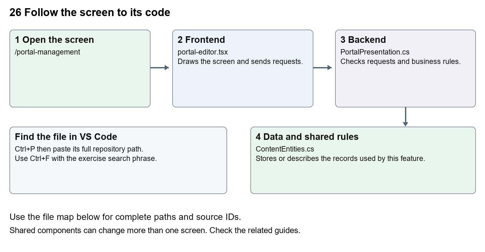

# Nexora portal management

Document 26 of the Nexora learning guides  
Source snapshot 13 October 2026 at 17:12 UTC


Understand CRM control of member portal branding, themes, menus, pages and onboarding.

### Recognise the screen and its scope

Open `/portal-management`. CRM routes use port 3017; member routes use 3018; public website routes can use 3019. Brackets name a route parameter, not text to paste into a browser. Choose a real record or site id from the application.

This guide covers Draft save preview and publish; Portal name tagline and welcome; Neon and classic appearance controls; Motion settings and reduced motion; Menu labels order and visibility; Dashboard sections and custom pages; Self-registration and organisation-request settings.



The diagram shows the file roles. The full paths below are what you paste into Ctrl+P.

### Find the files in VS Code

| Role | File and source ID | What it does |
| --- | --- | --- |
| Screen | S0067 portal-editor.tsx | Main UI or route for this topic |
| Server | S0235 PortalPresentation.cs | Endpoints or server rules |
| Data | S0216 ContentEntities.cs | Data shape or persistence structure |

**Screen S0067**  
[apps/web/src/features/content/portal-editor.tsx](<D:/Projects new/Nexora/apps/web/src/features/content/portal-editor.tsx>)

**Server S0235**  
[backend/src/Modules/Nexora.Modules.Content/PortalPresentation.cs](<D:/Projects new/Nexora/backend/src/Modules/Nexora.Modules.Content/PortalPresentation.cs>)

**Data S0216**  
[backend/src/Modules/Nexora.Modules.Content/ContentEntities.cs](<D:/Projects new/Nexora/backend/src/Modules/Nexora.Modules.Content/ContentEntities.cs>)

The complete HTML manual opens these source IDs inside its Source library. The Word manual shows short labelled extracts so you can learn the flow before reading large files. Each individual Markdown guide includes its complete primary files after the walkthrough.

### Follow the request and the records

1. PortalEditor loads the draft and published configuration.
2. Staff change draft fields and preview the appearance.
3. Saving persists a draft with its expected version.
4. Publishing validates and replaces the published configuration.
5. Member and public sign-in views read the published settings for the association.

### Read the code with an explanation

Draft and published settings are separate. The preview shows presentation while member data stays live in the real portal. Labels and page text are stored data, so administrators can change them without coding. presentation.ts supplies fallback defaults; changing a fallback does not overwrite an existing published configuration. Dashboard stays available even if other menu links are hidden.

Source reference S0067 apps/web/src/features/content/portal-editor.tsx

Selected opening lines with their original numbers. The complete file is in the HTML source library.

```tsx
0001  "use client";
0002  import { WorkspaceHeading } from "@/components/ui/workspace-heading";
0003  import { RecordListing } from "../shared/record-listing";
0004  import { useEntityListing } from "../shared/entity-listing-controls";
0005  import listingStyles from "../crm/record-listing.module.css";
0006  import { ArrowLeft, Plus } from "lucide-react";
```


The import lines lead to shared components and helpers. Start at the exported component or route function; follow the request helper to the server rather than assuming the whole feature lives in this file.

Source reference S0235 backend/src/Modules/Nexora.Modules.Content/PortalPresentation.cs

Extract from source line 73. A fragment from a long line is shown without the rest of that line.

```cs
0073          api.MapGet("/portal", async (ContentDbContext db, CancellationToken ct) => Results.Ok(ReadPortalConfiguration(await db.Set<PortalConfiguration>().SingleOrDefaultAsync(ct))));
```


On the server, look for MapGet to load records, MapPost to create or perform an action, MapPut or MapPatch to change data, and RequireAuthorization for permissions. Some shared methods register endpoints indirectly. Find SaveChangesAsync to see the database write. A request method alone does not tell you every side effect.

Source reference S0216 backend/src/Modules/Nexora.Modules.Content/ContentEntities.cs

Selected opening lines with their original numbers. The complete file is in the HTML source library.

```cs
0001  using Nexora.BuildingBlocks.Domain;
0003  namespace Nexora.Modules.Content;
0005  public sealed class Site : TenantEntity
0006  {
0007      public string Name { get; set; } = "";
0008      public string Tagline { get; set; } = "";
```


Follow model fields to their request names and database mapping. An id points to a particular record. A tenant id limits the organisation. A version or concurrency stamp protects newer edits. Some model files describe contracts rather than tables; check the owning DbContext before assuming storage.

### Make or trace your first change

1. Press Ctrl+P and open [apps/web/src/features/content/portal-editor.tsx](<D:/Projects new/Nexora/apps/web/src/features/content/portal-editor.tsx>).
2. Press Ctrl+F and search for `Branding and welcome`. In this snapshot it appears at line 57.
3. Replace this editor section heading only. Open Portal management and inspect Settings. For a no-code exercise, preview a changed draft welcome message, then discard it rather than publishing to members.
4. Replace only `Branding and welcome` with `Portal branding and welcome` in that intended location. Keep quotes, tags, JSON keys and routes intact.
5. Save with Ctrl+S. Inspect Problems and the local screen. Review the diff and restore the original text when you finish practising.

Extract from source line 57. A fragment from a long line is shown without the rest of that line.

```tsx
0057  xt-xl font-semibold sm:col-span-2">Branding and welcome</h2>{([['name', 'Portal name', 100], ['tagli
```


These exercises have not been applied to the application. Their search phrases are verified against the captured source. Line numbers can move; the phrase and file path are your main navigation aids.

### Check a change and diagnose problems

Confirm the original screen still loads, the changed words appear in the intended place, and another screen using the same component still behaves correctly. If an action fails, inspect the browser Network response, the relevant helper and server validation message. Use the common error table at the beginning of the manual. Reload on a version conflict instead of removing the version check.

A syntax error after a text edit usually means a quote, brace or closing tag changed. Compare your diff with the original. An unchanged browser result can mean the wrong port, a saved published configuration overriding a default, or a running API that has not reloaded.

### Understand the current limits

Editing needs content.manage and publication needs content.publish. Custom member pages are plain text, not arbitrary executable HTML. Published onboarding changes can allow new registrations.

### Continue learning

Related guides [24 Nexora member portal login and onboarding](#guide_24), [25 Nexora member portal journeys](#guide_25), [27 Nexora website editor and publishing](#guide_27).

## Complete primary source files

These are the complete captured files, with numbered source lines. Other supporting files are included in the complete HTML manual. Configured local passwords, if any, are explicitly omitted. Do not paste the display line numbers into code.

### S0067 portal-editor.tsx

[apps/web/src/features/content/portal-editor.tsx](<D:/Projects new/Nexora/apps/web/src/features/content/portal-editor.tsx>)

SHA256 `2470971148a7f42f2a4e9bcd2b962dc3b8e8a824e2be597ee0845d32e72b2289`; 74 source lines; complete captured text.

```tsx
0001  "use client";
0002  import { WorkspaceHeading } from "@/components/ui/workspace-heading";
0003  import { RecordListing } from "../shared/record-listing";
0004  import { useEntityListing } from "../shared/entity-listing-controls";
0005  import listingStyles from "../crm/record-listing.module.css";
0006  import { ArrowLeft, Plus } from "lucide-react";
0007  import { useEffect, useState } from "react";
0008  import { moduleApi } from "../shared/module-api";
0009  import { defaultPresentation, defaultPortalDesign, portalDesignStyle, type PortalDesign, type PortalPresentation } from "../portal/presentation";
0010  import portalStyles from "../portal/portal.module.css";
0011  import type { WebsiteDesignState } from "./types";
0012  type State = { version: string | null; draft: PortalPresentation; published: PortalPresentation; publishedAtUtc: string | null; hasUnpublishedChanges: boolean };
0013  const input = "mt-1 block w-full rounded-lg border border-slate-300 bg-white p-2 text-slate-900";
0014  const button = "rounded-lg border border-slate-300 bg-white px-4 py-2 text-sm disabled:opacity-50";
0015  const sectionLabels: Record<string, string> = { summary: "Summary cards", membership: "Current membership", applications: "Recent applications", links: "Quick links" };
0016  export function PortalEditor({ permissions }: { permissions: string[] }) {
0017    const [view,setView]=useState<"list"|"settings"|number>("list");
0018    const [state, setState] = useState<State | null>(null);
0019    const [draft, setDraft] = useState(defaultPresentation);
0020    const [error, setError] = useState(""); const [message, setMessage] = useState(""); const [busy, setBusy] = useState(false);
0021    const [reload, setReload] = useState(0); const [preview, setPreview] = useState(false);
0022    const canEdit = permissions.includes("content.manage"), canPublish = permissions.includes("content.publish");
0023    const pages=draft.pages.map((page,index)=>({...page,id:String(index),status:state?.hasUnpublishedChanges||JSON.stringify(draft)!==JSON.stringify(state?.draft)?"Draft changes":"Current"}));
0024    const listing=useEntityListing({records:pages,columns:["Page","Address","Status"]});
0025    function addPage(){let n=1;while(draft.menu.some(m=>m.key===`page-${n}`))n++;const slug=`page-${n}`;setView(draft.pages.length);patch({pages:[...draft.pages,{slug,title:"New member page",body:""}],menu:[...draft.menu,{key:slug,label:"New member page",visible:true}]});}
0026    const dirty = state != null && JSON.stringify(draft) !== JSON.stringify(state.draft);
0027    useEffect(() => { let active = true; moduleApi<State>("content", "/portal").then(s => { if (active) { setState(s); setDraft(s.draft); setError(""); } }).catch(e => { if (active) setError(e.message); }); return () => { active = false; }; }, [reload]);
0028    useEffect(() => { const warn = (e: BeforeUnloadEvent) => { if (dirty) { e.preventDefault(); e.returnValue = ""; } }; window.addEventListener("beforeunload", warn); return () => window.removeEventListener("beforeunload", warn); }, [dirty]);
0029    async function save(publish = false) {
0030      setBusy(true); setError(""); setMessage("");
0031      try { const next = await moduleApi<State>("content", publish ? "/portal/publish" : "/portal", publish ? "POST" : "PUT", { version: state?.version, configuration: draft }); setState(next); setDraft(next.draft); setMessage(publish ? "Portal published. Members see these settings on their next page load." : "Portal draft saved. The live portal is unchanged."); }
0032      catch (e) { setError(e instanceof Error ? e.message : "Unable to save portal."); } finally { setBusy(false); }
0033    }
0034    function move<T>(items: T[], index: number, step: number): T[] { const next = [...items]; [next[index], next[index + step]] = [next[index + step], next[index]]; return next; }
0035    function patch(change: Partial<PortalPresentation>) { setDraft(d => ({ ...d, ...change })); }
0036    const design = { ...defaultPortalDesign, ...draft.design };
0037    function patchDesign(change: Partial<PortalDesign>) { patch({ design: { ...design, ...change } }); }
0038    async function applyWebsitePalette() {
0039      setBusy(true); setError(""); setMessage("");
0040      try {
0041        const website = await moduleApi<{ design: WebsiteDesignState }>("content", "/site");
0042        const colours = website.design.published;
0043        patchDesign({ theme: "neon", backgroundColor: colours.backgroundColor, textColor: colours.textColor, accentColor: colours.accentColor, secondaryAccentColor: colours.secondaryAccentColor });
0044        setMessage("Published website colours applied to the portal draft. Save and publish to apply.");
0045      } catch (e) { setError(e instanceof Error ? e.message : "Unable to read website colours."); } finally { setBusy(false); }
0046    }
0047    return <main className="mx-auto max-w-6xl space-y-5 p-5 text-slate-900 sm:p-8">
0048      <WorkspaceHeading actions={view==="list"&&canEdit?<button type="button" className={listingStyles.create} disabled={!state||draft.pages.length>=30} aria-label="Add member page" onClick={addPage}><Plus size={18}/></button>:undefined}>Portal pages</WorkspaceHeading>
0049      {view!=="list"&&<button type="button" className={button} aria-label="Back to listing" onClick={()=>{setView("list");setPreview(false);}}><ArrowLeft size={16}/></button>}
0050      {view==="list"&&<>{listing.toolbar}<RecordListing columnControls={listing.columnControls} label="Portal pages" rows={pages.filter(listing.matches)} filterKey={listing.filterKey} loading={!state&&!error} name={row=>row.title} onView={row=>setView(Number(row.id))} onEdit={canEdit?row=>setView(Number(row.id)):undefined} columns={[{key:"title",label:"Page",render:row=>row.title},{key:"slug",label:"Address",hidden:!listing.show("Address"),render:row=>row.slug},{key:"status",label:"Status",hidden:!listing.show("Status"),render:row=>row.status}]}/><button type="button" className={button} disabled={!state} onClick={()=>setView("settings")}>Portal settings</button>{dirty&&<p role="status">Unsaved changes. Open a page or Portal settings to save the draft.</p>}</>}
0051      {error && <p role="alert" className="rounded-lg bg-red-50 p-4 text-red-900">{error} <button className="underline" onClick={() => { if (!dirty || window.confirm("Discard unsaved changes and reload?")) setReload(n => n + 1); }}>Reload saved portal</button></p>}
0052      {message && <p role="status" className="rounded-lg bg-emerald-50 p-4">{message}</p>}
0053      {view!=="list"&&(!state ? <p>Loading portal settings…</p> : <>
0054        <div className="flex flex-wrap items-center gap-3 rounded-xl bg-white p-4"><span className="mr-auto text-sm">{dirty ? "Unsaved changes" : state.hasUnpublishedChanges ? "Saved draft has unpublished changes" : "Published settings are current"}{state.publishedAtUtc && ` · Published ${new Date(state.publishedAtUtc).toLocaleString()}`}</span><button className={button} onClick={() => setPreview(!preview)}>{preview ? "Close preview" : "Preview draft"}</button><button className={button} disabled={busy || !canEdit} onClick={() => void save()}>Save portal draft</button><button className={button} disabled={busy || !canPublish || dirty || !state.version} onClick={() => void save(true)}>Publish portal</button><button className={button} disabled={busy || !canEdit} onClick={() => { if (window.confirm("Replace your editor changes with the currently published settings? Save and publish to apply.")) setDraft(state.published); }}>Restore published settings</button></div>
0055        {preview && <section aria-label="Portal draft preview" data-theme={design.theme} data-motion={design.motionEnabled} className={`${portalStyles.portal} ${portalStyles.preview} rounded-2xl bg-[#f7f7f2] p-6`} style={portalDesignStyle(design, draft.brandColor)}><p className="text-xs text-slate-500">Draft preview · membership data stays live in the member portal</p><h2 className="mt-3 text-xl font-semibold">{draft.name}</h2><div className="mt-4 flex flex-wrap gap-3">{draft.menu.filter(m => m.visible).map(m => <span key={m.key} className="rounded-full border px-3 py-2 text-sm">{m.label}</span>)}</div><p className="mt-6 text-sm uppercase tracking-widest">{draft.tagline}</p><h3 className="mt-3 text-2xl font-semibold">{draft.menu.find(m => m.key === "dashboard")?.label}</h3><p className="mt-3">Welcome back, Member. {draft.welcomeText}</p><div className="mt-4 grid gap-3 sm:grid-cols-2">{draft.dashboardSections.map(key => <div key={key} className="rounded-xl bg-white p-5">{sectionLabels[key]}</div>)}</div>{draft.pages.map(p => <article key={p.slug} className="mt-4 rounded-xl bg-white p-5"><h3 className="text-xl font-semibold">{p.title}</h3><p className="mt-3 whitespace-pre-wrap break-words">{p.body}</p></article>)}</section>}
0056        <fieldset disabled={busy || !canEdit} className="space-y-5 disabled:opacity-70">
0057          {view==="settings"&&<><section className="grid gap-4 rounded-xl bg-white p-6 sm:grid-cols-2"><h2 className="text-xl font-semibold sm:col-span-2">Branding and welcome</h2>{([['name', 'Portal name', 100], ['tagline', 'Portal tagline', 200], ['welcomeText', 'Dashboard welcome text', 300]] as const).map(([key,label,max]) => <label key={key}>{label}<input className={input} value={draft[key]} maxLength={max} onChange={e => patch({ [key]: e.target.value })} /></label>)}<label>Portal brand colour<input type="color" className={`${input} h-11`} value={draft.brandColor} onChange={e => patch({ brandColor: e.target.value })} /></label><p className="text-sm text-slate-500 sm:col-span-2">Choose a dark colour for readable buttons. Your portal remains unchanged until you publish.</p></section>
0058          <section className="space-y-4 rounded-xl bg-white p-6"><h2 className="text-xl font-semibold">Member onboarding</h2><p className="text-sm text-slate-500">Save and publish to apply. Self-registration uses the configured association domain and creates a new Contact. The local identity adapter currently supports development only; production identity, email verification and recovery remain future scope.</p>
0059            <label className="block"><input type="checkbox" checked={draft.onboarding?.allowSelfRegistration ?? false} onChange={e => patch({ onboarding: { allowSelfRegistration: e.target.checked, allowOrganisationRequests: draft.onboarding?.allowOrganisationRequests ?? false } })} /> Allow member self-registration</label>
0060            <label className="block"><input type="checkbox" checked={draft.onboarding?.allowOrganisationRequests ?? false} onChange={e => patch({ onboarding: { allowSelfRegistration: draft.onboarding?.allowSelfRegistration ?? false, allowOrganisationRequests: e.target.checked } })} /> Allow company access requests</label><p className="text-sm text-slate-500">Company access requires CRM review. Account creation does not activate membership.</p>
0061          </section>
0062          <section className="space-y-5 rounded-xl bg-white p-6"><h2 className="text-xl font-semibold">Portal appearance</h2><p className="text-sm text-slate-500">Preview, save and publish the portal theme. The neon palette also styles sign-in on your association’s configured domain. Members’ reduced-motion preferences take priority.</p>
0063            <div className="grid gap-4 sm:grid-cols-2"><div><label htmlFor="portal-theme">Portal theme</label><select id="portal-theme" className={input} value={design.theme} onChange={e => patchDesign({ theme: e.target.value as PortalDesign["theme"] })}><option value="classic">Classic</option><option value="neon">Neon</option></select></div><button type="button" className={button + " self-end"} onClick={() => void applyWebsitePalette()}>Use published website colours</button>
0064            {(["backgroundColor", "textColor", "accentColor", "secondaryAccentColor"] as const).map((key, i) => { const label = ["Portal background colour", "Portal text colour", "Portal accent colour", "Portal secondary accent colour"][i]; return <div key={key}><label>{label}<input type="color" className={input + " h-11"} value={design[key]} onChange={e => patchDesign({ [key]: e.target.value })} /></label><label><span className="sr-only">{label} hex</span><input className={input + " font-mono"} value={design[key]} pattern="#[0-9a-fA-F]{6}" maxLength={7} spellCheck={false} onChange={e => patchDesign({ [key]: e.target.value })} /></label></div>; })}
0065            {([['cornerRadius', 'Portal corner radius (px)', 0, 32], ['glowStrength', 'Portal glow strength (%)', 0, 60], ['motionDurationMs', 'Portal hover duration (ms)', 100, 1000]] as const).map(([key, label, min, max]) => <label key={key}>{label}<input className={input} type="number" min={min} max={max} value={design[key]} onChange={e => patchDesign({ [key]: Number(e.target.value) })} /></label>)}</div>
0066            <label className="block"><input type="checkbox" checked={design.motionEnabled} onChange={e => patchDesign({ motionEnabled: e.target.checked })} /> Enable portal hover animations</label>
0067          </section>
0068          <section className="rounded-xl bg-white p-6"><h2 className="text-xl font-semibold">Portal navigation</h2><p className="mt-2 text-sm text-slate-500">Order menus, rename labels or hide links. Dashboard always remains available.</p><div className="mt-4 space-y-3">{draft.menu.map((m,i) => <div key={m.key} className="flex flex-wrap items-end gap-3 rounded-lg border p-3"><label className="min-w-0 flex-1">Menu label: {m.key}<input className={input} maxLength={80} value={m.label} onChange={e => patch({ menu: draft.menu.map(x => x.key === m.key ? { ...x, label: e.target.value } : x) })} /></label><label><input type="checkbox" checked={m.visible} disabled={m.key === "dashboard"} onChange={e => patch({ menu: draft.menu.map(x => x.key === m.key ? { ...x, visible: e.target.checked } : x) })} /> Show {m.key}</label><button className={button} disabled={i === 0} onClick={() => patch({ menu: move(draft.menu,i,-1) })} aria-label={`Move ${m.key} up`}>↑</button><button className={button} disabled={i === draft.menu.length - 1} onClick={() => patch({ menu: move(draft.menu,i,1) })} aria-label={`Move ${m.key} down`}>↓</button></div>)}</div></section>
0069          <section className="rounded-xl bg-white p-6"><h2 className="text-xl font-semibold">Dashboard sections</h2><div className="mt-4 flex flex-wrap gap-5">{Object.entries(sectionLabels).map(([key,label]) => <label key={key}><input type="checkbox" checked={draft.dashboardSections.includes(key)} onChange={e => patch({ dashboardSections: e.target.checked ? [...draft.dashboardSections,key] : draft.dashboardSections.filter(k => k !== key) })} /> {label}</label>)}</div><ol className="mt-4 space-y-2">{draft.dashboardSections.map((key,i) => <li key={key} className="flex items-center gap-3"><span className="mr-auto">{sectionLabels[key]}</span><button className={button} disabled={i === 0} onClick={() => patch({ dashboardSections: move(draft.dashboardSections,i,-1) })} aria-label={`Move ${sectionLabels[key]} up`}>↑</button><button className={button} disabled={i === draft.dashboardSections.length - 1} onClick={() => patch({ dashboardSections: move(draft.dashboardSections,i,1) })} aria-label={`Move ${sectionLabels[key]} down`}>↓</button></li>)}</ol></section>
0070          </>}<section className="space-y-5 rounded-xl bg-white p-6"><h2 className="text-xl font-semibold">Custom member pages</h2><p className="text-sm text-slate-500">Add information for signed-in members. Text is displayed as written, without HTML or scripts. Remove a page from the draft and publish to withdraw it.</p>{draft.pages.map((p,i) => typeof view==="number"&&view===i?<article key={i} className="space-y-3 rounded-xl border p-4"><label className="block">Page address<input className={input} value={p.slug} maxLength={60} onChange={e => { const slug = e.target.value; patch({ pages: draft.pages.map((x,j) => j === i ? { ...x, slug } : x), menu: draft.menu.map(m => m.key === p.slug ? { ...m, key: slug } : m) }); }} /></label><label className="block">Page title<input className={input} value={p.title} maxLength={120} onChange={e => patch({ pages: draft.pages.map((x,j) => j === i ? { ...x, title: e.target.value } : x) })} /></label><label className="block">Page content<textarea className={input} rows={8} value={p.body} maxLength={10000} onChange={e => patch({ pages: draft.pages.map((x,j) => j === i ? { ...x, body: e.target.value } : x) })} /></label><button className={button} onClick={() => { if (window.confirm(`Remove ${p.title} from the draft?`)) patch({ pages: draft.pages.filter((_,j) => i !== j), menu: draft.menu.filter(m => m.key !== p.slug) }); setView("list"); }}>Remove page</button></article>:null)}</section>
0071        </fieldset>
0072      </>)}
0073    </main>;
0074  }
```

### S0235 PortalPresentation.cs

[backend/src/Modules/Nexora.Modules.Content/PortalPresentation.cs](<D:/Projects new/Nexora/backend/src/Modules/Nexora.Modules.Content/PortalPresentation.cs>)

SHA256 `4cac5c503c6920c4461ac7ab0d032bc37632b68aca4dd2dc2b276d21048c12a8`; 92 source lines; complete captured text.

```cs
0001  using System.ComponentModel.DataAnnotations;
0002  using System.Text.Json;
0003  using System.Text.RegularExpressions;
0004  using Microsoft.AspNetCore.Builder;
0005  using Microsoft.AspNetCore.Http;
0006  using Microsoft.AspNetCore.Routing;
0007  using Microsoft.EntityFrameworkCore;
0008  using Nexora.BuildingBlocks.Domain;
0009  using Nexora.BuildingBlocks.Security;
0010  
0011  namespace Nexora.Modules.Content;
0012  
0013  public sealed class PortalConfiguration : TenantEntity
0014  {
0015      public string DraftJson { get; set; } = "";
0016      public string? PublishedJson { get; set; }
0017      public DateTime? PublishedAtUtc { get; set; }
0018      public Guid? PublishedBy { get; set; }
0019  }
0020  internal sealed class PortalPresentationDirectory(ContentDbContext db) : IPortalPresentationDirectory
0021  {
0022      public async Task<PortalPresentation> ReadAsync(CancellationToken ct)
0023      {
0024          var json = await db.Set<PortalConfiguration>().Select(x => x.PublishedJson).SingleOrDefaultAsync(ct);
0025          return json == null ? PortalPresentation.Default : JsonSerializer.Deserialize<PortalPresentation>(json)!;
0026      }
0027  }
0028  public static partial class ContentModule
0029  {
0030      public sealed record PortalConfigurationRequest(Guid? Version, PortalPresentation Configuration);
0031      private static object ReadPortalConfiguration(PortalConfiguration? row) => new
0032      {
0033          version = row?.Version,
0034          draft = row == null ? PortalPresentation.Default : JsonSerializer.Deserialize<PortalPresentation>(row.DraftJson),
0035          published = row?.PublishedJson == null ? PortalPresentation.Default : JsonSerializer.Deserialize<PortalPresentation>(row.PublishedJson),
0036          publishedAtUtc = row?.PublishedAtUtc,
0037          hasUnpublishedChanges = row != null && row.DraftJson != row.PublishedJson
0038      };
0039      private static void ValidatePortalPresentation(PortalPresentation value)
0040      {
0041          if (value == null) throw new ValidationException("Portal configuration is required.");
0042          Text(value.Name, 100); Text(value.Tagline, 200, false); Text(value.WelcomeText, 300, false);
0043          if (!Regex.IsMatch(value.BrandColor ?? "", "^#[0-9a-fA-F]{6}$")) throw new ValidationException("Choose a six-digit brand colour.");
0044          double Channel(int offset) { var c = Convert.ToInt32(value.BrandColor!.Substring(offset, 2), 16) / 255d; return c <= .04045 ? c / 12.92 : Math.Pow((c + .055) / 1.055, 2.4); }
0045          if (.2126 * Channel(1) + .7152 * Channel(3) + .0722 * Channel(5) > .16) throw new ValidationException("Choose a darker brand colour so white text stays readable.");
0046          var design = value.Design ?? new PortalDesign();
0047          Choice(design.Theme, "classic", "neon");
0048          var background = Luminance(design.BackgroundColor); var foreground = Luminance(design.TextColor);
0049          Luminance(design.AccentColor); Luminance(design.SecondaryAccentColor);
0050          if ((Math.Max(background, foreground) + .05) / (Math.Min(background, foreground) + .05) < 4.5)
0051              throw new ValidationException("Portal text and background must have at least 4.5:1 contrast.");
0052          Range(design.CornerRadius, 0, 32); Range(design.GlowStrength, 0, 60); Range(design.MotionDurationMs, 100, 1000);
0053          if (value.Pages == null || value.Pages.Length > 30 || value.Menu == null || value.DashboardSections == null)
0054              throw new ValidationException("Provide navigation, dashboard sections and at most 30 custom pages.");
0055          var keys = PortalPresentation.Default.Menu.Select(m => m.Key).ToHashSet();
0056          foreach (var page in value.Pages)
0057          {
0058              if (page == null || !Regex.IsMatch(page.Slug ?? "", "^[a-z][a-z0-9-]{0,59}$") || !keys.Add(page.Slug!) || page.Slug is "api" or "login" or "logout" or "csrf" or "signup" or "register")
0059                  throw new ValidationException("Use unique page addresses with letters, numbers and hyphens; built-in addresses are reserved.");
0060              Text(page.Title, 120); Text(page.Body, 10000, false);
0061          }
0062          if (value.Menu.Length != keys.Count || value.Menu.Any(m => m == null || !keys.Contains(m.Key)) || value.Menu.Select(m => m.Key).Distinct().Count() != keys.Count)
0063              throw new ValidationException("Include each built-in section and custom page exactly once in navigation.");
0064          foreach (var item in value.Menu) Text(item.Label, 80);
0065          if (!value.Menu.Single(m => m.Key == "dashboard").Visible) throw new ValidationException("Dashboard must remain visible.");
0066          var sections = PortalPresentation.Default.DashboardSections;
0067          if (value.DashboardSections.Length == 0 || value.DashboardSections.Distinct().Count() != value.DashboardSections.Length || value.DashboardSections.Any(s => !sections.Contains(s)))
0068              throw new ValidationException("Choose at least one dashboard section, without duplicates.");
0069          if (JsonSerializer.Serialize(value).Length > 100000) throw new ValidationException("Portal configuration is too large.");
0070      }
0071      private static void MapPortalPresentation(RouteGroupBuilder api)
0072      {
0073          api.MapGet("/portal", async (ContentDbContext db, CancellationToken ct) => Results.Ok(ReadPortalConfiguration(await db.Set<PortalConfiguration>().SingleOrDefaultAsync(ct))));
0074          api.MapPut("/portal", async (PortalConfigurationRequest request, ContentDbContext db, IRequestIdentity who, CancellationToken ct) =>
0075          {
0076              ValidatePortalPresentation(request.Configuration);
0077              var row = await db.Set<PortalConfiguration>().SingleOrDefaultAsync(ct);
0078              if (row?.Version != request.Version) return Conflict();
0079              if (row == null) { row = new PortalConfiguration { TenantId = who.TenantId!.Value }; db.Add(row); }
0080              row.DraftJson = JsonSerializer.Serialize(request.Configuration);
0081              await db.SaveChangesAsync(ct); return Results.Ok(ReadPortalConfiguration(row));
0082          }).RequireAuthorization("content.manage");
0083          api.MapPost("/portal/publish", async (PortalConfigurationRequest request, ContentDbContext db, IRequestIdentity who, CancellationToken ct) =>
0084          {
0085              var row = await db.Set<PortalConfiguration>().SingleOrDefaultAsync(ct) ?? throw new ValidationException("Save a portal draft first.");
0086              if (row.Version != request.Version) return Conflict();
0087              ValidatePortalPresentation(JsonSerializer.Deserialize<PortalPresentation>(row.DraftJson)!);
0088              row.PublishedJson = row.DraftJson; row.PublishedAtUtc = DateTime.UtcNow; row.PublishedBy = who.UserId;
0089              await db.SaveChangesAsync(ct); return Results.Ok(ReadPortalConfiguration(row));
0090          }).RequireAuthorization("content.publish");
0091      }
0092  }
```

### S0216 ContentEntities.cs

[backend/src/Modules/Nexora.Modules.Content/ContentEntities.cs](<D:/Projects new/Nexora/backend/src/Modules/Nexora.Modules.Content/ContentEntities.cs>)

SHA256 `6ece527fbeeb7e89719451882d9af18bd9da87128a53535bc26f718691278d93`; 66 source lines; complete captured text.

```cs
0001  using Nexora.BuildingBlocks.Domain;
0002  
0003  namespace Nexora.Modules.Content;
0004  
0005  public sealed class Site : TenantEntity
0006  {
0007      public string Name { get; set; } = "";
0008      public string Tagline { get; set; } = "";
0009      public string BrandColor { get; set; } = "#183a31";
0010      public Guid? LogoMediaId { get; set; }
0011  }
0012  public sealed class Page : TenantEntity
0013  {
0014      public Guid SiteId { get; set; }
0015      public string Slug { get; set; } = "";
0016      public Guid DraftId { get; set; }
0017      public Guid? PublishedId { get; set; }
0018      public int NavigationOrder { get; set; }
0019      public string NavigationLabel { get; set; } = "";
0020      public bool ShowInNavigation { get; set; } = true;
0021  }
0022  public sealed class MediaAsset : TenantEntity
0023  {
0024      public Guid SiteId { get; set; }
0025      public string Name { get; set; } = "";
0026      public string ContentType { get; set; } = "";
0027      public byte[] Content { get; set; } = [];
0028      public string ScanStatus { get; set; } = "quarantined";
0029      public bool IsPublic { get; set; }
0030  }
0031  public sealed class PageRedirect : TenantEntity
0032  {
0033      public Guid SiteId { get; set; }
0034      public Guid PageId { get; set; }
0035      public string Slug { get; set; } = "";
0036  }
0037  public sealed class ScheduledPublication : TenantEntity
0038  {
0039      public Guid PageId { get; set; }
0040      public Guid RevisionId { get; set; }
0041      public Guid PublisherId { get; set; }
0042      public DateTime PublishAtUtc { get; set; }
0043      public string Status { get; set; } = "pending";
0044      public string? Failure { get; set; }
0045  }
0046  public sealed class PageVersion : TenantEntity, IAppendOnly
0047  {
0048      public Guid PageId { get; set; }
0049      public string Title { get; set; } = "";
0050      public string Description { get; set; } = "";
0051      public string BlocksJson { get; set; } = "[]";
0052      public Guid AuthorId { get; set; }
0053  }
0054  public sealed class Publication : TenantEntity, IAppendOnly
0055  {
0056      public Guid PageId { get; set; }
0057      public Guid? PageVersionId { get; set; }
0058      public Guid ActorId { get; set; }
0059  }
0060  public sealed record ContentItem(string Heading, string Text, Guid? MediaId = null, string? LinkLabel = null, string? LinkUrl = null);
0061  public sealed record ContentLayout(string Span = "full", string Alignment = "left", string Surface = "card", string Spacing = "normal", string Eyebrow = "", bool Hidden = false);
0062  public sealed record ContentBlock(string Type, string Heading, string Text, string? LinkLabel = null, string? LinkUrl = null, Guid? MediaId = null,
0063      ContentLayout? Layout = null, WebsiteMotion? Motion = null, ContentItem[]? Items = null);
0064  public sealed record SiteRequest(string Name, string Tagline);
0065  public sealed record PageRequest(string Slug, string Title, string Description, ContentBlock[] Blocks, Guid? Version);
0066  public sealed record PublishRequest(Guid Version, Guid? RevisionId = null);
```
