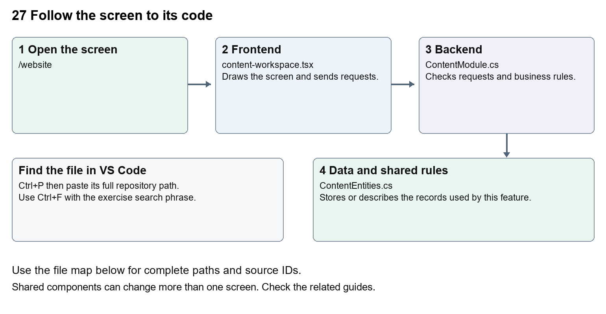

# Nexora website editor and publishing

Document 27 of the Nexora learning guides  
Source snapshot 14 October 2026 at 06:41 UTC


Understand CRM-managed pages, design controls, media, revision history and publication.

### Recognise the screen and its scope

Open `/website`. CRM routes use port 3017; member routes use 3018; public website routes can use 3019. Brackets name a route parameter, not text to paste into a browser. Choose a real record or site id from the application.

This guide covers Website creation and page list; Block editor and studio template; Layout colours typography and appearance; Per-block motion and hover controls; Media upload and scanning; Draft save preview publish schedules redirects and history.



The diagram shows the file roles. The full paths below are what you paste into Ctrl+P.

### Find the files in VS Code

| Role | File and source ID | What it does |
| --- | --- | --- |
| Screen | S0066 content-workspace.tsx | Main UI or route for this topic |
| Server | S0219 ContentModule.cs | Endpoints or server rules |
| Data | S0217 ContentEntities.cs | Data shape or persistence structure |

**Screen S0066**  
[apps/web/src/features/content/content-workspace.tsx](<D:/Projects new/Nexora/apps/web/src/features/content/content-workspace.tsx>)

**Server S0219**  
[backend/src/Modules/Nexora.Modules.Content/ContentModule.cs](<D:/Projects new/Nexora/backend/src/Modules/Nexora.Modules.Content/ContentModule.cs>)

**Data S0217**  
[backend/src/Modules/Nexora.Modules.Content/ContentEntities.cs](<D:/Projects new/Nexora/backend/src/Modules/Nexora.Modules.Content/ContentEntities.cs>)

The complete HTML manual opens these source IDs inside its Source library. The Word manual shows short labelled extracts so you can learn the flow before reading large files. Each individual Markdown guide includes its complete primary files after the walkthrough.

### Follow the request and the records

1. The workspace loads the site, page drafts, design settings and media.
2. BlockEditor collects structured blocks and their layout and motion.
3. Saving creates or updates a revision using the expected version.
4. An authorised publish or schedule action selects what visitors may see.
5. Public routes render published revisions and published design settings.

### Read the code with an explanation

A page is a stored address and publication pointer; a revision holds title, description and blocks. A draft can change without changing the visitor page. WebsiteDesign and WebsiteMotion describe manageable design fields, not just hardcoded CSS. The editor and public renderer share types so the stored block data can be rendered consistently.

Source reference S0066 apps/web/src/features/content/content-workspace.tsx

Selected opening lines with their original numbers. The complete file is in the HTML source library.

```tsx
0001  "use client";
0002  import { WorkspaceHeading } from "@/components/ui/workspace-heading";
0003  import { RecordListing } from "../shared/record-listing";
0004  import listingStyles from "../crm/record-listing.module.css";
0005  import { ArrowLeft, Plus } from "lucide-react";
0007  import { useEffect, useRef, useState } from "react";
```


The import lines lead to shared components and helpers. Start at the exported component or route function; follow the request helper to the server rather than assuming the whole feature lives in this file.

Source reference S0219 backend/src/Modules/Nexora.Modules.Content/ContentModule.cs

Extract from source line 33. A fragment from a long line is shown without the rest of that line.

```cs
0033          var api = endpoints.MapGroup("/api/v1/content").RequireAuthorization("content.read").WithTags("Content");
```


On the server, look for MapGet to load records, MapPost to create or perform an action, MapPut or MapPatch to change data, and RequireAuthorization for permissions. Some shared methods register endpoints indirectly. Find SaveChangesAsync to see the database write. A request method alone does not tell you every side effect.

Source reference S0217 backend/src/Modules/Nexora.Modules.Content/ContentEntities.cs

Selected opening lines with their original numbers. The complete file is in the HTML source library.

```cs
0001  using Nexora.BuildingBlocks.Domain;
0003  namespace Nexora.Modules.Content;
0005  public sealed class Site : TenantEntity
0006  {
0007      public string Name { get; set; } = "";
0008      public string Tagline { get; set; } = "";
```


Follow model fields to their request names and database mapping. An id points to a particular record. A tenant id limits the organisation. A version or concurrency stamp protects newer edits. Some model files describe contracts rather than tables; check the owning DbContext before assuming storage.

### Make or trace your first change

1. Press Ctrl+P and open [apps/web/src/features/content/content-workspace.tsx](<D:/Projects new/Nexora/apps/web/src/features/content/content-workspace.tsx>).
2. Press Ctrl+F and search for `Create your association website`. In this snapshot it appears at line 78.
3. Replace this empty-site form heading only. Inspect it only on a local site without saved content. For an existing website, use the block editor to preview draft text and discard it without publishing.
4. Replace only `Create your association website` with `Set up your association website` in that intended location. Keep quotes, tags, JSON keys and routes intact.
5. Save with Ctrl+S. Inspect Problems and the local screen. Review the diff and restore the original text when you finish practising.

Extract from source line 78. A fragment from a long line is shown without the rest of that line.

```tsx
0078   className="text-xl font-semibold">Create your association website</h2><label className="block text-sm">Associa
```


These exercises have not been applied to the application. Their search phrases are verified against the captured source. Line numbers can move; the phrase and file path are your main navigation aids.

### Check a change and diagnose problems

Confirm the original screen still loads, the changed words appear in the intended place, and another screen using the same component still behaves correctly. If an action fails, inspect the browser Network response, the relevant helper and server validation message. Use the common error table at the beginning of the manual. Reload on a version conflict instead of removing the version check.

A syntax error after a text edit usually means a quote, brace or closing tag changed. Compare your diff with the original. An unchanged browser result can mean the wrong port, a saved published configuration overriding a default, or a running API that has not reloaded.

### Understand the current limits

Changing default template data does not overwrite saved pages. Clean media, permissions, domain configuration and publish state affect visitor availability. A page labelled Contact does not establish delivery of real enquiries.

### Continue learning

Related guides [26 Nexora portal management](#guide_26), [28 Nexora public website](#guide_28), [29 Nexora documents evidence and file safety](#guide_29).

## Complete primary source files

These are the complete captured files, with numbered source lines. Other supporting files are included in the complete HTML manual. Configured local passwords, if any, are explicitly omitted. Do not paste the display line numbers into code.

### S0066 content-workspace.tsx

[apps/web/src/features/content/content-workspace.tsx](<D:/Projects new/Nexora/apps/web/src/features/content/content-workspace.tsx>)

SHA256 `d596d5cf809ba265acc0db00f639d53a048ef20f6354a0a9e2084922cdd01a3b`; 102 source lines; complete captured text.

```tsx
0001  "use client";
0002  import { WorkspaceHeading } from "@/components/ui/workspace-heading";
0003  import { RecordListing } from "../shared/record-listing";
0004  import listingStyles from "../crm/record-listing.module.css";
0005  import { ArrowLeft, Plus } from "lucide-react";
0006  
0007  import { useEffect, useRef, useState } from "react";
0008  import { useEntityListing } from "../shared/entity-listing-controls";
0009  import { moduleApi } from "../shared/module-api";
0010  import { CmsSettings, PagePublishingSettings } from "./cms-settings";
0011  import { SiteRenderer } from "./site-renderer";
0012  import { BlockEditor } from "./website-controls";
0013  import { studioLandingPage } from "./website-design";
0014  import type { Block, Draft, PageDetail, PageRecord, SiteState, Media } from "./types";
0015  
0016  const input = "mt-1 w-full rounded-lg border border-slate-300 bg-white px-3 py-2 text-sm text-slate-900";
0017  const button = "rounded-lg border border-slate-300 bg-white px-4 py-2 text-sm font-medium text-slate-800 disabled:opacity-50";
0018  const primary = "rounded-lg bg-[#183a31] px-4 py-2 text-sm font-medium text-white disabled:opacity-50";
0019  const blank: Draft = { slug: "home", title: "Welcome to our association", description: "Connect with our association and discover how to get involved.", blocks: [{ type: "hero", heading: "A stronger community, together.", text: "Introduce your association, the people you serve, and the difference membership makes." }] };
0020  export function ContentWorkspace({ permissions }: { permissions: string[] }) {
0021    const [state, setState] = useState<SiteState>({ site: null, pages: [] });
0022    const [media, setMedia] = useState<Media[]>([]);
0023    const [ready, setReady] = useState(false);
0024    const [error, setError] = useState("");
0025    const [message, setMessage] = useState("");
0026    const [busy, setBusy] = useState(false);
0027    const [reload, setReload] = useState(0);
0028    const [detail, setDetail] = useState<PageDetail | null>(null);
0029    const [draft, setDraft] = useState<Draft>(blank);
0030    const [saved, setSaved] = useState("");
0031    const [editing, setEditing] = useState(false);
0032    const [settings, setSettings] = useState(false);
0033    const [preview, setPreview] = useState(false);
0034    const [restoreId, setRestoreId] = useState("");
0035    const request = useRef(0);
0036    const canEdit = permissions.includes("content.manage");
0037    const canPublish = permissions.includes("content.publish");
0038    const listing=useEntityListing({records:state.pages.map(page=>({...page,status:page.publishedId?"published":"draft"})),columns:["Page","Details"]});
0039    const dirty = JSON.stringify(draft) !== saved;
0040    useEffect(() => {
0041      let current = true;
0042      moduleApi<SiteState>("content", "/site").then(s => { if (current) { setState(s); setReady(true); setError(""); } }).catch(e => { if (current) setError(e.message); });
0043      moduleApi<Media[]>("content", "/media").then(m => { if (current) setMedia(m); }).catch(e => { if (current) setError(e.message); });
0044      return () => { current = false; };
0045    }, [reload]);
0046    async function open(id: string) {
0047      if (editing && dirty && !window.confirm("Discard your unsaved page changes?")) return;
0048      const token = ++request.current; setBusy(true); setError(""); setMessage("");
0049      try {
0050        const d = await moduleApi<PageDetail>("content", `/pages/${id}`);
0051        if (token !== request.current) return;
0052        const next = { slug: d.page.slug, title: d.revision.title, description: d.revision.description, blocks: d.revision.blocks };
0053        setDetail(d); setDraft(next); setSaved(JSON.stringify(next)); setEditing(true); setPreview(false); setRestoreId("");
0054      } catch (e) { setError(e instanceof Error ? e.message : "Unable to open page."); }
0055      finally { if (token === request.current) setBusy(false); }
0056    }
0057    async function action(work: () => Promise<void>) {
0058      setBusy(true); setError(""); setMessage("");
0059      try { await work(); setReload(n => n + 1); } catch (e) { setError(e instanceof Error ? e.message : "Unable to save."); } finally { setBusy(false); }
0060    }
0061    function patchBlock(index: number, change: Partial<Block>) { setDraft(d => ({ ...d, blocks: d.blocks.map((b, i) => i === index ? { ...b, ...change } : b) })); }
0062    async function publish(unpublish = false, revisionId?: string) {
0063      if (!detail || !window.confirm(unpublish ? "Remove this page from the public website?" : "Publish this saved version to the public website?")) return;
0064      await action(async () => {
0065        const page = await moduleApi<PageRecord>("content", `/pages/${detail.page.id}/${unpublish ? "unpublish" : "publish"}`, "POST", { version: detail.page.version, revisionId });
0066        setDetail({ ...detail, page }); setMessage(unpublish ? "Page unpublished." : "Saved version published.");
0067      });
0068    }
0069    return <main className="mx-auto max-w-7xl space-y-5 p-5 sm:p-8">
0070      <WorkspaceHeading actions={state.site&&!editing&&!settings&&canEdit?<button type="button" className={listingStyles.create} aria-label="Add website page" onClick={()=>{++request.current;setDetail(null);setDraft({...blank,slug:state.pages.length?"":"home"});setSaved("");setEditing(true);setPreview(false);setMessage("");}}><Plus size={18}/></button>:undefined}>Website pages</WorkspaceHeading>
0071      {(editing||settings)&&<button className={button} aria-label="Back to listing" onClick={()=>{if(editing&&dirty&&!window.confirm("Discard unsaved page changes?"))return;++request.current;setEditing(false);setSettings(false);setPreview(false);}}><ArrowLeft size={16}/></button>}
0072      {error && <div role="alert" className="rounded-lg bg-red-50 p-4 text-red-800">{error} <button className={button} onClick={() => { setReload(n => n + 1); if (detail) void open(detail.page.id); }}>Reload</button></div>}
0073      {message && <p role="status" className="rounded-lg bg-emerald-50 p-4 text-emerald-900">{message}</p>}
0074      {!ready && !error && <p role="status" className="rounded-lg bg-white p-4">Loading website…</p>}
0075      {ready && !state.site && <form className="max-w-xl space-y-4 rounded-xl bg-white p-6 text-slate-900" onSubmit={e => {
0076        e.preventDefault(); const data = new FormData(e.currentTarget);
0077        void action(async () => { await moduleApi("content", "/site", "POST", { name: data.get("name"), tagline: data.get("tagline") }); setMessage("Website created. Add your first page and publish it when ready."); });
0078      }}><h2 className="text-xl font-semibold">Create your association website</h2><label className="block text-sm">Association name<input name="name" className={input} required maxLength={100} /></label><label className="block text-sm">Short tagline<input name="tagline" className={input} maxLength={200} /></label><button className={primary} disabled={busy || !canEdit}>Create website</button></form>}
0079      {state.site&&!editing&&!settings&&<>{listing.toolbar}<RecordListing columnControls={listing.columnControls} label="Website pages" rows={state.pages.filter(page=>listing.matches({...page,status:page.publishedId?"published":"draft"}))} filterKey={listing.filterKey} loading={busy} name={row=>row.title} onView={row=>void open(row.id)} onEdit={canEdit?row=>void open(row.id):undefined} columns={[{key:"page",label:"Page",render:row=>row.title},{key:"details",label:"Details",hidden:!listing.show("Details"),render:row=>`/${row.slug} · ${row.publishedId?"Published":"Draft"}${row.publishedId&&row.publishedId!==row.draftId?" · Unpublished changes":""}`}]}/><button className={button} onClick={()=>setSettings(true)}>Website settings and media</button>{state.pages.some(p=>p.slug==="home"&&p.publishedId)&&<a className={button} href={`/site/${state.site.id}/home`} target="_blank" rel="noreferrer">Open public website ↗</a>}</>}
0080      {state.site&&settings&&<CmsSettings site={state.site} media={media} design={state.design} canEdit={canEdit} canPublish={canPublish} changed={()=>setReload(n=>n+1)}/>}
0081      {state.site && <div>
0082        {editing ? <section className="space-y-5 rounded-xl bg-white p-6 text-slate-900">
0083          <div className="flex flex-wrap items-center gap-2"><h2 className="mr-auto text-xl font-semibold">{detail ? "Edit page" : "New page"}</h2><button className={button} onClick={() => setPreview(!preview)}>{preview ? "Back to editor" : "Preview draft"}</button>{detail?.page.publishedId && <a className={button} href={`/site/${state.site.id}/${detail.page.slug}`} target="_blank" rel="noreferrer">View published page ↗</a>}</div>
0084          {preview ? <SiteRenderer preview content={{ site: state.site, design: state.design?.draft, slug: draft.slug, page: { ...draft, id: detail?.revision.id ?? "preview" }, navigation: [] }} /> : <form className="space-y-4" onSubmit={e => { e.preventDefault(); void action(async () => {
0085            const result = await moduleApi<PageDetail>("content", detail ? `/pages/${detail.page.id}` : "/pages", detail ? "PUT" : "POST", { ...draft, version: detail?.page.version });
0086            setDetail({ ...result, history: [{ id: result.revision.id, title: result.revision.title, createdAtUtc: result.revision.createdAtUtc ?? "" }, ...(detail?.history ?? [])].slice(0, 100) }); setSaved(JSON.stringify(draft)); setMessage("Draft saved. The published page is unchanged.");
0087          }); }}>
0088            <fieldset disabled={busy || !canEdit} className="space-y-4">
0089              <div className="grid gap-4 sm:grid-cols-2"><label className="text-sm">Page title<input className={input} required maxLength={120} value={draft.title} onChange={e => setDraft({ ...draft, title: e.target.value })} /></label><label className="text-sm">Page address<input className={input} required pattern="[a-z0-9]+(-[a-z0-9]+)*" maxLength={100} disabled={!!detail} value={draft.slug} onChange={e => setDraft({ ...draft, slug: e.target.value })} /></label></div>
0090              <label className="block text-sm">Search description<textarea className={input} maxLength={300} value={draft.description} onChange={e => setDraft({ ...draft, description: e.target.value })} /></label>
0091              {draft.blocks.map((block, index) => <BlockEditor key={index} block={block} index={index} count={draft.blocks.length} media={media} patch={change => patchBlock(index, change)} move={direction => setDraft(d => { const blocks = [...d.blocks]; [blocks[index], blocks[index + direction]] = [blocks[index + direction], blocks[index]]; return { ...d, blocks }; })} remove={() => setDraft(d => ({ ...d, blocks: d.blocks.filter((_, i) => i !== index) }))} />)}
0092              <div className="flex flex-wrap gap-2"><button type="button" className={button} onClick={() => { if (window.confirm("Replace this draft’s sections with the editable studio landing layout? Published content is unchanged until you publish.")) setDraft(d => ({ ...d, blocks: studioLandingPage() })); }}>Use studio landing layout</button><button type="button" className={button} disabled={draft.blocks.length >= 20} onClick={() => setDraft({ ...draft, blocks: [...draft.blocks, { type: "text", heading: "", text: "" }] })}>Add block</button><button className={primary}>Save draft</button></div>
0093            </fieldset>
0094          </form>}
0095          {detail && canPublish && <PagePublishingSettings page={detail.page} disabled={busy || dirty} changed={async () => { await open(detail.page.id); setReload(n => n + 1); }} />}
0096          {detail && canPublish && <div className="space-y-3 border-t border-slate-200 pt-4"><p className="text-sm text-slate-600">{dirty ? "Save draft changes before publishing." : "Publishing makes this saved version visible to everyone."}</p><div className="flex flex-wrap gap-2"><button className={primary} disabled={busy || dirty} onClick={() => void publish()}>Publish saved draft</button>{detail.page.publishedId && <button className={button} disabled={busy || dirty} onClick={() => void publish(true)}>Unpublish page</button>}</div>
0097            {!!detail.history?.length && <div className="flex flex-wrap items-end gap-2"><label className="text-sm">Previous version<select className={input} value={restoreId} onChange={e => setRestoreId(e.target.value)}><option value="">Choose a saved version</option>{detail.history.map(v => <option key={v.id} value={v.id}>{v.title} · {new Date(v.createdAtUtc).toLocaleString()}</option>)}</select></label><button className={button} disabled={busy || dirty || !restoreId} onClick={() => void publish(false, restoreId)}>Publish selected version</button></div>}
0098          </div>}
0099        </section> : null}
0100      </div>}
0101    </main>;
0102  }
```

### S0219 ContentModule.cs

[backend/src/Modules/Nexora.Modules.Content/ContentModule.cs](<D:/Projects new/Nexora/backend/src/Modules/Nexora.Modules.Content/ContentModule.cs>)

SHA256 `b73dad7cff3279ffab5823c18b4ca0910fb9e3d14574f82a7f70575f3887109c`; 150 source lines; complete captured text.

```cs
0001  using System.ComponentModel.DataAnnotations;
0002  using System.Text.Json;
0003  using System.Text.RegularExpressions;
0004  using Microsoft.AspNetCore.Antiforgery;
0005  using Microsoft.AspNetCore.Builder;
0006  using Microsoft.AspNetCore.Http;
0007  using Microsoft.AspNetCore.Routing;
0008  using Microsoft.EntityFrameworkCore;
0009  using Microsoft.Extensions.Configuration;
0010  using Microsoft.Extensions.DependencyInjection;
0011  using Microsoft.Extensions.Hosting;
0012  using Nexora.BuildingBlocks.Persistence;
0013  using Nexora.BuildingBlocks.Security;
0014  
0015  namespace Nexora.Modules.Content;
0016  
0017  public static partial class ContentModule
0018  {
0019      private static readonly JsonSerializerOptions Json = new(JsonSerializerDefaults.Web);
0020      public static IServiceCollection AddNexoraContent(this IServiceCollection services, IConfiguration configuration)
0021      {
0022          services.AddDbContext<ContentDbContext>((sp,o) => o.AddInterceptors(sp.GetRequiredService<WorkflowCaptureInterceptor>()).UseSqlServer(configuration.GetConnectionString("Nexora"), sql => sql.MigrationsHistoryTable("__EFMigrationsHistory", "content")));
0023          services.AddWorkflowEntity<ContentDbContext,Page>("pages","Website pages","content.read","NavigationLabel",null,null,null,new WorkflowRelation("site","sites","siteId"));
0024          services.AddWorkflowEntity<ContentDbContext,Site>("sites","Websites","content.read","Name");
0025          services.AddHostedService<ContentScheduler>();
0026          AddWorkflowCommands(services);
0027          services.AddScoped<IPortalPresentationDirectory, PortalPresentationDirectory>();
0028          services.AddScoped<IPortalRegistrationDirectory, PortalRegistrationDirectory>();
0029          return services;
0030      }
0031      public static void MapNexoraContent(this IEndpointRouteBuilder endpoints)
0032      {
0033          var api = endpoints.MapGroup("/api/v1/content").RequireAuthorization("content.read").WithTags("Content");
0034          api.AddEndpointFilter(async (context, next) =>
0035          {
0036              context.HttpContext.Response.Headers.CacheControl = "no-store";
0037              try
0038              {
0039                  if (!HttpMethods.IsGet(context.HttpContext.Request.Method)) await context.HttpContext.RequestServices.GetRequiredService<IAntiforgery>().ValidateRequestAsync(context.HttpContext);
0040                  return await next(context);
0041              }
0042              catch (AntiforgeryValidationException) { return Results.Problem(statusCode: 400, title: "Invalid security token."); }
0043              catch (ValidationException e) { return Results.Problem(statusCode: 400, title: e.Message); }
0044              catch (KeyNotFoundException) { return Results.NotFound(); }
0045              catch (TenantBoundaryException) { return Results.NotFound(); }
0046              catch (DbUpdateConcurrencyException) { return Results.Problem(statusCode: 409, title: "This page changed. Reload before saving or publishing."); }
0047              catch (DbUpdateException) { return Results.Problem(statusCode: 409, title: "This site or page address already exists, or the page changed. Reload and try again."); }
0048          });
0049          MapManagement(api);
0050          MapPortalPresentation(api);
0051          MapWebsitePresentation(api);
0052          MapPublic(endpoints);
0053          api.MapGet("/site", async (ContentDbContext db, CancellationToken ct) =>
0054          {
0055              var site = await db.Sites.SingleOrDefaultAsync(ct);
0056              var pages = await (from p in db.Pages join v in db.Versions on p.DraftId equals v.Id orderby p.Slug select new { p.Id, p.Slug, p.Version, p.DraftId, p.PublishedId, p.NavigationLabel, p.NavigationOrder, p.ShowInNavigation, v.Title }).ToListAsync(ct);
0057              var design = ReadWebsiteConfiguration(await db.Set<WebsiteConfiguration>().SingleOrDefaultAsync(ct));
0058              return Results.Ok(new { site, pages, design });
0059          });
0060          api.MapPost("/site", async (SiteRequest r, ContentDbContext db, IRequestIdentity who, CancellationToken ct) =>
0061          {
0062              if (await db.Sites.AnyAsync(ct)) return Results.Conflict();
0063              var site = new Site { TenantId = who.TenantId!.Value, Name = Text(r.Name, 100), Tagline = Text(r.Tagline, 200, false) };
0064              db.Add(site); await db.SaveChangesAsync(ct); return Results.Ok(site);
0065          }).RequireAuthorization("content.manage");
0066          api.MapPost("/pages", async (PageRequest r, ContentDbContext db, IRequestIdentity who, CancellationToken ct) =>
0067          {
0068              var site = await db.Sites.SingleOrDefaultAsync(ct) ?? throw new ValidationException("Create your website first.");
0069              if (await db.Pages.CountAsync(ct) >= 100) throw new ValidationException("This website supports up to 100 pages.");
0070              var slug = Slug(r.Slug);
0071              if (await db.Set<PageRedirect>().AnyAsync(p => p.Slug == slug, ct)) throw new ValidationException("That address is reserved by a redirect.");
0072              site.UpdatedAtUtc = DateTime.UtcNow;
0073              var page = new Page { TenantId = site.TenantId, SiteId = site.Id, Slug = slug, NavigationOrder = await db.Pages.CountAsync(ct) };
0074              var revision = Revision(page, r, who.UserId!.Value); await ValidateRevisionMedia(db, site.Id, revision, false, ct); page.DraftId = revision.Id;
0075              db.Add(page); db.Add(revision); await db.SaveChangesAsync(ct); return Results.Ok(new { page, revision = ReadRevision(revision) });
0076          }).RequireAuthorization("content.manage");
0077          api.MapGet("/pages/{id:guid}", async (Guid id, ContentDbContext db, CancellationToken ct) =>
0078          {
0079              var page = await Find(db, id, ct);
0080              var revision = await db.Versions.SingleAsync(v => v.Id == page.DraftId && v.PageId == id, ct);
0081              var history = await db.Versions.Where(v => v.PageId == id).OrderByDescending(v => v.CreatedAtUtc).Select(v => new { v.Id, v.Title, v.CreatedAtUtc }).Take(100).ToListAsync(ct);
0082              return Results.Ok(new { page, revision = ReadRevision(revision), history });
0083          });
0084          api.MapPut("/pages/{id:guid}", async (Guid id, PageRequest r, ContentDbContext db, IRequestIdentity who, CancellationToken ct) =>
0085          {
0086              var page = await Find(db, id, ct);
0087              if (page.Version != r.Version) return Conflict();
0088              if (page.Slug != r.Slug) throw new ValidationException("Page addresses are fixed in this first website release.");
0089              var revision = Revision(page, r, who.UserId!.Value); await ValidateRevisionMedia(db, page.SiteId, revision, false, ct); db.Add(revision); page.DraftId = revision.Id;
0090              await db.SaveChangesAsync(ct); return Results.Ok(new { page, revision = ReadRevision(revision) });
0091          }).RequireAuthorization("content.manage");
0092          api.MapPost("/pages/{id:guid}/publish", async (Guid id, PublishRequest r, ContentDbContext db, IRequestIdentity who, CancellationToken ct) =>
0093          {
0094              var page = await Find(db, id, ct); if (page.Version != r.Version) return Conflict();
0095              var revisionId = r.RevisionId ?? page.DraftId;
0096              if (!await db.Versions.AnyAsync(v => v.Id == revisionId && v.PageId == id, ct)) return Results.NotFound();
0097              await PublishRevision(page,revisionId,db,who.UserId!.Value,ct);
0098              await db.SaveChangesAsync(ct); return Results.Ok(page);
0099          }).RequireAuthorization("content.publish");
0100          api.MapGet("/pages/{id:guid}/preview/{revisionId:guid}",async(Guid id,Guid revisionId,ContentDbContext db,CancellationToken ct)=>{
0101              var page=await Find(db,id,ct);var revision=await db.Versions.SingleOrDefaultAsync(x=>x.Id==revisionId&&x.PageId==id,ct);if(revision==null)return Results.NotFound();var site=await db.Sites.SingleAsync(x=>x.Id==page.SiteId,ct);
0102              var configuration=await db.Set<WebsiteConfiguration>().SingleOrDefaultAsync(x=>x.SiteId==site.Id,ct);
0103              return Results.Ok(new{site,slug=page.Slug,page=ReadRevision(revision),navigation=Array.Empty<object>(),design=ReadWebsiteDesign(configuration?.DraftJson)});
0104          });
0105          api.MapPost("/pages/{id:guid}/unpublish", async (Guid id, PublishRequest r, ContentDbContext db, IRequestIdentity who, CancellationToken ct) =>
0106          {
0107              var page = await Find(db, id, ct); if (page.Version != r.Version) return Conflict();
0108              await CancelSchedule(db, id, ct);
0109              page.PublishedId = null;
0110              db.Add(new Publication { TenantId = page.TenantId, PageId = id, ActorId = who.UserId!.Value });
0111              await db.SaveChangesAsync(ct); return Results.Ok(page);
0112          }).RequireAuthorization("content.publish");
0113      }
0114      private static object ReadRevision(PageVersion r) => new { r.Id, r.Title, r.Description, r.CreatedAtUtc, blocks = JsonSerializer.Deserialize<ContentBlock[]>(r.BlocksJson, Json) };
0115      private static Task<Page> Find(ContentDbContext db, Guid id, CancellationToken ct) => FindCore(db, id, ct);
0116      private static async Task<Page> FindCore(ContentDbContext db, Guid id, CancellationToken ct) => await db.Pages.SingleOrDefaultAsync(p => p.Id == id, ct) ?? throw new KeyNotFoundException();
0117      private static IResult Conflict() => Results.Problem(statusCode: 409, title: "This page changed. Reload before saving or publishing.");
0118      private static string Text(string? value, int max, bool required = true)
0119      {
0120          var text = value?.Trim() ?? "";
0121          if ((required && text.Length == 0) || text.Length > max) throw new ValidationException($"Text must be {(required ? "1" : "0")}–{max} characters.");
0122          return text;
0123      }
0124      private static string Slug(string value)
0125      {
0126          if (value is "login" or "portal" or "site" or "api" || value == null || !Regex.IsMatch(value, "^[a-z0-9]+(?:-[a-z0-9]+)*$") || value.Length > 100) throw new ValidationException("Use a lowercase page address with letters, numbers and hyphens.");
0127          return value;
0128      }
0129      private static PageVersion Revision(Page page, PageRequest r, Guid author)
0130      {
0131          if (r.Blocks == null || r.Blocks.Length is < 1 or > 20) throw new ValidationException("Choose between 1 and 20 content blocks.");
0132          var blocks = r.Blocks.Select(b =>
0133          {
0134              if (b == null || b.Type is not ("hero" or "text" or "feature" or "cta" or "image" or "download" or "feature-grid" or "showcase" or "gallery" or "faq")) throw new ValidationException("Unsupported content block.");
0135              if (b.Type is "image" or "download" && (b.MediaId == null || string.IsNullOrWhiteSpace(b.Text))) throw new ValidationException("Choose an image and enter its alternative text.");
0136              var url = WebsiteLink(b.LinkUrl);
0137              if (b.Items?.Length > 12 || b.Type is "feature-grid" or "showcase" or "gallery" or "faq" && (b.Items == null || b.Items.Length == 0))
0138                  throw new ValidationException("Interactive sections need between 1 and 12 items.");
0139              var items = b.Items?.Select(item => {
0140                  if (item == null) throw new ValidationException("Choose a valid section item.");
0141                  var itemUrl = WebsiteLink(item.LinkUrl);
0142                  return new ContentItem(Text(item.Heading, 160), Text(item.Text, 1500, false), item.MediaId, Text(item.LinkLabel, 80, itemUrl != null), itemUrl);
0143              }).ToArray();
0144              return new ContentBlock(b.Type, Text(b.Heading, 160, false), Text(b.Text, 3000, false), Text(b.LinkLabel, 80, url != null), url, b.MediaId,
0145                  b.Layout == null ? null : ValidateLayout(b.Layout), b.Motion == null ? null : ValidateMotion(b.Motion), items);
0146          }).ToArray();
0147          var json = JsonSerializer.Serialize(blocks, Json); if (json.Length > 40000) throw new ValidationException("Page content is too large.");
0148          return new PageVersion { TenantId = page.TenantId, PageId = page.Id, Title = Text(r.Title, 120), Description = Text(r.Description, 300, false), BlocksJson = json, AuthorId = author };
0149      }
0150  }
```

### S0217 ContentEntities.cs

[backend/src/Modules/Nexora.Modules.Content/ContentEntities.cs](<D:/Projects new/Nexora/backend/src/Modules/Nexora.Modules.Content/ContentEntities.cs>)

SHA256 `6ece527fbeeb7e89719451882d9af18bd9da87128a53535bc26f718691278d93`; 66 source lines; complete captured text.

```cs
0001  using Nexora.BuildingBlocks.Domain;
0002  
0003  namespace Nexora.Modules.Content;
0004  
0005  public sealed class Site : TenantEntity
0006  {
0007      public string Name { get; set; } = "";
0008      public string Tagline { get; set; } = "";
0009      public string BrandColor { get; set; } = "#183a31";
0010      public Guid? LogoMediaId { get; set; }
0011  }
0012  public sealed class Page : TenantEntity
0013  {
0014      public Guid SiteId { get; set; }
0015      public string Slug { get; set; } = "";
0016      public Guid DraftId { get; set; }
0017      public Guid? PublishedId { get; set; }
0018      public int NavigationOrder { get; set; }
0019      public string NavigationLabel { get; set; } = "";
0020      public bool ShowInNavigation { get; set; } = true;
0021  }
0022  public sealed class MediaAsset : TenantEntity
0023  {
0024      public Guid SiteId { get; set; }
0025      public string Name { get; set; } = "";
0026      public string ContentType { get; set; } = "";
0027      public byte[] Content { get; set; } = [];
0028      public string ScanStatus { get; set; } = "quarantined";
0029      public bool IsPublic { get; set; }
0030  }
0031  public sealed class PageRedirect : TenantEntity
0032  {
0033      public Guid SiteId { get; set; }
0034      public Guid PageId { get; set; }
0035      public string Slug { get; set; } = "";
0036  }
0037  public sealed class ScheduledPublication : TenantEntity
0038  {
0039      public Guid PageId { get; set; }
0040      public Guid RevisionId { get; set; }
0041      public Guid PublisherId { get; set; }
0042      public DateTime PublishAtUtc { get; set; }
0043      public string Status { get; set; } = "pending";
0044      public string? Failure { get; set; }
0045  }
0046  public sealed class PageVersion : TenantEntity, IAppendOnly
0047  {
0048      public Guid PageId { get; set; }
0049      public string Title { get; set; } = "";
0050      public string Description { get; set; } = "";
0051      public string BlocksJson { get; set; } = "[]";
0052      public Guid AuthorId { get; set; }
0053  }
0054  public sealed class Publication : TenantEntity, IAppendOnly
0055  {
0056      public Guid PageId { get; set; }
0057      public Guid? PageVersionId { get; set; }
0058      public Guid ActorId { get; set; }
0059  }
0060  public sealed record ContentItem(string Heading, string Text, Guid? MediaId = null, string? LinkLabel = null, string? LinkUrl = null);
0061  public sealed record ContentLayout(string Span = "full", string Alignment = "left", string Surface = "card", string Spacing = "normal", string Eyebrow = "", bool Hidden = false);
0062  public sealed record ContentBlock(string Type, string Heading, string Text, string? LinkLabel = null, string? LinkUrl = null, Guid? MediaId = null,
0063      ContentLayout? Layout = null, WebsiteMotion? Motion = null, ContentItem[]? Items = null);
0064  public sealed record SiteRequest(string Name, string Tagline);
0065  public sealed record PageRequest(string Slug, string Title, string Description, ContentBlock[] Blocks, Guid? Version);
0066  public sealed record PublishRequest(Guid Version, Guid? RevisionId = null);
```
