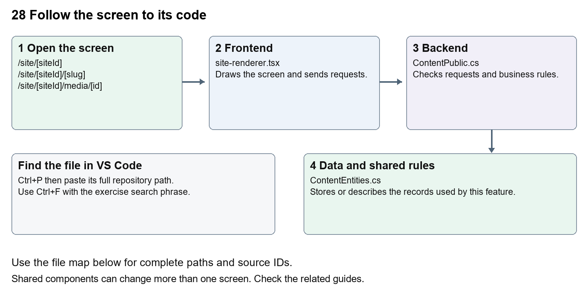

# Nexora public website

Document 28 of the Nexora learning guides  
Source snapshot 14 October 2026 at 06:41 UTC


Understand visitor routes, published content rendering, navigation, media and sitemap.

### Recognise the screen and its scope

Open `/site/[siteId]`, `/site/[siteId]/[slug]`, `/site/[siteId]/media/[id]`, `/site/[siteId]/sitemap.xml`. CRM routes use port 3017; member routes use 3018; public website routes can use 3019. Brackets name a route parameter, not text to paste into a browser. Choose a real record or site id from the application.

This guide covers Published home and pages; Site navigation and portal link; SEO metadata canonical links and sitemap; Redirects; Public clean media; Block rendering theme and motion.



The diagram shows the file roles. The full paths below are what you paste into Ctrl+P.

### Find the files in VS Code

| Role | File and source ID | What it does |
| --- | --- | --- |
| Screen | S0068 site-renderer.tsx | Main UI or route for this topic |
| Server | S0220 ContentPublic.cs | Endpoints or server rules |
| Data | S0217 ContentEntities.cs | Data shape or persistence structure |

**Screen S0068**  
[apps/web/src/features/content/site-renderer.tsx](<D:/Projects new/Nexora/apps/web/src/features/content/site-renderer.tsx>)

**Server S0220**  
[backend/src/Modules/Nexora.Modules.Content/ContentPublic.cs](<D:/Projects new/Nexora/backend/src/Modules/Nexora.Modules.Content/ContentPublic.cs>)

**Data S0217**  
[backend/src/Modules/Nexora.Modules.Content/ContentEntities.cs](<D:/Projects new/Nexora/backend/src/Modules/Nexora.Modules.Content/ContentEntities.cs>)

The complete HTML manual opens these source IDs inside its Source library. The Word manual shows short labelled extracts so you can learn the flow before reading large files. Each individual Markdown guide includes its complete primary files after the walkthrough.

### Follow the request and the records

1. A public route receives siteId and optional slug.
2. The route requests published page data from the API.
3. ContentPublic checks the site, publication and media availability.
4. SiteRenderer draws blocks with published layout and design.
5. Navigation, portal links and sitemap use published page addresses.

### Read the code with an explanation

The route is the entry point, but the page text lives in saved revisions. SiteRenderer switches on each block type, so a new block type needs matching types, editor controls, validation and rendering. Motion fields affect how content enters and responds to hover. Respect reduced-motion settings. A media URL is checked by the backend before data is returned.

Source reference S0068 apps/web/src/features/content/site-renderer.tsx

Selected opening lines with their original numbers. The complete file is in the HTML source library.

```tsx
0001  "use client";
0002  /* eslint-disable @next/next/no-img-element -- Media URLs enforce tenant, scan and public-grant checks. */
0003  import { useEffect, useId, useRef, useState, type CSSProperties, type ReactNode } from "react";
0004  import type { BlockItem, PublicPage, WebsiteMotion } from "./types";
0005  import { defaultDesign, defaultLayout } from "./website-design";
0006  import "./site.css";
```


The import lines lead to shared components and helpers. Start at the exported component or route function; follow the request helper to the server rather than assuming the whole feature lives in this file.

Source reference S0220 backend/src/Modules/Nexora.Modules.Content/ContentPublic.cs

Extract from source line 40. A fragment from a long line is shown without the rest of that line.

```cs
0040          endpoints.MapGet("/api/v1/public/portal-appearance", async (C
```


On the server, look for MapGet to load records, MapPost to create or perform an action, MapPut or MapPatch to change data, and RequireAuthorization for permissions. Some shared methods register endpoints indirectly. Find SaveChangesAsync to see the database write. A request method alone does not tell you every side effect.

Source reference S0217 backend/src/Modules/Nexora.Modules.Content/ContentEntities.cs

Selected opening lines with their original numbers. The complete file is in the HTML source library.

```cs
0001  using Nexora.BuildingBlocks.Domain;
0003  namespace Nexora.Modules.Content;
0005  public sealed class Site : TenantEntity
0006  {
0007      public string Name { get; set; } = "";
0008      public string Tagline { get; set; } = "";
```


Follow model fields to their request names and database mapping. An id points to a particular record. A tenant id limits the organisation. A version or concurrency stamp protects newer edits. Some model files describe contracts rather than tables; check the owning DbContext before assuming storage.

### Make or trace your first change

1. Press Ctrl+P and open [apps/web/src/features/content/site-renderer.tsx](<D:/Projects new/Nexora/apps/web/src/features/content/site-renderer.tsx>).
2. Press Ctrl+F and search for `export function`. In this snapshot it appears at line 57.
3. Read-only exercise: locate SiteRenderer, find how it chooses block types, then follow a hero block back to the editor types. Use CRM to preview changed text; do not replace a saved page with a hardcoded route.
4. Record the file, request path and server handler you found. This exercise is read-only; no stored records need to change.

Extract from source line 57. A fragment from a long line is shown without the rest of that line.

```tsx
0057  export function SiteRenderer({ content, preview = false }: { content: PublicPage; preview?: boolean }) {
```


These exercises have not been applied to the application. Their search phrases are verified against the captured source. Line numbers can move; the phrase and file path are your main navigation aids.

### Check a change and diagnose problems

Confirm the original screen still loads, the changed words appear in the intended place, and another screen using the same component still behaves correctly. If an action fails, inspect the browser Network response, the relevant helper and server validation message. Use the common error table at the beginning of the manual. Reload on a version conflict instead of removing the version check.

A syntax error after a text edit usually means a quote, brace or closing tag changed. Compare your diff with the original. An unchanged browser result can mean the wrong port, a saved published configuration overriding a default, or a running API that has not reloaded.

### Understand the current limits

The public demo is not evidence of live event booking, payments or enquiry delivery. Only published content is visible to anonymous visitors. Registration and member actions belong to the portal access boundary.

### Continue learning

Related guides [24 Nexora member portal login and onboarding](#guide_24), [27 Nexora website editor and publishing](#guide_27), [29 Nexora documents evidence and file safety](#guide_29).

## Complete primary source files

These are the complete captured files, with numbered source lines. Other supporting files are included in the complete HTML manual. Configured local passwords, if any, are explicitly omitted. Do not paste the display line numbers into code.

### S0068 site-renderer.tsx

[apps/web/src/features/content/site-renderer.tsx](<D:/Projects new/Nexora/apps/web/src/features/content/site-renderer.tsx>)

SHA256 `629904b01f57b5598afbbb0ca0b44b76df6aa0c463690128f5d04d50afb80d33`; 108 source lines; complete captured text.

```tsx
0001  "use client";
0002  /* eslint-disable @next/next/no-img-element -- Media URLs enforce tenant, scan and public-grant checks. */
0003  import { useEffect, useId, useRef, useState, type CSSProperties, type ReactNode } from "react";
0004  import type { BlockItem, PublicPage, WebsiteMotion } from "./types";
0005  import { defaultDesign, defaultLayout } from "./website-design";
0006  import "./site.css";
0007  
0008  function MotionSection({ children, motion, enabled, ...props }: { children: ReactNode; motion: WebsiteMotion; enabled: boolean; className: string; style: CSSProperties; "data-span": string; "data-alignment": string; "data-surface": string; "data-spacing": string; "data-block": string }) {
0009    const ref = useRef<HTMLElement>(null);
0010    useEffect(() => {
0011      const element = ref.current;
0012      if (!element || !enabled || motion.effect === "none" || !element.animate) return;
0013      const reduced = window.matchMedia("(prefers-reduced-motion: reduce)");
0014      if (reduced.matches) return;
0015      let animation: Animation | undefined;
0016      const play = () => {
0017        if (reduced.matches) return;
0018        const from: Keyframe = { opacity: 0, transform: "none", filter: "none" };
0019        if (motion.effect === "rise") from.transform = "translateY(" + motion.distance + "px)";
0020        if (motion.effect === "slide") from.transform = "translateX(" + motion.distance + "px)";
0021        if (motion.effect === "scale") from.transform = "scale(" + (1 - motion.distance / 500) + ")";
0022        if (motion.effect === "blur") from.filter = "blur(" + motion.distance / 3.5 + "px)";
0023        animation = element.animate([from, { opacity: 1, transform: "none", filter: "none" }], { duration: motion.durationMs, delay: motion.delayMs, easing: motion.easing, fill: "backwards" });
0024      };
0025      const observer = motion.trigger === "enter" && "IntersectionObserver" in window ? new IntersectionObserver(entries => {
0026        if (entries.some(entry => entry.isIntersecting)) { play(); observer?.disconnect(); }
0027      }, { threshold: .08 }) : null;
0028      if (observer) observer.observe(element); else play();
0029      const stop = () => { if (reduced.matches) { animation?.cancel(); observer?.disconnect(); } };
0030      reduced.addEventListener("change", stop);
0031      return () => { observer?.disconnect(); animation?.cancel(); reduced.removeEventListener("change", stop); };
0032    }, [enabled, motion]);
0033    return <section ref={ref} {...props} data-motion={enabled ? motion.effect : "none"} data-hover={enabled ? motion.hover : "none"}>{children}</section>;
0034  }
0035  
0036  function Showcase({ items, mediaUrl, pageLink }: { items: BlockItem[]; mediaUrl: (id: string) => string; pageLink: (url: string) => string }) {
0037    const [active, setActive] = useState(0);
0038    const id = useId();
0039    const index = Math.min(active, items.length - 1);
0040    return <div className="site-showcase">
0041      <div className="site-tabs" role="tablist" aria-label="Explore this section">{items.map((item, i) => <button key={i} type="button" role="tab" id={id + "-tab-" + i} aria-controls={id + "-panel-" + i} aria-selected={i === index} tabIndex={i === index ? 0 : -1} onClick={() => setActive(i)} onKeyDown={event => {
0042        let next = index;
0043        if (event.key === "ArrowRight") next = (index + 1) % items.length;
0044        else if (event.key === "ArrowLeft") next = (index - 1 + items.length) % items.length;
0045        else if (event.key === "Home") next = 0;
0046        else if (event.key === "End") next = items.length - 1;
0047        else return;
0048        event.preventDefault(); setActive(next); event.currentTarget.parentElement?.querySelectorAll<HTMLButtonElement>("[role=tab]")[next]?.focus();
0049      }}>{item.heading}</button>)}</div>
0050      {items.map((item, i) => <div key={i} role="tabpanel" id={id + "-panel-" + i} aria-labelledby={id + "-tab-" + i} tabIndex={0} hidden={i !== index} className="site-showcase-panel">
0051        {item.mediaId && }
0052        <div><h3>{item.heading}</h3><p>{item.text}</p>{item.linkUrl && <a className="site-button" href={pageLink(item.linkUrl)}>{item.linkLabel}<span aria-hidden>↗</span></a>}</div>
0053      </div>)}
0054    </div>;
0055  }
0056  
0057  export function SiteRenderer({ content, preview = false }: { content: PublicPage; preview?: boolean }) {
0058    const { site, page, navigation } = content;
0059    const design = { ...defaultDesign, ...content.design };
0060    const base = content.basePath ?? "/site/" + site.id;
0061    const mediaUrl = (id: string) => preview ? "/api/v1/content/media/" + id : "/site/" + site.id + "/media/" + id;
0062    const pageLink = (url: string) => url.startsWith("/site/" + site.id + "/") ? base + "/" + url.slice(("/site/" + site.id + "/").length) : url;
0063    const home = base ? base + "/home" : "/";
0064    const style = {
0065      "--site-brand": site.brandColor ?? "#183a31", "--site-bg": design.backgroundColor, "--site-fg": design.textColor, "--site-accent": design.accentColor, "--site-accent-secondary": design.secondaryAccentColor,
0066      "--site-width": design.contentWidth + "px", "--site-gap": design.sectionGap + "px", "--site-radius": design.cornerRadius + "px",
0067      "--site-font": design.font === "serif" ? "Georgia, serif" : design.font === "mono" ? "ui-monospace, monospace" : "var(--font-geist-sans, Arial), sans-serif",
0068      "--site-heading-size": design.headingSize === "small" ? "3.5rem" : design.headingSize === "medium" ? "5rem" : "6.5rem",
0069      "--site-ambient-duration": design.ambientDurationMs + "ms", "--site-motion-duration": design.motion.durationMs + "ms", "--site-motion-easing": design.motion.easing,
0070      "--site-hover-distance": -design.motion.distance / 7 + "px", "--site-ambient-distance": -design.motion.distance / 2 + "px",
0071    } as CSSProperties;
0072    return <div style={style} className="association-site" data-theme={design.theme} data-motion-enabled={design.motionEnabled} data-ambient={design.ambientEffect} data-pause-hover={design.pauseAmbientOnHover}>
0073      <a href="#site-content" className="site-skip">Skip to content</a>
0074      {preview && <div className="site-preview-note">Draft preview — only published versions appear on your public website.</div>}
0075      <header className="site-header" data-sticky={design.stickyHeader}>
0076        <div className="site-header-inner"><a href={home} className="site-brand"><span className="site-logo" aria-hidden>{site.logoMediaId ?  : site.name.slice(0, 1)}</span>{site.name}</a>
0077          <nav aria-label="Website navigation" className="site-navigation">{navigation.map(item => <a key={item.slug} aria-current={item.slug === content.slug ? "page" : undefined} href={item.slug === "home" ? home : base + "/" + item.slug}>{item.title}</a>)}</nav>
0078          <div className="site-header-actions">{design.showPortalLink && <a className="site-button site-button-small site-portal-link" href={pageLink(design.portalUrl)}>{design.portalLabel}<span aria-hidden>↗</span></a>}
0079            {!!navigation.length && <details className="site-mobile-menu"><summary aria-label="Open website menu"><span aria-hidden>☰</span></summary><nav aria-label="Mobile website navigation">{navigation.map(item => <a key={item.slug} href={item.slug === "home" ? home : base + "/" + item.slug}>{item.title}</a>)}</nav></details>}
0080          </div>
0081        </div>
0082      </header>
0083      <main id="site-content" className="site-main">
0084        <div className="site-masthead">{design.showTagline && <p className="site-eyebrow"><span aria-hidden />{site.tagline || site.name}</p>}<h1>{page.title}</h1>
0085          {page.description && <p className="site-introduction">{page.description}</p>}{content.slug !== "home" && <a className="site-back-link" href={home}>← Back to home</a>}
0086        </div>
0087        <div className="site-blocks">{page.blocks.filter(block => !block.layout?.hidden).map((block, index) => {
0088          const layout = block.layout ?? defaultLayout(block);
0089          const motion = block.motion ?? design.motion;
0090          const items = block.items ?? [];
0091          return <MotionSection key={page.id + "-" + index} motion={motion} enabled={design.motionEnabled} className={"site-section site-block-" + block.type} data-block={block.type} data-span={layout.span} data-alignment={layout.alignment} data-surface={layout.surface} data-spacing={layout.spacing} style={{ "--site-motion-duration": motion.durationMs + "ms", "--site-motion-easing": motion.easing, "--site-hover-distance": -motion.distance / 7 + "px", "--site-ambient-distance": -motion.distance / 2 + "px" } as CSSProperties}>
0092            {layout.eyebrow && <p className="site-eyebrow">{layout.eyebrow}</p>}
0093            {block.heading && <h2>{block.heading}</h2>}
0094            {block.type !== "image" && block.text && <p className="site-section-description">{block.text}</p>}
0095            {block.mediaId && block.type !== "download" && <figure className="site-media-frame">{block.type === "image" && block.heading && <figcaption>{block.heading}</figcaption>}</figure>}
0096            {block.type === "hero" && !block.mediaId && <div className="site-art" aria-hidden><div className="site-art-orbit" /><div className="site-art-orbit" /><div className="site-art-panel"><span>{site.name.slice(0, 1)}</span><i /><i /><i /></div></div>}
0097            {block.type === "feature-grid" && <div className="site-feature-grid">{items.map((item, i) => <article className="site-feature-card" key={i}>{item.mediaId && }<span className="site-item-number" aria-hidden>{String(i + 1).padStart(2, "0")}</span><h3>{item.heading}</h3><p>{item.text}</p>{item.linkUrl && <a className="site-text-link" href={pageLink(item.linkUrl)}>{item.linkLabel} <span aria-hidden>↗</span></a>}</article>)}</div>}
0098            {block.type === "showcase" && <Showcase items={items} mediaUrl={mediaUrl} pageLink={pageLink} />}
0099            {block.type === "gallery" && <div className="site-gallery" aria-label={block.heading || "Gallery"} tabIndex={0}>{items.map((item, i) => <figure key={i}>{item.mediaId && }<figcaption><h3>{item.heading}</h3><p>{item.text}</p>{item.linkUrl && <a href={pageLink(item.linkUrl)}>{item.linkLabel} ↗</a>}</figcaption></figure>)}</div>}
0100            {block.type === "faq" && <div className="site-faq">{items.map((item, i) => <details key={i}><summary>{item.heading}<span aria-hidden>+</span></summary><p>{item.text}</p>{item.linkUrl && <a className="site-text-link" href={pageLink(item.linkUrl)}>{item.linkLabel} ↗</a>}</details>)}</div>}
0101            {block.type === "download" && block.mediaId && <a className="site-button" href={mediaUrl(block.mediaId)} download>{block.linkLabel || "Download file"}<span aria-hidden>↓</span></a>}
0102            {block.linkUrl && <a className="site-button" href={pageLink(block.linkUrl)}>{block.linkLabel}<span aria-hidden>↗</span></a>}
0103          </MotionSection>;
0104        })}</div>
0105      </main>
0106      {design.showFooter && <footer className="site-footer"><div className="site-footer-inner"><div><p className="site-footer-name">{site.name}</p><p>{design.footerText || site.tagline}</p></div><nav aria-label="Footer navigation">{navigation.map(item => <a key={item.slug} href={item.slug === "home" ? home : base + "/" + item.slug}>{item.title}</a>)}</nav><p className="site-copyright">© {new Date().getFullYear()} {site.name}</p></div></footer>}
0107    </div>;
0108  }
```

### S0220 ContentPublic.cs

[backend/src/Modules/Nexora.Modules.Content/ContentPublic.cs](<D:/Projects new/Nexora/backend/src/Modules/Nexora.Modules.Content/ContentPublic.cs>)

SHA256 `69a32f966c6baeb4e77825348c34bec23ed58d0e2c7aa7d1f6847150e5ee0160`; 104 source lines; complete captured text.

```cs
0001  using System.Text.Json;
0002  using Microsoft.AspNetCore.Builder;
0003  using Microsoft.AspNetCore.Http;
0004  using Microsoft.AspNetCore.Routing;
0005  using Microsoft.EntityFrameworkCore;
0006  using Microsoft.Extensions.Configuration;
0007  using Microsoft.Extensions.Hosting;
0008  using Nexora.BuildingBlocks.Security;
0009  
0010  namespace Nexora.Modules.Content;
0011  public static partial class ContentModule
0012  {
0013      private static bool Domain(IConfiguration config, string host, Guid siteId) => config.GetSection("Content:Domains").GetChildren()
0014          .Any(d => string.Equals(d["Host"], host, StringComparison.OrdinalIgnoreCase) && Guid.TryParse(d["SiteId"], out var id) && id == siteId);
0015      private static async Task<Site?> PublicSite(Guid siteId, ContentDbContext db, IPublicTenantDirectory tenants, IConfiguration config, IHostEnvironment env, HttpContext http, CancellationToken ct)
0016      {
0017          http.Response.Headers.CacheControl = "no-store";
0018          var host = http.Request.Host.Host;
0019          if (!(env.IsDevelopment() && host is "localhost" or "127.0.0.1" or "::1") && !Domain(config, host, siteId)) return null;
0020          var site = await db.Sites.IgnoreQueryFilters().AsNoTracking().SingleOrDefaultAsync(s => s.Id == siteId, ct);
0021          return site != null && await tenants.IsActiveAsync(site.TenantId, ct) ? site : null;
0022      }
0023      internal static async Task<Site?> ResolvePortalSite(ContentDbContext db, IPublicTenantDirectory tenants, IConfiguration config, IHostEnvironment env, HttpContext http, CancellationToken ct)
0024      {
0025          var host = http.Request.Host.Host;
0026          var matches = config.GetSection("Content:Domains").GetChildren().Where(d => string.Equals(d["Host"], host, StringComparison.OrdinalIgnoreCase)).ToArray();
0027          if (matches.Length > 1) return null;
0028          Guid siteId;
0029          if (!Guid.TryParse(matches.SingleOrDefault()?["SiteId"], out siteId))
0030          {
0031              if (!(env.IsDevelopment() && host is "localhost" or "127.0.0.1" or "::1")) return null;
0032              var ids = await db.Sites.IgnoreQueryFilters().AsNoTracking().Select(s => s.Id).Take(2).ToListAsync(ct);
0033              if (ids.Count != 1) return null;
0034              siteId = ids[0];
0035          }
0036          return await PublicSite(siteId, db, tenants, config, env, http, ct);
0037      }
0038      private static void MapPublic(IEndpointRouteBuilder endpoints)
0039      {
0040          endpoints.MapGet("/api/v1/public/portal-appearance", async (ContentDbContext db, IPublicTenantDirectory tenants, IConfiguration config, IHostEnvironment env, HttpContext http, CancellationToken ct) =>
0041          {
0042              http.Response.Headers.CacheControl = "no-store";
0043              var site = await ResolvePortalSite(db, tenants, config, env, http, ct);
0044              if (site == null) return Results.NotFound();
0045              var json = await db.Set<PortalConfiguration>().IgnoreQueryFilters().AsNoTracking().Where(x => x.TenantId == site.TenantId).Select(x => x.PublishedJson).SingleOrDefaultAsync(ct);
0046              var presentation = json == null ? PortalPresentation.Default : JsonSerializer.Deserialize<PortalPresentation>(json)!;
0047              // Only sign-in branding is public. Member pages and navigation remain protected.
0048              return Results.Ok(new { presentation.Name, presentation.Tagline, presentation.BrandColor, design = presentation.Design ?? new PortalDesign() });
0049          }).AllowAnonymous();
0050          endpoints.MapGet("/api/v1/public/resolve-site", async (ContentDbContext db, IPublicTenantDirectory tenants, IConfiguration config, HttpContext http, CancellationToken ct) =>
0051          {
0052              http.Response.Headers.CacheControl = "no-store";
0053              var match = config.GetSection("Content:Domains").GetChildren().SingleOrDefault(d => string.Equals(d["Host"], http.Request.Host.Host, StringComparison.OrdinalIgnoreCase));
0054              if (match == null || !Guid.TryParse(match["SiteId"], out var id)) return Results.NotFound();
0055              var site = await db.Sites.IgnoreQueryFilters().SingleOrDefaultAsync(s => s.Id == id, ct);
0056              return site != null && await tenants.IsActiveAsync(site.TenantId, ct) ? Results.Ok(new { siteId = id }) : Results.NotFound();
0057          }).AllowAnonymous();
0058          endpoints.MapGet("/api/v1/public/sites/{siteId:guid}/media/{id:guid}", async (Guid siteId, Guid id, ContentDbContext db, IPublicTenantDirectory tenants, IConfiguration config, IHostEnvironment env, HttpContext http, CancellationToken ct) =>
0059          {
0060              var site = await PublicSite(siteId, db, tenants, config, env, http, ct); if (site == null) return Results.NotFound();
0061              var media = await db.Set<MediaAsset>().IgnoreQueryFilters().AsNoTracking().SingleOrDefaultAsync(m => m.Id == id && m.SiteId == siteId && m.TenantId == site.TenantId && m.IsPublic && m.ScanStatus == "clean", ct);
0062              if (media == null) return Results.NotFound();
0063              http.Response.Headers["X-Content-Type-Options"] = "nosniff"; http.Response.Headers.ContentSecurityPolicy = "sandbox";
0064              return media.ContentType.StartsWith("image/") ? Results.File(media.Content, media.ContentType) : Nexora.BuildingBlocks.Documents.DocumentSafety.Download(http, media.Name, media.Content);
0065          }).AllowAnonymous();
0066          endpoints.MapGet("/api/v1/public/sites/{siteId:guid}/sitemap.xml", async (Guid siteId, ContentDbContext db, IPublicTenantDirectory tenants, IConfiguration config, IHostEnvironment env, HttpContext http, CancellationToken ct) =>
0067          {
0068              var site = await PublicSite(siteId, db, tenants, config, env, http, ct); if (site == null) return Results.NotFound();
0069              var root = Domain(config, http.Request.Host.Host, siteId);
0070              var origin = root ? "https://" + http.Request.Host.Host : $"{http.Request.Scheme}://{http.Request.Host}/site/{siteId}";
0071              var slugs = await db.Pages.IgnoreQueryFilters().Where(p => p.SiteId == siteId && p.TenantId == site.TenantId && p.PublishedId != null).OrderBy(p => p.Slug).Select(p => p.Slug).ToListAsync(ct);
0072              var xml = new System.Xml.Linq.XDocument(new System.Xml.Linq.XElement(System.Xml.Linq.XName.Get("urlset", "http://www.sitemaps.org/schemas/sitemap/0.9"),
0073                  slugs.Select(slug => new System.Xml.Linq.XElement(System.Xml.Linq.XName.Get("url", "http://www.sitemaps.org/schemas/sitemap/0.9"),
0074                      new System.Xml.Linq.XElement(System.Xml.Linq.XName.Get("loc", "http://www.sitemaps.org/schemas/sitemap/0.9"), origin + (root && slug == "home" ? "/" : "/" + slug))))));
0075              return Results.Text(xml.ToString(), "application/xml");
0076          }).AllowAnonymous();
0077          endpoints.MapGet("/api/v1/public/sites/{siteId:guid}/{slug}", async (Guid siteId, string slug, ContentDbContext db, IPublicTenantDirectory tenants, IConfiguration config, IHostEnvironment env, HttpContext http, CancellationToken ct) =>
0078          {
0079              var site = await PublicSite(siteId, db, tenants, config, env, http, ct); if (site == null) return Results.NotFound();
0080              var published = await (from p in db.Pages.IgnoreQueryFilters().AsNoTracking()
0081                  join v in db.Versions.IgnoreQueryFilters().AsNoTracking() on p.PublishedId equals v.Id
0082                  where p.SiteId == siteId && p.TenantId == site.TenantId && v.TenantId == site.TenantId && v.PageId == p.Id
0083                  select new { Page = p, Revision = v }).ToListAsync(ct);
0084              var result = published.SingleOrDefault(p => p.Page.Slug == slug);
0085              if (result == null)
0086              {
0087                  var alias = await db.Set<PageRedirect>().IgnoreQueryFilters().SingleOrDefaultAsync(r => r.SiteId == siteId && r.TenantId == site.TenantId && r.Slug == slug, ct);
0088                  var target = published.SingleOrDefault(p => p.Page.Id == alias?.PageId);
0089                  return target == null ? Results.NotFound() : Results.Ok(new { redirectSlug = target.Page.Slug, basePath = Domain(config, http.Request.Host.Host, siteId) ? "" : $"/site/{siteId}" });
0090              }
0091              var publicMedia = await db.Set<MediaAsset>().IgnoreQueryFilters().Where(m => m.SiteId == siteId && m.TenantId == site.TenantId && m.IsPublic && m.ScanStatus == "clean").Select(m => m.Id).ToListAsync(ct);
0092              var blocks = (JsonSerializer.Deserialize<ContentBlock[]>(result.Revision.BlocksJson, Json) ?? [])
0093                  .Where(b => b.Layout?.Hidden != true && (b.Type is not ("image" or "download") || b.MediaId.HasValue && publicMedia.Contains(b.MediaId.Value)))
0094                  .Select(b => b with { MediaId = b.MediaId.HasValue && publicMedia.Contains(b.MediaId.Value) ? b.MediaId : null,
0095                      Items = b.Items?.Select(i => i with { MediaId = i.MediaId.HasValue && publicMedia.Contains(i.MediaId.Value) ? i.MediaId : null }).ToArray() });
0096              var designJson = await db.Set<WebsiteConfiguration>().IgnoreQueryFilters().Where(x => x.SiteId == siteId && x.TenantId == site.TenantId).Select(x => x.PublishedJson).SingleOrDefaultAsync(ct);
0097              var root = Domain(config, http.Request.Host.Host, siteId); var basePath = root ? "" : $"/site/{siteId}";
0098              var canonical = root ? $"https://{http.Request.Host.Host}{(slug == "home" ? "/" : "/" + slug)}" : null;
0099              return Results.Ok(new { site = new { site.Id, site.Name, site.Tagline, site.BrandColor, logoMediaId = site.LogoMediaId.HasValue && publicMedia.Contains(site.LogoMediaId.Value) ? site.LogoMediaId : null }, slug, basePath, canonical,
0100                  design = ReadWebsiteDesign(designJson), page = new { result.Revision.Id, result.Revision.Title, result.Revision.Description, result.Revision.CreatedAtUtc, blocks },
0101                  navigation = published.Where(p => p.Page.ShowInNavigation).OrderBy(p => p.Page.NavigationOrder).ThenBy(p => p.Page.Slug).Select(p => new { p.Page.Slug, title = string.IsNullOrEmpty(p.Page.NavigationLabel) ? p.Revision.Title : p.Page.NavigationLabel }) });
0102          }).AllowAnonymous();
0103      }
0104  }
```

### S0217 ContentEntities.cs

[backend/src/Modules/Nexora.Modules.Content/ContentEntities.cs](<D:/Projects new/Nexora/backend/src/Modules/Nexora.Modules.Content/ContentEntities.cs>)

SHA256 `6ece527fbeeb7e89719451882d9af18bd9da87128a53535bc26f718691278d93`; 66 source lines; complete captured text.

```cs
0001  using Nexora.BuildingBlocks.Domain;
0002  
0003  namespace Nexora.Modules.Content;
0004  
0005  public sealed class Site : TenantEntity
0006  {
0007      public string Name { get; set; } = "";
0008      public string Tagline { get; set; } = "";
0009      public string BrandColor { get; set; } = "#183a31";
0010      public Guid? LogoMediaId { get; set; }
0011  }
0012  public sealed class Page : TenantEntity
0013  {
0014      public Guid SiteId { get; set; }
0015      public string Slug { get; set; } = "";
0016      public Guid DraftId { get; set; }
0017      public Guid? PublishedId { get; set; }
0018      public int NavigationOrder { get; set; }
0019      public string NavigationLabel { get; set; } = "";
0020      public bool ShowInNavigation { get; set; } = true;
0021  }
0022  public sealed class MediaAsset : TenantEntity
0023  {
0024      public Guid SiteId { get; set; }
0025      public string Name { get; set; } = "";
0026      public string ContentType { get; set; } = "";
0027      public byte[] Content { get; set; } = [];
0028      public string ScanStatus { get; set; } = "quarantined";
0029      public bool IsPublic { get; set; }
0030  }
0031  public sealed class PageRedirect : TenantEntity
0032  {
0033      public Guid SiteId { get; set; }
0034      public Guid PageId { get; set; }
0035      public string Slug { get; set; } = "";
0036  }
0037  public sealed class ScheduledPublication : TenantEntity
0038  {
0039      public Guid PageId { get; set; }
0040      public Guid RevisionId { get; set; }
0041      public Guid PublisherId { get; set; }
0042      public DateTime PublishAtUtc { get; set; }
0043      public string Status { get; set; } = "pending";
0044      public string? Failure { get; set; }
0045  }
0046  public sealed class PageVersion : TenantEntity, IAppendOnly
0047  {
0048      public Guid PageId { get; set; }
0049      public string Title { get; set; } = "";
0050      public string Description { get; set; } = "";
0051      public string BlocksJson { get; set; } = "[]";
0052      public Guid AuthorId { get; set; }
0053  }
0054  public sealed class Publication : TenantEntity, IAppendOnly
0055  {
0056      public Guid PageId { get; set; }
0057      public Guid? PageVersionId { get; set; }
0058      public Guid ActorId { get; set; }
0059  }
0060  public sealed record ContentItem(string Heading, string Text, Guid? MediaId = null, string? LinkLabel = null, string? LinkUrl = null);
0061  public sealed record ContentLayout(string Span = "full", string Alignment = "left", string Surface = "card", string Spacing = "normal", string Eyebrow = "", bool Hidden = false);
0062  public sealed record ContentBlock(string Type, string Heading, string Text, string? LinkLabel = null, string? LinkUrl = null, Guid? MediaId = null,
0063      ContentLayout? Layout = null, WebsiteMotion? Motion = null, ContentItem[]? Items = null);
0064  public sealed record SiteRequest(string Name, string Tagline);
0065  public sealed record PageRequest(string Slug, string Title, string Description, ContentBlock[] Blocks, Guid? Version);
0066  public sealed record PublishRequest(Guid Version, Guid? RevisionId = null);
```
