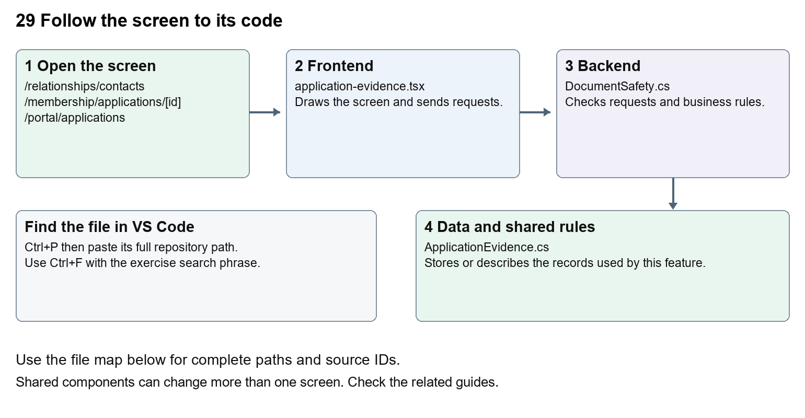

# Nexora documents evidence and file safety

Document 29 of the Nexora learning guides  
Source snapshot 14 October 2026 at 06:41 UTC


Understand CRM files, application evidence, CMS media and quarantined uploads.

### Recognise the screen and its scope

Open `/relationships/contacts`, `/membership/applications/[id]`, `/portal/applications`, `/website`. CRM routes use port 3017; member routes use 3018; public website routes can use 3019. Brackets name a route parameter, not text to paste into a browser. Choose a real record or site id from the application.

This guide covers Upload metadata and content; Quarantine and scan states; ClamAV scanner configuration; Clean-file download; Tenant and record access; Application evidence review and CMS public media.



The diagram shows the file roles. The full paths below are what you paste into Ctrl+P.

### Find the files in VS Code

| Role | File and source ID | What it does |
| --- | --- | --- |
| Screen | S0133 application-evidence.tsx | Main UI or route for this topic |
| Server | S0187 DocumentSafety.cs | Endpoints or server rules |
| Data | S0416 ApplicationEvidence.cs | Data shape or persistence structure |

**Screen S0133**  
[apps/web/src/features/shared/application-evidence.tsx](<D:/Projects new/Nexora/apps/web/src/features/shared/application-evidence.tsx>)

**Server S0187**  
[backend/src/BuildingBlocks/Nexora.BuildingBlocks/Documents/DocumentSafety.cs](<D:/Projects new/Nexora/backend/src/BuildingBlocks/Nexora.BuildingBlocks/Documents/DocumentSafety.cs>)

**Data S0416**  
[backend/src/Modules/Nexora.Modules.Membership/Domain/ApplicationEvidence.cs](<D:/Projects new/Nexora/backend/src/Modules/Nexora.Modules.Membership/Domain/ApplicationEvidence.cs>)

The complete HTML manual opens these source IDs inside its Source library. The Word manual shows short labelled extracts so you can learn the flow before reading large files. Each individual Markdown guide includes its complete primary files after the walkthrough.

### Follow the request and the records

1. A form sends a file and relevant record or draft id.
2. The endpoint validates size, type and access.
3. The shared safety service stores quarantine and scan state.
4. A scan result controls whether download or publication is allowed.
5. Record, application and public media endpoints apply their own access rules.

### Read the code with an explanation

File metadata is the name, type, size and scan result; file bytes are the actual content. Stored bytes alone do not make a file safe. Missing scanner access deliberately retains quarantine. CRM, portal evidence and CMS media use shared safety concepts but different endpoints and permissions. On Windows, Prepare-LocalDebug.ps1 calls Prepare-LocalDocumentScanner.ps1 before API preparation. The helper can download its configured ClamAV package and signatures, checks the package checksum and starts the local scanner on 127.0.0.1:3310. The Development API configuration points to that address. Inspect its logs under artifacts/local-document-scanner when this preparation fails. Never make the UI treat quarantined as clean to remove an error.

Source reference S0133 apps/web/src/features/shared/application-evidence.tsx

Selected opening lines with their original numbers. The complete file is in the HTML source library.

```tsx
0001  "use client";
0003  import { useEffect, useState } from "react";
0005  type Evidence = { id: string; name: string; size: number; scanStatus: string };
0006  type Change = { draftVersion: string };
0007  type Props = { path: string; staff?: boolean; version?: string; disabled?: boolean; canScan?: boolean;
0008    onChanged?: (version: string) => void; onBusy?: (busy: boolean) => void };
```


The import lines lead to shared components and helpers. Start at the exported component or route function; follow the request helper to the server rather than assuming the whole feature lives in this file.

Source reference S0187 backend/src/BuildingBlocks/Nexora.BuildingBlocks/Documents/DocumentSafety.cs

Extract from source line 17. A fragment from a long line is shown without the rest of that line.

```cs
0017  public static class DocumentSafety
```


On the server, look for MapGet to load records, MapPost to create or perform an action, MapPut or MapPatch to change data, and RequireAuthorization for permissions. Some shared methods register endpoints indirectly. Find SaveChangesAsync to see the database write. A request method alone does not tell you every side effect.

Source reference S0416 backend/src/Modules/Nexora.Modules.Membership/Domain/ApplicationEvidence.cs

Selected opening lines with their original numbers. The complete file is in the HTML source library.

```cs
0001  using Nexora.BuildingBlocks.Domain;
0002  namespace Nexora.Modules.Membership.Domain;
0004  public sealed class ApplicationEvidence : TenantEntity
0005  {
0006      public Guid DraftId { get; set; }
0007      public string Name { get; set; } = "";
```


Follow model fields to their request names and database mapping. An id points to a particular record. A tenant id limits the organisation. A version or concurrency stamp protects newer edits. Some model files describe contracts rather than tables; check the owning DbContext before assuming storage.

### Make or trace your first change

1. Press Ctrl+P and open [apps/web/src/features/shared/application-evidence.tsx](<D:/Projects new/Nexora/apps/web/src/features/shared/application-evidence.tsx>).
2. Press Ctrl+F and search for `export function`. In this snapshot it appears at line 10.
3. Read-only exercise: find the upload, list and download requests. Trace the scan-status rendering to the backend safety code. Explain why a successful upload can still be unavailable for download.
4. Record the file, request path and server handler you found. This exercise is read-only; no stored records need to change.

Extract from source line 10. A fragment from a long line is shown without the rest of that line.

```tsx
0010  export function ApplicationEvidence({ path, staff = false, version, disabled = false, canScan = false, onChanged, onBusy }: Props) {
```


These exercises have not been applied to the application. Their search phrases are verified against the captured source. Line numbers can move; the phrase and file path are your main navigation aids.

### Check a change and diagnose problems

Confirm the original screen still loads, the changed words appear in the intended place, and another screen using the same component still behaves correctly. If an action fails, inspect the browser Network response, the relevant helper and server validation message. Use the common error table at the beginning of the manual. Reload on a version conflict instead of removing the version check.

A syntax error after a text edit usually means a quote, brace or closing tag changed. Compare your diff with the original. An unchanged browser result can mean the wrong port, a saved published configuration overriding a default, or a running API that has not reloaded.

### Understand the current limits

No live scanner was exercised for this documentation task. A controlled clean-scan test is different from an operational ClamAV deployment. Leave access and quarantine checks in place.

### Continue learning

Related guides [05 Nexora CRM contacts](#guide_05), [10 Nexora membership applications and decisions](#guide_10), [25 Nexora member portal journeys](#guide_25), [27 Nexora website editor and publishing](#guide_27), [28 Nexora public website](#guide_28), [30 Nexora backend database and maintenance](#guide_30).

## Complete primary source files

These are the complete captured files, with numbered source lines. Other supporting files are included in the complete HTML manual. Configured local passwords, if any, are explicitly omitted. Do not paste the display line numbers into code.

### S0133 application-evidence.tsx

[apps/web/src/features/shared/application-evidence.tsx](<D:/Projects new/Nexora/apps/web/src/features/shared/application-evidence.tsx>)

SHA256 `f76eea872477114ac23f7135337832208b7a3c70375cec88978bbe6961f479be`; 82 source lines; complete captured text.

```tsx
0001  "use client";
0002  
0003  import { useEffect, useState } from "react";
0004  
0005  type Evidence = { id: string; name: string; size: number; scanStatus: string };
0006  type Change = { draftVersion: string };
0007  type Props = { path: string; staff?: boolean; version?: string; disabled?: boolean; canScan?: boolean;
0008    onChanged?: (version: string) => void; onBusy?: (busy: boolean) => void };
0009  
0010  export function ApplicationEvidence({ path, staff = false, version, disabled = false, canScan = false, onChanged, onBusy }: Props) {
0011    const [items, setItems] = useState<Evidence[] | null>(null);
0012    const [error, setError] = useState("");
0013    const [busy, setBusy] = useState(false);
0014    const [reload, setReload] = useState(0);
0015    const [removing, setRemoving] = useState<string | null>(null);
0016    async function request(suffix = "", method = "GET", body?: FormData | object) {
0017      const headers: Record<string, string> = {};
0018      if (method !== "GET") {
0019        const token = await fetch(`/api/v1/${staff ? "auth" : "portal"}/csrf`, { cache: "no-store" });
0020        if (!token.ok) throw new Error("Unable to obtain a security token. Refresh and try again.");
0021        headers["X-CSRF-TOKEN"] = (await token.json()).token;
0022      }
0023      if (body && !(body instanceof FormData)) headers["Content-Type"] = "application/json";
0024      const response = await fetch(`${path}${suffix}`, { method, cache: "no-store", headers,
0025        body: body instanceof FormData ? body : body ? JSON.stringify(body) : undefined });
0026      if (!response.ok) {
0027        if (!staff && response.status === 401) window.dispatchEvent(new Event("portal-session-expired"));
0028        const problem = await response.json().catch(() => null);
0029        throw new Error(response.status === 404 || response.status === 403 ? "These documents are unavailable or you no longer have access." : problem?.title ?? "Unable to load documents. Please try again.");
0030      }
0031      return response;
0032    }
0033    useEffect(() => {
0034      let active = true;
0035      fetch(path, { cache: "no-store" }).then(async response => {
0036        if (!response.ok) {
0037          if (!staff && response.status === 401) window.dispatchEvent(new Event("portal-session-expired"));
0038          throw new Error("These documents are unavailable or you no longer have access.");
0039        }
0040        return response.json() as Promise<Evidence[]>;
0041      }).then(value => { if (active) setItems(value); }).catch(e => { if (active) { setItems(null); setError(e.message); } });
0042      return () => { active = false; };
0043    }, [path, staff, reload]);
0044    async function run(work: () => Promise<void>) {
0045      setBusy(true); onBusy?.(true); setError("");
0046      try { await work(); } catch (e) { setError(e instanceof Error ? e.message : "Unable to update evidence."); }
0047      finally { setBusy(false); onBusy?.(false); }
0048    }
0049    function refresh() { setItems(null); setError(""); setReload(n => n + 1); }
0050    const locked = busy || disabled;
0051    return <section className="mt-6 min-w-0 space-y-4 rounded-xl border border-slate-200 p-4 print:hidden" aria-label="Application evidence">
0052      <div className="flex flex-wrap items-center justify-between gap-3"><h3 className="font-semibold">Application evidence</h3><button type="button" className="text-sm underline" disabled={locked} onClick={refresh}>Refresh documents</button></div>
0053      <p className="text-sm text-slate-600">PDF, PNG, JPEG or UTF-8 text. Up to 10 files, 5 MB each. Downloads stay blocked until a security scan passes. Submitted files are retained with the application.</p>
0054      {error && <p role="alert" className="break-words text-sm text-red-800">{error}</p>}
0055      {!items && !error && <p role="status">Loading documents…</p>}
0056      {items?.length === 0 && <p className="text-sm">No evidence files attached.</p>}
0057      {items?.map(item => <article key={item.id} className="portal-subcard space-y-2 rounded-lg bg-slate-50 p-3 text-sm">
0058        <p className="break-all font-medium">{item.name}</p><p>{Math.ceil(item.size / 1024)} KB · {item.scanStatus === "clean" ? "Scan passed" : item.scanStatus === "rejected" ? "Blocked by security scan" : "Awaiting security scan"}</p>
0059        {item.scanStatus === "quarantined" && <p className="text-slate-600">The scanner has not cleared this file. Your association can retry the check when scanning is available.</p>}
0060        <div className="flex flex-wrap gap-4">
0061          {item.scanStatus === "clean" && <button type="button" className="underline" disabled={locked} onClick={() => void run(async () => {
0062            const response = await request(`/${item.id}`); const url = URL.createObjectURL(await response.blob());
0063            const link = document.createElement("a"); link.href = url; link.download = item.name; link.click(); setTimeout(() => URL.revokeObjectURL(url), 1000);
0064          })}>Download {item.name}</button>}
0065          {item.scanStatus === "quarantined" && (version || canScan) && <button type="button" className="underline" disabled={locked} onClick={() => void run(async () => {
0066            const response = await request(`/${item.id}/scan`, "POST", version ? { version } : undefined);
0067            if (version) onChanged?.(((await response.json()) as Change).draftVersion); refresh();
0068          })}>Retry security scan</button>}
0069          {version && <button type="button" className="text-red-800 underline" disabled={locked} onClick={() => setRemoving(item.id)}>Remove {item.name}</button>}
0070        </div>
0071        {removing === item.id && <div className="space-y-2"><p>Remove this file from the draft?</p><button type="button" className="mr-4 text-red-800 underline" disabled={locked} onClick={() => void run(async () => {
0072          const change: Change = await (await request(`/${item.id}`, "DELETE", { version })).json(); onChanged?.(change.draftVersion); setRemoving(null); refresh();
0073        })}>Confirm removal</button><button type="button" className="underline" disabled={locked} onClick={() => setRemoving(null)}>Keep file</button></div>}
0074      </article>)}
0075      {version && <form className="space-y-3" onSubmit={e => {
0076        e.preventDefault(); const form = e.currentTarget; const data = new FormData(form); data.set("version", version);
0077        const file = data.get("file");
0078        if (!(file instanceof File) || file.size === 0 || file.size > 5 * 1024 * 1024) { setError("Choose a file up to 5 MB."); return; }
0079        void run(async () => { const change: Change = await (await request("", "POST", data)).json(); onChanged?.(change.draftVersion); form.reset(); refresh(); });
0080      }}><label className="block text-sm">Evidence file<input type="file" name="file" accept=".pdf,.png,.jpg,.jpeg,.txt" required disabled={locked} className="mt-2 block w-full min-w-0 text-sm" /></label><button disabled={locked || (items?.length ?? 0) >= 10} className="portal-action rounded-lg bg-[#183a31] px-4 py-2 text-sm font-semibold text-white disabled:opacity-50">Upload evidence</button></form>}
0081    </section>;
0082  }
```

### S0187 DocumentSafety.cs

[backend/src/BuildingBlocks/Nexora.BuildingBlocks/Documents/DocumentSafety.cs](<D:/Projects new/Nexora/backend/src/BuildingBlocks/Nexora.BuildingBlocks/Documents/DocumentSafety.cs>)

SHA256 `785c91939401dcce9b8a76b858ef2261fada0d66e6cdbd0dbb377d3aa678ae35`; 109 source lines; complete captured text.

```cs
0001  using System.Buffers.Binary;
0002  using System.ComponentModel.DataAnnotations;
0003  using System.Net.Sockets;
0004  using System.Text;
0005  using Microsoft.AspNetCore.Http;
0006  using Microsoft.Extensions.Configuration;
0007  
0008  namespace Nexora.BuildingBlocks.Documents;
0009  
0010  public sealed record DocumentUpload(string Name, byte[] Content);
0011  public interface IDocumentScanner
0012  {
0013      // Only an explicit clean result permits download. Unavailable includes malformed replies.
0014      Task<string> ScanAsync(byte[] content, CancellationToken ct);
0015  }
0016  
0017  public static class DocumentSafety
0018  {
0019      public const int MaxBytes = 5 * 1024 * 1024;
0020      public static async Task<DocumentUpload> ReadAsync(HttpRequest request, CancellationToken ct)
0021      {
0022          if (!request.HasFormContentType || request.ContentLength is null or <= 0 or > MaxBytes + 65536)
0023              throw new ValidationException("Upload one file up to 5 MB.");
0024          var form = await request.ReadFormAsync(ct);
0025          if (form.Files.Count != 1 || form.Files[0].Name != "file" || form.Count != 1 || !form.ContainsKey("version"))
0026              throw new ValidationException("Only a file and the current draft version are accepted.");
0027          var file = form.Files[0];
0028          var name = Path.GetFileName(file.FileName.Replace('\\', '/')).Trim();
0029          if (name.Length is 0 or > 160 || name.Any(char.IsControl) || file.Length is <= 0 or > MaxBytes)
0030              throw new ValidationException("Use a filename up to 160 characters and a file up to 5 MB.");
0031          await using var input = file.OpenReadStream();
0032          using var output = new MemoryStream();
0033          var buffer = new byte[16384];
0034          int count;
0035          while ((count = await input.ReadAsync(buffer, ct)) > 0)
0036          {
0037              if (output.Length + count > MaxBytes) throw new ValidationException("Choose a file up to 5 MB.");
0038              output.Write(buffer, 0, count);
0039          }
0040          var bytes = output.ToArray();
0041          var valid = Path.GetExtension(name).ToLowerInvariant() switch
0042          {
0043              ".pdf" => bytes.AsSpan().StartsWith("%PDF-"u8),
0044              ".png" => bytes.AsSpan().StartsWith(new byte[] { 137, 80, 78, 71, 13, 10, 26, 10 }),
0045              ".jpg" or ".jpeg" => bytes.AsSpan().StartsWith(new byte[] { 255, 216, 255 }),
0046              ".txt" => IsText(bytes),
0047              _ => false
0048          };
0049          if (!valid) throw new ValidationException("Choose a PDF, PNG, JPEG or UTF-8 text file with matching content.");
0050          return new(name, bytes);
0051      }
0052      private static bool IsText(byte[] bytes)
0053      {
0054          try { return bytes.Length > 0 && !new UTF8Encoding(false, true).GetString(bytes).Any(c => char.IsControl(c) && c is not '\r' and not '\n' and not '\t'); }
0055          catch (DecoderFallbackException) { return false; }
0056      }
0057      public static IResult Download(HttpContext http, string name, byte[] content)
0058      {
0059          http.Response.Headers.CacheControl = "no-store";
0060          http.Response.Headers["X-Content-Type-Options"] = "nosniff";
0061          http.Response.Headers.ContentSecurityPolicy = "sandbox";
0062          return Results.File(content, "application/octet-stream", name, enableRangeProcessing: false);
0063      }
0064  }
0065  
0066  // Protocol: https://docs.clamav.net/manual/Usage/ClamdProtocol.html
0067  // Host/port come only from trusted server configuration, never from an upload.
0068  public sealed class ClamDocumentScanner(IConfiguration configuration) : IDocumentScanner
0069  {
0070      public async Task<string> ScanAsync(byte[] content, CancellationToken ct)
0071      {
0072          var host = configuration["Documents:ClamAv:Host"];
0073          if (string.IsNullOrWhiteSpace(host)) return "quarantined";
0074          var port = configuration.GetValue("Documents:ClamAv:Port", 3310);
0075          if (port is < 1 or > 65535) return "quarantined";
0076          using var timeout = CancellationTokenSource.CreateLinkedTokenSource(ct);
0077          timeout.CancelAfter(TimeSpan.FromSeconds(10));
0078          try
0079          {
0080              using var client = new TcpClient();
0081              await client.ConnectAsync(host, port, timeout.Token);
0082              await using var stream = client.GetStream();
0083              await stream.WriteAsync("zINSTREAM\0"u8.ToArray(), timeout.Token);
0084              var size = new byte[4];
0085              for (var offset = 0; offset < content.Length; offset += 16384)
0086              {
0087                  var length = Math.Min(16384, content.Length - offset);
0088                  BinaryPrimitives.WriteInt32BigEndian(size, length);
0089                  await stream.WriteAsync(size, timeout.Token);
0090                  await stream.WriteAsync(content.AsMemory(offset, length), timeout.Token);
0091              }
0092              await stream.WriteAsync(new byte[4], timeout.Token);
0093              var reply = new List<byte>();
0094              var one = new byte[1];
0095              while (reply.Count < 1024 && await stream.ReadAsync(one, timeout.Token) == 1)
0096              {
0097                  if (one[0] == 0)
0098                  {
0099                      var result = Encoding.UTF8.GetString(reply.ToArray());
0100                      return result == "stream: OK" ? "clean" : result.StartsWith("stream: ") && result.EndsWith(" FOUND") ? "rejected" : "quarantined";
0101                  }
0102                  reply.Add(one[0]);
0103              }
0104              return "quarantined";
0105          }
0106          catch (Exception e) when (e is SocketException or IOException || e is OperationCanceledException && !ct.IsCancellationRequested)
0107          { return "quarantined"; }
0108      }
0109  }
```

### S0416 ApplicationEvidence.cs

[backend/src/Modules/Nexora.Modules.Membership/Domain/ApplicationEvidence.cs](<D:/Projects new/Nexora/backend/src/Modules/Nexora.Modules.Membership/Domain/ApplicationEvidence.cs>)

SHA256 `eb651c219f62f8e473e0b938c891217eeabc75cb6aa649b962882aadbba22686`; 13 source lines; complete captured text.

```cs
0001  using Nexora.BuildingBlocks.Domain;
0002  namespace Nexora.Modules.Membership.Domain;
0003  
0004  public sealed class ApplicationEvidence : TenantEntity
0005  {
0006      public Guid DraftId { get; set; }
0007      public string Name { get; set; } = "";
0008      public byte[] Content { get; set; } = [];
0009      public int Size { get; set; }
0010      public string Sha256 { get; set; } = "";
0011      public string ScanStatus { get; set; } = "quarantined";
0012      public DateTime? ScannedAtUtc { get; set; }
0013  }
```
