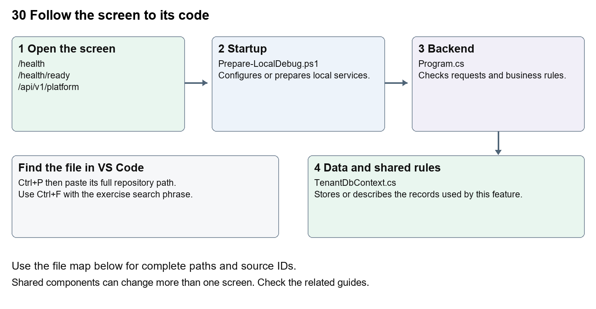

# Nexora backend database and maintenance

Document 30 of the Nexora learning guides  
Source snapshot 14 October 2026 at 06:41 UTC


Understand the shared API, module boundaries, SQL contexts, migrations, health checks and Git maintenance.

### Recognise the screen and its scope

Open `/health`, `/health/ready`, `/api/v1/platform`. CRM routes use port 3017; member routes use 3018; public website routes can use 3019. Brackets name a route parameter, not text to paste into a browser. Choose a real record or site id from the application.

This guide covers Nine modules and shared BuildingBlocks; Nine database contexts; Identity CRM Membership Events Finance Engagement Work and Content schemas; Workflow context and schema; Per-context migration histories; Readiness cancellation logging testing and release runbook; Local Git and documentation updates.



The diagram shows the file roles. The full paths below are what you paste into Ctrl+P.

### Find the files in VS Code

| Role | File and source ID | What it does |
| --- | --- | --- |
| Startup | S0678 Prepare-LocalDebug.ps1 | Local service setup |
| Server | S0576 Program.cs | Endpoints or server rules |
| Data | S0196 TenantDbContext.cs | Data shape or persistence structure |

**Startup S0678**  
[scripts/Prepare-LocalDebug.ps1](<D:/Projects new/Nexora/scripts/Prepare-LocalDebug.ps1>)

**Server S0576**  
[backend/src/Nexora.Api/Program.cs](<D:/Projects new/Nexora/backend/src/Nexora.Api/Program.cs>)

**Data S0196**  
[backend/src/BuildingBlocks/Nexora.BuildingBlocks/Persistence/TenantDbContext.cs](<D:/Projects new/Nexora/backend/src/BuildingBlocks/Nexora.BuildingBlocks/Persistence/TenantDbContext.cs>)

The complete HTML manual opens these source IDs inside its Source library. The Word manual shows short labelled extracts so you can learn the flow before reading large files. Each individual Markdown guide includes its complete primary files after the walkthrough.

### Follow the request and the records

1. Program registers module services and their database contexts.
2. Middleware applies errors, CORS, limits, authentication and authorisation.
3. Each module maps endpoints and tenant-scoped persistence.
4. Development startup and preparation manage the configured local database.
5. Operational checks report health and readiness; reviewed release steps govern deployment.

### Read the code with an explanation

A DbContext is a C# gateway to a group of tables. Different modules can use the same SQL database with separate schemas and migration histories. Identity plus eight business and Workflow contexts totals nine contexts in current source; read the generated context inventory for the exact names. Never apply one context's migration to another or drop a database to repair a missing table.

Source reference S0678 scripts/Prepare-LocalDebug.ps1

Selected opening lines with their original numbers. The complete file is in the HTML source library.

```ps1
0001  param([switch]$WaitForApi)
0002  $ErrorActionPreference = 'Stop'
0003  $root = Split-Path $PSScriptRoot -Parent
0004  function Wait-NexoraApi {
0005      param($StartedProcess)
0006      $deadline = (Get-Date).AddSeconds(180)
```


The import lines lead to shared components and helpers. Start at the exported component or route function; follow the request helper to the server rather than assuming the whole feature lives in this file.

Source reference S0576 backend/src/Nexora.Api/Program.cs

Extract from source line 83. A fragment from a long line is shown without the rest of that line.

```cs
0083  app.MapGet("/api/v1/platform", () =>
```


On the server, look for MapGet to load records, MapPost to create or perform an action, MapPut or MapPatch to change data, and RequireAuthorization for permissions. Some shared methods register endpoints indirectly. Find SaveChangesAsync to see the database write. A request method alone does not tell you every side effect.

Source reference S0196 backend/src/BuildingBlocks/Nexora.BuildingBlocks/Persistence/TenantDbContext.cs

Selected opening lines with their original numbers. The complete file is in the HTML source library.

```cs
0001  using Microsoft.EntityFrameworkCore;
0002  using Microsoft.EntityFrameworkCore.ChangeTracking;
0003  using Microsoft.EntityFrameworkCore.Metadata.Builders;
0004  using Microsoft.EntityFrameworkCore.Storage.ValueConversion;
0005  using Nexora.BuildingBlocks.Domain;
0006  using Nexora.BuildingBlocks.Security;
```


Follow model fields to their request names and database mapping. An id points to a particular record. A tenant id limits the organisation. A version or concurrency stamp protects newer edits. Some model files describe contracts rather than tables; check the owning DbContext before assuming storage.

### Make or trace your first change

1. Press Ctrl+P and open [backend/src/Nexora.Api/Program.cs](<D:/Projects new/Nexora/backend/src/Nexora.Api/Program.cs>).
2. Press Ctrl+F and search for `AddNexora`. In this snapshot it appears at line 28.
3. Read-only exercise: list the registered modules, then find each DbContext. Compare the generated database inventory with the health/readiness checks. Follow the Git practice instructions using only your own documentation or text change.
4. Record the file, request path and server handler you found. This exercise is read-only; no stored records need to change.

Extract from source line 28. A fragment from a long line is shown without the rest of that line.

```cs
0028  builder.Services.AddNexoraIdentity(builder.Configuration, builder.Environment.IsDevelopment());
```


These exercises have not been applied to the application. Their search phrases are verified against the captured source. Line numbers can move; the phrase and file path are your main navigation aids.

### Check a change and diagnose problems

Confirm the original screen still loads, the changed words appear in the intended place, and another screen using the same component still behaves correctly. If an action fails, inspect the browser Network response, the relevant helper and server validation message. Use the common error table at the beginning of the manual. Reload on a version conflict instead of removing the version check.

A syntax error after a text edit usually means a quote, brace or closing tag changed. Compare your diff with the original. An unchanged browser result can mean the wrong port, a saved published configuration overriding a default, or a running API that has not reloaded.

### Understand the current limits

A successful build, a health response and production approval are different results. This manual records source coverage and documentation checks; it does not claim a full platform regression, live provider delivery, backups or production acceptance.

### Continue learning

Related guides [02 Nexora platform setup and VS Code](#guide_02), [18 Nexora imports exports and migration](#guide_18), [20 Nexora administration and access](#guide_20), [22 Nexora workflow designer and runtime](#guide_22), [29 Nexora documents evidence and file safety](#guide_29).

## Complete primary source files

These are the complete captured files, with numbered source lines. Other supporting files are included in the complete HTML manual. Configured local passwords, if any, are explicitly omitted. Do not paste the display line numbers into code.

### S0678 Prepare-LocalDebug.ps1

[scripts/Prepare-LocalDebug.ps1](<D:/Projects new/Nexora/scripts/Prepare-LocalDebug.ps1>)

SHA256 `ad606c0b78af806aabd0c6756919db3d630c05e4399359c8ff168ddd349f1f45`; 71 source lines; complete captured text.

```ps1
0001  param([switch]$WaitForApi)
0002  $ErrorActionPreference = 'Stop'
0003  $root = Split-Path $PSScriptRoot -Parent
0004  function Wait-NexoraApi {
0005      param($StartedProcess)
0006      $deadline = (Get-Date).AddSeconds(180)
0007      $lastFailure = 'No readiness response received.'
0008      do {
0009          if ($StartedProcess -and $StartedProcess.HasExited) {
0010              throw 'The shared API exited during startup. Inspect artifacts/local-shared-api.log and local-shared-api-error.log.'
0011          }
0012          try {
0013              $response = Invoke-WebRequest 'http://localhost:5097/health/ready' -UseBasicParsing -TimeoutSec 45
0014              if ($response.StatusCode -eq 200) { Write-Output 'Nexora API is ready.'; return }
0015          } catch { $lastFailure = $_.Exception.Message }
0016          Start-Sleep -Seconds 1
0017      } while ((Get-Date) -lt $deadline)
0018      throw "API did not become ready on 5097: $lastFailure. Inspect API logs and resume any paused API debugger."
0019  }
0020  if ($WaitForApi) { Wait-NexoraApi; exit 0 }
0021  if (!$WaitForApi) {
0022      if ($env:OS -eq 'Windows_NT') { & "$root/scripts/Prepare-LocalDocumentScanner.ps1" }
0023      $mutex = New-Object System.Threading.Mutex($false, 'Local\NexoraDevApi5097')
0024      $locked = $false
0025      try {
0026          try { $locked = $mutex.WaitOne(240000) }
0027          catch [System.Threading.AbandonedMutexException] { $locked = $true }
0028          if (!$locked) { throw 'Timed out waiting for another API startup.' }
0029          $listeners = @(Get-NetTCPConnection -State Listen -LocalPort 5097 -ErrorAction SilentlyContinue)
0030          foreach ($listener in $listeners) {
0031              $owner = Get-CimInstance Win32_Process -Filter "ProcessId=$($listener.OwningProcess)"
0032              if (!$owner -or $owner.CommandLine -notmatch 'Nexora\.Api(?:\.dll|\.exe)') {
0033                  throw "Port 5097 belongs to another process (PID $($listener.OwningProcess)); it was not stopped."
0034              }
0035          }
0036          if ($listeners.Count) {
0037              $sourceFiles = Get-ChildItem "$root/backend/src" -Recurse -File | Where-Object {
0038                  $_.FullName -notmatch '[\\/](bin|obj)[\\/]' -and $_.Extension -in '.cs', '.csproj', '.props', '.targets', '.json'
0039              }
0040              $latestSource = $sourceFiles | Sort-Object LastWriteTimeUtc -Descending | Select-Object -First 1
0041              $ownerIds = @($listeners.OwningProcess | Select-Object -Unique)
0042              $recordedApiId = if (Test-Path "$root/artifacts/local-shared-api.pid") { (Get-Content "$root/artifacts/local-shared-api.pid" -Raw).Trim() } else { '' }
0043              foreach ($ownerId in $ownerIds) {
0044                  $owner = Get-CimInstance Win32_Process -Filter "ProcessId=$ownerId"
0045                  if ($owner -and $latestSource -and $latestSource.LastWriteTimeUtc -gt $owner.CreationDate.ToUniversalTime()) {
0046                      if ($recordedApiId -ne [string]$ownerId -or $owner.CommandLine -notmatch 'bin[/\\]LocalDebug[/\\]net10\.0[/\\]Nexora\.Api\.dll') {
0047                          throw "The API on 5097 predates backend changes and was started outside this preparation task. Stop that API debug session, then launch CRM, Portal or CMS again."
0048                      }
0049                      Write-Output 'Backend changes detected. Rebuilding the shared local API.'
0050                      Stop-Process -Id $ownerId
0051                      Wait-Process -Id $ownerId -Timeout 15 -ErrorAction SilentlyContinue
0052                      $listeners = @()
0053                  }
0054              }
0055          }
0056          if (!$listeners.Count) {
0057              dotnet build "$root/backend/src/Nexora.Api/Nexora.Api.csproj" --configuration LocalDebug -m:1 -nr:false -p:UseSharedCompilation=false -p:DebugSymbols=true -p:DebugType=portable -p:Optimize=false
0058              if ($LASTEXITCODE -ne 0) { throw 'API build failed.' }
0059              $config = (Get-Content "$root/.vscode/launch.json" -Raw | ConvertFrom-Json).configurations | Where-Object name -eq 'Nexora shared API'
0060              foreach ($property in $config.env.PSObject.Properties) { [Environment]::SetEnvironmentVariable($property.Name, $property.Value, 'Process') }
0061              New-Item -ItemType Directory "$root/artifacts" -Force | Out-Null
0062              $api = Start-Process dotnet -ArgumentList 'bin/LocalDebug/net10.0/Nexora.Api.dll', '--urls', 'http://localhost:5097' -WorkingDirectory "$root/backend/src/Nexora.Api" -WindowStyle Hidden -RedirectStandardOutput "$root/artifacts/local-shared-api.log" -RedirectStandardError "$root/artifacts/local-shared-api-error.log" -PassThru
0063              $api.Id | Set-Content "$root/artifacts/local-shared-api.pid"
0064          }
0065          Wait-NexoraApi -StartedProcess $api
0066      } finally {
0067          if ($locked) { $mutex.ReleaseMutex() }
0068          $mutex.Dispose()
0069      }
0070      exit 0
0071  }
```

### S0576 Program.cs

[backend/src/Nexora.Api/Program.cs](<D:/Projects new/Nexora/backend/src/Nexora.Api/Program.cs>)

SHA256 `ced3e2c3a7318361abebe285299108af8749da7016151db590405b9eac3d15ac`; 126 source lines; complete captured text.

```cs
0001  using Nexora.Modules.Workflow;
0002  using Nexora.Modules.Content;
0003  using Nexora.Api;
0004  using System.Reflection;
0005  using Nexora.Modules.Work;
0006  using Nexora.Modules.Work.Infrastructure;
0007  using Nexora.Modules.Engagement;
0008  using Nexora.Modules.Engagement.Infrastructure;
0009  using Nexora.Modules.Finance;
0010  using Nexora.Modules.Finance.Infrastructure;
0011  using Nexora.Modules.Events;
0012  using Nexora.Modules.Events.Infrastructure;
0013  using Nexora.Modules.Membership;
0014  using Nexora.Modules.Membership.Infrastructure;
0015  using Nexora.Modules.Crm;
0016  using Nexora.Modules.Crm.Infrastructure;
0017  using Microsoft.EntityFrameworkCore;
0018  using Microsoft.AspNetCore.Diagnostics.HealthChecks;
0019  using Nexora.BuildingBlocks.Platform;
0020  using Nexora.Modules.Identity;
0021  using Nexora.Modules.Identity.Infrastructure.Persistence;
0022  
0023  var builder = WebApplication.CreateBuilder(args);
0024  
0025  builder.Services.AddProblemDetails();
0026  builder.Services.AddOpenApi();
0027  builder.Services.AddHealthChecks();
0028  builder.Services.AddNexoraIdentity(builder.Configuration, builder.Environment.IsDevelopment());
0029  builder.Services.AddNexoraCrm(builder.Configuration);
0030  builder.Services.AddNexoraContent(builder.Configuration);
0031  builder.Services.AddNexoraMembership(builder.Configuration);
0032  builder.Services.AddNexoraEvents(builder.Configuration);
0033  builder.Services.AddNexoraFinance(builder.Configuration);
0034  builder.Services.AddNexoraWork(builder.Configuration);
0035  builder.Services.AddNexoraEngagement(builder.Configuration);
0036  builder.Services.AddNexoraWorkflow(builder.Configuration);
0037  builder.Services.AddCors(options =>
0038  {
0039      options.AddPolicy("NexoraWeb", policy =>
0040      {
0041          policy
0042              .WithOrigins(builder.Configuration.GetSection("Web:AllowedOrigins").Get<string[]>() ?? ["http://localhost:3000"])
0043              .AllowAnyHeader()
0044              .AllowAnyMethod()
0045              .AllowCredentials();
0046      });
0047  });
0048  
0049  var app = builder.Build();
0050  
0051  app.UseNexoraTelemetry();
0052  app.UseExceptionHandler(new ExceptionHandlerOptions
0053  {
0054      StatusCodeSelector = exception => exception is BadHttpRequestException badRequest
0055          ? badRequest.StatusCode
0056          : StatusCodes.Status500InternalServerError
0057  });
0058  app.UseHttpsRedirection();
0059  app.UseCors("NexoraWeb");
0060  app.UseRateLimiter();
0061  app.UseAuthentication();
0062  app.UseAuthorization();
0063  
0064  if (app.Environment.IsDevelopment())
0065  {
0066      app.MapOpenApi();
0067  }
0068  
0069  app.MapHealthChecks("/health", new HealthCheckOptions
0070  {
0071      ResponseWriter = async (context, report) =>
0072      {
0073          context.Response.ContentType = "application/json";
0074          await context.Response.WriteAsJsonAsync(new
0075          {
0076              status = report.Status.ToString().ToLowerInvariant(),
0077              service = "nexora-api",
0078              checkedAt = DateTimeOffset.UtcNow,
0079          });
0080      },
0081  });
0082  
0083  app.MapGet("/api/v1/platform", () =>
0084  {
0085      var version = Assembly.GetExecutingAssembly().GetName().Version?.ToString(3) ?? "0.1.0";
0086      return Results.Ok(new PlatformDescriptor(
0087          "Nexora",
0088          "nexora-api",
0089          version,
0090          ["platform-shell", "identity", "tenancy", "crm", "membership", "events", "finance", "engagement", "work", "insights"]));
0091  })
0092  .WithName("GetPlatformDescriptor")
0093  .WithTags("Platform");
0094  
0095  app.MapNexoraIdentityEndpoints();
0096  app.MapNexoraCrm();
0097  app.MapNexoraContent();
0098  app.MapNexoraMembership();
0099  app.MapNexoraEvents();
0100  app.MapNexoraFinance();
0101  app.MapNexoraWork();
0102  app.MapNexoraEngagement();
0103  app.MapNexoraWorkflow();
0104  app.MapNexoraReporting();
0105  app.MapNexoraReadiness();
0106  
0107  if (app.Environment.IsDevelopment())
0108  {
0109      await IdentitySeeder.SeedDevelopmentIdentityAsync(app.Services, builder.Configuration);
0110      if (!string.IsNullOrWhiteSpace(builder.Configuration["Identity:SeedAdminPassword"]))
0111      {
0112          await using var scope = app.Services.CreateAsyncScope();
0113          await scope.ServiceProvider.GetRequiredService<CrmDbContext>().Database.MigrateAsync();
0114          await scope.ServiceProvider.GetRequiredService<ContentDbContext>().Database.MigrateAsync();
0115          await scope.ServiceProvider.GetRequiredService<MembershipDbContext>().Database.MigrateAsync();
0116          await scope.ServiceProvider.GetRequiredService<EventsDbContext>().Database.MigrateAsync();
0117          await scope.ServiceProvider.GetRequiredService<FinanceDbContext>().Database.MigrateAsync();
0118          await scope.ServiceProvider.GetRequiredService<WorkDbContext>().Database.MigrateAsync();
0119          await scope.ServiceProvider.GetRequiredService<EngagementDbContext>().Database.MigrateAsync();
0120          await scope.ServiceProvider.GetRequiredService<WorkflowDbContext>().Database.MigrateAsync();
0121      }
0122  }
0123  
0124  app.Run();
0125  
0126  public partial class Program;
```

### S0196 TenantDbContext.cs

[backend/src/BuildingBlocks/Nexora.BuildingBlocks/Persistence/TenantDbContext.cs](<D:/Projects new/Nexora/backend/src/BuildingBlocks/Nexora.BuildingBlocks/Persistence/TenantDbContext.cs>)

SHA256 `64e38bae50b5b4ac07d9adf3372fbc6e95cb43861726112896115a8873e6509e`; 83 source lines; complete captured text.

```cs
0001  using Microsoft.EntityFrameworkCore;
0002  using Microsoft.EntityFrameworkCore.ChangeTracking;
0003  using Microsoft.EntityFrameworkCore.Metadata.Builders;
0004  using Microsoft.EntityFrameworkCore.Storage.ValueConversion;
0005  using Nexora.BuildingBlocks.Domain;
0006  using Nexora.BuildingBlocks.Security;
0007  namespace Nexora.BuildingBlocks.Persistence;
0008  public abstract class TenantDbContext(DbContextOptions options, IRequestIdentity identity) : DbContext(options), IWorkflowWriteIdentity, IAutomationFieldProvider
0009  {
0010      public IRequestIdentity WorkflowIdentity=>identity;
0011      protected override void OnConfiguring(DbContextOptionsBuilder optionsBuilder) { base.OnConfiguring(optionsBuilder); optionsBuilder.AddInterceptors(new DataAuditInterceptor(()=>ActiveTenantId)); }
0012      protected Guid? ActiveTenantId => identity.TenantId;
0013      protected Guid? ActiveUserId => identity.UserId;
0014      protected EntityTypeBuilder<T> TenantTable<T>(ModelBuilder builder, string table) where T : TenantEntity
0015      {
0016          var entity = builder.Entity<T>();
0017          entity.HasBaseType((Type?)null); entity.ToTable(table); entity.HasKey(x => x.Id);
0018          entity.HasAlternateKey(x => new { x.TenantId, x.Id });
0019          entity.HasQueryFilter(x => x.TenantId == ActiveTenantId);
0020          entity.Property(x => x.Version).IsConcurrencyToken();
0021          return entity;
0022      }
0023      protected void ConfigureColumns(ModelBuilder builder)
0024      {
0025          WorkflowOutboxModel.Configure(builder);
0026          builder.Entity<WorkflowDomainEvent>().HasQueryFilter(x=>x.TenantId==ActiveTenantId);
0027          builder.Entity<WorkflowActionReceipt>().HasQueryFilter(x=>x.TenantId==ActiveTenantId);
0028          TenantTable<AttributeDefinition>(builder, "AttributeDefinitions");
0029          TenantTable<AttributeValue>(builder, "AttributeValues");
0030          builder.Entity<AttributeDefinition>().Property(x => x.Name).HasMaxLength(80);
0031          builder.Entity<AttributeDefinition>().Property(x => x.EntityType).HasMaxLength(80);
0032          builder.Entity<AttributeDefinition>().HasIndex(x => new { x.TenantId, x.EntityType, x.Name }).IsUnique();
0033          builder.Entity<AttributeValue>().HasIndex(x => new { x.TenantId, x.RecordId, x.DefinitionId }).IsUnique();
0034          builder.Entity<AttributeValue>().HasOne<AttributeDefinition>().WithMany().HasForeignKey(x => new { x.TenantId, x.DefinitionId }).HasPrincipalKey(x => new { x.TenantId, x.Id }).OnDelete(DeleteBehavior.Restrict);
0035          var utc = new ValueConverter<DateTime, DateTime>(v => v, v => DateTime.SpecifyKind(v, DateTimeKind.Utc));
0036          foreach (var entity in builder.Model.GetEntityTypes())
0037              foreach (var property in entity.GetProperties())
0038              {
0039                  if (property.ClrType == typeof(string) && property.GetMaxLength() == null) property.SetMaxLength(500);
0040                  if (property.ClrType == typeof(decimal) || property.ClrType == typeof(decimal?)) { property.SetPrecision(18); property.SetScale(2); }
0041                  if (property.ClrType == typeof(DateTime) || property.ClrType == typeof(DateTime?)) property.SetValueConverter(utc);
0042              }
0043          builder.Entity<AttributeValue>().Property(x => x.NumberValue).HasPrecision(18, 4);
0044          Automations.Configure(builder);
0045          builder.Entity<AutomationConfiguration>().HasQueryFilter(x => x.TenantId == ActiveTenantId);
0046          DataAuditModel.Configure(builder,()=>ActiveTenantId);
0047      }
0048      public async Task<AutomationField[]> AutomationFieldsAsync(string kind, CancellationToken ct)
0049      {
0050          await Set<AttributeDefinition>().Where(x => x.EntityType == kind).LoadAsync(ct);
0051          return ChangeTracker.Entries<AttributeDefinition>().Where(e => e.State != EntityState.Deleted && e.Entity.TenantId == ActiveTenantId && e.Entity.EntityType == kind)
0052              .Select(e => new AutomationField(e.Entity.Id.ToString(), e.Entity.Name, e.Entity.DataType, true)).ToArray();
0053      }
0054      private async Task AutomateAsync(CancellationToken ct)
0055      {
0056          await GuardAsync(ct);
0057          await Automations.GuardAsync(this, ActiveTenantId, ActiveUserId, ct);
0058          await Automations.ApplyAsync<AttributeValue>(this, ActiveTenantId, kind => Model.GetEntityTypes().Select(e => e.ClrType).SingleOrDefault(t => t.Name == kind), x => x.GetType().Name, AutomationFieldsAsync, ct);
0059          await GuardAsync(ct);
0060      }
0061      public override int SaveChanges(bool acceptAllChangesOnSuccess) { AutomateAsync(default).GetAwaiter().GetResult(); return base.SaveChanges(acceptAllChangesOnSuccess); }
0062      public override async Task<int> SaveChangesAsync(bool acceptAllChangesOnSuccess, CancellationToken cancellationToken = default)
0063      { await AutomateAsync(cancellationToken); return await base.SaveChangesAsync(acceptAllChangesOnSuccess, cancellationToken); }
0064      protected virtual Task ValidateEntityAsync(EntityEntry<TenantEntity> entry, CancellationToken ct) => Task.CompletedTask;
0065      private async Task GuardAsync(CancellationToken ct)
0066      {
0067          ChangeTracker.DetectChanges();
0068          foreach (var entry in ChangeTracker.Entries<TenantEntity>().Where(x => x.State is EntityState.Added or EntityState.Modified or EntityState.Deleted).ToArray())
0069          {
0070              await ValidateEntityAsync(entry,ct);
0071              if (ActiveTenantId == null || ActiveUserId == null || entry.Entity.TenantId != ActiveTenantId) throw new TenantBoundaryException();
0072              if (entry.Entity is IAppendOnly && entry.State != EntityState.Added) throw new TenantBoundaryException();
0073              if (entry.State != EntityState.Added)
0074              {
0075                  var stored = await entry.GetDatabaseValuesAsync(ct);
0076                  if (stored == null || !Equals(stored["TenantId"], ActiveTenantId)) throw new TenantBoundaryException();
0077                  entry.Property(x => x.CreatedAtUtc).CurrentValue = (DateTime)stored["CreatedAtUtc"]!;
0078                  entry.Entity.Version = Guid.NewGuid(); entry.Entity.UpdatedAtUtc = DateTime.UtcNow;
0079              }
0080          }
0081      }
0082  }
0083  public sealed class TenantBoundaryException() : InvalidOperationException("Operation outside the active tenant boundary.");
```
