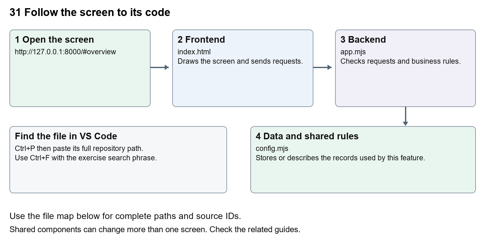

# Company Dash startup and dashboard

Document 31 of the Nexora learning guides  
Source snapshot 14 October 2026 at 06:41 UTC


Run the local maintenance dashboard and understand how it connects to Nexora.

### Recognise the screen and its scope

Open `http://127.0.0.1:8000/#overview`. Company Dash uses loopback port 8000 and hash navigation. Open its separate repository in VS Code before Ctrl+P. The source library uses company-dash as a project label, not a Nexora folder.

This guide covers Local startup; Overview and navigation; Configuration diagnostics; Local request token; Separate repository and data.



The diagram shows the file roles. The full paths below are what you paste into Ctrl+P.

### Find the files in VS Code

| Role | File and source ID | What it does |
| --- | --- | --- |
| Screen | S0698 index.html | Main UI or route for this topic |
| Server | S0701 app.mjs | Endpoints or server rules |
| Data | S0704 config.mjs | Data shape or persistence structure |

**Screen S0698**  
[public/index.html](<C:/Users/ramish/Documents/ChatGPT/Company Dash/public/index.html>)

**Server S0701**  
[server/app.mjs](<C:/Users/ramish/Documents/ChatGPT/Company Dash/server/app.mjs>)

**Data S0704**  
[server/config.mjs](<C:/Users/ramish/Documents/ChatGPT/Company Dash/server/config.mjs>)

Use the HTML source buttons for full files. Word shows labelled extracts; individual Markdown guides contain complete primary files.

### Follow the request and the records

1. Open the Company Dash folder in its own VS Code window and run node server/main.mjs.
2. The Node server serves public/index.html, app.js and styles.css on loopback port 8000.
3. The browser gets a local request token from /api/session and sends X-Command-Token with API requests.
4. GET /api/state returns repository, tasks, runs and provider status.
5. The browser renders the selected view; the server keeps task history in its own SQLite database.

### Read the code with an explanation

Company Dash is a separate Node.js application, not a Nexora API module. Its public folder is the frontend; server contains the backend. It needs Node 24 or newer for built-in SQLite and has no frontend build or npm dependencies. Run it from its own folder; opening index.html as a file will not provide its API. config.example.json shows safe defaults; local configuration and data stay private. The dashboard can inspect the Nexora checkout without becoming a runtime dependency of CRM, Portal or CMS.

Source reference S0698 company-dash/public/index.html

Extract from source line 8. A fragment from a long line is shown without the rest of that line.

```html
0008      <nav aria-label="Main navigation">
```


index.html supplies markup and app.js renders browser views. Follow api() to the server route handler.

Source reference S0701 company-dash/server/app.mjs

Extract from source line 23. A fragment from a long line is shown without the rest of that line.

```mjs
0023  export function createApp(config) {
```


The browser api() helper sends a method and local request token. app.mjs checks the route and calls the relevant service. Follow that call to understand SQL writes, process execution and filesystem changes.

Source reference S0704 company-dash/server/config.mjs

Selected opening lines with their original numbers. The complete file is in the HTML source library.

```mjs
0001  import fs from 'node:fs';
0002  import path from 'node:path';
0003  import { fileURLToPath } from 'node:url';
0004  import { resolveCodexPath } from './codex-path.mjs';
0006  export const root = path.resolve(path.dirname(fileURLToPath(import.meta.url)), '..');
0007  const local = path.join(root, 'config.local.json');
```


store.mjs defines SQLite history tables. catalog.mjs and config.mjs define configuration; repository.mjs records fingerprints. Trace each key into its service before assuming it is a stored table.

### Make or trace your first change

1. Press Ctrl+P and open [public/index.html](<C:/Users/ramish/Documents/ChatGPT/Company Dash/public/index.html>).
2. Press Ctrl+F and search for `Work board<span`. In this snapshot it appears at line 10.
3. Change the sidebar wording only, keeping the href, data-view and span intact. Refresh Company Dash and confirm the same work view opens. Restore the text after practising.
4. Replace only `Work board<span` with `Work requests<span` in that intended location. Keep quotes, tags, JSON keys and routes intact.
5. Save with Ctrl+S. Inspect Problems and the local screen. Review the diff and restore the original text when you finish practising.

Extract from source line 10. A fragment from a long line is shown without the rest of that line.

```html
0010        <a href="#work" data-view="work"><span class="nav-icon">▤</span>Work board<span id="work-count" class="nav-count">0</span></a>
```


These exercises have not been applied to the application. Their search phrases are verified against the captured source. Line numbers can move; the phrase and file path are your main navigation aids.

### Check a change and diagnose problems

Confirm the original screen still loads, the changed words appear in the intended place, and another screen using the same component still behaves correctly. If an action fails, inspect the browser Network response, the relevant helper and server validation message. Use the common error table at the beginning of the manual. Reload on a version conflict instead of removing the version check.

A syntax error after a text edit usually means a quote, brace or closing tag changed. Compare your diff with the original. An unchanged browser result can mean the wrong port, a saved published configuration overriding a default, or a running API that has not reloaded.

### Understand the current limits

The dashboard is local and single-user. Its request token and Host/Origin checks are not public multi-user authentication. Documentation capture does not start the dashboard, run an agent or change task history.

### Continue learning

Related guides [02 Nexora platform setup and VS Code](#guide_02), [32 Company Dash repository and source viewer](#guide_32), [33 Company Dash tasks agents and handoffs](#guide_33), [36 Company Dash history backups and settings](#guide_36).

## Complete primary source files

These are the complete captured files, with numbered source lines. Other supporting files are included in the complete HTML manual. Configured local passwords, if any, are explicitly omitted. Do not paste the display line numbers into code.

### S0698 index.html

[public/index.html](<C:/Users/ramish/Documents/ChatGPT/Company Dash/public/index.html>)

SHA256 `d11f5c418676ffe15e16199dc79b49670cbd53923e029a6f141d93e192cf0913`; 27 source lines; complete captured text.

```html
0001  <!doctype html>
0002  <html lang="en"><head><meta charset="utf-8"><meta name="viewport" content="width=device-width,initial-scale=1"><meta name="theme-color" content="#f5f6f8"><title>Nexora · Command Center</title><link rel="icon" href="/favicon.svg"><link rel="stylesheet" href="/styles.css"><script src="/app.js" defer></script></head>
0003  <body>
0004    <aside class="sidebar">
0005      <a class="brand" href="#overview"><span>Nexora<span class="brand-sub">COMMAND CENTER</span></span></a>
0006      <div class="workspace-switch"><span class="workspace-icon">N</span><span>Nexora workspace<small>Maintenance operations</small></span><span class="chevron">⌄</span></div>
0007      <div class="nav-label">WORKSPACE</div>
0008      <nav aria-label="Main navigation">
0009        <a href="#overview" data-view="overview"><span class="nav-icon">◫</span>Overview</a>
0010        <a href="#work" data-view="work"><span class="nav-icon">▤</span>Work board<span id="work-count" class="nav-count">0</span></a>
0011        <a href="#agents" data-view="agents"><span class="nav-icon">♧</span>AI team<span class="nav-count">6</span></a>
0012        <a href="#qa" data-view="qa"><span class="nav-icon">◎</span>QA & verification</a>
0013        <a href="#knowledge" data-view="knowledge"><span class="nav-icon">▧</span>Repository & docs</a>
0014        <a href="#activity" data-view="activity"><span class="nav-icon">↗</span>Activity log</a>
0015      </nav>
0016      <div class="sidebar-bottom"><div class="local-card"><span class="status-dot"></span><span>Local workspace<small>Changes stay in review</small></span></div><a class="settings-link" href="#settings">⚙ <span>Workspace settings</span></a><div class="profile"><span class="avatar">RS</span><span>Workspace owner<small>Local administrator</small></span></div></div>
0017    </aside>
0018    <div class="shell">
0019      <header class="topbar"><div class="breadcrumbs">Workspace <span>/</span> <strong id="breadcrumb">Overview</strong></div><div class="top-actions"><span class="environment">LOCAL</span><span class="connection" id="connection"><i></i>Connecting</span><button class="icon-button" id="refresh" aria-label="Refresh dashboard" title="Refresh dashboard">↻</button></div></header>
0020      <main id="main" tabindex="-1"><div class="loading">Connecting to your workspace…</div></main>
0021      <footer>NEXORA COMMAND CENTER <span>Source → request → handoff → evidence</span></footer>
0022    </div>
0023    <dialog id="request-dialog" class="request-dialog"><form id="request-form"><div class="modal-heading"><div><div class="eyebrow">WORK WITH YOUR AI TEAM</div><h2>New maintenance request</h2></div><button type="button" class="icon-button" data-close aria-label="Close">×</button></div><p class="muted">Describe the outcome. Your team will work from Nexora’s actual source.</p><label>Request title<input name="title" required maxlength="160" placeholder="e.g. Investigate company application permissions"></label><div class="form-row"><label>Assign to<select name="agent" id="agent-select" aria-label="Assign to"></select></label><label>Product area<select name="area" id="area-select" aria-label="Product area"></select></label></div><label>What needs to happen?<textarea name="description" required maxlength="12000" rows="6" placeholder="Explain the issue, expected behavior, and any acceptance criteria…"></textarea></label><div class="form-row"><label>Priority<select name="priority" aria-label="Priority"><option value="normal">Normal</option><option value="high">High</option><option value="urgent">Urgent</option><option value="low">Low</option></select></label><label class="checkbox-label"><input type="checkbox" name="workflow" checked><span>Create the maintenance workflow<small>Support / PM → BA → developer → QA</small></span></label></div><div class="form-note">Creating a request saves it to the board. Start each agent when ready; every handoff remains reviewable.</div><div class="modal-actions"><button type="button" class="button secondary" data-close>Cancel</button><button class="button primary" type="submit">Create request <span>↗</span></button></div></form></dialog>
0024    <dialog id="detail-dialog" class="detail-dialog"><div id="detail-content"></div></dialog>
0025    <dialog id="reader-dialog" class="reader-dialog"><div class="modal-heading"><h2 id="reader-title">Document</h2><div class="reader-actions"><button class="button secondary small" id="download">Download</button><button class="icon-button" data-close aria-label="Close">×</button></div></div><pre id="reader-content"></pre></dialog>
0026    <div id="toast" role="status" aria-live="polite"></div>
0027  </body></html>
```

### S0701 app.mjs

[server/app.mjs](<C:/Users/ramish/Documents/ChatGPT/Company Dash/server/app.mjs>)

SHA256 `7674d0b4ca7a02ea53371f9b3ee6163fe69c3879cb78c499f4a114b1e125b5c7`; 152 source lines; complete captured text.

```mjs
0001  import http from 'node:http';
0002  import fs from 'node:fs/promises';
0003  import path from 'node:path';
0004  import { randomBytes, timingSafeEqual } from 'node:crypto';
0005  import { Store, now } from './store.mjs';
0006  import { agents, areas, suites } from './catalog.mjs';
0007  import { Runner, providerStatus } from './runner.mjs';
0008  import { readSource, scanRepository } from './repository.mjs';
0009  import { integrationPreview, integrate } from './proposals.mjs';
0010  import { backupData, cleanupData, retentionPlan } from './maintenance.mjs';
0011  import { budgetState } from './usage.mjs';
0012  
0013  function text(value, label, max = 12000) { if (typeof value !== 'string' || !value.trim() || value.length > max) throw new Error(`${label} is required (maximum ${max} characters).`); return value.trim(); }
0014  function choice(value, list, label) { if (!list.includes(value)) throw new Error(`Invalid ${label}.`); return value; }
0015  async function body(req) {
0016    if (!(req.headers['content-type'] || '').startsWith('application/json')) throw new Error('JSON content type is required.');
0017    let value = '';
0018    for await (const chunk of req) { value += chunk; if (Buffer.byteLength(value) > 64000) throw new Error('Request is too large.'); }
0019    const result = JSON.parse(value || '{}');
0020    if (!result || typeof result !== 'object' || Array.isArray(result)) throw new Error('Expected a JSON object.');
0021    return result;
0022  }
0023  export function createApp(config) {
0024    const store = new Store(config.dataDir), runner = new Runner(store, config);
0025    const token = randomBytes(32).toString('hex');
0026    let scan = null, scanError = null, scanning = null;
0027    let provider = { available: false, detail: 'Checking Codex CLI…' };
0028    let maintenance = false;
0029    async function exclusive(work) {
0030      if (maintenance || runner.active || store.get("SELECT id FROM runs WHERE status IN ('queued','running')")) throw new Error('Wait for active/queued runs before maintenance or integration.');
0031      maintenance = true;
0032      try { return await work(); } finally { maintenance = false; }
0033    }
0034    const retentionTimer = config.retentionDays ? setInterval(() => exclusive(() => cleanupData(store, config)).catch(error => store.event(null,'maintenance.deferred',error.message)), 86400000) : null;
0035    retentionTimer?.unref();
0036    const refresh = async () => {
0037      if (scanning) return scanning;
0038      scanning = scanRepository(config.repoPath).then(result => { scan = result; scanError = null; return result; }).catch(error => { scanError = error.message; throw error; }).finally(() => { scanning = null; });
0039      return scanning;
0040    };
0041    const ready = Promise.allSettled([refresh(), providerStatus(config).then(value => { provider = value; })]);
0042    function task(key) { const value = store.get('SELECT * FROM tasks WHERE id=?', key); if (!value) throw new Error('Task not found.'); return value; }
0043    const server = http.createServer(async (req, res) => {
0044      const respond = (status, data, type = 'application/json; charset=utf-8') => { res.writeHead(status, { 'Content-Type': type }); res.end(type.startsWith('application/json') ? JSON.stringify(data) : data); };
0045      res.setHeader('Cache-Control', 'no-store');
0046      res.setHeader('X-Content-Type-Options', 'nosniff');
0047      res.setHeader('Referrer-Policy', 'no-referrer');
0048      res.setHeader('Content-Security-Policy', "default-src 'self'; script-src 'self'; style-src 'self'; img-src 'self' data:; connect-src 'self'; object-src 'none'; base-uri 'none'; frame-ancestors 'none'; form-action 'self'");
0049      try {
0050        const host = req.headers.host;
0051        const port = server.address()?.port;
0052        if (![ `127.0.0.1:${port}`, `localhost:${port}` ].includes(host)) return respond(403, { error: 'Local access only.' });
0053        if (req.headers.origin && req.headers.origin !== `http://${host}`) return respond(403, { error: 'Cross-origin requests are not permitted.' });
0054        if (req.headers['sec-fetch-site'] === 'cross-site') return respond(403, { error: 'Cross-site requests are not permitted.' });
0055        const url = new URL(req.url, `http://${host}`), route = url.pathname;
0056        if (req.method === 'GET' && route === '/api/session') return respond(200, { token });
0057        if (route.startsWith('/api/')) {
0058          const supplied = Buffer.from(req.headers['x-command-token'] || '');
0059          if (supplied.length !== token.length || !timingSafeEqual(supplied, Buffer.from(token))) return respond(401, { error: 'Refresh the page to reconnect your local session.' });
0060          if (maintenance && req.method !== 'GET') throw new Error('Maintenance is in progress. Retry shortly.');
0061          if (req.method === 'GET' && route === '/api/state') return respond(200, {
0062            agents, areas, suites: suites.map(({ args, kind, timeout, ...suite }) => suite),
0063            repository: scan ? { ...scan, files: undefined } : null, repositoryError: scanError, provider,
0064            tasks: store.all('SELECT * FROM tasks ORDER BY created_at DESC'),
0065            runs: store.all('SELECT id,task_id,target_task,source_hash,usage,kind,label,status,command,baseline,exit_code,error,created_at,started_at,ended_at FROM runs ORDER BY created_at DESC LIMIT 200'),
0066            events: store.all('SELECT * FROM events ORDER BY id DESC LIMIT 60'),
0067            artifacts: store.all('SELECT id,task_id,run_id,name,kind,created_at FROM artifacts ORDER BY created_at DESC LIMIT 200'),
0068            config: { repoPath: config.repoPath, mode: 'Local single-user', agentTimeoutMinutes: config.agentTimeoutMinutes, sqlServer: config.sqlServer, retentionDays: config.retentionDays || 0, qaRuntimePreparation: true },
0069            usage: budgetState(store, config),
0070          });
0071          if (req.method === 'POST' && route === '/api/repository/scan') { const result = await refresh(); store.event(null, 'repository.scanned', `${result.fileCount} source files indexed at ${result.commit.slice(0,7)}.`); return respond(200, result); }
0072          if (req.method === 'GET' && route === '/api/repository/files') return respond(200, { files: (scan?.files || []).filter(f => f.toLowerCase().includes((url.searchParams.get('q') || '').toLowerCase())).slice(0, 300) });
0073          if (req.method === 'GET' && route === '/api/repository/file') return respond(200, { path: url.searchParams.get('path'), content: await readSource(config.repoPath, url.searchParams.get('path')) });
0074          if (req.method === 'POST' && route === '/api/provider/check') { provider = await providerStatus(config); return respond(200, provider); }
0075          if (req.method === 'POST' && route === '/api/tasks') {
0076            const data = await body(req);
0077            const input = { title: text(data.title, 'Title', 160), description: text(data.description, 'Request'), agent: choice(data.agent, agents.map(a => a.id), 'agent'), area: choice(data.area, areas, 'area'), priority: choice(data.priority || 'normal', ['low','normal','high','urgent'], 'priority') };
0078            const result = store.transaction(() => {
0079              const root = store.task(input);
0080              if (data.workflow === true && ['pm', 'ba', 'support'].includes(input.agent)) {
0081                let previous = root;
0082                const order = ['pm', 'support'].includes(input.agent) ? ['ba', data.area === 'Portal' || data.area === 'Website / CMS' ? 'portal_dev' : 'crm_dev', 'qa'] : [data.area === 'Portal' || data.area === 'Website / CMS' ? 'portal_dev' : 'crm_dev', 'qa'];
0083                for (const agent of order) previous = store.task({ ...input, title: `${agent === 'ba' ? 'Specify' : agent === 'qa' ? 'Verify' : 'Implement'}: ${input.title}`, agent, parent_id: root.id, depends_on: previous.id, status: 'blocked' });
0084                store.event(root.id, 'workflow.created', 'A standard maintenance workflow was created. Each accepted handoff unlocks the next role; execution is started explicitly.');
0085              }
0086              return root;
0087            });
0088            return respond(201, result);
0089          }
0090          const match = route.match(/^\/api\/tasks\/([^/]+)(?:\/(messages|run|accept|cancel))?$/);
0091          if (match) {
0092            const current = task(match[1]), action = match[2];
0093            if (req.method === 'GET' && !action) return respond(200, { ...current, messages: store.all('SELECT * FROM messages WHERE task_id=? ORDER BY created_at', current.id), artifacts: store.all('SELECT * FROM artifacts WHERE task_id=? ORDER BY created_at DESC', current.id), runs: store.all('SELECT * FROM runs WHERE task_id=? OR target_task=? ORDER BY created_at DESC', current.id, current.id) });
0094            if (req.method === 'POST' && action === 'messages') {
0095              if (['running','queued','completed','cancelled'].includes(current.status)) throw new Error('Add a follow-up when this task is ready, blocked, or awaiting review.');
0096              const data = await body(req); store.message(current.id, 'user', text(data.content, 'Message'));
0097              if (current.status === 'review') store.run("UPDATE tasks SET status='ready',updated_at=? WHERE id=?", now(), current.id);
0098              store.event(current.id, 'task.message', 'A follow-up was added.'); return respond(201, { ok: true });
0099            }
0100            if (req.method === 'POST' && action === 'run') {
0101              if (!provider.available) throw new Error(provider.detail);
0102              const data = await body(req);
0103              return respond(202, runner.enqueue({ task: current, prepareRuntime: data.prepareRuntime ?? current.agent === 'qa' }));
0104            }
0105            if (req.method === 'POST' && action === 'accept') {
0106              if (current.status !== 'review') throw new Error('Only a task with a successful agent report can be accepted.');
0107              store.transaction(() => {
0108                store.run("UPDATE tasks SET status='completed',updated_at=? WHERE id=?", now(), current.id);
0109                store.run("UPDATE tasks SET status='ready',updated_at=? WHERE depends_on=? AND status='blocked'", now(), current.id);
0110                store.event(current.id, 'handoff.accepted', 'Report accepted for handoff. This does not merge code, certify QA or deploy Nexora.');
0111              }); return respond(200, { ok: true });
0112            }
0113            if (req.method === 'POST' && action === 'cancel') {
0114              if (['running','queued'].includes(current.status)) throw new Error('Stop the active run before closing its task.');
0115              if (current.status === 'completed') throw new Error('An accepted handoff cannot be cancelled.');
0116              store.run("UPDATE tasks SET status='cancelled',updated_at=? WHERE id=?", now(), current.id);
0117              store.event(current.id, 'task.cancelled', 'Task cancelled; dependent work stays blocked.'); return respond(200, { ok: true });
0118            }
0119          }
0120          if (req.method === 'POST' && route === '/api/qa/run') {
0121            const data = await body(req), suite = suites.find(s => s.id === data.suite);
0122            if (!suite) throw new Error('Unknown QA suite.');
0123            if (store.get("SELECT id FROM runs WHERE kind='qa' AND label=? AND status IN ('queued','running')", suite.id)) throw new Error('This suite is already queued or running.');
0124            const targetTask = data.taskId ? task(data.taskId) : null;
0125            if (targetTask && !['review','completed'].includes(targetTask.status)) throw new Error('Complete the agent proposal before running its QA.');
0126            return respond(202, runner.enqueue({ suite, targetTask }));
0127          }
0128          if (req.method === 'POST' && route === '/api/integration/preview') { const data = await body(req); return respond(200, await exclusive(() => integrationPreview(store, config, text(data.taskId,'Task',100)))); }
0129          if (req.method === 'POST' && route === '/api/integration/apply') { const data = await body(req); return respond(200, await exclusive(() => integrate(store, config, data.key))); }
0130          if (req.method === 'POST' && route === '/api/maintenance/backup') return respond(200, await exclusive(() => backupData(store, config)));
0131          if (req.method === 'GET' && route === '/api/maintenance/preview') return respond(200, { entries: await retentionPlan(store, config) });
0132          if (req.method === 'POST' && route === '/api/maintenance/cleanup') return respond(200, await exclusive(() => cleanupData(store, config)));
0133          const runMatch = route.match(/^\/api\/runs\/([^/]+)(\/cancel)?$/);
0134          if (runMatch) {
0135            if (req.method === 'POST' && runMatch[2]) return respond(200, runner.cancel(runMatch[1]));
0136            const result = store.get('SELECT * FROM runs WHERE id=?', runMatch[1]);
0137            if (req.method === 'GET' && result) return respond(200, result);
0138          }
0139          const artifactMatch = route.match(/^\/api\/artifacts\/([^/]+)$/);
0140          if (req.method === 'GET' && artifactMatch) {
0141            const result = store.get('SELECT * FROM artifacts WHERE id=?', artifactMatch[1]);
0142            if (result) return respond(200, result);
0143          }
0144          return respond(404, { error: 'Not found.' });
0145        }
0146        const assets = { '/': ['index.html','text/html; charset=utf-8'], '/app.js': ['app.js','text/javascript; charset=utf-8'], '/styles.css': ['styles.css','text/css; charset=utf-8'], '/favicon.svg': ['favicon.svg','image/svg+xml'] };
0147        if (req.method !== 'GET' || !assets[route]) return respond(404, { error: 'Not found.' });
0148        const [filename, mime] = assets[route]; respond(200, await fs.readFile(path.join(config.root, 'public', filename)), mime);
0149      } catch (error) { respond(400, { error: error.message }); }
0150    });
0151    return { server, store, runner, ready, close: async () => { if (retentionTimer) clearInterval(retentionTimer); await runner.shutdown(); while (maintenance) await new Promise(r => setTimeout(r,50)); await new Promise(resolve => server.close(resolve)); store.close(); } };
0152  }
```

### S0704 config.mjs

[server/config.mjs](<C:/Users/ramish/Documents/ChatGPT/Company Dash/server/config.mjs>)

SHA256 `62dfe860d9caf11f8d534389266872de75f438bb828a72ee0ff7014d1531f306`; 30 source lines; complete captured text.

```mjs
0001  import fs from 'node:fs';
0002  import path from 'node:path';
0003  import { fileURLToPath } from 'node:url';
0004  import { resolveCodexPath } from './codex-path.mjs';
0005  
0006  export const root = path.resolve(path.dirname(fileURLToPath(import.meta.url)), '..');
0007  const local = path.join(root, 'config.local.json');
0008  const settings = fs.existsSync(local) ? JSON.parse(fs.readFileSync(local, 'utf8')) : {};
0009  export const config = {
0010    root, repoPath: path.resolve(process.env.NEXORA_REPO_PATH || settings.repoPath || 'D:/Projects new/Nexora'),
0011    dataDir: path.resolve(process.env.COMMAND_CENTER_DATA || path.join(root, 'data')),
0012    port: Number(process.env.PORT || settings.port || 8000),
0013    codexPath: process.env.CODEX_EXECUTABLE || resolveCodexPath(settings.codexPath || 'codex'),
0014    dotnetPath: settings.dotnetPath || 'dotnet',
0015    sqlServer: settings.sqlServer || '.\\SQLEXPRESS',
0016    agentTimeoutMinutes: settings.agentTimeoutMinutes || 20,
0017    npmCli: settings.npmCli || path.resolve(path.dirname(process.execPath), '../node_modules/npm/bin/npm-cli.js'),
0018    maxRunTokens: settings.maxRunTokens ?? 0,
0019    dailyTokenLimit: settings.dailyTokenLimit ?? 0,
0020    dailyUsdLimit: settings.dailyUsdLimit ?? 0,
0021    tokenRates: settings.tokenRates ?? null,
0022    retentionDays: settings.retentionDays ?? 0,
0023  };
0024  if (!Number.isInteger(config.port) || config.port < 1 || config.port > 65535) throw new Error('Invalid port');
0025  if (!Number.isFinite(config.agentTimeoutMinutes) || config.agentTimeoutMinutes < 1 || config.agentTimeoutMinutes > 60) throw new Error('Agent timeout must be 1–60 minutes');
0026  if (/[;\r\n]/.test(config.sqlServer)) throw new Error('Invalid SQL Server instance');
0027  for (const key of ['maxRunTokens','dailyTokenLimit','retentionDays']) if (!Number.isSafeInteger(config[key]) || config[key] < 0) throw new Error(`Invalid ${key}`);
0028  if (!Number.isFinite(config.dailyUsdLimit) || config.dailyUsdLimit < 0) throw new Error('Invalid dailyUsdLimit');
0029  if (config.tokenRates && !['input','cached','output'].every(k => Number.isFinite(config.tokenRates[k]) && config.tokenRates[k] >= 0)) throw new Error('tokenRates needs nonnegative input/cached/output USD per million tokens.');
0030  if (config.dailyUsdLimit && !config.tokenRates) throw new Error('A dollar budget needs explicit tokenRates. Subscription billing is not inferred.');
```
