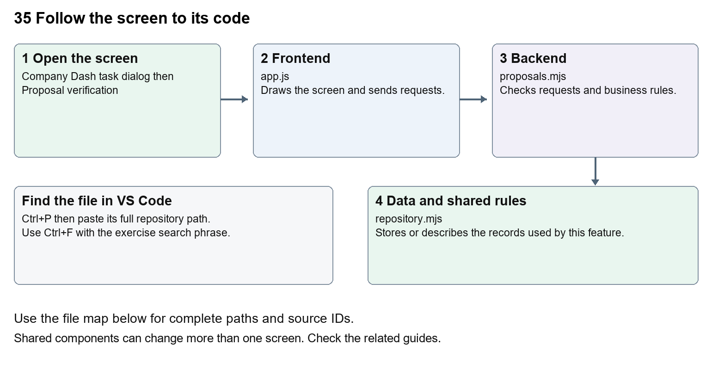

# Company Dash proposal review and integration

Document 35 of the Nexora learning guides  
Source snapshot 14 October 2026 at 06:41 UTC


Understand the review copy, matching source fingerprints and the explicit apply action.

### Recognise the screen and its scope

Open `Company Dash task dialog then Proposal verification`. Company Dash uses loopback port 8000 and hash navigation. Open its separate repository in VS Code before Ctrl+P. The source library uses company-dash as a project label, not a Nexora folder.

This guide covers Cumulative proposed patches; Proposal test evidence; Accepted ancestors; Integration preview; Freshness and expiry checks; Explicit local apply.



The diagram shows the file roles. The full paths below are what you paste into Ctrl+P.

### Find the files in VS Code

| Role | File and source ID | What it does |
| --- | --- | --- |
| Screen | S0696 app.js | Main UI or route for this topic |
| Server | S0707 proposals.mjs | Endpoints or server rules |
| Data | S0708 repository.mjs | Data shape or persistence structure |

**Screen S0696**  
[public/app.js](<C:/Users/ramish/Documents/ChatGPT/Company Dash/public/app.js>)

**Server S0707**  
[server/proposals.mjs](<C:/Users/ramish/Documents/ChatGPT/Company Dash/server/proposals.mjs>)

**Data S0708**  
[server/repository.mjs](<C:/Users/ramish/Documents/ChatGPT/Company Dash/server/repository.mjs>)

Use the HTML source buttons for full files. Word shows labelled extracts; individual Markdown guides contain complete primary files.

### Follow the request and the records

1. Read the task report and proposed patch before starting relevant proposal QA.
2. Review integration requests POST /api/integration/preview with a task id.
3. The backend checks the latest proposal, accepted handoffs, exact-source QA and unchanged original baseline.
4. A separate review copy and cumulative patch are returned for operator inspection.
5. Apply reviewed changes revalidates the review and updates the local Nexora checkout; checkout QA follows.

### Read the code with an explanation

public/app.js creates proposal controls and a review dialog. proposals.mjs requires passing evidence for the exact proposal fingerprint and compares the original checkout baseline. A downstream proposal includes earlier accepted developer changes. The review key expires after fifteen minutes and is revalidated on apply. Matching architecture evidence covers only that suite; choose API or browser checks when the change requires them. Applied source remains a local change until it is deliberately committed, pushed and deployed through the appropriate workflow.

Source reference S0696 company-dash/public/app.js

Extract from source line 68. A fragment from a long line is shown without the rest of that line.

```js
0068  function proposalActions(task) {
```


index.html supplies markup and app.js renders browser views. Follow api() to the server route handler.

Source reference S0707 company-dash/server/proposals.mjs

Extract from source line 14. A fragment from a long line is shown without the rest of that line.

```mjs
0014  export async function proposalReview(store, config, taskId) {
```


The browser api() helper sends a method and local request token. app.mjs checks the route and calls the relevant service. Follow that call to understand SQL writes, process execution and filesystem changes.

Source reference S0708 company-dash/server/repository.mjs

Selected opening lines with their original numbers. The complete file is in the HTML source library.

```mjs
0001  import fs from 'node:fs/promises';
0002  import path from 'node:path';
0003  import { execFile } from 'node:child_process';
0004  import { promisify } from 'node:util';
0005  import { createHash } from 'node:crypto';
0006  const exec = promisify(execFile);
```


store.mjs defines SQLite history tables. catalog.mjs and config.mjs define configuration; repository.mjs records fingerprints. Trace each key into its service before assuming it is a stored table.

### Make or trace your first change

1. Press Ctrl+P and open [server/proposals.mjs](<C:/Users/ramish/Documents/ChatGPT/Company Dash/server/proposals.mjs>).
2. Press Ctrl+F and search for `Run proposal QA on this exact source before integration.`. In this snapshot it appears at line 26.
3. Read-only exercise: find the exact-source QA requirement, then the original-checkout comparison and expiry check. Explain why a stale proposal must be refreshed rather than forced into the checkout.
4. Record the file, request path and server handler you found. This exercise is read-only; no stored records need to change.

Extract from source line 26. A fragment from a long line is shown without the rest of that line.

```mjs
0026    if (!evidence.length) throw new Error('Run proposal QA on this exact source before integration.');
```


These exercises have not been applied to the application. Their search phrases are verified against the captured source. Line numbers can move; the phrase and file path are your main navigation aids.

### Check a change and diagnose problems

Confirm the original screen still loads, the changed words appear in the intended place, and another screen using the same component still behaves correctly. If an action fails, inspect the browser Network response, the relevant helper and server validation message. Use the common error table at the beginning of the manual. Reload on a version conflict instead of removing the version check.

A syntax error after a text edit usually means a quote, brace or closing tag changed. Compare your diff with the original. An unchanged browser result can mean the wrong port, a saved published configuration overriding a default, or a running API that has not reloaded.

### Understand the current limits

Accepting a handoff does not integrate code. Apply is an explicit state-changing operator action; never bypass the baseline or evidence checks. This documentation task does not review or apply any live proposal.

### Continue learning

Related guides [30 Nexora backend database and maintenance](#guide_30), [32 Company Dash repository and source viewer](#guide_32), [33 Company Dash tasks agents and handoffs](#guide_33), [34 Company Dash QA and verification](#guide_34).

## Complete primary source files

These are the complete captured files, with numbered source lines. Other supporting files are included in the complete HTML manual. Configured local passwords, if any, are explicitly omitted. Do not paste the display line numbers into code.

### S0696 app.js

[public/app.js](<C:/Users/ramish/Documents/ChatGPT/Company Dash/public/app.js>)

SHA256 `b6c838b27b785cd119ba517bba6e9702d156bd120f8f10a7a54146fb1c8b9187`; 150 source lines; complete captured text.

```js
0001  /* No external assets or client dependencies. All dynamic content is escaped. */
0002  const $ = selector => document.querySelector(selector);
0003  const escape = value => String(value ?? '').replace(/[&<>"']/g, char => ({'&':'&amp;','<':'&lt;','>':'&gt;','"':'&quot;',"'":'&#39;'}[char]));
0004  const labels = { overview:'Overview', work:'Work board', agents:'AI team', qa:'QA & verification', knowledge:'Repository & docs', activity:'Activity log', settings:'Workspace settings' };
0005  const state = { data:null, token:null, view:'overview', task:null, reader:null, readRun:null, filter:'', area:'all', lastJSON:'', busy:false };
0006  const time = value => value ? new Date(value).toLocaleString(undefined,{month:'short',day:'numeric',hour:'2-digit',minute:'2-digit'}) : 'Not run';
0007  const badge = (status, label = status) => `<span class="badge ${escape(status)}">${escape(label.replaceAll('_',' '))}</span>`;
0008  const agentFor = id => state.data.agents.find(a => a.id === id);
0009  const avatar = (agent, mini=false) => `<span class="agent-avatar ${agent.color} ${mini?'mini-avatar':''}">${agent.initials}</span>`;
0010  const heading = (title, description, action = '<button class="button primary" data-new="pm"><span>＋</span> New request</button>') => `<div class="page-heading"><div><h1>${title}</h1><p>${description}</p></div>${action}</div>`;
0011  const empty = (title, description, action='') => `<div class="empty"><div class="empty-mark">◈</div><h3>${title}</h3><p>${description}</p>${action}</div>`;
0012  function toast(message, error=false) { const el=$('#toast'); el.textContent=message; el.className=`show${error?' error':''}`; clearTimeout(toast.timer); toast.timer=setTimeout(()=>el.className='',5500); }
0013  async function api(url, data, method) {
0014    const response = await fetch(url,{method:method || (data!==undefined?'POST':'GET'),headers:{'Content-Type':'application/json',...(state.token?{'X-Command-Token':state.token}:{})},body:data===undefined?undefined:JSON.stringify(data)});
0015    const result=await response.json(); if(!response.ok) throw new Error(result.error || `Request failed (${response.status})`); return result;
0016  }
0017  async function load(force=false) {
0018    try {
0019      const data = await api('/api/state'); const json = JSON.stringify(data); const previousTask=state.data?.tasks.find(t=>t.id===state.task);state.data=data;
0020      $('#connection').innerHTML='<i></i>Workspace connected';
0021      $('#work-count').textContent=data.tasks.filter(t=>!['completed','cancelled'].includes(t.status)).length;
0022      if(force || json!==state.lastJSON) { if(force || !$('#main').contains(document.activeElement) || !['INPUT','SELECT','TEXTAREA'].includes(document.activeElement.tagName)) { render(); state.lastJSON=json; } }
0023      if(state.readRun && $('#reader-dialog').open) await openRun(state.readRun);
0024      const currentTask=data.tasks.find(t=>t.id===state.task);
0025      if(currentTask&&$('#detail-dialog').open&&(previousTask?.status!==currentTask.status||previousTask?.updated_at!==currentTask.updated_at)&&!$('#detail-dialog').contains(document.activeElement?.closest('input,textarea,select'))) await openTask(currentTask.id);
0026    } catch(error) { $('#connection').textContent='Connection lost'; if(force) toast(error.message,true); }
0027  }
0028  function agentCard(agent, expanded=false) {
0029    const running=state.data.tasks.filter(t=>t.agent===agent.id && ['running','queued'].includes(t.status));
0030    return `<button class="agent-card" data-new="${agent.id}"><div class="agent-top">${avatar(agent)}<span class="agent-arrow">↗</span></div><h3>${agent.name}</h3><p>${expanded?agent.description:agent.specialty}</p>${expanded?`<div class="agent-capabilities">${['crm_dev','portal_dev','qa'].includes(agent.id)?'Isolated source workspace · Reviewable changes':'Repository analysis · Written handoffs'}</div>`:''}<div class="agent-state ${running.length?'active':''}"><i></i>${running.length?`${running.length} queued / running`:state.data.provider.available?'Ready for a request':'Awaiting connection'}</div></button>`;
0031  }
0032  function tasksTable(tasks) {
0033    if(!tasks.length) return empty('Your next improvement starts here','Create a request to give your team a clear outcome.', '<button class="button secondary small" data-new="pm">＋ Create your first request</button>');
0034    return `<div class="table-wrap"><table><thead><tr><th>REQUEST</th><th>OWNER</th><th>STATUS</th><th>PRIORITY</th></tr></thead><tbody>${tasks.map(t=>`<tr data-task="${t.id}" tabindex="0" role="button" aria-label="Open ${escape(t.title)}"><td class="task-title">${escape(t.title)}<small>${escape(t.area)} · ${time(t.created_at)}</small></td><td><div class="owner-cell">${avatar(agentFor(t.agent),true)}<span>${agentFor(t.agent).initials}</span></div></td><td>${badge(t.status)}</td><td>${badge(t.priority)}</td></tr>`).join('')}</tbody></table></div>`;
0035  }
0036  function activity(events) { return events.map(e=>`<div class="activity-item"><span class="event-dot">${e.type.includes('failed')?'!':e.type.includes('accepted')?'✓':'↗'}</span><div><p>${escape(e.detail)}</p><small>${time(e.created_at)}</small></div></div>`).join(''); }
0037  function overview() {
0038    const d=state.data,repo=d.repository;
0039    const active=d.tasks.filter(t=>['ready','queued','running','blocked'].includes(t.status)).length;
0040    const review=d.tasks.filter(t=>t.status==='review').length;
0041    const qa=d.runs.filter(r=>r.kind==='qa'), passed=qa.filter(r=>r.status==='succeeded').length;
0042    return heading('Your maintenance, in focus.','One workspace for Nexora’s people, product areas and verification.')+
0043      `<div class="overview-banner"><div class="banner-left"><span class="banner-icon">⌘</span><div><div class="banner-title">${repo?'Connected to Nexora':'Connect your Nexora repository'}</div><div class="banner-sub">${repo?'CRM, member portal and website. One connected codebase.':escape(d.repositoryError || 'Scanning the workspace…')}</div></div></div><div class="banner-meta"><div class="branch">⑂ ${escape(repo?.branch || 'Not connected')} <span>·</span> ${escape(repo?.commit.slice(0,7) || '—')}</div><div>${repo?`${repo.changedFiles} uncommitted files · source stays protected`:'Configure the workspace path in settings'}</div></div></div>`+
0044      `<div class="metrics"><div class="metric"><div class="metric-label">Open work<span class="metric-icon">▤</span></div><div class="metric-value">${active}<small>requests & handoffs</small></div><div class="metric-note">${d.tasks.filter(t=>t.status==='running').length} running now</div></div><div class="metric"><div class="metric-label">Ready for review<span class="metric-icon">◉</span></div><div class="metric-value">${review}<small>awaiting you</small></div><div class="metric-note">Reports and proposed changes</div></div><div class="metric"><div class="metric-label">QA evidence<span class="metric-icon">✓</span></div><div class="metric-value">${passed}<small>/ ${qa.length} runs</small></div><div class="metric-note ${passed?'good':''}">${qa.length?'Successful check executions':'No checks run in this workspace yet'}</div></div><div class="metric"><div class="metric-label">AI specialists<span class="metric-icon">♧</span></div><div class="metric-value">6<small>connected roles</small></div><div class="metric-note ${d.provider.available?'good':''}">${d.provider.available?'Codex CLI · signed in':'Connect Codex to start agent work'}</div></div></div>`+
0045      `<div class="grid-main"><div><section class="panel"><div class="panel-heading"><div><h2>Your AI team</h2><p>Specialists with shared context. Clear ownership.</p></div><a class="text-button" href="#agents">Meet the team <span>↗</span></a></div><div class="team-grid">${d.agents.map(a=>agentCard(a)).join('')}</div></section><section class="panel"><div class="panel-heading"><h2>Recent work</h2><a class="text-button" href="#work">Open board <span>↗</span></a></div>${tasksTable(d.tasks.slice(0,5))}</section></div><div><section class="panel"><div class="panel-heading"><h2>Product coverage</h2><span class="badge">SOURCE INDEX</span></div><div class="product-list">${(repo?.groups || [{name:'CRM',files:0},{name:'Portal',files:0},{name:'Website / CMS',files:0},{name:'Platform',files:0}]).map((g,i)=>`<div class="product-row"><div class="product-name"><span class="product-icon">${['▦','◇','▧','⌘'][i]}</span><div>${g.name}<small>${g.files} relevant source files</small></div></div>${badge(repo?'ready':'blocked',repo?'Indexed':'Not connected')}</div>`).join('')}</div><div class="panel-note">Source coverage is not a completion score. QA outcomes are tracked separately.</div></section><section class="panel"><div class="panel-heading"><h2>Latest activity</h2><a class="text-button" href="#activity">View all ↗</a></div>${d.events.length?`<div class="activity-list">${activity(d.events.slice(0,5))}</div>`:empty('A clear trail of work','Requests, scans and agent handoffs will appear here.')}</section><div class="source-caption">${repo?`Source indexed ${time(repo.scannedAt)}.<br>Use Refresh source to capture new repository changes.`:''}</div></div></div>`;
0046  }
0047  function work() {
0048    const d=state.data, tasks=d.tasks.filter(t=>(state.area==='all'||t.area===state.area)&&`${t.title} ${t.description}`.toLowerCase().includes(state.filter.toLowerCase()));
0049    const groups=[['Ready & blocked',['ready','blocked']],['In progress',['queued','running']],['In review',['review']],['Closed',['completed','cancelled']]];
0050    return heading('The work board','Follow a request from initial scope to an accepted handoff.')+`<div class="toolbar"><input id="task-search" aria-label="Search requests" placeholder="Search requests…" value="${escape(state.filter)}"><select id="task-area" aria-label="Filter product area"><option value="all">All product areas</option>${d.areas.map(a=>`<option ${a===state.area?'selected':''}>${a}</option>`).join('')}</select><span class="queue-marker">◷ ${d.runs.filter(r=>r.status==='queued').length} in execution queue</span></div><div class="board">${groups.map(([name,statuses])=>{const rows=tasks.filter(t=>statuses.includes(t.status));return `<section class="column"><div class="column-header">${name}<span>${rows.length}</span></div>${rows.map(t=>`<button class="work-card" data-task="${t.id}">${badge(t.status)}<h3>${escape(t.title)}</h3><p>${escape(t.description)}</p><div class="work-card-bottom"><span>${escape(t.area)}</span>${avatar(agentFor(t.agent),true)}</div>${t.depends_on?'<div class="source-caption">↳ Linked handoff</div>':''}</button>`).join('')}${!rows.length?'<div class="empty">No work here yet</div>':''}</section>`;}).join('')}</div><p class="source-caption">Accepted means the handoff was reviewed. Code merges, live test results and deployment remain separate evidence.</p>`;
0051  }
0052  function agentsView() { return heading('A team built around Nexora','Choose a specialist to open a request or start a conversation.')+(!state.data.provider.available?`<div class="notice">${escape(state.data.provider.detail)} <a href="#settings">Open settings →</a></div>`:'')+`<div class="agent-directory">${state.data.agents.map(a=>agentCard(a,true)).join('')}</div><p class="source-caption">Roles use a shared Codex runtime and execute one at a time. Agent output is saved for review; no messages are sent to clients.</p>`; }
0053  function qaView() {
0054    const d=state.data;
0055    return heading('Evidence over assumptions.','Run Nexora’s existing checks and inspect exactly what happened.','<button class="button secondary" data-scan>↻ Refresh source</button>')+`<div class="notice">These checks target the current Nexora checkout. They do not certify an agent’s proposed patch. Browser suites use disposable SQL databases and ports 5095 / 3015.</div><div class="qa-grid">${d.suites.map(s=>{const latest=d.runs.find(r=>r.kind==='qa'&&r.label===s.id&&!r.target_task);const busy=d.runs.some(r=>r.kind==='qa'&&r.label===s.id&&['running','queued'].includes(r.status));return `<section class="qa-card">${badge(latest?.status||'not-run',latest?.status==='succeeded'?'Passed':latest?.status||'Not run')}<h3>${s.name}</h3><p>${s.detail}</p><div class="qa-card-bottom"><span class="muted">${s.area}</span><button class="button secondary small" data-suite="${s.id}" ${busy?'disabled':''}>${busy?'Queued / running':'▷ Run check'}</button></div></section>`;}).join('')}</div><section class="panel"><div class="panel-heading"><h2>Execution history</h2><span class="badge">ACTUAL PROCESS RESULTS</span></div>${runsTable(d.runs.filter(r=>r.kind==='qa'))}</section>`;
0056  }
0057  function runsTable(runs) { if(!runs.length) return empty('No executions recorded','Choose a check above to collect your first result.'); return `<div class="table-wrap"><table><thead><tr><th>CHECK</th><th>RESULT</th><th>STARTED</th><th>EVIDENCE</th></tr></thead><tbody>${runs.map(r=>`<tr><td>${escape(state.data.suites.find(s=>s.id===r.label)?.name || r.label)}<small>${r.target_task?' · Proposal':' · Checkout'}</small></td><td>${badge(r.status,r.status==='succeeded'?'Passed':r.status)}</td><td>${time(r.started_at || r.created_at)}</td><td><button class="run-log-link" data-run="${r.id}">Open log ↗</button>${['running','queued'].includes(r.status)?`<button class="run-log-link" data-stop="${r.id}">Stop</button>`:''}</td></tr>`).join('')}</tbody></table></div>`; }
0058  function knowledge() {
0059    const repo=state.data.repository;
0060    const docs=(repo?.docs||[]).sort((a,b)=>Number(/PROGRESS|MASTER_PLAN|LOCAL-TESTING|STAGE-17/.test(b))-Number(/PROGRESS|MASTER_PLAN|LOCAL-TESTING|STAGE-17/.test(a)));
0061    return heading('Nexora, grounded in source.','Read the architecture, delivery notes and implementation behind every handoff.','<button class="button primary" data-scan>↻ Refresh source</button>')+`<div class="toolbar"><input id="file-search" aria-label="Search repository files" placeholder="Find a source file or document…"><button class="button secondary" id="search-files">Search source</button></div><div id="file-results"></div><h2 class="section-title">PROJECT KNOWLEDGE <span class="badge">${docs.length} DOCUMENTS</span></h2><div class="doc-grid">${docs.map(f=>`<button class="doc-card" data-file="${escape(f)}"><span class="doc-symbol">▧</span><span><strong>${escape(f.split('/').pop().replace('.md','').replaceAll('-',' ').replaceAll('_',' '))}</strong><small>${escape(f)}</small></span></button>`).join('')}</div>${!repo?empty('Repository not connected','Set the Nexora path in workspace settings.'):''}<p class="source-caption">Documents are read from the current local checkout. Their claims and percentages are historical reporting, not fresh verification.</p>`;
0062  }
0063  function settings() { const d=state.data; return heading('Workspace settings','A local maintenance workspace, connected to your Nexora checkout.','')+`<div class="settings-grid"><section class="panel"><div class="panel-heading"><h2>Repository connection</h2>${badge(d.repository?'ready':'blocked',d.repository?'Connected':'Disconnected')}</div><div class="settings-body"><strong>Nexora source</strong><code>${escape(d.config.repoPath)}</code><p>CRM, Portal, Website/CMS and platform modules share this repository. Agent runs use filtered source copies, including uncommitted files.</p><button class="button secondary" data-scan>↻ Refresh source</button></div></section><section class="panel"><div class="panel-heading"><h2>Agent runtime</h2>${badge(d.provider.available?'ready':'blocked',d.provider.available?'Signed in':'Not connected')}</div><div class="settings-body"><strong>Codex CLI</strong><p>${escape(d.provider.detail)}</p><p>Up to ${d.config.agentTimeoutMinutes} minutes per agent run. One run at a time. Your existing Codex account handles model usage; no model cost estimate is invented here.</p><button class="button secondary" id="check-provider">Check connection</button></div></section><section class="panel"><div class="panel-heading"><h2>Execution boundaries</h2></div><div class="settings-body"><p>PM, BA and Support inspect isolated source in read-only mode. Developers and QA can edit their isolated workspace. Reports and patches return to the review queue.</p><p><strong>Nothing automatically merges, pushes, deploys or sends client messages.</strong> The app does not connect to Nexora’s CRM assistant endpoint or production data.</p><p>Agent source context is processed through your Codex account. Local hosting does not mean local model inference.</p></div></section><section class="panel"><div class="panel-heading"><h2>Local configuration</h2></div><div class="settings-body"><p>Copy <strong>config.example.json</strong> to <strong>config.local.json</strong> to change repository path, executable paths, timeout or port. Restart after changes.</p><strong>QA SQL instance</strong><code>${escape(d.config.sqlServer)}</code><p>Tasks, messages, reports and run logs are stored in <strong>data/command-center.sqlite</strong>. This version is for one local administrator, not shared network hosting.</p></div></section></div>`; }
0064  function operationsSettings() {
0065    const u=state.data.usage, days=state.data.config.retentionDays;
0066    return `<section class="panel"><div class="panel-heading"><h2>Usage and maintenance</h2></div><div class="settings-body"><p>Today (UTC): <strong>${u.tokens.toLocaleString()} reported tokens</strong>. ${u.unknown} run(s) with unknown usage.</p><p>Per-run threshold: ${u.maxRunTokens || 'disabled'}. Daily token threshold: ${u.dailyTokenLimit || 'disabled'}. Estimated USD: ${u.estimatedUsd===null?'not configured':u.estimatedUsd.toFixed(4)}; daily threshold: ${u.dailyUsdLimit || 'disabled'}.</p><p>${escape(u.note)}</p><p>Workspace retention: ${days?`${days} days for closed work, checked daily`:'disabled'}. Reports and history are retained. Cleanup first creates a backup. Restore into a new data directory using the documented restore command.</p><button class="button secondary" id="backup-data">Create backup</button> <button class="button secondary" id="preview-cleanup">Review cleanup</button></div></section>`;
0067  }
0068  function proposalActions(task) {
0069    if(!task.workspace || !['review','completed'].includes(task.status))return '';
0070    return `<h3>PROPOSAL VERIFICATION</h3><label>Check to run<select id="proposal-suite">${state.data.suites.map(s=>`<option value="${s.id}">${escape(s.name)}</option>`).join('')}</select></label><button class="button secondary" data-proposal-qa="${task.id}">Test this proposal</button><button class="button secondary" data-integration="${task.id}">Review integration</button><p>Checks use a separate source copy. Integration requires matching QA evidence and an unchanged Nexora baseline.</p>`;
0071  }
0072  function render() {
0073    if(!state.data) return;
0074    state.view=Object.hasOwn(labels,location.hash.slice(1))?location.hash.slice(1):'overview';
0075    $('#breadcrumb').textContent=labels[state.view];
0076    document.querySelectorAll('[data-view]').forEach(a=>a.classList.toggle('active',a.dataset.view===state.view));
0077    const views={overview,work,agents:agentsView,qa:qaView,knowledge,settings,activity:()=>heading('Every handoff, on record.','A durable timeline of requests, execution and review.','')+`<section class="panel"><div class="full-activity">${state.data.events.length?activity(state.data.events):empty('Your activity starts here','Create a request or refresh the repository index.')}</div></section>`};
0078    $('#main').innerHTML=views[state.view]()+(state.view==='settings'?operationsSettings():'');
0079  }
0080  function newRequest(agent='pm') {
0081    $('#request-form').reset(); $('#agent-select').innerHTML=state.data.agents.map(a=>`<option value="${a.id}" ${a.id===agent?'selected':''}>${a.name}</option>`).join('');
0082    $('#area-select').innerHTML=state.data.areas.map(a=>`<option>${a}</option>`).join(''); updateWorkflow(); $('#request-dialog').showModal();
0083  }
0084  function updateWorkflow() { const eligible=['pm','ba','support'].includes($('#agent-select').value); const input=$('#request-form [name=workflow]');input.disabled=!eligible;input.checked=eligible && $('#agent-select').value!=='support'; }
0085  async function openTask(key) {
0086    const task=await api(`/api/tasks/${key}`); state.task=key; const agent=agentFor(task.agent), running=['running','queued'].includes(task.status);
0087    const dependency=state.data.tasks.find(t=>t.id===task.depends_on);
0088    const canRun=['ready','blocked'].includes(task.status)&&(!dependency||dependency.status==='completed');
0089    $('#detail-content').innerHTML=`<div class="modal-heading"><div><div class="eyebrow">${escape(agent.name)} · ${escape(task.area)}</div><h2>${escape(task.title)}</h2></div><button class="icon-button" data-close aria-label="Close">×</button></div><div class="detail-meta">${badge(task.status)}${badge(task.priority)}<span class="muted">Created ${time(task.created_at)}</span></div>${dependency?`<div class="notice">Handoff from: <button class="text-button" data-task="${dependency.id}">${escape(dependency.title)} ↗</button> · ${escape(dependency.status)}</div>`:''}<div class="detail-body"><div><div class="conversation">${task.messages.map(m=>`<div class="message ${m.role}"><div class="message-label">${m.role==='user'?'You':agent.name} · ${time(m.created_at)}</div><pre>${escape(m.content)}</pre></div>`).join('')}</div>${!running&&!['completed','cancelled'].includes(task.status)?`<form id="followup-form" class="followup"><textarea aria-label="Follow-up message" name="content" required maxlength="12000" rows="2" placeholder="Add context or request a revision…"></textarea><button class="button secondary" type="submit">Add</button></form>`:''}</div><aside class="detail-side"><h3>NEXT ACTION</h3>${canRun?`<button class="button primary" data-start="${task.id}" ${!state.data.provider.available?'disabled':''}>▷ Start ${agent.initials} agent</button>`:''}${task.status==='review'?`<button class="button primary" data-accept="${task.id}">✓ Accept handoff</button><p>Accepting unlocks the next role. It does not merge a patch or certify test results.</p>`:''}${running?`<div class="notice">${task.status==='queued'?'Waiting for the execution slot.':'Agent is working in its isolated workspace.'}</div>`:''}${!running&&!['completed','cancelled'].includes(task.status)?`<button class="button secondary small" data-cancel-task="${task.id}">Cancel task</button>`:''}<button class="button secondary small" data-task="${task.id}">↻ Refresh conversation</button>${proposalActions(task)}<h3 class="section-title">ARTIFACTS</h3>${task.artifacts.map(a=>`<button class="artifact-button" data-artifact="${a.id}">▧ ${escape(a.name)}</button>`).join('')||'<p>No artifacts yet.</p>'}<h3 class="section-title">RUNS</h3>${task.runs.map(r=>`<div class="run-line">${badge(r.status)}<button class="run-log-link" data-run="${r.id}">Log ↗</button>${['running','queued'].includes(r.status)?`<button class="run-log-link" data-stop="${r.id}">Stop</button>`:''}</div>`).join('')||'<p>Not run yet.</p>'}</aside></div>`;
0090    if(task.status==='blocked') {
0091      const latest=task.runs.find(r=>r.kind==='agent'&&r.task_id===task.id);
0092      const report=task.artifacts.find(a=>a.kind==='report'&&a.run_id===latest?.id);
0093      const notice=document.createElement('div');notice.className='notice';notice.setAttribute('role','status');
0094      notice.textContent=report?.content.trim().split(/\n\s*\n/)[0] || latest?.error || (dependency&&dependency.status!=='completed'?'Accept the preceding handoff to unlock this task.':'This task is blocked. Read its latest report or run log before retrying.');
0095      $('#detail-content .detail-body').before(notice);
0096    }
0097    if(canRun&&task.agent==='qa'&&state.data.config.qaRuntimePreparation) {
0098      const preparation=document.createElement('label');preparation.className='runtime-preparation';
0099      preparation.innerHTML='<span><input type="checkbox" id="prepare-qa-runtime" aria-label="Prepare test dependencies" checked> Prepare test dependencies</span><small>Restore packages in the isolated workspace before QA starts. Setup failures appear in the run log.</small>';
0100      $('#detail-content [data-start]').before(preparation);
0101    }
0102    if(canRun&&task.agent==='qa'&&!state.data.config.qaRuntimePreparation) {
0103      const notice=document.createElement('p');notice.textContent='Restart Company Dash to enable automatic test dependency preparation.';
0104      $('#detail-content [data-start]').before(notice);
0105    }
0106    if(!$('#detail-dialog').open) $('#detail-dialog').showModal();
0107  }
0108  function reader(name, content, run=null) { $('#review-action')?.remove(); state.reader={name,content}; state.readRun=run; $('#reader-title').textContent=name; $('#reader-content').textContent=content; if(!$('#reader-dialog').open) $('#reader-dialog').showModal(); }
0109  async function openRun(key) { const run=await api(`/api/runs/${key}`);reader(`${run.label} · ${run.status}`,`Status: ${run.status}\nStarted: ${run.started_at||'Not started'}\nExit code: ${run.exit_code??'—'}\nWorkspace: ${run.workspace||'Not captured'}\nCommand: ${run.command||'Not started'}\n${run.error?`Error: ${run.error}\n`:''}\n${run.log||'Waiting for output…'}`,['queued','running'].includes(run.status)?key:null); }
0110  async function searchFiles() { const result=await api(`/api/repository/files?q=${encodeURIComponent($('#file-search').value)}`); $('#file-results').innerHTML=`<div class="file-results">${result.files.map(f=>`<button class="file-result" data-file="${escape(f)}">${escape(f)}</button>`).join('')||'<div class="empty">No matching source files</div>'}</div>`; }
0111  document.addEventListener('click',async event=>{
0112    const el=event.target.closest('button,[data-task]'); if(!el) return;
0113    if(el.form && el.type==='submit') return; // The submit handler owns form buttons; disabling here cancels native submission.
0114    try {
0115      if(el.hasAttribute('data-close')) {el.closest('dialog').close();return;}
0116      if(el.dataset.new) {newRequest(el.dataset.new);return;}
0117      if(el.dataset.task) {await openTask(el.dataset.task);return;}
0118      if(el.dataset.file) {const file=await api(`/api/repository/file?path=${encodeURIComponent(el.dataset.file)}`);reader(file.path,file.content);return;}
0119      if(el.dataset.artifact) {const artifact=await api(`/api/artifacts/${el.dataset.artifact}`);reader(artifact.name,artifact.content);return;}
0120      if(el.dataset.run) {await openRun(el.dataset.run);return;}
0121      el.disabled=true;
0122      if(el.hasAttribute('data-scan')) {await api('/api/repository/scan',{});toast('Nexora source index refreshed.');}
0123      if(el.dataset.suite) {await api('/api/qa/run',{suite:el.dataset.suite});toast('QA check queued. Open its log to follow execution.');}
0124      if(el.dataset.proposalQa) {await api('/api/qa/run',{suite:$('#proposal-suite').value,taskId:el.dataset.proposalQa});toast('Isolated proposal check queued.');}
0125      if(el.dataset.integration) {const review=await api('/api/integration/preview',{taskId:el.dataset.integration});reader('Review local integration',`Files: ${review.changed.join(', ')}\nPassing proposal checks: ${review.evidence.map(e=>e.label).join(', ')}\nReview copy: ${review.candidate}\nSource hash: ${review.fingerprint}\n\nApply changes updates only the local Nexora checkout. No commit, push or deployment.\n\n${review.patch}`);const button=document.createElement('button');button.id='review-action';button.className='button primary';button.textContent='Apply reviewed changes';button.dataset.applyIntegration=review.key;$('#reader-dialog').append(button);}
0126      if(el.dataset.applyIntegration) {const result=await api('/api/integration/apply',{key:el.dataset.applyIntegration});reader('Local integration complete',result.note+'\n'+result.applied.join('\n'));toast('Reviewed changes applied. Run checkout QA next.');}
0127      if(el.id==='backup-data') {const backup=await api('/api/maintenance/backup',{});reader('Backup created',backup.directory+'\n'+backup.files+' verified files. See docs/OPERATIONS.md for restore.');}
0128      if(el.id==='preview-cleanup') {const plan=await api('/api/maintenance/preview');reader('Review expired workspace cleanup',plan.entries.length?plan.entries.map(e=>e.path).join('\n'):'No expired closed workspaces. Configure retentionDays to enable retention.');if(plan.entries.length){const button=document.createElement('button');button.id='review-action';button.dataset.cleanup='yes';button.className='button primary';button.textContent='Back up and remove expired copies';$('#reader-dialog').append(button);}}
0129      if(el.dataset.cleanup) {const result=await api('/api/maintenance/cleanup',{});reader('Cleanup complete',`${result.removed} expired copies removed. Task history and reports retained.`);}
0130      if(el.dataset.start) {await api(`/api/tasks/${el.dataset.start}/run`,{prepareRuntime:$('#prepare-qa-runtime')?.checked || false});toast('Agent run queued.');await openTask(el.dataset.start);}
0131      if(el.dataset.accept) {await api(`/api/tasks/${el.dataset.accept}/accept`,{});toast('Handoff accepted. The next role is ready.');await openTask(el.dataset.accept);}
0132      if(el.dataset.cancelTask) {await api(`/api/tasks/${el.dataset.cancelTask}/cancel`,{});toast('Task cancelled.');await openTask(el.dataset.cancelTask);}
0133      if(el.dataset.stop) {await api(`/api/runs/${el.dataset.stop}/cancel`,{});toast('Stop requested. Waiting for the process to exit.');}
0134      if(el.id==='refresh') toast('Dashboard refreshed.');
0135      if(el.id==='check-provider') {await api('/api/provider/check',{});toast('Agent connection checked.');}
0136      if(el.id==='search-files') { await searchFiles(); return; }
0137      if(el.id==='download' && state.reader) {const blob=new Blob([state.reader.content],{type:'text/plain;charset=utf-8'}),url=URL.createObjectURL(blob),a=document.createElement('a');a.href=url;a.download=state.reader.name.split(/[\\/]/).pop();a.click();setTimeout(()=>URL.revokeObjectURL(url),1000);}
0138      await load(true);
0139    }catch(error){toast(error.message,true);}finally{el.disabled=false;}
0140  });
0141  document.addEventListener('keydown',event=>{if(event.key==='Enter' && event.target.matches('tr[data-task]')) openTask(event.target.dataset.task).catch(e=>toast(e.message,true));if(event.key==='Enter'&&event.target.id==='file-search') searchFiles().catch(e=>toast(e.message,true));});
0142  document.addEventListener('change',event=>{if(event.target.id==='agent-select') updateWorkflow();if(event.target.id==='task-area'){state.area=event.target.value;render();}});
0143  document.addEventListener('input',event=>{if(event.target.id==='task-search'){state.filter=event.target.value;const position=event.target.selectionStart;render();$('#task-search').focus();$('#task-search').setSelectionRange(position,position);}});
0144  document.addEventListener('submit',async event=>{
0145    if(!['request-form','followup-form'].includes(event.target.id))return;event.preventDefault();const button=event.target.querySelector('[type=submit]');button.disabled=true;
0146    try{const data=Object.fromEntries(new FormData(event.target));if(event.target.id==='request-form'){data.workflow=data.workflow==='on';const task=await api('/api/tasks',data);$('#request-dialog').close();location.hash='work';await load(true);await openTask(task.id);toast('Request saved. Start the first agent when ready.');}else{await api(`/api/tasks/${state.task}/messages`,data);await openTask(state.task);await load(true);toast('Follow-up saved.');}}catch(error){toast(error.message,true);}finally{button.disabled=false;}
0147  });
0148  window.addEventListener('hashchange',render);
0149  async function boot(){try{state.token=(await api('/api/session')).token;await load(true);}catch(error){$('#main').innerHTML=empty('Unable to connect',escape(error.message));}setInterval(()=>load(),4000);}
0150  boot();
```

### S0707 proposals.mjs

[server/proposals.mjs](<C:/Users/ramish/Documents/ChatGPT/Company Dash/server/proposals.mjs>)

SHA256 `f1a23739badcd7cc27f8be200a6333163b4ea3b7978aff548af230f9b1c74afa`; 71 source lines; complete captured text.

```mjs
0001  import fs from 'node:fs/promises';
0002  import path from 'node:path';
0003  import { createHash, randomUUID } from 'node:crypto';
0004  import { allowed, git, createSnapshot, sourceFingerprint } from './repository.mjs';
0005  
0006  export async function workspace(config, task) {
0007    if (!task?.workspace) throw new Error('This task has no proposal workspace.');
0008    const base = await fs.realpath(path.join(config.dataDir, 'workspaces'));
0009    const actual = await fs.realpath(task.workspace);
0010    if (path.dirname(actual) !== base || path.resolve(task.workspace) !== actual) throw new Error('Proposal workspace is outside the managed directory.');
0011    return actual;
0012  }
0013  
0014  export async function proposalReview(store, config, taskId) {
0015    const task = store.get('SELECT * FROM tasks WHERE id=?', taskId);
0016    if (!task || !['review','completed'].includes(task.status)) throw new Error('Finish and review the agent proposal first.');
0017    const cwd = await workspace(config, task);
0018    const latest = store.get("SELECT * FROM runs WHERE task_id=? AND kind='agent' ORDER BY created_at DESC,id DESC LIMIT 1", taskId);
0019    if (latest?.status !== 'succeeded') throw new Error('The latest agent run has not succeeded.');
0020    const artifact = store.get("SELECT * FROM artifacts WHERE run_id=? AND kind='patch'", latest.id);
0021    if (!artifact) throw new Error('There is no proposed patch to integrate.');
0022    const changed = (await git(cwd, ['diff','--name-only','-z','HEAD'])).split('\0').filter(Boolean);
0023    if (!changed.length || changed.some(f => !allowed(f))) throw new Error('Proposal contains excluded paths or no changes.');
0024    const fingerprint = await sourceFingerprint(cwd);
0025    const evidence = store.all("SELECT id,label,source_hash FROM runs WHERE kind='qa' AND target_task=? AND status='succeeded' ORDER BY created_at DESC", taskId).filter(r => r.source_hash === fingerprint);
0026    if (!evidence.length) throw new Error('Run proposal QA on this exact source before integration.');
0027    const currentPatch = await git(cwd, ['diff','HEAD','--no-ext-diff','--no-textconv','--binary']);
0028    if (currentPatch !== artifact.content) throw new Error('Proposal changed after its report. Run the agent and review its new patch.');
0029    let first = task;
0030    while (first.depends_on) {
0031      first = store.get('SELECT * FROM tasks WHERE id=?', first.depends_on);
0032      if (!first || first.status !== 'completed') throw new Error('Accept all preceding handoffs first.');
0033    }
0034    const original = store.get('SELECT baseline FROM runs WHERE task_id=? AND baseline IS NOT NULL ORDER BY created_at,id LIMIT 1', first.id);
0035    const origin = original && JSON.parse(original.baseline).snapshotHash;
0036    const checkoutHash = await sourceFingerprint(config.repoPath);
0037    if (!origin || checkoutHash !== origin) throw new Error('Nexora source changed since this workflow began. Refresh the proposal against the new checkout before integration.');
0038    return { taskId, changed, fingerprint, checkoutHash, patchHash: createHash('sha256').update(currentPatch).digest('hex'), evidence, patch: currentPatch };
0039  }
0040  
0041  export async function integrationPreview(store, config, taskId) {
0042    const review = await proposalReview(store, config, taskId);
0043    const key = randomUUID();
0044    const candidate = path.join(config.dataDir, 'integration', key);
0045    await createSnapshot(config.repoPath, candidate);
0046    const patchFile = path.join(config.dataDir, 'integration', `${key}.patch`);
0047    await fs.writeFile(patchFile, review.patch);
0048    await git(candidate, ['apply','--check',patchFile]);
0049    await git(candidate, ['apply',patchFile]);
0050    const value = { ...review, patch: undefined, key, candidate, patchFile, expires: Date.now() + 15 * 60000 };
0051    store.run('INSERT INTO meta(key,value) VALUES(?,?)', `integration:${key}`, JSON.stringify(value));
0052    store.event(taskId, 'integration.preview', `Prepared a review copy with ${review.changed.length} changed file(s). Original checkout unchanged.`);
0053    return { ...value, patch: review.patch };
0054  }
0055  
0056  export async function integrate(store, config, key) {
0057    if (typeof key !== 'string' || !/^[0-9a-f-]{36}$/.test(key)) throw new Error('Invalid integration review.');
0058    const saved = store.get('SELECT value FROM meta WHERE key=?', `integration:${key}`);
0059    if (!saved) throw new Error('Review missing or already applied.');
0060    const preview = JSON.parse(saved.value);
0061    if (Date.now() > preview.expires) throw new Error('Review expired. Prepare a new preview.');
0062    const fresh = await proposalReview(store, config, preview.taskId);
0063    if (fresh.patchHash !== preview.patchHash || fresh.fingerprint !== preview.fingerprint || fresh.checkoutHash !== preview.checkoutHash) throw new Error('Source changed after review. Prepare a new preview.');
0064    // Rewrite from the immutable database artifact, never trust a file edited by another local process.
0065    await fs.writeFile(preview.patchFile, fresh.patch);
0066    await git(config.repoPath, ['apply','--check',preview.patchFile]);
0067    await git(config.repoPath, ['apply',preview.patchFile]);
0068    store.run('DELETE FROM meta WHERE key=?', `integration:${key}`);
0069    store.event(preview.taskId, 'integration.applied', `${fresh.changed.length} reviewed file(s) applied locally. No commit, push or deployment.`);
0070    return { applied: fresh.changed, note: 'Changes are uncommitted. Run checkout QA to verify the integrated checkout.' };
0071  }
```

### S0708 repository.mjs

[server/repository.mjs](<C:/Users/ramish/Documents/ChatGPT/Company Dash/server/repository.mjs>)

SHA256 `74674b3599835f79cfeb5d0be5d6fad40e88c1f523d0bb3f42b1e88052575675`; 108 source lines; complete captured text.

```mjs
0001  import fs from 'node:fs/promises';
0002  import path from 'node:path';
0003  import { execFile } from 'node:child_process';
0004  import { promisify } from 'node:util';
0005  import { createHash } from 'node:crypto';
0006  const exec = promisify(execFile);
0007  export async function git(root, args) {
0008    return (await exec('git', ['-c', 'core.quotePath=false', ...args], { cwd: root, windowsHide: true, maxBuffer: 24 * 1024 * 1024, timeout: 30000, env: { ...process.env, GIT_OPTIONAL_LOCKS: '0' } })).stdout;
0009  }
0010  const excluded = /(^|\/)(node_modules|\.git|\.codex|\.vscode|\.next[^/]*|bin|obj|artifacts|data|coverage|test-results|playwright-report)(\/|$)/i;
0011  const sensitive = /(^|\/)(\.env[^/]*|appsettings[^/]*\.json|launchSettings\.json|[^/]*(secret|credential|password)[^/]*|id_rsa|id_ed25519|\.npmrc|nuget\.config)$/i;
0012  const extensions = new Set(['.md', '.txt', '.json', '.cs', '.csproj', '.sln', '.slnx', '.props', '.targets', '.ts', '.tsx', '.js', '.jsx', '.mjs', '.cjs', '.css', '.html', '.yml', '.yaml', '.ps1', '.sql', '.sh', '.xml', '.toml', '.gitignore', '.gitattributes']);
0013  export function allowed(relative) {
0014    return typeof relative === 'string' && relative.length < 500 && !relative.includes('\\') && !relative.includes(':') && !relative.includes('\0') && !relative.startsWith('/') && !relative.split('/').some(p => p === '..' || p === '.' || !p) && !excluded.test(relative) && !sensitive.test(relative) && (extensions.has(path.extname(relative).toLowerCase()) || ['.gitignore', '.gitattributes'].includes(path.basename(relative)));
0015  }
0016  export async function readSource(root, relative) {
0017    if (!allowed(relative)) throw new Error('This path is outside the permitted source files.');
0018    const base = await fs.realpath(root);
0019    const target = path.resolve(base, relative);
0020    const real = await fs.realpath(target);
0021    const resolved = path.relative(base, real);
0022    if (resolved.startsWith('..') || path.isAbsolute(resolved) || real !== target) throw new Error('Linked or escaped paths are not permitted.');
0023    const stat = await fs.stat(real);
0024    if (!stat.isFile() || stat.size > 750000) throw new Error('File is not readable text or exceeds 750 KB.');
0025    const content = await fs.readFile(real, 'utf8');
0026    if (content.includes('\0')) throw new Error('Binary files are not supported.');
0027    return content;
0028  }
0029  export async function inventory(root) {
0030    const files = (await git(root, ['ls-files', '-z', '--cached', '--others', '--exclude-standard'])).split('\0').filter(Boolean);
0031    return [...new Set(files)].filter(allowed).sort();
0032  }
0033  export async function baseline(root) {
0034    const [commit, branch, changes] = await Promise.all([
0035      git(root, ['rev-parse', 'HEAD']), git(root, ['branch', '--show-current']), git(root, ['status', '--porcelain=v1', '-uall']),
0036    ]);
0037    return { commit: commit.trim(), branch: branch.trim() || '(detached)', dirty: Boolean(changes.trim()), changedFiles: changes.trim() ? changes.trimEnd().split('\n').length : 0 };
0038  }
0039  export async function scanRepository(root) {
0040    const [base, files] = await Promise.all([baseline(root), inventory(root)]);
0041    const groups = [
0042      { name: 'CRM', match: /Nexora\.Modules\.(Crm|Membership)|features\/(crm|membership)/ },
0043      { name: 'Portal', match: /[Pp]ortal|features\/portal/ },
0044      { name: 'Website / CMS', match: /Nexora\.Modules\.Content|features\/content|\/site\// },
0045      { name: 'Platform', match: /BuildingBlocks|Nexora\.Modules\.(Identity|Work)|Nexora\.(Api|Worker)\// },
0046    ].map(g => ({ name: g.name, files: files.filter(f => g.match.test(f)).length }));
0047    const docs = files.filter(f => f.endsWith('.md') && (f.startsWith('docs/') || f === 'README.md' || f === 'AGENTS.md'));
0048    return { ...base, path: root, scannedAt: new Date().toISOString(), fileCount: files.length, groups, docs, files };
0049  }
0050  export async function sourceFingerprint(root) {
0051    const hash = createHash('sha256');
0052    for (const file of await inventory(root)) hash.update(file).update('\0').update(await readSource(root, file)).update('\0');
0053    return hash.digest('hex');
0054  }
0055  
0056  // Operator-owned preparation: Next's required local guidance travels with an
0057  // agent copy, without granting the agent access to live dependencies.
0058  export async function prepareAgentGuides(source, destination) {
0059    const web = root => path.join(root, 'apps', 'web');
0060    const docs = path.join(web(source), 'node_modules', 'next', 'dist', 'docs');
0061    if (!await fs.stat(docs).catch(() => null)) return false;
0062    for (const name of ['package.json', 'package-lock.json']) {
0063      const original = await fs.readFile(path.join(web(source), name), 'utf8').catch(() => null);
0064      const proposed = await fs.readFile(path.join(web(destination), name), 'utf8').catch(() => null);
0065      if (original === null || original !== proposed) return false;
0066    }
0067    const base = await fs.realpath(docs);
0068    await fs.cp(base, path.join(web(destination), 'node_modules', 'next', 'dist', 'docs'), {
0069      recursive: true, dereference: true,
0070      filter: async item => {
0071        const actual = await fs.realpath(item);
0072        if (actual !== base && !actual.startsWith(base + path.sep)) throw new Error('Next guidance link escapes its directory.');
0073        return true;
0074      },
0075    });
0076    return true;
0077  }
0078  export async function createSnapshot(source, destination, inherit = false) {
0079    const initial = await baseline(source);
0080    const files = await inventory(source);
0081    await fs.mkdir(destination, { recursive: true });
0082    const hash = createHash('sha256');
0083    let count = 0, total = 0;
0084    const omitted = [];
0085    if (inherit) {
0086      // Preserve the first snapshot's HEAD across handoffs so each patch remains cumulative.
0087      await git(source, ['clone', '--no-hardlinks', '--no-local', source, destination]);
0088      const retained = new Set(files);
0089      for (const file of (await git(destination, ['ls-files', '-z'])).split('\0').filter(Boolean)) {
0090        if (!allowed(file)) throw new Error('Snapshot baseline contains an excluded path.');
0091        if (!retained.has(file)) await fs.unlink(path.join(destination, file));
0092      }
0093    }
0094    for (const file of files) {
0095      let content;
0096      try { content = await readSource(source, file); } catch (error) { omitted.push(`${file}: ${error.message}`); continue; }
0097      total += Buffer.byteLength(content);
0098      if (total > 120 * 1024 * 1024) throw new Error('Source snapshot exceeds 120 MB.');
0099      hash.update(file).update('\0').update(content).update('\0');
0100      await fs.mkdir(path.dirname(path.join(destination, file)), { recursive: true });
0101      await fs.writeFile(path.join(destination, file), content);
0102      count++;
0103    }
0104    await git(destination, ['init', '-q']);
0105    await git(destination, ['add', '-A']);
0106    if (!inherit) await git(destination, ['-c', 'user.name=Command Center', '-c', 'user.email=local@command-center.invalid', '-c', 'core.hooksPath=', 'commit', '-qm', 'Isolated source baseline', '--no-verify']);
0107    return { ...initial, snapshotHash: hash.digest('hex'), capturedFiles: count, omitted, capturedAt: new Date().toISOString(), note: 'Filtered source copy, including current uncommitted source. Secrets, runtime configuration, dependencies and build outputs excluded. Copy is not an atomic filesystem snapshot.' };
0108  }
```
