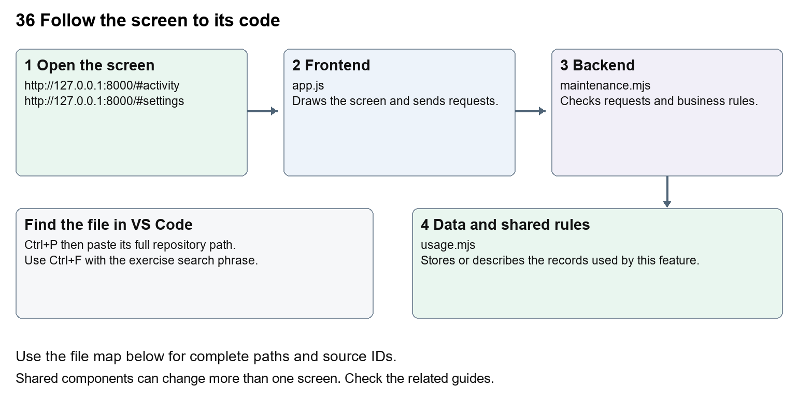

# Company Dash history backups and settings

Document 36 of the Nexora learning guides  
Source snapshot 14 October 2026 at 06:41 UTC


Locate persistent history, usage controls, backup verification and deliberate restoration.

### Recognise the screen and its scope

Open `http://127.0.0.1:8000/#activity`, `http://127.0.0.1:8000/#settings`. Company Dash uses loopback port 8000 and hash navigation. Open its separate repository in VS Code before Ctrl+P. The source library uses company-dash as a project label, not a Nexora folder.

This guide covers SQLite history and activity; Configuration diagnostics; Provider token usage; Optional usage thresholds; Checksummed backups; Restore to a new directory; Opt-in workspace retention.



The diagram shows the file roles. The full paths below are what you paste into Ctrl+P.

### Find the files in VS Code

| Role | File and source ID | What it does |
| --- | --- | --- |
| Screen | S0696 app.js | Main UI or route for this topic |
| Server | S0706 maintenance.mjs | Endpoints or server rules |
| Data | S0712 usage.mjs | Data shape or persistence structure |

**Screen S0696**  
[public/app.js](<C:/Users/ramish/Documents/ChatGPT/Company Dash/public/app.js>)

**Server S0706**  
[server/maintenance.mjs](<C:/Users/ramish/Documents/ChatGPT/Company Dash/server/maintenance.mjs>)

**Data S0712**  
[server/usage.mjs](<C:/Users/ramish/Documents/ChatGPT/Company Dash/server/usage.mjs>)

Use the HTML source buttons for full files. Word shows labelled extracts; individual Markdown guides contain complete primary files.

### Follow the request and the records

1. Activity displays stored events; settings reads safe configuration and usage summaries from /api/state.
2. Budget calculations combine provider usage with explicitly configured rates when available.
3. Create backup requests POST /api/maintenance/backup after active and queued work has stopped.
4. The server copies the database, reports and relevant workspaces and verifies a checksummed manifest.
5. The restore command checks the backup and writes to a new data directory; retention previews precede deliberate cleanup.

### Read the code with an explanation

data/ contains the SQLite database, reports and isolated workspaces and stays outside Git and the source library. config.local.json contains workstation settings; config.example.json explains the keys without revealing private values. Token usage is provider-reported. Dollar estimates need explicit rates; subscription billing is not inferred. Zero-valued thresholds and retention mean disabled defaults. Backups omit regenerable dependencies and build output. server/restore.mjs calls restoreBackup from maintenance.mjs and expects a backup directory and a new destination.

Source reference S0696 company-dash/public/app.js

Extract from source line 63. A fragment from a long line is shown without the rest of that line.

```js
0063  function settings() { const d=state.data; return heading('Worksp
```


index.html supplies markup and app.js renders browser views. Follow api() to the server route handler.

Source reference S0706 company-dash/server/maintenance.mjs

Extract from source line 25. A fragment from a long line is shown without the rest of that line.

```mjs
0025  export async function backupData(store, config) {
```


The browser api() helper sends a method and local request token. app.mjs checks the route and calls the relevant service. Follow that call to understand SQL writes, process execution and filesystem changes.

Source reference S0712 company-dash/server/usage.mjs

Selected opening lines with their original numbers. The complete file is in the HTML source library.

```mjs
0001  export function usageTotal(usage) { return (usage?.input_tokens || 0) + (usage?.output_tokens || 0); }
0002  export function estimateCost(usage, rates) {
0003    if (!usage || !rates) return null;
0004    return ((usage.input_tokens - usage.cached_input_tokens) * rates.input + usage.cached_input_tokens * rates.cached + usage.output_tokens * rates.output) / 1000000;
0005  }
0006  export function usageParser(onUsage) {
```


store.mjs defines SQLite history tables. catalog.mjs and config.mjs define configuration; repository.mjs records fingerprints. Trace each key into its service before assuming it is a stored table.

### Make or trace your first change

1. Press Ctrl+P and open [server/maintenance.mjs](<C:/Users/ramish/Documents/ChatGPT/Company Dash/server/maintenance.mjs>).
2. Press Ctrl+F and search for `export async function backupData`. In this snapshot it appears at line 25.
3. Read-only exercise: find how backupData creates its manifest and how restoreBackup verifies each file. Then find retentionPlan and explain why previewing it does not delete history.
4. Record the file, request path and server handler you found. This exercise is read-only; no stored records need to change.

Extract from source line 25. A fragment from a long line is shown without the rest of that line.

```mjs
0025  export async function backupData(store, config) {
```


These exercises have not been applied to the application. Their search phrases are verified against the captured source. Line numbers can move; the phrase and file path are your main navigation aids.

### Check a change and diagnose problems

Confirm the original screen still loads, the changed words appear in the intended place, and another screen using the same component still behaves correctly. If an action fails, inspect the browser Network response, the relevant helper and server validation message. Use the common error table at the beginning of the manual. Reload on a version conflict instead of removing the version check.

A syntax error after a text edit usually means a quote, brace or closing tag changed. Compare your diff with the original. An unchanged browser result can mean the wrong port, a saved published configuration overriding a default, or a running API that has not reloaded.

### Understand the current limits

Usage thresholds act at provider turn boundaries and cannot guarantee an exact in-flight spending cap. A backup is not a successful restore test. Do not run cleanup or restoration against existing history while learning; the documentation task performs neither action.

### Continue learning

Related guides [31 Company Dash startup and dashboard](#guide_31), [33 Company Dash tasks agents and handoffs](#guide_33), [35 Company Dash proposal review and integration](#guide_35).

## Complete primary source files

These are the complete captured files, with numbered source lines. Other supporting files are included in the complete HTML manual. Configured local passwords, if any, are explicitly omitted. Do not paste the display line numbers into code.

### S0696 app.js

[public/app.js](<C:/Users/ramish/Documents/ChatGPT/Company Dash/public/app.js>)

SHA256 `b6c838b27b785cd119ba517bba6e9702d156bd120f8f10a7a54146fb1c8b9187`; 150 source lines; complete captured text.

```js
0001  /* No external assets or client dependencies. All dynamic content is escaped. */
0002  const $ = selector => document.querySelector(selector);
0003  const escape = value => String(value ?? '').replace(/[&<>"']/g, char => ({'&':'&amp;','<':'&lt;','>':'&gt;','"':'&quot;',"'":'&#39;'}[char]));
0004  const labels = { overview:'Overview', work:'Work board', agents:'AI team', qa:'QA & verification', knowledge:'Repository & docs', activity:'Activity log', settings:'Workspace settings' };
0005  const state = { data:null, token:null, view:'overview', task:null, reader:null, readRun:null, filter:'', area:'all', lastJSON:'', busy:false };
0006  const time = value => value ? new Date(value).toLocaleString(undefined,{month:'short',day:'numeric',hour:'2-digit',minute:'2-digit'}) : 'Not run';
0007  const badge = (status, label = status) => `<span class="badge ${escape(status)}">${escape(label.replaceAll('_',' '))}</span>`;
0008  const agentFor = id => state.data.agents.find(a => a.id === id);
0009  const avatar = (agent, mini=false) => `<span class="agent-avatar ${agent.color} ${mini?'mini-avatar':''}">${agent.initials}</span>`;
0010  const heading = (title, description, action = '<button class="button primary" data-new="pm"><span>＋</span> New request</button>') => `<div class="page-heading"><div><h1>${title}</h1><p>${description}</p></div>${action}</div>`;
0011  const empty = (title, description, action='') => `<div class="empty"><div class="empty-mark">◈</div><h3>${title}</h3><p>${description}</p>${action}</div>`;
0012  function toast(message, error=false) { const el=$('#toast'); el.textContent=message; el.className=`show${error?' error':''}`; clearTimeout(toast.timer); toast.timer=setTimeout(()=>el.className='',5500); }
0013  async function api(url, data, method) {
0014    const response = await fetch(url,{method:method || (data!==undefined?'POST':'GET'),headers:{'Content-Type':'application/json',...(state.token?{'X-Command-Token':state.token}:{})},body:data===undefined?undefined:JSON.stringify(data)});
0015    const result=await response.json(); if(!response.ok) throw new Error(result.error || `Request failed (${response.status})`); return result;
0016  }
0017  async function load(force=false) {
0018    try {
0019      const data = await api('/api/state'); const json = JSON.stringify(data); const previousTask=state.data?.tasks.find(t=>t.id===state.task);state.data=data;
0020      $('#connection').innerHTML='<i></i>Workspace connected';
0021      $('#work-count').textContent=data.tasks.filter(t=>!['completed','cancelled'].includes(t.status)).length;
0022      if(force || json!==state.lastJSON) { if(force || !$('#main').contains(document.activeElement) || !['INPUT','SELECT','TEXTAREA'].includes(document.activeElement.tagName)) { render(); state.lastJSON=json; } }
0023      if(state.readRun && $('#reader-dialog').open) await openRun(state.readRun);
0024      const currentTask=data.tasks.find(t=>t.id===state.task);
0025      if(currentTask&&$('#detail-dialog').open&&(previousTask?.status!==currentTask.status||previousTask?.updated_at!==currentTask.updated_at)&&!$('#detail-dialog').contains(document.activeElement?.closest('input,textarea,select'))) await openTask(currentTask.id);
0026    } catch(error) { $('#connection').textContent='Connection lost'; if(force) toast(error.message,true); }
0027  }
0028  function agentCard(agent, expanded=false) {
0029    const running=state.data.tasks.filter(t=>t.agent===agent.id && ['running','queued'].includes(t.status));
0030    return `<button class="agent-card" data-new="${agent.id}"><div class="agent-top">${avatar(agent)}<span class="agent-arrow">↗</span></div><h3>${agent.name}</h3><p>${expanded?agent.description:agent.specialty}</p>${expanded?`<div class="agent-capabilities">${['crm_dev','portal_dev','qa'].includes(agent.id)?'Isolated source workspace · Reviewable changes':'Repository analysis · Written handoffs'}</div>`:''}<div class="agent-state ${running.length?'active':''}"><i></i>${running.length?`${running.length} queued / running`:state.data.provider.available?'Ready for a request':'Awaiting connection'}</div></button>`;
0031  }
0032  function tasksTable(tasks) {
0033    if(!tasks.length) return empty('Your next improvement starts here','Create a request to give your team a clear outcome.', '<button class="button secondary small" data-new="pm">＋ Create your first request</button>');
0034    return `<div class="table-wrap"><table><thead><tr><th>REQUEST</th><th>OWNER</th><th>STATUS</th><th>PRIORITY</th></tr></thead><tbody>${tasks.map(t=>`<tr data-task="${t.id}" tabindex="0" role="button" aria-label="Open ${escape(t.title)}"><td class="task-title">${escape(t.title)}<small>${escape(t.area)} · ${time(t.created_at)}</small></td><td><div class="owner-cell">${avatar(agentFor(t.agent),true)}<span>${agentFor(t.agent).initials}</span></div></td><td>${badge(t.status)}</td><td>${badge(t.priority)}</td></tr>`).join('')}</tbody></table></div>`;
0035  }
0036  function activity(events) { return events.map(e=>`<div class="activity-item"><span class="event-dot">${e.type.includes('failed')?'!':e.type.includes('accepted')?'✓':'↗'}</span><div><p>${escape(e.detail)}</p><small>${time(e.created_at)}</small></div></div>`).join(''); }
0037  function overview() {
0038    const d=state.data,repo=d.repository;
0039    const active=d.tasks.filter(t=>['ready','queued','running','blocked'].includes(t.status)).length;
0040    const review=d.tasks.filter(t=>t.status==='review').length;
0041    const qa=d.runs.filter(r=>r.kind==='qa'), passed=qa.filter(r=>r.status==='succeeded').length;
0042    return heading('Your maintenance, in focus.','One workspace for Nexora’s people, product areas and verification.')+
0043      `<div class="overview-banner"><div class="banner-left"><span class="banner-icon">⌘</span><div><div class="banner-title">${repo?'Connected to Nexora':'Connect your Nexora repository'}</div><div class="banner-sub">${repo?'CRM, member portal and website. One connected codebase.':escape(d.repositoryError || 'Scanning the workspace…')}</div></div></div><div class="banner-meta"><div class="branch">⑂ ${escape(repo?.branch || 'Not connected')} <span>·</span> ${escape(repo?.commit.slice(0,7) || '—')}</div><div>${repo?`${repo.changedFiles} uncommitted files · source stays protected`:'Configure the workspace path in settings'}</div></div></div>`+
0044      `<div class="metrics"><div class="metric"><div class="metric-label">Open work<span class="metric-icon">▤</span></div><div class="metric-value">${active}<small>requests & handoffs</small></div><div class="metric-note">${d.tasks.filter(t=>t.status==='running').length} running now</div></div><div class="metric"><div class="metric-label">Ready for review<span class="metric-icon">◉</span></div><div class="metric-value">${review}<small>awaiting you</small></div><div class="metric-note">Reports and proposed changes</div></div><div class="metric"><div class="metric-label">QA evidence<span class="metric-icon">✓</span></div><div class="metric-value">${passed}<small>/ ${qa.length} runs</small></div><div class="metric-note ${passed?'good':''}">${qa.length?'Successful check executions':'No checks run in this workspace yet'}</div></div><div class="metric"><div class="metric-label">AI specialists<span class="metric-icon">♧</span></div><div class="metric-value">6<small>connected roles</small></div><div class="metric-note ${d.provider.available?'good':''}">${d.provider.available?'Codex CLI · signed in':'Connect Codex to start agent work'}</div></div></div>`+
0045      `<div class="grid-main"><div><section class="panel"><div class="panel-heading"><div><h2>Your AI team</h2><p>Specialists with shared context. Clear ownership.</p></div><a class="text-button" href="#agents">Meet the team <span>↗</span></a></div><div class="team-grid">${d.agents.map(a=>agentCard(a)).join('')}</div></section><section class="panel"><div class="panel-heading"><h2>Recent work</h2><a class="text-button" href="#work">Open board <span>↗</span></a></div>${tasksTable(d.tasks.slice(0,5))}</section></div><div><section class="panel"><div class="panel-heading"><h2>Product coverage</h2><span class="badge">SOURCE INDEX</span></div><div class="product-list">${(repo?.groups || [{name:'CRM',files:0},{name:'Portal',files:0},{name:'Website / CMS',files:0},{name:'Platform',files:0}]).map((g,i)=>`<div class="product-row"><div class="product-name"><span class="product-icon">${['▦','◇','▧','⌘'][i]}</span><div>${g.name}<small>${g.files} relevant source files</small></div></div>${badge(repo?'ready':'blocked',repo?'Indexed':'Not connected')}</div>`).join('')}</div><div class="panel-note">Source coverage is not a completion score. QA outcomes are tracked separately.</div></section><section class="panel"><div class="panel-heading"><h2>Latest activity</h2><a class="text-button" href="#activity">View all ↗</a></div>${d.events.length?`<div class="activity-list">${activity(d.events.slice(0,5))}</div>`:empty('A clear trail of work','Requests, scans and agent handoffs will appear here.')}</section><div class="source-caption">${repo?`Source indexed ${time(repo.scannedAt)}.<br>Use Refresh source to capture new repository changes.`:''}</div></div></div>`;
0046  }
0047  function work() {
0048    const d=state.data, tasks=d.tasks.filter(t=>(state.area==='all'||t.area===state.area)&&`${t.title} ${t.description}`.toLowerCase().includes(state.filter.toLowerCase()));
0049    const groups=[['Ready & blocked',['ready','blocked']],['In progress',['queued','running']],['In review',['review']],['Closed',['completed','cancelled']]];
0050    return heading('The work board','Follow a request from initial scope to an accepted handoff.')+`<div class="toolbar"><input id="task-search" aria-label="Search requests" placeholder="Search requests…" value="${escape(state.filter)}"><select id="task-area" aria-label="Filter product area"><option value="all">All product areas</option>${d.areas.map(a=>`<option ${a===state.area?'selected':''}>${a}</option>`).join('')}</select><span class="queue-marker">◷ ${d.runs.filter(r=>r.status==='queued').length} in execution queue</span></div><div class="board">${groups.map(([name,statuses])=>{const rows=tasks.filter(t=>statuses.includes(t.status));return `<section class="column"><div class="column-header">${name}<span>${rows.length}</span></div>${rows.map(t=>`<button class="work-card" data-task="${t.id}">${badge(t.status)}<h3>${escape(t.title)}</h3><p>${escape(t.description)}</p><div class="work-card-bottom"><span>${escape(t.area)}</span>${avatar(agentFor(t.agent),true)}</div>${t.depends_on?'<div class="source-caption">↳ Linked handoff</div>':''}</button>`).join('')}${!rows.length?'<div class="empty">No work here yet</div>':''}</section>`;}).join('')}</div><p class="source-caption">Accepted means the handoff was reviewed. Code merges, live test results and deployment remain separate evidence.</p>`;
0051  }
0052  function agentsView() { return heading('A team built around Nexora','Choose a specialist to open a request or start a conversation.')+(!state.data.provider.available?`<div class="notice">${escape(state.data.provider.detail)} <a href="#settings">Open settings →</a></div>`:'')+`<div class="agent-directory">${state.data.agents.map(a=>agentCard(a,true)).join('')}</div><p class="source-caption">Roles use a shared Codex runtime and execute one at a time. Agent output is saved for review; no messages are sent to clients.</p>`; }
0053  function qaView() {
0054    const d=state.data;
0055    return heading('Evidence over assumptions.','Run Nexora’s existing checks and inspect exactly what happened.','<button class="button secondary" data-scan>↻ Refresh source</button>')+`<div class="notice">These checks target the current Nexora checkout. They do not certify an agent’s proposed patch. Browser suites use disposable SQL databases and ports 5095 / 3015.</div><div class="qa-grid">${d.suites.map(s=>{const latest=d.runs.find(r=>r.kind==='qa'&&r.label===s.id&&!r.target_task);const busy=d.runs.some(r=>r.kind==='qa'&&r.label===s.id&&['running','queued'].includes(r.status));return `<section class="qa-card">${badge(latest?.status||'not-run',latest?.status==='succeeded'?'Passed':latest?.status||'Not run')}<h3>${s.name}</h3><p>${s.detail}</p><div class="qa-card-bottom"><span class="muted">${s.area}</span><button class="button secondary small" data-suite="${s.id}" ${busy?'disabled':''}>${busy?'Queued / running':'▷ Run check'}</button></div></section>`;}).join('')}</div><section class="panel"><div class="panel-heading"><h2>Execution history</h2><span class="badge">ACTUAL PROCESS RESULTS</span></div>${runsTable(d.runs.filter(r=>r.kind==='qa'))}</section>`;
0056  }
0057  function runsTable(runs) { if(!runs.length) return empty('No executions recorded','Choose a check above to collect your first result.'); return `<div class="table-wrap"><table><thead><tr><th>CHECK</th><th>RESULT</th><th>STARTED</th><th>EVIDENCE</th></tr></thead><tbody>${runs.map(r=>`<tr><td>${escape(state.data.suites.find(s=>s.id===r.label)?.name || r.label)}<small>${r.target_task?' · Proposal':' · Checkout'}</small></td><td>${badge(r.status,r.status==='succeeded'?'Passed':r.status)}</td><td>${time(r.started_at || r.created_at)}</td><td><button class="run-log-link" data-run="${r.id}">Open log ↗</button>${['running','queued'].includes(r.status)?`<button class="run-log-link" data-stop="${r.id}">Stop</button>`:''}</td></tr>`).join('')}</tbody></table></div>`; }
0058  function knowledge() {
0059    const repo=state.data.repository;
0060    const docs=(repo?.docs||[]).sort((a,b)=>Number(/PROGRESS|MASTER_PLAN|LOCAL-TESTING|STAGE-17/.test(b))-Number(/PROGRESS|MASTER_PLAN|LOCAL-TESTING|STAGE-17/.test(a)));
0061    return heading('Nexora, grounded in source.','Read the architecture, delivery notes and implementation behind every handoff.','<button class="button primary" data-scan>↻ Refresh source</button>')+`<div class="toolbar"><input id="file-search" aria-label="Search repository files" placeholder="Find a source file or document…"><button class="button secondary" id="search-files">Search source</button></div><div id="file-results"></div><h2 class="section-title">PROJECT KNOWLEDGE <span class="badge">${docs.length} DOCUMENTS</span></h2><div class="doc-grid">${docs.map(f=>`<button class="doc-card" data-file="${escape(f)}"><span class="doc-symbol">▧</span><span><strong>${escape(f.split('/').pop().replace('.md','').replaceAll('-',' ').replaceAll('_',' '))}</strong><small>${escape(f)}</small></span></button>`).join('')}</div>${!repo?empty('Repository not connected','Set the Nexora path in workspace settings.'):''}<p class="source-caption">Documents are read from the current local checkout. Their claims and percentages are historical reporting, not fresh verification.</p>`;
0062  }
0063  function settings() { const d=state.data; return heading('Workspace settings','A local maintenance workspace, connected to your Nexora checkout.','')+`<div class="settings-grid"><section class="panel"><div class="panel-heading"><h2>Repository connection</h2>${badge(d.repository?'ready':'blocked',d.repository?'Connected':'Disconnected')}</div><div class="settings-body"><strong>Nexora source</strong><code>${escape(d.config.repoPath)}</code><p>CRM, Portal, Website/CMS and platform modules share this repository. Agent runs use filtered source copies, including uncommitted files.</p><button class="button secondary" data-scan>↻ Refresh source</button></div></section><section class="panel"><div class="panel-heading"><h2>Agent runtime</h2>${badge(d.provider.available?'ready':'blocked',d.provider.available?'Signed in':'Not connected')}</div><div class="settings-body"><strong>Codex CLI</strong><p>${escape(d.provider.detail)}</p><p>Up to ${d.config.agentTimeoutMinutes} minutes per agent run. One run at a time. Your existing Codex account handles model usage; no model cost estimate is invented here.</p><button class="button secondary" id="check-provider">Check connection</button></div></section><section class="panel"><div class="panel-heading"><h2>Execution boundaries</h2></div><div class="settings-body"><p>PM, BA and Support inspect isolated source in read-only mode. Developers and QA can edit their isolated workspace. Reports and patches return to the review queue.</p><p><strong>Nothing automatically merges, pushes, deploys or sends client messages.</strong> The app does not connect to Nexora’s CRM assistant endpoint or production data.</p><p>Agent source context is processed through your Codex account. Local hosting does not mean local model inference.</p></div></section><section class="panel"><div class="panel-heading"><h2>Local configuration</h2></div><div class="settings-body"><p>Copy <strong>config.example.json</strong> to <strong>config.local.json</strong> to change repository path, executable paths, timeout or port. Restart after changes.</p><strong>QA SQL instance</strong><code>${escape(d.config.sqlServer)}</code><p>Tasks, messages, reports and run logs are stored in <strong>data/command-center.sqlite</strong>. This version is for one local administrator, not shared network hosting.</p></div></section></div>`; }
0064  function operationsSettings() {
0065    const u=state.data.usage, days=state.data.config.retentionDays;
0066    return `<section class="panel"><div class="panel-heading"><h2>Usage and maintenance</h2></div><div class="settings-body"><p>Today (UTC): <strong>${u.tokens.toLocaleString()} reported tokens</strong>. ${u.unknown} run(s) with unknown usage.</p><p>Per-run threshold: ${u.maxRunTokens || 'disabled'}. Daily token threshold: ${u.dailyTokenLimit || 'disabled'}. Estimated USD: ${u.estimatedUsd===null?'not configured':u.estimatedUsd.toFixed(4)}; daily threshold: ${u.dailyUsdLimit || 'disabled'}.</p><p>${escape(u.note)}</p><p>Workspace retention: ${days?`${days} days for closed work, checked daily`:'disabled'}. Reports and history are retained. Cleanup first creates a backup. Restore into a new data directory using the documented restore command.</p><button class="button secondary" id="backup-data">Create backup</button> <button class="button secondary" id="preview-cleanup">Review cleanup</button></div></section>`;
0067  }
0068  function proposalActions(task) {
0069    if(!task.workspace || !['review','completed'].includes(task.status))return '';
0070    return `<h3>PROPOSAL VERIFICATION</h3><label>Check to run<select id="proposal-suite">${state.data.suites.map(s=>`<option value="${s.id}">${escape(s.name)}</option>`).join('')}</select></label><button class="button secondary" data-proposal-qa="${task.id}">Test this proposal</button><button class="button secondary" data-integration="${task.id}">Review integration</button><p>Checks use a separate source copy. Integration requires matching QA evidence and an unchanged Nexora baseline.</p>`;
0071  }
0072  function render() {
0073    if(!state.data) return;
0074    state.view=Object.hasOwn(labels,location.hash.slice(1))?location.hash.slice(1):'overview';
0075    $('#breadcrumb').textContent=labels[state.view];
0076    document.querySelectorAll('[data-view]').forEach(a=>a.classList.toggle('active',a.dataset.view===state.view));
0077    const views={overview,work,agents:agentsView,qa:qaView,knowledge,settings,activity:()=>heading('Every handoff, on record.','A durable timeline of requests, execution and review.','')+`<section class="panel"><div class="full-activity">${state.data.events.length?activity(state.data.events):empty('Your activity starts here','Create a request or refresh the repository index.')}</div></section>`};
0078    $('#main').innerHTML=views[state.view]()+(state.view==='settings'?operationsSettings():'');
0079  }
0080  function newRequest(agent='pm') {
0081    $('#request-form').reset(); $('#agent-select').innerHTML=state.data.agents.map(a=>`<option value="${a.id}" ${a.id===agent?'selected':''}>${a.name}</option>`).join('');
0082    $('#area-select').innerHTML=state.data.areas.map(a=>`<option>${a}</option>`).join(''); updateWorkflow(); $('#request-dialog').showModal();
0083  }
0084  function updateWorkflow() { const eligible=['pm','ba','support'].includes($('#agent-select').value); const input=$('#request-form [name=workflow]');input.disabled=!eligible;input.checked=eligible && $('#agent-select').value!=='support'; }
0085  async function openTask(key) {
0086    const task=await api(`/api/tasks/${key}`); state.task=key; const agent=agentFor(task.agent), running=['running','queued'].includes(task.status);
0087    const dependency=state.data.tasks.find(t=>t.id===task.depends_on);
0088    const canRun=['ready','blocked'].includes(task.status)&&(!dependency||dependency.status==='completed');
0089    $('#detail-content').innerHTML=`<div class="modal-heading"><div><div class="eyebrow">${escape(agent.name)} · ${escape(task.area)}</div><h2>${escape(task.title)}</h2></div><button class="icon-button" data-close aria-label="Close">×</button></div><div class="detail-meta">${badge(task.status)}${badge(task.priority)}<span class="muted">Created ${time(task.created_at)}</span></div>${dependency?`<div class="notice">Handoff from: <button class="text-button" data-task="${dependency.id}">${escape(dependency.title)} ↗</button> · ${escape(dependency.status)}</div>`:''}<div class="detail-body"><div><div class="conversation">${task.messages.map(m=>`<div class="message ${m.role}"><div class="message-label">${m.role==='user'?'You':agent.name} · ${time(m.created_at)}</div><pre>${escape(m.content)}</pre></div>`).join('')}</div>${!running&&!['completed','cancelled'].includes(task.status)?`<form id="followup-form" class="followup"><textarea aria-label="Follow-up message" name="content" required maxlength="12000" rows="2" placeholder="Add context or request a revision…"></textarea><button class="button secondary" type="submit">Add</button></form>`:''}</div><aside class="detail-side"><h3>NEXT ACTION</h3>${canRun?`<button class="button primary" data-start="${task.id}" ${!state.data.provider.available?'disabled':''}>▷ Start ${agent.initials} agent</button>`:''}${task.status==='review'?`<button class="button primary" data-accept="${task.id}">✓ Accept handoff</button><p>Accepting unlocks the next role. It does not merge a patch or certify test results.</p>`:''}${running?`<div class="notice">${task.status==='queued'?'Waiting for the execution slot.':'Agent is working in its isolated workspace.'}</div>`:''}${!running&&!['completed','cancelled'].includes(task.status)?`<button class="button secondary small" data-cancel-task="${task.id}">Cancel task</button>`:''}<button class="button secondary small" data-task="${task.id}">↻ Refresh conversation</button>${proposalActions(task)}<h3 class="section-title">ARTIFACTS</h3>${task.artifacts.map(a=>`<button class="artifact-button" data-artifact="${a.id}">▧ ${escape(a.name)}</button>`).join('')||'<p>No artifacts yet.</p>'}<h3 class="section-title">RUNS</h3>${task.runs.map(r=>`<div class="run-line">${badge(r.status)}<button class="run-log-link" data-run="${r.id}">Log ↗</button>${['running','queued'].includes(r.status)?`<button class="run-log-link" data-stop="${r.id}">Stop</button>`:''}</div>`).join('')||'<p>Not run yet.</p>'}</aside></div>`;
0090    if(task.status==='blocked') {
0091      const latest=task.runs.find(r=>r.kind==='agent'&&r.task_id===task.id);
0092      const report=task.artifacts.find(a=>a.kind==='report'&&a.run_id===latest?.id);
0093      const notice=document.createElement('div');notice.className='notice';notice.setAttribute('role','status');
0094      notice.textContent=report?.content.trim().split(/\n\s*\n/)[0] || latest?.error || (dependency&&dependency.status!=='completed'?'Accept the preceding handoff to unlock this task.':'This task is blocked. Read its latest report or run log before retrying.');
0095      $('#detail-content .detail-body').before(notice);
0096    }
0097    if(canRun&&task.agent==='qa'&&state.data.config.qaRuntimePreparation) {
0098      const preparation=document.createElement('label');preparation.className='runtime-preparation';
0099      preparation.innerHTML='<span><input type="checkbox" id="prepare-qa-runtime" aria-label="Prepare test dependencies" checked> Prepare test dependencies</span><small>Restore packages in the isolated workspace before QA starts. Setup failures appear in the run log.</small>';
0100      $('#detail-content [data-start]').before(preparation);
0101    }
0102    if(canRun&&task.agent==='qa'&&!state.data.config.qaRuntimePreparation) {
0103      const notice=document.createElement('p');notice.textContent='Restart Company Dash to enable automatic test dependency preparation.';
0104      $('#detail-content [data-start]').before(notice);
0105    }
0106    if(!$('#detail-dialog').open) $('#detail-dialog').showModal();
0107  }
0108  function reader(name, content, run=null) { $('#review-action')?.remove(); state.reader={name,content}; state.readRun=run; $('#reader-title').textContent=name; $('#reader-content').textContent=content; if(!$('#reader-dialog').open) $('#reader-dialog').showModal(); }
0109  async function openRun(key) { const run=await api(`/api/runs/${key}`);reader(`${run.label} · ${run.status}`,`Status: ${run.status}\nStarted: ${run.started_at||'Not started'}\nExit code: ${run.exit_code??'—'}\nWorkspace: ${run.workspace||'Not captured'}\nCommand: ${run.command||'Not started'}\n${run.error?`Error: ${run.error}\n`:''}\n${run.log||'Waiting for output…'}`,['queued','running'].includes(run.status)?key:null); }
0110  async function searchFiles() { const result=await api(`/api/repository/files?q=${encodeURIComponent($('#file-search').value)}`); $('#file-results').innerHTML=`<div class="file-results">${result.files.map(f=>`<button class="file-result" data-file="${escape(f)}">${escape(f)}</button>`).join('')||'<div class="empty">No matching source files</div>'}</div>`; }
0111  document.addEventListener('click',async event=>{
0112    const el=event.target.closest('button,[data-task]'); if(!el) return;
0113    if(el.form && el.type==='submit') return; // The submit handler owns form buttons; disabling here cancels native submission.
0114    try {
0115      if(el.hasAttribute('data-close')) {el.closest('dialog').close();return;}
0116      if(el.dataset.new) {newRequest(el.dataset.new);return;}
0117      if(el.dataset.task) {await openTask(el.dataset.task);return;}
0118      if(el.dataset.file) {const file=await api(`/api/repository/file?path=${encodeURIComponent(el.dataset.file)}`);reader(file.path,file.content);return;}
0119      if(el.dataset.artifact) {const artifact=await api(`/api/artifacts/${el.dataset.artifact}`);reader(artifact.name,artifact.content);return;}
0120      if(el.dataset.run) {await openRun(el.dataset.run);return;}
0121      el.disabled=true;
0122      if(el.hasAttribute('data-scan')) {await api('/api/repository/scan',{});toast('Nexora source index refreshed.');}
0123      if(el.dataset.suite) {await api('/api/qa/run',{suite:el.dataset.suite});toast('QA check queued. Open its log to follow execution.');}
0124      if(el.dataset.proposalQa) {await api('/api/qa/run',{suite:$('#proposal-suite').value,taskId:el.dataset.proposalQa});toast('Isolated proposal check queued.');}
0125      if(el.dataset.integration) {const review=await api('/api/integration/preview',{taskId:el.dataset.integration});reader('Review local integration',`Files: ${review.changed.join(', ')}\nPassing proposal checks: ${review.evidence.map(e=>e.label).join(', ')}\nReview copy: ${review.candidate}\nSource hash: ${review.fingerprint}\n\nApply changes updates only the local Nexora checkout. No commit, push or deployment.\n\n${review.patch}`);const button=document.createElement('button');button.id='review-action';button.className='button primary';button.textContent='Apply reviewed changes';button.dataset.applyIntegration=review.key;$('#reader-dialog').append(button);}
0126      if(el.dataset.applyIntegration) {const result=await api('/api/integration/apply',{key:el.dataset.applyIntegration});reader('Local integration complete',result.note+'\n'+result.applied.join('\n'));toast('Reviewed changes applied. Run checkout QA next.');}
0127      if(el.id==='backup-data') {const backup=await api('/api/maintenance/backup',{});reader('Backup created',backup.directory+'\n'+backup.files+' verified files. See docs/OPERATIONS.md for restore.');}
0128      if(el.id==='preview-cleanup') {const plan=await api('/api/maintenance/preview');reader('Review expired workspace cleanup',plan.entries.length?plan.entries.map(e=>e.path).join('\n'):'No expired closed workspaces. Configure retentionDays to enable retention.');if(plan.entries.length){const button=document.createElement('button');button.id='review-action';button.dataset.cleanup='yes';button.className='button primary';button.textContent='Back up and remove expired copies';$('#reader-dialog').append(button);}}
0129      if(el.dataset.cleanup) {const result=await api('/api/maintenance/cleanup',{});reader('Cleanup complete',`${result.removed} expired copies removed. Task history and reports retained.`);}
0130      if(el.dataset.start) {await api(`/api/tasks/${el.dataset.start}/run`,{prepareRuntime:$('#prepare-qa-runtime')?.checked || false});toast('Agent run queued.');await openTask(el.dataset.start);}
0131      if(el.dataset.accept) {await api(`/api/tasks/${el.dataset.accept}/accept`,{});toast('Handoff accepted. The next role is ready.');await openTask(el.dataset.accept);}
0132      if(el.dataset.cancelTask) {await api(`/api/tasks/${el.dataset.cancelTask}/cancel`,{});toast('Task cancelled.');await openTask(el.dataset.cancelTask);}
0133      if(el.dataset.stop) {await api(`/api/runs/${el.dataset.stop}/cancel`,{});toast('Stop requested. Waiting for the process to exit.');}
0134      if(el.id==='refresh') toast('Dashboard refreshed.');
0135      if(el.id==='check-provider') {await api('/api/provider/check',{});toast('Agent connection checked.');}
0136      if(el.id==='search-files') { await searchFiles(); return; }
0137      if(el.id==='download' && state.reader) {const blob=new Blob([state.reader.content],{type:'text/plain;charset=utf-8'}),url=URL.createObjectURL(blob),a=document.createElement('a');a.href=url;a.download=state.reader.name.split(/[\\/]/).pop();a.click();setTimeout(()=>URL.revokeObjectURL(url),1000);}
0138      await load(true);
0139    }catch(error){toast(error.message,true);}finally{el.disabled=false;}
0140  });
0141  document.addEventListener('keydown',event=>{if(event.key==='Enter' && event.target.matches('tr[data-task]')) openTask(event.target.dataset.task).catch(e=>toast(e.message,true));if(event.key==='Enter'&&event.target.id==='file-search') searchFiles().catch(e=>toast(e.message,true));});
0142  document.addEventListener('change',event=>{if(event.target.id==='agent-select') updateWorkflow();if(event.target.id==='task-area'){state.area=event.target.value;render();}});
0143  document.addEventListener('input',event=>{if(event.target.id==='task-search'){state.filter=event.target.value;const position=event.target.selectionStart;render();$('#task-search').focus();$('#task-search').setSelectionRange(position,position);}});
0144  document.addEventListener('submit',async event=>{
0145    if(!['request-form','followup-form'].includes(event.target.id))return;event.preventDefault();const button=event.target.querySelector('[type=submit]');button.disabled=true;
0146    try{const data=Object.fromEntries(new FormData(event.target));if(event.target.id==='request-form'){data.workflow=data.workflow==='on';const task=await api('/api/tasks',data);$('#request-dialog').close();location.hash='work';await load(true);await openTask(task.id);toast('Request saved. Start the first agent when ready.');}else{await api(`/api/tasks/${state.task}/messages`,data);await openTask(state.task);await load(true);toast('Follow-up saved.');}}catch(error){toast(error.message,true);}finally{button.disabled=false;}
0147  });
0148  window.addEventListener('hashchange',render);
0149  async function boot(){try{state.token=(await api('/api/session')).token;await load(true);}catch(error){$('#main').innerHTML=empty('Unable to connect',escape(error.message));}setInterval(()=>load(),4000);}
0150  boot();
```

### S0706 maintenance.mjs

[server/maintenance.mjs](<C:/Users/ramish/Documents/ChatGPT/Company Dash/server/maintenance.mjs>)

SHA256 `c3873880f2bdb4c085389fe23d8bd4a1f486ec45e0fbfd1ded132781c8af77a9`; 104 source lines; complete captured text.

```mjs
0001  import fs from 'node:fs/promises';
0002  import path from 'node:path';
0003  import { DatabaseSync } from 'node:sqlite';
0004  import { createHash, randomUUID } from 'node:crypto';
0005  
0006  const regenerable = /(^|[\\/])(node_modules|\.next[^\\/]*|bin|obj|artifacts|coverage|test-results|playwright-report)([\\/]|$)/i;
0007  
0008  async function plainTree(directory, internalLinks = false, include = () => true) {
0009    const items = [];
0010    async function visit(current) {
0011      for (const entry of await fs.readdir(current, { withFileTypes: true })) {
0012        const item = path.join(current, entry.name);
0013        if (!include(item)) continue;
0014        if ((await fs.lstat(item)).isSymbolicLink()) {
0015          const actual = await fs.realpath(item);
0016          if (internalLinks && actual.startsWith(path.resolve(directory) + path.sep)) continue;
0017          throw new Error('Linked paths are not permitted in backups or cleanup.');
0018        }
0019        if (entry.isDirectory()) await visit(item);
0020        else if (entry.isFile()) items.push(item);
0021      }
0022    }
0023    await visit(directory); return items;
0024  }
0025  export async function backupData(store, config) {
0026    const backups = path.join(config.dataDir, 'backups');
0027    await fs.mkdir(backups, { recursive: true });
0028    if ((await fs.lstat(backups)).isSymbolicLink()) throw new Error('Backup directory must not be linked.');
0029    const key = `${new Date().toISOString().replaceAll(':','-')}-${randomUUID()}`;
0030    const destination = path.join(backups, key);
0031    await fs.mkdir(destination);
0032    store.db.exec(`VACUUM INTO '${path.join(destination, 'command-center.sqlite').replaceAll("'","''")}'`);
0033    for (const name of ['workspaces','outputs']) {
0034      const source = path.join(config.dataDir, name);
0035      if (!await fs.stat(source).catch(() => null)) continue;
0036      if ((await fs.lstat(source)).isSymbolicLink()) throw new Error('Managed data directory must not be linked.');
0037      const include = item => name !== 'workspaces' || !regenerable.test(path.relative(source, item));
0038      await plainTree(source, false, include);
0039      await fs.cp(source, path.join(destination, name), { recursive: true, force: false, errorOnExist: true, filter: include });
0040    }
0041    const files = {};
0042    for (const file of await plainTree(destination)) files[path.relative(destination, file).replaceAll('\\','/')] = createHash('sha256').update(await fs.readFile(file)).digest('hex');
0043    await fs.writeFile(path.join(destination, 'manifest.json'), JSON.stringify({ createdAt: new Date().toISOString(), files, note: 'Includes database, agent workspaces and reports. QA dependency copies, integration previews, server locks and other backups are regenerable and excluded.' }, null, 2));
0044    store.event(null, 'maintenance.backup', `Backup created: ${key}`);
0045    return { key, directory: destination, files: Object.keys(files).length };
0046  }
0047  export async function retentionPlan(store, config) {
0048    if (!config.retentionDays) return [];
0049    const cutoff = new Date(Date.now() - config.retentionDays * 86400000).toISOString();
0050    const tasks = store.all('SELECT * FROM tasks');
0051    const closed = t => ['completed','cancelled'].includes(t.status) && t.updated_at < cutoff;
0052    const descendantsClosed = t => tasks.filter(c => c.depends_on === t.id).every(c => closed(c) && descendantsClosed(c));
0053    const entries = [];
0054    for (const task of tasks.filter(t => t.workspace && closed(t) && descendantsClosed(t))) entries.push({ kind: 'workspaces', path: task.workspace, taskId: task.id });
0055    // Only finished, old QA copies; never remove a running/queued check.
0056    for (const run of store.all("SELECT id,workspace FROM runs WHERE kind='qa' AND target_task IS NOT NULL AND status NOT IN ('queued','running') AND ended_at < ?", cutoff)) if (run.workspace) entries.push({ kind: 'verification', path: run.workspace, runId: run.id });
0057    for (const item of entries) {
0058      const base = path.resolve(config.dataDir, item.kind), target = path.resolve(item.path);
0059      if (path.dirname(target) !== base) throw new Error('Refusing cleanup outside the managed directory.');
0060      if (!await fs.stat(target).catch(() => null)) continue;
0061      if (await fs.realpath(base) !== base || await fs.realpath(target) !== target || (await fs.lstat(target)).isSymbolicLink()) throw new Error('Refusing linked cleanup target.');
0062      await plainTree(target, item.kind === 'verification');
0063    }
0064    return entries;
0065  }
0066  export async function cleanupData(store, config) {
0067    const plan = await retentionPlan(store, config);
0068    if (!plan.length) return { removed: 0 };
0069    const backup = await backupData(store, config);
0070    for (const entry of plan) {
0071      // Paths were resolved and constrained above. Never delete history or original source.
0072      await fs.rm(path.resolve(entry.path), { recursive: true, force: true });
0073      if (entry.taskId) store.run('UPDATE tasks SET workspace=NULL WHERE id=?', entry.taskId);
0074      if (entry.runId) store.run('UPDATE runs SET workspace=NULL WHERE id=?', entry.runId);
0075    }
0076    store.event(null, 'maintenance.cleanup', `Removed ${plan.length} expired workspace copies after backup ${backup.key}; task/run/report history retained.`);
0077    return { removed: plan.length, backup };
0078  }
0079  export async function restoreBackup(source, destination) {
0080    const from = await fs.realpath(source), target = path.resolve(destination);
0081    if (target === from || target.startsWith(from + path.sep)) throw new Error('Restore target must be outside the backup.');
0082    if (await fs.stat(target).catch(() => null)) throw new Error('Restore target must not exist.');
0083    const manifest = JSON.parse(await fs.readFile(path.join(from,'manifest.json'),'utf8'));
0084    for (const [relative, expected] of Object.entries(manifest.files)) {
0085      if (relative.includes('\\') || relative.includes(':') || relative.split('/').some(p => !p || p === '.' || p === '..') || path.isAbsolute(relative)) throw new Error('Invalid backup path.');
0086      const file = path.resolve(from,relative);
0087      if (await fs.realpath(file) !== file) throw new Error('Linked backup path.');
0088      if (createHash('sha256').update(await fs.readFile(file)).digest('hex') !== expected) throw new Error(`Backup checksum mismatch: ${relative}`);
0089    }
0090    const db = new DatabaseSync(path.join(from,'command-center.sqlite'), { readOnly:true });
0091    try { if (db.prepare('PRAGMA integrity_check').get().integrity_check !== 'ok') throw new Error('Backup database failed integrity check.'); } finally { db.close(); }
0092    await fs.mkdir(target, { recursive: true });
0093    for (const relative of Object.keys(manifest.files)) { await fs.mkdir(path.dirname(path.join(target,relative)), { recursive:true }); await fs.copyFile(path.join(from,relative),path.join(target,relative)); }
0094    const restored = new DatabaseSync(path.join(target,'command-center.sqlite'));
0095    try {
0096      for (const task of restored.prepare('SELECT id,workspace FROM tasks WHERE workspace IS NOT NULL').all()) {
0097        const next = path.join(target,'workspaces',path.basename(task.workspace));
0098        restored.prepare('UPDATE tasks SET workspace=? WHERE id=?').run(await fs.stat(next).catch(() => null) ? next : null, task.id);
0099      }
0100      restored.prepare("DELETE FROM meta WHERE key LIKE 'integration:%'").run();
0101      restored.prepare("UPDATE runs SET workspace=NULL WHERE target_task IS NOT NULL").run();
0102    } finally { restored.close(); }
0103    return { directory:target, verifiedFiles:Object.keys(manifest.files).length };
0104  }
```

### S0712 usage.mjs

[server/usage.mjs](<C:/Users/ramish/Documents/ChatGPT/Company Dash/server/usage.mjs>)

SHA256 `96c866cda854539adda12ba056a0b430512d7b0b7c36d37cdbd6f9564fe76e96`; 36 source lines; complete captured text.

```mjs
0001  export function usageTotal(usage) { return (usage?.input_tokens || 0) + (usage?.output_tokens || 0); }
0002  export function estimateCost(usage, rates) {
0003    if (!usage || !rates) return null;
0004    return ((usage.input_tokens - usage.cached_input_tokens) * rates.input + usage.cached_input_tokens * rates.cached + usage.output_tokens * rates.output) / 1000000;
0005  }
0006  export function usageParser(onUsage) {
0007    let pending = '';
0008    const total = { input_tokens: 0, cached_input_tokens: 0, output_tokens: 0 };
0009    return chunk => {
0010      pending += chunk;
0011      const lines = pending.split('\n'); pending = lines.pop();
0012      if (pending.length > 2000000) pending = '';
0013      for (const line of lines) {
0014        let event; try { event = JSON.parse(line); } catch { continue; }
0015        if (event.type !== 'turn.completed' || !event.usage) continue;
0016        const u = event.usage;
0017        if (!['input_tokens','output_tokens'].every(k => Number.isSafeInteger(u[k]) && u[k] >= 0) || !Number.isSafeInteger(u.cached_input_tokens ?? 0) || (u.cached_input_tokens ?? 0) < 0 || (u.cached_input_tokens ?? 0) > u.input_tokens) continue;
0018        for (const k of Object.keys(total)) total[k] += u[k] || 0;
0019        onUsage({ ...total });
0020      }
0021    };
0022  }
0023  export function budgetState(store, config) {
0024    const today = new Date().toISOString().slice(0,10);
0025    const runs = store.all("SELECT status,usage,command FROM runs WHERE kind='agent' AND substr(COALESCE(started_at,created_at),1,10)=?", today);
0026    const tokens = runs.reduce((n,r) => n + usageTotal(r.usage ? JSON.parse(r.usage) : null), 0);
0027    const unknown = runs.filter(r => r.command && r.status !== 'queued' && !r.usage).length;
0028    const prices = config.tokenRates;
0029    const cost = prices ? runs.reduce((n,r) => n + (estimateCost(r.usage ? JSON.parse(r.usage) : null, prices) || 0), 0) : null;
0030    return { date: today, tokens, unknown, estimatedUsd: cost, dailyTokenLimit: config.dailyTokenLimit || 0, dailyUsdLimit: config.dailyUsdLimit || 0, maxRunTokens: config.maxRunTokens || 0, note: 'Usage is reported after a model turn. Limits block subsequent runs and can overshoot within a turn. Cost uses operator-supplied rates, not account billing.' };
0031  }
0032  export function checkBudget(store, config) {
0033    const state = budgetState(store, config);
0034    if ((state.dailyTokenLimit && state.tokens >= state.dailyTokenLimit) || (state.dailyUsdLimit && state.estimatedUsd >= state.dailyUsdLimit)) throw new Error('Daily usage budget reached. Review usage or wait for the next UTC day.');
0035    if ((state.dailyTokenLimit || state.dailyUsdLimit || state.maxRunTokens) && state.unknown) throw new Error('An agent run has unknown usage today. Budget accounting is incomplete; review its failure before changing the budget configuration.');
0036  }
```
