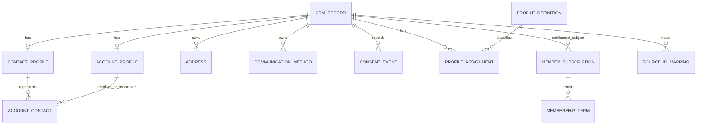

# Migration fields and shared schema review

Completed 30 September 2026. Review began 29 September. Source: `C:/Users/ramish/Desktop/Data Migration Template.xlsx`, read without modification. Repository baseline: `8c82222` plus the association-history changes recorded in the [standard-functionality review](STANDARD_FUNCTIONALITY_GAP_ANALYSIS.md).

The workbook is a useful field baseline for CRM first and Portal afterwards. It requires substantial extensions to existing models, especially structured Contact/Account details, addresses, communication preferences and membership history. Its flat migration layout should map into related records within the existing modular monolith. It should not become one wide Contact table and one wide Account table, or separate copies of member data for each platform.

This review captures field requirements and design recommendations. It does not create database tables, import sample records or change Portal permissions. The [master plan section 48](NEXORA_PRODUCT_ARCHITECTURE_MASTER_PLAN.md#48-standard-functionality-and-migration-field-requirements) incorporates the findings and delivery order. The [field inventory](DATA_MIGRATION_FIELD_INVENTORY.md) preserves every source header and cell for subsequent mapping.

## Workbook coverage

There are **22 sheets and 717 non-empty field-header occurrences**. These include repeated fields across sheets and sections, not 717 unique business attributes. Contact and Account formatting extends to row 1000, but only five and three populated sample rows respectively were found. Counts below exclude blank formatted cells. Source sheet spelling is retained, including the leading space in ` Contact Qualifications`.

| Source sheet | Field occurrences | Populated rows after headers | Current scope |
| --- | ---: | ---: | --- |
| CONTACT | 185 | 5 | Extend existing CRM Contact; separate embedded membership/finance data |
| Contact Disabilitities | 5 | 2 | Future restricted profile capability |
| Contact Qualifications | 9 | 2 | Future qualifications capability |
| Contact Working Patterns | 4 | 2 | Future repeating profile detail |
| Contact CPD Details | 12 | 2 | Future CPD workflow; current exam results are not CPD records |
| Communicatioin History | 17 | 4 | Extend current communication/history coverage; dedicated log needed |
| Profile List | 2 | 7 | Extend flat tags with a managed taxonomy |
| Account Contact Relationship | 10 | 4 | Extend existing dated associations |
| ACCOUNT | 160 | 3 | Extend existing CRM Account; separate embedded membership/finance data |
| Membership | 54 | 0 | Extend existing subscription model |
| DD Instalments | 5 | 4 | Future Direct Debit capability |
| Membership Application | 23 | 2 | Extend existing application model; separate change type from subject type |
| Membership Rate | 13 | 2 | Extend existing product/policy pricing |
| Membership History | 11 | 2 | Extend current action history with effective-dated business changes |
| Events | 54 | 2 | Extend existing offerings selectively; defer absent submodules |
| Event Delegates | 53 | 4 | Extend existing enrollment; separate booking, session and price records |
| Committee | 11 | 1 | Extend existing Engagement communities |
| Committee Member | 16 | 3 | Extend existing community membership |
| Committee Meeting | 13 | 6 | Extend existing meetings; separate meeting and attendee rows |
| Committee Election | 16 | 3 | Future election capability |
| Finance | 25 | 12 | Map into existing finance transactions and lines |
| Product Sale | 19 | 0 | Extend existing catalogue; the sheet describes products rather than sale transactions |
| **Total** | **717** | | |

Header rows differ: Finance and Product Sale use row 1; Profile List uses row 3; the other sheets use row 2. There are no formulas, named ranges or Excel data-validation rules. One comment on Event Delegates J2 lists registration statuses. Red header text is present, but there is no explicit mandatory-field legend. For example, both Contact_ID and Account_ID are red in some sheets where sample rows supply only one: do not make both universally required based on colour alone.

## Findings against the current application

“Partial” below means related storage or behaviour exists, but the workbook's semantics are not fully represented. A custom text field does not count as an implemented relationship, consent rule or transaction calculation.

| Area and source location | Current implementation | Required design change |
| --- | --- | --- |
| Contact identity, CONTACT B2:R2 | `CrmRecord` has a combined Name, Kind, Status, Category and staff/team owners | Add a typed Contact profile for title, first/middle/last/previous name and post-nominal. Preserve Name compatibility and existing IDs. Define Contact Type separately from membership type; store source references separately |
| Account identity, ACCOUNT A2:X2 | Same generic CRM record; generic labelled relationships | Add typed Account details for full/trading names, industry, business start date and size. Trading Status is not automatically the CRM active/inactive status. Model dated parent/child links; account owner, main Contact and entitlement owner are different relationships |
| Main Account and department, association B2:K2 | `AccountContact` stores JobTitle, roles, main/authorised Contact flags, StartDate, EndDate and reason | Add Department and clear Main Account semantics. Enforce at most one current Main Account per Contact if that rule is adopted from the standard specification. Do not reuse IsMainContact for the opposite direction. Main Account changes need atomic replacement and history |
| Email/phone fields, CONTACT S2:AH2 and ACCOUNT Y2:AM2 | `CommunicationMethod` stores kind/value and per-method consent; kinds currently email, phone, website | Add purpose/priority and validity/bounce metadata as needed. Keep multiple channel rows instead of Other_Email_1 through Other_Email_5 database columns. Finance email has a different purpose from general email |
| Addresses, CONTACT AI2:BU2 and ACCOUNT AN2:BH2 | Address has label, two lines, city, region, postcode, country; Portal uses a Member correspondence label | Add line 3/4, county, explicit mailing/billing purpose, addressee/company/job title and effective/ceased history. County and Region must remain distinct. Decide whether “same address” is a shared reference or a copy; avoid silent divergence |
| Social fields, CONTACT BW2:CG2 and ACCOUNT BI2:BS2 | No dedicated social profile model in the reviewed CRM domain | Use channel/profile rows for identifiers. Imported follower/tweet counters need an observation date and source if retained; workbook fields do not imply an automatic social integration |
| Communication permissions, CONTACT CH2:CO2 and ACCOUNT BT2:CA2 | Consent evidence on communication methods; marketing excludes denied email consent | Add record-level suppression and purpose/third-party consent events. Record the actor/source/effective time and distinguish unknown from refusal. Define which service messages remain allowed rather than applying a marketing flag indiscriminately |
| EDI, CONTACT CP2:DD2 and disability sheet | No corresponding first-class profile storage | Future restricted detail with explicit access policy and consent handling. Do not put these fields into the default CRM list, generic portal object or public directory |
| Profile tags, CONTACT DE2:DI2, ACCOUNT CZ2:DD2, Profile List B3:C10 | Flat `RecordTag` with individual assignment/search | Model definitions and parent/child relationships separately from assignments. Keep profile taxonomy separate from Contact Category and Membership Category. Clarify uniqueness scope for Child_Node before creating an index |
| Directory, CONTACT DJ2:EG2 and ACCOUNT CB2:CY2 | CMS publishing exists, but no matching CRM directory projection in reviewed models | Future publication projection with an explicit address source and public-field selection. Do_Not_Show_In_Directory should override publication; absence of that flag is not sufficient permission to publish every field |
| Membership embedded in CONTACT EH2:GE2 and ACCOUNT DE2:FD2; standalone Membership B2:BC2 | Product, application, subscription, review, policy, certificate and communication entities exist | Store membership once in the Membership module and project it into Contact/Account screens. Extend dates, categories/bands and change history where scoped. Do not maintain three competing membership records |
| Application O2 versus current ApplicationType | Current ApplicationType represents individual/corporate | Introduce a separate application-change concept for New, Upgrade, Reinstate and Rejoin. Do not replace subject type with those values or map Current directly to submitted/approved without a translation rule |
| Rates and history | Product has one rate/currency/category; policy has fee/proration/renewal settings; history stores actions and selected term dates | Effective-dated rates need type/category/band/period, joining versus renewal amount and defined VAT semantics. Business history needs previous/new values and effective/ceased dates, beyond a generic action label |
| Payer and invoicing | Membership has entitlement Account/Contact and manually verified payment evidence | Add explicit payer/invoice-recipient relationships if implemented. Neither Paid_By nor Invoicing_Account should change the entitlement owner. Invoice settlement remains Finance-owned |
| Direct Debit fields across four areas | No dedicated mandate/instalment lifecycle in reviewed models | Retain as future requirements. Separate mandates and instalments from profiles; use a payment-provider reference/masked presentation where appropriate. Do not copy raw bank fields into ordinary Contact/Account APIs |
| Events B2:BC2 | Offering has name, kind, venue text, start/end instants, one capacity and status | Extend time zone, venue Account reference, key dates and web metadata selectively. Separate capacity by attendance format when supported; date/time inputs must combine using the event time zone. Abstract handling remains future |
| Delegates B2:BB2 | Enrollment links one Contact to one Offering, with a status; sessions exist independently | Separate booker from delegate, booking from attendance, and session allocations from enrollment. Numbered Session_1..10 and Rate_Type_1..5 become child rows, with price/tax snapshots. TBA needs explicit semantics before permitting an unidentified attendee |
| Committees and meetings | Community/CommunityMember/CommunityMeeting support name, purpose, roles, contact links, agenda and start time | Extend effective membership terms, designation and meeting end/coordinator/venue where scoped. Meeting rows contain both meeting and attendee fields and require separate identities. Elections remain future |
| Finance A1:Y1 | Orders/lines/invoices/receipts/credits/refunds/allocations already exist | Map transaction headers and lines, resolve source references, add historical transaction/due dates and ledger metadata where required. Define amount, tax, discount and sign conventions plus currency before import |
| Product Sale A1:S1 | CatalogueProduct has SKU/name/price/currency/VAT/active | Extend product metadata and supplier relationships selectively. Web publication/member-only access needs publishing and entitlement enforcement; it is not provided by storing a Boolean alone |
| Import pipeline | Current CRM transfer accepts fixed CSV columns: id, version, kind, name, status, category, email | This XLSX is not supported by the current importer. Add staged mapping/validation and source-ID translation before loading it; do not pass legacy IDs as internal GUIDs |

Source anchors: [CRM entities](../../backend/src/Modules/Nexora.Modules.Crm/Domain/CrmEntities.cs), [associations](../../backend/src/Modules/Nexora.Modules.Crm/Domain/AccountContact.cs), [membership entities](../../backend/src/Modules/Nexora.Modules.Membership/Domain/MembershipEntities.cs), [membership operations](../../backend/src/Modules/Nexora.Modules.Membership/Domain/MembershipOperationsEntities.cs), [events](../../backend/src/Modules/Nexora.Modules.Events/Domain/EventEntities.cs), [engagement](../../backend/src/Modules/Nexora.Modules.Engagement/Domain/EngagementEntities.cs), [finance](../../backend/src/Modules/Nexora.Modules.Finance/Domain/FinanceEntities.cs), [CRM import](../../backend/src/Modules/Nexora.Modules.Crm/CrmTransfer.cs).

## Recommended shared schema

Extend the current model with typed profiles and child records. Keep existing GUIDs and `(TenantId, Id)` integrity, version checks, module boundaries and history. This is a proposed logical model, not delivered tables:

One module owns each fact. CRM owns identity/contactability/associations, Membership owns applications and entitlement history, Events owns enrollment, Engagement owns committees, and Finance owns transactions and balances. CRM and Portal use the same records through different authorized commands/projections. CMS receives only publishable content.

Use `(TenantId, SourceSystem, EntityType, SourceId)` for migration identity, preserving the original external identifier as text and mapping it to the existing internal ID. Numeric Excel formatting can lose leading zeros in account numbers, sort codes, references and phone numbers; define these as strings in the canonical dictionary. Use decimal amounts with currency, date-only types for business dates and UTC instants plus a named time zone for scheduled events. Do not default blank consent answers to false or blank amounts to zero without an explicit rule.

Core identity, foreign keys, statuses, financial values and fields used by business rules belong in typed models. Reuse existing custom fields for bounded optional extension data, not for every workbook column. Derived fields such as Total_Outstanding, last payment details and committee active-member count should normally be calculated from authoritative records. Historical imported summaries may be retained as dated source snapshots or reconciled opening balances, not treated as independent editable truth.

Membership remains **one active entitlement per Contact or Account regardless of offering**. The Primary_Membership column does not change that rule. Historical records and source identifiers can be retained without permitting simultaneous active memberships. Current profile dates and migration dates must not overwrite immutable application price/terms snapshots.

## CRM and Portal field access

The workbook does not specify per-field Portal visibility or editability. The following is a proposed policy to use when creating the detailed field dictionary, not an implemented or user-approved permission matrix:

| Field group | CRM | Portal | Public website/CMS |
| --- | --- | --- | --- |
| Personal names, contact details, addresses | Staff maintain under existing permissions | Own-record view/edit through explicit validated endpoints; define verification for email changes | Only deliberately published directory fields |
| Account details and representatives | Authorised staff maintain | Delegated Account access only; a Contact association alone grants no access | Published company profile only |
| Consent and directory preferences | Staff maintain with evidence/history | Own preferences; organisation preferences require the relevant grant | Only the resulting published projection |
| Membership category/status/rate, approval and renewal controls | Authorised staff and domain commands | Relevant status/history read-only; requests through application workflows | No internal decisions, pricing overrides or review notes |
| Financial transactions and balances | Finance permissions | Relevant own/delegated-account statements if that Portal feature is implemented; read-only amounts | Not public |
| EDI, disability and banking | Separately restricted future workflows | Explicit own-data scope only when implemented; no broad organisation-admin visibility | Never included in the default public projection |
| Internal remarks, ownership, audit, ledger codes and suppression provenance | Staff-only according to purpose | Excluded by default; member-facing notes need a separate explicit field | Excluded |
| Events/committee participation | Staff administer within existing module permissions | Own participation or authorised management when the corresponding feature exists | Explicit published event/committee content only |

At the initial review baseline, the Portal profile update accepted only `name`, `postalAddress` and `version`; its address projection contains line1/line2/city/region/postcode/country. That is a confirmed field-coverage gap, not a reason to expose the entire CRM record. Extend [PortalEndpoints](../../backend/src/Modules/Nexora.Modules.Identity/PortalEndpoints.cs) and [MemberProfileDirectory](../../backend/src/Modules/Nexora.Modules.Crm/Infrastructure/MemberProfileDirectory.cs) together with shared validation and negative permission tests.

## Template and sample-data issues

These findings concern supplied examples and import conventions. They do not invalidate the requested fields or prove that production source data has the same issues.

| Evidence | Finding | Import/design response |
| --- | --- | --- |
| ACCOUNT E4:E5 and F4:G5 | Two populated rows share Account_ID but differ in account names and other fields | Flag a conflicting duplicate; require reconciliation rather than last-row-wins or automatic merge |
| CONTACT DK3:DL3, DK4:DL4, DK6:DL6, DK7:DL7 | Both mailing and billing directory address flags are Yes | Define one address-source enum or explicit precedence; preserve the conflict in preview |
| Contact Qualifications D3:D4 | Account ID column contains institution names not matching supplied Account IDs | Use a resolved Account reference or the separate Other_Institution field, with an exception queue |
| Committee K3 | Organiser Account reference does not match the supplied Account IDs | Resolve or quarantine the link; do not create a guessed Account |
| Committee Meeting B4:B8; Committee Election B4:B5 | References point to committees absent from the Committee sheet | Validate against both staged and existing permitted target records; these cannot resolve from this workbook alone |
| DD Instalments B3:B6 | Member references absent from all supplied standalone/embedded membership IDs | Leave future instalments staged until the source membership is identified |
| Finance rows 4:5, 6:7, 8:9, 10:11 | Transaction headers repeat across lines; 12 rows describe 8 transaction numbers | Group headers and preserve line IDs. Summing Transaction_Amount per row would double-count repeated headers |
| Finance G1, K1, Q1:S1, Y1 | Amount/tax/VAT semantics are not specified sufficiently to determine gross/net interpretation | Define totals, rounding, tax codes and signed transaction conventions before reconciliation |
| Finance A1:Y1; Membership Rate B2:N2 | No currency column | Require a declared migration currency or reliable source mapping; do not infer currency from country |
| CONTACT R2 and FC2; Committee Election C2:H2 and M2:Q2 | Repeated header labels have different context | Key mapping by sheet, section and cell, not header text alone |
| CONTACT EH2:GE2; ACCOUNT DE2:FD2; Membership B2:BC2 | Membership and payment facts are repeated in three layouts | Establish source precedence and conflict checks; stage once, write once |
| Workbook-wide | No explicit requiredness/types/lengths/lookup catalogue; red headings alone are ambiguous | Complete the canonical dictionary before schema generation; names and sample values are not full validation rules |
| Event Delegates J2 comment | Status vocabulary includes enquiry, confirmed, waiting list, invoiced, transferred out and cancelled | Treat as source vocabulary to map to current workflow, not as instructions to change state or send messages |

The Account and Contact samples are small; no completeness percentage or production-data readiness estimate is justified. Membership and Product Sale contain headers only, so their migration examples cannot validate workflow assumptions. Sheet misspellings and mixed separators should remain accepted source aliases while canonical API/property names use consistent conventions.

## Next implementation specification

Before database edits, map every inventoried field to: canonical entity/property, source aliases, type/length, requiredness by workflow, lookup/validation, current coverage, migration transform, sensitivity, CRM access, Portal read/edit scope, public visibility, derived-versus-stored status and current/future delivery phase.

Start with Contacts, Accounts and associations. Then extend contact methods, address purpose/history and consent. Bring existing membership/transaction fields into related views through their owning modules. Add Portal fields only after the shared storage and command contracts are in place. Unbuilt CPD, qualifications, elections and Direct Debit workflows remain future work, consistent with the original scope instruction.

Migration should proceed through source-ID staging, dry-run validation, duplicate/reference resolution, additive schema/backfill, module-level import, reconciliation and rollback verification. Re-running a batch must not duplicate relationships, subscriptions or finance transactions. Never infer credentials or grant Portal access merely because a Contact, Account or membership row was imported.

## Verification and completion

Read all 22 sheets' headers, populated sample rows, merged section headings, header colours, comment and validation metadata. Captured all 717 field occurrences and checked selected cross-sheet IDs, directory flag conflicts and Finance header/line grouping. Compared relevant CRM, Membership, Events, Engagement, Finance and Portal source models/contracts. Preserved the workbook and existing application changes. This turn adds documentation only; previous application test results are recorded historical evidence and were not rerun for this review.

## Implementation follow-up — 30 September 2026

The user authorised starting the unambiguous fields. [Slice 1](CRM_STRUCTURED_PROFILE_FIELDS.md) now defines and implements structured Contact names and Account full/trading names/business commencement date, reuses existing website communication records, and maps safe shared projections into Portal. This supersedes the initial profile-coverage finding for those fields only. The rest of the workbook review and future-module exclusions remain applicable. No data import has been run.
