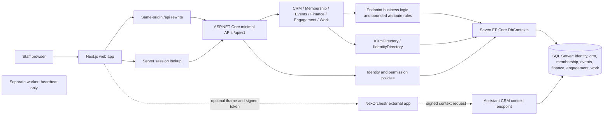
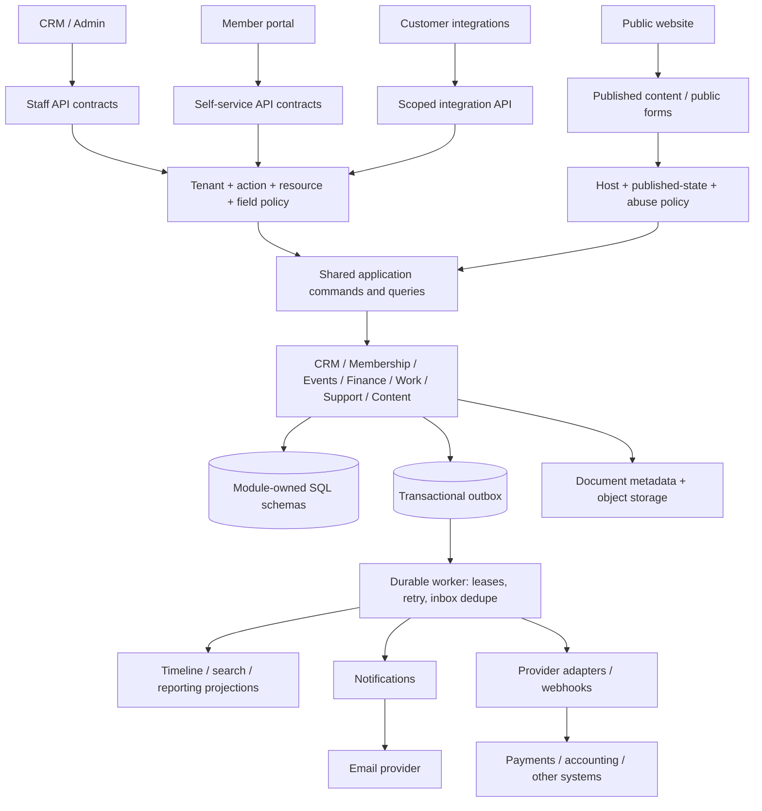
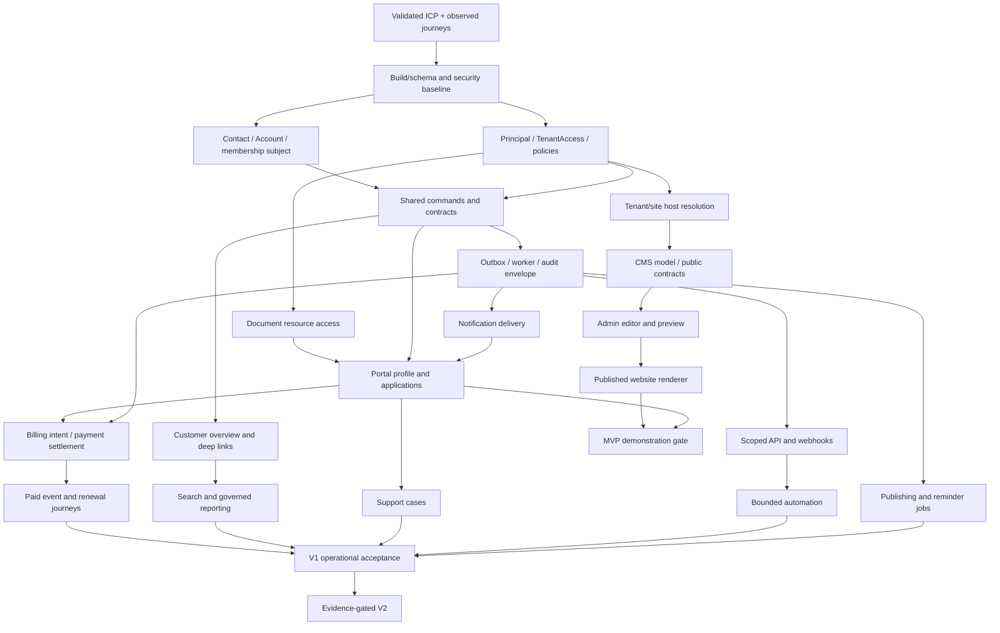

# NEXORA PRODUCT & ARCHITECTURE MASTER PLAN

**Assessment date:** 17 September 2026  
**Status:** Proposed product direction and implementation plan; no production implementation authorised by this document.  
**Repository:** Nexora only. Base commit `52e41b9fdac163d222b35d6191f853d2450caf71`, plus existing working-tree changes.  
**Companion documents:** [Repository evidence inventory](REPOSITORY_EVIDENCE.md) · [Week-by-week execution plan](WEEK_BY_WEEK_EXECUTION_PLAN.md) · [Living progress report and daily log](NEXORA_PROGRESS_REPORT.md)

**Progress tracking — 21 September 2026:** Implementation now follows the revised website-first, portal-next priority to establish a tangible working product. See the living progress report for current CRM, Portal and Website estimates, delivered capabilities and verification gaps. The original assessment below is retained as the planning baseline; its historical gaps and phase order are not a current delivery status.

**Requirements update — 29 September 2026:** The [standard-functionality gap analysis](STANDARD_FUNCTIONALITY_GAP_ANALYSIS.md) and its module-by-module delivery sequence are incorporated into this master plan in section 48. The supplied migration workbook establishes the field requirements for CRM first and Portal afterwards; see the [field and schema review](DATA_MIGRATION_FIELD_REVIEW.md) and [complete source field inventory](DATA_MIGRATION_FIELD_INVENTORY.md). Section 48 is the current refinement sequence for this work. The historical assessment and estimates below remain dated evidence, not current completion claims. The latest request authorises plan updates and workbook review, not new database migrations or bulk import.

## 1. Executive product vision

Build a focused **membership operations platform for small and midsize professional and trade associations**, initially those managing company memberships, named contacts, applications and renewals. Give staff and members one reliable record of their relationship, responsibilities, membership status and transactions.

The first commercial promise should be: **“Run company membership applications and renewals without repeatedly re-entering customer information or asking staff to make every change.”** This positioning is a hypothesis to validate, not an established market advantage.

The strongest foundation already exists: Next.js, ASP.NET Core, module-owned SQL schemas, Account/Contact records, dated associations, permission policies and tenant guards. Preserve it. The main investment should connect and harden these capabilities, not create a second CRM.

Five decisions drive this plan:

1. Keep the modular monolith and one shared domain behind CRM, portal and website.
2. Retain existing record IDs and Account–Contact history. Add typed profiles and explicit access grants through migrations.
3. Prioritise one complete application-to-renewal journey over broad coverage of fundraising, examinations, marketing and sales.
4. Build a small CMS for the association website; support customers keeping their current website. A mandatory website replacement increases switching cost.
5. Treat production identity, assistant authorization, payment integrity, migration quality and recovery as release gates.

**Delivery estimate:** two experienced full-stack developers, AI-assisted, approximately **120 developer-days / 15 working weeks to a demonstrable MVP**, and **256 developer-days / 32 working weeks total to controlled commercial V1**. Reserve another 25% for uncertainty: a prudent V1 planning envelope is **40 working weeks**. These are estimates from code inspection, not delivery commitments.

## 2. Existing system audit: method and confidence

Repository-wide discovery covered application source, seven module schemas, endpoint declarations, domain entities, shared persistence, frontend routes/features, tests, migrations, CI, scripts and project documentation. Key implementation paths were read in detail. Generated migration metadata was inspected structurally alongside current model definitions; dependencies/build output and local secrets were excluded. The companion inventory records file hashes and endpoint declarations so findings can be revisited against the observed versions.

This is a static architecture/product audit with a build attempt, not a penetration test, deployed-system audit, exhaustive line-by-line review or browser accessibility certification. Existing data, deployment configuration, paid provider accounts, customer interviews and production telemetry were not available. A documented feature is not counted as implemented unless supported by source.

**Observed verification:** `dotnet test backend/Nexora.slnx --configuration Release --nologo --verbosity quiet` passed the two architecture tests, then failed compiling Membership: `RequestedEndUtc` is referenced at `MembershipModule.cs:78,94` but absent from `MembershipApplication`. API tests therefore did not run. The compiler also emitted ASP.NET analyzer `AD0001` warnings. SQL Server migration/volume tests require `NEXORA_TEST_SQLSERVER`; they were not executed in this assessment. Frontend verification is recorded in section 43.

There were substantial tracked modifications and untracked files before this audit, including the association and membership additions. They were included, not discarded, committed or rewritten. Prior stage checkmarks describe implementation slices; they do not establish current build health or commercial readiness.

## 3. Current architecture diagram

**Not present in the inspected source:** customer portal, public CMS renderer, CMS content persistence, transactional outbox dispatcher, payment gateway adapter, email delivery adapter, general workflow runner or support-case module. The worker is a deployment scaffold. NexOrchestr is a configured external dependency, not proof of a working AI service in this repository. Compose starts a development SQL Server only.

## 4. Existing functionality inventory

“Implemented slice” means source exists; the current compile failure prevents treating these slices as freshly runtime-verified.

| Area | Existing data and behavior | Frontend/API/service path | Assessment |
| --- | --- | --- | --- |
| Identity | Tenant, Identity User/Role, Team/TeamMember, RolePermission, AuditEvent; development login/logout/session; active-user/tenant checks | `IdentityModule`, security adapters; `/api/v1/auth/*`, admin access overview; login/settings | Useful foundation; production OIDC, external account lifecycle and access administration incomplete |
| CRM | `CrmRecord` with contact/account kind; addresses, communication methods, relationships, notes, tags, files, activities, saved views, custom fields | CRM workspace → `/api/v1/crm/*` → `CrmModule`, `CrmDbContext` | Retain; local record lifecycle, search, paging and archive/restore exist |
| Account–Contact | Dated `AccountContact`, role rows, job title, main/authorised flags, end reason, version; history on both parents | `AccountContactEndpoints`; Contacts/Employers panels | Already implemented; do not recreate as a new join table |
| Membership | Products, applications, subscriptions, policy, review, certificates, draft communications, history; corporate/individual/affiliate application; approve/reject; renew/lapse/cancel/reinstate | Membership workspace and operations endpoints | Substantial reusable workflow; compile/schema alignment and corporate uniqueness need attention |
| Events/learning | Offering (event/course/exam), sessions, enrollment, result/history; capacity, waitlist, approval, transfer, attendance, cancellation, pass/fail | Events workspace → `EventsModule` | Administration slice; no portal booking/payment integration or full LMS |
| Finance | CatalogueProduct, SalesOrder, OrderLine, PostedInvoice, Receipt, Credit, Allocation, Refund, History | Finance workspace → `FinanceModule`; CSV export | Manual receivables slice; records external payments/refunds, does not initiate them |
| Engagement | Community, CommunityMember/Meeting, Campaign/Recipient, Fund/Contribution, History | Shared operations workspace → `EngagementModule` | Prepares consent-filtered audience; no campaign send; contributions are recorded, not collected |
| Work | WorkItem, private assignment Notification, WorkHistory, ImportBatch/Row | Operations workspace → `WorkModule` | Contact-linked tasks; JSON task preview/commit import; CSV export; no general importer |
| Attributes/layout rules | CRM custom-field tables; shared typed attribute tables in other modules; `AutomationConfiguration` | Shared attribute/layout/rules controllers | Real bounded configuration; not a general process engine |
| Insights | `IReportDataset` contributors: contacts, memberships, offerings, orders, campaigns, tasks; permitted query/filter/export/count | Insights workspace → `ReportingEndpoints` | Reusable governed dataset boundary; fixed label/status/date shape, no saved report builder |
| Home/navigation | Responsive sidebar; query-string CRM record selection; visual cards/chart | AppShell and dashboard | Home metrics/date/activity are hard-coded; header search, quick create and bell are unwired |
| Operations | Health/readiness; request correlation, duration meter; migration export scripts; CI web/backend/SQL jobs; release runbook | API/worker/scripts/`.github/workflows` | Good starting controls, not evidence of operated hosting, backup or monitoring |

There are minimal API handlers rather than MVC controllers. Most domain operations live inside endpoint classes and EF persistence methods. `ICrmDirectory`, `IIdentityDirectory`, `IReportDataset` and the local identity adapter are the principal reusable contracts; there is not yet a complete independent application-service layer.

Source anchors: [API composition](../../backend/src/Nexora.Api/Program.cs), [CRM implementation](../../backend/src/Modules/Nexora.Modules.Crm/CrmModule.cs), [Membership implementation](../../backend/src/Modules/Nexora.Modules.Membership/MembershipModule.cs), [shared attributes](../../backend/src/BuildingBlocks/Nexora.BuildingBlocks/Persistence/EntityAttributes.cs), [release runbook](../operations/RELEASE-RUNBOOK.md).

## 5. Technical problems and release blockers

| ID | Finding and evidence | Consequence | Required response |
| --- | --- | --- | --- |
| A01 | Build failure: `MembershipModule.cs:78,94` references missing `RequestedEndUtc` | API cannot compile in observed working tree | Reconcile quote domain, nullable migration/backfill and snapshot; then run full tests |
| A02 | `/api/v1/assistant/crm-context` validates an HMAC/expiry, calls `IgnoreQueryFilters`, and checks only token tenant; it does not use normal active-user/tenant or `crm.read` policies. Assistant page issues tokens to any signed-in session when configured | A valid token can expose tenant CRM records/custom fields to a user lacking CRM permission, including after deactivation until expiry | Disable bridge for release until scoped server-side exchange, current authorization and negative tests exist; no claim of an observed external exploit |
| A03 | Production local login correctly disabled; `/auth/providers` explicitly returns `entraEnabled=false` | No completed production sign-in route | Implement/verify workforce OIDC and separate portal access lifecycle before customer deployment |
| A04 | Membership active unique index is `(TenantId, ContactId, ProductId)` while approval overlap check sometimes keys by AccountId | Same contact representing two companies can be rejected; simultaneous approvals for one company through different contacts may both pass the query | Align entitlement subject and concurrency locking; test corporate and individual cases on SQL Server |
| A05 | CRM timeline queries only `crm.Activities`; no cross-module record-context aggregator | Contact/Account 360 promise is incomplete | Add permission-filtered module contributors and stable deep links |
| A06 | `MembershipReview.PaymentVerified` plus free-text reference is independent of finance records; approval creates an active subscription directly | Paid entitlement cannot be assumed to reflect settlement | Separate approved/pending-payment/active conditions; link billable intent and settlement evidence |
| A07 | Domain transitions largely reside in handlers; attribute writes use endpoint filters; guards/rules run in SaveChanges | New portal/job/API callers could duplicate or bypass behavior | Extract tested application commands in small slices; preserve tenant guards |
| A08 | CRM has a separate base-row/attribute implementation from other modules; two fetch/error/CSRF clients | Drift and repeated implementation work | Share contracts/validation/client infrastructure incrementally, retain existing storage during migration |
| A09 | `AccountContactChoices` includes domain-specific codes such as fumigation; currencies/statuses/section names are fixed in several layers | One customer's vocabulary leaks into product; unsuitable generic configuration model | Versioned tenant dictionaries for labels/categories; keep integrity transitions code-owned |
| A10 | CRM association UI requests only `page=1&includeEnded=false` and turns load failure into an empty result | More than 25 links and ended history are hidden; failure looks like “no associations” | Paging/history controls, visible retry state and Account/Contact navigation |
| A11 | CRM parent files stored as byte arrays up to 5 MB; extension allowlist but no scan pipeline | Not ready for public uploads or broader document lifecycle | Quarantined object storage, content checks, access grants, retention and scan result |
| A12 | Module lists frequently use fixed `Take(100/200)`; CRM child collections may be fully materialized; contact directories use first 50; finance selector searches Contacts although backend accepts active Accounts too | Truncation and account billing discoverability problems; growth risk | Consistent pagination, explicit totals and account-aware selectors |
| A13 | Login alone has rate-limiting policy; no reviewed public/integration scopes/quotas | Portal/API exposure requires additional abuse control | Per tenant/client/identity limits, payload limits and provider budgets |
| A14 | User belongs to one tenant; normalized email unique globally; Identity base role name uniqueness also needs review | One person serving several customer organisations is awkward; tenant role provisioning may collide | Explicit principal-to-tenant grants; inspect generated Identity indexes before onboarding |
| A15 | Snapshot names stored in memberships/enrollments/orders without documented live-vs-historical semantics | Staff may see outdated names, or future code may rewrite legal history | Distinguish live display from immutable quoted/posted snapshots |
| A16 | Dashboard and header imply capabilities/data not wired to backend; fallback workspace scaffolding remains | Misleading demonstration and inconsistent UX | Wire real dataset cards; remove/label inactive controls; retire unreachable scaffolding when proven |
| A17 | Existing ADRs promise outbox, generated client and OIDC; these are not complete in source | Architecture documents overstate current implementation | Track each ADR's implementation state and acceptance evidence |

Cross-module CRM IDs generally use directory validation rather than composite SQL foreign keys to CRM. This is an explicit integrity gap to address, not automatically a reason to break module encapsulation. Module-owned composite foreign keys already provide useful tenant protection within schemas.

## 6. Contact & Account redesign: evolve, do not replace

Keep `crm.Records` and stable IDs as a shared relationship identity. Add optional one-to-one **ContactProfile** and **AccountProfile** rows using `(TenantId, RecordId)` constraints. ContactProfile holds person-specific structured names and optional preferred name; AccountProfile holds legal/trading names and optional registration identifiers. Do not require date of birth or other sensitive fields without a validated use case. Keep immutable kind and use typed commands/DTOs to prevent treating an account as a person.

Retain `AccountContact` as a temporal many-to-many association. A contact can represent several accounts; accounts can have many contacts. Relationship roles describe business responsibilities. **Neither `IsAuthorisedContact` nor an email-domain match grants portal access.** Identity grants must be independently approved and revocable. Decide whether “main” means one active primary contact or several named representatives; recommended default is one primary per account, enforced transactionally, with other roles multi-valued. Preserve ended links and require a new link on rejoin.

| Relationship | Current | Proposed rule and API/read behavior |
| --- | --- | --- |
| Contact ↔ Account | Dated association exists; generic RecordRelationship also exists | Association is authoritative for employment/representation. Generic relationships only for other semantics; migrate duplicates with reviewed mapping |
| Addresses/contact methods | Child rows of either CRM kind | Keep owner explicit; add verification/preference metadata and edit commands; no implicit copying between company and person |
| Membership/application | Contact required; Account optional | Add explicit entitlement subject: company or person. Applicant contact, payer and beneficiary can differ; keep historical applicant context |
| Orders/invoices/receipts | CustomerId references CRM record; names snapshotted | BillToRecordId with validated kind; immutable posted party/address/tax snapshots; optional requester/beneficiary links |
| Tasks | Optional ContactId only | Typed subject links for Account, Contact, application and case; validate through owner-module contract |
| Documents | CRM files only | Document plus typed DocumentLink; distinguish internal, portal-shared and public media |
| Communications | Contact methods, audience and draft records | Delivery records with recipient snapshot, channel/purpose/template version and linked subject |
| Events | Enrollment links Contact | Keep attendee Contact; optional booking Account and Order reference; no automatic access to colleagues' bookings |
| Portal | Absent | External principal → tenant access → verified Contact binding; optional account-specific grants |
| Cases/forms | Absent/general forms absent | Case or submission references requester Contact, optional authorised Account and versioned form |
| Audit/timeline | Separate source histories | Cross-module read contributors; common event envelope, distinct public-safe timeline projection |

**360 view contract:** `GET /api/v1/crm/records/{id}/overview` returns record header, allowed actions and permitted section summaries. Paginated `/related/{capability}` endpoints fetch actual related records. `/timeline?cursor=...&type=...&from=...` uses deterministic ordering. Each contributor enforces tenant, module, record and field visibility before returning data or counts. No finance total for a user lacking finance rights; no internal note in portal output.

Show company memberships once under the company. A representative's page may show “memberships represented” separately from personal memberships. Do not copy company transactions to every employee timeline. Deduplicate shared events by event ID; retain association-at-event-time context.

**Search and navigation:** name/email/company identifier lookup, status/owner/category/company/membership filters, saved views, account/contact deep links and back-to-results state. Preserve existing CRM `?record=` links during route evolution. Add recent records only after access rechecks. Profile update commits synchronously; its response contains the new version, and CRM revalidation sees it immediately. Timeline/search projections can lag and must report freshness; no unnecessary websocket requirement.

**Migration:** inventory duplicates and invalid kinds → add profiles/grants/subject columns → deterministic backfill report → conflict queue for ambiguous associations → dual-read compatibility → validate counts/IDs/links and finance snapshots → switch callers → retire obsolete writes. Never automatically merge people by shared email or company name.

## 7. Target customer analysis

These are segment hypotheses, not measured market sizes. No revenue/TAM figures or willingness-to-pay claims are inferred from competitor feature pages.

| Segment | Problem and buyer | Purchasing/integration needs | Fit and decision |
| --- | --- | --- | --- |
| Professional/trade associations with company members | Membership manager and operations director reconcile company representatives, applications, renewal evidence and invoices | Reliable import, audit/history, company delegation, branded portal, accounting/email, accessible UX, support and predictable cost | **Primary wedge.** Highest reuse of current corporate association work; start with simple rules, not statutory accreditation |
| Individual professional membership bodies | Staff manage grades, renewals, CPD and member benefits | Personal subscriptions, payment mandates, privacy, credentials, LMS and sometimes SSO | Secondary; reuse person subject but defer full accreditation/CPD engine |
| Training providers | Course administrators sell places, allocate learners and manage changes | LMS, video, accounting, scheduling, transfers and refunds | Adjacent expansion. Existing offerings useful, but competing as a full training system broadens scope too far |
| Very small volunteer clubs | Volunteer wants cheap membership list, payment and basic website | Low subscription, no implementation project, little training | Poor initial economics if onboarding is service-heavy; established simple tools are strong alternatives |
| General SMEs/B2B sales organisations | Sales teams need pipeline, email/calendar sync and forecasting | Sales productivity, ecosystem, mobile and reporting | Defer horizontal CRM positioning; current sales pipeline depth is not competitive |
| General service businesses | Owner wants service delivery, scheduling, billing and support | Vertical booking and operational workflows | Too broad; pursue only if a narrow membership-like service segment validates demand |
| Large regulated/complex associations | CIO needs SSO, strict governance, chapters, integrations and migration assurance | Formal procurement/security, complex entitlements, availability commitments | Future; high deal value does not offset early delivery/support risk |

Working ICP for interviews: association with **3–25 staff and roughly 500–10,000 member/contact records**, annual or rolling corporate dues, some individual members, one accounting package, and an existing website. These bounds are discovery filters, not architectural or pricing limits.

Interview 8–12 buyers/operators across at least three organisations; observe actual application and renewal work with redacted examples. Ask about time spent, errors, incumbent cost including implementation, integrations, migration concerns and budget approval. Secure two design partners, at least one willing to discuss a paid pilot, before broadening beyond the MVP. Do not contact anyone automatically as part of this audit.

## 8. Nexora Market Requirements Matrix

Demand ratings are **reasoned estimates for the proposed ICP**, supported by supplier offerings and published case studies; they are not a customer survey. Cost: S ≈ 2–5, M ≈ 6–15, L ≈ 16–30, XL >30 developer-days for a useful production slice. Costs overlap shared phases and must not be summed as separate commitments. Supplier evidence is detailed in section 9.

| Capability | Market demand | Competitors offering it | Nexora status | Commercial value | Complexity | Recommendation |
| --- | --- | --- | --- | --- | --- | --- |
| Connected people/company records | High | Glue Up, iMIS, HubSpot, Attio | Partial connected IDs; weak 360 | Less lookup/re-entry and clearer accountability | L | **Core:** improve existing |
| Company representatives and delegated portal access | High for corporate ICP; validate exact rules | iMIS broad membership/portal; competitor delegation depth not verified | Associations exist; grants absent | Company self-service without exposing unrelated people | L | **Core:** add secure grants |
| Applications, review and renewals | High | WildApricot, Glue Up, Join It, iMIS | Staff workflow exists | Main operational/revenue cycle | L | **Core:** repair/connect |
| Member profile and self-service | High | WildApricot, Glue Up, Join It | Absent | Fewer service requests and faster updates | XL | **Core:** portal slice |
| Payments and invoice visibility | High for paid membership | WildApricot, Glue Up, Join It | Manual receivables only | Collect dues and reduce reconciliation | XL | **Core V1:** one provider |
| Import/export and data portability | High switching requirement | WildApricot onboarding, Join It imports, Attio API | Task import; limited exports | Migration feasibility and customer trust | L | **Core:** CRM/company/member import |
| Transactional reminders/email | High | Glue Up, WildApricot, Join It | Drafts/audience only | Reliable application and renewal communication | L | **Core:** delivery service |
| Basic website/CMS | Medium-high, varies with current site | WildApricot, iMIS, HubSpot | Absent | Convert visitors and reduce webmaster requests | XL | **Core bounded slice:** optional adoption |
| Events and bookings | Medium-high | WildApricot, Glue Up, iMIS, Join It | Staff capacity/booking slice | Member value and supplementary revenue | L | **Valuable V1:** one simple event journey |
| Documents/evidence | High for reviewed applications | iMIS broader portal, portal platforms | CRM attachments only | Self-service evidence and certificates | L | **Core:** safe document sharing |
| Global search/360 timeline | High staff need | HubSpot, Attio, Glue Up member data | Local search/history only | Reduce time finding actionable information | L | **Core:** permission-aware summary |
| Operational reports | High | iMIS, Glue Up, Zoho One | Governed narrow datasets | Renewals, applications and cash visibility | M–L | **Core:** extend datasets, few useful templates |
| RBAC, privacy, recovery | High trust requirement | Enterprise suites; plan-dependent | Partial | Makes commercial use supportable | XL | **Core:** release gate |
| API/webhooks | Medium-high for connected buyers | Attio, Join It, n8n ecosystem | Versioned staff API, no integration auth | Avoid customer-specific forks | L | **Valuable V1:** limited pilot API |
| Configurable fields/forms/templates | High within limits | Membership tools, HubSpot, Zoho | Typed fields/layout calculations exist | Lower onboarding/customisation cost | L | **Core:** reuse; bounded form versioning |
| Cross-module automation | Medium-high | Glue Up, Attio, n8n | Attribute calculations only | Consistent handoffs and reminders | L | **Valuable V1:** predefined actions first |
| Support requests | Medium | Zendesk, HubSpot | Absent | Visible service follow-up in portal | M | **Valuable V1:** basic case thread |
| AI-assisted summaries/drafts | Unproven for this ICP | Attio, HubSpot | External bridge only | Potential reading/writing time savings | M | **Future:** measured pilot after security |
| Full marketing automation | Segment-dependent | HubSpot, Zoho, Glue Up | Audience preparation | Advanced acquisition/retention | XL | **Future:** integrate provider first |
| LMS, exam delivery, complex CPD | High only in specialist segment | Arlo/LMS integrations, iMIS | Basic course/exam records | Valuable after vertical validation | XL | **Future:** integrate before building |
| Native mobile apps, community feeds | Unproven incremental demand | Glue Up, WildApricot | Responsive web shell | May improve engagement, adds support cost | XL | **Defer:** validate web limits |
| Full DXP/personalisation and visual low-code builder | Low initial necessity | Contentful adjacent CMS; Zoho platform | Absent | Low early return versus complexity | XL | **Avoid in MVP/V1** |
| General ledger/payroll/inventory | Low ICP fit | Zoho suite, specialist vendors | No general ledger | Duplicates mature systems | XL | **Avoid:** integrate |

## 9. Competitor capability analysis and current evidence

Research accessed 17 September 2026. These are documented supplier capabilities, not hands-on quality scores. “Not verified” does not mean absent. Availability can depend on region, plan and add-ons. Pricing examples below are published anchors, not equivalent quotes.

| Product/category | Verified capabilities and commercial model | Competitive implication for Nexora |
| --- | --- | --- |
| **WildApricot — established membership suite** | Website, member database, events, recurring payments, member/admin mobile experiences. Pricing is contact-based; page displayed USD 66/month for 100 contacts on monthly billing and a 60-day trial. Provider choice can introduce extra charges. [Features/pricing](https://www.wildapricot.com/pricing), [website builder](https://www.wildapricot.com/features/membership-website-builder-software) | An integrated website/member suite is already baseline. Nexora should not claim novelty or assume small clubs will pay for a migration project |
| **Glue Up — association/community suite** | Connected membership applications, renewals, payments, events, email and member self-service; community and mobile experiences. [Membership platform](https://www.glueup.com/membership-management-software) | Direct breadth competitor. Narrow operational depth and evidenced implementation outcomes are needed; feature count is not a winning argument |
| **iMIS — established association platform** | Membership, financials, education, websites/portals, commerce and reporting. Supplier case studies describe automated invoicing and self-service reducing staff work. [Platform](https://www.imis.com/), [EOA case study](https://www.imis.com/Common/Uploaded%20files/Public%20Site/case-studies/iMIS-Case-study_EOA_NA_Ltr.pdf), [CPSS case study](https://www.imis.com/Common/Uploaded%20files/Public%20Site/case-studies/iMIS-Case-study_CPSS_NA_Ltr.pdf) | The vertical is established, not empty. These supplier-selected cases support the problem direction, but do not prove Nexora can outperform iMIS |
| **Join It — focused membership alternative** | Member database, recurring dues, reminders and event registration; higher plan includes API/webhooks. Hybrid subscription/capacity and service fees: documented 1.5–3% paid-transaction fee, separate from Stripe fees. [Pricing](https://joinit.com/pricing), [features](https://joinit.com/features) | Simplicity and integration already have competitors. Total cost matters; compare subscription plus volume plus service fees, not headline subscription |
| **HubSpot — CRM/marketing/content/service suite** | Customer Platform combines customer-facing tools; documented portal settings include ticket access and conversation timeline. [Platform](https://www.hubspot.com/products/customer-platform), [portal documentation, marked legacy](https://knowledge.hubspot.com/inbox/manage-customer-portal-settings) | Strong adjacent suite. A support ticket portal is not evidence of full association entitlements; verify current portal offering during procurement comparison |
| **Attio — current-generation CRM** | Configurable workflows/agents and developer interfaces; documented REST API and permissioned MCP integration. [Workflows](https://attio.com/platform/workflows), [REST API](https://docs.attio.com/rest-api/overview), [MCP](https://attio.com/help/reference/attio-ai/attio-mcp) | Raises expectations for fast CRM interaction and extensibility. Do not chase autonomous agents before reliable customer data and access policies |
| **Zoho One — broad business suite** | 50+ business applications, central administration, customisation and analytics; flexible-seat vs all-employee licensing. External Learn portal capacity can be an additional charge. [Suite pricing](https://www.zoho.com/one/pricing/), [Learn portal pricing](https://help.zoho.com/portal/en/kb/zoho-learn/custom-portals/articles/custom-portal-pricing) | Broad/low-cost bundling is difficult to beat. Compare implementation and external-user costs; do not generalise Learn-specific limits to every Zoho portal |
| **Microsoft Power Pages — portal/low-code alternative** | External websites connected to Dataverse, with authenticated/anonymous site capacity licensing. [Pricing](https://www.microsoft.com/en-us/power-platform/products/power-pages/pricing/), [licensing guidance](https://www.microsoft.com/licensing/guidance/Power-Platform) | Attractive to Microsoft-centric organisations; portal usage and implementation effort belong in buyer TCO comparisons |
| **Contentful — CMS/DXP-adjacent platform** | Scheduled publish/unpublish, publishing actions and release tooling. [Scheduling documentation](https://www.contentful.com/help/scheduled-publishing/) | Publishing lifecycle is standard; Nexora should build a small domain-appropriate editor rather than an enterprise DXP |
| **Zendesk — customer service** | Help-center self-service and support workflows work together. [Support and Knowledge](https://support.zendesk.com/hc/en-us/articles/4408882448922-Using-Zendesk-Support-and-Zendesk-Knowledge-together) | Basic cases may be useful, but full contact-centre functionality should remain an integration |
| **Arlo — specialist training operations** | Course commerce/registration and integrations spanning LMS, video and other business tools. [Platform](https://www.arlo.co/), [integration overview](https://support.arlo.co/hc/en-gb/articles/211908823-App-integration-overview) | Training has deep specialist requirements; existing Nexora course records are not a full training product |
| **n8n — workflow/integration alternative** | Workflow automation and integration ecosystem; fair-code licensing. [Documentation](https://docs.n8n.io/), [integrations](https://n8n.io/integrations) | Customers may connect Nexora through external automation. Expose secure events/actions rather than cloning a general connector ecosystem; review licensing before any embedding |

No reliable primary evidence was established here that these competitors are universally “too expensive,” “dated,” or “hard to use.” Those are customer-specific hypotheses to test. Vendor pages establish supply, not independent demand. Review-site anecdotes found during discovery were not used to rank product quality.

## 10. Market gaps and opportunities

The credible opportunity is **reducing implementation and daily administrative effort for a narrow membership workflow**, not inventing a missing category.

| Opportunity hypothesis | Problem evidence | Nexora experiment and success threshold |
| --- | --- | --- |
| Corporate representation without duplicate people | Current repository specifically models company/contact histories; membership platforms emphasise connected data | Observe five corporate workflows. Demonstrate one person representing two companies, with independent permissions and no duplicate identity |
| Fewer staff-mediated updates | Glue Up self-service offering and iMIS CPSS case describe this use case | At least 80% of invited pilot users complete profile/application tasks unaided; compare support requests against baseline |
| Faster, predictable onboarding | WildApricot includes onboarding/import support, showing onboarding itself is competitive scope | Import and reconcile a representative pilot dataset in ≤5 developer-days; repeat second tenant without source fork |
| Clear renewal exceptions and payment evidence | Current Nexora review model; iMIS invoicing case describes administrative workload | Staff resolve an unpaid/compliance exception from one overview; target 30% median handling-time reduction, measured before claiming it |
| Transparent total cost and portability | Join It transaction fees and Microsoft external-user licensing show different cost drivers | Compare three realistic annual workload scenarios, migration/support included; validate willingness to pay rather than promise cheapest pricing |

All numerical thresholds above are proposed validation gates. No measured Nexora improvement is claimed.

## 11. Recommended positioning and commercial discovery

Position as **“Membership operations and self-service for company-based associations.”** Lead demonstrations with account representatives, an application, staff review, member visibility and renewal exceptions. Show one record across experiences.

Offer a managed pilot with a fixed scope: one tenant, one membership model, one accounting export, one payment provider, and agreed data migration. Keep integrations and configurable templates in the same versioned product. Quote exceptional work separately only when it can remain an extension, not a permanent fork.

Evaluate a base subscription including staff and member self-service, tiered by active membership capacity and measurable usage such as storage/email. Keep security, export and basic access control in every paid tier. Do not charge per page view or hide essential portal functionality behind unpredictable fees. This is a packaging hypothesis; no final price is justified yet.

Measure onboarding effort, support hours/tenant/month, hosting cost, email/storage cost, payment support effort, trial conversion, renewal retention and gross contribution after support. Calculate value with customer inputs: monthly staff hours saved × their actual loaded hourly cost, plus agreed reduction in collection errors. Do not assume every collected pound is incremental revenue.

## 12. Features to retain

Retain tenant query/write guards, composite tenant keys, optimistic version tokens, Account–Contact history, archive/restore semantics, typed fields, limited calculation rules, consent evidence, saved CRM views, existing membership transitions, offering capacity/waitlists, finance snapshots/reversals, assignment notifications, dataset permission filtering, readiness checks, CI and migration/recovery scripts.

Retain all source for deferred modules. Remove them from the initial product package through server-enforced capabilities and navigation policy rather than deleting useful work or continuing to advertise unfinished coverage.

## 13. Features to improve

Prioritise compilation/schema alignment; production authentication; assistant permissions; membership subject/uniqueness; shared application commands; customer overview/timeline; finance account selection; immutable quote/term snapshots; document access; staff dashboard truthfulness; consistent pagination/error states; configuration permission distinctions; import; and deployed recovery evidence.

Convert code-owned industry dictionaries to tenant settings where appropriate. Keep active/posted/settled transitions and authorization policies explicit in code. A configurable status label must never allow a tenant to bypass payment or approval requirements.

## 14. Features to add

Add external identity bindings and account grants, portal profile/applications, secure document lifecycle, small CMS/public renderer, outbox/inbox/job processing, transactional notification delivery, billable-source links and one payment adapter, basic support cases, cross-module read projections, tenant onboarding/configuration, scoped integration credentials/webhooks, release observability and backup/restore automation.

Add a **data-quality and migration workbench** before sophisticated AI: external IDs, preview, duplicate candidates, dry-run errors, reconciliation and undo/compensation policy. This is an essential selling capability missing from a screen-led roadmap.

## 15. Features to avoid or defer

Do not build a general ledger, payroll, inventory, arbitrary low-code runtime, tenant-supplied scripts, full DXP, social network, omnichannel contact centre, native apps, full LMS/exam delivery, generic sales forecasting, autonomous financial decisions or a public plugin marketplace in MVP/V1.

Defer new fundraising, complex examinations, election/committee administration and broad marketing automation. Existing slices can remain dormant. Integrate mature vendors when a paying customer demonstrates the need. Do not expand just because a legacy reference system contains a module.

## 16. CRM/Admin architecture and UX

Keep the existing Next.js feature organisation. Build around three primary staff tasks: **find a customer, understand their status, complete the next action**. A record page has an identity header, relationship context, action queue and permitted related information. Detail panels retrieve real linked entities; tab count is not a measure of integration.

Use module navigation filtered by permissions and enabled tenant capabilities. API enforcement remains authoritative. Put configuration in Administration, with separate edit/publish rights for forms, workflow and CMS. Show only operational modules in the chosen package; useful existing but deferred modules need not clutter the first customer's sidebar.

Standardise `RecordHeader`, `DataTable`, `FilterBar`, `Pagination`, `EmptyState`, `ErrorState`, `ConfirmationDialog`, `Timeline` and accessible form fields. Reuse existing buttons/panels/attributes as starting points. Give every async panel loading, empty, permission-denied, error/retry and stale-conflict states. Avoid treating an error as zero records.

Support keyboard operation, labelled controls, focus restoration, screen-reader status updates, responsive forms and horizontally scrollable tables. Prioritise mobile portal journeys and quick staff lookups; do not compress a desktop administrative grid into a phone. Test complete journeys against WCAG 2.2 AA, not merely component labels. [W3C WCAG 2.2](https://www.w3.org/TR/WCAG22/)

## 17. Customer/member portal architecture

The portal is a distinct experience consuming the same application commands. Start with route groups in the existing Next.js application, with separate portal layout and authorization. Separate deployment later only for a demonstrated release/security/traffic need. A portal response is a deliberately restricted DTO, not a staff API response with hidden UI fields.

**MVP:** invitation/registration, verified sign-in and recovery, own profile, own memberships, bounded application draft/submit/status, permitted evidence upload/download, preferences and a task-oriented dashboard. **V1:** account representative access, invoice/payment journey, simple events, case requests and notifications. Company edits that affect legal/billing identity can enter staff review; ordinary personal contact details save directly.

Portal endpoints derive the contact and tenant from verified access bindings. Never trust a submitted `ContactId`, `AccountId`, URL slug or email domain as permission. Account grants specify actions such as view-membership, submit-application, manage-representatives or view-invoices. A representative for company A must not see company B, colleagues' private personal records, internal compliance notes or staff audit details.

An example profile command allows preferred name and contact information but rejects owner, role, membership status, tenant ID and internal classification fields. Account selection lists only granted accounts. Revoking a grant or ending a relevant association causes subsequent access checks to deny access; historical records remain.

## 18. Public website architecture

Serve anonymous, published tenant content using the Next.js renderer and dedicated public read APIs. Do not reuse the current blanket login redirect for public routes. Resolve host → verified TenantDomain → tenant/site, reject unknown hosts, and never trust forwarded-host headers from untrusted proxies.

Public flows are pages → membership/event information → bounded form or portal entry. Publish-only queries must never return CRM records, internal files, draft content or private member data. Public member directories are opt-in and out of V1 unless a pilot proves need.

Public cache keys include tenant/site/locale/content version; portal and staff responses are private/no-store where appropriate. Publishing invalidates only that site's affected cache entries. Preview uses short-lived, authenticated, version-specific access with no indexing/cache leakage. Add canonical URLs, titles/descriptions, sitemap, robots rules, redirects and structured event metadata where accurate.

This plan treats “public Nexora website” as the **tenant organisation's CMS-powered site**. Nexora's own marketing site can consume the same renderer with its own isolated site/content, but is not another commercial application. Customers can retain WordPress or another CMS and link/embed Nexora forms/portal instead of migrating immediately.

## 19. CMS architecture

Create a small `Content` module owning Site, Page, PageVersion, ContentBlock, NavigationItem, MediaReference, Redirect and PublishJob. Use stable page IDs with versioned content; tenant/site/locale/slug is unique. Content blocks are allowlisted schemas: rich text, image, CTA, hero, news list, event list and approved form reference. No arbitrary JavaScript, SQL or executable template upload.

MVP supports page/navigation/media editing, drafts, authenticated preview, manual publish/unpublish, basic SEO and redirects. V1 adds articles, scheduled publishing and a simple editor/publisher distinction. Full localisation, multi-site campaigns, experimentation and personalised content are V2 only when justified.

Publishing validates links, block schemas, alt text and media visibility, then atomically changes the published-version pointer and records an outbox event. The job runner uses an idempotency key and version check; a delayed job cannot overwrite a newer manual publication. Rollback republishes a known version rather than deleting history. News/landing pages share the same content primitives.

Use sanitised rich text and server-rendered components. Public media has an explicit publish grant; a CRM evidence file does not become public because someone pastes its ID into content. Record privacy-aware conversion events only under the applicable consent policy.

## 20. Shared backend architecture

Use `Application` use-case classes inside each module and published DTO/contracts accessible through a deliberately limited contracts layer. Keep BuildingBlocks focused on infrastructure and stable shared contracts; do not turn it into every module's business model. Queries may compose through explicit contributors; modules do not reach into each other's DbContexts.

Keep one backend application, one worker, one primary SQL catalog with module schemas, object storage and managed hosting. A reverse proxy/WAF can provide routing/TLS without introducing an API-gateway product. No Kafka, Kubernetes, microservices, event-sourced rewrite or separate search cluster is required initially.

**Transactions:** each domain change and its outgoing events commit in its module transaction. Cross-module sequences use durable orchestration with explicit pending states and compensation, not a sequence of unrelated SaveChanges calls pretending to be atomic. If an immediate invariant truly spans modules, define a reviewed coordinator/shared SQL transaction and test it on SQL Server; never infer shared transactions from a shared connection string.

For registration, an external identity can exist while local provisioning is pending. Provisioning retries bind exactly one Contact/access grant per request. For payment, a settled receipt can exist while entitlement activation is pending; reconciliation completes the workflow. Do not undo actual money movement by deleting a database row.

## 21. Domain/database architecture

This is a **target logical ER model**, not a claim that all tables exist. `UserPrincipal`, grants, profiles, shared Documents, Forms, Cases, CMS, Workflow and integration/outbox entities are new or evolved concepts. Existing `NexoraUser` is the migration source for staff principals; `MemberSubscription`, `Enrollment`, `PostedInvoice` and `Receipt` remain reusable domain concepts.

```mermaid
erDiagram
  TENANT ||--o{ TENANT_ACCESS : grants
  USER_PRINCIPAL ||--o{ TENANT_ACCESS : receives
  USER_PRINCIPAL ||--o{ EXTERNAL_LOGIN : authenticates
  TENANT_ACCESS ||--o| PORTAL_BINDING : may_have
  CONTACT ||--o{ PORTAL_BINDING : identifies
  TENANT_ACCESS ||--o{ ACCOUNT_ACCESS_GRANT : holds
  ACCOUNT ||--o{ ACCOUNT_ACCESS_GRANT : scopes
  CRM_RECORD ||--o| CONTACT : person_profile
  CRM_RECORD ||--o| ACCOUNT : company_profile
  ACCOUNT ||--o{ ACCOUNT_CONTACT : represented_by
  CONTACT ||--o{ ACCOUNT_CONTACT : represents
  ACCOUNT_CONTACT ||--o{ ASSOCIATION_ROLE : describes
  CRM_RECORD ||--o{ ADDRESS : owns
  CRM_RECORD ||--o{ COMMUNICATION_METHOD : owns
  CONTACT ||--o{ CONSENT_EVENT : records
  CRM_RECORD ||--o{ APPLICATION : entitlement_subject
  CONTACT ||--o{ APPLICATION : applicant
  MEMBERSHIP_PRODUCT ||--o{ APPLICATION : offers
  APPLICATION ||--o| MEMBER_SUBSCRIPTION : creates
  MEMBER_SUBSCRIPTION ||--o{ MEMBERSHIP_TERM : retains
  APPLICATION ||--o{ FORM_SUBMISSION : captures
  FORM_VERSION ||--o{ FORM_SUBMISSION : defines
  CRM_RECORD ||--o{ SALES_ORDER : billed_to
  SALES_ORDER ||--|{ ORDER_LINE : contains
  SALES_ORDER ||--o| POSTED_INVOICE : posts
  POSTED_INVOICE ||--o{ ALLOCATION : settled_by
  RECEIPT ||--o{ ALLOCATION : applies
  PAYMENT_ATTEMPT ||--o| RECEIPT : settles
  OFFERING ||--o{ ENROLLMENT : contains
  CONTACT ||--o{ ENROLLMENT : attends
  CRM_RECORD ||--o{ SUPPORT_CASE : concerns
  SUPPORT_CASE ||--o{ CASE_MESSAGE : contains
  CRM_RECORD ||--o{ WORK_ITEM : concerns
  DOCUMENT ||--|{ DOCUMENT_LINK : shared_through
  CRM_RECORD ||--o{ DOCUMENT_LINK : references
  CRM_RECORD ||--o{ COMMUNICATION : addressed_or_related
  COMMUNICATION ||--o{ DELIVERY_ATTEMPT : attempts
  NOTIFICATION ||--o{ DELIVERY_ATTEMPT : channels
  SITE ||--o{ CMS_PAGE : contains
  CMS_PAGE ||--|{ CMS_VERSION : versions
  WORKFLOW_VERSION ||--o{ WORKFLOW_RUN : executes
  WORKFLOW_RUN ||--o{ WORKFLOW_ACTION : tracks
  INTEGRATION_CONNECTION ||--o{ INTEGRATION_DELIVERY : logs
  OUTBOX_EVENT ||--o{ INTEGRATION_DELIVERY : causes
  CRM_RECORD ||--o{ TIMELINE_ENTRY : projects
  TENANT ||--o{ AUDIT_RECORD : owns
```

All tenant-owned rows include TenantId even where omitted in this diagram. An Account is a customer's company **inside** a tenant; it is never the SaaS Tenant itself. A portal login is an authentication identity, not a Contact or subscription. One verified principal can have access to several SaaS tenants without sharing their CRM data.

| Existing concept | Decision |
| --- | --- |
| `CrmRecord` kind contact/account | Retain IDs; typed profile extensions; no indiscriminate party-model rewrite |
| `AccountContact` and roles | Retain history, add configurable role dictionary and clear primary/access semantics |
| `RecordRelationship` | Retain for non-employment relationships; de-duplicate semantics, not records automatically |
| `MemberSubscription` and application snapshots | Add explicit subject, term history and billable-source links; retain previous dates/rates/history |
| `MembershipCertificate` | Retain issued snapshot; add document rendition/version, revocation/correction policy if required |
| `PostedInvoice`, receipts/credits/allocations/refunds | Retain financial history; provider settlement and reconciliation layer is additive |
| `Enrollment`, `Offering`, `ExamResult` | Retain events slice; optional billed account/order linkage; full LMS deferred |
| `RecordFile` | Migrate bytes to Document storage with checksums and reconciled links; preserve IDs via mapping |
| `Activity`, module histories, Identity AuditEvent | Keep authoritative histories; map to common envelope and safe timeline projection |
| Work Notification | Migrate/adapt to central notification record; retain user-private visibility and read state |
| CRM CustomField vs shared Attribute | Converge definition/validation API first; staged data migration later only if needed |

Use composite `(TenantId, Id)` references within a module. Cross-module references require validated typed contracts, lifecycle restrictions and an integrity reconciliation job; a plain GUID must not be accepted unchecked. Use a closed registry of subject types for generic links with owner-module validation, not arbitrary table-name strings.

**Updated 29 September 2026 to reflect the established membership rule:** Permit only one active membership per tenant and Contact, or per tenant and Account, regardless of product/offering. Account membership belongs to the Account, not its applicant Contact. Serialize activation/approval against the entitlement subject across products and retain the existing filtered unique indexes. A unique application ID prevents duplicate approval of one application but does not prevent concurrent activation of different applications. Pending applications across different offerings remain allowed. Preserve historical memberships; the migration workbook's `Primary_Membership` field does not authorise multiple active entitlements.

Keep immutable MembershipTerm/price/terms-version snapshots so renewal does not erase prior commercial terms. Add currency precision policy; initial V1 supports one configured settlement currency per tenant, with existing historic currencies preserved. Store business dates distinctly from instants; use UTC instants for events and tenant time zone for date-based deadlines. These are proposed conventions requiring migration tests.

## 22. Authentication and RBAC architecture

Reuse secure cookies, CSRF handling, active-tenant checks and permission policies. Implement workforce OIDC authorization-code flow with PKCE through a supported identity library. Bind issuer/subject and approved organisation mapping; never auto-provision tenant access merely because a login succeeds. Keep development identity disabled outside Development.

For external members, prefer a managed OIDC customer identity provider where cost, region and recovery needs fit; alternatively complete ASP.NET Identity's verification, recovery, MFA and abuse controls. Select one supported V1 provider after a small integration/cost test. Do not maintain two independent contact databases or store long-lived tokens in browser storage.

Evolve the one-tenant User model to **Principal + TenantAccess + role assignments**, with explicit portal Contact binding and account grants. Reconcile global email/role constraints, issuer-subject uniqueness and existing logins through a staged migration. Shared email addresses are contact information, not an identity merge key. Tenant switching must select an existing active grant and issue a new scoped session.

| Actor | Typical scope | Sensitive actions |
| --- | --- | --- |
| Membership staff | CRM and membership records for tenant | Submit/review separated where needed; no automatic finance/export rights |
| Finance staff | Billing and permitted customer context | Post, reconcile, credit/refund and export explicitly granted |
| Content editor/publisher | Tenant/site content | Draft vs publish permissions; no CRM access implied |
| Member | Bound Contact and own records | Own profile/application; allowlisted fields only |
| Company representative | Explicit Account grants | Company invoice/representative actions according to grant; no general CRM read |
| Integration client | Tenant-bound scopes and allowed operations | No staff cookie impersonation; credential rotation/revocation |
| Worker/service actor | Job-specific tenant and capability | Explicit system identity; never bypass all tenant guards globally |
| Support operator | Approved, time-limited tenant support grant | Reason, audit and revocation; no invisible impersonation |

Policy decision = authenticated principal + active tenant grant + action permission + resource relationship + field visibility + enabled capability. Tenant filters alone are insufficient. Re-evaluate grants for sensitive actions; revoke sessions/security stamp on access changes. Staff admin MFA is a V1 gate; partner/member MFA can be risk-based, with recoverable enrolment. Define idle/absolute session limits and test logout, suspended tenants, revoked grants and key rotation.

## 23. Automation architecture

Keep current field calculations as **record rules**. They limit writes to custom attributes, validate types and reject cycles; those are useful protections. Do not turn them into arbitrary domain state transitions or network calls in SaveChanges.

Add a separate bounded process layer: `Trigger → Conditions → Approved Actions`. Example: `application.submitted.v1` → membership type/amount condition → create review task → send acknowledgement → record run. Business approval and payment checks still run inside domain commands, not editable workflow JSON.

Version WorkflowDefinition, WorkflowVersion, Run and ActionAttempt. Each run records tenant, trigger event, workflow version, actor, condition outcome and action status. Enforce max steps, max duration, recursion depth, tenant quotas, permissions, dry-run and publish review. Idempotency key = workflow version + event ID + action step. Model waits/retries durably; never hold an HTTP request open for days.

MVP uses fixed application acknowledgement/task actions. V1 adds configurable template/recipient/delay/conditions for a handful of safe actions. Defer drag-and-drop graphs, arbitrary scripts and general-purpose connectors. External workflow products can consume the public API; they must not be the only place Nexora's entitlement rules exist.

## 24. Integration architecture

Use transactional outbox events with event ID, tenant, schema version, aggregate ID/version, occurred-at, correlation/causation IDs and minimal payload. Worker leases and deduplicating inbox records support at-least-once delivery. On transient failure use bounded exponential backoff/jitter; after budget exhaustion retain dead-letter diagnostics and a permissioned replay action. Do not promise exactly-once network delivery.

Store tenant IntegrationConnection records with secret-store references, provider account IDs, scopes, environment and health state. Separate test/live credentials. Providers implement small capability-driven interfaces such as `IPaymentProvider`, `IEmailProvider` and `IFileStore`; do not force accounting sync and payment capture into one generic interface. Preserve provider-specific capabilities without leaking vendor calls through core business logic.

| Category | V1 decision | Extension approach |
| --- | --- | --- |
| Payments | One hosted-checkout provider, initially evaluate Stripe; tenant connected account mapping | Payment/refund/reconcile contract; signatures and idempotency; no card data in Nexora |
| Accounting | One reviewed CSV/export contract for pilot's package; connector only if a sale requires it | External IDs, tax/account mapping, sync state and reconciliation; no new general ledger |
| Email | One transactional provider with verified sending domains | Template/version, delivery/bounce/suppression callbacks; SMTP/Graph only when justified |
| Identity/SSO | One workforce adapter and chosen customer identity approach | OIDC issuer/subject mapping and tenant grant contracts |
| Marketing | Export/consent-aware sync later | Purpose-specific consent and authoritative unsubscribe direction |
| LMS/video | Later | Enrollment/course IDs, attendance/completion callbacks, controlled reconciliation |
| Analytics | Privacy-aware product events with chosen collector | Exclude raw PII; server-side operational metrics separate from marketing attribution |
| Signing | Later | Document version, signature envelope and completion evidence |
| Storage | One object-store implementation | Metadata in Nexora, private access, scanning and lifecycle policy |
| SMS/push/chat | Later | Notification channel contract; channel consent and cost limits |
| Automation platforms | V1 pilot webhooks/API; marketplace connector later | Same scoped API as partners, no privileged backdoor |

Verify webhook signatures on original payload, enforce size/time limits, bind events to the configured provider account/tenant, persist receipt before acknowledging, deduplicate events, and reconcile actual provider state when ordering is uncertain. Stripe explicitly documents duplicate delivery and signature verification considerations. [Stripe webhook guidance](https://docs.stripe.com/webhooks?locale=en-GB)

## 25. Public API and developer ecosystem strategy

Existing `/api/v1` routes are staff browser APIs, not a finished public developer product. Build shared commands now; expose a **small partner API** in V1 for customer lookup, selected membership read/write operations and event subscriptions. Keep public published-content APIs separate from authenticated integration APIs.

For first private integrations, use high-entropy tenant-bound API keys stored as hashes, with scope, expiry, rotation, revocation and last-used metadata. Use authorization headers, never query-string credentials. Add OAuth applications when third-party delegated consent is actually required; do not invent a proprietary token protocol. Browser cookie endpoints retain CSRF; key/OAuth routes use explicit bearer authentication and resource authorization rather than copying cookie behavior indiscriminately.

Publish OpenAPI and generated client types, sample requests, pagination, error codes, idempotency, rate limits and deprecation policy. Use additive changes within v1; breaking changes require versioned contracts and a declared support window. Limit list sizes, query cost and webhook subscriptions per tenant. Audit exports and bulk reads.

A developer portal and self-service app marketplace are V2. V1 can provide static documentation, scoped credentials through admin, delivery logs and an isolated test tenant with synthetic data. Review outbound webhook destinations against SSRF, private address ranges, DNS changes and redirect abuse.

## 26. AI strategy

Repair or disable the existing assistant bridge before connecting any additional data. It is neither a secure public API nor a substitute for a governed AI architecture.

| Candidate | User problem | First evaluation | Decision |
| --- | --- | --- | --- |
| Customer summary with source links | Staff read several records before responding | 50 representative redacted records; compare reading time, missed critical facts and unsupported claims | First V2 candidate; target ≥30% median preparation-time reduction, no permission leakage |
| Email draft from approved context | Repeated writing | Staff acceptance/edit rate, quality rubric, time saved | Pilot with human approval; no automatic sending |
| Evidence extraction | Staff retype document fields | Exact-field accuracy and review effort by document type | Only after secure storage and clear retention policy |
| Natural-language reporting/search | Users cannot formulate filters | Translate to allowlisted query DSL; confirm filters and display source/time range | Later; never unrestricted generated SQL |
| Support suggestions | Repeated known questions | Ground in approved current knowledge; escalation and correction rate | Later; no autonomous eligibility or refund decisions |
| Autonomous eligibility/payment decisions | Consequential decisions, hard-to-audit reasoning | Not an acceptable MVP shortcut | Avoid |

All AI calls use tenant-aware authorization, minimal context, provider/region/retention configuration, budget limits, traceable model/prompt versions and a feature flag. Treat uploaded text and retrieved content as untrusted; it must not change tool permissions. Search indexes, caches and evaluation datasets need the same tenant/field boundary. Keep source citations, user review and deterministic non-AI fallback. No V1 milestone depends on AI adoption.

## 27. Notification architecture

Evolve Work.Notification into a shared notification service, preserving existing private assignment notifications. Separate **notification intent**, recipient resolution, channel delivery and read state. A user may receive an in-app item and an email; these are two deliveries of one event, not two business actions.

Records include tenant, subject, recipient principal/contact, purpose, template/version, locale, channel, queued/sent/delivered/failed status and provider reference. Email/in-app are V1; portal notifications share the same intent with portal-safe content. SMS/push are later adapters.

Outbox-driven delivery checks current destination/consent/suppression immediately before sending. Transactional account messages and marketing subscriptions have distinct purposes. Provider acceptance is not proof of recipient delivery. Display failure/retry visibility and dead-letter handling; do not label a drafted or queued message “sent.”

Template editing allows safe variables, preview and test recipients. Prevent arbitrary recipient expansion from untrusted portal input. Add per-tenant quotas, deduplication, opt-out handling and failure metrics. Deleting a contact method must not erase required historical delivery/consent evidence without retention review.

## 28. Search architecture

Start with indexed SQL queries and a cross-module search facade: Accounts, Contacts, memberships/applications, tasks, invoices and events. Return small typed results with permitted display fields, canonical route and matched context. Reuse CRM saved-view concepts; define consistent filter/sort/cursor conventions.

Search permissions apply before ranking and counts. Restrict portal search to own/granted resources and public search to published content. A tenant filter does not make a document searchable to every tenant user. Recently viewed and cached results must be re-authorized.

Add SQL full-text indexing for approved text fields after measuring contains-search limitations. Document content extraction requires scanning, permission tagging and retention handling. Introduce an external search service only for measured latency/relevance/scale needs; rebuildable indexes are projections, never systems of record. V1 offers metadata search for documents; semantic/vector search is deferred.

Target staff record lookup p95 under 2 seconds and primary page interaction p95 under 2.5 seconds on an agreed load profile. Validate at 10,000 and 100,000 representative records and simultaneous users; existing 10,000-row SQL test is not evidence for 1,000 tenants.

## 29. Reporting and analytics architecture

Extend `IReportDataset` rather than build a second reporting stack. Add a schema registry with typed permitted fields, approved filters/aggregates, currencies, tenant scope and field sensitivity. Save report definitions/version/owner/sharing policy. No arbitrary user SQL or unrestricted cross-module joins.

Begin with five decision-oriented templates: applications awaiting action, renewals due/overdue, active memberships by type, invoice/receipt reconciliation exceptions, and event registrations/capacity. Define denominators and dates: active membership is an effective entitlement, not merely `Status == active`; renewal rate uses memberships due in a cohort, not all contacts.

Separate financial measures by currency and distinguish billed, credited, received and allocated amounts. Never sum different currencies or equate prepared campaigns with messages delivered. Exports recheck permissions, neutralise spreadsheet formulas, limit size and leave an audit record. Larger/scheduled reports run as tenant-scoped jobs with expiring downloads.

Replace hard-coded Home data with authorised real query results and explicit empty states. Saved reports and selected KPI layouts are V1; general visual report designers, predictive retention and AI analytics are V2. Product usage analytics measures task completion and friction, avoiding sensitive field values.

## 30. Security architecture

Address observed gaps before promising enterprise readiness. Protect every surface: staff, portal, public forms, file delivery, integration endpoints, jobs, AI, search, exports and support operations. Use a threat model covering cross-tenant and same-tenant cross-account access, mass assignment, token replay, forged webhooks, malicious files, XSS and resource exhaustion. OWASP's API guidance specifically includes object and function authorization risks. [OWASP API Security Top 10](https://api-security.owasp.org/editions/2023/en/0x00-header/)

V1 controls: least-privilege roles/resource policies; admin MFA; proven OIDC/logout/recovery; secure HttpOnly cookies/CSRF; trusted-proxy configuration; HSTS/TLS; suitable CSP/frame policies; secret vault and rotation; shared encrypted data-protection keys; private database/storage; encryption at rest and in transit; audit integrity; request/job quotas; dependency/secret scanning; central security alerts and independent penetration testing.

Define tenant data classification, retention schedules, export/erasure procedures, lawful processing purposes, controller/processor responsibilities, subprocessor disclosure and contractual region commitments. Data minimisation and privacy by default should shape fields and visibility from the start. Validate the applicable UK/EU obligations and marketing rules with qualified review; this is an engineering plan, not a legal determination. [ICO data protection by design/default](https://ico.org.uk/for-organisations/uk-gdpr-guidance-and-resources/accountability-and-governance/guide-to-accountability-and-governance/data-protection-by-design-and-by-default/)

Retention must reconcile access/erasure with required financial/audit retention. Use redaction/pseudonymisation and legal-hold procedures where appropriate; “append-only forever” is not a complete privacy policy. Treat consent as versioned purpose/channel evidence with source/time and withdrawal, not one mutable boolean.

Before real customer data: complete restore rehearsal, incident contacts and runbook, provider/region review, secrets review, permission matrix tests and independent security review of exposed journeys. Record evidence and owners; no certification claim follows from the presence of a checklist.

## 31. Multi-tenancy strategy and growth

Nexora already has multi-tenant persistence patterns. Keep a shared application and database with TenantId-scoped module schemas initially. **Schemas separate modules, not customers.** Add tenant-safe unique/reference constraints, scoped background identities and consistent cache/blob/event keys. Consider database row-level security as defence in depth only after evaluating connection context, pooling and migrations; it is not a substitute for application policy.

| Scale | Recommended operating model | Required evidence/change |
| --- | --- | --- |
| 1 customer | One managed stack with synthetic demo/staging separate from production; tenant key still mandatory | Repeatable onboarding, access tests, import reconciliation, backup/restore |
| 10 customers | Shared stack, tenant configuration/domain registry, per-tenant connections and usage budgets | Second/third tenant onboard without fork; no cross-tenant caches, jobs or role collisions |
| 100 customers | Multiple stateless API/web replicas, protected shared session keys, worker concurrency quotas, measured indexes | Load/soak tests, noisy-neighbour controls, migration automation, capacity/cost dashboards |
| 1,000+ customers | Route tenants to database pools/shards only when measured; selective dedicated tenant deployments if commercially justified | Tenant placement catalog, staged migrations, tenant move/reconciliation tools, support/on-call capacity; no fixed capacity promise from today's code |

Tenant configuration covers name/brand/time zone, verified domains, feature entitlements, policy templates, contact dictionaries, sender domains, integration connections and storage/email/API quotas. Keep feature flags for rollout separate from billable entitlements; both require server enforcement.

Provision tenant, admin access, defaults and integration test state via an idempotent workflow with status/rollback. Custom domains require ownership verification, TLS lifecycle and protection against abandoned-domain takeover. Export/offboard one tenant without exposing others. Shared-catalog point-in-time recovery may require restoring the catalog to an isolated environment then extracting a tenant consistently; rehearse this, not only whole-database restore.

## 32. SaaS/commercial and operational readiness

| Capability | Demonstration MVP | Controlled V1 | Later |
| --- | --- | --- | --- |
| Tenant onboarding | Repeatable scripted setup, two synthetic tenants | Operator-run audited onboarding and configuration, real domain/sender verification | Self-service trials and automated provisioning |
| Demo/trial | Resettable synthetic demo, safe seeded journeys | Time-limited supervised trial; expiry/export policy | Self-serve acquisition funnel |
| Plans/billing | Explicit demo flags | One commercial plan and manual Nexora subscription invoicing; server entitlements | Automated SaaS subscription billing and multiple plans |
| Customer membership money | Free/zero-dues demo only | Hosted payment plus refund/reconciliation; distinct from Nexora's SaaS billing | Additional providers/direct debit |
| Import/export | Sample import preview and mapped IDs | Customer data rehearsal, duplicate review, totals and repeatable export | Partner migration tooling |
| Backup/recovery | Staging restore test | Automated backups, monitored retention, restore and tenant recovery drills | Regional failover where justified |
| Monitoring/support | Correlation IDs and basic dashboards | Error/latency/job/payment/notification alerts, support access and incident ownership | Broader SLOs and dedicated support organisation |
| Documentation | Demo guide and capability limitations | Admin/member guides, onboarding checklist, API examples, release notes and supported-browser policy | Developer portal |
| Release management | CI and migration rehearsal | Versioned immutable artifacts, reviewed migrations, rollout flags, compatible rollback | Tenant-cohort releases and advanced canarying |
| Commercial trust | Product demo and discovery notes | Contract/DPA, privacy/subprocessors, support terms, security evidence, portability and offboarding | Procurement certifications only where justified |

Membership payments collected by customer organisations and subscription fees paid to Nexora are separate accounting/product domains. Do not route member money through Nexora's own merchant account without a deliberate commercial/legal model.

## 33. End-to-end workflows and failure handling

Every workflow below uses the same application commands from staff, portal and integration adapters, with caller-specific authorization. Internal events and notifications are emitted only after durable state exists.

| Journey | Intended flow | Failure, permission and acceptance rules |
| --- | --- | --- |
| Visitor → registered member identity | Published site → register/invite → verify identity → tenant access provisioning → create/match Contact → optional approved Account association/grant → portal → welcome event → CRM/timeline | Stable provisioning key; no automatic match on name/email alone; company access needs proof/approval. Provider success/local failure stays pending and retries without duplicate Contact. Registration itself does not create a paid membership |
| Portal profile update | Principal/Contact binding → allowlisted command → CRM commit/version → fresh portal response → CRM revalidation → audit/timeline | Reject foreign Contact IDs and internal fields; stale version returns 409; verified login email changes use identity verification, not ordinary profile edit |
| Application | Choose offered product → form-version draft → evidence links → quote/terms snapshot → submit → review task → decision → approved-pending-payment or active if policy permits → notification | Duplicate submit key returns same application; decisions require distinct permission and current relationship; immutable submitted snapshot; concurrent corporate overlap prevented |
| Payment and membership activation | Approved application/renewal creates billable intent/order → hosted checkout → verified provider event → receipt/allocation → settlement event → activate term → receipt/confirmation | Browser redirect is not settlement. Validate currency/amount/provider tenant; dedupe webhooks; late/failed payments leave pending state; provider reconciliation repairs missed events; overrides require reason and finance authority |
| Refund | Finance-authorised request → refund intent → provider call with idempotency → confirmation → immutable refund/reversal → entitlement policy review | No blind repeat after timeout; query provider before retry. Refund policy and entitlement cancellation are separate decisions, audited together |
| Renewal | Due-term query → eligibility review → quote/new term intent → reminder → payment/declaration/compliance → renewal command → new term history | Time-zone-safe dates; one intent per subject/product/term; no renewal solely because a reminder ran; unpaid/compliance exceptions visible to staff |
| Document | Upload permission → constrained upload → quarantine → size/type/scan → metadata/link transaction → authorised download → retention | Pending/failed scans never downloadable by portal/public; guessed file IDs denied; abandoned uploads expire; scan callback tenant-bound |
| Support | Portal requester → case with own/granted account → staff queue → public reply or internal note → notification → resolution | Public/internal visibility explicit; staff task can link to case but is not the case itself; attachments inherit case grants; no colleague records exposed |
| Event/service booking | Published offering → eligible portal attendee → capacity reservation → optional billable intent → confirm enrollment → notification → staff attendance | Concurrent last-seat test; reservation expiry; duplicate request key; cancellation/refund policy; paid booking cannot rely solely on return URL |
| CMS publication | Editor draft/version → preview → publisher approval → published pointer/outbox → site cache invalidation → visible page | Draft not public; invalid media/links rejected; scheduled job checks version; rollback leaves audit; tenant/site cache isolation |
| Workflow automation | Durable domain event → matching published rules → recorded run → authorised commands → delivery intents → result history | Retry-safe step keys; recursion/action quotas; one failed notification cannot undo approved application; partial failure visible and resumable |
| Notifications | Domain event → purpose/template/recipient → consent/suppression → provider → callback → state and timeline | Delivered differs from accepted/sent; recheck current suppression; no message bodies or secrets in general logs |
| Third-party integration | Committed outbox event → subscribed scoped destination → signed delivery → success/retry/dead-letter → operator reconciliation | Validate destination; prevent replay duplicates, record schema version; tenant-safe redaction and manual replay; suspended tenant work is paused |

Application/quote states and payment states must be separate. Proposed application states: draft, submitted, under-review, approved, rejected, withdrawn. Proposed entitlement states: pending-conditions, active, lapsed, cancelled. Payment states include created, pending, succeeded, failed, refunded/partially-refunded. Map old states through migration; do not simply rename existing rows without preserving meaning.

## 34. Current versus commercially viable Nexora: gap analysis

| Area | Existing | Missing | Improvement needed | Market value | Priority | Dependency |
| --- | --- | --- | --- | --- | --- | --- |
| Build/release baseline | CI/test projects | Current passing API build/lint | Fix A01 and frontend lint; reproducible baseline | Reliable delivery | Must, P0/P1 | None |
| Identity/tenant | Cookie/RBAC/guards | Production OIDC, multi-tenant grants, portal binding | Reuse security; remove assistant bypass | Trust/access | Must, P1 | Domain identity decision |
| Account/Contact | Shared records, dated associations | Typed profiles, secure company grants, integrated context | Preserve IDs; paging/history/deep links | Core differentiation hypothesis | Must, P1/P2 | Identity and subject model |
| Membership | Products/review/transitions | Consistent corporate uniqueness, terms, settlement linkage | Repair domain and tests | Primary workflow | Must, P1/P3/P5 | Subject and transaction contracts |
| Portal | No implementation | Customer self-service | Same commands, restricted DTOs | Fewer admin requests | Must, P3 | Identity, CRM, files |
| CMS/site | No implementation | Publishable content and public routes | Small Content module/renderer | Acquisition/self-service | Must bounded, P4 | Host resolution, public auth boundaries |
| Files | CRM byte arrays | Scan/private object lifecycle | Document service and links | Evidence/customer trust | Must, P2/P3 | Storage and resource policy |
| Money | Manual financial records | Payment adapter/billable integration | Exact settlement, reconciliation, account billing | Paid membership | Must V1, P5 | Outbox, finance, subject rules |
| Notifications | Task notification and drafts | Actual delivery/template status | Central intents/channel workers | Reliable communication | Must, P2/P3/P5 | Outbox and email account |
| Workflow | Typed calculation rules | Durable cross-module orchestration | Separate bounded workflow service | Less manual handoff | Should, P7 | Commands/events/jobs |
| Search/timeline | CRM-local search/history | Cross-module permitted context | Contributors/projections and navigation | Staff productivity | Must, P2/P6 | Record links/policy |
| Events | Staff booking slice | Portal and payment linkage | Reuse capacity and enrollment | Member services | Should V1, P6 | Portal and payments |
| Support | Tasks only | Customer-visible case/replies | Small Case model + linked task | Traceable requests | Should V1, P7 | Portal, documents, notifications |
| Reporting | Dataset registry/query/export | Useful aggregates, real Home, saved definitions | Evolve registry | Operational decisions | Must/Should, P6 | Domain semantics/policy |
| Integration API | Staff REST v1 | Client identity/scopes/webhooks/logs | Pilot API, no broad marketplace | Extensibility | Should V1, P7 | Auth/outbox/contracts |
| Commercial ops | Runbook/scripts | Onboarding, backup evidence, support terms, entitlements | Repeatable controlled SaaS operation | Ability to sell/support | Must, P8 | All exposed journeys |
| AI | Optional external iframe/bridge | Governed retrieval, evaluation and cost control | Fix access now; product AI later | Unproven time saving | Fix Must; features Could V2 | Secure data and evidence |

## 35. Feature prioritisation: problem → user → value → cost → priority

Cost ranges are incremental implementation slices with shared infrastructure dependencies, not an additive estimate. The phase totals in section 41 are the scheduling authority.

| Feature | Problem → user → value | Cost | Priority/release |
| --- | --- | ---: | --- |
| Build/schema/security baseline | Broken/incomplete foundation → developers and buyers → trustworthy executable product | 12–20 days | Must, before new surfaces |
| Workforce/customer identity and grants | Missing production/self-service access → staff/members → safe login and delegation | 18–28 | Must MVP/V1 |
| Account/Contact profiles and overview | Fragmented relationship context → membership staff → fewer lookups/errors | 15–25 | Must MVP |
| Corporate membership subject/term integrity | Applicant mistaken for beneficiary → company administrators/finance → correct renewals | 10–18 | Must MVP |
| Portal profile/application | Staff mediate every update → members → faster completion | 22–34 | Must MVP |
| Safe documents | Unstructured email attachments → applicants/reviewers → secure evidence sharing | 8–14 | Must MVP |
| CRM/member migration and export | Cannot switch safely → customer admin → onboarding and portability | 10–18 | Must MVP sample/V1 real |
| Transactional email and in-app items | Silent outcomes/manual chasing → members/staff → confidence and follow-up | 8–14 | Must MVP test/V1 real |
| Bounded CMS/public site | Webmaster dependency → content team/applicants → published information and conversion | 24–38 | Must MVP bounded; optional customer adoption |
| Hosted payments and settlement | Manual cash checking → finance/member → paid service delivery | 28–42 | Must V1 |
| Renewal evidence/reminders | Due memberships lost in lists → operations → predictable renewal queue | 8–14 | Must V1 |
| Search/related navigation | Fragmented records → staff → quick resolution | 8–14 | Must MVP basic/V1 extended |
| Operational reports/real dashboard | Demo metrics and exports not actionable → managers → accurate workload/dues view | 8–14 | Must V1; minimum real cards MVP |
| Simple event self-service | Booking handled by staff → members/event admin → reduced administration | 10–18 | Should V1 |
| Basic support cases | Requests scattered across email/tasks → member/staff → clear ownership | 6–10 | Should V1 |
| Bounded process automation | Repeated handoffs → staff → consistent task/reminder behavior | 8–14 | Should V1 |
| Scoped partner API/webhooks | Customer-specific integration requests → IT/partners → avoid source forks | 10–16 | Should V1 private pilot |
| Scheduled CMS/report jobs | Manual timed work → content/operations → predictable publication/reports | 4–8 | Should V1, bounded templates |
| Tenant onboarding/operations/security verification | Hard to support real data → buyer/operator → commercial release | 32–48 | Must V1 |
| AI summary/draft pilot | Reading/writing burden → staff → measurable time savings | 6–12 | Could V2, gated |
| Accounting connector | CSV operational burden → finance → less reconciliation | 8–15/provider | Could V2; pull into V1 only by replacing equivalent scope |
| Advanced CPD/training/community/marketing | Specialist needs → narrower future segments → expansion | 20–60+ each | Defer pending paid demand |
| General ledger/low-code runtime/native apps | Broad capability ambition → no validated first buyer → high cost | 40–100+ each | Avoid initial product |

Must Have is the viable-product boundary, Should Have has strong value but can move if discovery changes the ICP, Could Have needs measured incremental value, and Avoid/Defer has no current delivery entitlement. Never slip security, isolation, recovery or payment integrity to retain a Should feature.

## 36. Exact MVP definition and demonstration gate

MVP is a **credible supervised demonstration on synthetic data**, not the first paid production release. It supports one configured company-membership product, one individual example, one tenant-facing website template and a second synthetic tenant for isolation tests.

The demonstration is complete only when:

1. Staff sign in through the intended production identity path in staging; a member completes verification/recovery and portal access.
2. Staff create/find an Account and Contact, associate them, update/end/rejoin the association, and see history without duplicating the person.
3. A member updates their allowed profile; staff read the committed change. A member cannot change staff-only fields or another person's record.
4. A configured application draft accepts evidence, snapshots terms/quote, submits once and appears in the staff queue. Approval activates a **zero-dues** membership; rejection remains visible to the applicant with safe wording.
5. Staff and member see the same membership status and permitted document. Internal notes remain staff-only.
6. Acknowledgement and task notifications are demonstrated through a test email provider/sink with honest delivery status.
7. Staff publish a CMS page/navigation change and the public site reflects it; draft content remains private.
8. Staff use a genuine overview/search/history and real counts. The app contains no unlabelled fabricated customer metrics in the demo journey.
9. A representative sample import has preview/errors/reconciled IDs; Account/Contact data is exportable.
10. Builds, lint, domain/API/SQL migration tests and selected browser journeys pass; a synthetic second tenant cannot access any first-tenant resource.

**Excluded:** real payments, public self-service trials, full accounting integrations, complex paid events, full marketing, AI features, advanced CMS/report builder and general workflow canvas. No real customer data or paid live entitlement is authorised by an MVP demonstration gate. The paid journey follows in P5.

## 37. Exact V1 definition and commercial acceptance

V1 supports a **small controlled cohort of paying associations**, initially one commercial plan, one settlement currency per tenant, one supported payment provider and one reviewed accounting export format. It includes all MVP journeys plus:

- Production portal identity/recovery, company grants and revocation; admin MFA and approved resource/field policies.
- Paid application/renewal settlement, invoice view, receipt/refund/reconciliation exceptions and immutable term history; no card handling by Nexora.
- Real transactional messages with consent/suppression/failure handling; scheduled renewal reminders and safe CMS scheduling.
- Simple member event registration/attendance; basic support request/reply; useful operational reports and saved filters.
- Controlled fields/forms/templates/status labels; audited configuration versions and bounded automation actions.
- Tenant branding/domain setup, repeatable data migration, export/offboarding, feature entitlements and support tooling.
- Scoped API/webhooks for selected integrations, documented contracts and replay visibility.
- Monitoring/alerting, tested restore and incident runbook, deployment/migration rehearsal, dependency/security reviews and accessibility acceptance.

Commercial gate: two pilot tenants successfully complete representative journeys without a code fork; all Must tests pass; no unresolved critical/high security or data-integrity issues; finance owner signs off reconciliation examples; recovery meets agreed objectives; operational and customer documentation is complete. Pilot satisfaction and willingness to pay determine rollout, not a preassigned date.

Proposed initial service targets for validation: p95 primary interaction <2.5 seconds on agreed test load, database RPO ≤1 hour and RTO ≤4 hours, 99.5% monthly availability target excluding explicitly agreed maintenance. These are engineering planning targets, **not contractual SLAs or achieved results**; test full files/config/provider recovery before promising them.

## 38. V2+ expansion roadmap

Prioritise expansion only after usage and paid demand:

| Candidate | Start trigger | Indicative additional effort |
| --- | --- | ---: |
| Accounting connector and richer partner OAuth | ≥2 paying tenants need the same sync and manual exports are materially costly | 15–25 days |
| Deeper individual membership/CPD/LMS integration | Repeated paid demand from professional bodies; clear external system of record | 25–45 |
| AI summaries/drafts | Reliable authorised context and baseline task-time measures exist | 6–12 pilot; production scope re-estimated |
| Self-service SaaS onboarding/billing | Repeatable operator onboarding and acceptable support/unit economics | 20–35 |
| Advanced reports/segments/workflow templates | Users repeatedly need the same unsupported operational query/handoff | 20–35 |
| Localisation/multi-site/personalised content | Signed customer need with content governance and consent model | 20–40 |
| Native mobile/community depth | Web usage shows a specific unmet device/offline need | Separate product discovery; no committed estimate |

Do not schedule all candidates concurrently. At eight effective developer-days/week, a chosen 40-day expansion occupies roughly five weeks before contingency. Revisit the competitive evidence quarterly and after pilot losses; avoid perpetual platform work unrelated to sales/use.

## 39. Dependency map

Do not start portal account management before resource grants; do not start real payment-dependent entitlements before idempotency/reconciliation; do not ship scheduled publishing before durable jobs; do not build reporting joins before ownership/visibility semantics. Design can overlap implementation, but acceptance cannot skip these dependencies.

## 40. Implementation phases

All phases follow: **requirement → market value → architecture → dependencies → data model → API contract → UX → implementation → integration testing**. Each includes backend, frontend and failure-path acceptance, not just screens. These are future tasks; this assessment changes documentation only.

| Phase / weeks | Objective, business value and features | Backend, database and APIs | Frontend and integrations | Dependencies, testing and deliverables | Days / risks |
| --- | --- | --- | --- | --- | --- |
| **P0 W1** | Confirm narrow buyer/journeys; establish truth and release gates | Reproduce build/lint, domain/index audit, inventory duplicates; draft command/API contracts | Prototype primary journey; compare actual buyer workflow; no new production feature | No dependencies; baseline report, ICP decision, acceptance fixtures and migration decision log | **8**; customer access, changing scope |
| **P1 W2–4** | Secure usable identity/domain foundation | Fix quote/schema mismatch; corporate subject/term model and concurrency; assistant deny/scopes; OIDC, principal/access/grant migrations; typed CRM profiles | Staff login/access and account/representative UI fixes; generated-client foundation; identity provider | P0; full API/SQL migration/negative access tests; stable shared command seams and green baseline | **24**; identity mapping and legacy data conflicts |
| **P2 W5–7** | Connect existing modules safely | Customer context contributors, audit envelope; outbox/inbox/job leases; document metadata/quarantine; import IDs/preview; notification intents | Real record overview, paging/history/retry, sample import; storage/scan and test email adapters | P1; tenant/private-file tests, retry/crash recovery, sample import reconciliation; connected foundation | **24**; event semantics, file safety, shared-code refactor |
| **P3 W8–11** | Self-service application journey | Portal DTOs/commands, binding/grants, versioned form draft/submit, quotes/terms, record linkage, delivery | Portal profile/dashboard/application/evidence/preferences; verification/recovery UI; provider test email | P1/P2; end-to-end member/staff sync, foreign-account denial, stale writes, duplicate submit; portal beta | **32**; recovery complexity, forms scope, account proof |
| **P4 W12–15** | CMS-backed public site and credible demo | Content/site/version/navigation/media/redirect tables; published/preview APIs; host registry; minimum publish pipeline | Editor + public renderer, SEO, basic analytics controls; complete shared design system for demo | P2/P3; unpublished-content/cache isolation, browser/accessibility journey, sample restore and import; **MVP gate** | **32**; CMS overreach, cache/host isolation |
| **P5 W16–20** | Paid membership and reliable renewals | Billable-source/order links, PaymentAttempt/webhook inbox, receipt/allocation/reconciliation, term conditions and refund intents; accounting export | Checkout/invoices/status and finance exception UI; real email/templates; one payment provider | P2/P3; signed/duplicate/out-of-order webhook tests, timeouts, refunds, concurrent renewal, money totals; paid pilot candidate | **40**; provider onboarding, financial policy, external failures |
| **P6 W21–23** | Member service value and accurate operations | Portal enrollment/order links; capacity reservation; customer search contributors; expanded report schemas/saved definitions | Simple event booking, staff attendance, search and real KPI/report views; existing payment/email adapters | P5; final-seat races, payment expiry, privacy-filtered search/report/export; usable events/insights | **24**; demand for complex events or reporting |
| **P7 W24–26** | Controlled extension and support | Case/messages/links, workflow versions/runs, scoped keys/webhook delivery, scheduled publication/report jobs | Portal cases/staff queue; basic workflow/template controls and integration logs; partner sandbox | P2/P5/P6; internal-note privacy, scope/replay/SSRF tests, scheduler conflicts; integration/support release slice | **24**; API scope growth, arbitrary workflow pressure |
| **P8 W27–32** | Operate and sell controlled V1 | Idempotent tenant provisioning, flags/usage, restore/offboarding, deployment configuration, audit/retention and migration hardening | Admin onboarding/support tools, error/accessibility fixes, guides and production domains/senders; monitoring/backup services | All previous phases; real-data rehearsal, two pilots, load/soak, external security test, finance review, recovery drill; **V1 gate** | **48**; migration defects, review findings, pilot/support capacity |

Reprioritise the Should features in P6/P7 if discovery exposes a stronger requirement. For example, replace simple cases with a required accounting connector of equivalent effort; do not silently add it. Retain all Must integrity/security/operational work.

## 41. Developer-day estimates and assumptions

One developer-day is eight working hours. Assume two experienced developers covering .NET, SQL Server and Next.js, each available five days/week with **80% project delivery capacity** after meetings, reviews and routine interruptions: **8 effective developer-days/week**. AI assists scaffolding, test generation and documentation; no blanket “10×” productivity assumption. Estimate includes engineering design, implementation, integration, review, regression tests and release documentation. Approximately 25–30% of effort should protect testing/integration/hardening rather than only feature writing.

Existing reusable code is retained, especially modules, tenant guards, associations, field rules, finance operations and UI foundations. Estimate assumes incremental refactoring, no framework/database migration and no microservices. Product owner participation, designer/UX reviews, legal/accounting review and independent security testing require separate availability/budget; developer coordination/remediation allowance is included, external consultant labour is not.

| Phase | Low | Planning | High | Planning weeks at 8 days/week |
| --- | ---: | ---: | ---: | ---: |
| P0 | 6 | 8 | 10 | 1 |
| P1 | 20 | 24 | 32 | 3 |
| P2 | 20 | 24 | 32 | 3 |
| P3 | 26 | 32 | 42 | 4 |
| P4 | 26 | 32 | 42 | 4 |
| **MVP cumulative** | **98** | **120** | **158** | **15** |
| P5 | 32 | 40 | 52 | 5 |
| P6 | 20 | 24 | 32 | 3 |
| P7 | 20 | 24 | 32 | 3 |
| P8 | 40 | 48 | 64 | 6 |
| **V1 cumulative** | **210** | **256** | **338** | **32** |

The low/high ranges reflect scope/data/provider uncertainty, not statistical confidence intervals. **256 + 25% = 320 developer-days equivalent / 40 working weeks** is a prudent reserve envelope. Do not add this reserve again on top of the high estimate unless new evidence warrants it. Re-estimate after P0 and after the first portal/payment slice.

With one developer at the same 80% delivery availability, planning V1 is approximately **64 working weeks**, or **80 with the reserve**. A second developer does not automatically halve every task; the weekly plan assumes coordinated backend/frontend/verification overlap and avoids simultaneous edits to shared files.

## 42. Calendar timeline

The week-by-week plan is relative so it remains usable if the start changes. With an illustrative start of **Monday 21 September 2026**:

- Planning MVP: end of W15, **1 January 2027**, before holiday adjustments.
- Planning controlled V1: end of W32, **30 April 2027**, before holiday adjustments.
- V1 with eight reserve weeks: end of W40, **25 June 2027**, before holiday adjustments.

These are mathematical dates, not realistic holiday commitments. UK holidays, Christmas leave, procurement/security reviews and delayed design-partner feedback shift elapsed calendar time. Allow roughly 2–4 additional calendar weeks if both developers have overlapping year-end leave, and record actual availability before committing dates. An adjusted reserve-envelope V1 might therefore be late June–July 2027, subject to discovery.

Run acceptance gates at P1, P3, MVP, paid-journey readiness and V1. Stop adding scope when a gate fails; use reserve/remediation and move dependent dates. No release date overrides security or financial integrity.

## 43. Testing strategy and actual verification

**This audit's checks:**

| Check | Result | Meaning |
| --- | --- | --- |
| Repository discovery | 257 source/config/documentation files inventoried with hashes | Broad structural coverage; detailed review concentrated on core paths |
| Architecture tests | 2 passed | Naming/project-reference conventions only; not proof of complete module isolation |
| API test command | Failed during Membership compilation with CS0117/CS1061 for `RequestedEndUtc` | API tests did not execute; no pass claim |
| Compiler diagnostics | Repeated ASP.NET route-analyzer AD0001 warnings | Investigate tooling independently of the domain compile error |
| Frontend lint | Direct bundled Node execution of existing ESLint failed: one `react-hooks/set-state-in-effect` error at membership organisation application line 25; one unused `onClose` warning in CRM | Existing frontend baseline is not green. `npm` was absent from shell PATH; bundled Node successfully ran ESLint |
| Frontend production build/browser run | Not executed | No runtime visual, responsiveness or accessibility certification |
| SQL Server migration/load tests | Not executed in this audit | Require isolated SQL Server setup; no real database altered |

Existing tests cover tenant persistence, cookie/CSRF boundaries, local login, CRM lifecycle/fields/files, association history, membership application/pagination, event capacity/transitions, finance balances, work notifications/imports, automation and reporting. Most API tests use **separate SQLite in-memory databases per module** with EnsureCreated; these do not validate the shared SQL Server catalog or SQL concurrency. SQL migration tests and a 10,000-record CRM check exist and CI includes a dedicated SQL job. Keep both test tiers.

Future testing layers:

1. **Domain tests:** membership subject/term overlap, quotes, date boundaries, cancellation, tax rounding and allowed transitions. Include leap dates, fixed-year policies, zero fees and currency rejection.
2. **Application/API tests:** same commands through staff/portal/integration; field allowlists, state conflicts, duplicate requests, transaction rollback and expected 400/401/403/404/409/429 behavior.
3. **SQL integration tests:** fresh migration, upgrade from observed baseline, repeat scripts, no pending model changes, composite keys, concurrent corporate approvals, last seat, allocations/refunds, outbox atomicity and job leases. Use isolated generated catalogs, not customer databases.
4. **Security matrix:** tenant A/B, member A/B, same-tenant account A/B, revoked grant, suspended tenant, user without module permission, expired/replayed token, private document and internal case note. Include assistant, search, exports, callbacks and worker paths.
5. **Contract tests:** generated client/OpenAPI drift, provider sandbox fixtures/signatures, unknown event versions, schema compatibility and idempotency body mismatch.
6. **Browser journeys:** staff/member/public journey, recovery, keyboard/focus, small viewport, error/retry/offline, stale edits, refresh/back navigation and unavailable providers. Add Playwright to CI using reproducible services; existing tests rely on externally started apps and a browser channel.
7. **Resilience/performance:** provider timeout before/after success, worker crash, duplicate callbacks, queue backlog, tenant quotas, unbounded query prevention; realistic 10k/100k records, concurrency and soak. Monitor p95 and error rates, not one warm request.
8. **Operational acceptance:** restored staging data, checksum/totals, signed migrations, canary/rollback, secret rotation, incident exercise and actual alert delivery.

Definition of Done includes acceptance evidence, migration and rollout/rollback notes, telemetry, permissions, privacy classification, integration contracts, user-facing states and documentation. Test count or visual polish cannot substitute for completed workflows.

## 44. Deployment strategy

Keep local development, isolated CI databases, staging, synthetic demo and production separate. Use the existing .NET/Next.js/SQL Server stack with managed web/API/worker hosting, managed SQL, private object storage, secret storage and telemetry. A Microsoft-oriented hosting choice is reasonable to evaluate with SQL Server/Entra, but select the actual services/region/cost through an infrastructure decision record; do not assume a cloud account is configured.

Build immutable versioned web/API/worker artifacts from one tested revision. CI must enforce lint, compile, tests and migration model checks; release pipeline adds dependency/security scans, deployment config and smoke tests. Pin and review runtime/container dependencies rather than deploy a moving `latest` tag. The current SQL Developer compose service is for development, not production licensing/hosting.

Use expand/backfill/validate/contract migrations. Preserve old API/schema compatibility during rolling releases. Deploy compatible schema changes using a migration principal, then API/worker/web, then feature-enable the tenant cohort. Do not run automatic production migrations on startup. Keep shared data-protection keys durable across replicas and releases; validate cookie behavior behind the real proxy.

Rollback application artifacts only to a schema-compatible version. Prefer reviewed forward repair for financial data. For data recovery, restore to an isolated catalog, reconcile each tenant and payment provider, then switch under controlled maintenance. Ensure outbox replay cannot double-send a financial action after restore. Test storage metadata/object consistency and recovering integration secrets/config references as well as SQL.

Start with operator-run release/onboarding workflows before self-service SaaS provisioning. Use feature flags for limited pilot exposure and server entitlements for sold features. Keep audit trails for operator access and deployment/migration decisions.

## 45. Risks and decision log

| Risk | Likelihood/impact | Mitigation, owner and gate |
| --- | --- | --- |
| No validated buyer or insufficient willingness to switch | High/high | Product owner: interviews and paid-pilot discussion by P0/P3; narrow/revise scope if evidence fails |
| Breadth consumes all development capacity | High/high | Product owner/tech lead: freeze MVP, replace rather than add Should scope; no low-code/LMS expansion |
| Access leak through portal, assistant or projections | Medium/critical | Security/tech lead: A02 closure and tenant/account/field matrix before exposure |
| Membership or payment race corrupts entitlement | Medium/high | Backend/finance owner: SQL concurrency, idempotency, term and reconciliation tests at P1/P5 |
| Legacy data ambiguity makes migration expensive | High/high | Data/onboarding owner: sample early, dry runs, reviewed conflicts and fixed migration scope |
| Identity/provider procurement delays | Medium/high | Tech lead/product owner: provider selection and test accounts early; never use dev auth as fallback production design |
| Historical snapshots mistaken for current data | Medium/high | Domain owner: field semantics and immutable documents; explicit live-profile display |
| CMS turns into a second broad product | High/medium | Product owner: allowlisted blocks, one template, keep external website option |
| Estimates based on unverified working tree | High/medium | Tech lead: green baseline and re-estimate after P1; keep 25% reserve |
| Support/onboarding margin makes low-price sales unviable | Medium/high | Commercial owner: record actual hours/cost per pilot, cap customisation and define supported scope |
| Noisy tenant or failed external provider | Medium/high | Operations: quotas/backpressure, independent job status, retries/reconciliation and monitored capacity |
| Privacy/retention promises exceed implementation | Medium/high | Product/privacy owner: reviewed policies, data inventory and operational evidence at V1 |

Proposed decisions requiring confirmation through discovery, not blocking this document: exact ICP, corporate primary-contact policy, entitlement conditions, identity providers, settlement currency/provider, account proof process, pilot accounting format, hosting region and commercial support scope. The plan supplies defaults but does not claim these business decisions are already agreed.

## 46. Technical debt repayment and rework prevention

Maintain A01–A17 as an owned debt register. Close A01–A04 before dependent features; address A05–A11 in the connected portal foundation; schedule A12–A17 within affected phases. The lint error is an additional baseline gate. Do not attempt a simultaneous rewrite of all endpoint classes, UI workspaces and attribute storage.

Refactor one vertical command at a time: preserve current API behavior → move validation/transaction into application service → test staff route → add restricted portal route → add outbox → verify rollback and permission boundaries. Share client generation/errors, field metadata and UI primitives after two genuine consumers justify the abstraction.

For every module/change, record this **readiness checklist** in its specification:

| Required question | Required evidence |
| --- | --- |
| Does it already exist? | Inventory search and source path; reuse/replace rationale |
| Who needs it and why pay? | Observed user problem or explicit discovery hypothesis with gate |
| What must precede it? | Dependency IDs and completed gates |
| What owns the data? | Entities, keys, lifecycle, tenant/resource constraints and migration |
| What is the contract? | DTOs, permission/resource policy, errors, pagination/version/idempotency |
| What changes in CRM? | Related-record/overview/timeline/report effects |
| What changes in portal? | Self-service grants, editable fields and safe status/message visibility |
| What changes on website? | Public/published boundary, content/SEO/cache/form effects |
| What integrates? | Providers, events, retries, reconciliation and external IDs |
| What is reused? | Commands, UI, attributes, storage and tests |
| What proves completion? | Happy/failure/concurrent/unauthorised acceptance examples |
| How is it operated? | Telemetry, rollout/rollback, privacy/retention, support and docs |

No implementation starts merely because a tab or screen is absent. An important business rule cannot live only in a frontend form, endpoint filter or unpublished design note. Update ADR implementation status and route inventory when the code changes. Keep future project-specific source/documentation inside this repository and do not depend on sibling checkouts.

## 47. Recommended implementation order and immediate next work

1. Confirm the corporate-association wedge using real workflows; freeze a demonstrable application journey.
2. Establish a green build/lint/migration baseline and close the assistant authorization gap.
3. Finalise principal/tenant/account grants, membership entitlement subject and safe concurrent term rules.
4. Extract shared commands; connect CRM overview/history; add durable jobs, safe documents, notification intents and import foundations.
5. Deliver portal profile/application with verification, permissions and immediate shared-data visibility.
6. Deliver the bounded CMS/public website and pass the synthetic MVP gate.
7. Add actual payment settlement, renewal conditions, reconciliation and transactional delivery.
8. Connect simple events, meaningful reports/search, support and limited integration/workflow controls.
9. Prove two tenant onboardings, recovery, security, accessibility and finance correctness before controlled V1 release.
10. Expand only from paid demand and measured user outcomes.

The complete weekly sequence and completion evidence follow in the [Week-by-week execution plan](WEEK_BY_WEEK_EXECUTION_PLAN.md). The present deliverable is an audit and design proposal. It does not authorise implementation, deploy anything, provision accounts or send messages to prospective customers.

## 48. Standard functionality and migration field requirements

Added 29 September 2026 at the user's request; workbook review completed 30 September. This section incorporates the previous gap review and records the new workbook findings. Detailed requirements are retained in the linked documents so that the master plan and implementation backlog have one traceable source.

### Requirements and scope

- [Standard functionality comparison](STANDARD_FUNCTIONALITY_GAP_ANALYSIS.md): existing implementation, gaps, exclusions, acceptance and delivery evidence by module.
- [Migration field review](DATA_MIGRATION_FIELD_REVIEW.md): all 22 workbook sheets reviewed, schema implications, current-code comparison, sample-data issues and proposed CRM/Portal access categories.
- [Exact field inventory](DATA_MIGRATION_FIELD_INVENTORY.md): 717 field-header occurrences with source sheet/cell and section. These are import field occurrences, not 717 distinct columns to add to the database.
- The workbook is the requested field baseline. Preserve its field meanings and source mappings. A field being required in the product does not establish that every record must contain a value, that every member may edit it, or that it is public.
- Keep CRM, Portal and CMS on shared module-owned data and commands. Deliver staff capture and validation first, then authorised Portal views/edits. CMS receives only explicitly published projections.
- Continue excluding unbuilt modules from immediate delivery. Retain CPD, qualifications, disability/EDI collection, Direct Debit execution and elections as future requirements where dedicated workflows do not exist. Do not silently discard their source columns during migration staging.
- Preserve the one-active-membership rule, historic records, existing IDs, permission boundaries, file scanning and size limits. Sample values, workbook notes and labels are reference data, not instructions to execute actions.

### Integrated sequence

| Order | Work | Status or completion gate |
| --- | --- | --- |
| 1 | Accounts/Contacts association history and paging from the standard-functionality review | Delivered in the working tree: dates, reasons, history filter, paging and load recovery. Recorded verification: 4 association backend tests including SQL replay, 2 Edge browser journeys, TypeScript and focused lint. Not a deployment claim |
| 2 | Complete source-to-domain field dictionary before schema-heavy CRM work | Workbook reviewed and exact headers captured. Still define canonical types, requiredness, lookup codes, lengths, source precedence and field-level Portal rights |
| 3 | Common UI gaps | Wire sidebar collapse and record section visibility/collapse through existing components; preserve accessibility and permission enforcement |
| 4 | CRM field foundation, module by module | Extend typed Contact/Account profiles, association department/Main Account semantics, communication channels, address purpose/history and consent. Additive migrations must preserve current IDs and shared Portal behaviour |
| 5 | CRM notes and existing connected activity | Note metadata/important alert; permission-filtered Finance related lists and explicitly defined Account roll-ups. Follow the detailed gap review rather than reimplementing existing module services |
| 6 | Existing Membership, Events, Engagement and Finance fields | Map the workbook to the current domain models; separate lifecycle actions from subject type, transaction headers from lines and editable fields from derived balances. Defer missing submodules |
| 7 | Portal field exposure | For each delivered CRM field, define own-record or delegated-account access, editability, review requirements and audit. Reject staff-only fields at the server; do not return the full CRM object |
| 8 | Migration and acceptance | Tenant/source/entity-aware ID mapping, dry run, duplicate/reference resolution, idempotent batch import, reconciliation and rollback. Validate staff-to-Portal consistency and regress existing CMS publishing |

The workbook review refines the earlier sequence by putting the field dictionary ahead of schema changes. On 30 September the user authorised starting the first unambiguous field slice. The [Contact/Account profile dictionary and delivery record](CRM_STRUCTURED_PROFILE_FIELDS.md) defines exact source mappings, validation, relational ownership, Portal rights, routes and verification. Structured names and organisation details are now implemented in the working tree with an additive migration. Verification passed: 24 focused API tests across runs, 2 architecture tests, 4 Edge browser journeys across runs, TypeScript, focused lint and no pending CRM model changes. The migration was exercised on disposable SQL Express databases; the shared running instance has not been restarted or migrated. The next authorised slice delivers Department on Account–Contact relationships with a read-only own-relationship Portal projection. Five focused API/SQL tests, the expanded Edge journey, TypeScript, lint and migration-model checks passed; see the delivery record for boundaries. Main Account selection is now implemented as one optional current relationship per Contact, with atomic switching, a database uniqueness constraint and read-only Portal indication. Final regression passed: 30 API/SQL tests without skips, 2 architecture tests, 3 Edge journeys, TypeScript/lint and no pending CRM model changes. Address purpose/source/history and communication preferences are next. No workbook data has been imported. Existing estimates and progress percentages are unchanged.

### Decisions still needed before affected implementation

1. Mandatory fields by workflow, permitted lookup values and precise meaning of red headers. No validation lists or explicit legend are present in the workbook.
2. Portal field ownership: self-edit, delegated-account edit, staff approval, read-only or staff-only. Directory publication is a separate choice.
3. Membership source precedence across Contact, Account and Membership sheets, meaning of Primary Membership under one active entitlement, and separation of payer/invoice recipient from entitlement owner.
4. Directory address precedence, field-specific consent/suppression semantics, and source handling of balances, tax and currency.
5. Resolve sample duplicate IDs and unresolved references through import validation; never merge or invent linked records automatically.
