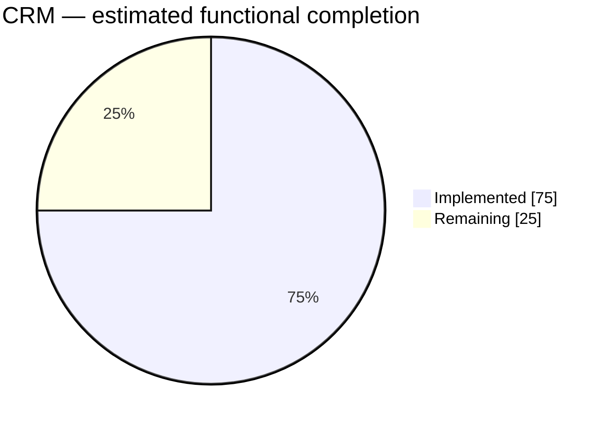
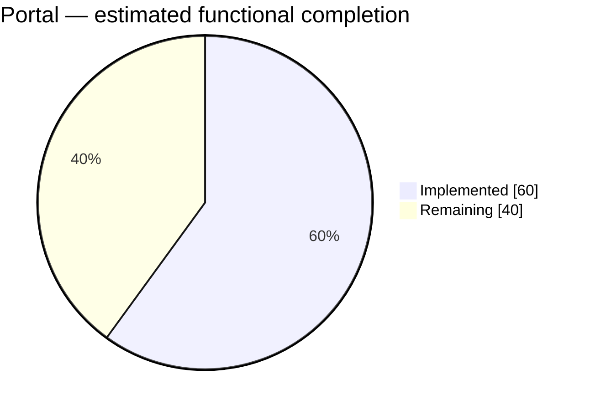
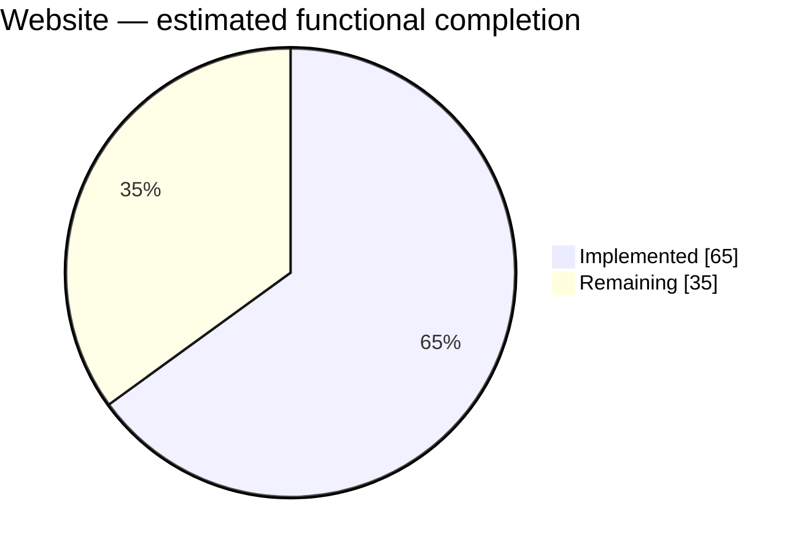

# NEXORA — PROJECT PROGRESS REPORT

**Latest assessment:** 22 September 2026 (Europe/London)  
**Reporting baseline:** Revised delivery priority: a tangible, working CRM, association website and member portal.  
**Daily update:** 9:00 pm Europe/London; scheduled in the current Codex task.  
**Companion documents:** [Master plan](NEXORA_PRODUCT_ARCHITECTURE_MASTER_PLAN.md) · [Execution plan](WEEK_BY_WEEK_EXECUTION_PLAN.md)

## 1. Reporting purpose and scope

Track actual delivered functionality, integration and verification against the revised project direction. The website-first, portal-next sequence supersedes the original phase order for implementation priority. Original security and commercial acceptance gates remain relevant to release readiness.

This report is the living progress record. The master plan retains the product vision and target scope; daily entries here record what changed and the evidence supporting it. Do not interpret original week numbers as elapsed or completed work.

## 2. Current progress dashboard

| Area | Estimated functional completion | Remaining | Current position |
| --- | ---: | ---: | --- |
| CRM | **75%** | 25% | Core staff records, associations, fields and saved views exist; connected record context and supporting workflows need completion. |
| Portal | **60%** | 40% | Local personal application lifecycle, receipts, draft removal and staff access management implemented; approval/rejection browser journeys verified. |
| Website | **65%** | 35% | CMS editing, preview, versions, publication and public pages exist; publishing and tenant presentation controls remain. |

These are rounded engineering estimates introduced on 21 September, based on repository inspection and delivery notes. They are not measured backlog completion, time spent, release readiness or a percentage of the entire Nexora master plan. Treat each as approximate, with roughly ±10 percentage points of judgment uncertainty. No overall project percentage is calculated because the three areas differ in scope and effort.

The baseline covers core CRM operations, core member profile/application self-service and a bounded association website. Paid checkout, advanced events, broad workflow automation and commercial operations are tracked separately in the master plan; they are not silently included in these three denominators.

## 3. Area assessment

| Area | Implemented functionality | Main remaining work |
| --- | --- | --- |
| CRM | Contact/Account management, dated associations, configurable attributes, saved views/filtering and shared member-profile persistence. | Permission-filtered cross-module overview/history and search; import/export reconciliation; safe document lifecycle; integration and verification completion. Existing partial capabilities should be reused. |
| Portal | Separate local member session, explicit revocable Contact binding, shared profile, membership/application status, draft/save/reopen/review/submit/discard, retained terms/quote receipts, portal product settings, staff account provisioning/linking/revocation UI, explicit company grants and organisation applications. | Application evidence/documents; durable notifications; broader profile fields; production identity/verification/recovery deferred by the product owner. |
| Website | Content module, editor, bounded blocks, preview, immutable versions, publish/unpublish/restore, anonymous published pages and local multi-page demonstration. | Media grants, branding controls, navigation ordering, redirects, sitemap/canonical configuration and custom-domain root routing; production build and release verification. |

Evidence: [CRM saved views](../stages/CRM-SAVED-VIEWS.md), [Account/Contact structure](../stages/STAGE-03A-ACCOUNT-CONTACT-STRUCTURE.md), [Website](../stages/STAGE-10-ASSOCIATION-WEBSITE.md), [Portal foundation](../stages/STAGE-11-MEMBER-PORTAL.md), [Portal applications](../stages/STAGE-12-PORTAL-APPLICATIONS.md), [Portal self-service](../stages/STAGE-13-PORTAL-SELF-SERVICE.md).

## 4. Verification and release position

The entries below summarize recorded delivery evidence. The portal implementation was tested during the 21 September working session; the initial report itself did not rerun tests.

| Check | Latest recorded evidence | Qualification |
| --- | --- | --- |
| API regression | 104 passed; none skipped | PortalComplete suite with isolated SQL Express catalogs enabled, including migration/SQL tests. |
| SQL migration replay/model checks | Passed separately | Does not establish parallel-submit or corporate-entitlement concurrency correctness. |
| Portal draft/submission browser journey | Desktop/mobile passed | Earlier journey; do not conflate with the expanded staff-decision suite. |
| Expanded approval/rejection browser journey | Both journeys passed in development and against the production frontend | Isolated SQL Express database; staff UI provisioning/revocation, draft discard, receipt reload, decisions, shared profile, no private-note leakage and mobile overflow checks. Final screenshots visually reviewed. |
| Website browser journey | Local publication/draft-isolation journey passed | Historical local evidence; not a public deployment. |
| TypeScript/targeted lint | Passed for documented slices | No claim that every current frontend file passed a fresh full lint run. |
| Production frontend build | Passed on 21 September | Isolated `next build --webpack`; TypeScript/route generation passed, followed by two passing portal journeys against `next start`. Production identity and deployment are still unverified. |
| Git integration | Substantial modified/untracked implementation | Current work is not yet one committed, verified release baseline. |

**Release position:** Working local product slices; full MVP acceptance and commercial readiness are not complete. Production staff identity remains disabled, and corporate membership subject/concurrency rules still need resolution. These concerns are tracked independently from functional percentages.

## 5. Next delivery priorities

1. Continue secure portal application documents and test-sink notifications; deepen corporate entitlement/concurrency verification.
2. Consolidate current work into a reviewed, verified repository baseline without discarding unrelated changes.
3. Keep production identity explicitly deferred by the user's local-development choice; resume provider integration when that choice changes.
4. Connect application documents, notifications and genuine CRM record context.
5. Complete the bounded website presentation/publishing controls and review the integrated demonstration against MVP criteria.

This is a proposed next-work order, not authorization to launch a production service or broaden scope.

## 6. Daily reporting rules

- Use the Europe/London calendar date. Update the current dashboard and append or extend one entry per day below; preserve previous dates and their original estimates.
- Inspect current source changes, commits, stage notes and available test results. Distinguish work completed today from previously delivered functionality reviewed today.
- Record implemented, verified, blocked and not-run work separately. A route, screenshot or test-file presence alone does not prove completion.
- Change a percentage only when a meaningful capability is delivered, removed or re-scoped. Explain every change. No automatic daily increment and no inference from lines of code or commit counts.
- Keep the initial scope stable. If scope changes, record the decision and explicitly rebaseline the affected estimate rather than hiding the denominator change.
- Use rounded estimates in five-point increments until an agreed, weighted acceptance backlog supports a more precise calculation. Keep uncertainty visible.
- Record commands/results when available, relevant source/document links, blockers and the next concrete actions. Never copy credentials or secrets into this report.
- A reporting run is read-only for application code and databases. Update this report and necessary strategy links only; do not start services, run migrations, publish content or commit/push merely to produce a daily report.
- If there is no material change, leave percentages unchanged and record that briefly. Daily reporting does not itself prove daily delivery.

## 7. Daily progress log

### 21 September 2026 — Initial reporting baseline

**Entry type:** Current-state assessment, not a claim that all functionality was built today. This initial entry is not a final cutoff of the day's work and can be extended at day end.

| Area | Previous estimate | Current estimate | Change |
| --- | --- | --- | --- |
| CRM | Not previously tracked | 75% | Initial baseline |
| Portal | Not previously tracked | 50% | Initial baseline |
| Website | Not previously tracked | 65% | Initial baseline |

**Work recorded for today:** Portal application delivery notes dated 21 September document personal draft/save/review/submit and the staff product settings follow-up. Staff settings persistence was checked in the browser. The expanded approval/rejection suite was prepared, but its final run is still pending.

**Reporting work completed:** Compared repository state with the master plan and revised delivery sequence; established the three functional estimates, pie charts and this ongoing report. Source baseline inspected: commit `52e41b9` plus the current modified/untracked working tree.

**Verification:** Historical outcomes and qualifications are listed in section 4. No tests were rerun to create this report.

**Blockers/open checks:** LocalDB availability for isolated browser verification; production frontend build; production identity; corporate subject/concurrency rules; uncommitted integration baseline.

**Next working session:** Close the pending portal decision-journey verification, then confirm the next scoped implementation slice against section 5.

**Same-day follow-up — debugger readiness:** Investigated the Website/Portal SQL cancellation issue and corrected the two-second readiness polling timeout. Added safe per-context database diagnostics and a bounded server readiness budget. Seven targeted tests passed, including a disposable SQL Server migration-history test; a fresh API checked all eight contexts against `NexoraDev` and returned 200. The existing debug process's separate 503 remains unclassified until it is restarted with diagnostics. See [investigation and verification](../stages/READINESS-DATABASE-DIAGNOSTICS.md). Functional estimates remain unchanged: this is startup reliability work, not new scope completion. Full portal browser verification and production frontend build remain open.

**Reporting cadence:** Daily update scheduled for 9:00 pm Europe/London in the current task.

**Portal self-service follow-up — resumed 21 September:** Delivered own-application receipt/detail and printing, stable accepted terms and quote display, version-checked unsubmitted draft discard, navigation/overview refresh, session-expiry handling across portal panels, and staff account provisioning/linking/revocation UI. Corrected select labels after browser testing exposed their unstable accessible names. Full backend suite: 104 passed, no skipped SQL tests. TypeScript and targeted lint passed. Both staff approval and rejection browser journeys passed on disposable SQL Express catalogs in development and against the final production frontend build (2 tests in 30.1 seconds). Final desktop/mobile screenshots were visually reviewed. Test catalogs and runner processes were cleaned up. LocalDB failed to start in this session, so these passes are not LocalDB verification. Production frontend compilation is now verified; production identity remains deferred and no public deployment is claimed.

| Area | Earlier today | Updated estimate | Reason |
| --- | ---: | ---: | --- |
| CRM | 75% | 75% | No additional CRM scope claimed. |
| Portal | 50% | 60% | Receipt/draft lifecycle and staff access UI delivered; the integrated decision journey now has passing browser evidence. |
| Website | 65% | 65% | No additional website scope claimed. |

The percentages retain the same core functional scope and judgment uncertainty. Local-only identity was explicitly selected; it is a deferred requirement, not completed work or a reduced denominator. Company grants, secure documents and notifications remain significant portal work.

### Daily entry template

Copy this structure under a new dated heading; do not replace historical entries.

| Area | Previous | Current | Reason for change or no change |
| --- | ---: | ---: | --- |
| CRM | — | — | — |
| Portal | — | — | — |
| Website | — | — | — |

- **Completed today:** Concrete capability and source/stage links.
- **Verified today:** Commands, results and the revision/scope tested where known.
- **Unverified or blocked:** Exact outstanding check and observed reason.
- **Scope decisions:** Any denominator changes or newly agreed priorities.
- **Next session:** Specific actions in priority order.

**22 September 2026 — organisation portal verification resumed:** Recovered the interrupted organisation browser journey and fixed explicit accessible labels on the staff and member organisation selects. Production frontend build/TypeScript passed; all three production-frontend browser journeys passed (company grant/application/receipt/approval/revocation and both personal decisions). The company mobile receipt was visually reviewed. Full API suite passed: 105 tests, zero failures or skips, with SQL Express migration checks enabled. Runner processes and its disposable database were cleaned up. See [Stage 14](../stages/STAGE-14-PORTAL-ORGANISATIONS.md). CRM 75%, Portal 60%, Website 65% estimates are retained pending a broader remaining-scope assessment; the verified company slice does not establish full portal completion. Secure documents, durable notifications and deeper corporate concurrency verification are next; production integrations remain deferred. Earlier verification rows above retain their historical evidence.

**22 September 2026 — secure evidence work started:** Added focused regression coverage for the existing application-evidence boundary: safe filename/path handling, accepted file signatures, unsupported/mismatched content rejection, and download security headers (`ApplicationEvidenceSafetyTests`, 5/5). Added an authenticated portal journey covering member upload, owner isolation, quarantined-download denial and unknown-application staff denial (1/1). Clean-scan staff review and organisation-grant revocation remain open because the local test scanner intentionally quarantines when ClamAV is unavailable. Estimates remain CRM 75%, Portal 60%, Website 65%.

**22 September 2026 — notification sink started:** Portal submission now persists a tenant-scoped `application.submitted` notification in the same transaction as the application, exposes only the signed-in member's entries, and supports durable read-state updates. The receipt journey verified queue creation and marking an item read (1/1 under `PortalNotifications`). This is a local test sink with `queued` delivery state, not external email delivery. Approval/rejection, access-grant/revocation and evidence notifications remain next; estimates remain CRM 75%, Portal 60%, Website 65%.

**22 September 2026 — notification sink delivery state:** Added the staff test-sink transition from `queued` to `delivered`, with delivery-attempt counting and idempotent status guard. The focused receipt test remains green after the new migration and endpoint. Approval/rejection and access-grant/revocation notification recipients still require explicit portal account/contact binding; no percentage change is claimed.

**22 September 2026 — decision recipient binding:** Approval and rejection now resolve the active portal access for the application Contact and enqueue a member-targeted notification in the same membership decision save. The focused receipt/decision regression passed under `PortalNotifyDecision`; no external email delivery is claimed. Access-grant/revocation and evidence-result notifications remain next. Estimates remain CRM 75%, Portal 60%, Website 65%.

**22 September 2026 — access notifications:** Portal access grants, local-member provisioning and revocation now enqueue recipient-specific notifications through the local sink. The access-list regression passed under `PortalNotifyAccess`; notifications remain queued test-sink records until explicitly delivered. Evidence scan-result notifications remain the final notification event family; estimates remain CRM 75%, Portal 60%, Website 65%.

**22 September 2026 — evidence notifications:** Evidence upload and scan/retry now enqueue member-targeted `clean`, `rejected` or `quarantined` scan-result notifications using active portal Contact binding. The evidence ownership regression passed under `PortalNotifyEvidence`; local ClamAV absence still prevents a clean-scan environment claim. Notification event coverage is now implemented in the local sink; estimates remain CRM 75%, Portal 60%, Website 65%.

**22 September 2026 — concurrency hardening started:** Added SQL filtered unique indexes for one submitted personal application per Contact/product and one submitted organisation application per Account/product. This protects simultaneous submissions at the database boundary; the application journey regression passed under `PortalConcurrency`, with the new migration/model included. Overlapping membership dates and concurrent approval activation remain open; estimates remain CRM 75%, Portal 60%, Website 65%.

**22 September 2026 — active-membership guard:** Added SQL uniqueness guards for one active personal membership per Contact/product and one active organisation membership per Account/product. Approval and revocation regressions passed 2/2 under `PortalConcurrency2`. This closes duplicate active-row races; overlapping date ranges across separate products and policy-specific limits remain open. Estimates remain CRM 75%, Portal 60%, Website 65%.

**22 September 2026 — membership rule clarified:** The user confirmed that a Contact may hold only one active membership total and an organisation may hold only one active membership total, regardless of offering. Re-scoped the SQL guards from `(subject, product)` to Contact-only and Account-only, generated the follow-up migration, and passed approval/revocation checks 2/2 under `OneMembership`. Estimates remain CRM 75%, Portal 60%, Website 65%.

**22 September 2026 — concurrency rule closed:** Pending applications remain allowed across different offerings because the confirmed rule applies to active memberships, not application drafts. Removed the over-broad submitted-application uniqueness guards after the full suite exposed that incompatibility; retained Contact-only and Account-only active-membership guards. The affected foreign-tenant/duplicate-approval regression passed under `PortalFinal3`. Remaining portal scope is secure-document clean-scan verification, corporate entitlement/concurrency tests beyond one-active-membership, broader profile fields, and deferred production identity/invitations/recovery.
