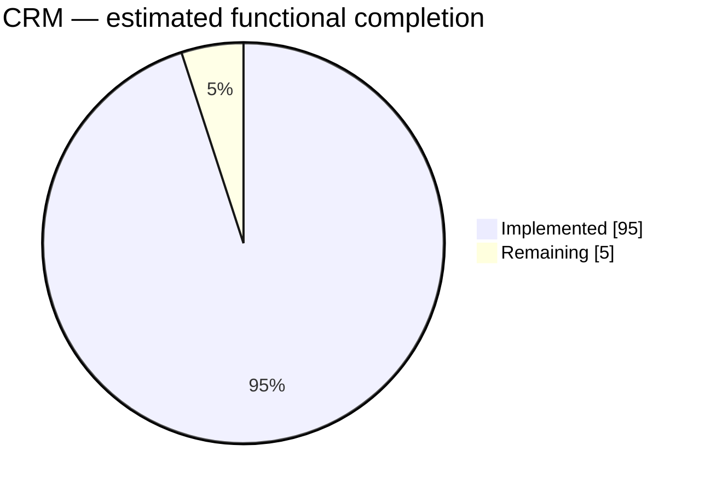
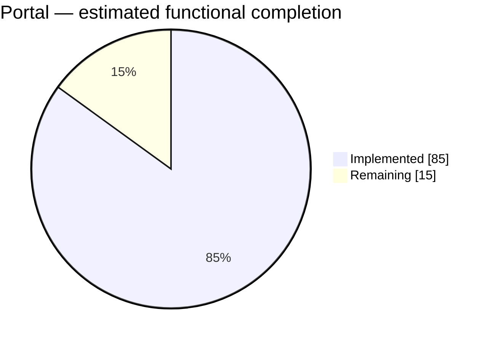
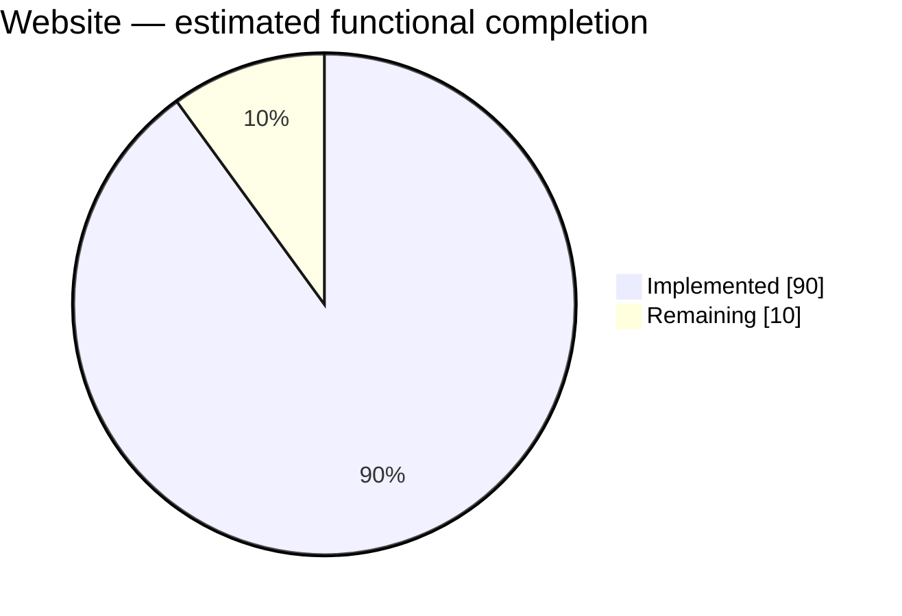

# NEXORA — PROJECT PROGRESS REPORT

**Latest assessment:** 26 October 2026, 7:05 am catch-up review (Europe/London) 
**Reporting baseline:** Revised delivery priority: a tangible, working CRM, association website and member portal.  
**Daily update:** 9:00 pm Europe/London; scheduled in the current Codex task.  
**Companion documents:** [Master plan](NEXORA_PRODUCT_ARCHITECTURE_MASTER_PLAN.md) · [Execution plan](WEEK_BY_WEEK_EXECUTION_PLAN.md)

## 1. Reporting purpose and scope

Track actual delivered functionality, integration and verification against the revised project direction. The website-first, portal-next sequence supersedes the original phase order for implementation priority. Original security and commercial acceptance gates remain relevant to release readiness.

This report is the living progress record. The master plan retains the product vision and target scope; daily entries here record what changed and the evidence supporting it. Do not interpret original week numbers as elapsed or completed work.

## 2. Current progress dashboard

Latest recorded broad verification is the 7 October market-readiness review: 260 API tests and two architecture tests passed with SQL enabled and no skips. All 17 enabled production-frontend browser journeys passed across a whole-suite run and a focused repair rerun, with three existing skips; no single final green whole-browser-suite run is claimed. Production identity, services and deployment acceptance remain open. See the same-day entry and [product health evidence](../market/PRODUCT-HEALTH.md).

The 30 September delivery adds shared structured CRM/Portal profiles, relationship Department and Main Account selection, committed as `4d48fd5`. Its delivery notes record 30 focused API/SQL tests, two architecture tests and three Edge journeys passing. These focused results supplement the integrated baseline; they do not constitute a fresh whole-system regression. Estimates remain unchanged because this extends existing record/profile functionality without closing the remaining release dependencies or changing the bounded scope.

| Area | Estimated functional completion | Remaining | Current position |
| --- | ---: | ---: | --- |
| CRM | **95%** | 5% | Core records, connected context/search, reconciled CSV transfer and scan-gated documents delivered and verified; live scanner and deployment acceptance remain. |
| Portal | **85%** | 15% | Local personal/company applications, receipts, secure evidence lifecycle, notification inbox and correspondence profile delivered; production identity, external delivery and live antivirus operations remain. |
| Website / CMS | **90%** | 10% | Editing, versions, media grants, branding, navigation, redirects, SEO and scheduled publishing delivered; live scanner/domain operations and deployment acceptance remain. |

These are rounded engineering estimates introduced on 21 September, based on repository inspection and delivery notes. They are not measured backlog completion, time spent, release readiness or a percentage of the entire Nexora master plan. Treat each as approximate, with roughly ±10 percentage points of judgment uncertainty. No overall project percentage is calculated because the three areas differ in scope and effort.

The baseline covers core CRM operations, core member profile/application self-service and a bounded association website. Paid checkout, advanced events, broad workflow automation and commercial operations are tracked separately in the master plan; they are not silently included in these three denominators.

## 3. Area assessment

| Area | Implemented functionality | Main remaining work |
| --- | --- | --- |
| CRM | Contact/Account management, associations, custom attributes/views, shared member profiles, permission-filtered connected context/search, reconciled CSV import/export and private scan-gated documents. | Live antivirus operations and deployment/user acceptance. Large-scale migration, automatic merging and full database backup are outside the bounded CSV workflow. |
| Portal | Local member sessions, revocable personal/company grants, personal/company draft and receipt journeys, staff access management, secure evidence controls, durable local notifications with member inbox, shared name/correspondence profile and one-active-membership guards. | Deferred production identity/registration/invitations/recovery; external notification delivery; live ClamAV setup and operational verification. |
| Website / CMS | Content editor, preview, immutable versions, publish/unpublish/restore, image/document library with scan/public grants, branding, menu controls, redirects, sitemap/canonical metadata, configured-domain routing and durable scheduled publication. | Live ClamAV, real domain/DNS/TLS setup and deployment acceptance. General publishing integrations remain outside this bounded slice. |

Evidence: [CRM saved views](../stages/CRM-SAVED-VIEWS.md), [Account/Contact structure](../stages/STAGE-03A-ACCOUNT-CONTACT-STRUCTURE.md), [Website](../stages/STAGE-10-ASSOCIATION-WEBSITE.md), [Portal foundation](../stages/STAGE-11-MEMBER-PORTAL.md), [Portal applications](../stages/STAGE-12-PORTAL-APPLICATIONS.md), [Portal self-service](../stages/STAGE-13-PORTAL-SELF-SERVICE.md).

## 4. Verification and release position

The entries below summarize recorded delivery evidence. Current CRM and integrated verification is recorded in the 24 September entry and Stage 17. CMS delivery is recorded in Stage 16. Portal delivery is recorded in Stage 15; earlier dated outcomes remain historical evidence.

| Check | Latest recorded evidence | Qualification |
| --- | --- | --- |
| API regression | 260 API tests and two architecture tests passed, SQL enabled, 7 October | No failures/skips in recorded backend run; later frontend repairs have separate browser evidence. |
| SQL migration replay/model checks | Passed in full suite | Includes existing CMS site upgrade preservation; concurrency has separate tests. |
| Portal draft/submission browser journey | Desktop/mobile passed | Earlier journey; do not conflate with the expanded staff-decision suite. |
| Expanded approval/rejection browser journey | Both journeys passed in development and against the production frontend | Isolated SQL Express database; staff UI provisioning/revocation, draft discard, receipt reload, decisions, shared profile, no private-note leakage and mobile overflow checks. Final screenshots visually reviewed. |
| Integrated CRM/Portal/CMS browser journeys | All 5 passed, 24 September | CRM import/search/context/files, 3 portal journeys and CMS publishing against one isolated production frontend. No public deployment. |
| TypeScript/targeted lint | Full TypeScript and changed CRM/test lint passed, 24 September | Prior CMS/proxy/routes checks also passed; no blanket full-repository lint claim. |
| Production frontend build | Passed on 24 September | Isolated `next build --webpack` and browser verification against `next start`. API uses Development local identity; production identity/deployment remain unverified. |
| Git integration | Latest commit `424da72`, 21 October, preserves pitch templates and the report after acquisition-script/test backup `8be9211`; application backup remains `e936abc` | Pending market documents, marketing scripts and this report remain separate. Backup and test-source presence are not application regression results. |

**Release position:** Working local product slices; full MVP acceptance and commercial readiness are not complete. Production staff identity remains disabled. The confirmed personal/company one-active-membership rule now has application checks and passing SQL concurrency coverage; live provider and antivirus operations remain release dependencies. These concerns are tracked independently from functional percentages.

## 5. Next delivery priorities

1. Core local portal delivery is verified; retain production identity, external delivery and live antivirus operations as explicit release dependencies.
2. Verify the shared local instance against the new CRM migrations before user acceptance; the 30 September delivery notes leave that instance unmigrated. Keep focused verification distinct from a fresh integrated regression.
3. Keep production identity explicitly deferred by the user's local-development choice; resume provider integration when that choice changes.
4. Local CRM integration is verified; use the shared CRM/Portal/CMS debug options for user acceptance.
5. Bounded CMS presentation/publishing controls are delivered; complete scanner/domain deployment acceptance when production integration is resumed.

This is a proposed next-work order, not authorization to launch a production service or broaden scope.

## 6. Daily reporting rules

- Use the Europe/London calendar date. Update the current dashboard and append or extend one entry per day below; preserve previous dates and their original estimates.
- Inspect current source changes, commits, stage notes and available test results. Distinguish work completed today from previously delivered functionality reviewed today.
- Record implemented, verified, blocked and not-run work separately. A route, screenshot or test-file presence alone does not prove completion.
- Change a percentage only when a meaningful capability is delivered, removed or re-scoped. Explain every change. No automatic daily increment and no inference from lines of code or commit counts.
- Keep the initial scope stable. If scope changes, record the decision and explicitly rebaseline the affected estimate rather than hiding the denominator change.
- Use rounded estimates in five-point increments until an agreed, weighted acceptance backlog supports a more precise calculation. Keep uncertainty visible.
- Record commands/results when available, relevant source/document links, blockers and the next concrete actions. Never copy credentials or secrets into this report.
- A reporting run is read-only for application code and databases. Update this report and necessary strategy links only; do not start services, run migrations, publish content or commit/push merely to produce a daily report.
- If there is no material change, leave percentages unchanged and record that briefly. Daily reporting does not itself prove daily delivery.

## 7. Daily progress log

### 26 October 2026 — Morning catch-up

**Evidence and estimates:** No material product change or newer completed application verification was found in the inspected Git history, working-tree status, delivery records and available artifacts since the 23 October review. Latest commit remains `424da72` (21 October); pending changes concern market documents, marketing scripts and this report. CRM **95%**, Portal **85%**, Website/CMS **90%** remain unchanged. Earlier test results retain their original dates and verification limits.

**Blockers and next actions:** Retained Portal acceptance, field/import/settlement reconciliation, deferred production identity, external providers/scanning, deployment/restore and the recorded dependency-advisory review remain open. Continue acceptance in its owning implementation task when resumed. This is a 7:05 am catch-up, not a completed day-end report; no delivery is invented for missed dates. Only this report was edited; no application code, tests, migrations, services, publication, commits or pushes were performed. Report-only edits do not require beginner-manual regeneration.

### 23 October 2026 — Morning catch-up

**Repository and evidence:** Commits `8be9211` and `424da72` (21 October) preserve acquisition evidence gates, marketing test source, pitch templates and the prior report. Pending changes remain in market documents and two marketing scripts. No newer completed application verification was found in the inspected delivery records and artifacts; test-source additions alone do not prove a passing run.

**Estimates and next actions:** CRM **95%**, Portal **85%**, Website/CMS **90%** remain unchanged because the recorded changes do not close product acceptance gaps. Remaining work is retained Portal acceptance in its owning task, field/import/settlement reconciliation, deferred production identity, external providers/scanning, deployment/restore and the recorded dependency-advisory review. Earlier verification retains its original dates and limits.

**Reporting boundary:** This is a 7:21 am catch-up, not a completed day-end review. No delivery is invented for missed dates. Only this report was edited; no application code, tests, migrations, services, publication, commits or pushes were performed. Beginner manuals were not regenerated for this report-only change.

### 21 October 2026 — Morning catch-up

**Recorded delivery:** The 19 October commits `608ae4a` and `aaa9ee4` preserve brochure assets, outreach policy and publication evidence. The [brochure delivery record](../market/listings/product-page/README.md) records successful publication and desktop/mobile browser checks in its owning task. This is a public marketing page, not a deployed CRM/Portal/CMS service or accepted directory listing; no live publication check was repeated today.

**Evidence and estimates:** No newer completed application verification was found in the inspected delivery records and artifacts. CRM **95%**, Portal **85%**, Website/CMS **90%** remain unchanged: marketing publication does not close functional acceptance gaps. Current pending changes concern market documents and the marketing-review script. Earlier broad and scoped verification retain their original dates and limits.

**Blockers and next actions:** Complete retained Portal acceptance in its owning task, reconcile remaining field/import/settlement scope, and address production identity (still deferred), external providers/scanning, deployment/restore and the recorded dependency-advisory review before release. This is a 7:22 am catch-up, not a completed day-end assessment; no missed-day delivery is invented. Only this report was edited; no application code, tests, migrations, services, publication, commits or pushes were performed. Report-only edits do not require beginner-manual regeneration.

### 19 October 2026 — Repository backup catch-up

**Repository position:** Latest commit `e936abc` (15 October) backs up the CRM/listing implementation, following `75cb746` for backup policy and delivery notes. Application changes previously reported as uncommitted are now captured in Git; current pending changes inspected are market documents and a marketing-review script. This is a backup/integration milestone, not a new product acceptance result.

**Evidence and estimates:** No newer completed application verification was found in the inspected delivery documents and artifacts. CRM **95%**, Portal **85%**, Website/CMS **90%** remain unchanged; prior full-suite and scoped UI results retain their recorded boundaries. Beginner-manual state still records the 14 October snapshot as reviewed. No fresh source-fingerprint check was run, so current-source documentation parity is not newly certified. This report-only change does not alter implementation/runtime configuration or regenerate manuals.

**Next actions and limitations:** Review the backed-up implementation against the remaining acceptance requirements and keep matching documentation current when source changes. Retained Portal acceptance, field/import/settlement work, production identity, live providers/scanning, deployment/restore and the recorded dependency-advisory review remain open. This is a morning catch-up; no daily delivery is invented for intervening dates. Only this report was edited; no tests, migrations, services, publication, commits or pushes were performed.

### 15 October 2026 — Beginner documentation maintenance catch-up

**Recorded delivery:** Commit `6793449` (14 October) adds Company Dash documentation and the beginner-manual maintenance workflow. The guide index now lists 36 guides and a 14 October source snapshot covering 717 text files across the two applications. Company Dash is captured for documentation only; it remains a separate application with no Nexora runtime dependency. The maintenance instructions require source comparison, archived prior manuals, offline/browser checks and Word visual review before marking a refreshed collection reviewed.

**Verification boundary:** Reviewed Git history/status, the guide index and maintenance records, delivery-note timestamps and available artifact timestamps. The maintenance state records the 14 October snapshot as reviewed, with source/browser checks and rendered Word visual review passed. Documentation capture/review is separate from product regression; no newer completed application test result was found beyond the previously recorded full backend and scoped UI evidence. This reporting-only edit changes neither implementation nor selected runtime configuration, so it does not trigger a manual regeneration. No claim is made that a fresh source-fingerprint or Word review ran today.

**Estimates and next actions:** CRM **95%**, Portal **85%**, Website/CMS **90%**, unchanged. Documentation breadth does not increase functional completion. Later CRM/interface/sorting work remains uncommitted; review it with its scoped evidence and maintain matching guides when implementation changes. Retained Portal acceptance, field/import/settlement requirements, production identity, live providers/scanning, deployment/restore and the recorded dependency-advisory review remain open. This is a morning catch-up, not a completed day-end review; no missed-date delivery entries are invented. Only this report was edited; no tests, migrations, services, publication, commits or pushes were performed.

### 13 October 2026 — CRM presentation, sorting and learning guides

**Implemented and integrated:** `6c43592` preserves website/Portal onboarding and outreach updates; `9344fe2` backs up CRM theme work in progress; latest commit `2bf1d97` adds the beginner learning guides. The guide index describes 30 teaching guides and an offline source-linked HTML manual plus Word versions. Later CRM/interface and sorting changes remain uncommitted; a backup commit is not completed acceptance.

**Recorded scoped verification:** [CRM theme alignment](CRM-THEME-2026-10-13.md) records production build, TypeScript, scoped lint and desktop/mobile checks, including preview isolation, reduced motion and print styling. [Listing sorting](LISTING-SORTING-2026-10-13.md) records 26 existing API checks and seven new sorting regressions in separate runs, three browser tests and 36 read-only local SQL-backed queries. Sorting is applied before server pagination where required and retained in CRM URLs/views. These results are delivery-note evidence, not reruns or a new whole-system regression. Saved record-panel/tag visual-review JSON reports no browser errors and checks responsive audit panels, independent rails, popup focus, cancel/Escape and mobile fit. Screenshot presence alone is not business acceptance.

**Estimates and boundaries:** CRM **95%**, Portal **85%**, Website/CMS **90%**, unchanged. Presentation, sorting and documentation improve existing scope; they do not close the remaining provider, import or deployment requirements. The 7 October full backend baseline remains the latest broad evidence reviewed. The 12 October Portal journeys remain newer scoped evidence; retained ten-member acceptance is still separate.

**Next actions:** Review and integrate the outstanding sorting/interface changes with their scoped evidence, finish retained acceptance in its owning task and continue the agreed field/import/settlement requirements. Production identity, live providers/scanning, operational recovery/deployment and the recorded development-dependency advisory review remain open. A local scanner helper filename does not establish live scanner acceptance. This reporting run edited only the report and did not execute tests, migrations, services, publication, commits or pushes.

### 12 October 2026 — Website design controls and Portal theme

**Implemented:** The [website design delivery](PUBLIC-WEBSITE-DESIGN-2026-10-12.md) records structured feature-grid/showcase/gallery/FAQ sections, a studio renderer, independently drafted/published global design, per-section layout/motion controls and cyan/violet styling. The [Portal delivery](PORTAL-NEON-DESIGN-2026-10-12.md) adds configurable classic/neon appearance, copying published website colours into a Portal draft, restricted public sign-in branding, reduced-motion/print handling and a persistent shared Portal layout to remove navigation flashes. Website and Portal publication remain independent.

**Recorded verification:** Website notes record 13 distinct API/migration checks across scoped runs, frontend typecheck/lint/build, a production browser design/publishing journey and anonymous desktop/mobile checks across nine pages, ten links, Portal navigation and sitemap. Portal notes record four API checks, frontend checks/build and a production configuration journey covering persistence, publication, private-page boundaries, mobile overflow and reduced motion. The notes record local NexoraDev website migration and theme publication; this reporting run performed neither. Screenshots supplement these checks but do not establish full application regression. The 7 October broad backend baseline remains the latest full-suite evidence reviewed.

**Navigation follow-up evidence:** Portal delivery notes additionally record all four production browser journeys passing after the shared-layout repair, including delayed navigation/sign-out, personal approval/rejection, organisation receipts and live access revocation. This is newer Portal-specific evidence, not completion of the separate retained ten-member review or a new full CRM/Portal/CMS run.

**Estimates and repository:** CRM **95%**, Portal **85%**, Website/CMS **90%**, unchanged. These are meaningful presentation/configuration improvements, recorded separately without silently expanding the original bounded scope or marking remaining production requirements complete. Latest commit remains `539a446`; subsequent Portal/Website changes are uncommitted. The earlier clean-tree statement describes the 10 October integration checkpoint only.

**Remaining and next actions:** Review the new theme/layout changes for integration and preserve their scoped verification boundaries; finish retained Portal acceptance in its owning task and continue agreed field/import/settlement requirements. Production identity, live provider/scanning, deployment/restore, migration reconciliation and the recorded development-dependency advisory review remain open. No code, tests, services, databases, content publication or Git history were changed by this reporting run; only this report was updated.

### 10 October 2026 — Morning catch-up

**8:57 pm same-day integration update:** Commit `539a446` (`Integrate CRM, membership, workflow and interface updates`, 6:36 pm Europe/London) now incorporates the previously pending work. Git status was clean before this report refresh. This supersedes the morning's uncommitted-baseline observation and closes that repository-integration action for the committed scope. No newer completed test evidence was found; committing the work does not rerun or extend the 7 October API/browser results. CRM **95%**, Portal **85%**, Website/CMS **90%** remain unchanged. Retained Portal acceptance, remaining field/import/settlement scope, production services and operational acceptance remain open. Next: assess the committed baseline against those remaining acceptance requirements and retain the existing test qualifications. This run edited only the report and did not test, migrate, deploy, commit or push.

**Product position:** CRM **95%**, Portal **85%**, Website/CMS **90%**, unchanged. Reviewed Git history/status, delivery documents and available artifact timestamps. Latest commit remains `f82db09`; subsequent implementation and market material remain uncommitted. No newer completed application regression or verified product delivery was found beyond the 7 October baseline. The later shared-API log timestamp is runtime activity, not acceptance evidence. This is a morning catch-up, not a completed day-end review; no missing-date delivery entries are invented.

**Commercial scope update:** The [market launch pack](../market/START-HERE.md) records ten additional US pitches on 9 October and a subsequent user-directed move of new prospect research to the Middle East, focused on evidenced first-CRM adoption. These are records from the separate outreach task, not sends or mailbox checks performed here. Existing outreach/suppression history remains relevant; no recipient interest, qualified pilot or product readiness is inferred from campaign activity.

**Remaining and next actions:** Engineering priorities are unchanged: review the uncommitted baseline, complete retained Portal acceptance in its owning task, continue agreed field/import/settlement work, and close production identity, live delivery/scanning, deployment/restore and migration-reconciliation requirements. The recorded development-dependency advisory review remains open; no fresh audit was run. Continue commercial qualification in the separate campaign task under its current market instructions. This reporting run edited only this report and did not change application code, run tests/migrations/services, send messages, publish, commit or push.

### 8 October 2026 — Demonstration and market-discovery delivery

**Estimates and application verification:** CRM **95%**, Portal **85%**, Website/CMS **90%**, unchanged. Latest commit remains `f82db09`; subsequent changes remain uncommitted. No newer completed application regression was found beyond the 7 October evidence: 260 API and two architecture tests passed, with 17 enabled browser journeys covered across runs and three existing skips. Today's commercial assets do not increase functional completion or establish release readiness.

**Delivered and recorded evidence:** The [market launch pack](../market/START-HERE.md) now includes a narrated/captioned 90-second MP4 demonstration, revised outreach material and US prospect research. `artifacts/market-pitch-verification.json` records nine fitting scenes, no tour runtime errors, 1280x720 video, decoded samples and audio checks. This verifies the saved demonstration artifact, not every product feature or a hosted deployment.

**Commercial progress, separately qualified:** The [UK outreach record](../market/outreach/2026-10-08/STATUS.md) records eleven individually addressed messages with Sent-copy and attachment checks; recipient delivery, viewing and interest remain unverified. A separate [US outreach record](../market/us/outreach/2026-10-08/STATUS.md) and prospect shortlist are present. These are prior-task records inspected locally, not mailbox checks or messages sent by this reporting run. No customer conversion or pilot acceptance is inferred.

**Remaining and next actions:** Continue market discovery from the recorded campaign status without duplicating sent messages, and use actual replies/qualified calls to assess demand. Engineering priorities remain reviewing the uncommitted baseline, retained Portal acceptance and agreed migration-field/settlement work. Production identity, external email/payment/scanning, hosting/restore and migration reconciliation remain open; the previously recorded five high development-dependency advisory entries still require review. No fresh dependency audit or runtime test was performed. This run changed only this report and did not send messages, modify application code, run migrations, publish, commit or push.

### 7 October 2026 — Automation metadata catch-up

**9:02 pm daily update — material readiness progress:** The [market-readiness review](../market/PRODUCT-HEALTH.md) records repair of the shared API startup failure caused by missing `AttributeDefinition.Section` migrations in five modules, serial build/test settings for workstation memory pressure, corrected custom-field section persistence, membership Setup navigation/list state, lookup-selection timing and accessible control names. It also records successful shared API readiness and concurrent CRM/Portal/CMS checks. This supersedes the earlier blanket assumption that shared startup remained unverified; it does not establish production readiness or source-workbook import.

**Verification:** Recorded SQL-enabled backend results are **260 API plus two architecture tests passed, zero failures/skips**. Production browser coverage is **16 passed, one failed, three skipped** in the patched whole-suite run, followed by **both membership journeys passing** in the final rebuilt focused run. Together these cover all 17 enabled journeys; they are not one final green whole-suite run. TypeScript/lint and production build passed according to the health ledger. Existing broader automation/login-dependent browser skips and retained ten-member data-review completion remain separate limitations.

**Dependencies and delivery assets:** Saved audit JSON reports zero production npm advisories after dependency updates, but five high development-dependency entries remain; the health review attributes them to the braces dependency chain and leaves release review open. These are saved audit results, not a fresh registry/security assessment by this report. Market-discovery material and a recorded product tour are present; creating these assets does not establish customer validation, external outreach or a production launch.

**Position and next actions:** CRM **95%**, Portal **85%**, Website/CMS **90%** remain unchanged: this work repairs and verifies existing capabilities without redefining their scope. Latest commit remains `f82db09`, with subsequent changes uncommitted. Review the current changes for integration, retain the precise cross-run browser evidence, finish outstanding retained acceptance in its owning task, and resolve or explicitly review the development advisory before release. Production identity, external email/payment/scanning, deployment/restore and migration reconciliation remain open. This reporting run only updated this report and ran no application tests, migrations, services, publication, commits or pushes.

**Timing and estimates:** This is a 2:17 pm catch-up, not a completed day-end report. CRM **95%**, Portal **85%**, Website/CMS **90%** remain unchanged. No entries or delivery claims are invented for missed dates. Automation metadata improvements extend existing configuration capabilities; they do not establish completion of the outstanding functional or production acceptance scope.

**Implemented since the last review:** The [automation metadata guide](../implementation/AUTOMATION_METADATA.md), shared catalogue and corresponding source describe one shared frontend/backend section catalogue, reconciliation of older saved layouts, discovery of mapped scalar fields, Contact/Account profile rule sources, and custom-attribute workflow metadata/query/change-event support. Sensitive fields are explicitly excluded; registered domain commands retain mutation permission checks. This work is uncommitted; latest commit remains `f82db09`.

**Verified from saved evidence:** The 5 October TRX files under `artifacts/automation-catalog-tests/` record 14/14 automation-catalog tests, 23/23 workflow-catalog regression tests and 10/10 workflow-engine regression tests passing, each with zero failures. The saved frontend build log reaches its completed route summary. Saved live metadata records Contact/Account field discovery, profile/social registration and 25 workflow entities; it is a metadata snapshot, not an end-to-end business acceptance test. These focused runs do not refresh the earlier 202-check full API baseline against every subsequent field/UI change. No checks were rerun for reporting.

**Remaining and next actions:** The retained E2E review remains documented as in progress. The newest field-delivery notes still leave shared migration/browser acceptance open; later runtime log timestamps alone do not prove those checks completed. Coordinate that verification in the owning implementation task, review the uncommitted catalogue/field/UI changes against a stable regression baseline, then continue the remaining Account/application/settlement requirements. Production identity, live providers/scanning, imports and deployment acceptance remain open. Only this report was edited; no application code, tests, migrations, services, publication, commits or pushes were performed.

### 4 October 2026 — After-midnight catch-up for 3 October delivery

**9:00 pm same-day update — migration-field delivery:** Substantial additional uncommitted Contact, Account and Membership work is now recorded in the [migration template progress](../implementation/MIGRATION_TEMPLATE_PROGRESS.md). Application representation is **Contact 127/185 field occurrences**, **Account 90/160**, and **Membership Application 18/23**, with New/Rejoin purpose only partially covering its lifecycle field. These are separate source-field coverage measures, not import completion or replacements for the CRM/Portal/Website percentages. No source workbook rows have been imported.

**Implemented and recorded verification:** Contact delivery includes purpose-aware address details, communications/preferences, profile taxonomy and Membership general/financial metadata. Account general-information coverage is 20/24 fields; parent history remains open. Membership Application now records requested classifications, payment/invoicing snapshots, status dates and private staff remarks with versioned review and approval handoff. Delivery notes record 22 selected API/SQL passes for the Contact/Membership continuation, six API/SQL passes for Account general fields, and 55 selected API/SQL passes for Membership Application, followed by two focused refinement passes. Counts overlap and are not summed. TypeScript, focused lint and production frontend builds are recorded as passing with seven existing generated CSS warnings. The Account tests also cover a request-parsing fix preserving HTTP 400 for malformed input. None of these checks were rerun for this report, and no new whole-checkout regression is established.

**Verification boundaries and next work:** These newer field migrations remain unapplied to the shared development database, authenticated browser appearance remains unverified, and source changes remain uncommitted; latest commit is still `f82db09`. This supersedes any assumption that the earlier migrated annotation batch covers today's new migrations. Next: coordinate the shared upgrade and browser acceptance with the owning implementation task, then address dated Account hierarchy, remaining application Upgrade/Reinstate transitions, term-linked financial obligations and provider-backed settlement/Direct Debit. GoCardless/Stripe preference is recorded metadata, not live mandate or collection support. EDI/directory requirements remain deferred pending their access/publication rules. CRM **95%**, Portal **85%**, Website/CMS **90%** remain unchanged because these expanded field slices have separate coverage and outstanding acceptance; no denominator has been silently enlarged. Retained E2E completion, production identity, live delivery/scanning and deployment acceptance remain open. The evening reporting run edited only this report.

**Timing and estimates:** The trigger at 23:28 UTC on 3 October is **12:28 am on 4 October Europe/London**. This entry reviews prior-day delivery, not a completed 4 October workday. CRM **95%**, Portal **85%**, Website/CMS **90%** remain unchanged. Catalogue breadth and presentation/audit improvements are recorded explicitly without changing the bounded denominators or inferring production readiness.

**Catalogue verification recovered:** `workflow-catalog-full-tests.log` records **194 passed, eight skipped, zero failures**; `workflow-catalog-sql-tests.log` records all **eight SQL-only checks passing** separately. The [operations catalogue delivery record](WORKFLOW_OPERATIONS_TEMPLATE_PACK.md) reconciles these as all 202 checks across two runs. `workflow-catalog-final-focused.log` records **63 passing focused tests**, including community leave; this closes the previously reported catalogue failure. The delivery record also reports TypeScript/lint, two architecture checks and live catalogue installation/reinstallation, approval/worker audit, Content revision preview and mobile checks. It records 34 saved catalogue definitions, 29 primary entries and zero active versions. Live provider acceptance remains unverified.

**Later implemented/targeted verification:** The [3 October annotation delivery](../implementation/BROWSER_ANNOTATIONS_2026-10-03.md) records listing/navigation/detail improvements, contact presentation and protected photos, and per-entity data audit across nine contexts. It records 22 targeted backend passes, frontend checks, isolated SQL migration/model parity and local browser checks. These are documented results, not reruns by this report. The earlier 202-check result must not be treated as full verification of this later batch. Audit begins when enabled, covers tracked EF writes and redacts protected payloads; it does not reconstruct old history or cover direct SQL. Live scanning remains necessary for production photo acceptance.

**Repository and remaining work:** Latest commit remains `f82db09`; catalogue and subsequent annotation/audit changes remain uncommitted. The retained ten-member E2E review is still documented as in progress; no completion is inferred from the separate catalogue/browser checks. Next: review and integrate the newer changes with a stable regression baseline, complete retained acceptance in its owning task, and continue agreed migration-field work. Production identity, external delivery/scanning and deployment acceptance remain open. This catch-up changed only the report; no application edits, tests, services, migrations, commits or pushes were performed.

### 2 October 2026 — Workflow delivery and regression recovery

**Estimates:** CRM **95%**, Portal **85%**, Website/CMS **90%**, unchanged. Workflow and administration extend the wider master plan; they do not silently increase the three bounded functional denominators. No production-readiness increase is inferred.

**Committed delivery:** `f82db09` (2 October) commits workflow automation, module navigation and administration. The [workflow delivery plan](ADVANCED_WORKFLOW_ARCHITECTURE_AND_DELIVERY_PLAN.md) now records advanced processing and a business operations pack with 13 configurable templates, human approvals, deadline routing, business-state waits and an Operations approval/exception screen. Controlled provider tests do not establish live email, HTTPS or AI delivery.

**Verified evidence:** Workflow operations logs record a broad API run of **169 passed, eight skipped, zero failures**, followed by **38 passing focused workflow tests**. Delivery notes also record two SQL migration/lease checks, two architecture checks, frontend checks and local browser approval/run-history checks. This supersedes the earlier four-failure broad run for that tested delivery, but skipped tests remain a limitation. This chat separately verified the four original failures passing and two scheduler lifecycle tests passing; its own later full run was stopped after memory pressure and the user's stop instruction and has no completed result.

**Newer work remains open:** Subsequent uncommitted changes include CRM timeline/sticky presentation and workflow catalogue, Portal contracts and membership payment-command work. `workflow-catalog-checks.log` records **35 passed, one failed**, in `Community_leave_uses_domain_command_and_replays_without_another_delete`. The later focused log had no completion summary when inspected. Treat this as a pending verification issue for the newer changes, not as a failure of the earlier committed baseline. No real payment-provider capability is inferred from a source filename.

**Portal acceptance and ownership:** The retained review remains marked in progress. Its saved ledger confirms the first member's personal/organisation submissions, approvals, private-note protection, notifications, mobile layout and access isolation; it does not establish completion for all ten members. The separate retained E2E task owns browser/data work and shared API restoration. This reporting run did not resume that work or launch tests/services.

**Next actions and blockers:** Resolve/retest the newer catalogue failure, finish the retained acceptance review in its owning task, and reconcile current source with the completed test baseline before the next integration claim. Production identity remains deliberately deferred; live providers/scanning, deployment acceptance, migration-field completion and broader paid/member-service scope remain open. Only this report was changed; no application code, migrations, publishing, commits or pushes were performed.

### 1 October 2026 — Catch-up review of 30 September delivery

**5:49 pm requested refresh:** The checkout has materially changed since this morning. New and modified source includes shared listing/navigation/presentation controls, administration screens and backend permissions, membership setup values with an additive migration, and a new Workflow module/designer with persistence, migrations, processing and test coverage. These changes remain uncommitted; latest commit is still `4d48fd5`. This paragraph supersedes the morning's clean-application-working-tree observation, while preserving it as history.

**Afternoon verification evidence:** `artifacts/workflow-final-tests.log` records six passing API tests, zero failures/skips, at 4:33 pm. `artifacts/workflow-advanced-build.log` records a successful later build with zero warnings/errors at 5:43 pm. The [workflow delivery plan](ADVANCED_WORKFLOW_ARCHITECTURE_AND_DELIVERY_PLAN.md) records local save/publish/execute/history browser checks, isolated SQL migration/lease checks, architecture checks and frontend typecheck/lint for the initial manual workflow slice. These are recorded results, not tests rerun for this report. Later advanced workflow files exist, so the earlier six-test pass must not be treated as verification of every current change. No fresh integrated CRM/Portal/CMS regression or complete administration/membership-setup acceptance result was established in this review.

**Afternoon assessment and next actions:** CRM **95%**, Portal **85%**, Website/CMS **90%** remain the bounded functional estimates. Shared UI changes do not independently establish additional accepted functional scope; advanced workflow belongs to the wider master plan and is tracked separately. Next: finish and verify the evolving workflow slice, establish administration/setup acceptance evidence, run integrated regression against a stable checkout, and review the uncommitted changes. The morning database-upgrade concern remains unverified rather than confirmed current. Production identity, external delivery, live scanning and deployment acceptance remain open. Only this report was edited by this refresh; no tests, migrations, commits or pushes were performed.

**Timing and estimates:** Reviewed at 7:42 am Europe/London, not the scheduled day-end cutoff. CRM remains **95%**, Portal **85%**, Website/CMS **90%**. No intervening daily entry or delivery date is invented. The new work extends existing CRM/profile capabilities; production dependencies remain open, so no percentage increase or denominator change is justified.

**Implemented since the previous review:** Commit `4d48fd5` includes association-history pagination/retry, shared structured Contact/Account profiles, relationship Department and single-current Main Account selection. Members can edit their own allowlisted name fields; delegated organisation details and relationship fields are read-only. Main Account selection does not grant Portal access or membership. Three additive CRM migrations and requirement/migration-field documentation are committed. See [field delivery and verification](CRM_STRUCTURED_PROFILE_FIELDS.md) and [association-history delivery](STANDARD_FUNCTIONALITY_GAP_ANALYSIS.md).

**Recorded verification, not rerun today:** Final field-delivery notes report 30 focused API/SQL tests with no skips, two architecture tests and three Edge journeys passing, plus TypeScript, focused lint and no pending CRM model changes. Browser coverage includes Account/Contact history and CRM-to-Portal profile, Department and Main Account sharing. SQL replay covers the single-current Main Account constraint. These are focused development/local results; the last recorded full integrated baseline remains 122 API tests and five browser journeys from 24 September. No fresh whole-system, CMS publishing or production deployment acceptance is claimed.

**Repository and blockers:** Git shows only the pre-existing progress-report modification; implementation is committed through `4d48fd5`. Delivery notes explicitly leave the shared running database unmigrated; its current migration state was not queried by this reporting run. Production identity remains deliberately deferred, with external notifications, live antivirus and domain/deployment acceptance still open. Workbook mapping is documented; no workbook import is claimed.

**Next actions:** In a separate implementation session, check the shared local database migration state and complete the normal local upgrade/restart and CRM/Portal acceptance checks. Then scope address purpose/source/history and communication preferences against the agreed field dictionary. Preserve the existing profile permissions and membership rule. This reporting run changed only this report and did not run tests, migrations, services, publishing, commits or pushes.

### 29 September 2026 — Association history and scope review

Current estimates remain **CRM 95%, Portal 85%, Website/CMS 90%**, against the existing bounded functional scope. No percentage increase is justified by today's unverified changes. The new standard-functionality gap analysis and migration-field inventory inform future scope; they do not silently change these denominators or establish completion of the full master plan.

**Implemented/in progress:** The uncommitted CRM association panel now includes pagination, ended-association visibility and explicit load/retry handling. A new browser test file covers Account and Contact association history. The master plan has working-tree revisions alongside the gap analysis and field inventory. These are source/document observations, not passing acceptance results.

**Verification:** Reviewed Git changes, Stage 19 and available logs without running tests. Stage 19 records four passing production portal browser journeys and configuration API/build/model checks for the committed 28 September portal configuration delivery. No new passing result for the association-history test was found in the inspected evidence. The prior full integrated baseline remains 122 API tests and five browser journeys from 24 September.

**Repository/release position:** Latest commit remains `8c82222`; subsequent CRM and strategy changes are uncommitted. Production identity, external message delivery, live antivirus verification and deployment acceptance remain open. Next: verify the association-history changes, reconcile the new gap analysis with the agreed backlog, and review the pending changes for a commit. No application code, databases or Git history were changed by this reporting run.

### 28 September 2026 — Scheduled catch-up review

No additional verified delivery was found beyond the recorded 24 September baseline. CRM remains **95%**, Portal **85%**, Website/CMS **90%**; no scope or estimate change. This automation ran at 7:25 am London time, so this is a catch-up assessment, not a completed day-end report. No entries or delivery claims were invented for intervening dates.

Reviewed current Git status/history, stage notes and available artifact logs. Latest commit remains `102cfc0`; the subsequent CRM, portal, CMS and local-debug work remains uncommitted. Latest available verification logs are dated 24 September: public navigation checks and the website publishing regression passed. The recorded integrated baseline remains 122 API tests and five production-frontend browser journeys; none were rerun for this report.

Next actions remain reviewing the delivery for a commit/release baseline and verifying live scanning, production identity, external notifications and domain/deployment operations. Untracked `.next-local-debug-*` build directories are present and should be excluded from any future source commit. No new blocker or test failure was observed in this reporting review.

### 21 September 2026 — Initial reporting baseline

**Entry type:** Current-state assessment, not a claim that all functionality was built today. This initial entry is not a final cutoff of the day's work and can be extended at day end.

| Area | Previous estimate | Current estimate | Change |
| --- | --- | --- | --- |
| CRM | Not previously tracked | 75% | Initial baseline |
| Portal | Not previously tracked | 50% | Initial baseline |
| Website | Not previously tracked | 65% | Initial baseline |

**Work recorded for today:** Portal application delivery notes dated 21 September document personal draft/save/review/submit and the staff product settings follow-up. Staff settings persistence was checked in the browser. The expanded approval/rejection suite was prepared, but its final run is still pending.

**Reporting work completed:** Compared repository state with the master plan and revised delivery sequence; established the three functional estimates, pie charts and this ongoing report. Source baseline inspected: commit `52e41b9` plus the current modified/untracked working tree.

**Verification:** Historical outcomes and qualifications are listed in section 4. No tests were rerun to create this report.

**Blockers/open checks:** LocalDB availability for isolated browser verification; production frontend build; production identity; corporate subject/concurrency rules; uncommitted integration baseline.

**Next working session:** Close the pending portal decision-journey verification, then confirm the next scoped implementation slice against section 5.

**Same-day follow-up — debugger readiness:** Investigated the Website/Portal SQL cancellation issue and corrected the two-second readiness polling timeout. Added safe per-context database diagnostics and a bounded server readiness budget. Seven targeted tests passed, including a disposable SQL Server migration-history test; a fresh API checked all eight contexts against `NexoraDev` and returned 200. The existing debug process's separate 503 remains unclassified until it is restarted with diagnostics. See [investigation and verification](../stages/READINESS-DATABASE-DIAGNOSTICS.md). Functional estimates remain unchanged: this is startup reliability work, not new scope completion. Full portal browser verification and production frontend build remain open.

**Reporting cadence:** Daily update scheduled for 9:00 pm Europe/London in the current task.

**Portal self-service follow-up — resumed 21 September:** Delivered own-application receipt/detail and printing, stable accepted terms and quote display, version-checked unsubmitted draft discard, navigation/overview refresh, session-expiry handling across portal panels, and staff account provisioning/linking/revocation UI. Corrected select labels after browser testing exposed their unstable accessible names. Full backend suite: 104 passed, no skipped SQL tests. TypeScript and targeted lint passed. Both staff approval and rejection browser journeys passed on disposable SQL Express catalogs in development and against the final production frontend build (2 tests in 30.1 seconds). Final desktop/mobile screenshots were visually reviewed. Test catalogs and runner processes were cleaned up. LocalDB failed to start in this session, so these passes are not LocalDB verification. Production frontend compilation is now verified; production identity remains deferred and no public deployment is claimed.

| Area | Earlier today | Updated estimate | Reason |
| --- | ---: | ---: | --- |
| CRM | 75% | 75% | No additional CRM scope claimed. |
| Portal | 50% | 60% | Receipt/draft lifecycle and staff access UI delivered; the integrated decision journey now has passing browser evidence. |
| Website | 65% | 65% | No additional website scope claimed. |

The percentages retain the same core functional scope and judgment uncertainty. Local-only identity was explicitly selected; it is a deferred requirement, not completed work or a reduced denominator. Company grants, secure documents and notifications remain significant portal work.

### Daily entry template

Copy this structure under a new dated heading; do not replace historical entries.

| Area | Previous | Current | Reason for change or no change |
| --- | ---: | ---: | --- |
| CRM | — | — | — |
| Portal | — | — | — |
| Website | — | — | — |

- **Completed today:** Concrete capability and source/stage links.
- **Verified today:** Commands, results and the revision/scope tested where known.
- **Unverified or blocked:** Exact outstanding check and observed reason.
- **Scope decisions:** Any denominator changes or newly agreed priorities.
- **Next session:** Specific actions in priority order.

**22 September 2026 — organisation portal verification resumed:** Recovered the interrupted organisation browser journey and fixed explicit accessible labels on the staff and member organisation selects. Production frontend build/TypeScript passed; all three production-frontend browser journeys passed (company grant/application/receipt/approval/revocation and both personal decisions). The company mobile receipt was visually reviewed. Full API suite passed: 105 tests, zero failures or skips, with SQL Express migration checks enabled. Runner processes and its disposable database were cleaned up. See [Stage 14](../stages/STAGE-14-PORTAL-ORGANISATIONS.md). CRM 75%, Portal 60%, Website 65% estimates are retained pending a broader remaining-scope assessment; the verified company slice does not establish full portal completion. Secure documents, durable notifications and deeper corporate concurrency verification are next; production integrations remain deferred. Earlier verification rows above retain their historical evidence.

**22 September 2026 — secure evidence work started:** Added focused regression coverage for the existing application-evidence boundary: safe filename/path handling, accepted file signatures, unsupported/mismatched content rejection, and download security headers (`ApplicationEvidenceSafetyTests`, 5/5). Added an authenticated portal journey covering member upload, owner isolation, quarantined-download denial and unknown-application staff denial (1/1). Clean-scan staff review and organisation-grant revocation remain open because the local test scanner intentionally quarantines when ClamAV is unavailable. Estimates remain CRM 75%, Portal 60%, Website 65%.

**22 September 2026 — notification sink started:** Portal submission now persists a tenant-scoped `application.submitted` notification in the same transaction as the application, exposes only the signed-in member's entries, and supports durable read-state updates. The receipt journey verified queue creation and marking an item read (1/1 under `PortalNotifications`). This is a local test sink with `queued` delivery state, not external email delivery. Approval/rejection, access-grant/revocation and evidence notifications remain next; estimates remain CRM 75%, Portal 60%, Website 65%.

**22 September 2026 — notification sink delivery state:** Added the staff test-sink transition from `queued` to `delivered`, with delivery-attempt counting and idempotent status guard. The focused receipt test remains green after the new migration and endpoint. Approval/rejection and access-grant/revocation notification recipients still require explicit portal account/contact binding; no percentage change is claimed.

**22 September 2026 — decision recipient binding:** Approval and rejection now resolve the active portal access for the application Contact and enqueue a member-targeted notification in the same membership decision save. The focused receipt/decision regression passed under `PortalNotifyDecision`; no external email delivery is claimed. Access-grant/revocation and evidence-result notifications remain next. Estimates remain CRM 75%, Portal 60%, Website 65%.

**22 September 2026 — access notifications:** Portal access grants, local-member provisioning and revocation now enqueue recipient-specific notifications through the local sink. The access-list regression passed under `PortalNotifyAccess`; notifications remain queued test-sink records until explicitly delivered. Evidence scan-result notifications remain the final notification event family; estimates remain CRM 75%, Portal 60%, Website 65%.

**22 September 2026 — evidence notifications:** Evidence upload and scan/retry now enqueue member-targeted `clean`, `rejected` or `quarantined` scan-result notifications using active portal Contact binding. The evidence ownership regression passed under `PortalNotifyEvidence`; local ClamAV absence still prevents a clean-scan environment claim. Notification event coverage is now implemented in the local sink; estimates remain CRM 75%, Portal 60%, Website 65%.

**22 September 2026 — concurrency hardening started:** Added SQL filtered unique indexes for one submitted personal application per Contact/product and one submitted organisation application per Account/product. This protects simultaneous submissions at the database boundary; the application journey regression passed under `PortalConcurrency`, with the new migration/model included. Overlapping membership dates and concurrent approval activation remain open; estimates remain CRM 75%, Portal 60%, Website 65%.

**22 September 2026 — active-membership guard:** Added SQL uniqueness guards for one active personal membership per Contact/product and one active organisation membership per Account/product. Approval and revocation regressions passed 2/2 under `PortalConcurrency2`. This closes duplicate active-row races; overlapping date ranges across separate products and policy-specific limits remain open. Estimates remain CRM 75%, Portal 60%, Website 65%.

**22 September 2026 — membership rule clarified:** The user confirmed that a Contact may hold only one active membership total and an organisation may hold only one active membership total, regardless of offering. Re-scoped the SQL guards from `(subject, product)` to Contact-only and Account-only, generated the follow-up migration, and passed approval/revocation checks 2/2 under `OneMembership`. Estimates remain CRM 75%, Portal 60%, Website 65%.

**22 September 2026 — concurrency rule closed:** Pending applications remain allowed across different offerings because the confirmed rule applies to active memberships, not application drafts. Removed the over-broad submitted-application uniqueness guards after the full suite exposed that incompatibility; retained Contact-only and Account-only active-membership guards. The affected foreign-tenant/duplicate-approval regression passed under `PortalFinal3`. Remaining portal scope is secure-document clean-scan verification, corporate entitlement/concurrency tests beyond one-active-membership, broader profile fields, and deferred production identity/invitations/recovery.

**22 September 2026 — daily report refresh:** Committed the delivery checkpoint `102cfc0` (`Align membership migrations with active membership rules`) after resolving the EF Core pending-model exception. The final migration snapshot now matches the Membership model; `dotnet ef migrations has-pending-model-changes` returned no changes when run against the rebuilt migration configuration. A normal Debug build was blocked by the currently running VS Code API process holding output DLLs, so the user should restart the debug session before retesting startup. Estimates remain CRM 75%, Portal 60%, Website 65%; no scope change is claimed.

### 23 September 2026 — local portal completion and integration verification

**Scope:** Complete the remaining core local portal work while preserving the existing deferral of production identity and external delivery. Paid checkout and later event/service journeys retain their separate master-plan scope.

**Delivered:** Member notification inbox with persistent read state; six-field correspondence address shared with CRM, strict field allowlisting and stale-update protection; corrected rejected-evidence notification wording. Verified clean/blocked evidence access using controlled test scanner results, including staff download and company grant revocation. Added real SQL Server simultaneous personal/company activation checks. Approval, renewal and reinstatement now explain the one-active-membership rule before writing, with database constraints protecting races.

**Integration fixes:** Clean migration replay exposed duplicate index drops in `RemoveSubmittedApplicationGuardsFinal`; conditional drops now support fresh catalogs. Updated the personal browser journey to enforce the confirmed rule rather than expect two active memberships. Existing unrelated report changes were preserved.

**API verification:** 114 passed, zero failed/skipped, under `PortalVerify` with SQL Express enabled, including fresh migration replay and pending-model checks. TypeScript and targeted portal lint passed. Final production frontend build and all three browser journeys passed (55.3 seconds), including company access/revocation, personal approval with the one-active-membership guard, rejection, correspondence persistence and notification read-state persistence. Desktop/mobile screenshots were visually reviewed. Runner processes and its disposable SQL catalog were cleaned up. Logs: `artifacts/portal-finish-api-verified.log` and `artifacts/portal-finish-browser-complete.log`.

**Estimate:** Portal 60% to **85%**, CRM remains 75%, Website remains 65%. This is a rounded reassessment recognizing the accumulated company/document/notification/profile delivery and integrated rule verification, not an automatic increment or a measured backlog ratio. The scope denominator and approximately +/-10-point uncertainty remain unchanged. It is not a claim of production readiness or 100% portal completion.

**Remaining release dependencies:** Production identity, registration/invitations/recovery, external notification delivery, and a live ClamAV service with operational scan verification. Controlled clean/rejected test results do not prove an installed antivirus service. No public deployment, production integration or development-database migration is claimed.

Details: [local portal completion](../stages/STAGE-15-PORTAL-LOCAL-COMPLETION.md).

**23 September 2026 — CMS publishing completion:** Website/CMS moves from approximately **65% to 90%** within the same bounded association-website scope. Delivered media uploads, scan/public grants and revocation, image/document blocks, branding/logo settings, navigation, address redirects, sitemap/canonical configuration, configured-domain routing and durable scheduled publication. Existing sites retain their brand/menu defaults on upgrade. The increase reflects delivered capabilities; it is not a production-readiness score. CRM remains 75% and Portal 85%.

Full API suite: **119 passed, zero failed/skipped**, including SQL migration/upgrade and permission/media/scheduling coverage. Full TypeScript and targeted CMS lint passed. Expanded production website journey passed; desktop/mobile screenshots were reviewed. Final CMS browser follow-up passed (1 test, 11.8s), and all 3 production portal regression journeys passed (36.9s). Details are recorded in [Stage 16](../stages/STAGE-16-CMS-PUBLISHING.md). No live scanner, DNS/TLS deployment or user database migration was performed. Work remains in the current working tree.

### 24 September 2026 — CRM integration and three debug options

CRM moves from approximately **75% to 95%** after auditing the Portal/CMS boundary and delivering connected record context/search, reconciled CSV transfer and private scan-gated CRM documents. Portal remains 85% and CMS 90%; no denominator change or production-readiness claim. Source-module permissions govern projections and search; no duplicate CMS contact store or anonymous tracking was introduced.

**Verified:** Full API suite **122 passed, zero failed/skipped** (3m1s), including SQL upgrade/model/volume tests. All **5 production browser journeys passed** (1.7m): CRM, personal approval/rejection, company portal and CMS. Full TypeScript and targeted CRM/test lint passed. CRM desktop/mobile screenshots reviewed. Previous failed runs and their fixes are documented in Stage 17.

**Local testing:** VS Code now exposes only **CRM**, **Portal** and **CMS**; internal API/web configurations are hidden. They share SQL Express `NexoraDev`, API 5097 and web 3017. A repeatable local test-data helper prepares a Contact/Account, portal member and membership product without overwriting existing website pages. Source-route smoke verification passed, including staff CRM/CMS routes and the local portal login. Pending development migrations were applied to `NexoraDev`; test processes were stopped and debug ports released. Details are recorded in [Stage 17](../stages/STAGE-17-CRM-INTEGRATION.md); [testing guide](../LOCAL-TESTING.md).

**Remaining:** live ClamAV and production identity/provider/domain operations, deployment acceptance and a reviewed commit/release baseline. Current work is preserved in the working tree.

### 24 September 2026 — Public website content and navigation

The local public website now has nine published, CMS-editable pages, six main menu entries, linked membership guides and FAQs, and portal entry points. Existing custom content is preserved. All nine public pages passed desktop/mobile browser checks, ten internal destinations resolved, the sitemap included every page, and a visitor journey reached portal sign-in. Full TypeScript and targeted renderer/editor lint passed. See [Stage 18](../stages/STAGE-18-PUBLIC-WEBSITE.md).

Functional estimates remain CRM 95%, Portal 85%, CMS 90%; these describe bounded module functionality, not a completed production website or the whole master plan. Company Dash is also available in the VS Code launch menu, alongside CRM, Portal and CMS; CMS opens the public site. The Events and Contact pages disclose their demonstration limits. Real organisation content, production integrations and deployment are still required for a live customer launch.

### 28 September — CRM-managed portal configuration

The portal now has a CRM editor for branding, welcome copy, menu labels/order/visibility, dashboard section order/visibility and custom member information pages. Draft and published settings are tenant scoped; existing portal workflows and default appearance are retained. This adds content-management capability without changing the production identity/delivery readiness estimates above. See [Stage 19](../stages/STAGE-19-PORTAL-CONFIGURATION.md) for the implementation boundary and verification evidence.
