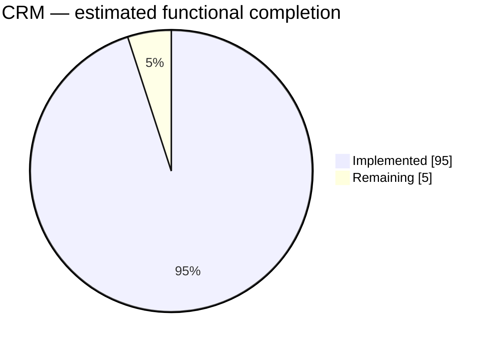
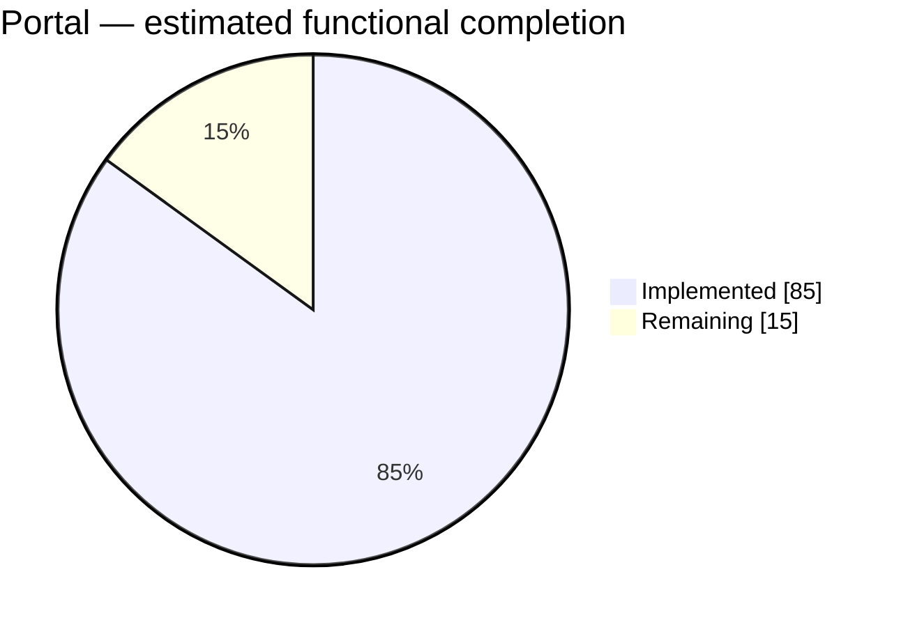
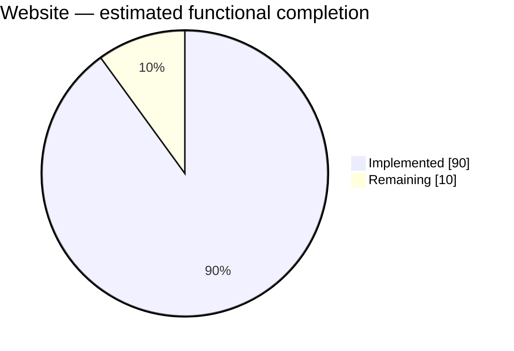

# NEXORA — PROJECT PROGRESS REPORT

**Latest assessment:** 28 September 2026, 7:25 am catch-up review (Europe/London) 
**Reporting baseline:** Revised delivery priority: a tangible, working CRM, association website and member portal.  
**Daily update:** 9:00 pm Europe/London; scheduled in the current Codex task.  
**Companion documents:** [Master plan](NEXORA_PRODUCT_ARCHITECTURE_MASTER_PLAN.md) · [Execution plan](WEEK_BY_WEEK_EXECUTION_PLAN.md)

## 1. Reporting purpose and scope

Track actual delivered functionality, integration and verification against the revised project direction. The website-first, portal-next sequence supersedes the original phase order for implementation priority. Original security and commercial acceptance gates remain relevant to release readiness.

This report is the living progress record. The master plan retains the product vision and target scope; daily entries here record what changed and the evidence supporting it. Do not interpret original week numbers as elapsed or completed work.

## 2. Current progress dashboard

Latest recorded integrated verification is the 24 September CRM delivery: 122 API tests and five browser journeys passed. The subsequent public-website work populates the local CMS with nine editable pages and adds anonymous desktop/mobile navigation checks. These are local functional results; production services and deployment acceptance remain open. See the dated entries below for evidence.

| Area | Estimated functional completion | Remaining | Current position |
| --- | ---: | ---: | --- |
| CRM | **95%** | 5% | Core records, connected context/search, reconciled CSV transfer and scan-gated documents delivered and verified; live scanner and deployment acceptance remain. |
| Portal | **85%** | 15% | Local personal/company applications, receipts, secure evidence lifecycle, notification inbox and correspondence profile delivered; production identity, external delivery and live antivirus operations remain. |
| Website / CMS | **90%** | 10% | Editing, versions, media grants, branding, navigation, redirects, SEO and scheduled publishing delivered; live scanner/domain operations and deployment acceptance remain. |

These are rounded engineering estimates introduced on 21 September, based on repository inspection and delivery notes. They are not measured backlog completion, time spent, release readiness or a percentage of the entire Nexora master plan. Treat each as approximate, with roughly ±10 percentage points of judgment uncertainty. No overall project percentage is calculated because the three areas differ in scope and effort.

The baseline covers core CRM operations, core member profile/application self-service and a bounded association website. Paid checkout, advanced events, broad workflow automation and commercial operations are tracked separately in the master plan; they are not silently included in these three denominators.

## 3. Area assessment

| Area | Implemented functionality | Main remaining work |
| --- | --- | --- |
| CRM | Contact/Account management, associations, custom attributes/views, shared member profiles, permission-filtered connected context/search, reconciled CSV import/export and private scan-gated documents. | Live antivirus operations and deployment/user acceptance. Large-scale migration, automatic merging and full database backup are outside the bounded CSV workflow. |
| Portal | Local member sessions, revocable personal/company grants, personal/company draft and receipt journeys, staff access management, secure evidence controls, durable local notifications with member inbox, shared name/correspondence profile and one-active-membership guards. | Deferred production identity/registration/invitations/recovery; external notification delivery; live ClamAV setup and operational verification. |
| Website / CMS | Content editor, preview, immutable versions, publish/unpublish/restore, image/document library with scan/public grants, branding, menu controls, redirects, sitemap/canonical metadata, configured-domain routing and durable scheduled publication. | Live ClamAV, real domain/DNS/TLS setup and deployment acceptance. General publishing integrations remain outside this bounded slice. |

Evidence: [CRM saved views](../stages/CRM-SAVED-VIEWS.md), [Account/Contact structure](../stages/STAGE-03A-ACCOUNT-CONTACT-STRUCTURE.md), [Website](../stages/STAGE-10-ASSOCIATION-WEBSITE.md), [Portal foundation](../stages/STAGE-11-MEMBER-PORTAL.md), [Portal applications](../stages/STAGE-12-PORTAL-APPLICATIONS.md), [Portal self-service](../stages/STAGE-13-PORTAL-SELF-SERVICE.md).

## 4. Verification and release position

The entries below summarize recorded delivery evidence. Current CRM and integrated verification is recorded in the 24 September entry and Stage 17. CMS delivery is recorded in Stage 16. Portal delivery is recorded in Stage 15; earlier dated outcomes remain historical evidence.

| Check | Latest recorded evidence | Qualification |
| --- | --- | --- |
| API regression | 122 passed; zero failures or skips, 24 September | CrmComplete full suite with SQL Express migration/model/volume checks and CRM import, scan, integrity, source-permission/search coverage. |
| SQL migration replay/model checks | Passed in full suite | Includes existing CMS site upgrade preservation; concurrency has separate tests. |
| Portal draft/submission browser journey | Desktop/mobile passed | Earlier journey; do not conflate with the expanded staff-decision suite. |
| Expanded approval/rejection browser journey | Both journeys passed in development and against the production frontend | Isolated SQL Express database; staff UI provisioning/revocation, draft discard, receipt reload, decisions, shared profile, no private-note leakage and mobile overflow checks. Final screenshots visually reviewed. |
| Integrated CRM/Portal/CMS browser journeys | All 5 passed, 24 September | CRM import/search/context/files, 3 portal journeys and CMS publishing against one isolated production frontend. No public deployment. |
| TypeScript/targeted lint | Full TypeScript and changed CRM/test lint passed, 24 September | Prior CMS/proxy/routes checks also passed; no blanket full-repository lint claim. |
| Production frontend build | Passed on 24 September | Isolated `next build --webpack` and browser verification against `next start`. API uses Development local identity; production identity/deployment remain unverified. |
| Git integration | Substantial modified/untracked implementation | Current work is not yet one committed, verified release baseline. |

**Release position:** Working local product slices; full MVP acceptance and commercial readiness are not complete. Production staff identity remains disabled. The confirmed personal/company one-active-membership rule now has application checks and passing SQL concurrency coverage; live provider and antivirus operations remain release dependencies. These concerns are tracked independently from functional percentages.

## 5. Next delivery priorities

1. Core local portal delivery is verified; retain production identity, external delivery and live antivirus operations as explicit release dependencies.
2. Consolidate current work into a reviewed, verified repository baseline without discarding unrelated changes.
3. Keep production identity explicitly deferred by the user's local-development choice; resume provider integration when that choice changes.
4. Local CRM integration is verified; use the shared CRM/Portal/CMS debug options for user acceptance.
5. Bounded CMS presentation/publishing controls are delivered; complete scanner/domain deployment acceptance when production integration is resumed.

This is a proposed next-work order, not authorization to launch a production service or broaden scope.

## 6. Daily reporting rules

- Use the Europe/London calendar date. Update the current dashboard and append or extend one entry per day below; preserve previous dates and their original estimates.
- Inspect current source changes, commits, stage notes and available test results. Distinguish work completed today from previously delivered functionality reviewed today.
- Record implemented, verified, blocked and not-run work separately. A route, screenshot or test-file presence alone does not prove completion.
- Change a percentage only when a meaningful capability is delivered, removed or re-scoped. Explain every change. No automatic daily increment and no inference from lines of code or commit counts.
- Keep the initial scope stable. If scope changes, record the decision and explicitly rebaseline the affected estimate rather than hiding the denominator change.
- Use rounded estimates in five-point increments until an agreed, weighted acceptance backlog supports a more precise calculation. Keep uncertainty visible.
- Record commands/results when available, relevant source/document links, blockers and the next concrete actions. Never copy credentials or secrets into this report.
- A reporting run is read-only for application code and databases. Update this report and necessary strategy links only; do not start services, run migrations, publish content or commit/push merely to produce a daily report.
- If there is no material change, leave percentages unchanged and record that briefly. Daily reporting does not itself prove daily delivery.

## 7. Daily progress log

### 28 September 2026 — Scheduled catch-up review

No additional verified delivery was found beyond the recorded 24 September baseline. CRM remains **95%**, Portal **85%**, Website/CMS **90%**; no scope or estimate change. This automation ran at 7:25 am London time, so this is a catch-up assessment, not a completed day-end report. No entries or delivery claims were invented for intervening dates.

Reviewed current Git status/history, stage notes and available artifact logs. Latest commit remains `102cfc0`; the subsequent CRM, portal, CMS and local-debug work remains uncommitted. Latest available verification logs are dated 24 September: public navigation checks and the website publishing regression passed. The recorded integrated baseline remains 122 API tests and five production-frontend browser journeys; none were rerun for this report.

Next actions remain reviewing the delivery for a commit/release baseline and verifying live scanning, production identity, external notifications and domain/deployment operations. Untracked `.next-local-debug-*` build directories are present and should be excluded from any future source commit. No new blocker or test failure was observed in this reporting review.

### 21 September 2026 — Initial reporting baseline

**Entry type:** Current-state assessment, not a claim that all functionality was built today. This initial entry is not a final cutoff of the day's work and can be extended at day end.

| Area | Previous estimate | Current estimate | Change |
| --- | --- | --- | --- |
| CRM | Not previously tracked | 75% | Initial baseline |
| Portal | Not previously tracked | 50% | Initial baseline |
| Website | Not previously tracked | 65% | Initial baseline |

**Work recorded for today:** Portal application delivery notes dated 21 September document personal draft/save/review/submit and the staff product settings follow-up. Staff settings persistence was checked in the browser. The expanded approval/rejection suite was prepared, but its final run is still pending.

**Reporting work completed:** Compared repository state with the master plan and revised delivery sequence; established the three functional estimates, pie charts and this ongoing report. Source baseline inspected: commit `52e41b9` plus the current modified/untracked working tree.

**Verification:** Historical outcomes and qualifications are listed in section 4. No tests were rerun to create this report.

**Blockers/open checks:** LocalDB availability for isolated browser verification; production frontend build; production identity; corporate subject/concurrency rules; uncommitted integration baseline.

**Next working session:** Close the pending portal decision-journey verification, then confirm the next scoped implementation slice against section 5.

**Same-day follow-up — debugger readiness:** Investigated the Website/Portal SQL cancellation issue and corrected the two-second readiness polling timeout. Added safe per-context database diagnostics and a bounded server readiness budget. Seven targeted tests passed, including a disposable SQL Server migration-history test; a fresh API checked all eight contexts against `NexoraDev` and returned 200. The existing debug process's separate 503 remains unclassified until it is restarted with diagnostics. See [investigation and verification](../stages/READINESS-DATABASE-DIAGNOSTICS.md). Functional estimates remain unchanged: this is startup reliability work, not new scope completion. Full portal browser verification and production frontend build remain open.

**Reporting cadence:** Daily update scheduled for 9:00 pm Europe/London in the current task.

**Portal self-service follow-up — resumed 21 September:** Delivered own-application receipt/detail and printing, stable accepted terms and quote display, version-checked unsubmitted draft discard, navigation/overview refresh, session-expiry handling across portal panels, and staff account provisioning/linking/revocation UI. Corrected select labels after browser testing exposed their unstable accessible names. Full backend suite: 104 passed, no skipped SQL tests. TypeScript and targeted lint passed. Both staff approval and rejection browser journeys passed on disposable SQL Express catalogs in development and against the final production frontend build (2 tests in 30.1 seconds). Final desktop/mobile screenshots were visually reviewed. Test catalogs and runner processes were cleaned up. LocalDB failed to start in this session, so these passes are not LocalDB verification. Production frontend compilation is now verified; production identity remains deferred and no public deployment is claimed.

| Area | Earlier today | Updated estimate | Reason |
| --- | ---: | ---: | --- |
| CRM | 75% | 75% | No additional CRM scope claimed. |
| Portal | 50% | 60% | Receipt/draft lifecycle and staff access UI delivered; the integrated decision journey now has passing browser evidence. |
| Website | 65% | 65% | No additional website scope claimed. |

The percentages retain the same core functional scope and judgment uncertainty. Local-only identity was explicitly selected; it is a deferred requirement, not completed work or a reduced denominator. Company grants, secure documents and notifications remain significant portal work.

### Daily entry template

Copy this structure under a new dated heading; do not replace historical entries.

| Area | Previous | Current | Reason for change or no change |
| --- | ---: | ---: | --- |
| CRM | — | — | — |
| Portal | — | — | — |
| Website | — | — | — |

- **Completed today:** Concrete capability and source/stage links.
- **Verified today:** Commands, results and the revision/scope tested where known.
- **Unverified or blocked:** Exact outstanding check and observed reason.
- **Scope decisions:** Any denominator changes or newly agreed priorities.
- **Next session:** Specific actions in priority order.

**22 September 2026 — organisation portal verification resumed:** Recovered the interrupted organisation browser journey and fixed explicit accessible labels on the staff and member organisation selects. Production frontend build/TypeScript passed; all three production-frontend browser journeys passed (company grant/application/receipt/approval/revocation and both personal decisions). The company mobile receipt was visually reviewed. Full API suite passed: 105 tests, zero failures or skips, with SQL Express migration checks enabled. Runner processes and its disposable database were cleaned up. See [Stage 14](../stages/STAGE-14-PORTAL-ORGANISATIONS.md). CRM 75%, Portal 60%, Website 65% estimates are retained pending a broader remaining-scope assessment; the verified company slice does not establish full portal completion. Secure documents, durable notifications and deeper corporate concurrency verification are next; production integrations remain deferred. Earlier verification rows above retain their historical evidence.

**22 September 2026 — secure evidence work started:** Added focused regression coverage for the existing application-evidence boundary: safe filename/path handling, accepted file signatures, unsupported/mismatched content rejection, and download security headers (`ApplicationEvidenceSafetyTests`, 5/5). Added an authenticated portal journey covering member upload, owner isolation, quarantined-download denial and unknown-application staff denial (1/1). Clean-scan staff review and organisation-grant revocation remain open because the local test scanner intentionally quarantines when ClamAV is unavailable. Estimates remain CRM 75%, Portal 60%, Website 65%.

**22 September 2026 — notification sink started:** Portal submission now persists a tenant-scoped `application.submitted` notification in the same transaction as the application, exposes only the signed-in member's entries, and supports durable read-state updates. The receipt journey verified queue creation and marking an item read (1/1 under `PortalNotifications`). This is a local test sink with `queued` delivery state, not external email delivery. Approval/rejection, access-grant/revocation and evidence notifications remain next; estimates remain CRM 75%, Portal 60%, Website 65%.

**22 September 2026 — notification sink delivery state:** Added the staff test-sink transition from `queued` to `delivered`, with delivery-attempt counting and idempotent status guard. The focused receipt test remains green after the new migration and endpoint. Approval/rejection and access-grant/revocation notification recipients still require explicit portal account/contact binding; no percentage change is claimed.

**22 September 2026 — decision recipient binding:** Approval and rejection now resolve the active portal access for the application Contact and enqueue a member-targeted notification in the same membership decision save. The focused receipt/decision regression passed under `PortalNotifyDecision`; no external email delivery is claimed. Access-grant/revocation and evidence-result notifications remain next. Estimates remain CRM 75%, Portal 60%, Website 65%.

**22 September 2026 — access notifications:** Portal access grants, local-member provisioning and revocation now enqueue recipient-specific notifications through the local sink. The access-list regression passed under `PortalNotifyAccess`; notifications remain queued test-sink records until explicitly delivered. Evidence scan-result notifications remain the final notification event family; estimates remain CRM 75%, Portal 60%, Website 65%.

**22 September 2026 — evidence notifications:** Evidence upload and scan/retry now enqueue member-targeted `clean`, `rejected` or `quarantined` scan-result notifications using active portal Contact binding. The evidence ownership regression passed under `PortalNotifyEvidence`; local ClamAV absence still prevents a clean-scan environment claim. Notification event coverage is now implemented in the local sink; estimates remain CRM 75%, Portal 60%, Website 65%.

**22 September 2026 — concurrency hardening started:** Added SQL filtered unique indexes for one submitted personal application per Contact/product and one submitted organisation application per Account/product. This protects simultaneous submissions at the database boundary; the application journey regression passed under `PortalConcurrency`, with the new migration/model included. Overlapping membership dates and concurrent approval activation remain open; estimates remain CRM 75%, Portal 60%, Website 65%.

**22 September 2026 — active-membership guard:** Added SQL uniqueness guards for one active personal membership per Contact/product and one active organisation membership per Account/product. Approval and revocation regressions passed 2/2 under `PortalConcurrency2`. This closes duplicate active-row races; overlapping date ranges across separate products and policy-specific limits remain open. Estimates remain CRM 75%, Portal 60%, Website 65%.

**22 September 2026 — membership rule clarified:** The user confirmed that a Contact may hold only one active membership total and an organisation may hold only one active membership total, regardless of offering. Re-scoped the SQL guards from `(subject, product)` to Contact-only and Account-only, generated the follow-up migration, and passed approval/revocation checks 2/2 under `OneMembership`. Estimates remain CRM 75%, Portal 60%, Website 65%.

**22 September 2026 — concurrency rule closed:** Pending applications remain allowed across different offerings because the confirmed rule applies to active memberships, not application drafts. Removed the over-broad submitted-application uniqueness guards after the full suite exposed that incompatibility; retained Contact-only and Account-only active-membership guards. The affected foreign-tenant/duplicate-approval regression passed under `PortalFinal3`. Remaining portal scope is secure-document clean-scan verification, corporate entitlement/concurrency tests beyond one-active-membership, broader profile fields, and deferred production identity/invitations/recovery.

**22 September 2026 — daily report refresh:** Committed the delivery checkpoint `102cfc0` (`Align membership migrations with active membership rules`) after resolving the EF Core pending-model exception. The final migration snapshot now matches the Membership model; `dotnet ef migrations has-pending-model-changes` returned no changes when run against the rebuilt migration configuration. A normal Debug build was blocked by the currently running VS Code API process holding output DLLs, so the user should restart the debug session before retesting startup. Estimates remain CRM 75%, Portal 60%, Website 65%; no scope change is claimed.

### 23 September 2026 — local portal completion and integration verification

**Scope:** Complete the remaining core local portal work while preserving the existing deferral of production identity and external delivery. Paid checkout and later event/service journeys retain their separate master-plan scope.

**Delivered:** Member notification inbox with persistent read state; six-field correspondence address shared with CRM, strict field allowlisting and stale-update protection; corrected rejected-evidence notification wording. Verified clean/blocked evidence access using controlled test scanner results, including staff download and company grant revocation. Added real SQL Server simultaneous personal/company activation checks. Approval, renewal and reinstatement now explain the one-active-membership rule before writing, with database constraints protecting races.

**Integration fixes:** Clean migration replay exposed duplicate index drops in `RemoveSubmittedApplicationGuardsFinal`; conditional drops now support fresh catalogs. Updated the personal browser journey to enforce the confirmed rule rather than expect two active memberships. Existing unrelated report changes were preserved.

**API verification:** 114 passed, zero failed/skipped, under `PortalVerify` with SQL Express enabled, including fresh migration replay and pending-model checks. TypeScript and targeted portal lint passed. Final production frontend build and all three browser journeys passed (55.3 seconds), including company access/revocation, personal approval with the one-active-membership guard, rejection, correspondence persistence and notification read-state persistence. Desktop/mobile screenshots were visually reviewed. Runner processes and its disposable SQL catalog were cleaned up. Logs: `artifacts/portal-finish-api-verified.log` and `artifacts/portal-finish-browser-complete.log`.

**Estimate:** Portal 60% to **85%**, CRM remains 75%, Website remains 65%. This is a rounded reassessment recognizing the accumulated company/document/notification/profile delivery and integrated rule verification, not an automatic increment or a measured backlog ratio. The scope denominator and approximately +/-10-point uncertainty remain unchanged. It is not a claim of production readiness or 100% portal completion.

**Remaining release dependencies:** Production identity, registration/invitations/recovery, external notification delivery, and a live ClamAV service with operational scan verification. Controlled clean/rejected test results do not prove an installed antivirus service. No public deployment, production integration or development-database migration is claimed.

Details: [local portal completion](../stages/STAGE-15-PORTAL-LOCAL-COMPLETION.md).

**23 September 2026 — CMS publishing completion:** Website/CMS moves from approximately **65% to 90%** within the same bounded association-website scope. Delivered media uploads, scan/public grants and revocation, image/document blocks, branding/logo settings, navigation, address redirects, sitemap/canonical configuration, configured-domain routing and durable scheduled publication. Existing sites retain their brand/menu defaults on upgrade. The increase reflects delivered capabilities; it is not a production-readiness score. CRM remains 75% and Portal 85%.

Full API suite: **119 passed, zero failed/skipped**, including SQL migration/upgrade and permission/media/scheduling coverage. Full TypeScript and targeted CMS lint passed. Expanded production website journey passed; desktop/mobile screenshots were reviewed. Final CMS browser follow-up passed (1 test, 11.8s), and all 3 production portal regression journeys passed (36.9s). Details are recorded in [Stage 16](../stages/STAGE-16-CMS-PUBLISHING.md). No live scanner, DNS/TLS deployment or user database migration was performed. Work remains in the current working tree.

### 24 September 2026 — CRM integration and three debug options

CRM moves from approximately **75% to 95%** after auditing the Portal/CMS boundary and delivering connected record context/search, reconciled CSV transfer and private scan-gated CRM documents. Portal remains 85% and CMS 90%; no denominator change or production-readiness claim. Source-module permissions govern projections and search; no duplicate CMS contact store or anonymous tracking was introduced.

**Verified:** Full API suite **122 passed, zero failed/skipped** (3m1s), including SQL upgrade/model/volume tests. All **5 production browser journeys passed** (1.7m): CRM, personal approval/rejection, company portal and CMS. Full TypeScript and targeted CRM/test lint passed. CRM desktop/mobile screenshots reviewed. Previous failed runs and their fixes are documented in Stage 17.

**Local testing:** VS Code now exposes only **CRM**, **Portal** and **CMS**; internal API/web configurations are hidden. They share SQL Express `NexoraDev`, API 5097 and web 3017. A repeatable local test-data helper prepares a Contact/Account, portal member and membership product without overwriting existing website pages. Source-route smoke verification passed, including staff CRM/CMS routes and the local portal login. Pending development migrations were applied to `NexoraDev`; test processes were stopped and debug ports released. Details are recorded in [Stage 17](../stages/STAGE-17-CRM-INTEGRATION.md); [testing guide](../LOCAL-TESTING.md).

**Remaining:** live ClamAV and production identity/provider/domain operations, deployment acceptance and a reviewed commit/release baseline. Current work is preserved in the working tree.

### 24 September 2026 — Public website content and navigation

The local public website now has nine published, CMS-editable pages, six main menu entries, linked membership guides and FAQs, and portal entry points. Existing custom content is preserved. All nine public pages passed desktop/mobile browser checks, ten internal destinations resolved, the sitemap included every page, and a visitor journey reached portal sign-in. Full TypeScript and targeted renderer/editor lint passed. See [Stage 18](../stages/STAGE-18-PUBLIC-WEBSITE.md).

Functional estimates remain CRM 95%, Portal 85%, CMS 90%; these describe bounded module functionality, not a completed production website or the whole master plan. Company Dash is also available in the VS Code launch menu, alongside CRM, Portal and CMS; CMS opens the public site. The Events and Contact pages disclose their demonstration limits. Real organisation content, production integrations and deployment are still required for a live customer launch.

### 28 September — CRM-managed portal configuration

The portal now has a CRM editor for branding, welcome copy, menu labels/order/visibility, dashboard section order/visibility and custom member information pages. Draft and published settings are tenant scoped; existing portal workflows and default appearance are retained. This adds content-management capability without changing the production identity/delivery readiness estimates above. See [Stage 19](../stages/STAGE-19-PORTAL-CONFIGURATION.md) for the implementation boundary and verification evidence.
